# ⚡ Async & Sync Execution — Linux I/O, epoll, io_uring & Node.js

### Core Mental Model — Before Everything Else

> [!important] The Most Important Distinction
> **Asynchronous** describes the *programming interface* — your function can be suspended while work is pending and the event loop continues serving other work.
> **Blocking vs Non-blocking** describes whether a *system call* makes the calling thread wait.
> These are **related but NOT identical concepts.**
>
> A libuv worker thread may *block* inside the kernel while doing a file read — but the JavaScript main thread remains free. That is still "async" from the Node.js programmer's perspective.

| Concept | Accurate Meaning |
| :--- | :--- |
| **Synchronous execution** | Caller waits for the called operation to finish before proceeding |
| **Asynchronous execution** | Caller can continue other work while the operation is pending |
| **Blocking I/O** | The calling thread is prevented from making progress until the syscall returns |
| **Non-blocking I/O** | Syscall returns immediately — often with `EAGAIN`/`EWOULDBLOCK` if it can't proceed |
| **Readiness notification** | OS says an FD is *ready* for an operation; app still performs it |
| **Completion notification** | OS reports an operation has *completed* and supplies its result |

---

## Topics Covered

| Timestamp | Topic | Core Question |
| :--- | :--- | :--- |
| 00:00–02:25 | Synchronous vs Asynchronous | Caller, receiver, waiting and independent execution |
| 02:25–05:45 | Synchronous I/O | Blocking syscalls and process/thread scheduling |
| 05:45–09:15 | Disk I/O internals | CPU, kernel, device drivers, disk controller |
| 09:15–10:45 | Asynchronous I/O | Readiness vs completion notification |
| 09:45–10:45 | `select`, `poll`, `epoll` | Monitoring file descriptors |
| 10:20–10:45 | IOCP and `io_uring` | Completion-based I/O |
| 11:00–14:50 | Node.js thread pool | How blocking operations are delegated |
| 14:50–17:35 | Callbacks, Promises, async/await | Different ways to handle async results |
| 18:00–21:00 | Node.js event loop | Processing callbacks and async events |
| 21:00–23:15 | Async backend processing | Client waiting vs server processing |
| 23:15–25:45 | Message queues and job IDs | Decoupling long-running backend work |
| 26:00–30:30 | PostgreSQL WAL and commits | Transactions, durability, async commits |
| 30:30–33:20 | Linux filesystem cache and fsync | Buffered writes, disk durability, io_uring |
| 33:20–35:30 | Database replication | Primary, replicas, sync/async replication |
| 35:30–38:15 | OS write caching and SSDs | Write batching, disk writes, SSD endurance |

---

## 1. Architecture — The Full Stack

Before writing any code, understand all the components involved.

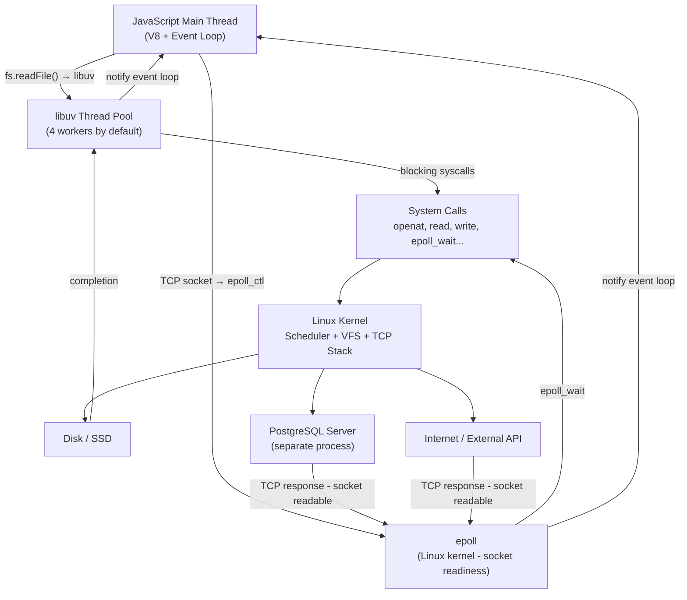

**Two completely different internal paths:**
- **Thread-pool path** — Node delegates blocking file/crypto/DNS work to workers
- **Event-notification path** — Node uses epoll to know when sockets are readable/writable

> [!caution] These paths are NOT interchangeable
> File reads → libuv thread pool. Database/HTTP sockets → epoll. Using the wrong mental model causes wrong diagnoses when profiling.

---

## 2. Linux Concepts You Must Understand

### 2.1 Blocking vs Non-blocking I/O

**Blocking I/O** — thread cannot advance until syscall returns:

```javascript
// Synchronous — BLOCKS the JavaScript thread entirely
const data = fs.readFileSync("large-file.txt");
console.log("File loaded"); // only runs after read completes
```

**Non-blocking / Async API** — thread suspends, not blocks:

```javascript
// Async — suspends THIS async function, NOT the event loop
const promise = fs.promises.readFile("large-file.txt");
console.log("I execute immediately"); // runs before file is read
const data = await promise;
console.log("File loaded"); // resumes after read completes
```

> [!note] readFile is NOT a non-blocking kernel operation
> `fs.promises.readFile()` achieves an async *programming interface* by delegating the inherently blocking disk read to libuv's thread pool. It is not a non-blocking fd in the kernel sense.

---

### 2.2 Process, Thread & Context Switching

- **Process** — a running program with its own virtual address space, FD table, and kernel resources
- **Thread** — an execution unit within a process; shares address space but has its own stack + registers
- **Context switch** — the OS saves one thread's CPU register state and restores another's

```
Node.js Process
│
├── Main JavaScript Thread     ← runs your JS, event loop
├── libuv worker thread 1      ← may be doing file read (blocked in kernel)
├── libuv worker thread 2      ← idle
├── libuv worker thread 3      ← idle
└── libuv worker thread 4      ← idle
```

> [!note] Important Correction
> The kernel doesn't remove the **entire Node.js process** from the CPU when a worker blocks. It only blocks the specific worker thread. The JS main thread stays runnable.

---

### 2.3 File Descriptors

A **file descriptor (FD)** is a small integer handle in a process's FD table pointing to an open kernel resource.

| FD Number | Common Resource |
| :--- | :--- |
| `0` | stdin |
| `1` | stdout |
| `2` | stderr |
| `3` | opened file |
| `4` | database TCP socket |
| `5` | HTTP socket |

Resources that FDs can point to: files, TCP sockets, pipes, terminals, `epoll` instances, timers, `eventfd`.

> [!note] Why FDs matter
> `select`, `poll`, `epoll`, and `io_uring` all operate around file descriptors. Everything in Linux I/O monitoring revolves around them.

---

### 2.4 select, poll and epoll

These are Linux mechanisms for monitoring multiple file descriptors simultaneously.

| Mechanism | Model | Scalability | Limitation |
| :--- | :--- | :--- | :--- |
| **`select()`** | Readiness; FD bit-sets | Limited by `FD_SETSIZE` (typically 1024) — a compile-time constant, not a hard kernel limit | Sets must be rebuilt every call; O(n) scan |
| **`poll()`** | Readiness; `pollfd` array | No `FD_SETSIZE` limit | Kernel still O(n)-scans all supplied FDs on each call |
| **`epoll`** | Readiness; kernel interest list | O(1) for event delivery — scales to tens of thousands of FDs | Linux-specific |

**How epoll works internally:**

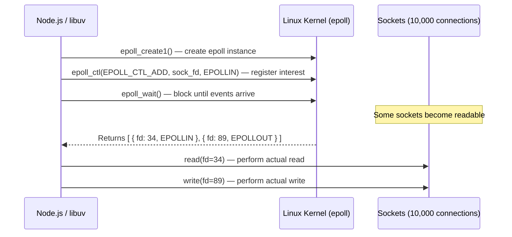

> [!important] epoll ≠ operation complete
> `EPOLLIN` means the socket *can be read without blocking*. It does **NOT** mean the full HTTP response or database result has arrived. You may need multiple `read()` calls + protocol parsing before the complete application message is assembled.

**Level-triggered vs Edge-triggered:**
- **Level-triggered (LT)** — epoll keeps reporting readiness as long as the condition is true (default, safer)
- **Edge-triggered (ET)** — epoll only reports a *state transition*; more efficient but requires draining all data and careful `EAGAIN` handling

---

### 2.5 io_uring — Modern Linux Async I/O

> [!tip] io_uring is the most important modern Linux I/O innovation
> Introduced in Linux 5.1 (2019). It fundamentally changes how apps interact with the kernel — from readiness-based polling to completion-based batched submission.

**io_uring is built around two shared ring buffers** between user space and kernel:

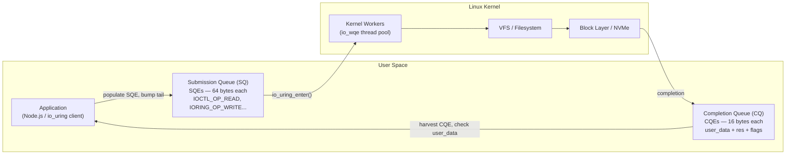

**SQE (Submission Queue Entry) — 64 bytes:**
- Opcode (`IORING_OP_READ`, `IORING_OP_WRITE`, `IORING_OP_ACCEPT`...)
- File descriptor, buffer, offset
- `user_data` — a 64-bit tag you set to correlate completions back to requests

**CQE (Completion Queue Entry) — 16 bytes:**
- `user_data` — copied from matching SQE (lets you identify which request finished)
- `res` — result (bytes read/written, or negative error code like `-EAGAIN`)
- `flags` — extra metadata

**Three operation modes:**

| Mode | How It Works | Use Case |
| :--- | :--- | :--- |
| **Interrupt-driven** (default) | User calls `io_uring_enter()` to submit; kernel uses interrupts for completion | General workloads |
| **IOPOLL** (`IORING_SETUP_IOPOLL`) | Kernel thread polls NVMe device directly — no interrupt overhead | Ultra-fast NVMe SSDs |
| **SQPOLL** (`IORING_SETUP_SQPOLL`) | Dedicated kernel thread watches SQ — zero syscalls for submission | Extreme throughput scenarios |

**epoll vs io_uring:**

| Aspect | epoll | io_uring |
| :--- | :--- | :--- |
| **Primary abstraction** | FD readiness events | Submitted operations + completions |
| **Who performs I/O** | Application (after readiness notification) | Kernel (executes submitted operation) |
| **Strength** | Many concurrent long-lived sockets | Batched, high-throughput I/O |
| **File I/O** | Regular files always "ready" — not useful | Designed to handle async file I/O |
| **Model** | Readiness-based | Completion-based |
| **Syscall overhead** | Per-event | Can batch many ops in one `io_uring_enter()` |

> [!note] io_uring internal blocking
> Not every io_uring operation is guaranteed to execute without blocking or worker-thread offloading inside the kernel. For operations or filesystems that cannot be made async directly, the kernel transparently offloads work to its internal `io_wqe` worker thread pool and writes to the CQ when done. The user-facing model is still completion-based, but the kernel's execution may involve blocking internally.

> [!caution] io_uring and Node.js — Don't Conflate Them
> **io_uring is a Linux kernel interface.** It is not the same as Node.js's Promise API, `async/await`, or libuv's event loop.
> - Standard Node.js filesystem APIs (`fs.promises.readFile`, etc.) **do not automatically use io_uring**. They use the libuv thread pool on Linux.
> - io_uring is used in native C/C++ applications, custom runtimes (like Bun, which uses io_uring on Linux), or through native Node addons that implement it directly.
> - You cannot call io_uring from JavaScript — it is a kernel ABI.
> - Think of io_uring as an *alternative implementation path* that a runtime *could* use instead of libuv's thread pool for file I/O.

---

### 2.6 libuv — The Bridge Between Node.js and Linux

Node.js does NOT independently implement every OS mechanism. It uses **libuv**.

```
JavaScript Application
        │
  Node.js APIs (fs, net, http, crypto...)
        │
  V8 Engine + Node C++ Bindings
        │
      libuv
        │
  Linux Kernel / System Calls
```

**What libuv provides:**
- Event loop
- Thread pool (default size: **4**, configurable via `UV_THREADPOOL_SIZE`, max: **1024**)
- Async file-system operations
- Network I/O integration
- Timers and signals
- OS abstraction (works on Linux, macOS, Windows)

**What uses the libuv thread pool:**
- All `fs.promises.*` / callback-based `fs.*` APIs (except `fs.FSWatcher`)
- `dns.lookup()` (by default)
- CPU-intensive crypto operations
- zlib compression

**What uses epoll (event-driven, NOT thread pool):**
- TCP/UDP sockets (`net`, `http`, `https`, database drivers)
- `fs.watch()` (inotify-based on Linux)

> [!caution] "Node creates a new thread for every file read" is WRONG
> libuv uses a **shared bounded pool** of workers, not one thread per operation. If all 4 (default) workers are busy, the 5th file operation waits.

---

## 3. Linux System Calls — The Kernel Boundary

A **system call (syscall)** is a controlled transition from **user space** into **kernel space** to request a service from the operating system.

### 3.1 User Space vs Kernel Space

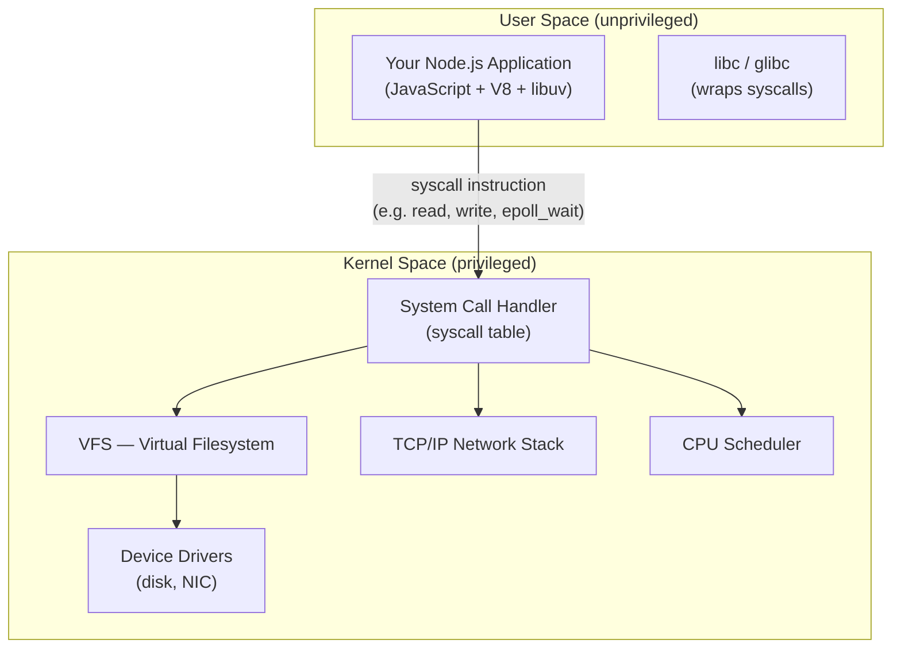

- **User space** — where your application runs; cannot directly access hardware
- **Kernel space** — where the OS runs; has full hardware access
- A syscall crosses this boundary via a CPU instruction (`syscall` on x86-64, `svc` on ARM)
- Every `fs.readFile()`, `socket.write()`, `setTimeout()` eventually triggers one or more syscalls

---

### 3.2 Essential System Calls

| Syscall | Signature | What It Does | Node.js Context |
| :--- | :--- | :--- | :--- |
| `open()` / `openat()` | `openat(dirfd, path, flags, mode)` | Opens a file, returns an FD | Used beneath every file operation; `openat` is preferred (relative to a dir FD) |
| `read()` | `read(fd, buf, count)` | Reads up to `count` bytes from FD into buffer | File reads and socket reads in libuv workers |
| `write()` | `write(fd, buf, count)` | Writes `count` bytes to FD | File writes, socket sends |
| `close()` | `close(fd)` | Releases the FD; OS can reuse the number | Called after files/sockets are done |
| `fsync()` | `fsync(fd)` | Flushes data + all metadata to durable storage | Used by PostgreSQL/databases for WAL durability |
| `fdatasync()` | `fdatasync(fd)` | Flushes data + only necessary metadata | Cheaper than `fsync`; avoids flushing timestamps |
| `socket()` | `socket(domain, type, protocol)` | Creates a network socket FD | Used when Node opens a TCP connection |
| `connect()` | `connect(sockfd, addr, addrlen)` | Connects socket to remote address | TCP client connect |
| `accept()` | `accept(sockfd, addr, addrlen)` | Accepts an incoming connection | TCP server receives client |
| `send()` / `recv()` | `send(fd, buf, len, flags)` | Send/receive bytes on a socket | TCP data transfer |
| `epoll_create1()` | `epoll_create1(flags)` | Creates an epoll instance FD | Called once by libuv at startup |
| `epoll_ctl()` | `epoll_ctl(epfd, op, fd, event)` | Add/modify/remove FD interest | Called when Node starts watching a socket |
| `epoll_wait()` | `epoll_wait(epfd, events, maxevents, timeout)` | Blocks until events are ready | The event loop's idle wait |
| `fcntl()` | `fcntl(fd, cmd, ...)` | Manipulate FD flags | Setting `O_NONBLOCK` on a socket |

### 3.3 O_NONBLOCK, EAGAIN, EWOULDBLOCK

**`O_NONBLOCK`** is a flag set on a file descriptor to make I/O operations non-blocking:

```c
// Set a socket to non-blocking mode
int flags = fcntl(sockfd, F_GETFL, 0);
fcntl(sockfd, F_SETFL, flags | O_NONBLOCK);
```

When you `read()` a non-blocking socket that has no data yet:
- **Blocking socket** → thread sleeps until data arrives
- **Non-blocking socket** → returns immediately with error code `-1` and `errno = EAGAIN` (or `EWOULDBLOCK`, which is equivalent on Linux)

This is how epoll and libuv work under the hood:
1. Set socket to `O_NONBLOCK`
2. Register socket with `epoll_ctl(EPOLL_CTL_ADD, ...)`
3. Call `epoll_wait()` — blocks until socket is ready
4. When ready: call `read()` — returns data immediately (no sleeping)
5. If `read()` returns `EAGAIN` again — no more data available, re-arm epoll

### 3.4 How an FD is Allocated and Released

```
Process FD Table         Open File Table (kernel)       Inode Table (kernel)
┌────────────────┐       ┌──────────────────────┐       ┌───────────────┐
│ fd 0 → ────────┼──────▶│ position=0, flags... ├──────▶│ /dev/stdin    │
│ fd 1 → ────────┼──────▶│ position=0, flags... ├──────▶│ /dev/stdout   │
│ fd 2 → ────────┼──────▶│ position=0, flags... ├──────▶│ /dev/stderr   │
│ fd 3 → ────────┼──────▶│ position=100, R/W... ├──────▶│ /home/file.txt│
│ fd 4 → (empty) │       └──────────────────────┘       └───────────────┘
└────────────────┘
```

- `open()` → kernel allocates the lowest available FD number and fills the table entry
- `close()` → kernel frees that FD slot; the number can be immediately reused
- **FD leak** — forgetting to call `close()` exhausts the process's FD table (default limit: 1024–65536 depending on OS config)

> [!warning] FD Exhaustion is a real production failure
> If your Node.js app opens files/sockets without closing them, it eventually hits the FD limit and throws `EMFILE: too many open files`. Check with `ls -l /proc/<pid>/fd | wc -l`.

---

## 4. Promise Lifecycle & async/await Internals

### 4.1 What a Promise Actually Is

> [!important] A Promise does NOT perform I/O
> A Promise is a **JavaScript object** that represents the eventual result of an operation. The actual work (file read, network call, timer) is handled by **Node.js, libuv, the OS, or another system**. The Promise is just a handle to track the result and register callbacks.

A Promise has three mutually exclusive states:

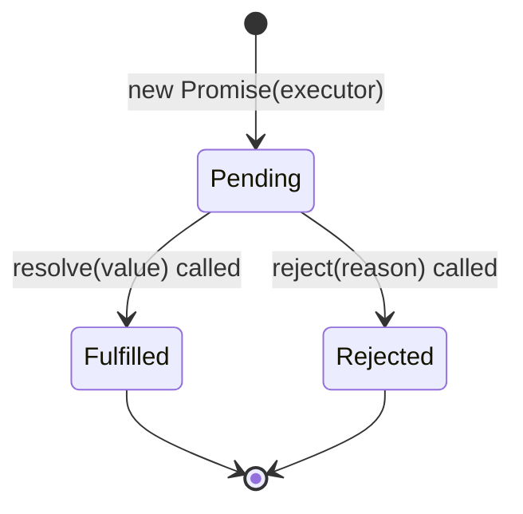

```javascript
// 1. Creation — executor runs synchronously
const p = new Promise((resolve, reject) => {
  console.log("executor runs NOW"); // synchronous
  setTimeout(() => resolve("done"), 1000); // schedules async work
});
// p is now in Pending state

// 2. Registering reactions with .then() / .catch() / .finally()
p
  .then(value  => console.log("fulfilled:", value))  // runs when resolved
  .catch(error => console.log("rejected:", error))   // runs when rejected
  .finally(()  => console.log("always runs"));       // always runs after settled
```

### 4.2 How Promise Reactions Enter the Microtask Queue

When a Promise settles (resolves or rejects), its `.then()` callbacks are **not called immediately**. They are placed in the **microtask queue** and run after the current synchronous operation completes:

```javascript
console.log("1 — sync");

Promise.resolve("value").then(v => {
  console.log("3 — microtask:", v); // scheduled, not immediate
});

console.log("2 — sync");
// Output: 1, 2, 3
```

**Why microtasks, not the event loop?**
- Microtasks run *before* the event loop moves to its next phase
- This guarantees that Promise chains are processed atomically without I/O callbacks interleaving

### 4.3 How await Registers a Continuation

`await` is syntactic sugar over `.then()`. Under the hood:

```javascript
// This:
async function getUser() {
  const result = await fetchUser(101);
  return result.name;
}

// Is roughly equivalent to:
function getUser() {
  return fetchUser(101).then(result => {
    return result.name;
  });
}
```

**Step by step when `await` is hit:**
1. The awaited expression is evaluated — returns a Promise
2. The current async function is **suspended** (its stack frame is saved)
3. Control returns to the **caller** of the async function
4. When the Promise settles, the continuation (`return result.name`) is queued as a **microtask**
5. The microtask queue drains → the async function **resumes**

### 4.4 Error Propagation Through async Functions

Errors in async functions become rejected Promises automatically:

```javascript
async function riskyOperation() {
  const data = await fs.readFile("missing.txt"); // throws if file missing
  return data; // never reached if above throws
}

// Option 1: .catch() on the returned Promise
riskyOperation().catch(err => console.error("caught:", err.message));

// Option 2: try/catch inside async function
async function safeOperation() {
  try {
    const data = await fs.readFile("missing.txt");
    return data;
  } catch (err) {
    console.error("file error:", err.message);
    return null; // graceful fallback
  }
}

// Option 3: top-level await (ESM only)
try {
  const data = await fs.readFile("missing.txt");
} catch (err) {
  console.error(err.message);
}
```

> [!caution] Unhandled Promise rejections crash Node.js (since v15)
> Always add `.catch()` or `try/catch` around awaited Promises. An unhandled rejection emits `UnhandledPromiseRejection` and **terminates the process** in Node.js v15+.

### 4.5 Callback → Promise → async/await Evolution

```javascript
// 1. Callback style (oldest) — "callback hell" risk
fs.readFile("file.txt", (err, data) => {
  if (err) return console.error(err);
  console.log(data);
});

// 2. Promise style — chainable, flatter
fs.promises.readFile("file.txt")
  .then(data => console.log(data))
  .catch(err => console.error(err));

// 3. async/await style (modern) — reads like sync code
async function read() {
  try {
    const data = await fs.promises.readFile("file.txt");
    console.log(data);
  } catch (err) {
    console.error(err);
  }
}
```

All three styles produce the **same underlying behaviour** — the difference is only syntax and readability. Under the hood, all three go through libuv's thread pool for file reads.

---

## 5. Networking Internals — TCP, Sockets, DNS & TLS

### 5.1 TCP Three-Way Handshake

Before any HTTP, database, or API data flows, TCP must establish a connection:

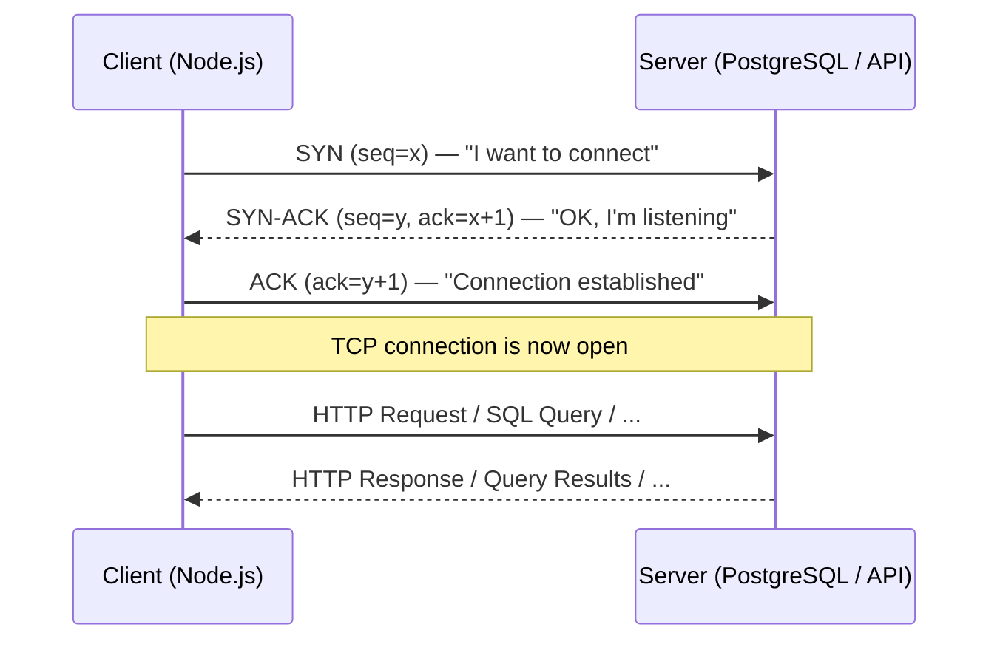

**Cost of TCP connection setup:** 1 full network round-trip (1 RTT) before any application data. This is why **connection pooling** exists — reuse connections instead of re-establishing them per request.

### 5.2 Socket Creation and File Descriptors

When Node.js makes an outbound TCP connection:

```
1. socket(AF_INET, SOCK_STREAM, 0)  → creates socket FD (e.g. fd=7)
2. connect(7, {host, port})          → initiates TCP handshake (non-blocking)
3. epoll_ctl(EPOLL_CTL_ADD, 7, EPOLLOUT)  → watch for writability (connect done)
4. epoll_wait()                      → event loop waits
5. EPOLLOUT fires → connect complete → socket is usable
6. write(7, http_request_bytes, len) → send request data
7. epoll_ctl(EPOLL_CTL_MOD, 7, EPOLLIN)  → now watch for readability
8. epoll_wait()                      → wait for response
9. EPOLLIN fires → read(7, buf, len) → receive response bytes
```

Every active connection is a file descriptor. **1000 concurrent connections = 1000 open FDs in the process.**

### 5.3 DNS Resolution

Before TCP can connect, Node must resolve `hostname → IP address`:

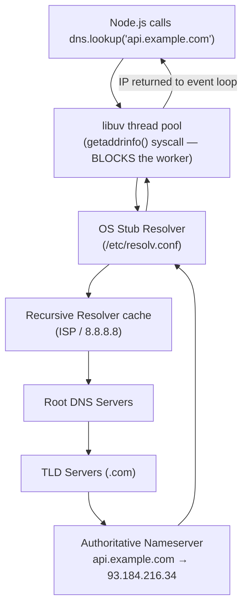

> [!important] `dns.lookup()` uses the libuv thread pool — not epoll
> `getaddrinfo()` is a blocking POSIX call. libuv runs it in its thread pool to avoid blocking the event loop. This means DNS can consume a thread pool slot even though the actual network socket uses epoll later.
>
> **Alternative:** `dns.resolve()` uses the OS resolver protocol directly over UDP sockets and integrates with the event loop without consuming a thread pool slot.

### 5.4 TLS Handshake

HTTPS connections require TLS negotiation before any application data flows:

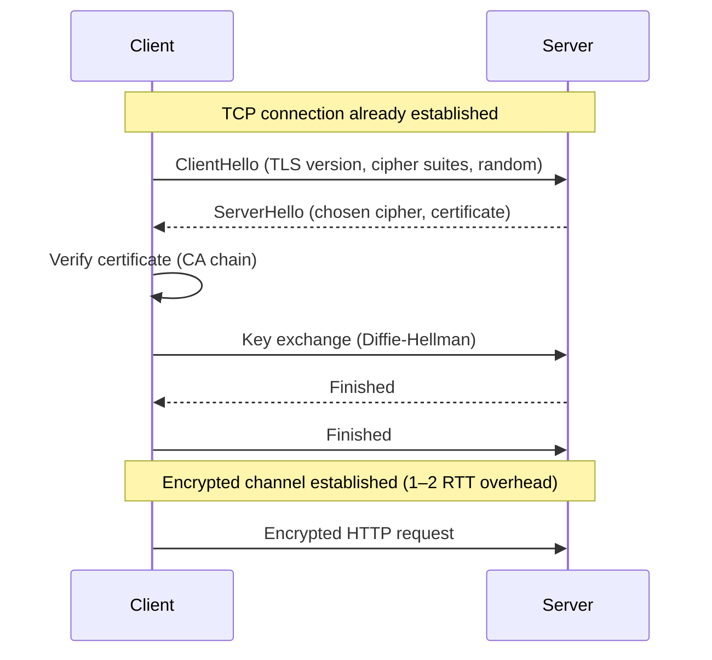

**TLS costs:**
- 1–2 extra RTTs for TLS 1.2; 1 RTT for TLS 1.3 (or 0-RTT resumption)
- CPU cost for cryptographic operations (key exchange, symmetric encryption/decryption)
- These are real costs even though the network wait is handled async via epoll

### 5.5 Socket Buffers & Backpressure

Every socket has two kernel-managed buffers:

```
Sender                    Kernel Buffers                  Receiver
Node.js                                                    Server

write(fd, data) ──▶ [Send Buffer (64KB)] ──▶ TCP ──▶ [Recv Buffer (64KB)] ──▶ read(fd)
                         kernel manages                     kernel manages
```

- **Send buffer full** → `write()` returns `EAGAIN` on non-blocking socket — the app must pause writing (**backpressure**)
- **Recv buffer full** → TCP receiver advertises zero window to sender → sender stalls
- Node.js streams handle backpressure automatically via `writable.write()` returning `false` and the `'drain'` event

### 5.6 HTTP Request/Response Lifecycle over TCP

```
1. DNS resolution         → hostname → IP (libuv thread pool via getaddrinfo)
2. TCP handshake          → SYN / SYN-ACK / ACK (1 RTT)
3. TLS handshake          → ClientHello ... Finished (1-2 RTT, HTTPS only)
4. HTTP request write     → write(sockfd, "GET /api HTTP/1.1\r\n...")
5. epoll_wait (EPOLLIN)   → wait for server response bytes
6. read loop              → read(sockfd, buf) until full HTTP response assembled
7. HTTP parsing           → status line, headers, body boundaries
8. Body parsing           → JSON.parse() / streaming
9. Promise resolution     → event loop notified, .then() / await resumes
10. Connection keep-alive → socket stays open for reuse (HTTP/1.1 default)
```

### 5.7 Connection Pooling

Re-establishing a TCP+TLS connection per request is expensive (2–3 RTTs). Connection pools maintain a set of **long-lived, reusable connections**:

```javascript
// pg Pool maintains N persistent TCP connections to PostgreSQL
const pool = new pg.Pool({
  connectionString: process.env.DATABASE_URL,
  max: 10,         // max concurrent connections
  idleTimeoutMillis: 30000, // close idle connections after 30s
  connectionTimeoutMillis: 2000, // throw if no connection available in 2s
});

// Each pool.query() reuses an existing TCP connection
// TCP handshake only happens once at pool creation time
```

> [!tip] Pool size is not "more = better"
> More connections = more memory, more kernel FDs, more PostgreSQL worker processes. For CPU-bound PostgreSQL queries, optimal pool size ≈ number of CPU cores on the DB server. Too many connections = lock contention and context-switch overhead.

---

## 6. Three Real-World Examples — Side by Side

The same Promise/await API hides very different OS mechanisms underneath.

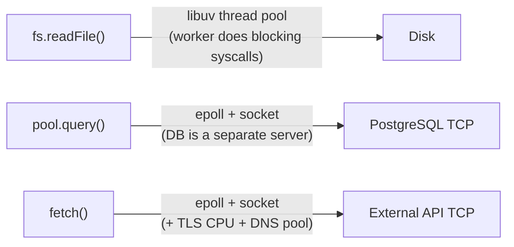

| Detail | `fs.readFile()` | `pool.query()` | `fetch()` |
| :--- | :--- | :--- | :--- |
| **Operation type** | Disk I/O | Network I/O | Network I/O |
| **Node mechanism** | libuv thread pool | Socket events (epoll) | Socket events (epoll) |
| **Linux mechanism** | `openat()`, `read()` syscalls | `epoll_wait()` → `read()` | `epoll_wait()` → `read()` |
| **External machine** | No | Yes (PostgreSQL server) | Yes |
| **JS main thread blocks?** | No | No | No |
| **Worker thread blocks?** | Yes (in kernel) | No | No |

---

### Example A — Reading a File from Disk

```javascript
import fs from "node:fs/promises";

async function readDocument() {
  console.log("A: start");
  const data = await fs.readFile("./large-file.txt"); // suspends here
  console.log("D: resumed");
  return data;
}

console.log("B: before call");
readDocument();
console.log("C: main thread continues"); // runs BEFORE D
```

**Expected output:**
```
B: before call
A: start
C: main thread continues
D: resumed
```

**What actually happens inside Linux:**

```
Main JS Thread                 libuv Worker Thread              Linux Kernel
     │                               │                               │
     │── fs.readFile() ──────────────▶ queued in pool               │
     │                               │── open(), read() syscalls ──▶│
     │── console.log("C") ──────────▶│                              │── disk read
     │  (continues other work)       │  (may sleep waiting)         │── page cache
     │                               │◀── data returned ────────────│
     │◀── libuv notifies event loop ─│                              │
     │── Promise resolves            │                              │
     │── await resumes              │                              │
     │── console.log("D")           │                              │
```

---

### Example B — PostgreSQL Database Query

```javascript
import pg from "pg";

const pool = new pg.Pool({ connectionString: process.env.DATABASE_URL });

async function getUser(email) {
  console.log("A: query start");
  const result = await pool.query(
    "SELECT * FROM users WHERE email = $1",
    [email]
  );
  console.log("D: query resumed");
  return result.rows[0];
}

console.log("B: before query");
getUser("user@example.com");
console.log("C: main thread continues");
```

**Internal flow — this is different from file reads:**

```
Node.js                    Linux Kernel / epoll          PostgreSQL Server
   │                               │                           │
   │── pool.query() ───────────────▶ write SQL to TCP socket  │
   │                               │── TCP → network ─────────▶│
   │── console.log("C") ──────────▶│                           │── parse SQL
   │  (handles other requests)     │                           │── execute query
   │                               │                           │── fetch rows
   │                               │◀── TCP response ──────────│
   │                               │── socket readable         │
   │                               │── epoll_wait() returns    │
   │                               │── libuv reads bytes       │
   │                               │── parses pg wire protocol │
   │◀── Promise resolves ──────────│                           │
   │── await resumes               │                           │
```

> [!important] PostgreSQL runs in its OWN process
> Node.js is waiting for **network data**. PostgreSQL does the actual DB work independently. epoll doesn't execute SQL — it only tells Node when network bytes are readable.

> [!warning] Connection Pool ≠ Unlimited Concurrency
> If all pool connections are busy with slow queries, the next `.query()` call waits for a free connection — even though Node's event loop is responsive.

---

### Example C — Third-Party API (fetch)

```javascript
async function generateVoice(text) {
  console.log("A: request start");

  const response = await fetch("https://api.elevenlabs.io/v1/text-to-speech", {
    method: "POST",
    headers: {
      "Content-Type": "application/json",
      Authorization: `Bearer ${process.env.API_KEY}`
    },
    body: JSON.stringify({ text })
  });

  const result = await response.json();
  console.log("D: response resumed");
  return result;
}

console.log("B: before fetch");
generateVoice("Hello world");
console.log("C: main thread continues");
```

**Internal flow:**

```
Node.js                     Linux Kernel                  External API (ElevenLabs)
   │                              │                               │
   │── fetch() ──────────────────▶│── DNS lookup (may use pool)  │
   │                              │── TCP connect + TLS handshake│
   │                              │── write HTTP POST bytes ─────▶│
   │── console.log("C") ─────────▶│                              │── process request
   │  (handles other work)        │                              │── generate audio
   │                              │◀── HTTP response bytes ───────│
   │                              │── socket readable             │
   │                              │── epoll_wait() returns       │
   │                              │── TLS decrypt + HTTP parse   │
   │◀── fetch Promise resolves ───│                              │
   │── await response.json()      │── may need more reads        │
   │── await resumes              │                              │
```

> [!note] DNS and TLS are NOT free
> `dns.lookup()` can consume a libuv thread pool slot. TLS handshakes and record processing involve real CPU work. Neither is free just because the network wait is async.

> [!tip] The event loop does not idle during 10-second API calls
> While ElevenLabs generates audio for 10 seconds, your Node.js server can handle hundreds of other HTTP requests, DB queries, and file reads.

---

## 4. Promises, async/await & the Node.js Event Loop

### 4.1 Execution Order — The Complete Picture

```javascript
console.log("1");                              // sync - runs first

process.nextTick(() => console.log("3"));      // nextTick queue
Promise.resolve().then(() => console.log("4")); // microtask queue
setTimeout(() => console.log("5"), 0);         // timer phase

console.log("2");                              // sync - runs before any async
```

**Output:**
```
1
2
3   ← nextTick drains before microtasks
4   ← Promise microtask
5   ← timer phase (next event loop iteration)
```

### 4.2 Event Loop Phases

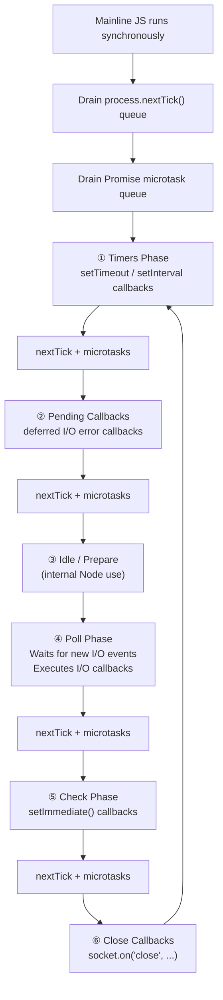

> [!important] Microtasks drain between EVERY phase
> Both `process.nextTick()` and Promise microtasks are drained after **every single callback** across all phases — not just between phases. This ensures high-priority continuations never starve.

**Priority order (highest → lowest):**
1. `process.nextTick()` queue
2. Promise microtask queue
3. Event loop phases (Timers → Poll → Check → Close → repeat)

### 4.3 async/await mechanics

```javascript
async function test() {
  console.log("2");        // runs synchronously when test() is called
  await new Promise(resolve => setTimeout(resolve, 1000));
  console.log("4");        // scheduled as microtask AFTER timer fires
}

console.log("1");
test();                    // starts executing, reaches await, suspends
console.log("3");          // main thread continues immediately
// ~1 second later...
// 4
```

The `await` keyword:
1. Suspends **the current async function only** (not the event loop thread)
2. Saves the continuation after `await` as a Promise `.then()` handler
3. Returns control to the caller

> [!caution] CPU-bound code STILL blocks the event loop
> ```javascript
> app.get("/heavy", (req, res) => {
>   // This IS NOT async — it blocks ALL requests
>   let result = 0;
>   for (let i = 0; i < 1e10; i++) result += i;
>   res.json({ result });
> });
> ```
> Async I/O does **not** make CPU-bound JavaScript concurrent. For CPU work, use `worker_threads`.

---

## 5. Asynchronous Backend Processing — Message Queues

This is a different kind of async — not async I/O, but async **business workflows**.

### The Problem

A user uploads a video and your API needs to:
1. Store the raw video
2. Transcode to multiple resolutions
3. Generate thumbnails
4. Upload to CDN
5. Send notification email

Should the HTTP request wait for all 5 steps? **No.** This could take minutes.

### Solution — Message Queue + Background Workers

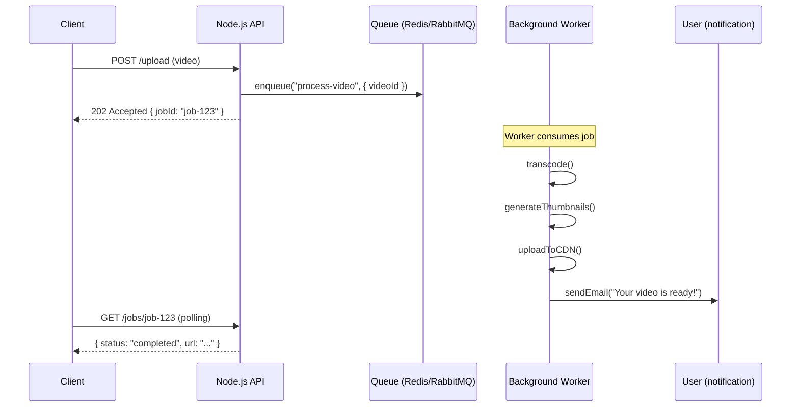

```javascript
// API — accept and queue immediately
app.post("/upload", async (req, res) => {
  const job = await videoQueue.add("process-video", {
    videoId: req.body.videoId
  });

  // 202 Accepted = "I got it, processing is happening"
  res.status(202).json({
    message: "Video processing started",
    jobId: job.id
  });
});

// Separate Worker Process — does the actual heavy work
videoWorker.process(async (job) => {
  await convertVideo(job.data.videoId);
  await generateThumbnails(job.data.videoId);
  await uploadToCloud(job.data.videoId);
  await sendNotificationEmail(job.data.videoId);
  return { status: "completed" };
});
```

**Promise vs Job ID:**

| | In-process Promise | Durable Job ID |
| :--- | :--- | :--- |
| **Scope** | In-memory, single process | Cross-process, cross-machine |
| **Persistence** | Lost on crash | Survives restarts (Redis/DB) |
| **Observable by** | Only the current process | Any client via HTTP polling |
| **Retry** | Manual | Built-in with backoff |
| **Use for** | I/O operations within a request | Long-running business workflows |

> [!tip] Design message queues for reliability
> Always plan for: idempotency, retries with exponential backoff, dead-letter queues, visibility timeouts, ordering requirements, and job status persistence.

---

## 6. PostgreSQL — WAL, Commits, fsync & Replication

### 6.1 Write-Ahead Log (WAL)

**WAL is the journal of all database changes.** It's what makes PostgreSQL crash-safe.

```sql
BEGIN;
UPDATE accounts SET balance = balance - 500 WHERE id = 1;
UPDATE accounts SET balance = balance + 500 WHERE id = 2;
COMMIT;
```

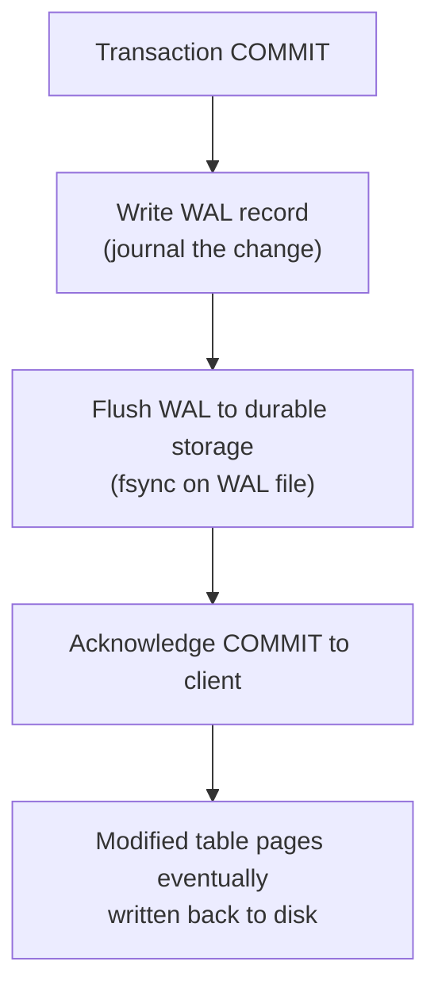

> [!note] PostgreSQL does NOT flush every table page on commit
> It only guarantees WAL durability. The WAL record is enough to replay the change after a crash. Data heap pages are flushed lazily in the background.

### 6.2 Synchronous vs Asynchronous Commit

| Setting | What It Waits For | Risk |
| :--- | :--- | :--- |
| `synchronous_commit = on` (default) | Local WAL flush to durable storage before ACK | Safest — no data loss on crash |
| `synchronous_commit = off` | Returns ACK immediately — WAL flushed later | Recent acknowledged transactions may be lost on crash |
| `synchronous_commit = remote_write` | Standby received + written to OS (not flushed) | Stronger than off, weaker than on |
| `synchronous_commit = remote_apply` | Standby applied WAL (visible to standby queries) | Strongest — highest latency |

### 6.3 Synchronous vs Asynchronous Replication

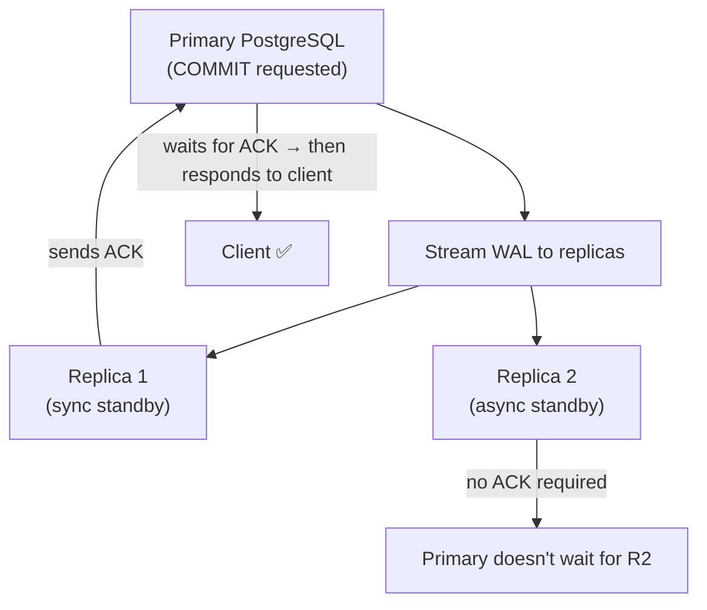

| Setting | What Waits | Failure Trade-off |
| :--- | :--- | :--- |
| **Async commit** (local) | Does not wait for local WAL durability | May lose recent commits on crash |
| **Sync commit** (local) | Waits for local WAL flush | No local data loss |
| **Async replication** | Does not wait for standbys | Replication lag; potential loss on failover |
| **Sync replication** | Waits for configured standbys (`synchronous_standby_names`) | Higher commit latency; zero replica data loss |

**`synchronous_standby_names` examples:**
```ini
# Priority: wait for the first 2 from this list (by order)
synchronous_standby_names = 'FIRST 2 (node1, node2, node3)'

# Quorum: wait for ANY 2 out of 3 (more resilient to single node failure)
synchronous_standby_names = 'ANY 2 (node1, node2, node3)'

# Any 1 connected standby
synchronous_standby_names = 'ANY 1 (*)'
```

> [!caution] Don't conflate these two
> **Async commit** = waiting for *local WAL durability* → risk of losing commits on *this server* crashing.
> **Async replication** = waiting for *remote replica acknowledgement* → risk of losing data on *failover*.
> They are completely different settings and different failure modes.

---

## 7. Linux Page Cache, fsync & SSD Write Amplification

### 7.1 The Page Cache — Linux Write-Back

When your app calls `write()`, Linux **does not write to disk immediately**:

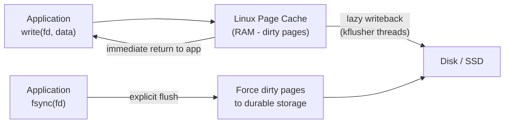

**Why write-back exists:** If a 4KB block is modified 50 times in quick succession, Linux writes the final state **once** to disk. Massive performance win for sequential workloads.

**The danger:** Data in page cache (RAM) is lost on power failure before writeback.

### 7.2 fsync() and fdatasync()

```c
fsync(fd);      // flush data + ALL metadata (timestamps, inode) to storage
fdatasync(fd);  // flush data + only metadata NEEDED to retrieve data (e.g., file size)
                // skips non-essential metadata like last-access time → cheaper
```

> [!note] Correction: fsync() does NOT "disable" the page cache
> `fsync()` **requests synchronization** of cached modifications to durable storage. It does not bypass the cache; it forces the cache contents down to the storage device. The storage device's own write cache and flush guarantees still matter.

**How databases use this:**
1. Write WAL record → page cache (fast)
2. Call `fsync(wal_fd)` → forces WAL to durable storage (slow, but guarantees crash-safety)
3. Acknowledge commit to client

### 7.3 SSD Write Amplification

| Component | Size | Operation |
| :--- | :--- | :--- |
| **SSD Page** | 4KB–16KB | Minimum read/write unit |
| **SSD Erase Block** | 2MB–8MB | Minimum erase unit |

**SSDs cannot overwrite in place.** To modify a 4KB page:
1. Read the entire erase block (2MB+) into controller buffer
2. Modify the 4KB data
3. Write the entire block to a **new** erased location
4. Mark old block for garbage collection

**Write Amplification Factor (WAF)** = bytes written to NAND ÷ bytes app intended to write

| I/O Pattern | WAF Effect | Why |
| :--- | :--- | :--- |
| **Frequent small `fsync` calls** | High WAF — bad for SSD endurance | Each fsync pushes fragmented 4KB writes → triggers read-modify-write cycles |
| **Page cache write-back** (lazy) | Low WAF — good | Coalesces many dirty pages into large sequential writes → fills erase blocks cleanly |
| **Sequential bulk writes** | Lowest WAF | Fills full erase blocks without garbage collection overhead |

> [!tip] Database tuning insight
> Aggressive `fsync` on WAL (required for ACID) is unavoidable for correctness. Use SSDs with high endurance ratings for database WAL files, or use `fdatasync` instead of `fsync` where the metadata savings are significant.

---

## 8. Practical Experiments on Linux

```bash
# Install tools
sudo apt update && sudo apt install strace lsof sysstat

# Experiment 1: Watch file-system syscalls from Node.js
# -f follows threads (watches libuv workers too)
strace -f -e trace=openat,read,close node file-read.js

# Experiment 2: See active TCP connections with process names
sudo ss -tnp

# Experiment 3: Inspect Node.js threads
ps -T -p $(pgrep -n node)

# Experiment 4: See all file descriptors open by Node.js
ls -l /proc/$(pgrep -n node)/fd/

# Experiment 5: Watch network syscalls during a DB query
strace -f -e trace=network node database-test.js
```

---

## 9. Corrections to Common Misconceptions

| What's often said | Accurate understanding |
| :--- | :--- |
| "Node creates a new thread for every file read" | libuv uses a **shared bounded pool** (default 4 workers) |
| "async/await blocks the rest of Node.js" | It suspends **the current async function** only — event loop continues |
| "epoll tells you when an operation is complete" | epoll reports **readiness**, not completion — app still performs the I/O |
| "io_uring and epoll do the same thing" | epoll = readiness model; io_uring = completion model — fundamentally different |
| "Node uses epoll for everything" | File I/O → thread pool; sockets → epoll |
| "The process gets kicked off the CPU" | Only the specific blocking **thread** becomes non-runnable — other threads continue |
| "Async means the whole system is non-blocking" | Depends on which component — PostgreSQL, the kernel, and worker threads can all block internally |
| "fsync disables the page cache" | fsync **synchronizes** cached data to storage; it doesn't bypass the cache |

---

## 10. Study Roadmap

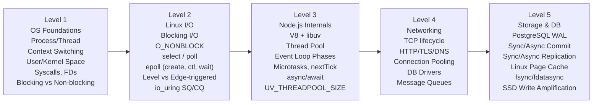

---

## 11. Glossary

| Term | Definition |
| :--- | :--- |
| **Async function** | JavaScript function that can suspend at `await` and resume after a Promise settles |
| **Callback** | Function invoked when an operation completes or an event occurs |
| **Promise** | Object representing eventual completion or failure of an async operation |
| **Microtask** | High-priority queued continuation — includes Promise reactions |
| **Event loop** | Node/libuv mechanism that processes timers, I/O events, callbacks, and pending work |
| **libuv thread pool** | Shared worker pool for selected blocking operations; default size 4 |
| **File descriptor** | Integer handle to an open kernel resource |
| **System call** | Controlled transition from user space to kernel space to request a kernel service |
| **Blocking call** | Call that prevents the calling thread from proceeding |
| **Non-blocking call** | Call that returns immediately if it cannot make progress now |
| **Readiness** | An FD can now support an I/O operation without blocking |
| **Completion** | A submitted I/O operation has finished |
| **epoll** | Linux readiness-notification facility for FDs |
| **io_uring** | Linux completion-oriented async I/O using SQ and CQ ring buffers |
| **WAL** | Write-Ahead Log — journal used for crash recovery and replication |
| **fsync()** | Request to synchronize file modifications and required metadata to durable storage |
| **Connection pool** | Reusable set of database connections to avoid per-query TCP setup |
| **Message queue** | Durable intermediary for decoupled producer-consumer workflows |
| **Job ID** | Durable cross-process reference for tracking async backend work |
| **Write Amplification** | Ratio of bytes written to NAND ÷ bytes app intended to write |
| **Page cache** | Linux kernel RAM cache for file data; enables write-back optimization |

---

## 12. References & Further Reading

### Official Documentation
- [Node.js — Promises](https://nodejs.org/learn/asynchronous-work/discover-promises-in-nodejs)
- [Node.js — Event Loop, Timers & nextTick](https://nodejs.org/learn/asynchronous-work/event-loop-timers-and-nexttick)
- [Node.js — process.nextTick()](https://nodejs.org/learn/asynchronous-work/understanding-processnexttick)
- [Node.js — File System API (thread-pool behavior)](https://nodejs.org/api/fs.html)
- [Node.js — net TCP/IPC APIs](https://nodejs.org/api/net.html)
- [libuv — Thread Pool Work Scheduling](https://docs.libuv.org/en/stable/threadpool.html)
- [Linux man page — epoll_wait(2)](https://man7.org/linux/man-pages/man2/epoll_wait.2.html)
- [Linux man page — epoll(7)](https://man.archlinux.org/man/epoll.7)
- [Linux man page — io_uring_enter(2)](https://www.man7.org/linux/man-pages/man2/io_uring_enter.2.html)
- [PostgreSQL — WAL Reliability](https://www.postgresql.org/docs/current/wal-reliability.html)
- [Percona — synchronous_commit settings explained](https://www.percona.com/blog/synchronous-commit-in-postgresql/)

### Engineering Articles
- [IBM Developer — Introduction to the Node.js Event Loop](https://developer.ibm.com/learningpaths/get-started-nodejs/intro-to-event-loops/)
- [ARMO — io_uring Security Analysis](https://www.prsol.cc/2025/04/25/linux-io_uring-security-blindspot-allows-stealthy-rootkit-attacks/)
- [Hashnode — From CRUD to Real Systems: Async Backend with Queues](https://hashnode.com/posts/from-crud-to-real-systems-building-an-async-backend-with-queues/69c3da2948484169af7f0246)
- [CrunchyData — Synchronous Replication in PostgreSQL](https://www.crunchydata.com/blog/synchronous-commit-replication-tradeoffs)

### Books
| Book | Why Read It |
| :--- | :--- |
| **Operating Systems: Three Easy Pieces** | Processes, threads, scheduling, virtual memory, file systems, I/O |
| **The Linux Programming Interface** (Kerrisk) | System calls, epoll, sockets, threads, file I/O — the bible |
| **Linux Kernel Development** (Robert Love) | Kernel scheduling, page cache, block I/O internals |
| **Node.js Design Patterns** (Casciaro & Mammino) | Event loop, streams, async patterns, Node architecture |
| **Designing Data-Intensive Applications** (Kleppmann) | WAL, replication, durability, queues, distributed systems |
| **Database Internals** (Alex Petrov) | Storage engines, WAL, transactions, replication, consistency |

---

## 13. Topics for Further Investigation

- Exact libuv backend selection across Linux versions and Node releases
- `UV_THREADPOOL_SIZE` sizing under real workloads — bigger is not always better
- `epoll` level-triggered vs edge-triggered semantics and backpressure handling
- `io_uring` fixed buffers, registered files, polling modes, `SQPOLL`, kernel-worker offload
- PostgreSQL `synchronous_commit`, `wal_sync_method`, `synchronous_standby_names` interactions
- Linux dirty-page writeback: `vm.dirty_background_ratio`, `vm.dirty_expire_centisecs`
- `TCP_NODELAY` (Nagle's algorithm), keepalives, socket buffer sizing, connection pool tuning
- HTTP/1.1 keep-alive vs HTTP/2 multiplexing in Node's Undici-based `fetch()`
- Promise scheduling vs `setImmediate`, `setTimeout`, I/O callbacks, and `nextTick` priority
- Queue delivery semantics: at-most-once, at-least-once, exactly-once, visibility timeout, dead-letter handling, idempotency

