# ⚡ Async & Sync Execution — Linux I/O, epoll, io_uring & Node.js

### Core Mental Model — Before Everything Else

> [!important] The Most Important Distinction
> **Asynchronous** describes the *programming interface* — your function can be suspended while work is pending and the event loop continues serving other work.
> **Blocking vs Non-blocking** describes whether a *system call* makes the calling thread wait.
> These are **related but NOT identical concepts.**
>
> A libuv worker thread may *block* inside the kernel while doing a file read — but the JavaScript main thread remains free. That is still "async" from the Node.js programmer's perspective.

| Concept | Accurate Meaning |
| :--- | :--- |
| **Synchronous execution** | Caller waits for the called operation to finish before proceeding |
| **Asynchronous execution** | Caller can continue other work while the operation is pending |
| **Blocking I/O** | The calling thread is prevented from making progress until the syscall returns |
| **Non-blocking I/O** | Syscall returns immediately — often with `EAGAIN`/`EWOULDBLOCK` if it can't proceed |
| **Readiness notification** | OS says an FD is *ready* for an operation; app still performs it |
| **Completion notification** | OS reports an operation has *completed* and supplies its result |

---

## Topics Covered

| Timestamp | Topic | Core Question |
| :--- | :--- | :--- |
| 00:00–02:25 | Synchronous vs Asynchronous | Caller, receiver, waiting and independent execution |
| 02:25–05:45 | Synchronous I/O | Blocking syscalls and process/thread scheduling |
| 05:45–09:15 | Disk I/O internals | CPU, kernel, device drivers, disk controller |
| 09:15–10:45 | Asynchronous I/O | Readiness vs completion notification |
| 09:45–10:45 | `select`, `poll`, `epoll` | Monitoring file descriptors |
| 10:20–10:45 | IOCP and `io_uring` | Completion-based I/O |
| 11:00–14:50 | Node.js thread pool | How blocking operations are delegated |
| 14:50–17:35 | Callbacks, Promises, async/await | Different ways to handle async results |
| 18:00–21:00 | Node.js event loop | Processing callbacks and async events |
| 21:00–23:15 | Async backend processing | Client waiting vs server processing |
| 23:15–25:45 | Message queues and job IDs | Decoupling long-running backend work |
| 26:00–30:30 | PostgreSQL WAL and commits | Transactions, durability, async commits |
| 30:30–33:20 | Linux filesystem cache and fsync | Buffered writes, disk durability, io_uring |
| 33:20–35:30 | Database replication | Primary, replicas, sync/async replication |
| 35:30–38:15 | OS write caching and SSDs | Write batching, disk writes, SSD endurance |

---

## 1. Architecture — The Full Stack

Before writing any code, understand all the components involved.

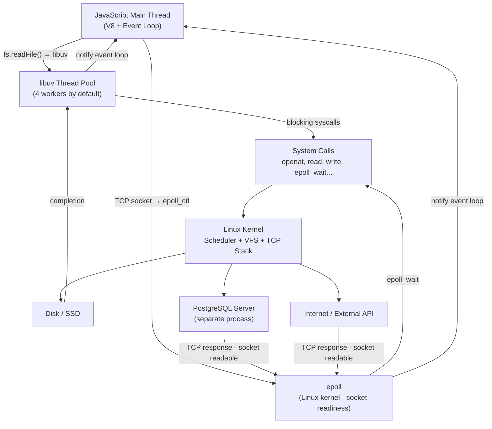

**Two completely different internal paths:**
- **Thread-pool path** — Node delegates blocking file/crypto/DNS work to workers
- **Event-notification path** — Node uses epoll to know when sockets are readable/writable

> [!caution] These paths are NOT interchangeable
> File reads → libuv thread pool. Database/HTTP sockets → epoll. Using the wrong mental model causes wrong diagnoses when profiling.

---

## 2. Linux Concepts You Must Understand

### 2.1 Blocking vs Non-blocking I/O

**Blocking I/O** — thread cannot advance until syscall returns:

```javascript
// Synchronous — BLOCKS the JavaScript thread entirely
const data = fs.readFileSync("large-file.txt");
console.log("File loaded"); // only runs after read completes
```

**Non-blocking / Async API** — thread suspends, not blocks:

```javascript
// Async — suspends THIS async function, NOT the event loop
const promise = fs.promises.readFile("large-file.txt");
console.log("I execute immediately"); // runs before file is read
const data = await promise;
console.log("File loaded"); // resumes after read completes
```

> [!note] readFile is NOT a non-blocking kernel operation
> `fs.promises.readFile()` achieves an async *programming interface* by delegating the inherently blocking disk read to libuv's thread pool. It is not a non-blocking fd in the kernel sense.

---

### 2.2 Process, Thread & Context Switching

- **Process** — a running program with its own virtual address space, FD table, and kernel resources
- **Thread** — an execution unit within a process; shares address space but has its own stack + registers
- **Context switch** — the OS saves one thread's CPU register state and restores another's

```
Node.js Process
│
├── Main JavaScript Thread     ← runs your JS, event loop
├── libuv worker thread 1      ← may be doing file read (blocked in kernel)
├── libuv worker thread 2      ← idle
├── libuv worker thread 3      ← idle
└── libuv worker thread 4      ← idle
```

> [!note] Important Correction
> The kernel doesn't remove the **entire Node.js process** from the CPU when a worker blocks. It only blocks the specific worker thread. The JS main thread stays runnable.

---

### 2.3 File Descriptors

A **file descriptor (FD)** is a small integer handle in a process's FD table pointing to an open kernel resource.

| FD Number | Common Resource |
| :--- | :--- |
| `0` | stdin |
| `1` | stdout |
| `2` | stderr |
| `3` | opened file |
| `4` | database TCP socket |
| `5` | HTTP socket |

Resources that FDs can point to: files, TCP sockets, pipes, terminals, `epoll` instances, timers, `eventfd`.

> [!note] Why FDs matter
> `select`, `poll`, `epoll`, and `io_uring` all operate around file descriptors. Everything in Linux I/O monitoring revolves around them.

---

### 2.4 select, poll and epoll

These are Linux mechanisms for monitoring multiple file descriptors simultaneously.

| Mechanism | Model | Scalability | Limitation |
| :--- | :--- | :--- | :--- |
| **`select()`** | Readiness; FD bit-sets | Limited by `FD_SETSIZE` (typically 1024) — a compile-time user-space constant, not a hard kernel limit | Sets must be rebuilt every call; kernel performs an $O(n)$ linear scan across all descriptors |
| **`poll()`** | Readiness; `pollfd` array | No `FD_SETSIZE` limit | Kernel still performs an $O(n)$ linear scan across all supplied descriptors on every invocation |
| **`epoll`** | Readiness; kernel interest list | Returns only active/ready events ($O(k)$ where $k \ll n$) — scales to tens of thousands of idle connections | Linux-specific; interest list changes require `epoll_ctl` syscalls |

> [!note] epoll Performance Nuance — Not Universally $O(1)$
> While often colloquially called "$O(1)$", epoll does not guarantee constant-time processing under all conditions:
> - `select()` and `poll()` require scanning the entire monitored set of $n$ file descriptors on every single call.
> - `epoll` maintains a persistent interest list in the kernel (using an internal red-black tree) and a separate ready list (doubly linked list). It wakes up and returns only the descriptors that actually received events ($O(k)$ ready descriptors).
> - However, overall throughput depends on the number of ready events delivered, the cost of handling `epoll_ctl()` additions/deletions, and the application's processing loop. It eliminates the full $O(n)$ descriptor scan, but is not universally $O(1)$.

**How epoll works internally:**

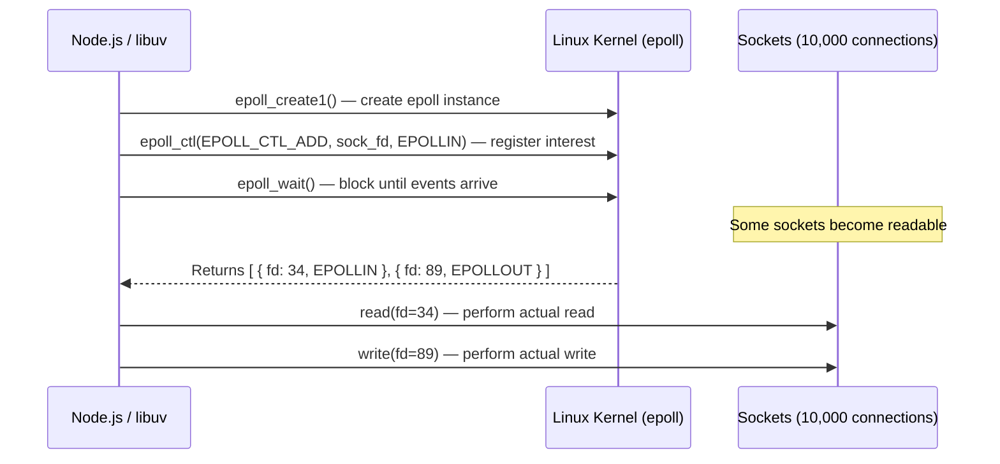

> [!important] epoll ≠ operation complete
> `EPOLLIN` means the socket *can be read without blocking*. It does **NOT** mean the full HTTP response or database result has arrived. You may need multiple `read()` calls + protocol parsing before the complete application message is assembled.

**Level-triggered vs Edge-triggered:**
- **Level-triggered (LT)** — epoll keeps reporting readiness as long as the condition is true (default, safer)
- **Edge-triggered (ET)** — epoll only reports a *state transition*; more efficient but requires draining all data and careful `EAGAIN` handling

---

### 2.5 io_uring — Modern Linux Async I/O

> [!tip] io_uring is the most important modern Linux I/O innovation
> Introduced in Linux 5.1 (2019). It fundamentally changes how apps interact with the kernel — from readiness-based polling to completion-based batched submission.

**io_uring is built around two shared ring buffers** between user space and kernel:

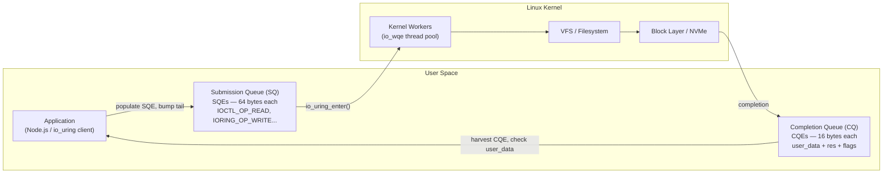

**SQE (Submission Queue Entry) — 64 bytes:**
- Opcode (`IORING_OP_READ`, `IORING_OP_WRITE`, `IORING_OP_ACCEPT`...)
- File descriptor, buffer, offset
- `user_data` — a 64-bit tag you set to correlate completions back to requests

**CQE (Completion Queue Entry) — 16 bytes:**
- `user_data` — copied from matching SQE (lets you identify which request finished)
- `res` — result (bytes read/written, or negative error code like `-EAGAIN`)
- `flags` — extra metadata

**Three operation modes:**

| Mode | How It Works | Use Case |
| :--- | :--- | :--- |
| **Interrupt-driven** (default) | User calls `io_uring_enter()` to submit; kernel uses interrupts for completion | General workloads |
| **IOPOLL** (`IORING_SETUP_IOPOLL`) | Kernel thread polls NVMe device directly — no interrupt overhead | Ultra-fast NVMe SSDs |
| **SQPOLL** (`IORING_SETUP_SQPOLL`) | Dedicated kernel thread watches SQ — zero syscalls for submission | Extreme throughput scenarios |

**epoll vs io_uring:**

| Aspect | epoll | io_uring |
| :--- | :--- | :--- |
| **Primary abstraction** | FD readiness events | Submitted operations + completions |
| **Who performs I/O** | Application (after readiness notification) | Kernel (executes submitted operation) |
| **Strength** | Many concurrent long-lived sockets | Batched, high-throughput I/O |
| **File I/O** | Regular files always "ready" — not useful | Designed to handle async file I/O |
| **Model** | Readiness-based | Completion-based |
| **Syscall overhead** | Per-event | Can batch many ops in one `io_uring_enter()` |

> [!note] io_uring internal blocking
> Not every io_uring operation is guaranteed to execute without blocking or worker-thread offloading inside the kernel. For operations or filesystems that cannot be made async directly, the kernel transparently offloads work to its internal `io_wqe` worker thread pool and writes to the CQ when done. The user-facing model is still completion-based, but the kernel's execution may involve blocking internally.

> [!caution] io_uring and Node.js — Don't Conflate Them
> **io_uring is a Linux kernel interface.** It is not the same as Node.js's Promise API, `async/await`, or libuv's event loop.
> - Standard Node.js filesystem APIs (`fs.promises.readFile`, etc.) **do not automatically use io_uring**. They use the libuv thread pool on Linux.
> - io_uring is used in native C/C++ applications, custom runtimes (like Bun, which uses io_uring on Linux), or through native Node addons that implement it directly.
> - You cannot call io_uring from JavaScript — it is a kernel ABI.
> - Think of io_uring as an *alternative implementation path* that a runtime *could* use instead of libuv's thread pool for file I/O.

---

### 2.6 libuv — The Bridge Between Node.js and Linux

Node.js does NOT independently implement every OS mechanism. It uses **libuv**.

```
JavaScript Application
        │
  Node.js APIs (fs, net, http, crypto...)
        │
  V8 Engine + Node C++ Bindings
        │
      libuv
        │
  Linux Kernel / System Calls
```

**What libuv provides:**
- Event loop
- Thread pool (default size: **4**, configurable via `UV_THREADPOOL_SIZE`, max: **1024**)
- Async file-system operations
- Network I/O integration
- Timers and signals
- OS abstraction (works on Linux, macOS, Windows)

**What uses the libuv thread pool:**
- All `fs.promises.*` / callback-based `fs.*` APIs (except `fs.FSWatcher`)
- `dns.lookup()` (by default)
- CPU-intensive crypto operations
- zlib compression

**What uses epoll (event-driven, NOT thread pool):**
- TCP/UDP sockets (`net`, `http`, `https`, database drivers)
- `fs.watch()` (inotify-based on Linux)

> [!caution] "Node creates a new thread for every file read" is WRONG
> libuv uses a **shared bounded pool** of workers, not one thread per operation. If all 4 (default) workers are busy, the 5th file operation waits.

---

## 3. Linux System Calls — The Kernel Boundary

A **system call (syscall)** is a controlled transition from **user space** into **kernel space** to request a service from the operating system.

### 3.1 User Space vs Kernel Space

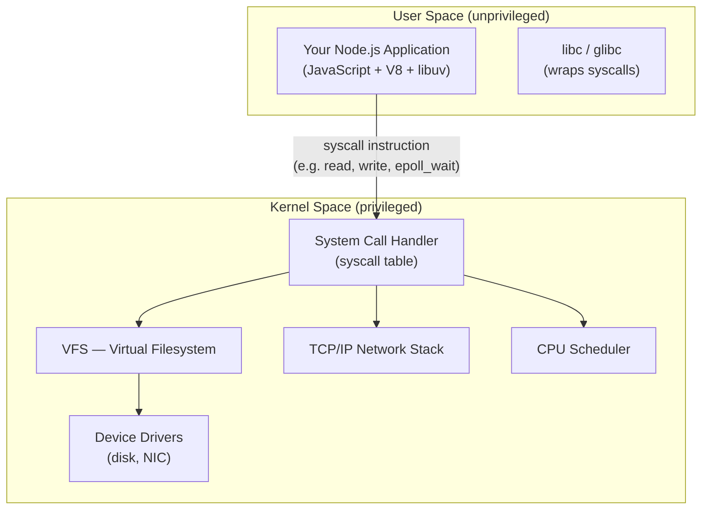

- **User space** — where your application runs; cannot directly access hardware
- **Kernel space** — where the OS runs; has full hardware access
- A syscall crosses this boundary via a CPU instruction (`syscall` on x86-64, `svc` on ARM)
- Operations like `fs.readFile()` and `socket.write()` eventually trigger system calls (`openat`, `read`, `write`, `epoll_ctl`).
- **Timers like `setTimeout()` do NOT trigger individual syscalls:** Node.js and libuv manage timers purely in-memory using a priority queue (min-heap). When the event loop is ready to sleep waiting for I/O, it calculates the time remaining until the earliest timer expires and passes that duration as the `timeout` argument to `epoll_wait(..., timeout)`. The kernel wakes the loop when either I/O arrives or the timer timeout expires.

---

### 3.2 Essential System Calls

| Syscall | Signature | What It Does | Node.js Context |
| :--- | :--- | :--- | :--- |
| `open()` / `openat()` | `openat(dirfd, path, flags, mode)` | Opens a file, returns an FD | Used beneath every file operation; `openat` is preferred (relative to a dir FD) |
| `read()` | `read(fd, buf, count)` | Reads up to `count` bytes from FD into buffer | File reads and socket reads in libuv workers |
| `write()` | `write(fd, buf, count)` | Writes `count` bytes to FD | File writes, socket sends |
| `close()` | `close(fd)` | Releases the FD; OS can reuse the number | Called after files/sockets are done |
| `fsync()` | `fsync(fd)` | Flushes data + all metadata to durable storage | Used by PostgreSQL/databases for WAL durability |
| `fdatasync()` | `fdatasync(fd)` | Flushes data + only necessary metadata | Cheaper than `fsync`; avoids flushing timestamps |
| `socket()` | `socket(domain, type, protocol)` | Creates a network socket FD | Used when Node opens a TCP connection |
| `connect()` | `connect(sockfd, addr, addrlen)` | Connects socket to remote address | TCP client connect |
| `accept()` | `accept(sockfd, addr, addrlen)` | Accepts an incoming connection | TCP server receives client |
| `send()` / `recv()` | `send(fd, buf, len, flags)` | Send/receive bytes on a socket | TCP data transfer |
| `epoll_create1()` | `epoll_create1(flags)` | Creates an epoll instance FD | Called once by libuv at startup |
| `epoll_ctl()` | `epoll_ctl(epfd, op, fd, event)` | Add/modify/remove FD interest | Called when Node starts watching a socket |
| `epoll_wait()` | `epoll_wait(epfd, events, maxevents, timeout)` | Blocks until events are ready | The event loop's idle wait |
| `fcntl()` | `fcntl(fd, cmd, ...)` | Manipulate FD flags | Setting `O_NONBLOCK` on a socket |

### 3.3 O_NONBLOCK, EAGAIN, EWOULDBLOCK

**`O_NONBLOCK`** is a flag set on a file descriptor to make I/O operations non-blocking:

```c
// Set a socket to non-blocking mode
int flags = fcntl(sockfd, F_GETFL, 0);
fcntl(sockfd, F_SETFL, flags | O_NONBLOCK);
```

When you `read()` a non-blocking socket that has no data yet:
- **Blocking socket** → thread sleeps until data arrives
- **Non-blocking socket** → returns immediately with error code `-1` and `errno = EAGAIN` (or `EWOULDBLOCK`, which is equivalent on Linux)

This is how epoll and libuv work under the hood:
1. Set socket to `O_NONBLOCK`
2. Register socket with `epoll_ctl(EPOLL_CTL_ADD, ...)`
3. Call `epoll_wait()` — blocks until socket is ready
4. When ready: call `read()` — returns data immediately (no sleeping)
5. If `read()` returns `EAGAIN` again — no more data available, re-arm epoll

### 3.4 How an FD is Allocated and Released

```
Process FD Table         Open File Table (kernel)       Inode Table (kernel)
┌────────────────┐       ┌──────────────────────┐       ┌───────────────┐
│ fd 0 → ────────┼──────▶│ position=0, flags... ├──────▶│ /dev/stdin    │
│ fd 1 → ────────┼──────▶│ position=0, flags... ├──────▶│ /dev/stdout   │
│ fd 2 → ────────┼──────▶│ position=0, flags... ├──────▶│ /dev/stderr   │
│ fd 3 → ────────┼──────▶│ position=100, R/W... ├──────▶│ /home/file.txt│
│ fd 4 → (empty) │       └──────────────────────┘       └───────────────┘
└────────────────┘
```

- `open()` → kernel allocates the lowest available FD number and fills the table entry
- `close()` → kernel frees that FD slot; the number can be immediately reused
- **FD leak** — forgetting to call `close()` exhausts the process's FD table (default limit: 1024–65536 depending on OS config)

> [!warning] FD Exhaustion is a real production failure
> If your Node.js app opens files/sockets without closing them, it eventually hits the FD limit and throws `EMFILE: too many open files`. Check with `ls -l /proc/<pid>/fd | wc -l`.

---

## 4. Promise Lifecycle & async/await Internals

### 4.1 What a Promise Actually Is

> [!important] A Promise does NOT perform I/O
> A Promise is a **JavaScript object** that represents the eventual result of an operation. The actual work (file read, network call, timer) is handled by **Node.js, libuv, the OS, or another system**. The Promise is just a handle to track the result and register callbacks.

A Promise has three mutually exclusive states:

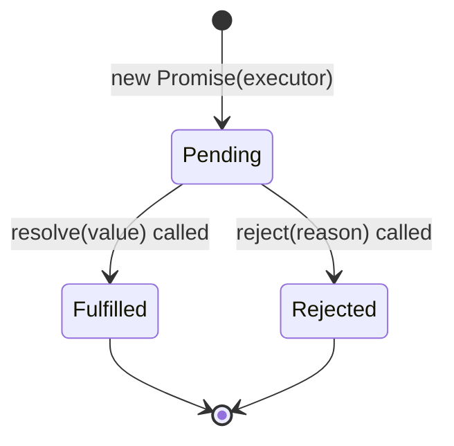

```javascript
// 1. Creation — executor runs synchronously
const p = new Promise((resolve, reject) => {
  console.log("executor runs NOW"); // synchronous
  setTimeout(() => resolve("done"), 1000); // schedules async work
});
// p is now in Pending state

// 2. Registering reactions with .then() / .catch() / .finally()
p
  .then(value  => console.log("fulfilled:", value))  // runs when resolved
  .catch(error => console.log("rejected:", error))   // runs when rejected
  .finally(()  => console.log("always runs"));       // always runs after settled
```

### 4.2 How Promise Reactions Enter the Microtask Queue

When a Promise settles (resolves or rejects), its `.then()` callbacks are **not called immediately**. They are placed in the **microtask queue** and run after the current synchronous operation completes:

```javascript
console.log("1 — sync");

Promise.resolve("value").then(v => {
  console.log("3 — microtask:", v); // scheduled, not immediate
});

console.log("2 — sync");
// Output: 1, 2, 3
```

**Why microtasks, not the event loop?**
- Microtasks run *before* the event loop moves to its next phase
- This guarantees that Promise chains are processed atomically without I/O callbacks interleaving

### 4.3 How await Registers a Continuation

While `await` is often explained as syntactic sugar for `.then()`, this is a **simplified mental model**. In reality, `await` is a native ECMAScript language feature implemented inside the V8 engine with optimized coroutine-style stack suspension:

```javascript
// Conceptual approximation:
async function getUser() {
  const result = await fetchUser(101);
  return result.name;
}

// Conceptually behaves similarly to:
function getUser() {
  return Promise.resolve(fetchUser(101)).then(result => {
    return result.name;
  });
}
```

> [!note] Approximation Caveat
> While `.then()` chains create intermediate Promise instances and extra function allocations for closures, native `await` directly suspends and restores the generator-like async function execution context in V8, minimizing memory overhead.

**Step by step when `await` is hit:**
1. The awaited expression is evaluated — wrapped into a Promise if not already one.
2. The current async function's execution context is **suspended** (saving its local variable frame).
3. Control returns synchronously to the **caller** of the async function.
4. When the awaited Promise settles, the continuation (the remainder of the async function) is enqueued as a **microtask**.
5. When the microtask queue runs, the async function's execution frame is restored, and execution **resumes**.

### 4.4 Error Propagation Through async Functions

Errors in async functions become rejected Promises automatically:

```javascript
async function riskyOperation() {
  const data = await fs.readFile("missing.txt"); // throws if file missing
  return data; // never reached if above throws
}

// Option 1: .catch() on the returned Promise
riskyOperation().catch(err => console.error("caught:", err.message));

// Option 2: try/catch inside async function
async function safeOperation() {
  try {
    const data = await fs.readFile("missing.txt");
    return data;
  } catch (err) {
    console.error("file error:", err.message);
    return null; // graceful fallback
  }
}

// Option 3: top-level await (ESM only)
try {
  const data = await fs.readFile("missing.txt");
} catch (err) {
  console.error(err.message);
}
```

> [!caution] Unhandled Promise Rejections Crash Node.js by Default (v15+)
> Starting in Node.js v15, the **default mode** (`--unhandled-rejections=throw`) raises an unhandled Promise rejection as an **uncaught exception**, which prints a stack trace and terminates the process with a non-zero exit code.
> - This default behavior can be configured using the `--unhandled-rejections` CLI flag:
>   - `throw` (default): Emits `unhandledRejection`. If no handler is registered, raises an uncaught exception (terminating process).
>   - `strict`: Immediately raises an uncaught exception, even if an `unhandledRejection` hook is registered.
>   - `warn`: Emits a warning to stderr but allows the process to continue running (legacy behavior).
>   - `none`: Completely silent (strongly discouraged).
> Always guard asynchronous operations with `try/catch` or explicit `.catch()` handlers.

### 4.5 Callback → Promise → async/await Evolution

```javascript
// 1. Callback style (oldest) — "callback hell" risk
fs.readFile("file.txt", (err, data) => {
  if (err) return console.error(err);
  console.log(data);
});

// 2. Promise style — chainable, flatter
fs.promises.readFile("file.txt")
  .then(data => console.log(data))
  .catch(err => console.error(err));

// 3. async/await style (modern) — reads like sync code
async function read() {
  try {
    const data = await fs.promises.readFile("file.txt");
    console.log(data);
  } catch (err) {
    console.error(err);
  }
}
```

All three styles produce the **same underlying behaviour** — the difference is only syntax and readability. Under the hood, all three go through libuv's thread pool for file reads.

---

## 5. Networking Internals — TCP, Sockets, DNS & TLS

### 5.1 TCP Three-Way Handshake

Before any HTTP, database, or API data flows, TCP must establish a connection:

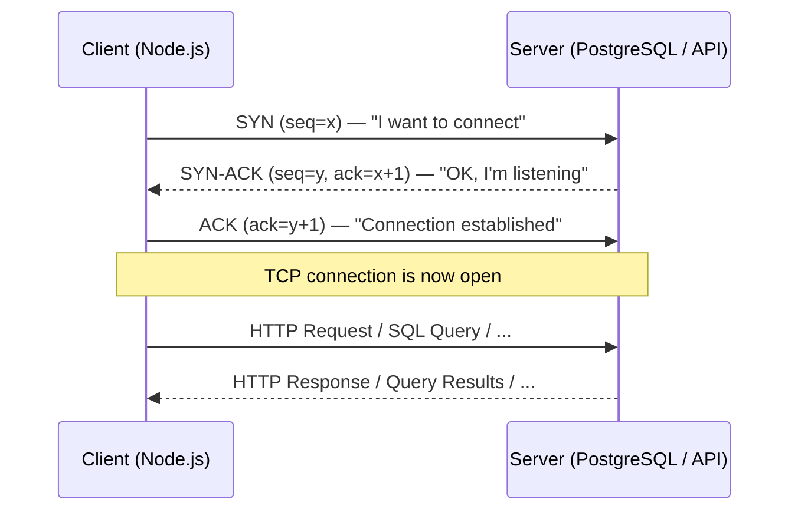

**Cost of TCP connection setup:** 1 full network round-trip (1 RTT) before any application data. This is why **connection pooling** exists — reuse connections instead of re-establishing them per request.

### 5.2 Socket Creation and File Descriptors

When Node.js makes an outbound TCP connection:

```
1. socket(AF_INET, SOCK_STREAM, 0)  → creates socket FD (e.g. fd=7)
2. connect(7, {host, port})          → initiates TCP handshake (non-blocking)
3. epoll_ctl(EPOLL_CTL_ADD, 7, EPOLLOUT)  → watch for writability (connect done)
4. epoll_wait()                      → event loop waits
5. EPOLLOUT fires → connect complete → socket is usable
6. write(7, http_request_bytes, len) → send request data
7. epoll_ctl(EPOLL_CTL_MOD, 7, EPOLLIN)  → now watch for readability
8. epoll_wait()                      → wait for response
9. EPOLLIN fires → read(7, buf, len) → receive response bytes
```

Every active connection is a file descriptor. **1000 concurrent connections = 1000 open FDs in the process.**

### 5.3 DNS Resolution

Before TCP can connect to a domain name, Node must resolve `hostname → IP address`:

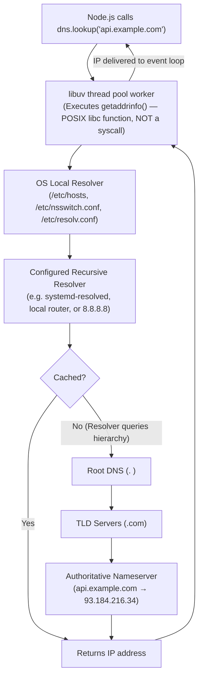

> [!important] `dns.lookup()` vs `dns.resolve()`
> - **`dns.lookup()` (default in `http.get`, `fetch`, etc.):** Calls `getaddrinfo(3)`, a synchronous POSIX C library function. Because it blocks, libuv offloads it to its **thread pool**. It respects operating-system configuration (`/etc/hosts`, `/etc/nsswitch.conf`). High DNS traffic can exhaust libuv worker threads.
> - **`dns.resolve()` / `dns.resolve4()`:** Uses the bundled **`c-ares`** C library. It communicates directly with configured nameservers over asynchronous UDP/TCP sockets integrated into the **event loop** (no libuv worker threads used). However, it does *not* read `/etc/hosts`.

### 5.4 TLS Handshake

HTTPS connections require TLS negotiation before any application data flows:

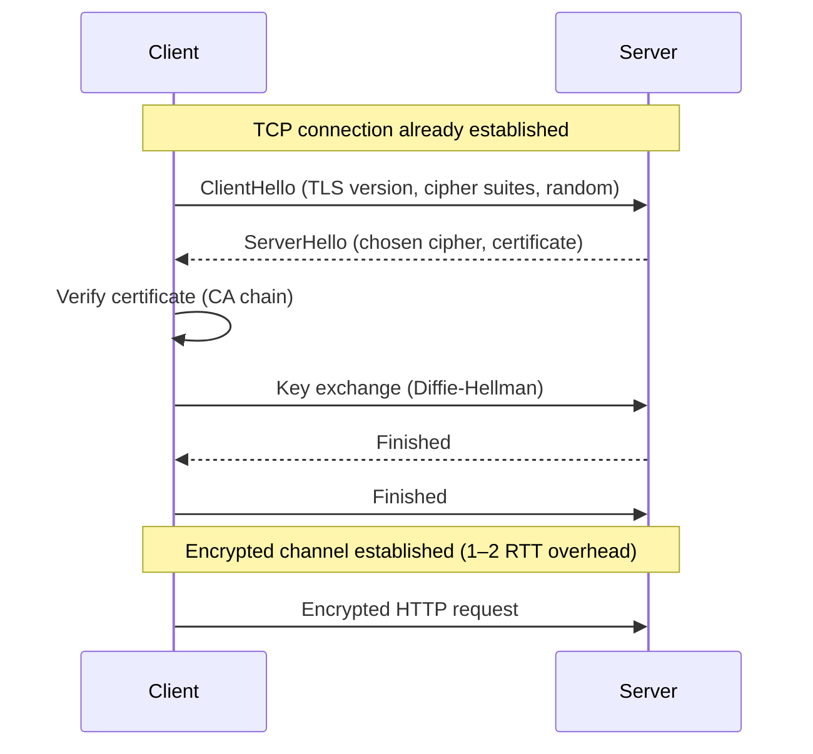

**TLS costs:**
- 1–2 extra RTTs for TLS 1.2; 1 RTT for TLS 1.3 (or 0-RTT session resumption)
- CPU cost for cryptographic operations (asymmetric key exchange, symmetric AES/ChaCha encryption/decryption)
- These are real costs even though the network wait is handled async via epoll

### 5.5 Socket Buffers & Backpressure

Every TCP socket has two kernel-managed buffers:

```
Sender (Node.js)          Kernel Buffers (Auto-Tuned)           Receiver (Server)

write(fd, data) ──▶ [Send Buffer (e.g. 64KB*)] ──▶ TCP ──▶ [Recv Buffer (e.g. 128KB*)] ──▶ read(fd)
                        kernel manages                           kernel manages
```
*\*Buffer sizes above are purely illustrative examples.*

> [!note] Dynamic Socket Buffer Tuning in Linux
> Linux does not use a fixed 64 KB buffer for all sockets. The kernel dynamically auto-tunes TCP socket buffer sizes based on the connection's **Bandwidth-Delay Product (BDP)**:
> - `net.ipv4.tcp_wmem = min default max` (e.g. `4096 16384 4194304`)
> - `net.ipv4.tcp_rmem = min default max` (e.g. `4096 131072 6291456`)
> If an application explicitly overrides buffer sizes via `setsockopt(..., SO_SNDBUF/SO_RCVBUF)`, Linux disables automatic buffer tuning for that socket.

- **Send buffer full:** `write()` on a non-blocking socket returns `EAGAIN` / `EWOULDBLOCK` — the application must stop pushing data (**backpressure**).
- **Receive buffer full:** The TCP receiver advertises a zero-window (`win=0`) back to the sender, pausing sender transmission at the transport layer.
- Node.js streams implement automatic backpressure handling: `writable.write()` returns `false` when internal buffers exceed `highWaterMark`, and emits `'drain'` once the buffer is flushed.

### 5.6 HTTP Request/Response Lifecycle over TCP

```
1. DNS resolution         → hostname → IP (libuv thread pool via getaddrinfo)
2. TCP handshake          → SYN / SYN-ACK / ACK (1 RTT)
3. TLS handshake          → ClientHello ... Finished (1-2 RTT, HTTPS only)
4. HTTP request write     → write(sockfd, "GET /api HTTP/1.1\r\n...")
5. epoll_wait (EPOLLIN)   → wait for server response bytes
6. read loop              → read(sockfd, buf) until full HTTP response assembled
7. HTTP parsing           → status line, headers, body boundaries
8. Body parsing           → JSON.parse() / streaming
9. Promise resolution     → event loop notified, .then() / await resumes
10. Connection keep-alive → socket stays open for reuse (HTTP/1.1 default)
```

### 5.7 Connection Pooling

Re-establishing a TCP+TLS connection per request is expensive (2–3 RTTs). Connection pools maintain a set of **long-lived, reusable connections**:

```javascript
// pg Pool maintains N persistent TCP connections to PostgreSQL
const pool = new pg.Pool({
  connectionString: process.env.DATABASE_URL,
  max: 10,         // max concurrent connections
  idleTimeoutMillis: 30000, // close idle connections after 30s
  connectionTimeoutMillis: 2000, // throw if no connection available in 2s
});

// Each pool.query() reuses an existing TCP connection
// TCP handshake only happens once at pool creation time
```

> [!tip] Pool size is not "more = better"
> More connections = more memory, more kernel FDs, more PostgreSQL worker processes. For CPU-bound PostgreSQL queries, optimal pool size ≈ number of CPU cores on the DB server. Too many connections = lock contention and context-switch overhead.

---

## 6. Three Real-World Examples — Side by Side

The same Promise/await API hides very different OS mechanisms underneath.

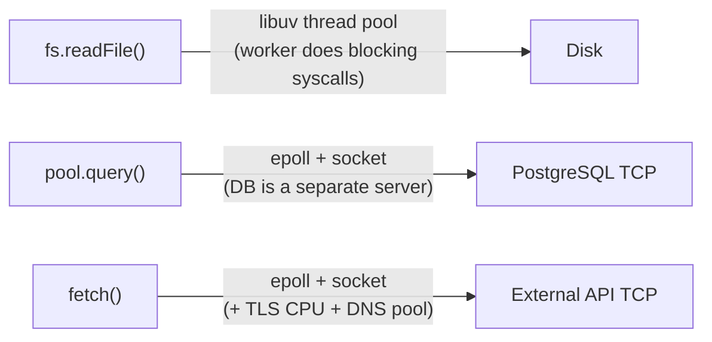

| Detail | `fs.readFile()` | `pool.query()` | `fetch()` |
| :--- | :--- | :--- | :--- |
| **Operation type** | Disk I/O | Network I/O | Network I/O |
| **Node mechanism** | libuv thread pool | Socket events (epoll) | Socket events (epoll) |
| **Linux mechanism** | `openat()`, `read()` syscalls | `epoll_wait()` → `read()` | `epoll_wait()` → `read()` |
| **External machine** | No | Yes (PostgreSQL server) | Yes |
| **JS main thread blocks?** | No | No | No |
| **Worker thread blocks?** | Yes (in kernel) | No | No |

---

### 6.1 Example A — Reading a File from Disk (libuv Worker Pool)

```javascript
import fs from "node:fs/promises";

async function readDocument() {
  console.log("A: start");
  const data = await fs.readFile("./large-file.txt"); // suspends here
  console.log("D: resumed");
  return data;
}

console.log("B: before call");
readDocument();
console.log("C: main thread continues"); // runs BEFORE D
```

**Expected output:**
```
B: before call
A: start
C: main thread continues
D: resumed
```

**What actually happens inside Linux:**

```
Main JS Thread                 libuv Worker Thread              Linux Kernel
     │                               │                               │
     │── fs.readFile() ──────────────▶ queued in pool               │
     │                               │── open(), read() syscalls ──▶│
     │── console.log("C") ──────────▶│                              │── disk read
     │  (continues other work)       │  (may sleep waiting)         │── page cache
     │                               │◀── data returned ────────────│
     │◀── libuv notifies event loop ─│                              │
     │── Promise resolves            │                              │
     │── await resumes              │                              │
     │── console.log("D")           │                              │
```

---

### 6.2 Example B — PostgreSQL Database Query (TCP Sockets & epoll)

```javascript
import pg from "pg";

const pool = new pg.Pool({ connectionString: process.env.DATABASE_URL });

async function getUser(email) {
  console.log("A: query start");
  const result = await pool.query(
    "SELECT * FROM users WHERE email = $1",
    [email]
  );
  console.log("D: query resumed");
  return result.rows[0];
}

console.log("B: before query");
getUser("user@example.com");
console.log("C: main thread continues");
```

**Internal flow — this is different from file reads:**

```
Node.js                    Linux Kernel / epoll          PostgreSQL Server
   │                               │                           │
   │── pool.query() ───────────────▶ write SQL to TCP socket  │
   │                               │── TCP → network ─────────▶│
   │── console.log("C") ──────────▶│                           │── parse SQL
   │  (handles other requests)     │                           │── execute query
   │                               │                           │── fetch rows
   │                               │◀── TCP response ──────────│
   │                               │── socket readable         │
   │                               │── epoll_wait() returns    │
   │                               │── libuv reads bytes       │
   │                               │── parses pg wire protocol │
   │◀── Promise resolves ──────────│                           │
   │── await resumes               │                           │
```

> [!important] PostgreSQL runs in its OWN process
> Node.js is waiting for **network data**. PostgreSQL does the actual DB work independently. epoll doesn't execute SQL — it only tells Node when network bytes are readable.

> [!warning] Connection Pool ≠ Unlimited Concurrency
> If all pool connections are busy with slow queries, the next `.query()` call waits for a free connection — even though Node's event loop is responsive.

---

### 6.3 Example C — Third-Party API Call (Sockets, TLS & DNS)

```javascript
async function generateVoice(text) {
  console.log("A: request start");

  const response = await fetch("https://api.elevenlabs.io/v1/text-to-speech", {
    method: "POST",
    headers: {
      "Content-Type": "application/json",
      Authorization: `Bearer ${process.env.API_KEY}`
    },
    body: JSON.stringify({ text })
  });

  const result = await response.json();
  console.log("D: response resumed");
  return result;
}

console.log("B: before fetch");
generateVoice("Hello world");
console.log("C: main thread continues");
```

**Internal flow:**

```
Node.js                     Linux Kernel                  External API (ElevenLabs)
   │                              │                               │
   │── fetch() ──────────────────▶│── DNS lookup (may use pool)  │
   │                              │── TCP connect + TLS handshake│
   │                              │── write HTTP POST bytes ─────▶│
   │── console.log("C") ─────────▶│                              │── process request
   │  (handles other work)        │                              │── generate audio
   │                              │◀── HTTP response bytes ───────│
   │                              │── socket readable             │
   │                              │── epoll_wait() returns       │
   │                              │── TLS decrypt + HTTP parse   │
   │◀── fetch Promise resolves ───│                              │
   │── await response.json()      │── may need more reads        │
   │── await resumes              │                              │
```

> [!note] DNS and TLS are NOT free
> `dns.lookup()` can consume a libuv thread pool slot. TLS handshakes and record processing involve real CPU work. Neither is free just because the network wait is async.

> [!tip] The event loop does not idle during 10-second API calls
> While ElevenLabs generates audio for 10 seconds, your Node.js server can handle hundreds of other HTTP requests, DB queries, and file reads.

---

## 7. Node.js Event Loop, Microtasks & Execution Ordering

### 7.1 Execution Order — CommonJS vs. ESM Module Evaluation

> [!important] Crucial Difference: CommonJS vs. ESM Top-Level Ordering
> The execution order between `process.nextTick()` and `Promise.resolve().then()` is **NOT identical between CommonJS and ES Modules** when executed at the top level of a file.

Consider this script:
```javascript
console.log("start");

process.nextTick(() => console.log("nextTick"));
Promise.resolve().then(() => console.log("promise"));

console.log("end");
```

#### CommonJS Execution (`.cjs` or standard `require`):
In CommonJS, the script is loaded inside a synchronous function wrapper: `(function(exports, require, module, __filename, __dirname) { ... })`. When the synchronous wrapper exits, Node.js explicitly triggers a tick cycle, draining the `nextTick` queue **before** the Promise microtask queue:
```text
start
end
nextTick    ← nextTick queue drains first in CommonJS
promise     ← Promise microtask drains second
```

#### ESM Execution (`.mjs` or `"type": "module"`):
In ECMAScript Modules, the ECMAScript specification dictates that top-level module evaluation runs within an asynchronous module graph execution record (an implicit Promise lifecycle). When the synchronous body of the module finishes, the engine settles the module Promise, which triggers the **Promise microtask queue before control returns to Node's tick callback processor**:
```text
start
end
promise     ← Promise microtask drains first during ESM module completion
nextTick    ← nextTick queue runs after
```

> [!note] Inside Asynchronous Callbacks (After Top-Level Evaluation)
> Once the initial module has loaded and code executes inside subsequent callbacks (e.g. inside `setTimeout`, `fs.readFile`, or HTTP handlers), `process.nextTick` consistently drains before Promise microtasks across both module systems.

### 7.2 Event Loop Phases

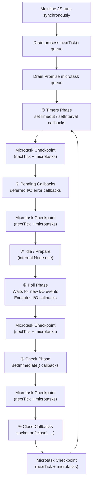

> [!important] Microtask Checkpoint Mechanics (V8 / Node 11+ Alignment)
> In modern Node.js (Node 11+), Node aligned its event loop with the HTML5/V8 web standard specifications:
> - Microtasks are drained **after each individual callback/macrotask** invoked from user space, rather than waiting for the entire event loop phase to empty.
> - For instance, if multiple `setTimeout` timers expire at the exact same millisecond: Node runs Timer Callback 1 $\rightarrow$ **drains microtasks** $\rightarrow$ Timer Callback 2 $\rightarrow$ **drains microtasks**.
> - *Nuance:* While this per-macrotask microtask checkpoint is the standard model for JavaScript callbacks, certain internal Node.js execution boundaries (such as native C++ binding returns, stream chunk batching, or bootstrap phases) may have specialized scheduling semantics.

**Standard Callback Priority Order (highest → lowest):**
1. Synchronous execution on call stack
2. `process.nextTick()` queue
3. Promise microtask queue (`.then()`, `catch()`, `finally()`, `await` continuations)
4. Event loop phases: Timers $\rightarrow$ Pending $\rightarrow$ Poll $\rightarrow$ Check (`setImmediate`) $\rightarrow$ Close callbacks

### 7.3 CPU-Bound Work vs Event Loop

> [!caution] CPU-bound code STILL blocks the event loop
> ```javascript
> app.get("/heavy", (req, res) => {
>   // This IS NOT async — it blocks the single JS thread for ALL users
>   let result = 0;
>   for (let i = 0; i < 1e10; i++) result += i;
>   res.json({ result });
> });
> ```
> Async I/O does **not** make CPU-bound JavaScript concurrent. For heavy CPU computations (cryptography, video/image processing, complex math), offload to worker threads (`worker_threads`), a child process (`child_process.fork`), or a dedicated background job worker.

---

## 8. Asynchronous Backend Processing — Message Queues

This is a different kind of async — not async I/O, but async **business workflows**.

### 8.1 The Long-Running Task Problem

A user uploads a video and your API needs to:
1. Store the raw video
2. Transcode to multiple resolutions
3. Generate thumbnails
4. Upload to CDN
5. Send notification email

Should the HTTP request wait for all 5 steps? **No.** This could take minutes.

### 8.2 Message Queues, Producers, Consumers & Job IDs

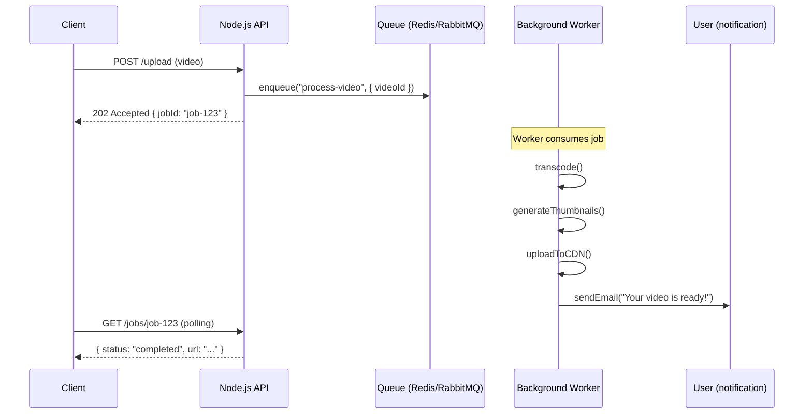

```javascript
// API — accept and queue immediately
app.post("/upload", async (req, res) => {
  const job = await videoQueue.add("process-video", {
    videoId: req.body.videoId
  });

  // 202 Accepted = "I got it, processing is happening"
  res.status(202).json({
    message: "Video processing started",
    jobId: job.id
  });
});

// Separate Worker Process — does the actual heavy work
videoWorker.process(async (job) => {
  await convertVideo(job.data.videoId);
  await generateThumbnails(job.data.videoId);
  await uploadToCloud(job.data.videoId);
  await sendNotificationEmail(job.data.videoId);
  return { status: "completed" };
});
```

### 8.3 In-Process Promise vs Distributed Job ID

| Dimension | In-Process Promise | Distributed Job ID |
| :--- | :--- | :--- |
| **Scope** | In-memory, single process | Cross-process, cross-machine |
| **Persistence** | Lost on crash | Survives restarts (Redis/DB) |
| **Observable by** | Only the current process | Any client via HTTP polling |
| **Retry** | Manual | Built-in with backoff |
| **Use for** | I/O operations within a request | Long-running business workflows |

> [!tip] Design message queues for reliability
> Always plan for: idempotency, retries with exponential backoff, dead-letter queues, visibility timeouts, ordering requirements, and job status persistence.

---

## 9. PostgreSQL — WAL, Commits, Durability & Replication

### 9.1 Write-Ahead Log (WAL)

**WAL is the append-only journal of all database modifications.** It is the core mechanism that ensures PostgreSQL's durability and crash recovery.

```sql
BEGIN;
UPDATE accounts SET balance = balance - 500 WHERE id = 1;
UPDATE accounts SET balance = balance + 500 WHERE id = 2;
COMMIT;
```

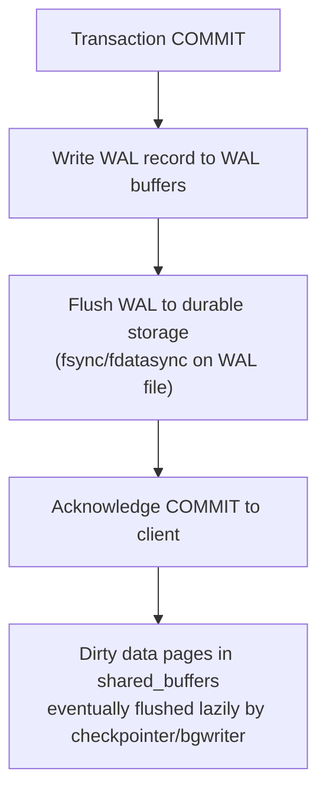

> [!note] PostgreSQL does NOT flush modified table pages on commit
> It only ensures WAL durability. Because WAL is sequential and append-only, replaying WAL records after a crash reconstructs consistent data pages. Modified table/index pages in `shared_buffers` are flushed lazily and in batches by the background writer and checkpointer processes.

### 9.2 Synchronous vs Asynchronous Commit

The `synchronous_commit` parameter controls when PostgreSQL considers a transaction committed and returns success to the client:

| Setting | What PostgreSQL Waits For Before Acknowledging | Durability & Failure Risk |
| :--- | :--- | :--- |
| `synchronous_commit = on` (default) | **Local:** Waits for local WAL flush.<br/>**Replication:** If `synchronous_standby_names` is set, it **also waits** for the configured number of synchronous standbys to confirm WAL flush to disk. | Highest safety. Committed transactions are guaranteed durable locally and on replicas. |
| `synchronous_commit = local` | Waits for **local WAL flush only**, even when synchronous replication is enabled. | Local crash safety guaranteed; does not block on network or standby latency. |
| `synchronous_commit = off` | Returns success immediately after writing to WAL buffers in RAM; WAL is flushed asynchronously later (governed by `wal_writer_delay`, default 200ms). | High transaction throughput; risk of losing up to ~3x `wal_writer_delay` of acknowledged transactions if server crashes. |
| `synchronous_commit = remote_write` | Waits for standbys to receive WAL and write it to their OS page cache (not flushed to disk yet). | Survives standby process crash, but not standby power outage. |
| `synchronous_commit = remote_apply` | Waits until standbys have written, flushed, and **actively replayed (applied)** the WAL so queries on the standby immediately reflect the changes. | Eliminates read-your-writes replication lag on replicas; highest commit latency. |

### 9.3 Synchronous vs Asynchronous Replication

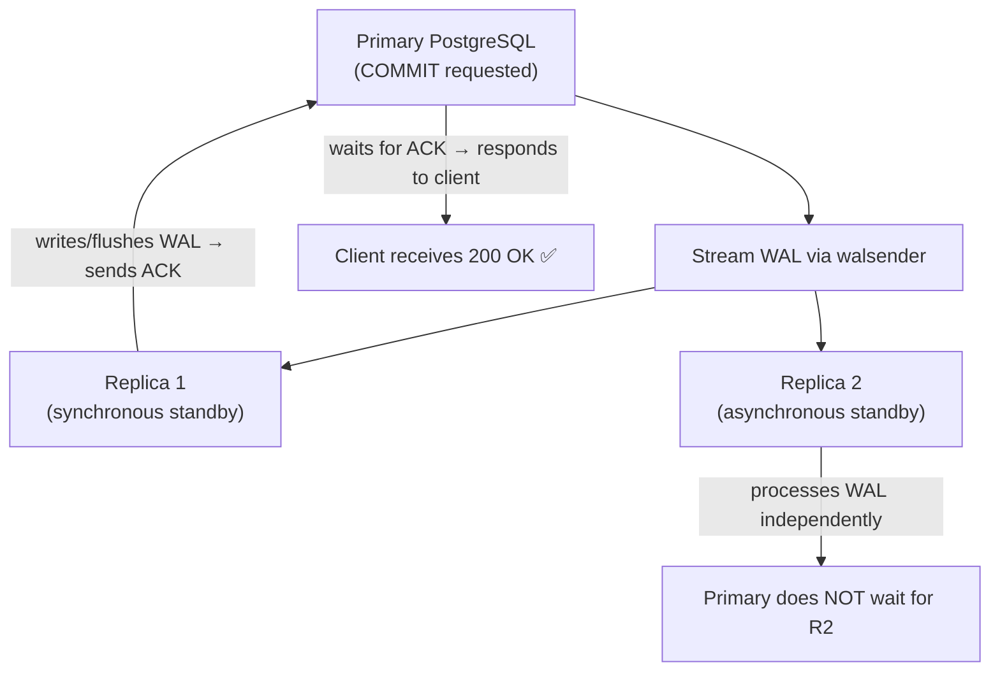

| Dimension | Asynchronous Replication | Synchronous Replication |
| :--- | :--- | :--- |
| **Commit Latency** | Low — primary proceeds as soon as local requirements are met | Higher — bound by network round-trip time (RTT) + replica disk I/O |
| **Standby Failure** | Primary continues writing uninterrupted | Primary **blocks/stalls all writes** if active sync standbys drop below quorum |
| **Replication Lag** | Replicas may lag seconds or minutes behind primary | Replicas stay in lockstep (zero or near-zero lag) |
| **Failover Risk** | Potential loss of recent transactions (RPO > 0) | Near-zero RPO for acknowledged transactions |

**`synchronous_standby_names` Configuration Options:**
```ini
# Priority-based: wait for the first 2 connected standbys in priority order
synchronous_standby_names = 'FIRST 2 (node1, node2, node3)'

# Quorum-based: wait for ANY 2 out of the 3 standbys (resilient to single node failure)
synchronous_standby_names = 'ANY 2 (node1, node2, node3)'

# Wildcard quorum: wait for any 1 connected standby
synchronous_standby_names = 'ANY 1 (*)'
```

> [!warning] Zero Data Loss Nuance
> While synchronous replication provides significantly stronger durability (RPO = 0 under standard planned failover), it does **not** guarantee zero data loss under every conceivable failure mode:
> 1. **Multiple simultaneous hardware failures** exceeding the configured quorum (e.g. primary and all synchronous standbys suffer simultaneous power failure).
> 2. **Network partitions / Split-Brain**: If stonith/fencing is misconfigured, a partitioned primary may continue accepting writes while an out-of-date standby is promoted.
> 3. **Forced failover by administrators**: If an admin promotes an asynchronous or lagging replica while the sync standby is temporarily unreachable.
> 4. **In-flight commits**: If the primary crashes after writing to local WAL and replicas, but before transmitting the network ACK back to the client, the client assumes failure even though the transaction actually committed.

> [!important] Crucial Difference
> - **Asynchronous commit** = trade-off of *local WAL durability* vs latency (survives process crash vs power failure).
> - **Asynchronous replication** = trade-off of *remote replica synchrony* vs network latency.

---

## 10. Linux Storage — Page Cache, Write-Back, fsync & SSDs

### 10.1 The Page Cache, Dirty Throttling & Direct I/O

When an application calls `write()`, Linux stores the data in RAM inside the **page cache** as "dirty pages":

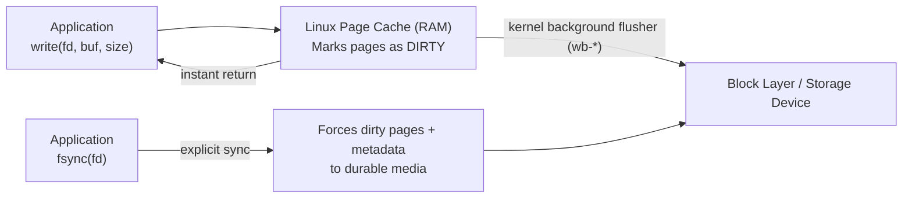

**Write-Back Throttling (Kernel sysctl parameters):**
- `vm.dirty_background_ratio` (default ~10%): When dirty pages reach this percentage of available memory, kernel background flusher threads (`wb-*`) start asynchronously writing pages out to disk.
- `vm.dirty_ratio` (default ~20%): Hard safety ceiling. If dirty memory reaches this percentage, **all writing processes calling `write()` are forcefully throttled and blocked** until dirty page memory drops below the threshold.
- `vm.dirty_expire_centisecs` (default 3000 = 30 seconds): Maximum duration a page is permitted to remain dirty before it must be queued for writeback.

**Direct I/O (`O_DIRECT`):**
Applications can bypass the Linux page cache entirely by opening files with the `O_DIRECT` flag:
- Data is transferred directly between user-space memory buffers and the storage controller via DMA (Direct Memory Access), without copying into the kernel page cache.
- Eliminates page cache CPU copy overhead and avoids polluting RAM by evicting cached application memory.
- Requires strict memory buffer and offset alignment to the underlying storage block boundaries (typically 512 or 4096 bytes).
- **Who uses Direct I/O:** Database engines like MySQL InnoDB (with `innodb_flush_method = O_DIRECT`), ScyllaDB, and virtualization hypervisors (QEMU/KVM).
- **PostgreSQL distinction (Double Buffering):** PostgreSQL's traditional storage path does **NOT** use `O_DIRECT`. PostgreSQL uses standard buffered I/O through the Linux page cache alongside its own internal `shared_buffers` pool ("double buffering"), relying on explicit `fsync()` / `fdatasync()` system calls for durability.

### 10.2 fsync() vs fdatasync()

```c
fsync(fd);      // Synchronizes dirty data pages + ALL inode metadata (atime, mtime, size)
fdatasync(fd);  // Synchronizes dirty data pages + ONLY metadata strictly required to retrieve data (e.g. file size)
```

> [!note] fsync() does NOT "disable" the page cache
> `fsync()` requests that the kernel flush all dirty pages for that specific FD down to the physical drive and issues a flush command to the drive's volatile cache. It does not disable buffering for future writes.

**Why `fdatasync()` matters for databases:**
A log file being appended to does not change its permissions or owner; only its size changes. If the file size was preallocated, `fdatasync()` skips writing updated inode timestamp blocks, reducing expensive random metadata disk writes.

### 10.3 SSD Flash Architecture, Erase Blocks & Write Amplification

| Flash Geometry | Typical Size | Operation | Constraint |
| :--- | :--- | :--- | :--- |
| **Page** | 4KB–16KB | Read & Write (Program) | Can only be written to an already erased page |
| **Block (Erase Block)** | 2MB–8MB | Erase | Must erase the entire block at once |

Because SSDs cannot overwrite data in place, updating a 4KB page requires writing the new version to an empty erased page and marking the old physical page as "invalid".

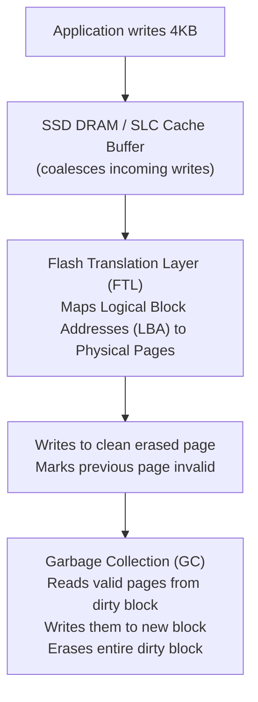

**Write Amplification Factor (WAF):**
$$\text{WAF} = \frac{\text{Bytes physically written to NAND flash}}{\text{Bytes requested by host application}}$$

> [!note] SSD Write Amplification & fsync() Nuance
> Modern SSD controllers use dynamic SLC caching, wear leveling, and internal DRAM buffers to stage and coalesce incoming writes.
> - `fsync()` requests synchronization of file data and required metadata down to durable non-volatile media, which causes the operating system to send cache flush / write barrier commands to the drive controller.
> - Frequent synchronization prevents the OS page cache and drive DRAM cache from coalescing writes into contiguous batches, increasing transaction latency ("sync stalls").
> - However, the exact impact of frequent syncs on the Write Amplification Factor (WAF) is **workload- and device-dependent**: it varies based on access patterns (random vs. sequential), available drive over-provisioning, free disk capacity, and specific SSD controller firmware algorithms. Avoid assuming a fixed universal WAF multiplier.

---

## 11. Practical Experiments on Linux

Run these commands on your Linux system to inspect processes, threads, sockets, and syscalls live:

```bash
# 1. Install necessary inspection tools
sudo apt update && sudo apt install strace lsof sysstat procps

# 2. Watch file-system syscalls from Node.js
# -f follows child threads (inspecting libuv worker pool threads)
# -tt prints microsecond timestamps
strace -f -tt -e trace=openat,read,write,close,fsync node file-read.js

# 3. Inspect Node.js process threads (Main thread vs libuv worker pool)
ps -T -p $(pgrep -n node)
# Shows SPID (thread IDs). You will see the main thread + 4 default libuv workers

# 4. Observe open file descriptors (sockets, files, epoll instance)
ls -l /proc/$(pgrep -n node)/fd/
# Inspects FD 0, 1, 2, open sockets, and eventpoll descriptors

# 5. Watch network and socket syscalls during a database/HTTP query
strace -f -e trace=network,epoll_create1,epoll_ctl,epoll_wait node database-test.js

# 6. Inspect active TCP socket buffer queues
sudo ss -t -i -a
# Displays send-q, recv-q, RTT, and TCP congestion window parameters
```

---

## 12. Corrections to Common Misconceptions & Gotchas

| Common Misconception | Precise Technical Reality |
| :--- | :--- |
| *"Node.js spawns a new thread for every file read"* | libuv uses a **shared, bounded worker thread pool** (default 4 threads, configurable up to 1024 via `UV_THREADPOOL_SIZE`). |
| *"async/await pauses or blocks the Node.js process"* | `await` suspends **only the surrounding async function's execution frame**. Control returns to the caller, and the event loop continues processing other requests. |
| *"epoll tells you when an operation has finished"* | epoll reports **readiness** (e.g. data can now be read without blocking), not completion. The application still executes the `read()` or `write()` syscall. |
| *"io_uring and epoll are essentially the same"* | epoll is **readiness-based** (monitors FDs); io_uring is **completion-based** (submits batched operations to an SQ ring, reaps completions from a CQ ring). |
| *"Node.js automatically uses io_uring for file I/O on Linux"* | Standard Node.js `fs.promises` uses the **libuv thread pool**. io_uring is a Linux kernel ABI not enabled by default in standard Node.js filesystem modules. |
| *"select() has a hard 1024 kernel limit"* | The 1024 limit is a compile-time user-space macro (`FD_SETSIZE`), not a fundamental kernel limit, but it still constrains portable user programs. |
| *"fsync() disables the Linux page cache"* | `fsync()` **synchronizes dirty pages to storage**; it does not disable kernel page buffering for subsequent operations. |
| *"Synchronous database replication guarantees zero data loss in all cases"* | It guarantees RPO = 0 under standard failover, but multi-node simultaneous failures, split-brain scenarios, or improper administrator promotions can still lose data. |
| *"Asynchronous I/O eliminates all blocking in the system"* | Worker threads in libuv, the kernel block layer, and external database processes can still block on disk access or lock contention internally. |

---

## 13. Study Roadmap

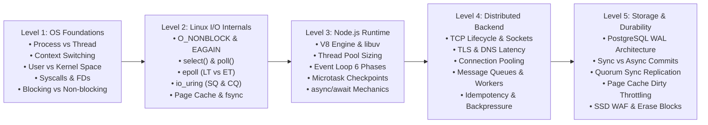

---

## 14. Glossary

| Term | Technical Definition |
| :--- | :--- |
| **Async function** | A JavaScript function returning a Promise that can suspend execution at `await` expressions without blocking the runtime thread. |
| **Callback** | A function passed as an argument to be invoked upon completion of an asynchronous task or event. |
| **Promise** | An object representing the eventual completion (fulfillment) or failure (rejection) of an asynchronous operation and its resulting value. |
| **Microtask** | A high-priority job queued in V8 (Promise reactions, `queueMicrotask`) processed immediately following the current script or callback. |
| **`process.nextTick`** | A Node.js-specific queue that drains immediately after the current operation finishes, taking precedence over Promise microtasks. |
| **Event loop** | The libuv/V8 loop mechanism that coordinates non-blocking I/O, timers, and callback execution across defined phases. |
| **libuv thread pool** | A bounded pool of OS worker threads used to execute blocking operations (file I/O, DNS `getaddrinfo`, crypto) off the main thread. |
| **File Descriptor (FD)** | An unsigned integer index in a process's file-descriptor table representing an open file, socket, pipe, or eventpoll instance. |
| **System Call (syscall)** | A low-level instruction causing a software interrupt/transition from unprivileged user space to privileged kernel space. |
| **Blocking call** | A system call that suspends the calling thread in the kernel scheduler until the requested operation completes or data is available. |
| **Non-blocking call** | A call configured to return immediately (with `EAGAIN`/`EWOULDBLOCK`) if it cannot make immediate progress without sleeping. |
| **Readiness Notification** | An OS mechanism (e.g. `epoll`) that informs an application when an FD is ready for reading or writing. |
| **Completion Notification** | An OS mechanism (e.g. `io_uring`, Windows IOCP) where the kernel executes the I/O and notifies the app when the operation has finished. |
| **epoll** | A scalable Linux-specific I/O event notification facility that monitors thousands of FDs and returns only active/ready descriptors ($O(k)$ event delivery) without scanning the entire registered set. |
| **io_uring** | A Linux asynchronous I/O interface using lockless shared ring buffers (Submission Queue and Completion Queue) to minimize syscalls. |
| **Write-Ahead Log (WAL)** | An append-only log recording state changes before they are applied to database heap pages to guarantee ACID durability. |
| **`fsync()`** | A system call that flushes dirty data and metadata for an FD from OS cache down to permanent non-volatile storage. |
| **Connection Pool** | A cache of established, reusable database/TCP connections that avoids connection-setup overhead (TCP/TLS handshakes). |
| **Message Queue** | A durable broker (RabbitMQ, Redis Streams, Kafka) that decouples producers and consumers for asynchronous background workflows. |
| **Job ID** | A persistent, globally unique identifier used by clients to poll or track the lifecycle of long-running asynchronous background jobs. |
| **Page Cache** | Transparent kernel RAM buffer caching file pages to accelerate reads and coalesce dirty writes. |
| **Write Amplification (WAF)** | The ratio of physical NAND flash bytes written relative to logical host bytes written. |

---

## 15. Prioritized Reading List & References

### Recommended Reading Order & Specific Chapters

| Priority | Book | Edition & Core Chapters to Study | Core Focus |
| :---: | :--- | :--- | :--- |
| **1** | **Operating Systems: Three Easy Pieces (OSTEP)**<br/>*Remzi H. Arpaci-Dusseau & Andrea C. Arpaci-Dusseau* | • **Virtualization:** Ch. 4 (Processes), Ch. 5 (Process API: `fork`, `exec`, `wait`), Ch. 6 (Direct Execution), Ch. 7–10 (CPU Scheduling)<br/>• **Concurrency:** Ch. 26–27 (Threads & Thread API), Ch. 28–31 (Locks, Condition Variables, Semaphores), Ch. 32 (Concurrency Bugs)<br/>• **Persistence:** Ch. 36 (I/O Devices), Ch. 37 (Hard Disks), Ch. 39 (Files & Directories), Ch. 40 (File System Implementation) | OS fundamentals, process lifecycle, thread synchronization, and disk block mechanics. |
| **2** | **The Linux Programming Interface (TLPI)**<br/>*Michael Kerrisk* | • **File I/O:** Ch. 4–5 (The Universal I/O Model, File Descriptors, `open`, `read`, `write`, `close`, `fcntl`)<br/>• **Processes & Memory:** Ch. 6 (Processes & Virtual Memory), Ch. 24–27 (Process Creation, Termination, Monitoring)<br/>• **Threads:** Ch. 29–33 (POSIX Threads: Creation, Mutexes, Condition Variables)<br/>• **Sockets:** Ch. 56–61 (Sockets Overview, UNIX Domain, Internet Domain, Advanced Sockets)<br/>• **Alternative I/O:** **Ch. 63 (Alternative I/O Models: `select`, `poll`, `epoll`)** | The authoritative manual for Linux system calls, file descriptors, and epoll mechanics. |
| **3** | **Node.js Design Patterns (3rd Edition)**<br/>*Mario Casciaro & Luciano Mammino* | • **Ch. 1:** The Node.js Platform (Reactor Pattern, libuv, Event Loop)<br/>• **Ch. 2:** The Module System (CommonJS vs ESM execution ordering)<br/>• **Ch. 4–5:** Asynchronous Control Flow with Callbacks, Promises, and async/await | Node runtime architecture, microtask scheduling, and asynchronous design patterns. |
| **4** | **Designing Data-Intensive Applications (DDIA)**<br/>*Martin Kleppmann* | • **Ch. 3:** Storage and Retrieval (SSTables, LSM-trees, B-Trees, Write-Ahead Logs)<br/>• **Ch. 5:** Replication (Synchronous vs Asynchronous, Replication Lag, Failover Risks)<br/>• **Ch. 7:** Transactions (ACID, Isolation levels, Serializability)<br/>• **Ch. 11:** Stream Processing & Message Queues | Durability trade-offs, distributed consensus, and asynchronous replication semantics. |
| **5** | **Database Internals**<br/>*Alex Petrov* | • **Part I (Storage Engines):**<br/>  - Ch. 1: Introduction & Overview (DBMS Architecture, Memory- vs. Disk-Based)<br/>  - Ch. 2–4: B-Tree Basics, File Formats (Slotted Pages), and B-Tree Implementation<br/>  - Ch. 5: Transaction Processing & Recovery (Concurrency Control, WAL, ARIES, Checkpointing)<br/>  - Ch. 6–7: B-Tree Variants (Copy-on-write, Bw-Trees) and Log-Structured Storage (LSM Trees)<br/>• **Part II (Distributed Systems):**<br/>  - Ch. 9–10: Failure Detection & Leader Election<br/>  - Ch. 11: Replication and Consistency<br/>  - Ch. 13: Distributed Transactions (Two-Phase Commit)<br/>  - Ch. 14: Consensus (Paxos, Raft) | Deep dive into database storage engines, page layouts, WAL recovery, and distributed consensus. |

### Authoritative Documentation & Specifications
- [Node.js Official Documentation — Discover Promises](https://nodejs.org/learn/asynchronous-work/discover-promises-in-nodejs)
- [Node.js Official Documentation — The Node.js Event Loop, Timers, and process.nextTick()](https://nodejs.org/learn/asynchronous-work/event-loop-timers-and-nexttick)
- [Node.js File System API — Thread Pool Behavior](https://nodejs.org/api/fs.html#threadpool-usage)
- [libuv Design and Architecture Guide — Thread Pool](https://docs.libuv.org/en/stable/threadpool.html)
- [Linux Programmer's Manual — epoll(7)](https://man.archlinux.org/man/epoll.7)
- [Linux Programmer's Manual — epoll_wait(2)](https://man7.org/linux/man-pages/man2/epoll_wait.2.html)
- [Linux Programmer's Manual — io_uring_enter(2)](https://www.man7.org/linux/man-pages/man2/io_uring_enter.2.html)
- [PostgreSQL Documentation — WAL Reliability & Checkpoints](https://www.postgresql.org/docs/current/wal-reliability.html)
- [PostgreSQL Documentation — Synchronous Replication Configuration](https://www.postgresql.org/docs/current/warm-standby.html#SYNCHRONOUS-REPLICATION)

### Selected Engineering Articles
- [IBM Developer — Introduction to the Event Loop in Node.js](https://developer.ibm.com/learningpaths/get-started-nodejs/intro-to-event-loops/)
- [ARMO — io_uring Architecture & Security Considerations](https://www.prsol.cc/2025/04/25/linux-io_uring-security-blindspot-allows-stealthy-rootkit-attacks/)
- [Percona — synchronous_commit Settings and Performance Trade-offs](https://www.percona.com/blog/synchronous-commit-in-postgresql/)
- [Crunchy Data — High Availability & Synchronous Replication in Postgres](https://www.crunchydata.com/blog/synchronous-commit-replication-tradeoffs)
- [Hashnode — From CRUD to Real Systems: Building an Async Backend with Queues](https://hashnode.com/posts/from-crud-to-real-systems-building-an-async-backend-with-queues/69c3da2948484169af7f0246)

---

## 16. Topics for Further Investigation

- Exact libuv backend selection logic across Linux versions, architectures, and Node releases
- Optimal `UV_THREADPOOL_SIZE` tuning under high-concurrency production workloads (testing diminishing returns)
- Level-triggered vs edge-triggered epoll backpressure management in high-throughput network proxies
- `io_uring` fixed buffers (`IORING_REGISTER_BUFFERS`), registered files, and polling modes (`IORING_SETUP_SQPOLL`)
- PostgreSQL `synchronous_commit`, `wal_sync_method`, `wal_writer_delay`, and `checkpoint_completion_target` interactions
- Linux dirty-page writeback tuning: `vm.dirty_background_ratio`, `vm.dirty_ratio`, and `vm.dirty_expire_centisecs`
- Socket buffer auto-tuning (`tcp_rmem`, `tcp_wmem`), TCP window scaling, and Nagle's algorithm (`TCP_NODELAY`)
- HTTP/1.1 persistent connections vs HTTP/2 multiplexing in Node.js's Undici fetch engine
- Priority inversion edge cases between `process.nextTick()`, Promise microtasks, and timer phases
- Message queue delivery semantics: at-most-once vs at-least-once, consumer heartbeats, visibility timeouts, and dead-letter queue architectures


