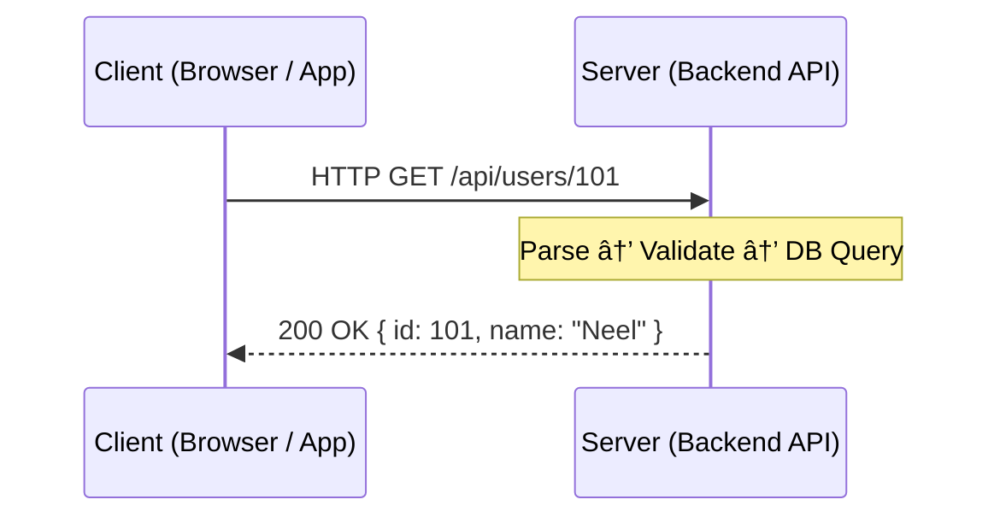
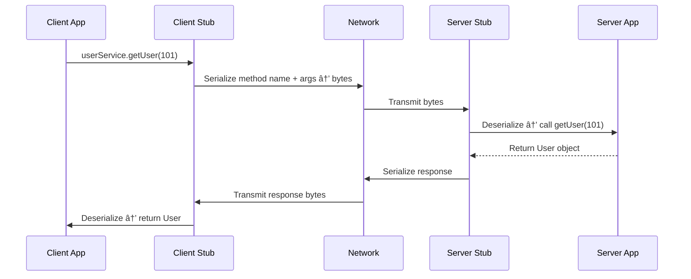
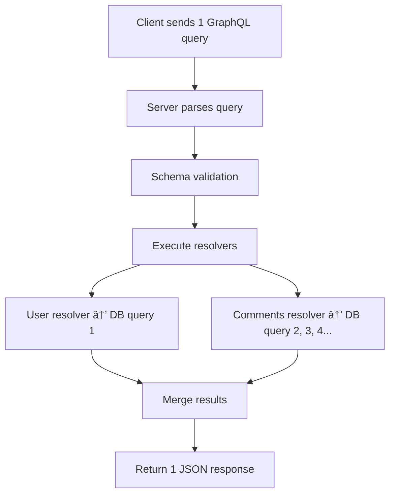
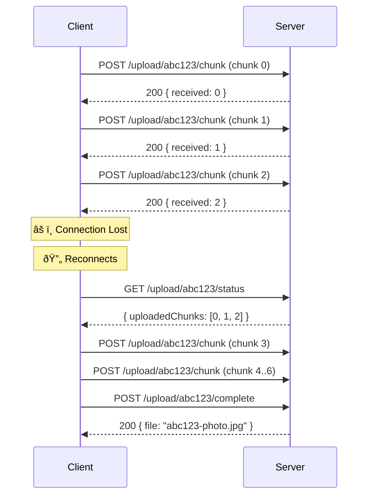
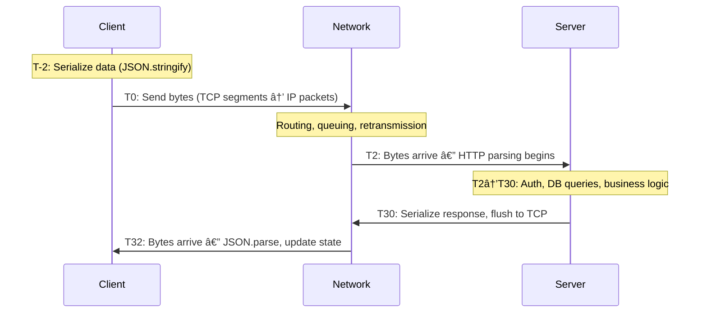
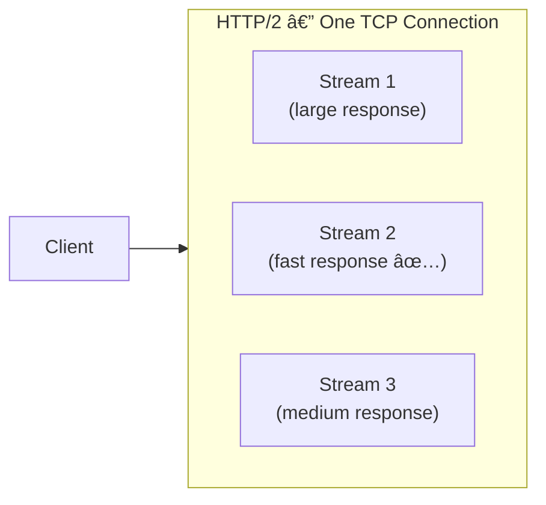

---
title: Request–Response Communication Pattern
tags:
  - backend-engineering
  - http
  - networking
  - communication-patterns
  - rpc
  - graphql
  - serialization
type: technical-note
status: active
source: Hussein Nasser — Backend Engineering Course
---

# 🔄 Request–Response Communication Pattern

### The Big Picture — Why Communication Patterns Matter

Backend applications never work in isolation. Everything communicates:

- **Browser ↔ Backend API** — user-facing apps
- **Mobile App ↔ Server** — REST or GraphQL
- **Backend ↔ Database** — SQL over TCP
- **Microservice ↔ Microservice** — RPC, HTTP, message queues
- **Notification service ↔ Connected clients** — push, polling, SSO

Understanding the **first principles** behind communication patterns is what separates engineers who *use* frameworks from engineers who can *design* systems.

| Pattern | Core Concept |
| :--- | :--- |
| **Request–Response** | Client sends a request; server responds |
| **Synchronous** | Caller waits for the result |
| **Asynchronous** | Work continues independently |
| **Push** | Server sends data to clients without a request |
| **Pull** | Client polls/fetches data on demand |
| **Long Polling** | Server holds a request until data is available |
| **Pub–Sub** | Publishers produce events; subscribers consume them |
| **Multiplexing** | Multiple logical streams share one connection |
| **Demultiplexing** | Incoming bytes are separated into the correct streams |

---

## 1. What is Request–Response?

The simplest and most widespread communication pattern. Five steps, always:

```
1. Client sends a request
2. Server receives the request
3. Server parses it (understands structure/boundaries)
4. Server processes it (executes business logic)
5. Server sends a response → Client receives it
```



> [!note] Parsing ≠ Processing
> These are two **distinct** operations the server must do:
> - **Parsing** — Where does the request start/end? What is the method, URL, headers, body format?
> - **Processing** — Actually executing the requested operation (DB queries, business logic, etc.)
>
> A slow API could be slow at *either* stage. Never assume it's always the DB.

---

## 2. The TCP Stream / Message Boundary Problem

> [!important] TCP has no concept of an "HTTP message"
> TCP provides a **continuous ordered byte stream**, not discrete messages. The application protocol must define where one message ends and the next begins.

If a client sends 3 HTTP requests back-to-back over one TCP connection, the server might receive:

```
Read 1:  [REQUEST 1 complete] + [REQUEST 2 partial...]
Read 2:  [...REQUEST 2 continued] + [REQUEST 3 complete]
```

**HTTP solves this** with its defined message structure:

| Mechanism | How It Works |
| :--- | :--- |
| **Request line** | `GET /path HTTP/1.1\r\n` — signals start |
| **Headers + empty line** | `\r\n\r\n` signals the end of headers |
| **`Content-Length`** | Tells receiver exactly how many body bytes to read |
| **`Transfer-Encoding: chunked`** | Body arrives in size-prefixed chunks, ending with `0\r\n\r\n` |
| **Connection close** | Body ends when the TCP connection closes (HTTP/1.0 only) |

```
POST /upload HTTP/1.1
Host: example.com
Content-Length: 10        ← server reads exactly 10 bytes of body

HelloWorld
```

> [!caution] TCP packets ≠ HTTP requests
> A single HTTP request can span **many TCP segments**. Multiple HTTP requests can share **one TCP connection** (HTTP keep-alive). Never conflate the two layers.

> [!tip] 📚 Resources — TCP Message Framing
> - [TCP Message Framing — Stephen Cleary](https://blog.stephencleary.com/2009/04/message-framing.html) — definitive explanation of why TCP is a stream and how protocols define message boundaries

---

## 3. Serialization & Deserialization

**Serialization** converts an in-memory application object into a transmittable format.
**Deserialization** is the reverse — received bytes → usable application object.

```mermaid
flowchart LR
    A["App Object\n{ id: 101, name: 'Neel' }"] -->|JSON.stringify| B["JSON Bytes\n{\"id\":101,\"name\":\"Neel\"}"]
    B -->|Network| C["Received Bytes"]
    C -->|JSON.parse| D["App Object\n{ id: 101, name: 'Neel' }"]
```

### Format Comparison

| Format | Human Readable | Size | Parse Speed | Schema Required | Use Case |
| :--- | :---: | :--- | :--- | :---: | :--- |
| **JSON** | ✅ | Medium | Fast (native in JS) | ❌ | Web APIs, REST |
| **XML / SOAP** | ✅ | Large (verbose) | Slow (string parsing) | Optional | Legacy enterprise |
| **Protocol Buffers** | ❌ | Small (binary) | Very fast | ✅ | gRPC, internal services |
| **MessagePack** | ❌ | Small (binary) | Fast | ❌ | High-throughput APIs |

```proto
// protobuf schema — field names are NOT transmitted, only field numbers
syntax = "proto3";
message User {
  int32  id     = 1;
  string name   = 2;
  bool   active = 3;
}
```

> [!tip] JSON is not always slow; Protobuf is not always faster
> Performance depends on **payload size**, **runtime**, and **implementation quality**.
> A large JSON payload parsed in C++ with a naive parser can be a bottleneck.
> In Node.js, `JSON.parse` / `JSON.stringify` are native and usually fast enough.
> Measure first, optimize second.

**Why did the industry move from SOAP/XML → REST/JSON?**
XML is verbose — more bytes to transmit, more characters to parse. JSON maps naturally to JavaScript objects and is simpler to work with in web environments.

> [!tip] 📚 Resources — Serialization Formats
> - [Choosing Serialization Formats in Go — Rotational](https://rotational.io/blog/go-serialization-formats/)
> - [Serialization Performance Issues — OneUptime](https://oneuptime.com/blog/post/2026-01-24-serialization-performance/view)
> - [MessagePack Overview — GitHub](https://github.com/techishthoughts-org/java_serialization_frameworks/blob/main/docs/frameworks/msgpack.md)

---

## 4. Where is Request–Response Used?

### 4.1 HTTP

The backbone of the web. Every browser request is Request–Response.

**Internal lifecycle of one HTTP request:**

```
1. DNS resolution       → hostname → IP address
2. TCP handshake        → establish connection (SYN / SYN-ACK / ACK)
3. TLS handshake        → (HTTPS only) negotiate cipher, exchange keys
4. HTTP request sent    → headers + optional body
5. Server parses        → identifies method, path, headers, body
6. Server executes      → business logic, DB queries, external calls
7. HTTP response sent   → status line + headers + body
8. Client parses        → deserialize body, update UI
```

> [!note] HTTP Version Transport Differences
> - **HTTP/1.1** → TCP (one request per connection, or pipelined with ordering constraints)
> - **HTTP/2** → TCP with multiplexed streams (many requests per connection)
> - **HTTP/3** → QUIC over UDP (stream-level loss recovery, no TCP HOL blocking)

> [!tip] 📚 Resources — HTTP Messages
> - [MDN — HTTP Messages: Anatomy, Requests & Responses](https://developer.mozilla.org/en-US/docs/Web/HTTP/Guides/Messages)

---

### 4.2 DNS — Request–Response Over UDP

DNS is a pure Request–Response protocol. The client asks for a name → server returns an IP.


> [!important] DNS Query ID — Never Assume Response Order
> DNS sends multiple queries concurrently. Each query gets a **Transaction ID**. Responses can arrive **out of order** — the client uses the ID to match them.
>
> | Query ID | Question | Response Arrives |
> | :--- | :--- | :--- |
> | 1001 | google.com | 2nd |
> | 1002 | youtube.com | 3rd |
> | 1003 | github.com | 1st ✅ |
>
> **Lesson:** Never assume network responses arrive in request order. Always correlate with IDs.

**DNS transport:** UDP port 53 (small queries). Falls back to TCP for large responses. Also supports DoT (DNS-over-TLS) and DoH (DNS-over-HTTPS) for encryption.

---

### 4.3 RPC — Remote Procedure Call

RPC makes a network call **look like a local function call**.

```javascript
// Looks local — but executes on a remote machine
const user = await userService.getUser(101);
```

**Internal RPC flow:**



> [!warning] Leaky Abstraction — RPC's Hidden Danger
> The abstraction hides network reality. A "local" function call takes **microseconds**. The same call over RPC can take **hundreds of milliseconds** and can fail because:
> - The network is unavailable
> - The remote server is down
> - The request timed out
> - The request succeeded but the **response was lost** (did the work happen?)
>
> Always handle RPC failures explicitly. Never treat remote calls as local calls.

---

### 4.4 SQL — Database as Request–Response

Every SQL query is a request–response exchange over a TCP connection.

```sql
SELECT * FROM users WHERE id = 101;
```

**What the database actually does:**

```
1. Receive query bytes over TCP
2. Parse SQL syntax → AST (Abstract Syntax Tree)
3. Semantic check → resolve table names, columns, permissions
4. Query planner → build an execution plan
5. Optimizer → choose access strategy (index scan? full scan?)
6. Execute → retrieve rows
7. Serialize result set → send back over TCP
```

| Access Strategy | When Used | Performance |
| :--- | :--- | :--- |
| **Index Scan** | Selective predicate on indexed column | Fast — $O(\log n)$ lookup |
| **Index-Only Scan** | All needed data is in the index itself | Fastest — no heap access |
| **Bitmap Index Scan** | Multiple conditions combined | Good for moderate selectivity |
| **Full Table Scan (Seq Scan)** | No useful index, or most rows needed | Expected $O(n)$ — not always bad |

---

### 4.5 REST APIs

**REST (Representational State Transfer)** — an architectural style, not a protocol. Uses HTTP + JSON by convention.

```
GET    /api/users/101    → fetch user
POST   /api/users        → create user
PUT    /api/users/101    → replace user
PATCH  /api/users/101    → partial update
DELETE /api/users/101    → delete user
```

Each HTTP method maps to a CRUD operation on a resource. Every interaction is Request–Response.

---

### 4.6 SOAP APIs

**SOAP (Simple Object Access Protocol)** — XML-based messaging, common in enterprise systems.

```xml
<soap:Envelope>
  <soap:Body>
    <GetUser>
      <UserId>101</UserId>
    </GetUser>
  </soap:Body>
</soap:Envelope>
```

> [!note] Don't Optimize What Isn't Broken
> SOAP still runs billions of transactions daily in banking, healthcare, and telecom. Don't replace a working system without a concrete, measured reason.

---

### 4.7 GraphQL

GraphQL solves the **N+1 request problem** in REST — the client needed to make multiple round trips to fetch related data.

```graphql
# One request fetches everything the client needs
query {
  user(id: 101) {
    fullName
    comments(after: "2026-01-01") {
      text
      createdAt
    }
  }
}
```

**Internal GraphQL execution:**



> [!warning] GraphQL ≠ Fewer DB Queries
> One GraphQL request can trigger **many SQL queries** internally. The N+1 problem moves from client→server to resolver→database. Use the **DataLoader pattern** (request batching + caching) to prevent this.

> [!tip] 📚 Resources — GraphQL & DataLoader
> - [GraphQL N+1 Problem & DataLoader — Official graphql-js docs](https://www.graphql-js.org/docs/n1-dataloader/)
> - [DataLoader Batching — Chillicream Hot Chocolate](https://chillicream.com/docs/hotchocolate/fetching-data/batching/dataloader)
> - [GraphQL DataLoader Example Repository — GitHub](https://github.com/nickqweaver/graphql-dataloader-example)

---

## 5. Anatomy of an HTTP Request & Response

Both client and server must agree on the **protocol** (communication rules) and **message format** (data representation). Without agreement, bytes are meaningless.

### HTTP/1.1 Request Structure

```
GET /users/101 HTTP/1.1\r\n         ← Request line: method + path + version
Host: example.com\r\n               ← Required header (HTTP/1.1)
User-Agent: curl/8.5.0\r\n
Accept: application/json\r\n
\r\n                                ← Empty line = end of headers
                                    ← (no body for GET)
```

| Component | Meaning |
| :--- | :--- |
| `GET` | HTTP method (verb) |
| `/users/101` | Request-URI (resource path) |
| `HTTP/1.1` | Protocol version |
| `Host` | Virtual host routing (required) |
| `User-Agent` | Client identification |
| `Accept` | MIME types the client can handle |
| `\r\n\r\n` | Header terminator — signals start of body |

### HTTP/1.1 Response Structure

```
HTTP/1.1 200 OK\r\n
Content-Type: application/json\r\n
Content-Length: 35\r\n
\r\n
{"id":101,"name":"Neel","role":"dev"}
```

### Who Actually Parses This?

You don't write HTTP parsing code — the **HTTP library** does it for you.

```javascript
// Node.js built-in HTTP server — handles TCP + HTTP parsing
const http = require("node:http");

const server = http.createServer((req, res) => {
  // `req` is already fully parsed: method, url, headers, body stream
  console.log(req.method);   // "GET"
  console.log(req.url);      // "/users/101"
  console.log(req.headers);  // { host: "...", accept: "..." }
  res.end("Hello");
});

server.listen(3000);
```

```javascript
// Express wraps Node's HTTP — adds routing + middleware
const express = require("express");
const app = express();

app.use(express.json()); // ← deserializes JSON body for you

app.post("/users", (req, res) => {
  console.log(req.body); // ← already a JS object, not raw bytes
  res.status(201).json({ id: 1, ...req.body });
});

app.listen(3000);
```

> [!note] The work is still happening — libraries just hide it
> `express.json()` reads the raw body stream, checks `Content-Type`, calls `JSON.parse()`, and assigns the result to `req.body`. Every byte still gets processed.

---

## 6. Image Upload — Single vs Chunked

A concrete example of how the Request–Response pattern handles large data.

### 6.1 Approach 1: Single-Request Upload

```
POST /upload HTTP/1.1
Content-Type: image/jpeg
Content-Length: 5242880     ← 5 MB

[raw binary image bytes...]
```

| ✅ Pros | ❌ Cons |
| :--- | :--- |
| Simple — one request | Server size limits may reject large files |
| No chunk tracking needed | Network interruption = restart from zero |
| Easy error handling | High memory pressure on server |

> [!note] Streaming vs Buffering
> Sending an image in one request does **not** mean loading it all into RAM. Node.js can process the request body as a **readable stream** — bytes flow through without being buffered entirely.

**Node.js + Express (Multer) implementation:**

```javascript
const express = require("express");
const multer  = require("multer");
const path    = require("path");

const app = express();

// 1. Store files on disk with auto-generated filenames
const storage = multer.diskStorage({
  destination: (req, file, cb) => cb(null, "uploads/"),
  filename:    (req, file, cb) => cb(null, Date.now() + path.extname(file.originalname))
});

const upload = multer({
  storage,
  limits: { fileSize: 50 * 1024 * 1024 } // 50 MB hard limit
});

// 2. Single-file upload endpoint
app.post("/upload", upload.single("image"), (req, res) => {
  res.status(201).json({
    message: "Uploaded successfully",
    file: req.file.filename
  });
});

app.listen(3000, () => console.log("Server on :3000"));
```

```bash
# Upload using curl
curl -X POST http://localhost:3000/upload -F "image=@./photo.jpg"
```

---

### 6.2 Approach 2: Chunked / Resumable Upload

For large files (e.g. 700 MB), split the file into smaller pieces and send each independently.

```
Original: 700 MB
→ Chunk 0: 100 MB  → POST /upload/abc123/chunk  { chunkNumber: 0, totalChunks: 7 }
→ Chunk 1: 100 MB  → POST /upload/abc123/chunk  { chunkNumber: 1, totalChunks: 7 }
→ ...
→ Chunk 6: 100 MB  → POST /upload/abc123/chunk  { chunkNumber: 6, totalChunks: 7 }
→ Assemble         → POST /upload/abc123/complete
```



> [!tip] This pattern is called a **Resumable Upload**
> Services like Google Drive, YouTube, and S3 Multipart Upload use exactly this pattern. The client can disconnect, reconnect, check which chunks the server already has, and resume from where it left off.

**Server (`server.js`):**

```javascript
const express = require("express");
const multer  = require("multer");
const fs      = require("fs");
const path    = require("path");

const app      = express();
const TEMP_DIR = "temp";
const OUT_DIR  = "uploads";

app.use(express.json());
fs.mkdirSync(TEMP_DIR, { recursive: true });
fs.mkdirSync(OUT_DIR,  { recursive: true });

const upload = multer({ dest: TEMP_DIR, limits: { fileSize: 5 * 1024 * 1024 } });

// 1. Receive a single chunk
app.post("/upload/:uploadId/chunk", upload.single("chunk"), (req, res) => {
  const { uploadId } = req.params;
  const { chunkNumber, totalChunks } = req.body;

  if (!/^[a-zA-Z0-9_-]+$/.test(uploadId)) {
    fs.unlinkSync(req.file.path);
    return res.status(400).json({ error: "Invalid upload ID" });
  }

  const index = Number(chunkNumber);
  const total = Number(totalChunks);

  if (!Number.isInteger(index) || !Number.isInteger(total) || total < 1 || index < 0 || index >= total) {
    fs.unlinkSync(req.file.path);
    return res.status(400).json({ error: "Invalid chunk metadata" });
  }

  const chunkDir = path.join(TEMP_DIR, uploadId);
  fs.mkdirSync(chunkDir, { recursive: true });
  fs.renameSync(req.file.path, path.join(chunkDir, `chunk-${index}`));

  res.json({ message: "Chunk received", uploadId, chunkNumber: index, totalChunks: total });
});

// 2. Query which chunks are already uploaded (enables resume)
app.get("/upload/:uploadId/status", (req, res) => {
  const chunkDir = path.join(TEMP_DIR, req.params.uploadId);
  if (!fs.existsSync(chunkDir)) return res.json({ uploadedChunks: [] });

  const uploadedChunks = fs.readdirSync(chunkDir)
    .filter(f => /^chunk-\d+$/.test(f))
    .map(f => Number(f.replace("chunk-", "")));

  res.json({ uploadedChunks });
});

// 3. Assemble all chunks into the final file
app.post("/upload/:uploadId/complete", async (req, res) => {
  const { uploadId } = req.params;
  const { totalChunks, filename } = req.body;
  const total    = Number(totalChunks);
  const chunkDir = path.join(TEMP_DIR, uploadId);

  // Validate every chunk exists before attempting assembly
  for (let i = 0; i < total; i++) {
    if (!fs.existsSync(path.join(chunkDir, `chunk-${i}`))) {
      return res.status(400).json({ error: "Missing chunks", missingChunk: i });
    }
  }

  const output = path.join(OUT_DIR, `${uploadId}-${filename}`);

  try {
    await new Promise((resolve, reject) => {
      const ws = fs.createWriteStream(output);
      ws.on("error", reject);
      ws.on("finish", resolve);

      (async () => {
        for (let i = 0; i < total; i++) {
          await new Promise((res, rej) => {
            const rs = fs.createReadStream(path.join(chunkDir, `chunk-${i}`));
            rs.on("error", rej);
            rs.on("end", res);
            rs.pipe(ws, { end: false }); // don't close ws between chunks
          });
        }
        ws.end();
      })().catch(e => ws.destroy(e));
    });

    fs.rmSync(chunkDir, { recursive: true, force: true }); // cleanup temp files
    res.json({ message: "Upload completed", file: output });
  } catch {
    res.status(500).json({ error: "Assembly failed" });
  }
});

app.listen(3000, () => console.log("Chunk upload server on :3000"));
```

**Client (`client.js`) with auto-resume:**

```javascript
const fs       = require("fs");
const path     = require("path");
const axios    = require("axios");
const FormData = require("form-data");

const FILE       = "./photo.jpg";
const CHUNK_SIZE = 1024 * 1024; // 1 MB per chunk
const UPLOAD_ID  = "image-upload-" + Date.now();
const BASE_URL   = "http://localhost:3000";

async function uploadWithResume() {
  const fileSize    = fs.statSync(FILE).size;
  const totalChunks = Math.ceil(fileSize / CHUNK_SIZE);

  // 1. Check which chunks already uploaded (supports resume)
  const { data } = await axios.get(`${BASE_URL}/upload/${UPLOAD_ID}/status`);
  const uploaded  = new Set(data.uploadedChunks);

  // 2. Upload only missing chunks
  for (let i = 0; i < totalChunks; i++) {
    if (uploaded.has(i)) {
      console.log(`Skipping chunk ${i} (already uploaded)`);
      continue;
    }

    const start = i * CHUNK_SIZE;
    const end   = Math.min(start + CHUNK_SIZE, fileSize);
    const form  = new FormData();

    form.append("chunk",       fs.createReadStream(FILE, { start, end: end - 1 }), { filename: `chunk-${i}` });
    form.append("chunkNumber", String(i));
    form.append("totalChunks", String(totalChunks));

    await axios.post(`${BASE_URL}/upload/${UPLOAD_ID}/chunk`, form, { headers: form.getHeaders() });
    console.log(`✅ Chunk ${i + 1}/${totalChunks}`);
  }

  // 3. Tell server to assemble
  await axios.post(`${BASE_URL}/upload/${UPLOAD_ID}/complete`, {
    totalChunks,
    filename: path.basename(FILE)
  });

  console.log("🎉 Upload complete!");
}

uploadWithResume().catch(console.error);
```


> [!note] 📚 Resources — File Upload Architecture
> - [AWS S3 Multipart Upload Guide](https://docs.aws.amazon.com/AmazonS3/latest/userguide/mpu-upload-object.html)
> - [AWS S3 Multipart Upload Overview](https://docs.aws.amazon.com/AmazonS3/latest/userguide/mpuoverview.html)
> - [AWS Multipart Upload — AWS Blog](https://aws.amazon.com/blogs/aws/amazon-s3-multipart-upload/)
> - [AWS Amplify Resumable Uploads](https://aws.amazon.com/about-aws/whats-new/2021/10/aws-amplify-javascript-file-uploads-storage/)
> - [Uploading Large Files Without Killing Server Memory — Filestack](https://blog.filestack.com/uploading-large-files-server-memory/)
> - [Multipart & Chunked Uploads — Codelit](https://codelit.io/blog/api-multipart-file-upload)
> - [File Upload Pipeline: Presigned URLs, Chunked Uploads & S3 at Scale](https://letsbuildsolutions.com/blog/system-design/designing-a-file-upload-pipeline-presigned-urls-chunked-uploads-and-processing-at-scale/)
---

## 7. Limitations of Request–Response

### 7.1 The Notification Problem (Polling)

Request–Response requires the **client to initiate** every exchange. But what if the **server** needs to notify clients about events (new message, login alert, video upload)?

**Naive solution — Polling:**

```javascript
// Client asks every 5 seconds: "Any notifications?"
setInterval(async () => {
  const res  = await fetch("/notifications");
  const data = await res.json();
  if (data.notifications.length) display(data.notifications);
}, 5000);
```

**The math problem with polling at scale:**

$$\text{RPS} = \frac{\text{Clients}}{\text{Interval (seconds)}} = \frac{100{,}000}{5} = 20{,}000 \text{ req/s}$$

20,000 requests per second — even when **nothing has changed**.

| Problem | Impact |
| :--- | :--- |
| Empty responses are wasted work | CPU + network overhead |
| Latency = polling interval | 5s poll = up to 5s delay for notifications |
| Does not scale | 100k clients × frequent polls = huge server load |

**Better alternatives:** Long Polling, WebSockets, Server-Sent Events (SSE), Push notifications.

> [!tip] 📚 Resources — Polling & Real-Time Communication
> - [Polling, Long Polling, SSE & WebSockets — Technical Analysis](https://ssup2.github.io/blog-software/en/docs/theory-analysis/web-polling-long-polling-server-sent-events-websocket/)
> - [Long Polling vs WebSockets vs SSE — Medium System Design Blog](https://medium.com/system-design-blog/long-polling-vs-websockets-vs-server-sent-events-5a2d1c9e8d1f)

---

### 7.2 Long-Running Requests

```
POST /api/generate-report   → server takes 2 minutes
```

The client holds the connection open, waiting. What happens if it disconnects?

```
Client sends request  →  Server starts processing (2 min job)
      ↓
Client loses internet connection
      ↓
Server finishes the job, sends response — to nobody
      ↓
Client reconnects — has NO idea if the job succeeded
```

**Questions that have no good answers with naive Request–Response:**
- Did the server finish?
- Should I retry? Could retrying cause duplicates?
- Is the job still running?

**Solution — Async Job Pattern:**

```javascript
// 1. Accept the job, return immediately with a job ID
app.post("/api/reports", async (req, res) => {
  const jobId = await jobQueue.enqueue("generate-report", req.body);
  res.status(202).json({ jobId, status: "queued" }); // 202 Accepted
});

// 2. Client polls for status (or uses webhooks/SSE for push)
app.get("/api/reports/:jobId", async (req, res) => {
  const job = await jobQueue.getStatus(req.params.jobId);
  res.json({
    jobId:       job.id,
    status:      job.status,       // "queued" | "running" | "completed" | "failed"
    downloadUrl: job.downloadUrl   // available when completed
  });
});
```

> [!tip] 202 Accepted
> HTTP status `202 Accepted` means "I received your request and will process it, but I haven't done it yet." It's the correct status for async job submission.

---

## 8. Synchronous vs Asynchronous Execution

| Feature | Synchronous | Asynchronous |
| :--- | :--- | :--- |
| **Caller behavior** | Blocks until result arrives | Continues doing other work |
| **Execution model** | Sequential by default | Can overlap / interleave |
| **Best for** | Dependent sequential steps | I/O, background jobs, parallel fetches |

**Sync — sequential, one waits for the previous:**

```javascript
const user   = await getUser(101);    // wait...
const orders = await getOrders(101);  // wait again...
// Total time ≈ getUser + getOrders
```

**Async — concurrent, both in flight simultaneously:**

```javascript
const [user, orders] = await Promise.all([getUser(101), getOrders(101)]);
// Total time ≈ max(getUser, getOrders) — not the sum
```

> [!note] Async ≠ Parallel (in Node.js)
> Node.js runs JS on a **single thread**. `Promise.all` doesn't create new threads — it fires off multiple I/O operations and lets the event loop handle them. For CPU-heavy parallel work, use `worker_threads`.

---

## 9. Request–Response Full Lifecycle & Latency Model

One of the most important mental models for backend engineers. A request is not just one arrow on a diagram.



$$T_{\text{total}} = T_{\text{serialize}} + T_{\text{network\_out}} + T_{\text{server}} + T_{\text{network\_back}} + T_{\text{deserialize}}$$

| Phase | What's Happening | Common Bottlenecks |
| :--- | :--- | :--- |
| **T-2 → T0** | Serialize request, write to socket | Large payloads, slow JSON.stringify |
| **T0 → T2** | TCP segmentation, IP routing, delivery | Geographic distance, packet loss, congestion |
| **T2 → T30** | Parse HTTP, auth, DB queries, business logic | N+1 queries, missing indexes, external API calls |
| **T30 → T32** | Serialize response, transmit, parse at client | Large response bodies, slow JSON.parse |

> [!important] Slow API ≠ Slow Database
> The bottleneck can be at **any phase**. Profile all phases before optimizing. A `200ms` API response might be `5ms` DB + `195ms` JSON serialization of a huge payload.

---

## 10. curl Experiment — HTTP Internals in Practice

Understanding what happens when you run:

```bash
curl --trace trace.txt http://youtube.com
```

### DNS Resolution

```
== Info: Host youtube.com:80 was resolved.
== Info: IPv6: 2404:6800:4000:101f::5b, ...
== Info: IPv4: 192.178.174.91, ...
```

curl resolved `youtube.com` → got both IPv4 and IPv6 addresses back. This is the DNS Request–Response from Section 4.2 happening in practice.

### TCP Connection

```
== Info: Trying [2404:6800:4000:101f::5b]:80...
== Info: Connected to youtube.com port 80
```

curl preferred IPv6, connected on port 80 (plain HTTP). TCP 3-way handshake completed before any HTTP bytes were sent.

### The Actual HTTP Request — Raw Bytes

```
=> Send header, 74 bytes (0x4a)
0000: 47 45 54 20 2f 20 48 54 54 50 2f 31 2e 31 0d 0a
0010: 48 6f 73 74 3a 20 79 6f 75 74 75 62 65 2e 63 6f
...
```

Decoded:

```
GET / HTTP/1.1\r\n
Host: youtube.com\r\n
User-Agent: curl/8.5.0\r\n
Accept: */*\r\n
\r\n                    ← end of headers, no body (GET request)
```

| Hex | ASCII | Role |
| :--- | :--- | :--- |
| `47 45 54` | `GET` | HTTP method |
| `20` | ` ` | Space separator |
| `2F` | `/` | Request path |
| `0D 0A` | `\r\n` | CRLF — HTTP line terminator |
| `0D 0A 0D 0A` | `\r\n\r\n` | Double CRLF = end of headers |

### The 301 Redirect Response

```
<= Recv header: HTTP/1.1 301 Moved Permanently
<= Recv header: Location: https://youtube.com/
<= Recv header: Content-Length: 0
```

| Header | Meaning |
| :--- | :--- |
| `301 Moved Permanently` | Resource has a new permanent location |
| `Location: https://...` | Go here instead |
| `Content-Length: 0` | No body — just a redirect instruction |
| `Cache-Control: no-cache` | Don't cache this redirect response |
| `X-Content-Type-Options: nosniff` | Prevents MIME-type sniffing attacks |

**Why didn't curl follow the redirect?** curl doesn't follow redirects by default. The server responded and curl stopped.

```bash
curl -L http://youtube.com          # follow redirect
curl -IL http://youtube.com         # headers only, follow redirect
curl --trace trace.txt -L http://youtube.com  # full trace with redirect
curl -4 -v http://youtube.com       # force IPv4
curl -6 -v http://youtube.com       # force IPv6
curl -i https://example.com         # show both response headers + body
```

> [!note] `=> Send` vs `<= Recv` in curl trace
> `=>` = data your client **sent**. `<=` = data your client **received**. This is the Request–Response arrows made visible at byte level.

---

## 11. Head-of-Line Blocking & HTTP Pipelining

### HTTP/1.1 Pipelining

Allows sending multiple requests without waiting for each response:

```
Client → Request 1
Client → Request 2    (without waiting for Response 1)
Client → Request 3
Server ← Response 1
Server ← Response 2   (must be in order!)
Server ← Response 3
```

**The problem:** HTTP/1.1 requires responses **in request order**. If Request 1 takes 10 seconds, Responses 2 and 3 (which are ready in 20ms and 50ms) are blocked behind it.

This is **Head-of-Line (HOL) Blocking** at the application layer.

| Version | Transport | HOL Blocking | Solution |
| :--- | :--- | :--- | :--- |
| **HTTP/1.1** | TCP | ✅ Application-level (pipelining order) | Multiple connections (browsers open 6) |
| **HTTP/2** | TCP | ⚠️ Transport-level (packet loss) | Multiplexed streams — interleaved frames |
| **HTTP/3** | QUIC (UDP) | ✅ Eliminated | Independent stream delivery in QUIC |



> [!note] HTTP/2 Multiplexing
> HTTP/2 breaks requests and responses into **frames** that can be interleaved on a single TCP connection. Stream 2's response doesn't wait for Stream 1 to finish.

> [!note] HTTP/3 & QUIC
> HTTP/3 runs over **QUIC** (which uses UDP internally). QUIC implements reliable delivery **per stream** — a lost packet for Stream 1 doesn't stall Streams 2 and 3.

> [!tip] 📚 Resources — Head-of-Line Blocking & HTTP/3
> - [MDN — Head-of-Line Blocking](https://developer.mozilla.org/en-US/docs/Glossary/Head_of_line_blocking)
> - [HTTP/3 & QUIC: Prioritization & HOL Blocking — APNIC](https://blog.apnic.net/2022/11/30/http-3-and-quic-prioritization-and-head-of-line-blocking/)
> - [HTTP/3 Facts — Red Hat](https://www.redhat.com/zh-tw/blog/http3)
> - [QUIC & HTTP/3 Web Performance](https://javascript-conference.com/blog/quic-and-http-3-the-next-step-in-web-performance/)
> - [QUIC & HTTP/3 — System Design Space](https://system-design.space/en/chapter/quic-http3-protocol/)
> - [HTTP/3 Open Source Support & Limitations — HTTP Toolkit](https://httptoolkit.com/blog/http3-quic-open-source-support-nowhere/)

---

## 12. Key Engineering Takeaways

1. **TCP is a byte stream** — protocols must define their own message boundaries (`Content-Length`, `\r\n\r\n`, chunked encoding).
2. **Parsing ≠ Processing** — always two distinct costs; both contribute to latency.
3. **Serialization is not free** — large payloads + frequent serialization = measurable CPU overhead.
4. **Never assume response order** — use correlation IDs, job IDs, DNS transaction IDs.
5. **Request–Response isn't always enough** — notifications, real-time data, and long jobs need better patterns.
6. **Leaky abstractions kill you** — RPC looks local but fails like a network. Know what's under your abstractions.
7. **GraphQL reduces client requests, not DB queries** — use DataLoader to solve resolver N+1.
8. **Chunked uploads = resilience** — if a single-request upload dies, you restart from zero. Chunks let you resume.
9. **Async job pattern for long work** — return a job ID immediately (`202 Accepted`), let the client poll or subscribe for completion.
10. **Total latency = all phases** — serialize + network\_out + server + network\_back + deserialize. Profile all of them.

---

## 13. What to Study Next


