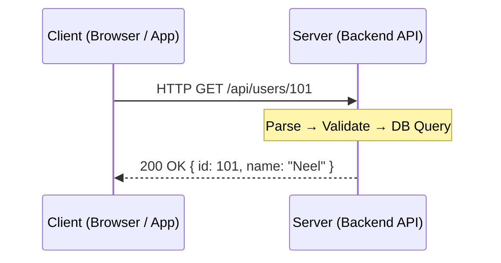
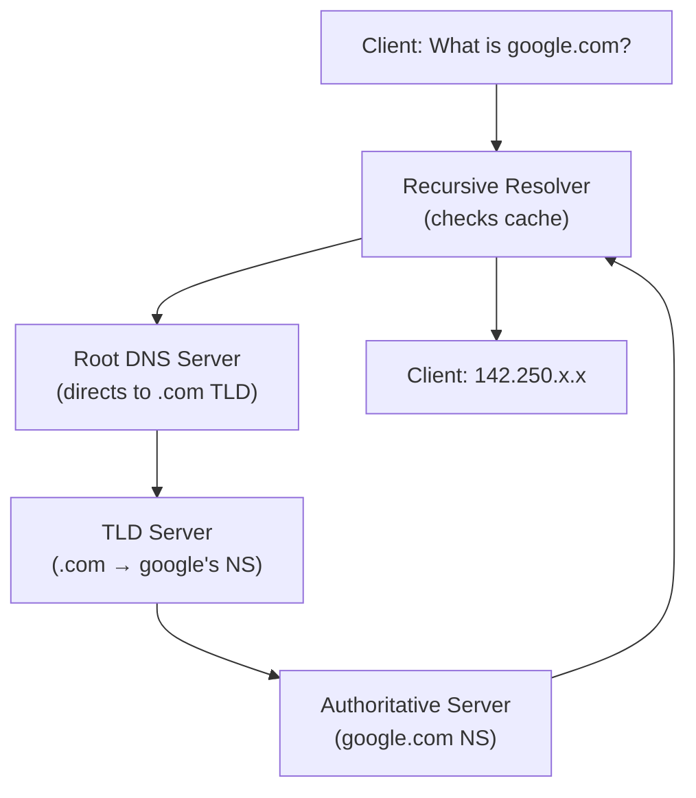
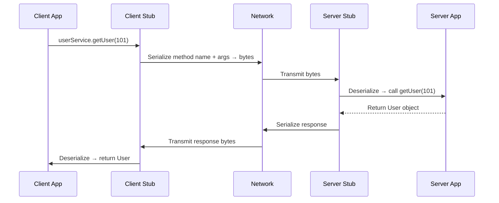
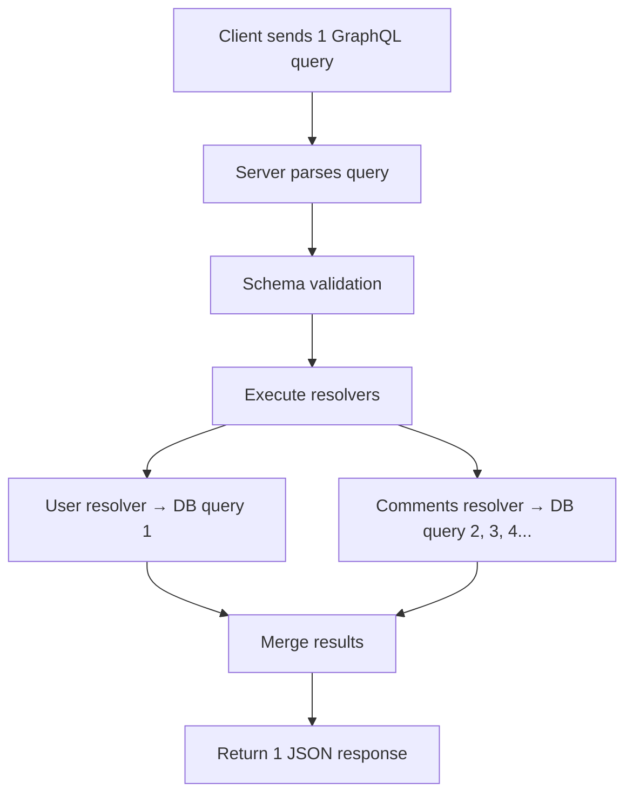
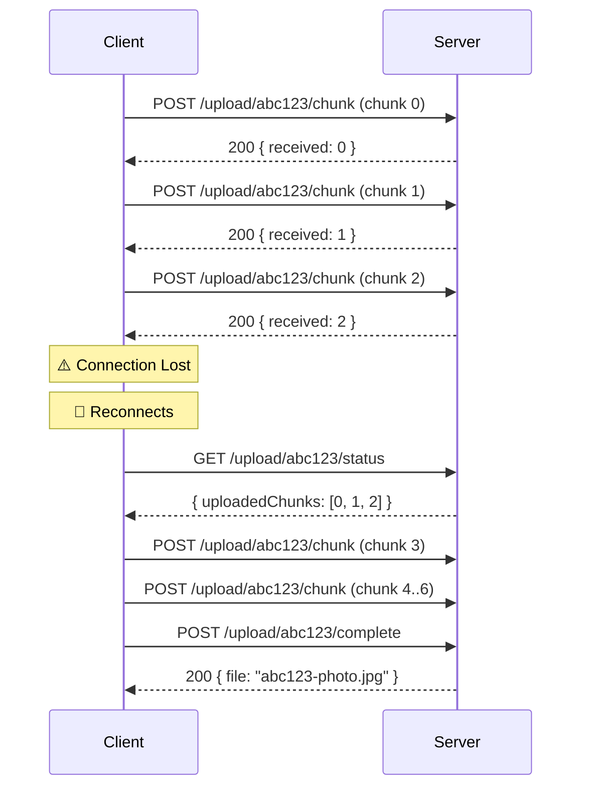
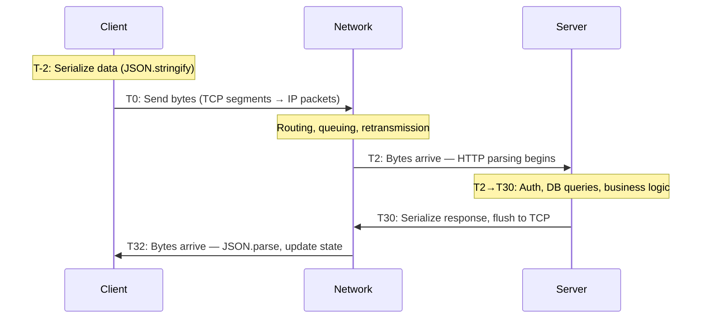
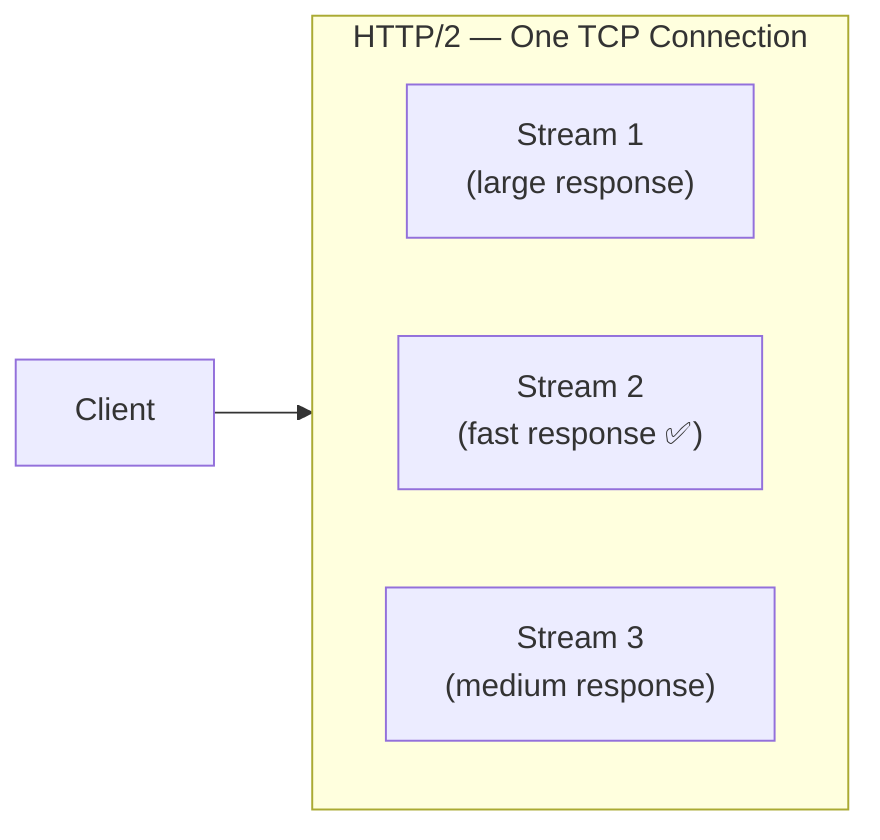

# 🔄 Request–Response Communication Pattern

### The Big Picture — Why Communication Patterns Matter

Backend applications never work in isolation. Everything communicates:

- **Browser ↔ Backend API** — user-facing apps
- **Mobile App ↔ Server** — REST or GraphQL
- **Backend ↔ Database** — SQL over TCP
- **Microservice ↔ Microservice** — RPC, HTTP, message queues
- **Notification service ↔ Connected clients** — push, polling, SSO

Understanding the **first principles** behind communication patterns is what separates engineers who *use* frameworks from engineers who can *design* systems.

| Pattern | Core Concept |
| :--- | :--- |
| **Request–Response** | Client sends a request; server responds |
| **Synchronous** | Caller waits for the result |
| **Asynchronous** | Work continues independently |
| **Push** | Server sends data to clients without a request |
| **Pull** | Client polls/fetches data on demand |
| **Long Polling** | Server holds a request until data is available |
| **Pub–Sub** | Publishers produce events; subscribers consume them |
| **Multiplexing** | Multiple logical streams share one connection |
| **Demultiplexing** | Incoming bytes are separated into the correct streams |

---

## 1. What is Request–Response?

The simplest and most widespread communication pattern. Five steps, always:

```
1. Client sends a request
2. Server receives the request
3. Server parses it (understands structure/boundaries)
4. Server processes it (executes business logic)
5. Server sends a response → Client receives it
```



> [!note] Parsing ≠ Processing
> These are two **distinct** operations the server must do:
> - **Parsing** — Where does the request start/end? What is the method, URL, headers, body format?
> - **Processing** — Actually executing the requested operation (DB queries, business logic, etc.)
>
> A slow API could be slow at *either* stage. Never assume it's always the DB.

---

## 2. The TCP Stream / Message Boundary Problem

> [!important] TCP has no concept of an "HTTP message"
> TCP provides a **continuous ordered byte stream**, not discrete messages. The application protocol must define where one message ends and the next begins.

If a client sends 3 HTTP requests back-to-back over one TCP connection, the server might receive:

```
Read 1:  [REQUEST 1 complete] + [REQUEST 2 partial...]
Read 2:  [...REQUEST 2 continued] + [REQUEST 3 complete]
```

**HTTP solves this** with its defined message structure:

| Mechanism | How It Works |
| :--- | :--- |
| **Request line** | `GET /path HTTP/1.1\r\n` — signals start |
| **Headers + empty line** | `\r\n\r\n` signals the end of headers |
| **`Content-Length`** | Tells receiver exactly how many body bytes to read |
| **`Transfer-Encoding: chunked`** | Body arrives in size-prefixed chunks, ending with `0\r\n\r\n` |
| **Connection close** | Body ends when the TCP connection closes (HTTP/1.0 only) |

```
POST /upload HTTP/1.1
Host: example.com
Content-Length: 10        ← server reads exactly 10 bytes of body

HelloWorld
```

> [!caution] TCP packets ≠ HTTP requests
> A single HTTP request can span **many TCP segments**. Multiple HTTP requests can share **one TCP connection** (HTTP keep-alive). Never conflate the two layers.

---

## 3. Serialization & Deserialization

**Serialization** converts an in-memory application object into a transmittable format.
**Deserialization** is the reverse — received bytes → usable application object.

```mermaid
flowchart LR
    A["App Object\n{ id: 101, name: 'Neel' }"] -->|JSON.stringify| B["JSON Bytes\n{\"id\":101,\"name\":\"Neel\"}"]
    B -->|Network| C["Received Bytes"]
    C -->|JSON.parse| D["App Object\n{ id: 101, name: 'Neel' }"]
```

### Format Comparison

| Format | Human Readable | Size | Parse Speed | Schema Required | Use Case |
| :--- | :---: | :--- | :--- | :---: | :--- |
| **JSON** | ✅ | Medium | Fast (native in JS) | ❌ | Web APIs, REST |
| **XML / SOAP** | ✅ | Large (verbose) | Slow (string parsing) | Optional | Legacy enterprise |
| **Protocol Buffers** | ❌ | Small (binary) | Very fast | ✅ | gRPC, internal services |
| **MessagePack** | ❌ | Small (binary) | Fast | ❌ | High-throughput APIs |

```proto
// protobuf schema — field names are NOT transmitted, only field numbers
syntax = "proto3";
message User {
  int32  id     = 1;
  string name   = 2;
  bool   active = 3;
}
```

> [!tip] JSON is not always slow; Protobuf is not always faster
> Performance depends on **payload size**, **runtime**, and **implementation quality**.
> A large JSON payload parsed in C++ with a naive parser can be a bottleneck.
> In Node.js, `JSON.parse` / `JSON.stringify` are native and usually fast enough.
> Measure first, optimize second.

**Why did the industry move from SOAP/XML → REST/JSON?**
XML is verbose — more bytes to transmit, more characters to parse. JSON maps naturally to JavaScript objects and is simpler to work with in web environments.

---

## 4. Where is Request–Response Used?

### 4.1 HTTP

The backbone of the web. Every browser request is Request–Response.

**Internal lifecycle of one HTTP request:**

```
1. DNS resolution       → hostname → IP address
2. TCP handshake        → establish connection (SYN / SYN-ACK / ACK)
3. TLS handshake        → (HTTPS only) negotiate cipher, exchange keys
4. HTTP request sent    → headers + optional body
5. Server parses        → identifies method, path, headers, body
6. Server executes      → business logic, DB queries, external calls
7. HTTP response sent   → status line + headers + body
8. Client parses        → deserialize body, update UI
```

> [!note] HTTP Version Transport Differences
> - **HTTP/1.1** → TCP (one request per connection, or pipelined with ordering constraints)
> - **HTTP/2** → TCP with multiplexed streams (many requests per connection)
> - **HTTP/3** → QUIC over UDP (stream-level loss recovery, no TCP HOL blocking)

---

### 4.2 DNS — Request–Response Over UDP

DNS is a pure Request–Response protocol. The client asks for a name → server returns an IP.



> [!important] DNS Query ID — Never Assume Response Order
> DNS sends multiple queries concurrently. Each query gets a **Transaction ID**. Responses can arrive **out of order** — the client uses the ID to match them.
>
> | Query ID | Question | Response Arrives |
> | :--- | :--- | :--- |
> | 1001 | google.com | 2nd |
> | 1002 | youtube.com | 3rd |
> | 1003 | github.com | 1st ✅ |
>
> **Lesson:** Never assume network responses arrive in request order. Always correlate with IDs.

**DNS transport:** UDP port 53 (small queries). Falls back to TCP for large responses. Also supports DoT (DNS-over-TLS) and DoH (DNS-over-HTTPS) for encryption.

---

### 4.3 RPC — Remote Procedure Call

RPC makes a network call **look like a local function call**.

```javascript
// Looks local — but executes on a remote machine
const user = await userService.getUser(101);
```

**Internal RPC flow:**



> [!warning] Leaky Abstraction — RPC's Hidden Danger
> The abstraction hides network reality. A "local" function call takes **microseconds**. The same call over RPC can take **hundreds of milliseconds** and can fail because:
> - The network is unavailable
> - The remote server is down
> - The request timed out
> - The request succeeded but the **response was lost** (did the work happen?)
>
> Always handle RPC failures explicitly. Never treat remote calls as local calls.

---

### 4.4 SQL — Database as Request–Response

Every SQL query is a request–response exchange over a TCP connection.

```sql
SELECT * FROM users WHERE id = 101;
```

**What the database actually does:**

```
1. Receive query bytes over TCP
2. Parse SQL syntax → AST (Abstract Syntax Tree)
3. Semantic check → resolve table names, columns, permissions
4. Query planner → build an execution plan
5. Optimizer → choose access strategy (index scan? full scan?)
6. Execute → retrieve rows
7. Serialize result set → send back over TCP
```

| Access Strategy | When Used | Performance |
| :--- | :--- | :--- |
| **Index Scan** | Selective predicate on indexed column | Fast — $O(\log n)$ lookup |
| **Index-Only Scan** | All needed data is in the index itself | Fastest — no heap access |
| **Bitmap Index Scan** | Multiple conditions combined | Good for moderate selectivity |
| **Full Table Scan (Seq Scan)** | No useful index, or most rows needed | Expected $O(n)$ — not always bad |

---

### 4.5 REST APIs

**REST (Representational State Transfer)** — an architectural style, not a protocol. Uses HTTP + JSON by convention.

```
GET    /api/users/101    → fetch user
POST   /api/users        → create user
PUT    /api/users/101    → replace user
PATCH  /api/users/101    → partial update
DELETE /api/users/101    → delete user
```

Each HTTP method maps to a CRUD operation on a resource. Every interaction is Request–Response.

---

### 4.6 SOAP APIs

**SOAP (Simple Object Access Protocol)** — XML-based messaging, common in enterprise systems.

```xml
<soap:Envelope>
  <soap:Body>
    <GetUser>
      <UserId>101</UserId>
    </GetUser>
  </soap:Body>
</soap:Envelope>
```

> [!note] Don't Optimize What Isn't Broken
> SOAP still runs billions of transactions daily in banking, healthcare, and telecom. Don't replace a working system without a concrete, measured reason.

---

### 4.7 GraphQL

GraphQL solves the **N+1 request problem** in REST — the client needed to make multiple round trips to fetch related data.

```graphql
# One request fetches everything the client needs
query {
  user(id: 101) {
    fullName
    comments(after: "2026-01-01") {
      text
      createdAt
    }
  }
}
```

**Internal GraphQL execution:**



> [!warning] GraphQL ≠ Fewer DB Queries
> One GraphQL request can trigger **many SQL queries** internally. The N+1 problem moves from client→server to resolver→database. Use the **DataLoader pattern** (request batching + caching) to prevent this.

---

## 5. Anatomy of an HTTP Request & Response

Both client and server must agree on the **protocol** (communication rules) and **message format** (data representation). Without agreement, bytes are meaningless.

### HTTP/1.1 Request Structure

```
GET /users/101 HTTP/1.1\r\n         ← Request line: method + path + version
Host: example.com\r\n               ← Required header (HTTP/1.1)
User-Agent: curl/8.5.0\r\n
Accept: application/json\r\n
\r\n                                ← Empty line = end of headers
                                    ← (no body for GET)
```

| Component | Meaning |
| :--- | :--- |
| `GET` | HTTP method (verb) |
| `/users/101` | Request-URI (resource path) |
| `HTTP/1.1` | Protocol version |
| `Host` | Virtual host routing (required) |
| `User-Agent` | Client identification |
| `Accept` | MIME types the client can handle |
| `\r\n\r\n` | Header terminator — signals start of body |

### HTTP/1.1 Response Structure

```
HTTP/1.1 200 OK\r\n
Content-Type: application/json\r\n
Content-Length: 35\r\n
\r\n
{"id":101,"name":"Neel","role":"dev"}
```

### Who Actually Parses This?

You don't write HTTP parsing code — the **HTTP library** does it for you.

```javascript
// Node.js built-in HTTP server — handles TCP + HTTP parsing
const http = require("node:http");

const server = http.createServer((req, res) => {
  // `req` is already fully parsed: method, url, headers, body stream
  console.log(req.method);   // "GET"
  console.log(req.url);      // "/users/101"
  console.log(req.headers);  // { host: "...", accept: "..." }
  res.end("Hello");
});

server.listen(3000);
```

```javascript
// Express wraps Node's HTTP — adds routing + middleware
const express = require("express");
const app = express();

app.use(express.json()); // ← deserializes JSON body for you

app.post("/users", (req, res) => {
  console.log(req.body); // ← already a JS object, not raw bytes
  res.status(201).json({ id: 1, ...req.body });
});

app.listen(3000);
```

> [!note] The work is still happening — libraries just hide it
> `express.json()` reads the raw body stream, checks `Content-Type`, calls `JSON.parse()`, and assigns the result to `req.body`. Every byte still gets processed.

---

## 6. Image Upload — Single vs Chunked

A concrete example of how the Request–Response pattern handles large data.

### 6.1 Approach 1: Single-Request Upload

```
POST /upload HTTP/1.1
Content-Type: image/jpeg
Content-Length: 5242880     ← 5 MB

[raw binary image bytes...]
```

| ✅ Pros | ❌ Cons |
| :--- | :--- |
| Simple — one request | Server size limits may reject large files |
| No chunk tracking needed | Network interruption = restart from zero |
| Easy error handling | High memory pressure on server |

> [!note] Streaming vs Buffering
> Sending an image in one request does **not** mean loading it all into RAM. Node.js can process the request body as a **readable stream** — bytes flow through without being buffered entirely.

**Node.js + Express (Multer) implementation:**

```javascript
const express = require("express");
const multer  = require("multer");
const path    = require("path");

const app = express();

// 1. Store files on disk with auto-generated filenames
const storage = multer.diskStorage({
  destination: (req, file, cb) => cb(null, "uploads/"),
  filename:    (req, file, cb) => cb(null, Date.now() + path.extname(file.originalname))
});

const upload = multer({
  storage,
  limits: { fileSize: 50 * 1024 * 1024 } // 50 MB hard limit
});

// 2. Single-file upload endpoint
app.post("/upload", upload.single("image"), (req, res) => {
  res.status(201).json({
    message: "Uploaded successfully",
    file: req.file.filename
  });
});

app.listen(3000, () => console.log("Server on :3000"));
```

```bash
# Upload using curl
curl -X POST http://localhost:3000/upload -F "image=@./photo.jpg"
```

---

### 6.2 Approach 2: Chunked / Resumable Upload

For large files (e.g. 700 MB), split the file into smaller pieces and send each independently.

```
Original: 700 MB
→ Chunk 0: 100 MB  → POST /upload/abc123/chunk  { chunkNumber: 0, totalChunks: 7 }
→ Chunk 1: 100 MB  → POST /upload/abc123/chunk  { chunkNumber: 1, totalChunks: 7 }
→ ...
→ Chunk 6: 100 MB  → POST /upload/abc123/chunk  { chunkNumber: 6, totalChunks: 7 }
→ Assemble         → POST /upload/abc123/complete
```



> [!tip] This pattern is called a **Resumable Upload**
> Services like Google Drive, YouTube, and S3 Multipart Upload use exactly this pattern. The client can disconnect, reconnect, check which chunks the server already has, and resume from where it left off.

**Server (`server.js`):**

```javascript
const express = require("express");
const multer  = require("multer");
const fs      = require("fs");
const path    = require("path");

const app      = express();
const TEMP_DIR = "temp";
const OUT_DIR  = "uploads";

app.use(express.json());
fs.mkdirSync(TEMP_DIR, { recursive: true });
fs.mkdirSync(OUT_DIR,  { recursive: true });

const upload = multer({ dest: TEMP_DIR, limits: { fileSize: 5 * 1024 * 1024 } });

// 1. Receive a single chunk
app.post("/upload/:uploadId/chunk", upload.single("chunk"), (req, res) => {
  const { uploadId } = req.params;
  const { chunkNumber, totalChunks } = req.body;

  if (!/^[a-zA-Z0-9_-]+$/.test(uploadId)) {
    fs.unlinkSync(req.file.path);
    return res.status(400).json({ error: "Invalid upload ID" });
  }

  const index = Number(chunkNumber);
  const total = Number(totalChunks);

  if (!Number.isInteger(index) || !Number.isInteger(total) || total < 1 || index < 0 || index >= total) {
    fs.unlinkSync(req.file.path);
    return res.status(400).json({ error: "Invalid chunk metadata" });
  }

  const chunkDir = path.join(TEMP_DIR, uploadId);
  fs.mkdirSync(chunkDir, { recursive: true });
  fs.renameSync(req.file.path, path.join(chunkDir, `chunk-${index}`));

  res.json({ message: "Chunk received", uploadId, chunkNumber: index, totalChunks: total });
});

// 2. Query which chunks are already uploaded (enables resume)
app.get("/upload/:uploadId/status", (req, res) => {
  const chunkDir = path.join(TEMP_DIR, req.params.uploadId);
  if (!fs.existsSync(chunkDir)) return res.json({ uploadedChunks: [] });

  const uploadedChunks = fs.readdirSync(chunkDir)
    .filter(f => /^chunk-\d+$/.test(f))
    .map(f => Number(f.replace("chunk-", "")));

  res.json({ uploadedChunks });
});

// 3. Assemble all chunks into the final file
app.post("/upload/:uploadId/complete", async (req, res) => {
  const { uploadId } = req.params;
  const { totalChunks, filename } = req.body;
  const total    = Number(totalChunks);
  const chunkDir = path.join(TEMP_DIR, uploadId);

  // Validate every chunk exists before attempting assembly
  for (let i = 0; i < total; i++) {
    if (!fs.existsSync(path.join(chunkDir, `chunk-${i}`))) {
      return res.status(400).json({ error: "Missing chunks", missingChunk: i });
    }
  }

  const output = path.join(OUT_DIR, `${uploadId}-${filename}`);

  try {
    await new Promise((resolve, reject) => {
      const ws = fs.createWriteStream(output);
      ws.on("error", reject);
      ws.on("finish", resolve);

      (async () => {
        for (let i = 0; i < total; i++) {
          await new Promise((res, rej) => {
            const rs = fs.createReadStream(path.join(chunkDir, `chunk-${i}`));
            rs.on("error", rej);
            rs.on("end", res);
            rs.pipe(ws, { end: false }); // don't close ws between chunks
          });
        }
        ws.end();
      })().catch(e => ws.destroy(e));
    });

    fs.rmSync(chunkDir, { recursive: true, force: true }); // cleanup temp files
    res.json({ message: "Upload completed", file: output });
  } catch {
    res.status(500).json({ error: "Assembly failed" });
  }
});

app.listen(3000, () => console.log("Chunk upload server on :3000"));
```

**Client (`client.js`) with auto-resume:**

```javascript
const fs       = require("fs");
const path     = require("path");
const axios    = require("axios");
const FormData = require("form-data");

const FILE       = "./photo.jpg";
const CHUNK_SIZE = 1024 * 1024; // 1 MB per chunk
const UPLOAD_ID  = "image-upload-" + Date.now();
const BASE_URL   = "http://localhost:3000";

async function uploadWithResume() {
  const fileSize    = fs.statSync(FILE).size;
  const totalChunks = Math.ceil(fileSize / CHUNK_SIZE);

  // 1. Check which chunks already uploaded (supports resume)
  const { data } = await axios.get(`${BASE_URL}/upload/${UPLOAD_ID}/status`);
  const uploaded  = new Set(data.uploadedChunks);

  // 2. Upload only missing chunks
  for (let i = 0; i < totalChunks; i++) {
    if (uploaded.has(i)) {
      console.log(`Skipping chunk ${i} (already uploaded)`);
      continue;
    }

    const start = i * CHUNK_SIZE;
    const end   = Math.min(start + CHUNK_SIZE, fileSize);
    const form  = new FormData();

    form.append("chunk",       fs.createReadStream(FILE, { start, end: end - 1 }), { filename: `chunk-${i}` });
    form.append("chunkNumber", String(i));
    form.append("totalChunks", String(totalChunks));

    await axios.post(`${BASE_URL}/upload/${UPLOAD_ID}/chunk`, form, { headers: form.getHeaders() });
    console.log(`✅ Chunk ${i + 1}/${totalChunks}`);
  }

  // 3. Tell server to assemble
  await axios.post(`${BASE_URL}/upload/${UPLOAD_ID}/complete`, {
    totalChunks,
    filename: path.basename(FILE)
  });

  console.log("🎉 Upload complete!");
}

uploadWithResume().catch(console.error);
```

---

## 7. Limitations of Request–Response

### 7.1 The Notification Problem (Polling)

Request–Response requires the **client to initiate** every exchange. But what if the **server** needs to notify clients about events (new message, login alert, video upload)?

**Naive solution — Polling:**

```javascript
// Client asks every 5 seconds: "Any notifications?"
setInterval(async () => {
  const res  = await fetch("/notifications");
  const data = await res.json();
  if (data.notifications.length) display(data.notifications);
}, 5000);
```

**The math problem with polling at scale:**

$$\text{RPS} = \frac{\text{Clients}}{\text{Interval (seconds)}} = \frac{100{,}000}{5} = 20{,}000 \text{ req/s}$$

20,000 requests per second — even when **nothing has changed**.

| Problem | Impact |
| :--- | :--- |
| Empty responses are wasted work | CPU + network overhead |
| Latency = polling interval | 5s poll = up to 5s delay for notifications |
| Does not scale | 100k clients × frequent polls = huge server load |

**Better alternatives:** Long Polling, WebSockets, Server-Sent Events (SSE), Push notifications.

---

### 7.2 Long-Running Requests

```
POST /api/generate-report   → server takes 2 minutes
```

The client holds the connection open, waiting. What happens if it disconnects?

```
Client sends request  →  Server starts processing (2 min job)
      ↓
Client loses internet connection
      ↓
Server finishes the job, sends response — to nobody
      ↓
Client reconnects — has NO idea if the job succeeded
```

**Questions that have no good answers with naive Request–Response:**
- Did the server finish?
- Should I retry? Could retrying cause duplicates?
- Is the job still running?

**Solution — Async Job Pattern:**

```javascript
// 1. Accept the job, return immediately with a job ID
app.post("/api/reports", async (req, res) => {
  const jobId = await jobQueue.enqueue("generate-report", req.body);
  res.status(202).json({ jobId, status: "queued" }); // 202 Accepted
});

// 2. Client polls for status (or uses webhooks/SSE for push)
app.get("/api/reports/:jobId", async (req, res) => {
  const job = await jobQueue.getStatus(req.params.jobId);
  res.json({
    jobId:       job.id,
    status:      job.status,       // "queued" | "running" | "completed" | "failed"
    downloadUrl: job.downloadUrl   // available when completed
  });
});
```

> [!tip] 202 Accepted
> HTTP status `202 Accepted` means "I received your request and will process it, but I haven't done it yet." It's the correct status for async job submission.

---

## 8. Synchronous vs Asynchronous Execution

| Feature | Synchronous | Asynchronous |
| :--- | :--- | :--- |
| **Caller behavior** | Blocks until result arrives | Continues doing other work |
| **Execution model** | Sequential by default | Can overlap / interleave |
| **Best for** | Dependent sequential steps | I/O, background jobs, parallel fetches |

**Sync — sequential, one waits for the previous:**

```javascript
const user   = await getUser(101);    // wait...
const orders = await getOrders(101);  // wait again...
// Total time ≈ getUser + getOrders
```

**Async — concurrent, both in flight simultaneously:**

```javascript
const [user, orders] = await Promise.all([getUser(101), getOrders(101)]);
// Total time ≈ max(getUser, getOrders) — not the sum
```

> [!note] Async ≠ Parallel (in Node.js)
> Node.js runs JS on a **single thread**. `Promise.all` doesn't create new threads — it fires off multiple I/O operations and lets the event loop handle them. For CPU-heavy parallel work, use `worker_threads`.

---

## 9. Request–Response Full Lifecycle & Latency Model

One of the most important mental models for backend engineers. A request is not just one arrow on a diagram.



$$T_{\text{total}} = T_{\text{serialize}} + T_{\text{network\_out}} + T_{\text{server}} + T_{\text{network\_back}} + T_{\text{deserialize}}$$

| Phase | What's Happening | Common Bottlenecks |
| :--- | :--- | :--- |
| **T-2 → T0** | Serialize request, write to socket | Large payloads, slow JSON.stringify |
| **T0 → T2** | TCP segmentation, IP routing, delivery | Geographic distance, packet loss, congestion |
| **T2 → T30** | Parse HTTP, auth, DB queries, business logic | N+1 queries, missing indexes, external API calls |
| **T30 → T32** | Serialize response, transmit, parse at client | Large response bodies, slow JSON.parse |

> [!important] Slow API ≠ Slow Database
> The bottleneck can be at **any phase**. Profile all phases before optimizing. A `200ms` API response might be `5ms` DB + `195ms` JSON serialization of a huge payload.

---

## 10. curl Experiment — HTTP Internals in Practice

Understanding what happens when you run:

```bash
curl --trace trace.txt http://youtube.com
```

### DNS Resolution

```
== Info: Host youtube.com:80 was resolved.
== Info: IPv6: 2404:6800:4000:101f::5b, ...
== Info: IPv4: 192.178.174.91, ...
```

curl resolved `youtube.com` → got both IPv4 and IPv6 addresses back. This is the DNS Request–Response from Section 4.2 happening in practice.

### TCP Connection

```
== Info: Trying [2404:6800:4000:101f::5b]:80...
== Info: Connected to youtube.com port 80
```

curl preferred IPv6, connected on port 80 (plain HTTP). TCP 3-way handshake completed before any HTTP bytes were sent.

### The Actual HTTP Request — Raw Bytes

```
=> Send header, 74 bytes (0x4a)
0000: 47 45 54 20 2f 20 48 54 54 50 2f 31 2e 31 0d 0a
0010: 48 6f 73 74 3a 20 79 6f 75 74 75 62 65 2e 63 6f
...
```

Decoded:

```
GET / HTTP/1.1\r\n
Host: youtube.com\r\n
User-Agent: curl/8.5.0\r\n
Accept: */*\r\n
\r\n                    ← end of headers, no body (GET request)
```

| Hex | ASCII | Role |
| :--- | :--- | :--- |
| `47 45 54` | `GET` | HTTP method |
| `20` | ` ` | Space separator |
| `2F` | `/` | Request path |
| `0D 0A` | `\r\n` | CRLF — HTTP line terminator |
| `0D 0A 0D 0A` | `\r\n\r\n` | Double CRLF = end of headers |

### The 301 Redirect Response

```
<= Recv header: HTTP/1.1 301 Moved Permanently
<= Recv header: Location: https://youtube.com/
<= Recv header: Content-Length: 0
```

| Header | Meaning |
| :--- | :--- |
| `301 Moved Permanently` | Resource has a new permanent location |
| `Location: https://...` | Go here instead |
| `Content-Length: 0` | No body — just a redirect instruction |
| `Cache-Control: no-cache` | Don't cache this redirect response |
| `X-Content-Type-Options: nosniff` | Prevents MIME-type sniffing attacks |

**Why didn't curl follow the redirect?** curl doesn't follow redirects by default. The server responded and curl stopped.

```bash
curl -L http://youtube.com          # follow redirect
curl -IL http://youtube.com         # headers only, follow redirect
curl --trace trace.txt -L http://youtube.com  # full trace with redirect
curl -4 -v http://youtube.com       # force IPv4
curl -6 -v http://youtube.com       # force IPv6
curl -i https://example.com         # show both response headers + body
```

> [!note] `=> Send` vs `<= Recv` in curl trace
> `=>` = data your client **sent**. `<=` = data your client **received**. This is the Request–Response arrows made visible at byte level.

---

## 11. Head-of-Line Blocking & HTTP Pipelining

### HTTP/1.1 Pipelining

Allows sending multiple requests without waiting for each response:

```
Client → Request 1
Client → Request 2    (without waiting for Response 1)
Client → Request 3
Server ← Response 1
Server ← Response 2   (must be in order!)
Server ← Response 3
```

**The problem:** HTTP/1.1 requires responses **in request order**. If Request 1 takes 10 seconds, Responses 2 and 3 (which are ready in 20ms and 50ms) are blocked behind it.

This is **Head-of-Line (HOL) Blocking** at the application layer.

| Version | Transport | HOL Blocking | Solution |
| :--- | :--- | :--- | :--- |
| **HTTP/1.1** | TCP | ✅ Application-level (pipelining order) | Multiple connections (browsers open 6) |
| **HTTP/2** | TCP | ⚠️ Transport-level (packet loss) | Multiplexed streams — interleaved frames |
| **HTTP/3** | QUIC (UDP) | ✅ Eliminated | Independent stream delivery in QUIC |



> [!note] HTTP/2 Multiplexing
> HTTP/2 breaks requests and responses into **frames** that can be interleaved on a single TCP connection. Stream 2's response doesn't wait for Stream 1 to finish.

> [!note] HTTP/3 & QUIC
> HTTP/3 runs over **QUIC** (which uses UDP internally). QUIC implements reliable delivery **per stream** — a lost packet for Stream 1 doesn't stall Streams 2 and 3.

---

## 12. Key Engineering Takeaways

1. **TCP is a byte stream** — protocols must define their own message boundaries (`Content-Length`, `\r\n\r\n`, chunked encoding).
2. **Parsing ≠ Processing** — always two distinct costs; both contribute to latency.
3. **Serialization is not free** — large payloads + frequent serialization = measurable CPU overhead.
4. **Never assume response order** — use correlation IDs, job IDs, DNS transaction IDs.
5. **Request–Response isn't always enough** — notifications, real-time data, and long jobs need better patterns.
6. **Leaky abstractions kill you** — RPC looks local but fails like a network. Know what's under your abstractions.
7. **GraphQL reduces client requests, not DB queries** — use DataLoader to solve resolver N+1.
8. **Chunked uploads = resilience** — if a single-request upload dies, you restart from zero. Chunks let you resume.
9. **Async job pattern for long work** — return a job ID immediately (`202 Accepted`), let the client poll or subscribe for completion.
10. **Total latency = all phases** — serialize + network\_out + server + network\_back + deserialize. Profile all of them.

---

## 13. What to Study Next


=====================================================================================

1) http
HTTP messages
HTTP messages are the mechanism used to exchange data between a server and a client in the HTTP protocol. There are two types of messages: requests sent by the client to trigger an action on the server, and responses, the answer that the server sends in response to a request.

Developers rarely, if ever, build HTTP messages from scratch. Applications such as a browser, proxy, or web server use software designed to create HTTP messages in a reliable and efficient way. How messages are created or transformed is controlled via APIs in browsers, configuration files for proxies or servers, or other interfaces.

In HTTP protocol versions up to HTTP/2, messages are text-based, and are relatively straightforward to read and understand after you've familiarized yourself with the format. In HTTP/2, messages are wrapped in binary framing, which makes them slightly harder to read. However the underlying semantics of the protocol are the same, so you can learn the structure and meaning of HTTP messages based on the text-based format of HTTP/1.x messages, and apply this understanding to HTTP/2 and beyond.

This guide uses HTTP/1.1 messages for readability, and explains the structure of HTTP messages using the HTTP/1.1 format. We highlight some differences that you might need for describing HTTP/2 in the final section.

Note: You can see HTTP messages in a browser's Network tab in the developer tools, or if you print HTTP messages to the console using CLI tools such as curl, for example.

In this article
Anatomy of an HTTP message
HTTP requests
HTTP responses
HTTP/2 messages
Conclusion
See also
Hetzner
Your project on Hetzner Cloud
Minimize risks, control costs & maximize data protection!
Start now!
Ad
Anatomy of an HTTP message
To understand how HTTP messages work, we'll look at HTTP/1.1 messages and examine the structure. The following illustration shows what messages in HTTP/1.1 look like:

Requests and responses share a common structure in HTTP

Both requests and responses share a similar structure:

A start-line is a single line that describes the HTTP version along with the request method or the outcome of the request.
An optional set of HTTP headers containing metadata that describes the message. For example, a request for a resource might include the allowed formats of that resource, while the response might include headers to indicate the actual format returned.
An empty line indicating the metadata of the message is complete.
An optional body containing data associated with the message. This might be POST data to send to the server in a request, or some resource returned to the client in a response. Whether a message contains a body or not is determined by the start-line and HTTP headers.
The start-line and headers of the HTTP message are collectively known as the head of the requests, and the part afterwards that contains its content is known as the body.

HTTP requests
Let's look at the following example HTTP POST request that's sent after a user submits a form on a web page:

http

Copy
POST /users HTTP/1.1
Host: example.com
Content-Type: application/x-www-form-urlencoded
Content-Length: 49

name=FirstName+LastName&email=bsmth%40example.com
The start-line in HTTP/1.x requests (POST /users HTTP/1.1 in the example above) is called a "request-line" and is made of three parts:

http

Copy
<method> <request-target> <protocol>
<method>
The HTTP method (also known as an HTTP verb) is one of a set of defined words that describes the meaning of the request and the desired outcome. For example, GET indicates that the client would like to receive a resource in return, and POST means that the client is sending data to a server.

<request-target>
The request target is usually an absolute or relative URL, and is characterized by the context of the request. The format of the request target depends on the HTTP method used and the request context. It is described in more detail in the Request targets section below.

<protocol>
The HTTP version, which defines the structure of the remaining message, acting as an indicator of the expected version to use for the response. This is almost always HTTP/1.1, as HTTP/0.9 and HTTP/1.0 are obsolete. In HTTP/2 and above, the protocol version isn't included in messages since it is understood from the connection setup.

Request targets
There are a few ways of describing a request target, but by far the most common is the "origin form". Here's a list of the types of targets and when they are used:

In origin form, the recipient combines an absolute path with the information in the Host header. A query string can be appended to the path for additional information (usually in key=value format). This is used with GET, POST, HEAD, and OPTIONS methods:

http

Copy
GET /en-US/docs/Web/HTTP/Guides/Messages HTTP/1.1
The absolute form is a complete URL, including the authority, and is used with GET when connecting to a proxy:

http

Copy
GET https://developer.mozilla.org/en-US/docs/Web/HTTP/Guides/Messages HTTP/1.1
The authority form is the authority and port separated by a colon (:). It is only used with the CONNECT method when setting up an HTTP tunnel:

http

Copy
CONNECT developer.mozilla.org:443 HTTP/1.1
The asterisk form is only used with OPTIONS when you want to represent the server as a whole (*) as opposed to a named resource:

http

Copy
OPTIONS * HTTP/1.1
Request headers
Headers are metadata sent with a request after the start line and before the body. In the form submission example above, they are the following lines of the message:

http

Copy
Host: example.com
Content-Type: application/x-www-form-urlencoded
Content-Length: 49
In HTTP/1.x, each header is a case-insensitive string followed by a colon (:) and a value whose format depends on the header. The whole header, including the value, consists of one single line. This line can be quite long in some cases, such as the Cookie header.

Example of headers in an HTTP request

Some headers are exclusively used in requests, while others can be sent in both requests and responses, or might have a more specific categorization:

Request headers provide additional context to a request or add extra logic to how it should be treated by a server (e.g., conditional requests).
Representation headers are sent in a request if the message has a body, and they describe the original form of the message data and any encoding applied. This allows the recipient to understand how to reconstruct the resource as it was before it was transmitted over the network.
Request body
The request body is the part of a request that carries information to the server. Only PATCH, POST, and PUT requests have a body. In the form submission example, this part is the body:

http

Copy
name=FirstName+LastName&email=bsmth%40example.com
The body in the form submission request contains a relatively small amount of information as key=value pairs, but a request body could contain other types of data that the server expects:

json

Copy
{
  "firstName": "Brian",
  "lastName": "Smith",
  "email": "bsmth@example.com",
  "more": "data"
}
or data in multiple parts:

http

Copy
--delimiter123
Content-Disposition: form-data; name="field1"

value1
--delimiter123
Content-Disposition: form-data; name="field2"; filename="example.txt"

Text file contents
--delimiter123--
HTTP responses
Responses are the HTTP messages a server sends back in reply to a request. The response lets the client know what the outcome of the request was. Here's an example HTTP/1.1 response to a POST request that created a new user:

http

Copy
HTTP/1.1 201 Created
Content-Type: application/json
Location: http://example.com/users/123

{
  "message": "New user created",
  "user": {
    "id": 123,
    "firstName": "Example",
    "lastName": "Person",
    "email": "bsmth@example.com"
  }
}
The start-line (HTTP/1.1 201 Created above) is called a "status line" in responses, and has three parts:

http

Copy
<protocol> <status-code> <reason-phrase>
<protocol>
The HTTP version of the message.

<status-code>
A numeric status code that indicates whether the request succeeded or failed. Common status codes are 200, 404, or 302.

<reason-phrase> Optional
The optional text after the status code is a brief, purely informational, text description of the status to help a human understand the outcome of a request. The reason phrase is occasionally included in parentheses (e.g., "201 (Created)") to indicate that it's optional.

Response headers
Response headers are the metadata sent with a response. In HTTP/1.x, each header is a case-insensitive string followed by a colon (:) and a value whose format depends upon which header is used.

Example of headers in an HTTP response

Like request headers, there are many different headers that can appear in responses, and they are categorized as:

Response headers that give additional context about the message or add extra logic to how the client should make subsequent requests. For example, headers like Server include information about the server software, while Date includes when the response was generated. There is also information about the resource being returned, such as its content type (Content-Type), or how it should be cached (Cache-Control).
Representation headers if the message has a body, they describe the form of the message data and any encoding applied. For example, the same resource might be formatted in a particular media type such as XML or JSON, localized to a particular written language or geographical region, and/or compressed or otherwise encoded for transmission. This allows a recipient to understand how to reconstruct the resource as it was before it was transmitted over the network.
Response body
A response body is included in most messages when responding to a client. In successful requests, the response body contains the data that the client asked for in a GET request. If there are problems with the client's request, it's common for the response body to describe why the request failed, and hint as to whether it's permanent or temporary.

Response bodies may be:

Single-resource bodies defined by the two headers: Content-Type and Content-Length, or of unknown length and encoded in chunks with Transfer-Encoding set to chunked.
Multiple-resource bodies, consisting of a body that contains multiple parts, each containing a different piece of information. Multipart bodies are typically associated with HTML Forms, but may also be sent in response to Range requests.
Responses with a status code that answers the request without the need to include message content, such as 201 Created or 204 No Content, do not have a body.

HTTP/2 messages
HTTP/1.x uses text-based messages that are straightforward to read and construct, but as a result have a few downsides. You can compress message bodies using gzip or other compression algorithms, but not headers. Headers are often similar or identical in a client-server interaction, but they are repeated in successive messages on a connection. There are many known methods to compress repetitive text that are very efficient, which leaves a large amount of bandwidth savings unutilized.

HTTP/1.x also has a problem called head-of-line (HOL) blocking, where a client has to wait for a response from the server before sending the next request. HTTP pipelining tried to work around this, but poor support and complexity means it's rarely used and difficult to get right. Several connections need to be opened to send requests concurrently; and warm (established and busy) connections are more efficient than cold ones due to TCP slow start.

In HTTP/1.1 if you want to make two requests in parallel, you have to open two connections:

Making two HTTP requests to a server in parallel

This means that browsers are limited in the number of resources that they can download and render at the same time, which has typically been limited to 6 parallel connections.

HTTP/2 allows you to use a single TCP connection for multiple requests and responses at the same time. This is done by wrapping messages into a binary frame and sending the requests and responses in a numbered stream on a connection. Data and header frames are handled separately, which allows headers to be compressed via an algorithm called HPACK. Using the same TCP connection to handle multiple requests at the same time is called multiplexing.

Multiplexing requests and responses in HTTP/2 using a single TCP connection.

Requests are not necessarily sequential: stream 9 doesn't have to wait for stream 7 to finish, for instance. The data from multiple streams are usually interleaved on the connection, so stream 9 and 7 can be received by the client at the same time. There's a mechanism for the protocol to set a priority for each stream or resource. Low-priority resources take up less bandwidth than higher-priority resources when they're being sent over different streams, or they could effectively be sent sequentially on the same connection if there are critical resources that should be handled first.

In general, despite all of the improvements and abstractions added over HTTP/1.x, virtually no changes are needed in the APIs used by developers to make use of HTTP/2 over HTTP/1.x. When HTTP/2 is available in both the browser and the server, it is switched on and used automatically.

Pseudo-headers
One notable change to messages in HTTP/2 are the use of pseudo-headers. Where HTTP/1.x used the message start-line, HTTP/2 uses special pseudo-header fields beginning with :. In requests, there are the following pseudo-headers:

:method - the HTTP method.
:scheme - the scheme portion of the target URI, which is often HTTP(S).
:authority - the authority portion of the target URI.
:path - the path and query parts of the target URI.
In responses, there is only one pseudo-header, and that's the :status which provides the code of the response.

We can make an HTTP/2 request using nghttp to fetch example.com, which will print out the request in a form that's more readable. You can make the request using this command where the -n option discards the downloaded data and -v is for 'verbose' output, showing reception and transmission of frames:

bash

Copy
nghttp -nv https://www.example.com
If you look down through the output, you'll see the timing for each frame transmitted and received:

[  0.123] <send|recv> <frame-type> <frame-details>
We don't have to go into too much detail on this output, but look out for the HEADERS frame in the format [ 0.123] send HEADERS frame .... In the lines after the header transmission, you will see the following lines:

http

Copy
[  0.447] send HEADERS frame ...
          ...
          :method: GET
          :path: /
          :scheme: https
          :authority: www.example.com
          accept: */*
          accept-encoding: gzip, deflate
          user-agent: nghttp2/1.61.0
This should look familiar if you're already comfortable working with HTTP/1.x and the concepts covered in the earlier section of this guide still apply. This is the binary frame with the GET request for example.com, converted into a readable form by nghttp. If you look further down the output of the command, you will see the :status pseudo-header in one of the streams received from the server:

http

Copy
[  0.433] recv (stream_id=13) :status: 200
[  0.433] recv (stream_id=13) content-encoding: gzip
[  0.433] recv (stream_id=13) age: 112721
[  0.433] recv (stream_id=13) cache-control: max-age=604800
[  0.433] recv (stream_id=13) content-type: text/html; charset=UTF-8
[  0.433] recv (stream_id=13) date: Fri, 13 Sep 2024 12:56:07 GMT
[  0.433] recv (stream_id=13) etag: "3147526947+gzip"
...
And if you remove the timing and stream ID from this message, it should be even more familiar:

http

Copy
:status: 200
content-encoding: gzip
age: 112721
Digging further into message frames, stream IDs and how the connection is managed is beyond the scope of this guide, but for the purpose of understanding and debugging HTTP/2 messages, you should be well-equipped using the knowledge and tools in this article.

Conclusion
This guide provides a general overview of the anatomy of HTTP messages, using the HTTP/1.1 format for illustration. We also explored HTTP/2 message framing, which introduces a layer between the HTTP/1.x syntax and the underlying transport protocol without fundamentally modifying HTTP's semantics. HTTP/2 was introduced to solve the head-of-line blocking issues present in HTTP/1.x by enabling multiplexing of requests.

One issue that remained in HTTP/2 is that even though head-of-line blocking was fixed in the protocol level, there is still a performance bottleneck due to head-of-line blocking within TCP (at the transport level). HTTP/3 addresses this limitation by using QUIC, a protocol built on UDP, instead of TCP. This change improves performance, reduces connection setup time, and enhances stability on degraded or unreliable networks. HTTP/3 retains the same core HTTP semantics, so features like request methods, status codes, and headers remain consistent across all three major HTTP versions.

If you understand HTTP/1.1's semantics, you already have a solid foundation for grasping HTTP/2 and HTTP/3. The main difference lies in how these semantics are implemented at the transport level. By following the examples and concepts in this guide, you should now feel equipped to work with HTTP and understand the meaning of messages, and how applications use HTTP to send and receive data.


2)Message Framing

Message Framing
18 years ago (Apr 30, 2009) • 52 Comments
The Problem
One of the most common beginner mistakes for people designing protocols for TCP/IP is that they assume that message boundaries are preserved. For example, they assume a single “Send” will result in a single “Receive”.

Some TCP/IP documentation is partially to blame. Many people read about how TCP/IP preserves packets - splitting them up when necessary and re-ordering and re-assembling them on the receiving side. This is perfectly true; however, a single “Send” does not send a single packet.

Local machine (loopback) testing confirms this misunderstanding, because usually when client and server are on the same machine they communicate quickly enough that single “sends” do in fact correspond to single “receives”. Unfortunately, this is only a coincidence.

This problem usually manifests itself when attempting to deploy a solution to the Internet (increasing latency between client and server) or when trying to send larger amounts of data (requiring fragmentation). Unfortunately, at this point, the project is usually in its final stages, and sometimes the application protocol has even been published!


True story: I once worked for a company that developed custom client/server software. The original communications code had made this common mistake. However, they were all on dedicated networks with high-end hardware, so the underlying problem only happened very rarely. When it did, the operators would just chalk it up to “that buggy Windows OS” or “another network glitch” and reboot. One of my tasks at this company was to change the communication to include a lot more information; of course, this caused the problem to manifest regularly, and the entire application protocol had to be changed to fix it. The truly amazing thing is that this software had been used in countless 24x7 automation systems for 20 years; it was fundamentally broken and no one noticed.

The Solution, Part 1 - Understanding
First, one must understand the abstraction of TCP/IP. From the application’s perspective, TCP operates on streams of data, never packets. Repeat this mantra three times: “TCP does not operate on packets of data. TCP operates on streams of data.”

There is no way to send a packet of data over TCP; that function call does not exist. Rather, there are two streams in a TCP connection: an incoming stream and an outgoing stream. One may read from the incoming stream by calling a “receive” method, and one may write to the outgoing stream by calling a “send” method. If one side calls “send” to send 5 bytes, and then calls “send” to send 5 more bytes, then there are 10 bytes that are placed in the outgoing stream. The receiving side may decide to read them one at a time from its receiving stream if it so wishes (calling “receive” 10 times), or it may wait for all 10 bytes to arrive and then read them all at once with a single call to “receive”.

Sending data to the TCP stream is rather easy; all one has to do is call “send”, and the appropriate bytes are queued to the outgoing stream. Receiving data from the TCP stream is a bit more tricky, because the “receive N bytes” operation will wait until at least one byte and at most N bytes arrive on the incoming stream before it returns. Note that the “receive N bytes” operation will complete even if it doesn’t read all N bytes, giving the application a chance to act on partial data while the rest of the data bytes are in transit. In the real world, very few programs can process partial receives; almost all programs need a buffer to store partial receives until they have enough data to do meaningful work.

To repeat: TCP operates on streams, not on packets. However, most application protocols are based on the idea of “messages”; for example, a client may send a “Lookup X” message to the server, and the server will respond with an “X Data” or “X Not Found” message. Since TCP operates on streams, one must design a “message framing” protocol that will wrap the messages sent back and forth.

The Solution, Part 2 - Design
There are two approaches commonly used for message framing: length prefixing and delimiters.

Length prefixing prepends each message with the length of that message. The format (and length) of the length prefix must be explicitly stated; “4-byte signed little-endian” (i.e., “int” in C#) is a common choice. To send a message, the sending side first converts the message to a byte array and then sends the length of the byte array followed by the byte array itself.

Receiving a length-prefixed message is harder, because of the possibility of partial receives. First, one must read the length of the message into a buffer until the buffer is full (e.g., if using “4-byte signed little-endian”, this buffer is 4 bytes). Then one allocates a second buffer and reads the data into that buffer. When the second buffer is full, then a single message has arrived, and one goes back to reading the length of the next message.

Delimiters are more complex to get right. When sending, any delimiter characters in the data must be replaced, usually with an escaping function. The receiving code cannot predict the incoming message size, so it must append all received data onto the end of a receiving buffer, growing the buffer as necessary. When a delimiter is found, the receiving side can apply an unescaping function to the receiving buffer to get the message. If the messages will never contain delimiters, then one may skip the escaping/unescaping functions.

A Brief Security Note
Whether using length-prefixing or delimiters, one must include code to prevent denial of service attacks. Length-prefixed readers can be given a huge message size; delimiting readers can be given a huge amount of data without delimiters. Either of these may result in an OutOfMemoryException, so one must include a maximum message size “sanity check” in the socket reading code.

The Solution, Part 3 - Code
A code sample for using length-prefixing is in its own blog post.

Another decent code example of length prefixing is on Jon Cole’s blog, although he assumes all the messages are just ASCII strings.

Yet another example of length prefixing is in the Nito.Async library: the Nito.Async.Sockets.SocketPacketProtocol class can be used to send or receive length-prefixed binary messages. It is written to use the Nito.Async socket classes, but the same code concepts translate well to the .NET Socket class.

Sample code: Length-prefix message framing for streams
18 years ago (Apr 30, 2009) • 56 Comments
The necessity of message framing is discussed at https://blog.stephencleary.com/2009/04/message-framing.html.

The class below is a modified version of Nito.Async.Sockets.SocketPacketProtocol from the Nito.Async library. The main difference is that the Nito.Async.Sockets.SocketPacketProtocol class communicates directly with the asynchronous Nito socket classes, allowing a more efficient implementation. The PacketProtocol class below is slightly less efficient, but can be used with any socket classes, including synchronous sockets or even non-socket streams such as files.

Note that PacketProtocol is not threadsafe, so the instance members of this class must be synchronized when necessary.

// Original source: https://blog.stephencleary.com/2009/04/sample-code-length-prefix-message.html
/// <summary>
/// Maintains the necessary buffers for applying a length-prefix message framing protocol over a stream.
/// </summary>
/// <remarks>
/// <para>Create one instance of this class for each incoming stream, and assign a handler to <see cref="MessageArrived"/>. As bytes arrive at the stream, pass them to <see cref="DataReceived"/>, which will invoke <see cref="MessageArrived"/> as necessary.</para>
/// <para>If <see cref="DataReceived"/> raises <see cref="System.Net.ProtocolViolationException"/>, then the stream data should be considered invalid. After that point, no methods should be called on that <see cref="PacketProtocol"/> instance.</para>
/// <para>This class uses a 4-byte signed integer length prefix, which allows for message sizes up to 2 GB. Keepalive messages are supported as messages with a length prefix of 0 and no message data.</para>
/// <para>This is EXAMPLE CODE! It is not particularly efficient; in particular, if this class is rewritten so that a particular interface is used (e.g., Socket's IAsyncResult methods), some buffer copies become unnecessary and may be removed.</para>
/// </remarks>
public class PacketProtocol
{
    /// <summary>
    /// Wraps a message. The wrapped message is ready to send to a stream.
    /// </summary>
    /// <remarks>
    /// <para>Generates a length prefix for the message and returns the combined length prefix and message.</para>
    /// </remarks>
    /// <param name="message">The message to send.</param>
    public static byte[] WrapMessage(byte[] message)
    {
        // Get the length prefix for the message
        byte[] lengthPrefix = BitConverter.GetBytes(message.Length);
  
        // Concatenate the length prefix and the message
        byte[] ret = new byte[lengthPrefix.Length + message.Length];
        lengthPrefix.CopyTo(ret, 0);
        message.CopyTo(ret, lengthPrefix.Length);
  
        return ret;
    }
  
    /// <summary>
    /// Wraps a keepalive (0-length) message. The wrapped message is ready to send to a stream.
    /// </summary>
    public static byte[] WrapKeepaliveMessage()
    {
        return BitConverter.GetBytes((int)0);
    }
  
    /// <summary>
    /// Initializes a new <see cref="PacketProtocol"/>, limiting message sizes to the given maximum size.
    /// </summary>
    /// <param name="maxMessageSize">The maximum message size supported by this protocol. This may be less than or equal to zero to indicate no maximum message size.</param>
    public PacketProtocol(int maxMessageSize)
    {
        // We allocate the buffer for receiving message lengths immediately
        this.lengthBuffer = new byte[sizeof(int)];
        this.maxMessageSize = maxMessageSize;
    }
  
    /// <summary>
    /// The buffer for the length prefix; this is always 4 bytes long.
    /// </summary>
    private byte[] lengthBuffer;
  
    /// <summary>
    /// The buffer for the data; this is null if we are receiving the length prefix buffer.
    /// </summary>
    private byte[] dataBuffer;
  
    /// <summary>
    /// The number of bytes already read into the buffer (the length buffer if <see cref="dataBuffer"/> is null, otherwise the data buffer).
    /// </summary>
    private int bytesReceived;
  
    /// <summary>
    /// The maximum size of messages allowed.
    /// </summary>
    private int maxMessageSize;
  
    /// <summary>
    /// Indicates the completion of a message read from the stream.
    /// </summary>
    /// <remarks>
    /// <para>This may be called with an empty message, indicating that the other end had sent a keepalive message. This will never be called with a null message.</para>
    /// <para>This event is invoked from within a call to <see cref="DataReceived"/>. Handlers for this event should not call <see cref="DataReceived"/>.</para>
    /// </remarks>
    public Action<byte[]> MessageArrived { get; set; }
  
    /// <summary>
    /// Notifies the <see cref="PacketProtocol"/> instance that incoming data has been received from the stream. This method will invoke <see cref="MessageArrived"/> as necessary.
    /// </summary>
    /// <remarks>
    /// <para>This method may invoke <see cref="MessageArrived"/> zero or more times.</para>
    /// <para>Zero-length receives are ignored. Many streams use a 0-length read to indicate the end of a stream, but <see cref="PacketProtocol"/> takes no action in this case.</para>
    /// </remarks>
    /// <param name="data">The data received from the stream. Cannot be null.</param>
    /// <exception cref="System.Net.ProtocolViolationException">If the data received is not a properly-formed message.</exception>
    public void DataReceived(byte[] data)
    {
        // Process the incoming data in chunks, as the ReadCompleted requests it
  
        // Logically, we are satisfying read requests with the received data, instead of processing the
        //  incoming buffer looking for messages.
  
        int i = 0;
        while (i != data.Length)
        {
            // Determine how many bytes we want to transfer to the buffer and transfer them
            int bytesAvailable = data.Length - i;
            if (this.dataBuffer != null)
            {
                // We're reading into the data buffer
                int bytesRequested = this.dataBuffer.Length - this.bytesReceived;
  
                // Copy the incoming bytes into the buffer
                int bytesTransferred = Math.Min(bytesRequested, bytesAvailable);
                Array.Copy(data, i, this.dataBuffer, this.bytesReceived, bytesTransferred);
                i += bytesTransferred;
  
                // Notify "read completion"
                this.ReadCompleted(bytesTransferred);
            }
            else
            {
                // We're reading into the length prefix buffer
                int bytesRequested = this.lengthBuffer.Length - this.bytesReceived;
  
                // Copy the incoming bytes into the buffer
                int bytesTransferred = Math.Min(bytesRequested, bytesAvailable);
                Array.Copy(data, i, this.lengthBuffer, this.bytesReceived, bytesTransferred);
                i += bytesTransferred;
  
                // Notify "read completion"
                this.ReadCompleted(bytesTransferred);
            }
        }
    }
  
    /// <summary>
    /// Called when a read completes. Parses the received data and calls <see cref="MessageArrived"/> if necessary.
    /// </summary>
    /// <param name="count">The number of bytes read.</param>
    /// <exception cref="System.Net.ProtocolViolationException">If the data received is not a properly-formed message.</exception>
    private void ReadCompleted(int count)
    {
        // Get the number of bytes read into the buffer
        this.bytesReceived += count;
  
        if (this.dataBuffer == null)
        {
            // We're currently receiving the length buffer
  
            if (this.bytesReceived != sizeof(int))
            {
                // We haven't gotten all the length buffer yet: just wait for more data to arrive
            }
            else
            {
                // We've gotten the length buffer
                int length = BitConverter.ToInt32(this.lengthBuffer, 0);
  
                // Sanity check for length < 0
                if (length < 0)
                    throw new System.Net.ProtocolViolationException("Message length is less than zero");
  
                // Another sanity check is needed here for very large packets, to prevent denial-of-service attacks
                if (this.maxMessageSize > 0 && length > this.maxMessageSize)
                    throw new System.Net.ProtocolViolationException("Message length " + length.ToString(System.Globalization.CultureInfo.InvariantCulture) + " is larger than maximum message size " + this.maxMessageSize.ToString(System.Globalization.CultureInfo.InvariantCulture));
  
                // Zero-length packets are allowed as keepalives
                if (length == 0)
                {
                    this.bytesReceived = 0;
                    if (this.MessageArrived != null)
                        this.MessageArrived(new byte[0]);
                }
                else
                {
                    // Create the data buffer and start reading into it
                    this.dataBuffer = new byte[length];
                    this.bytesReceived = 0;
                }
            }
        }
        else
        {
            if (this.bytesReceived != this.dataBuffer.Length)
            {
                // We haven't gotten all the data buffer yet: just wait for more data to arrive
            }
            else
            {
                // We've gotten an entire packet
                if (this.MessageArrived != null)
                    this.MessageArrived(this.dataBuffer);
  
                // Start reading the length buffer again
                this.dataBuffer = null;
                this.bytesReceived = 0;
            }
        }
    }
}


3)Head-of-line blocking

Head-of-line blocking
In computer networking, head-of-line blocking (HOL blocking) refers to a performance bottleneck that occurs when a queue of packets is held up by the first packet in the queue, even though other packets in the queue could be processed.

In HTTP/1.1, requests on a single TCP connection are usually sent sequentially — a new request can't be made on the connection while waiting for a response to the previous request. This can lead to HOL blocking problems even if there are several TCP connections between the client and server.

HTTP/1.1 defines an optional feature called HTTP pipelining that unsuccessfully attempted to work around HOL blocking, by allowing requests to be sent without waiting for earlier responses. Unfortunately the design of HTTP/1.1 means that responses must be returned in the same order as the requests were received, so HOL blocking can still occur if a request takes a long time to complete. Network conditions such as congestion, packet loss (and the resulting TCP retransmissions), or TCP slow start can also delay transmission and cause later responses to be blocked by earlier ones.

HTTP/2 reduces application-level HOL blocking by introducing request and response multiplexing. With this feature multiple requests and responses can be interleaved over a single TCP connection using independently numbered streams, and stream prioritization helps the server decide which streams to send first. Packet loss at the transport layer can still cause HOL blocking across streams because HTTP/2 runs over TCP — a lost TCP segment can stall all streams carried on that connection until the lost data is retransmitted.

HTTP/3 eliminates the transport-layer head-of-line blocking by using QUIC over UDP and thus HOL problem on HTTP no longer exists. QUIC provides multiple independent streams with per-stream loss recovery, so packet loss affects only the stream where it occurs rather than the entire connection. This removes the TCP-level HOL problem.


4)HTTP/3 and QUIC — prioritization and head-of-line blocking (APNIC):

Earlier this year, the IETF standardized HTTP/3, the latest version of the Hyper-Text Transport Protocol (HTTP). While it shares many similarities to its predecessor, HTTP/2, the most notable difference is its use of QUIC instead of TCP as a transport protocol.

While the performance of these two transport protocols has been compared before, their influence on web performance is still not exactly clear as details, for example, HTTP prioritization can now shift. This led my colleagues and me to analyse the influence of prioritization on head-of-line (HOL) blocking and, in turn, on web performance, the results of which we presented in our TMA’22 paper.

The following post seeks to provide some background on the changes between HTTP/2 and HTTP/3 and some of the key outcomes of our study.

Key points:
QUIC relieves HOL blocking during loss as it is stream-aware such that it knows which specific streams have been affected.
In high (random) loss and low bandwidth scenarios, where retransmissions occur often, the performance benefits of reduced HOL blocking of QUIC can be leveraged more often with parallel prioritization strategies.
Moving streams from the application layer to the transport layer with HTTP/3/QUIC opens a new parameter space for new optimizations.
HTTP/2 to HTTP/3 — what’s changed?
All HTTP versions rely on a request-response pattern to, for example, request web resources such as images, videos and stylesheets, when loading a web page. However, the versions differ in their behaviour when loading these resources. For instance, HTTP/1.1 only transfers one resource at a time over a connection, while HTTP/2 and HTTP/3 use resource streams to allow multiplexing multiple resource transfers over a single connection.

HTTP/2 implemented its own streams on top of a single TCP connection, while HTTP/3 can directly leverage QUIC streams provided on the transport layer. While this may sound like simply moving functionality between layers, changing to transport layer streams tackles a major issue of HTTP/2 — transport HOL blocking.

TCP handles a single opaque byte stream and is unaware of the resource streams on top. That means that packet loss influencing an HTTP/2 connection would not only stall one of HTTP/2‘s resource streams but all its current transfers as TCP waits for retransmissions.

QUIC relieves this HOL blocking as it is stream-aware such that it knows which specific streams have been affected. As shown in Figure 1, QUIC knows that only the blue stream is affected and can forward the remaining streams, for example, to support rendering images in the browser, while TCP would halt all resources to wait for the retransmission. However, for this idea to work, multiple streams need to be active.

Infographic showing the differences between a stream-unaware transport such as TCP and a stream-aware transport such as QUIC.
Figure 1 — Differences between a stream-unaware transport such as TCP and a stream-aware transport such as QUIC.
If you are interested in further information, Robin Marx (who also describes further HTTP/3 / QUIC intricacies) wrote a detailed blog post about this where he goes into much more detail on the theoretical background of HOL blocking and describes possible outcomes.

HTTP prioritization influencing QUIC
The actual implementation of QUIC and the HTTP/3 server influences the number of active QUIC streams. Moreover, browsers can signal resource priorities to the server to announce which resources are potentially most helpful. For example, sending a website’s stylesheet first is more important than an image outside the viewport.

Browsers can also decide whether resources should be sent in parallel, for example, to render multiple images progressively, or sequentially as they cannot be used progressively. As such, the browser can also influence how HOL blocking affects the QUIC connection. More parallel streams, maybe even sent round-robin, could mean less HOL blocking. However, related work generally finds that round-robin scheduling of web resources is worst for performance. Yet, it does not look at the interaction of loss and browser performance.

That means, there may be loss and retransmission scenarios, where round-robin scheduling with QUIC’s stream-awareness allows the browser to render the website faster. However, it is unknown when this is the case or whether round-robin scheduling will always be detrimental. Thus, we set out to investigate this interplay.

Analysing the influence of prioritization on HOL blocking and real-world performance
To analyse the interplay between prioritization, HOL blocking and web performance, we replayed 35 websites in a custom testbed (shown in Figure 2). We adapted web resource prioritization and scheduling on the one side, added link effects such as rate shaping, latency or packet loss during transmission in the middle, and loaded the website using Chromium on the other side.

Infographic showing the testbed setup to replay websites, adjust prioritization and measure performance and HOL blocking.
Figure 2 — Testbed setup to replay websites, adjust prioritization and measure performance and HOL blocking.
We then measured performance using the SpeedIndex, which measures the visual completeness over time and further calculated how many bytes were HOL blocked, that is, had to wait for retransmission.

For scheduling, we oriented at today’s browser strategies, namely Chrome’s sequential strategy, Firefox’s parallel strategy (once for HTTP/2 and the new EPS signalling) and weighted and normal round robin. As we essentially compare the difference between sequential and more parallel strategies, all results are shown in comparison to Chrome’s sequential strategy.

First, we examined the influence of bandwidth on the performance of HTTP/3 and how different resource prioritization schemes impacted the interplay. As such, we configured the bandwidth to 1 to 10Mbps while adding 50ms latency per direction and no artificial packet loss (Figure 3).

Sequence of cumulative distribution function graphs showing web performance and HOL blocking differences in comparison to Chrome's sequential scheduling for different bandwidths.
Figure 3 — Web performance and HOL blocking differences in comparison to Chrome’s sequential scheduling for different bandwidths.
For larger bandwidths, we saw less impact on the actual HOL blocking and also a vanishing difference in performance. Here, a lot of the resources were already transferred during the slow start of the connection, such that the browser already received sufficient resources to begin rendering the page.

For 10Mbps, several websites were even transferred completely during a slow start such that no congestion loss at all occurred. Thus, for more than a quarter of all websites, barely any difference can be seen.

For lower bandwidths, we could see more HOL blocking and performance differences between the strategies. That is, in comparison to higher bandwidths, the differences for HOL blocking and performance get stronger. We found that the parallel strategies reduced HOL blocking and achieved a small SpeedIndex improvement for the median case, but there were also performance detriments, which are dampened when not using round robin. That is, in low bandwidth scenarios — for example, in poor-coverage wireless scenarios — a carefully tuned switch to a parallel strategy can improve performance. When looking at poor coverage, there is also a high chance of loss such that we also added artificial, random loss on the link.

Sequence of cumulative distribution function graphs showing web performance and HOL blocking differences in comparison to Chrome's sequential scheduling at 2Mbps when adding artificial loss.
Figure 4 — Web performance and HOL blocking differences in comparison to Chrome’s sequential scheduling at 2Mbps when adding artificial loss.
In Figure 4, we can see how the HOL blocking is strongly reduced by parallel prioritization strategies for higher packet loss. Also, the SpeedIndex differences are affected. For example, for the red circles, we can see that with higher loss, more websites benefit from parallelism. However, the changes are more subtle in comparison to the HOL blocking (which is why we added the black S-line here for comparison).

We found that these improvements mainly occur for larger websites, which experienced more lost packets and thus benefitted more strongly from more parallel scheduling during random loss — a finding that is newly enabled by HTTP/3.

Note: The picture changes when the loss gets more bursty, which Robin Marx also already assumed in his blog post. An increase from random loss to bursts of size 5 already pushed the performance improvements below the S-line.

QUIC HOL blocking can influence HTTP/3 performance
We see that in high (random) loss and low bandwidth scenarios, where retransmissions occur often, the performance benefits of reduced HOL blocking of QUIC can be leveraged more often with parallel scheduling.

However, the performance is also still website dependent, for example, depending on the size of the resources. As such, for typical low loss / low RTT / high bandwidth scenarios, sequential scheduling is still fine.

For all other scenarios, we can see that conceptually simple changes, like moving streams from the application layer to the transport layer with HTTP/3/QUIC, can open a new parameter space for new optimizations. These, however, need to be carefully explored due to new interactions, such as the website size, to find improvements.

Read our TMA’22 paper for further details and results.

Constantin Sander is a PhD student at the Chair of Communication and Distributed Systems at RWTH Aachen University in Germany.

The views expressed by the authors of this blog are their own and do not necessarily reflect the views of APNIC. Please note a Code of Conduct applies to this blog.


5)HTTP/3 facts (Red Hat)

5 key HTTP/3 facts every Enterprise Architect needs to know
June 24, 20216-minute readLinux
Bob Reselman
Bob Reselman
Share


Subscribe to RSS
Back to all posts
HTTP/3 is the next-generation communication protocol for applications running on the internet. The protocol is not yet being used for general purposes in the way HTTP/1.1 and, to some extent, HTTP/2 are, but nonetheless many companies are preparing for its arrival. At some point, it will gain wide adoption. Thus, getting a general understanding of HTTP/3 is useful for Enterprise Architects interested in developing next-generation architectures.

The following is a list of five things that we think every Enterprise Architect needs to know about HTTP/3.

HTTP/3 is driven by the need for speed
HTTP/3 evolved from QUIC
HTTP/3 uses UDP
HTTP/3 addresses the head-of-line blocking problem
HTTP/3 injects QUIC into the OSI and TCP/IP Models
Let's look at the details of each.

HTTP/3 is driven by the need for speed
The driving force behind the advent of HTTP/3 is to make information traveling over the internet go faster in a more efficient manner. The internet has an insatiable appetite for speed, particularly as the demand for video, continuous event messaging, and other types of streaming data proliferate to a broader set of applications. HTTP/3 is intended to meet this demand.

HTTP/2 is fast, but it has design limitations that HTTP/3 addresses. You'll read about these limitations and how HTTP/3 addresses them in a moment. The bottom line is that HTTP/3 is designed for greater efficiency in web communication. So, let's look at how HTTP3 evolved.

HTTP/3 evolved from QUIC
QUIC is an acronym for Quick UDP Internet Connections. QUIC was created at Google by Jim Roskind, who released the first version of the design specification in 2012. In 2018 QUIC was combined with the HTTP working group of the Internet Engineering Task Force (IETF)  to create the HTTP/3 specification. The goal is to have HTTP/3 become a standard for the internet on the order of HTTP/1.1 or HTTP/2.

Whereas HTTP/1.1 and HTTP/2 use the Transmission Control Protocol (TCP) as their data transport protocol, QUIC was designed from the beginning to work with User Datagram Protocol (UDP). Using UDP incurs some tradeoffs, which you'll read about below, but one of the main benefits that UDP offers is that it's a faster, more efficient way to exchange data than its TCP counterpart.

HTTP/3 uses UDP
As mentioned above, HTTP/1.1 and HTTP/2 use TCP as their transmission protocol. HTTP/3 and QUIC, the protocol from which HTTP/3 was derived, use UDP. The difference matters. Here's why:

Fundamentally UDP is a fire and forget protocol. You send a data packet to a target, and that's that! TCP requires a lot of back and forth data exchange between sender and target to establish a network connection. Then, even after the connection is established, there's more back and forth because TCP requires that the sender receive an acknowledgment from the target every time a data packet is sent. This back and forth eats up time. UDP has no back and forth connection handshake, nor does it require acknowledgment from a target when data packets are received. It just sends packets of data to the destination and hopes for the best. (See Figure 1, below.)

diagram depicts tcp handshake
Eliminating all the back and forth activity makes UDP faster than TCP. But, there is a tradeoff. Under UDP, packets can get lost. Because there's no acknowledgment from the target, the sender never knows about the packet loss, and thus there's no way to recover. TCP, on the other hand, is designed to recover from packet loss. TCP notices that no acknowledgment has been received and resends the packet. TCP is slower, but it is fault-tolerant. Thus the tradeoff. TCP gives you fault tolerance. UDP gives you speed. The trick is to get both fault tolerance and speed. HTTP/3 provides both. Also, HTTP/3 addresses another problem: Head-of-line blocking.

HTTP/3 addresses the head-of-line blocking problem
One of the challenges that HTTP/3 addresses is the network latency bottleneck created by the head-of-line block. To understand the nature of head-of-line blocking, it's useful to review how data travels over the internet.

Essentially, head-of-line blocking is when one request blocks another from completing. The problem exists under HTTP/1.1 and HTTP/2 because these use TCP as the transport protocol. Take a look at Figure 2 below. It shows an illustration of the head-of-line blocking problem. An explanation follows.

tcp handshake requires acknowledgement or additional transmissions blocked
Whenever a client makes an HTTP request for data, in this case, the .jpg file described above in Figure 2, that data is broken up into packets sent across the network to the target and then reassembled upon arrival. As mentioned above, TCP uses a send-acknowledge pattern. Once the target receives a data packet, it replies to the sender with an acknowledgment. After the sender receives the acknowledgment, it sends another data packet. If no acknowledgment is received within a certain timespan, for example, half a second, the sender will try to send the packet again or just time out.

In the Figure 2 example above, you can see that Packet 1 is sent, and an acknowledgment is received. Packet 2 is sent, but the sender never receives the acknowledgment. Thus Packet 2 just sits in limbo. Packet 3 can't be sent because the acknowledgment for Packet 2 was never received. Packet 3 is blocked by Packet 2's exchange failure. This is what head-of-line blocking is about: A data packet can't be sent because a previous one has not been acknowledged. As you can imagine, the performance implications can be considerable.

HTTP/3 avoids the head-of-line blocking problem because, as you read above, UDP just sends packets; there is no acknowledgment in play. Thus, data exchange performance improves. However, because UDP doesn't expect an acknowledgment, data packets can get lost. This is a problem. HTTP/3 addresses the issue by modifying the OSI model by injecting QUIC technology into the stack, the details of which we describe next.

HTTP/3 injects QUIC into the OSI and TCP/IP Models
Moving data over a computer network is a complex undertaking. Doing something as simple as viewing a picture of a cat posted on Facebook requires a lot of technology and process. Without a standard way of doing things, the world of networking would be a collection of proprietary factions fighting it out for market dominance. It's hard to build something as ubiquitous as the internet under such conditions.

Fortunately, the days of the Wild West of network computing have long passed. Today we live in a world of generally accepted models and standards to conduct networking on a worldwide basis. The two prevalent models for internet networking are the OSI Model and the TCP/IP Model.

Both models describe the layers of technology required to construct and operate a non-proprietary worldwide network. The OSI Model has seven layers, while the TCP/IP Model has four layers. At the conceptual level, they are similar. They both describe how to connect two computers on a network to pass data back and forth.

Figure 3 below illustrates the various layers of the OSI and the TCP/IP models. Also, it shows how HTTP/3 maps against the models.

diagram of OSI and TCP/IP models and HTTP/3 mapped
The important thing to understand about HTTP/3 with regard to the OSI and TCP/IP models is that HTTP/3 injects QUIC into the network layering. The reason for the injection is that QUIC provides fault tolerance for data packet transmission under UDP. QUIC lives between transport and the application layers of the OSI and TCP/IP models. (See Figure 3, above.)

Remember, UDP is a fire and forget protocol. If a packet gets lost in the network, it's tough luck. Packet loss is acceptable for a few use cases, but most applications depend on reliable packet transmission. While TCP ensures reliable packet transmission, it's slower than UDP. However, when you combine UDP with QUIC, you get the best of both worlds: speed with reliable packet transmission. The result is HTTP/3.

Putting it all together
The need for speed has been a driving force in network architecture for more than a half-century, back to a time when dumb terminals connected to mainframe computers miles away. The rise of the internet and the proliferation of streaming data only accelerated demand.

HTTP/3 is well-positioned to make the internet go faster, but it still has a ways to go to become a generally adopted protocol. Today, all the major browsers support it, but it only has a 19% adoption rate among websites as of May 2021. Clearly, the obstacle to overcome is adoption on the server-side. Facebook and Google have HTTP/3 enabled on the server-side. Surprisingly, as of this writing, Twitter, Uber, Apple, and LinkedIn do not.

 

How to check if a server supports HTTP/3

You can use tools such as http3check.net or https://geekflare.com/http3-test/ to see if a website supports HTTP/3.

 

Still, if history has shown us anything, it's that when a protocol exists that will make the Internet go faster, it will be adopted. It's only a matter of time. HTTP/3 is on the path to wide acceptance that will make it an essential part of any Enterprise Architect's technology landscape. Given the impending adoption rate on the horizon, HTTP/3 is a protocol that's worth learning about sooner rather than later.

About the author
Bob Reselman
Bob Reselman

6)QUIC and HTTP/3 performance:
QUIC and HTTP/3: The Next Step in Web Performance
A comprehensive guide to configuring your site
Jul 30, 2024
Marcus Bointon
Marcus Bointon
Over the years, I've been involved with deploying web sites for many years, and also in pentests of many sites where I see lots of misconfiguration. Throughout this journey, I've witnessed firsthand the significant impact that protocol updates can have. The introduction of HTTP/2 fundamentally altered how we approach web service delivery, prioritizing efficiency and speed. Now, HTTP/3 is poised to do the same, ushering in a new era of web performance and potentially even security.
How did we get here?
Since the invention of the web in 1991, we’ve seen steady progress in the capabilities of the fundamental building blocks of the web: HTTP, HTML, and URLs.

HTTP/0.9: 1991, RFC
GET only, HTML only
HTTP/1.0: 1996, RFC1945
POST and other verbs, MIME
HTTP/1.1: 1997, RFC2068,2616
Keepalive, pipelining, host header, updated in 2014
HTTP/2: 2015, RFC7540
SPDY, binary protocol, multiplexed streams
HTTP/3: 2022, RFC9114
What did HTTP/2 change?
Binary protocol
Switching to a binary protocol represented a major shift in HTTP’s architecture, and made several other options possible. This enhanced protocol was initially available in the form of “SPDY”, and was implemented in several browsers and servers as an experimental extension that eventually evolved into HTTP/2.

Header compression
Text-based protocols are not good for operations like compression and encryption, and the binary protocol allowed HTTP to enable compression of HTTP headers, not just the body.

Multiplexing
HTTP initially tried to improve the performance of parallel response delivery by using multiple TCP connections (defaulting to six per domain in most browsers), but this also increased memory consumption and latency as each connection had to do a complete TCP and TLS handshake – this overhead is clearly visible in browser development tools. Multiplexing allowed multiple resources to be transferred over the same TCP connection at the same time. This was a step up from the pipelining and keepalive introduced in HTTP/1.1 as it allowed dynamic rescheduling of resource delivery, allowing for example an important, but small, JSON response to sneak past a bigger, but less important image download, even if it was requested later.

HTTP initially attempted to improve performance for parallel response delivery by allowing multiple TCP connections (typically defaulting to six per domain in most browsers). However, this approach also increased memory consumption and latency due to each connection requiring a full TCP and TLS handshake. This overhead is readily apparent in browser developer tools. Multiplexing, introduced in HTTP/2, addressed this by enabling the transfer of multiple resources over a single TCP connection concurrently. This marked a significant improvement over the pipelining and keepalive mechanisms of HTTP/1.1. Multiplexing allows for dynamic rescheduling of resource delivery, enabling a critical but smaller JSON response to bypass a larger, less important image download, even if it was requested later.

Server push
Server push eliminated some round trips, for example, allowing multiple image or JavaScript sub-resources to be speculatively bundled in the response to a single request for an initial HTML document. Despite the promise of this, especially for mobile applications, this approach has not seen much use.

TLS-only
Despite a great deal of push-back from corporate interests, and that HTTP/2 was ultimately technically allowed to be delivered over unencrypted HTTP, browser makers rejected the entire premise, and all popular implementations only support HTTP/2 over HTTPS, raising the security floor for everyone.


EVERYTHING AROUND NODEJS
Explore the iJS Node.js & Backend Track
Learn more
What problems does HTTP/2 have?
Head-of-line blocking
In early HTTP, every resource transfer required setting up a new TCP connection. HTTP 1.1 added pipelining and keepalive, allowing multiple requests and responses to use the same connection, removing a chunk of overhead. This was extended in HTTP/2 multiplexing, allowing dynamic reordering and reprioritisation of those resources within the connection, but both mechanisms are subject to the same problem. If the transfer at the front of the queue is held up, all of the responses queued up on that connection will stall, a phenomenon known as head-of-line blocking.

Network switching
An individual HTTP client connection is usually identified by the combination of its IP and port number. When a client transitions between network connections, for example moving from WiFi to mobile when leaving your house, both of these will change. This necessitates a completely new TCP connection with the new values, incurring overhead in setting up a new TCP and TLS connection from scratch. In situations when connections change rapidly, for example on a high speed train where connections are handed off between cell towers, or in high-density networks, for example, in a stadium, this can result in clients continuously reconnecting, with a dramatic impact on performance.

It’s stuck with TCP
HTTP/2 is built on TCP, and as such inherits all of its shortcomings. TCP was designed 50 years ago, and while it’s done remarkably well, it has some problems for the modern Internet that its creators did not foresee. However, we are stuck with it as it’s implementation is typically tied to the client and server operating systems that use it, so we can’t change it to suit one specific networking application, in this case HTTP.

TCP congestion control
One of the key things that can’t be changed easily in TCP is the congestion control algorithms that kick in when on busy networks. A great deal of research over the last 50 years has produced approaches to handling busy networks that are superior to what’s in TCP, and our inability to deploy them represents an ironic bottleneck of their own.

What are QUIC and HTTP/3?
QUIC (originally a backronym of “Quick UDP Internet Connections”, but that’s never used in practice) was started at Google in 2012. SPDY, that became HTTP/2, was a stepping stone to improvements in the low-level protocols that we rely on to deliver the web. Fundamentally, QUIC is a reimagining of TCP. Because we can’t replace TCP in every device in the world, it needed to be built on an existing lower-level protocol that provides a functional foundation, and a great fit for that is UDP, the user datagram protocol. UDP is much simpler than TCP, and lacks all kinds of features such as reliable delivery, connection identification, lost packet retransmission, packet reordering, and so on. The advantage of UDP is that it’s very fast and has very little overhead. UDP is most commonly used for protocols that don’t mind losing a bit of data here and there – you really don’t care that much about a few pixels glitching in the middle of a video call’s frame, or a little click in an audio call; it’s more important that the stream keeps going. It’s also used for DNS, in scenarios where you don’t care which DNS server responds, so long as one of them does.

At this point you’re probably thinking, “but we need reliable delivery for the web!”. That’s true, and it’s why we’ve used TCP to date. It provides the reliability guarantees we need, along with a bunch of other features we might not even use. But we can build reliable transports on top of unreliable ones – after all, this is exactly what TCP does on top of IP. So QUIC reimplements much of what TCP does, but on top of a UDP base and without all of TCP’s historical baggage, QUIC gives us free rein to rewrite things to better match how we want the web to work.

At the same time, Google was also looking at how encryption (specifically TLS) is used by HTTP. It’s all very ISO-network-diagram-friendly to use TLS as an independent layer, but if we look at the impact of this approach it becomes clear that TLS adds overhead in the form of latency on every request. So Google sought to integrate TLS (specifically TLS 1.3) directly into QUIC. Ultimately this allows what were previously three separate layers for TCP, TLS, and HTTP to be combined into a single layer with much lower overhead.

iJS Newsletter
Join the JavaScript community and keep up with the latest news!

 London
 New York
 Munich
 Berlin
Email *
send
As terms, QUIC and HTTP/3 are often used interchangeably, and though QUIC can exist by itself, HTTP/3 can’t exist without QUIC. While QUIC can be used as a transport for other protocols (covered below), at this point it’s rare enough that it can be assumed that if you say QUIC, you also mean HTTP/3.

QUIC is a new protocol that’s not part of the OS’s standard networking stack, so it had to be implemented in “userland”, directly inside the applications that use it – browsers, HTTP clients, servers, etc. This does mean that there are multiple independent implementations, which is a recipe for more bugs and interoperability issues, but at the same time it also means that those bugs are easier to fix – application updates can be developed and rolled out much faster than those for an operating system.

If you’ve ever used mosh (mobile shell) as a remote admin tool instead of SSH, and appreciated the joys of reliable terminal sessions that never die, you’ve already experienced the advantages that a connectionless protocol built on UDP can bring, as that’s exactly what mosh does.

QUIC was eventually formalised into RFC9000, and HTTP/3 over QUIC in RFC9114.

Perhaps QUIC’s biggest secret is that you’re using it already. QUIC was implemented in most browsers in 2022, and CloudFlare reported that HTTP/3 use overtook HTTP/1.1 in that same year.

Head-of-line blocking (HOLB)
I mentioned HOLB earlier. This occurs in HTTP/2 because while we implemented multiplexing within a single TCP channel, and we can reorder and reprioritise the transfers that are occurring within it, it’s still subject to TCP’s own limitations because TCP knows nothing about HTTP. QUIC allows us to do away with that. UDP’s connectionless approach lets every transfer proceed independently; holding up one transfer has no effect on the others.

fig1: Head-of-line blocking

Network layers
The ISO 7-layer model has had much criticism because there are so many exceptions to its academic, isolated approach; HTTP/3 blurs the boundaries even more, for considerable gain.

In HTTP/1.1 we had 2 or 3 layers depending on whether we added TLS into the mix. HTTP/2 clarified that by enforcing a TLS layer. HTTP/3 mixes it all up again by dropping TCP in favour of UDP and combining the TLS and HTTP layers.

fig2: Network Layers

All-round improvements
Let’s look at the overhead in creating a new connection across the three most common stacks. HTTP/2 with TLS 1.2, HTTP2 with TLS 1.3, and HTTP/3 on QUIC.

With TLS 1.2, the first request will require no less than 4 network round trips between client and server before the first HTTP response is delivered. One for TCP’s SYN/ACK handshake, two for TLS key exchange and session start, and finally the HTTP request itself. TLS 1.3 improved on this by combining its two round trips into one, saving 25%. HTTP/3 saves an additional trip by combining the equivalent of the TLS handshake (which no longer exists in QUIC) with the TLS setup, followed by the HTTP request, giving a 50% improvement over HTTP/2 with TLS 1.2.

fig3: Initial connections

 

When a client makes subsequent requests to the same server, we can save some effort – we already know what TLS configuration to use, so no key exchange or cipher negotiation is needed. This allows a resumed connection with HTTP/2 over TLS 1.3 to take only 2 network round trips. HTTP/3 goes further though, as it can combine all three into a single round-trip, halving the latency. When TLS 1.3 was announced back in 2016, this was touted as “0-RTT”, which was definitely an improvement, but it ignored that it still had TCP’s overhead. HTTP/3 delivers it for real.

fig4: Resumed connections

Network switching
I mentioned earlier that TCP connections are identified by the combination of the client’s IP + port number, resulting in needing to re-establish connections when these change. QUIC avoids this by not identifying connections this way and instead assigns a connection identifier (a random number) during the initial connection. All subsequent requests can use that identifier regardless of which network they are using. A major advantage of this is it means that resumed requests are much more likely to happen, as the connection does not need to be reset every time we switch networks, which is great news for busy or slow networks.

That sounds cool, but also like a bit of a privacy problem, as it means that you can be traced as you move between networks. Fortunately, this is something QUIC’s designers thought about. Instead of assigning you a single, static identifier on the initial connection, you’re assigned a pool of random values, and each time you switch networks the next value is used, so the server and client know you are the same user, but the networks in between do not. Clever, huh?

Header compression
When HTTP/2 introduced its binary protocol, it was able to add compression of HTTP headers, which were uncompressed in previous HTTP incarnations. In these days of chunky JWTs and Content-Security-Policy HTTP headers, this can represent a fair saving in the data required to transfer them.

Unfortunately, HTTP/2’s HPACK compression is dependent on reliable delivery of the underlying data, so everything has to be received in the compressed chunk’s entirely before it can be decompressed – it’s really another form of HOLB. HTTP/3 switches to a compression scheme called QPACK which is slightly less efficient, but avoids this congestion problem.

Security upgrade
While TLS 1.3 has been available as an option for a long time – My first conference talk on TLS 1.3 was in 2016 – QUIC makes it a requirement. Because QUIC is completely integrated with TLS, more of the data is encrypted – the only things not encrypted are the connection IDs, which are just random numbers anyway.

TLS 1.3 brings a bunch of security improvements over 1.2:

Lower overhead, as we’ve seen
No weak cipher suites, key-exchange algorithms, MACs, or hash functions
Perfect forward secrecy in all cipher suites
Downgrade detection
HTTP/3 is even safer than HTTP/2 + TLS 1.3 because more of the connection is encrypted – encryption kicks in earlier in the process when using QUIC, and encrypts its headers, whereas even TLS 1.3 does not.

All that said, HTTP/3 shares the same problem with resumed connections that HTTP/2 does in that it is not especially well defended against replay attacks. For this reason resumed connections should only be used for idempotent requests that do not change server state, which typically means GET requests only.


EVERYTHING AROUND NODEJS
Explore the iJS Node.js & Backend Track
Learn more
HTTP/3 implementations
HTTP/3 is harder to implement than HTTP/2 because every application has to implement all of the underlying QUIC protocol as well at both ends of the connection. Fortunately this speed bump is now largely in the past as HTTP/3 has been implemented in the majority of places that it’s needed.

Unsurprisingly, the first HTTP/3 client was Chrome, then in Chromium based-browsers that inherited from it, such as Microsoft Edge, soon followed by Firefox and Safari, including in iOS 15.

Servers were quick to follow, with Litespeed taking the chequered flag, followed by Caddy, Nginx, IIS (in Windows Server 2022), and HAProxy. The one straggler yet to make the finish line is Apache, but I’m sure it will get there soon. Libraries are vitally important for many implementations, saving a lot of development effort, and h2o, nghttp3, libcurl, and OpenSSL now all have HTTP/3 support.

Several cloud services, most notably CloudFlare, have updated their front-ends to support HTTP/3, so if you’re using that, it’s likely you have HTTP/3 support without even noticing!

Remember that all of these are “userland” implementations, and so are not subject to OS stagnation; so long as the OS supports UDP (and they all do), we’re good to go.

Deploying HTTP/3
We do have a slight chicken & egg problem: How does a client know that it can use HTTP/3? If the client just tries to use it, the server might not support it, and so we will be stuck there waiting for it to time out before we can fall back to HTTP/2 or further. This isn’t really acceptable, so we need to approach it from the other direction, providing hints to the client that they can upgrade their connection to HTTP/3 after they have connected by HTTP/2. This works much as we handle unencrypted HTTP – clients connect to the unsecured endpoint, and are then redirected to the secure one.

There are two key mechanisms available to do this. The Alt-Svc HTTP header, and the SVCB DNS record type.

The Alt-Svc HTTP header is defined in RFC7838, and is short for “Alternative service”, and works in a similar way to Strict-Transport-Security (HSTS) for HTTPS. A typical header might look like this:

Alt-Svc: h3=":443"; ma=3600, h2=":443"; ma=3600
This tells the client that the service that it’s connecting to is available on HTTP/3 on UDP port 443 and HTTP/2 over TCP on port 443, in that order or preference. In both cases the client is also told that these services will be available for at least the next 3600 seconds (1 hour). Once the browser has seen this header, it can then set about switching to the faster protocol.

The SVCB (“Service Binding”) DNS record type is defined in RFC9460, and looks like this:

example.com 3600 IN HTTPS 1 . alpn="h3,h2"
This says to a client that the _example.comdomain offers HTTPS service over HTTP/2 and HTTP/3 for at least the next hour. There is a bit of a silly issue here - we could have found out the same thing from anAlt-Svc` record just by going straight to the service. So we have just swapped an HTTP request for a DNS lookup, both of which are likely to have about the same network overhead. However, we need to do a DNS lookup anyway to discover the IP address to connect to, so this seems like extra work. Fortunately, the SVCB records authors thought of this too, and the response can include IP address hints, like this:

example.com 3600 IN HTTPS 1 . alpn="h3,h2" ipv4hint="192.0.2.1" ipv6hint="2001:db8::1"
This gives us both the information about the service availability and the IP addresses that we need to connect to; two birds, one stone.

SVCB has another trick up its sleeve: you can provide multiple records with different priorities and abilities:

example.com 3600 IN HTTPS 1 example.net alpn="h3,h2"
example.com 3600 IN HTTPS 2 example.org alpn="h2"
This says that the service is available on example.com over HTTP/2 and HTTP/3, but is also available as a fallback (with a higher weighting value meaning a lower priority) over HTTP/2 only at example.net.

Nginx config example
I have to say that Caddy is the easiest to configure for HTTP/3 because it’s enabled by default. That’s possible because of its integrated automatic certificate setup feature and you don’t have to do anything in addition. However nginx is extremely popular, so here’s how to make it work there.

server {
  listen 443 ssl;
  listen [::]:443 ssl;
  listen 443 quic;
  listen [::]:443 quic;
  http2 on;
  add_header Alt-Svc 'h3=":443"; ma=86400';
  server_name example.com www.example.com;
The first two lines will be familiar territory for nginx users – it’s not changed at all, though nginx moved the http2 switch from the listen directive to its own directive in version 1.25.1 in 2023.

We then add two lines to add listeners for QUIC on IPv4 and 6, on the same interfaces and port number as for HTTP/2, but there is no clash because they are on UDP instead of TCP.

You can find the nginx QUIC docs at nginx.org/en/docs/quic.html.

We then add an Alt-Svc header indicating that we recommend moving to HTTP/3 and it will be available for at least the next day. We don’t actually need to specify that we also offer HTTP/2, because it’s implicit – if we didn’t the client wouldn’t get to see this at all.

After this we carry on with all the other nginx config directives we might need – the server name, root directory, certificate locations, additional headers, logging config, etc. Remember that HTTP/3 requires TLSv1.3.

You also need to allow inbound traffic to UDP port 443 in your firewall and possibly in your cloud provider’s security groups too. In ufw on Debian and derivatives, you’d add it like this:

ufw allow proto udp from any to any port 443
In the next major releases of the Debian and Ubuntu packages later in 2024, you’ll also find support for an nginx ufw application (thanks to a PR by yours truly) that allows you to write this in a slightly prettier way, supporting all of HTTP/1, 2, and 3 in one line:

ufw allow from any to any app "Nginx QUIC"
Optimising for HTTP/3
Despite all the underlying changes, HTTP/3 remains unchanged with respect to HTTP semantics, so when it comes to optimisation it’s also the same as for HTTP/2. The short version:

Use few domains for loading content (reducing the number of DNS lookups and connection setups)
Don’t worry about bundling; request count doesn’t really matter any more, and larger numbers of small requests are easier for the browser to cache and manage. Think of webpack as an antipattern!
Make use of defer / preload / async directives for lazy-loading resources, letting the browser schedule them most efficiently.
iJS Newsletter
Join the JavaScript community and keep up with the latest news!

 London
 New York
 Munich
 Berlin
Email *
send
Testing HTTP/3
Testing HTTP/3 is slightly tricky. Until it sees the Alt-Svc header, a client doesn’t know it can use HTTP/3, so the very first request will be HTTP/2 (unless it’s done an SVCB lookup).

That status will persist for the max-age of the Alt-Svc header, so you want to keep that very short while testing. One trick I learned when playing with this is that browsers forget the max-age value if you use incognito/private browsing windows, so use that if you want to be able to see the 2 to 3 handoff repeatedly.

The first request will always be over HTTP/2, but you can’t predict exactly when the browser will switch to HTTP/3 for sub-requests. Browsers optimise very aggressively, so after it’s seen the Alt-Svc header, the browser may issue sub-resource requests simultaneously over both HTTP/2 and HTTP/3 for the same resource as a way of measuring which provides the best performance, and then use that result for subsequent requests.

If you open the network tab in Chrome’s developer tools, right-click on the request table’s header and enable “Protocol”, you’ll see a table column that shows what protocol the browser is using for each request. You should expect to see h2 for the first request, the further h2 requests for sub-resources, but at some point you’ll see it switch to h3. You might expect a reload to result in h3 or everything, however, you may find that Chrome classes anything delivered from its local cache as h2, even though it has never actually hit the network. Disabling the cache should allow you to see that everything has switched to h3 on reload. If you roll your mouse over the value in the protocol column, it will tell you why it selected that protocol, which is very useful for diagnosing connections that don’t seem to make the switch (e.g. if your browser finds that your site’s HTTP/3 responses are slower than HTTP/2, it won’t use them).

fig5: Dev tools view showing protocol column

There is a handy testing service at http3check.net that will confirm that your site is delivered over HTTP/3. There is a Chrome extension called HTTP Indicator that displays a little lightning bolt icon in your toolbar – blue for HTTP/2, orange for HTTP/3.

Crunch time: Is it actually faster?
Unfortunately, the answer here is “it depends“. As you’ve seen, it can be difficult to measure, but the biggest payoff will be in situations there HTTP/3’s features make a difference, which will be when you have any combination of:

Low bandwidth
High congestion
High latency
Frequent network switching
So if you’re testing this on your company’s fast fibre connection or good domestic broadband, you won’t see (or measure) any practical difference. But if you’re up a mountain in a country the other side of the world, with a weak signal, switching between roaming services during a major sporting event, it’s much more likely to help.

In 2022, Google reported a 14% speed improvement for the slowest 10% of users. Fastly/Wix reported an 18-33% improvement in time to first byte for HTTP/3.

This is really HTTP/3’s payoff – it raises the performance floor for everyone; those with the worst connections are the ones that will benefit most.

HTTP/3 problems
Not everything is rosy in the HTTP/3 garden; there are new opportunities for things to go astray. Networks might block UDP. There is latency in version discovery. It’s new, so will have more bugs. That more is encrypted is a double-edged sword; the increased protection makes it more difficult to do do low-level network analysis and troubleshooting, and making it much less friendly to corporate monitoring.

The future of QUIC
QUIC used a deliberately dynamic specification. Soon after the original 1.0 release. version 2 was released in RFC9369. This was essentially unchanged, but it forced implementors to cope with version number changes to prevent stagnation and “ossifcation” like MIME 1.0 experienced. This is especially prevalent in “middleboxes” that provide things like WAF and mail filtering.

QUIC features pluggable congestion control algorithms, so we are likely to see QUIC implementations tuned for mobile, satellite, low-power, or very long distance networks that have different usage and traffic profiles to broadband.

Though QUIC and HTTP/3 are very closely tied, it’s possible for other protocols to take advantage of QUIC’s approach, and there have already been implementations of SSH over QUIC and a proposed standard for DNS over QUIC.

What are you waiting for?
Go configure HTTP/3 on your servers now!

Further reading
https://www.debugbear.com/blog/http3-quic-protocol-guide
https://http.dev/3
https://www.csoonline.com/article/569541/6-ways-http-3-benefits-security-and-7-serious-concerns.html
Robin Marx at SmashingConf: https://vimeo.com/725331731


7)QUIC and HTTP/3 — System Design Space: 
QUIC and HTTP/3
medium
How QUIC and HTTP/3 rebuild the web's transport: a user-space protocol over UDP with integrated TLS 1.3, independent streams without head-of-line blocking, 1-RTT/0-RTT handshakes, and connection migration across network changes.

Before you read

Learning outcomes
15 min
Explain how QUIC combines the transport handshake with the TLS 1.3 handshake and cuts new-connection setup from 2-RTT for TCP + TLS 1.3 to 1-RTT, and on PSK resumption to 0-RTT, which is safe only for idempotent requests.
Distinguish head-of-line blocking at the application and transport layers: why HTTP/2 over TCP holds every stream hostage to a single loss, while HTTP/3 with QUIC streams and QPACK header compression delays only the stream whose data was lost.
Design an HTTP/3 rollout as an addition to HTTP/2: advertising via the Alt-Svc header, a fast fallback to TCP for networks that block UDP, CPU headroom for user-space crypto, and diagnosis through qlog instead of passive traffic analysis.
Prerequisites
Why foundational knowledge matters
Skills assessed
Systems fundamentals
Network reasoning
Latency reasoning
This chapter matters because it shows a change of foundation under web traffic: the transport moves from TCP to UDP, the TLS 1.3 handshake is built into it, and streams stop blocking each other when a packet is lost.

In practice, it helps you deploy HTTP/3 alongside HTTP/2 deliberately through Alt-Svc and fallback, account for UDP blocking and observability, and tell where the gain from removing HoL blocking is real and where server-side cost cancels it out.

In interviews and architecture discussions, it gives you a structured language to explain handshake cost, connection migration by connection ID, and stream behavior under loss through actual QUIC mechanisms rather than vague claims about a fast new protocol.

Practical value of this chapter
Latency budget

QUIC's 1-RTT versus TCP+TLS's 2-RTT, plus 0-RTT on resumption — concrete levers for the first request over long paths.

Streams without HoL blocking

A lost packet stalls only its own stream, not the whole connection — a real win when multiplexing many resources.

Connection migration

A connection ID instead of the 4-tuple keeps the session alive across Wi-Fi↔LTE — important for mobile clients.

Deliberate rollout

Alt-Svc and HTTP/2 fallback, UDP blocking, and server cost — what to account for so the gain is not cancelled out.

RFC

RFC 9000 (QUIC)

The QUIC specification: a UDP-based transport with streams, low-latency connection setup, and path migration.

Open the site
QUIC and HTTP/3 are not just another protocol version — they swap the foundation under all web traffic. The transport moves from the Transmission Control Protocol (TCP) to the User Datagram Protocol (UDP), the TLS 1.3 handshake is built into it, and streams stop blocking each other when a packet is lost. First-request latency, behavior on mobile networks, and the fate of a connection across a network change all depend on this shift.

This chapter builds on three neighboring protocol chapters and shows exactly what QUIC and HTTP/3 change on top of them. TCP protocol gives a reliable byte stream, TLS protocol adds the handshake and encryption on top of it, and HTTP protocol covers the application semantics and the HTTP/1.1 → HTTP/2 evolution.

The classic stack assembles exactly those three layers separately: first the TCP handshake, then the Transport Layer Security (TLS) handshake, and only then HTTP/2 multiplexes streams inside one connection. QUIC and HTTP/3 change precisely that: a transport over UDP with integrated TLS 1.3, streams without head-of-line blocking, and connection migration across a network change.

For system design this matters because QUIC sits on the path of a growing share of external traffic. Understanding its round-trips, how streams behave under loss, and the mechanics of migration helps you explain latency growth, deploy HTTP/3 alongside HTTP/2 deliberately, and see where QUIC's gain is real and where the network is stable enough that the difference barely registers.

Source

HTTP/3: the past, present, and future (Cloudflare)

Cloudflare's walkthrough of TCP-level HoL blocking, handshakes, and QUIC's advantages on unstable networks.

Open the site
The problem: handshake cost and HoL blocking
The classic stack is robust and proven, but it pays two clear costs: extra round-trips on connection setup and stream blocking when a single segment is lost. Both become visible exactly where the network is distant or unstable.

Round-trips to first byte

The classic stack stacks handshakes: one round-trip time (RTT) for TCP (SYN/SYN-ACK) plus another for TLS 1.3. A fresh connection to a distant server pays both round-trips before the first request even leaves.

Separate layers

TCP and TLS were designed independently, so their handshakes do not combine: the transport opens a stream first, and only then does security run on top of it.

HoL blocking at the transport

HTTP/2 multiplexes streams in one connection, but TCP delivers bytes strictly in order. Losing a single segment delays every logical stream, even those unrelated to the lost data.

Binding to the 4-tuple

A TCP connection is defined by the IP:port pair on both sides. Changing networks changes the client address and breaks the connection, forcing a new one and paying for handshakes again.

HTTP/2 removed head-of-line blocking at the application layer through multiplexing, but left it at the transport: a single ordered TCP stream still holds every logical stream hostage to one loss.

The classic stack vs. QUIC + HTTP/3
The key difference shows up in the structure of the stack itself: where there used to be three independent layers with their own handshakes, QUIC keeps a single transport over UDP that embeds both streams and TLS 1.3.

TCP + TLS 1.3 + HTTP/2

classic stack
HTTP/2 — framed multiplexing

Multiple streams in one connection, header compression with HPACK.

TLS 1.3 — separate record layer

Its own handshake on top of an already established TCP connection.

TCP — reliable byte stream

One ordered stream: losing a segment stalls every stream at once.

IP

Packet delivery between hosts.

QUIC + HTTP/3

next-generation transport
HTTP/3 — HTTP mapped onto QUIC streams

The same HTTP semantics, QPACK header compression without HoL blocking.

QUIC — transport + integrated TLS 1.3

Streams, reliability, and encryption in one protocol; a 1-RTT handshake.

UDP — datagrams

A minimal kernel transport; all connection logic moves into QUIC.

IP

Packet delivery between hosts.

On the left, three independent layers stack their handshakes and inherit TCP's single byte order. On the right, QUIC folds transport and TLS 1.3 into one protocol over UDP, and streams become independent in delivery.

RFC

RFC 9000 (QUIC)

Flow-controlled streams, per-stream retransmission, and packet encryption as the core of the QUIC transport.

Open the site
QUIC over UDP: streams without HoL blocking
QUIC (RFC 9000) is a user-space transport over UDP. The OS kernel only delivers datagrams, while all the logic of connections, multiplexing, and reliability lives in the QUIC library and works at the level of individual streams.

QUIC is a user-space transport over UDP: connection, stream, and retransmission logic lives in a library rather than in the OS kernel.
Inside one connection, independent streams run in parallel. Reliability and ordering are guaranteed per stream, not for the whole connection.
A lost packet only delays the streams whose data it carried. The other streams keep being delivered without blocking — that is the absence of HoL blocking at the transport.
In every QUIC packet the payload is encrypted and most header fields are protected (header protection); mainly the Connection ID stays visible for routing, so middleboxes see far less of the connection's internal structure than they do with TCP.
RFC

RFC 9001 (Using TLS to Secure QUIC)

How TLS 1.3 is embedded in QUIC: the handshake rides in packets and the record layer is replaced by packet protection.

Open the site
The handshake: integrated TLS 1.3, 1-RTT, and 0-RTT
In the classic stack the TCP and TLS handshakes run one after another. QUIC combines them: the transport and cryptographic handshake happen together, so a new connection fits in one RTT and resumption fits in zero.

Integrated TLS 1.3

QUIC does not carry TLS records on top of itself — it pulls the TLS 1.3 handshake inside the transport (RFC 9001). Handshake messages ride directly in QUIC packets, and the record layer is replaced by per-packet protection.

1-RTT for a new connection

Transport parameters and key exchange are combined: the client sends ClientHello in the first flight, and application data can flow after a single RTT. There is no separate TCP handshake before it.

0-RTT on resumption

If the peers have talked before, the client uses a pre-shared key (PSK) and sends the first data immediately, without waiting for the server's reply. The first request leaves in zero round-trips.

0-RTT replay risk

Early 0-RTT data is not replay-protected and provides no forward secrecy. Only idempotent operations are safe over it — never state-changing requests.

Careful with 0-RTT. Early data can be replayed and provides no forward secrecy, so only idempotent requests are safe over 0-RTT — the same caveat that applies to TLS session resumption.

Related chapter

UDP protocol

The datagram transport under QUIC: why UDP became the foundation for a user-space transport.

Open chapter
Connection migration: connection ID instead of IP:port
A TCP connection is rigidly bound to a 4-tuple of addresses and ports, so a network change breaks it. QUIC relies on a dedicated connection ID, and that lets the connection survive a move between networks.

Connection ID instead of the 4-tuple

A QUIC connection is identified by a dedicated connection ID in the packet header, not by the IP:port pair. The client address can change, yet the server still recognizes the connection by its ID.

Surviving a network change

A Wi-Fi↔LTE switch changes the client IP. A TCP connection would break at that moment, while QUIC continues the existing connection with no new handshake and no loss of open streams.

Validating the new path

On an address change the server runs path validation to confirm the client is actually reachable there — protection against address spoofing and amplification.

Privacy through ID rotation

Peers use several connection IDs and rotate them so that an on-path observer cannot link a client's activity by ID across a network change.

In practice this is most visible in mobile scenarios: a Wi-Fi↔LTE switch on a phone does not drop the download and needs no new handshake, because the connection is recognized by its ID rather than its address.

RFC

RFC 9114 (HTTP/3)

Mapping HTTP semantics onto the QUIC transport with an internal framing layer similar to HTTP/2.

Open the site
HTTP/3: mapping HTTP onto QUIC and QPACK
HTTP/3 (RFC 9114) keeps the same application semantics as earlier versions but carries it over QUIC streams. The key change in the details is header compression: HPACK is replaced by QPACK, designed for streams without a shared order.

Mapping HTTP onto QUIC

HTTP/3 keeps the same HTTP semantics (methods, status codes, headers from RFC 9110) but places each request-response on its own QUIC stream and uses its own binary framing, similar to HTTP/2.

QPACK instead of HPACK

HTTP/2's HPACK relies on strict ordering and is therefore incompatible with streams that share no global order. QPACK (RFC 9204) compresses headers so that decoding does not stall when packets are reordered.

Dynamic table under control

QPACK splits dictionary updates and references to them across different streams, letting the encoder choose its own trade-off between compression ratio and the risk of header blocking.

One stream per request

Because each HTTP request rides its own QUIC stream, a lost packet in one request does not stall the others — HoL blocking is eliminated at the application layer too.

HPACK in HTTP/2 relied on strict delivery order and therefore moved head-of-line blocking into header compression. QPACK (RFC 9204) breaks that link, allowing headers to be decoded even when packets are reordered.

Congestion, loss, and why UDP
QUIC does not abolish congestion control — it moves it into user space and makes it more precise. And the choice of UDP as the foundation is not about datagram performance, but about being able to deploy a new transport at all in today's internet.

Congestion control in user space

Congestion control and retransmission live in a library, not the kernel. Algorithms (CUBIC- or BBR-style) ship with the application — no waiting on the OS release cycle.

Cleaner loss signals

Every QUIC packet has a monotonically increasing number, and retransmitted data rides under a new number. This removes TCP's retransmission ambiguity and measures RTT and loss more precisely.

Why UDP, not a “new TCP”

Deploying a brand-new transport protocol next to TCP is not feasible: middleboxes pass essentially only TCP and UDP. QUIC builds on UDP precisely because that is the only way to deploy a user-space transport across the real internet.

Middlebox ossification

Firewalls and network address translation (NAT) ossified for decades around TCP's visible fields, blocking protocol evolution. QUIC encrypts almost all of its headers so the network's middle cannot depend on its internal structure and cannot stand in the way of future change.

Operations: deployment, fallback, and observability
Alt-Svc and HTTP/2 fallback

The browser first connects over HTTP/2 on TLS, and the server advertises HTTP/3 with an Alt-Svc header. If QUIC does not get through, the client transparently stays on HTTP/2 — HTTP/3 is almost always deployed as an addition, not a replacement.

UDP blocking

Some corporate networks throttle or drop UDP. A TCP fallback is therefore mandatory: without it, clients behind such networks simply cannot connect, and the fallback has to trigger quickly.

Server-side cost

Crypto and connection handling move into user space — usually pricier in CPU than hardware-accelerated TCP+TLS. Under high load that gap has to be budgeted into capacity upfront, not discovered in production.

Observability

Familiar tools rely on visible TCP fields, but QUIC encrypts them. Diagnosis uses qlog/qvis and server-side metrics, while passive on-the-wire analysis reveals almost nothing.

Why this matters for system design
A combined handshake removes a full round-trip at startup (2-RTT TCP+TLS → 1-RTT QUIC) and noticeably speeds up the first request over long paths.
Independent streams remove HoL blocking at the transport, so loss hurts unstable and mobile networks less.
Connection migration by connection ID holds the session across a network change with no new handshake.
QUIC encrypts headers and moves logic into user space — changing both server-side cost and the approach to observability.
Trade-offs and common mistakes
Assuming HTTP/3 is always faster than HTTP/2: on a stable wired network with low loss the gain from removing HoL blocking is small, and the extra CPU overhead can cancel it out.

Deploying HTTP/3 without a working HTTP/2 fallback: clients behind UDP blocking or a broken path are left with no access.

Sending non-idempotent requests over 0-RTT: early data can be replayed, which duplicates state-changing operations.

Expecting connection migration to hide every network change: it saves the connection but does not skip path validation and does not make recovery from long outages instant.

Porting TCP monitoring as-is: without qlog and server-side metrics, QUIC stays a black box because its headers are encrypted.

References
Source map: RFC 9000 anchors the QUIC transport, RFC 9001 the TLS 1.3 integration, RFC 9114 the HTTP/3 mapping, and RFC 9204 QPACK. Practical claims about latency gains and observability depend on the network, middleboxes, the QUIC implementation, and the quality of the HTTP/2 fallback — treat them as a signal for a decision, not a speedup guarantee for any product.

RFC 9000 — QUIC: A UDP-Based Multiplexed and Secure Transport — the core QUIC transport: streams, low-latency connection setup, path migration, and connection IDs.
RFC 9001 — Using TLS to Secure QUIC — how TLS 1.3 is embedded in QUIC: handshake over the transport, 1-RTT and 0-RTT, replacing the record layer.
RFC 9114 — HTTP/3 — mapping HTTP semantics onto QUIC with an internal framing layer similar to HTTP/2.
RFC 9204 — QPACK: Field Compression for HTTP/3 — header compression for HTTP/3 designed for streams without a shared order, reducing HoL blocking.
Cloudflare — HTTP/3: the past, the present, and the future — a practical walkthrough of TCP-level HoL blocking, handshakes, and QUIC's advantages on unstable networks.
Related chapters
TCP protocol — covers the reliable byte stream and handshake whose cost and transport-level HoL blocking QUIC is built to remove.
TLS protocol — breaks down the TLS 1.3 handshake and 1-RTT/0-RTT that QUIC pulls inside the transport per RFC 9001.
HTTP protocol — shows the HTTP semantics and the HTTP/1.1 → HTTP/2 evolution that HTTP/3 maps onto QUIC.
UDP protocol — explains the datagram transport QUIC runs on and why it remains the only way to deploy a new transport across the internet.
Knowledge check
Answer two questions. Unlike reading, your answers count towards your skill ratings.

1. A client connects for the first time to a server with an 80 ms RTT. How long after connection setup begins can it send the first HTTP request on a TCP + TLS 1.3 stack and on QUIC?

After 160 ms on TCP + TLS 1.3 and immediately on QUIC — the first request leaves in zero round-trips

After 240 ms on TCP + TLS 1.3 and after 80 ms on QUIC — the TLS 1.3 handshake over TCP needs two round-trips

After 160 ms on TCP + TLS 1.3 and after 80 ms on QUIC

After 160 ms on both stacks — QUIC first replays a TCP-style handshake over UDP and only then starts TLS
2. Why is QUIC built on top of UDP rather than as a new transport protocol alongside TCP?

The kernel processes UDP datagrams faster than TCP segments, and that is exactly where QUIC's latency gain comes from

Kernel UDP already implements congestion control, so QUIC does not have to write its own algorithm

UDP preserves datagram order within a single stream, which is exactly what independent QUIC streams need

Middleboxes pass essentially only TCP and UDP, so QUIC would not otherwise get through them
Check answers
Mastery

Skills backed by evidence
0 due
Complete a quiz, practice, or lab; reading alone does not raise mastery.

Spaced review
The queue is built only from assessed actions, with 1, 3, 7, 14, 30, and 90-day intervals.

Export Anki
Nothing in this chapter is due for review today.


Mark chapter as completed
Enable tracking in Settings


Add chapter to bookmarks
Recommended next: Why system design interviews matter in this process
Share
Copy link


in
Suggest a correction
Follow the author
Alexander Polomodov runs a Telegram channel with breakdowns of books, papers, and talks on architecture, engineering leadership, and AI in software development, publishes live streams and talks on YouTube, and writes long reads on his blog. All are in Russian.

Book Cube on Telegram
YouTube: Tell Me About Tech
Blog: tellmeabout.tech

8)HTTP/3 support and limitations (HTTP Toolkit): 
HTTP/3 is everywhere but nowhere
March 2025
Author: Tim Perryopens in a new tab

Introduction

Why do we need more than HTTP/1.1?
The two-tier web
OpenSSL + QUIC
What happens next?
HTTP/3 has been in development since at least 2016, while QUIC (the protocol beneath it) was first introduced by Google way back in 2013. Both are now standardized, supported in 95% of users' browsersopens in a new tab, already used in 32% of HTTP requests to Cloudflareopens in a new tab, and support is advertised by 35% of websitesopens in a new tab (through alt-svc or DNS) in the HTTP Archive dataset.

We've developed a totally new version of HTTP, and we're on track to migrate more than 1/3 of web traffic to it already! This is astonishing progress.

At the same time, neither QUIC nor HTTP/3 are included in the standard libraries of any major languages including Node.js, Go, Rust, Python or Ruby. Curl recently gained supportopens in a new tab but it's experimental and disabled in most distributions. There are a rare few external libraries for some languages, but all are experimental and/or independent of other core networking APIs. Despite mobile networking being a key use case for HTTP/3, Android's most popular HTTP library has no supportopens in a new tab. Popular servers like Nginx have only experimental supportopens in a new tab, disabled by default, Apache has no support or published plan for support, and Ingress-Nginx (arguably the most popular Kubernetes reverse proxy) has dropped all plans for HTTP/3 supportopens in a new tab punting everything to a totally new (as yet unreleased) successor project instead.

Really it's hard to point to any popular open-source tools that fully support HTTP/3: rollout has barely even started.

This seems contradictory. What's going on?

I'm going to assume a basic familiarity with the differences between HTTP/1.1 (et al), HTTP/2 and HTTP/3 here. If you're looking for more context, http2-explainedopens in a new tab and http3-explainedopens in a new tab from Daniel Stenberg (founder & lead developer of curl) is an excellent guide.

Why do we need more than HTTP/1.1?
Let's step back briefly. Why does this matter? Who cares about whether HTTP/3 is being rolled out successfully or not? If browser traffic and the big CDNs support HTTP/3, do we even need it in other client or server implementations?

For example, one recent post argued there isn't much point to HTTP/2 past the load balanceropens in a new tab. To roughly summarize, their pitch is that HTTP/2's big benefits revolve around multiplexing to avoid latency issues & head-of-line blockingopens in a new tab, and these aren't relevant within a LAN or datacenter where round-trip time (RTT) is low and you can keep long-lived TCP connections open indefinitely.

You could make much the same argument for HTTP/3: this is useful for the high-latency many-requests traffic of web browsers & CDNs, but irrelevant elsewhere.

Even just considering HTTP/1.1 vs HTTP/2 though, the reality of multiplexing benefits is more complicated:

Latency of responses isn't just network RTT: a slow server response because of server processing will block your TCP connection just as hard as network latency.
Your load balancer is often not co-located with your backend, e.g. if you serve everything through a geographically distributed CDN, which serves most content from its cache, but falls back to a separate application server backend for dynamic content & cache misses.
Long-lived TCP connections die. Networking can fail in a million ways, even within data centers, and 'keep-alive' is a desperate plea at best. Even HTTP itself will force this: there's cases like a response body failing half-way through that are unrecoverable in HTTP/1.1 without killing the connection entirely.
Any spikes in traffic mean you'll end up with the wrong number of TCP connections one way or the other: either you need an enormous unused pool available at all times, or you'll need to open a flood of new connections as traffic spikes come in, and so deal with TCP slow start, RTT & extra TLS handshakes as you do so.
There's a lot of traffic that's not websites and not just within in datacenters. Mobile apps definitely do have network latency issues, API servers absolutely do have slow endpoints that can block up open connections, and IoT is a world built almost exclusively of unreliable networks and performance challenges. All of these cases get value from HTTP/2 & HTTP/3.
Moving beyond multiplexing, there's plenty of other HTTP/2 benefits that apply beyond just load balancers & browsers:

HTTP header compression (HPACKopens in a new tab and QPACKopens in a new tab in HTTP/2 & HTTP/3 respectively) makes for a significant reduction in traffic in many cases, especially on long-lived connections such as within internal infrastructure. This is useful on the web, but can be an even bigger boost on mobile & IoT scenarios where networks are limited and unreliable.
Bidirectional HTTP request & response streaming (only possible in HTTP/2 & HTTP/3) enables entirely different communication patterns. Most notably used in gRPC (which requires HTTP/2 for most usage) this means the client and server can exchange continuous data within the same 'request' at the same time, acting similarly to a websocket but within existing HTTP semantics.
Both protocols support advanced prioritization support, allowing clients to indicate priority of requests to servers, to more efficiently allocate processing & receive the data they need most urgently. This is valuable for clients, but also between the load balancer and server: a cache miss for a waiting client has a very different priority to an optional background cache revalidation.
All that is just for HTTP/2. HTTP/3 improves on this yet further, with:

Significantly increased resilience to unreliable networks. By moving away from TCP's strict packet ordering, HTTP/3 makes each stream within the connection fully independent, so a missed packet on one stream doesn't slow down another stream.
Zero round-trip connection initialization. TLS1.3 allows zero round-trip connection setup when resuming a connection to a known server, so you don't need to wait for the TLS handshake before sending application data. For HTTP/1 & HTTP/2 though, you still need a TCP handshake first. With QUIC, you can do 0RTT TLS handshakesopens in a new tab, meaning you can connect to a server and send an HTTP request immediately, without waiting for a single packet in response, so there's no unnecessary RTT delay whatsoever.
Reductions in traffic size, connection count, and network round trips that can result in reduced battery use for clients and reduced processing, latency & bandwidth for servers.
Support for connection migrationopens in a new tab allowing a client to continue the same connection even as its IP address changes, and in theory even supporting multi-path connections using multiple addresses (e.g. a single connection to a server using both WiFi & cellular at the same time for extra bandwidth/reliability) in future.
Improved network congestion handling by moving away from TCP: QUIC can use Bottleneck Bandwidth and RTTopens in a new tab (BBR) for improved congestion control via active detection of network conditions, includes timestamps in each packet to help measure RTT, has improved detection of and recovery from packet loss, has better support for explicit congestion notifications (ECN) to actively manage congestion before packet loss, and may gain forward-error correction (FEC) support in futureopens in a new tab too.
Support for WebTransportopens in a new tab, a new protocol providing bidirectional full-duplex connections (similar to WebSockets) but supporting multiplexed streams to avoid head-of-line blocking, fixing various legacy WebSocket limitations (like incompatibility with CORS), and allowing streams to be unreliable and unordered - effectively providing UDP-style guarantees and lower-latency within web-compatible stream connections.
In addition to the theory, there's some concrete measurable benefits being reported already. RequestMetric ran some detailed benchmarksopens in a new tab showing some astonishing performance improvements for example:

A comparison of small site, content site & SPA loading time with HTTP/1.1, 2, and 3 showing major speedups

And Fastly shared the major improvements in time-to-first-byte they're seeing in the real world:

A tweet showing Fastly getting 18% time-to-first-byte improvements with HTTP/3

This all very clearly Good Stuff.

Now that the technology is standardized, widely supported in browsers & CDNs and thoroughly battle-tested, I think it's clear that all developers should be able to get these benefits built into their languages, servers & frameworks.

The two-tier web
That's not what's happened though: despite its benefits and frequent use in network traffic, most developers can't easily start using HTTP/3 end-to-end today. In this, HTTP/3 has thrown a long-growing divide on the internet into sharp relief. Nowadays, there's two very different kinds of web traffic:

Major browsers plus some very-specific mobile app traffic, where a small set of finely tuned & automatic-updating clients talk to a small set of very big servers, with as much traffic as possible handled by either an enormous CDN (Cloudflare, Akamai, Fastly, CloudFront) and/or significant in-house infra (Google, Meta, Amazon, Microsoft).
Everybody else: backend API clients & servers, every other mobile app, every smaller CDN, websites without a CDN, desktop apps, IoT, bots & indexers & scrapers, niche web browsers, self-hosted homelabs, CLI tools & scripts, students learning about network protocols, you name it.
Let's simplify a bit, and describe these two cases as 'hyperscale web' and 'long-tail web'. Both groups are building on the same basic standards, but they have very different focuses and needs, and increasingly different tools & platforms. This has been true for quite a while, but the reality of HTTP/3 makes it painfully clear.

There's a few notable differences in these groups:

Long-tail traffic is bigger than the hyperscale traffic. 67%opens in a new tab of web page requests are served directly without a CDN, and of CDN traffic to Cloudflare in 2024, 30% is automated and 60% is API clientsopens in a new tab.
The long-tail world is fragmented into different implementations, almost by definition. Most of the biggest implementations are open-source organizations with relatively little direct funding or full-time engineering power available, and much work is done by volunteers with no mandated central direction or clear focus.
The hyperscale world is controlled by a relatively small number of key stakeholders on both client & server side (you can count the relevant companies without taking your socks off). This lets them agree standards to fit their needs quickly & effectively - literally putting a representative of every implementation in the same room.
The hyperscale ecosystem has far more concentrated cash & motivations. It's a small number of players comprising some of the most valuable companies in the world, with business models that tie milliseconds of web performance directly to their bottom line.
The long-tail is completely dependent on open-source implementations and shared code. If you want to build a new mobile app tomorrow, you obviously should not start by building an HTTP parser.
The hyperscale ecosystem isn't worried about access to open-source implementations at all. They have sufficient engineering resources and complicated use cases that building their own custom implementation of a protocol from scratch can make perfect sense. Google.com is not going to be served by an Apache module with default settings, and Instagram is not sending requests with the same HTTP library as a Hello-World app.
The combination of hyperscale's evergreen clients plus money & motivation plus tight links between implementers and the business using the tools, means they can move fast to quickly build, ship & iterate new approaches.
Long-tail implementations are only updated relatively rarely (how many outdated Apache servers are there on the web?) and the maintainers are a tiny subset of the users, who care significantly about stability and avoiding breaking changes. Long-tail tool maintainers cannot just move fast and break things.
You can see the picture I'm painting. These two groups exist on the same web, but in very different ways.

Some of this might sound like the hyperscale gang are the nefarious baddies. That is not what I mean (fine, yes, there's an interesting conversation there more broadly, but talking strictly about network protocols here). Regarding HTTP/3 specifically, this is some superb engineering work that is solving real problems on the web, through some astonishingly tidy cooperation on open standards across different massive organizations. That's great!

There are many many people using services built by these companies, and their obsession with web performance is improving the quality of those services for large numbers of real people every day. This is very cool.

However, this would be much cooler if it was accessible to every other server, client & developer too. Most notably, this means the next generation of web technology is being defined & built by one minority group, and the larger majority have effectively no way to access this technology right now (despite years of standardization and development) other than paying money to the CDNs of that first minority group to help. Not cool.

OpenSSL + QUIC
I think the hyperscaler/long-tail divide is the fundamental cause here, but that's created quite a few more concrete issues downstream, the most notable of which is OpenSSL's approach to QUIC.

OpenSSL is easily the most used TLS library, and it's the foundational library for a large number of the open-source tools discussed above, so their support for this is essential to bringing QUIC & HTTP/3 to the wider ecosystem. There's already been quite a bit ofopens in a new tab extensiveopens in a new tab publicopens in a new tab discussionopens in a new tab aboutopens in a new tab OpenSSL's approach to QUIC, but as a quick summary:

BoringSSL shipped a usable API for QUIC implementations back in 2018.
OpenSSL did not, so various forks like QuicTLS appeared, providing OpenSSL plus BoringSSL's QUIC API.
An ecosystem of QUIC & HTTP/3 implementations (most notably Quiche, msh3/msquic, and nghttp3/ngtcp2) were built on top of BoringSSL and these forks over the many subsequent years.
OpenSSL has since slowly implemented an incompatible approach that this ecosystem can't directly use, with client support released in OpenSSL 3.2 (2023), and server support landing imminently in OpenSSL 3.5 (2025).
Some would argue this is a major mistake by OpenSSL, while I think OpenSSL would argue that BoringSSL's design is flawed and/or unsuitable for OpenSSL, and it was worth taking the time to do it right.

Regardless of who's actually 'right', this has created a significant schism in the entire ecosystem. Curl has a good overview of the state of play excluding OpenSSL:

HTTP/3 components supported by curl: the columns for quiche vs msh3 vs nghttp3, all working on top of Quictls, BoringSSL and others

OpenSSL's approach doesn't work easily in the TLS section for any of the existing QUIC & HTTP/3 implementations. In effect, they've started another column, but with no compatible implementations currently available in the HTTP/3 & QUIC spots.

This is a notable issue because for most major projects it would be an enormous & problematic undertaking to drop support for OpenSSL, which effectively means they still cannot ship built-in QUIC support today. Node.js recently briefly discussedopens in a new tab even dropping OpenSSL entirely because of this, in favour of BoringSSL or similar, but it's clear that it's not practical: it would be an enormous breaking change, no alternative offers the same levels of long-term support guarantees, and Node and other languages are often shipped in environments like Linux distributions where it uses the system's shared OpenSSL implementation, so this would create big headaches downstream too.

This is one example of the difference in fundamental pressures of the two tiers of organizations on the web here: open-source tools can't break things like this, and the libraries available to the long-tail are fragmented and uncoordinated. Meanwhile hyperscalers can make decisions quickly and near-unilaterally to set up implementations that work for their environments today, allowing them to get the benefits of new technologies without worrying too much about the state of the open-source common ecosystem for everybody else.

What happens next?
I hope this makes it clear there's a big problem here: underlying organizational differences are turning into a fundamental split in technologies on the Internet. There's an argument that despite the benefits, the long-tail web doesn't need HTTP/3, so they can just ignore it, or use a CDN with built-in support if they really care, and there is no real obligation as such for the hyperscalers to provide convenient implementations to the rest of us just because they want to use some neat new tech between themselves.

The problem here though is that there are real concrete benefits to these technologies. QUIC is a significant improvement on alternatives, especially on slow or unreliable mobile internet (e.g. everywhere outside the well-connected offices of the developed world) and when roaming between connections. There are technologies built on top of it, like WebTransport which provides additional significant new features & performance to replace WebSockets. There will be more features that depend on HTTP/3 in future (see how gRPC built on HTTP/2 for example). Again: the technology here is great! But it's a challenge if those benefits are not evenly distributed, and only accessible to a small set of organizations and their customers.

Continuing down this road has some plausible serious consequences:

In the short term, the long-tail web gains a concrete disadvantage vs the hyperscale web, as HTTP/3 and QUIC makes hyperscale sites faster & more reliable (especially on slow & mobile internet).
Other web tools and components (React et al) used by developers either working for hyperscale organizations or building on top of their tools & infra will increase in complexity to match, taking HTTP/3's benefits for granted and moving forwards on that basis, making them less and less relevant to other use cases.
If we're not careful, the split between the long-tail & hyperscale cases will widen. New features & tools for each use case will emerge, and won't be implemented by the other, and tooling will increasingly stratify.
If hyperscale-only tech is widespread but implementations are not, it becomes increasingly difficult to build tools to integrate with these. Building a Postman-like client for WebTransport is a whole lot harder if you're implementing the protocol from scratch instead of just a UI.
You'll start to see lack of HTTP/3 support used as a signal to trigger captchas & CDN blocks, like as TLS fingerprinting is already today. HTTP/3 support could very quickly & easily become a way to detect many non-browser clients, cutting long-tail clients off from the modern web entirely.
As all this escalates and self-reinforces, it becomes less & less sensible for the hyperscale side to worry about the long-tail's needs at all, and the ecosystem could stratify completely
All of that is a way away, and quite hypothetical! I suspect some of this will happen to some degree, but there's a wide spectrum of possibility. It's notable though that this doesn't just apply to HTTP/3: the centralization and coordination of a few CDN & web clients like this could easily play out similarly in many other kinds of technological improvements too.

For HTTP/3 at least, I'm hopeful that there will be a happy resolution here to improve on this split in time, although I don't know if it will come soon enough to avoid notable consequences. Many of the external libraries and experimental implementations of QUIC & HTTP/3 will mature with time, and I think eventually (I really really hope) the OpenSSL QUIC API schism will get resolved to open the door to QUIC support in the many OpenSSL-based environments, either with adapters to support both approaches or via a new HTTP/3 & QUIC stack that supports OpenSSL model directly. If you're interested in working on either, and there's anything I can do to help directly or to help fund that work, please get in touchopens in a new tab.

None of that will happen today though, so unfortunately if you want to use HTTP/3 end-to-end in your application, you may in for a hard time for a while yet. Watch this space.

Want to debug HTTP/1 and HTTP/2 in the meantime? Test out HTTP Toolkitopens in a new tab now. Open-source one-click HTTP(S) interception & debugging for web, Android, terminals, Docker & more.


==============================================================================
Serialization
1)Choosing serialization formats in Go
Choosing Serialization Formats in Go

Daniel Sollis, Danielle Maxwell | Monday, Dec 5, 2022 |  Serialization
Serialization format is an often-overlooked engineering step that could make your application as slow as a turtle or as speedy as a cheetah!

Serialization probably isn’t something that most developers spend too much brain power on when designing an application, but there’s more to sending bits over a wire than you may think and it deserves some thought. With most serialization formats claiming to be fast and lightweight solutions for transmitting data, choosing the optimal one can be difficult. In this post we’ll go over a few important serialization formats along with their pros and cons to help you determine the best choice for your situation.

JSON
JavaScript Object Notation is a text-based format based on JavaScript’s object syntax. Essentially, JSON is a string. One of the reasons many prefer to use it is that it’s human readable.

{"name":"Grinch", "age":42, "loc":"Mount Crumpit", "pet":true}
BSON
BSON Stands for “Binary JSON” and is the format used by MongoDB. BSON is designed to be space efficient, but because BSON encodes extra information like object length in documents, it might be less efficient than JSON in some cases. BSON does this in order to enhance its traversability. BSON is also designed to be transparently converted to/from JSON.

{"bah": "humbug"} →
\x16\x00\x00\x00            // total document size
\x02                        // 0x02 = type String
bah\x00                     // field name
\x06\x00\x00\x00humbug\x00  // field value
\x00                        // 0x00 = type EOO ('end of object')
BSON has some special types like “ObjectId”, “Min key”, and “Max key" which are not compatible with JSON. This incompatibility could lead to some type information getting lost when converting objects from BSON to JSON.

MessagePack
MessagePack is used with SignalR, an open source ASP.NET competitor to gRPC, and like protobufs, is specified using a schema. Ironically, MessagePack is more compatible with JSON than BSON, so:

{"name":"Grinch", "age":42, "loc":"Mount Crumpit", "pet":true}
becomes…

DF 00 00 00 04 A4 6E 61 6D 65 A6 47 72 69 6E 63 68 A3 61 67
65 2A A3 6C 6F 63 AD 4D 6F 75 6E 74 20 43 72 75 6D 70 69 74
A3 70 65 74 C3
It also supports static-typing and type-checking, which is good news if you are working in a strongly-typed language.

Protocol Buffers
Protocol Buffers or protobufs are serialization formats used with the Google designed gRPC Remote Procedure Call framework. They are specified with a generic schema that can generate code to be used with a variety of different languages. As mentioned in one of our previous blog posts, protobufs produce extremely compact messages by using a binary format.

syntax = "proto3";

package santa.v1;

import "google/protobuf/timestamp.proto";

message Sleigh {
    uint64 id = 1;
    bytes naughty_list = 2;
    bool lively_and_quick = 3;
    repeated string reindeer = 4;
    google.protobuf.Timestamp departure = 5;
}
Serialization Bakeoff
Because everyone loves benchmarks, we decided to put each of the serialization formats mentioned above to the test using Golang.

We created three different data structs: small (5 items), medium (20 items), and large (45 items). We were sure to use a range of data types (strings, integers, booleans, and time). For the protocol buffers, we used strings to represent time in this experiment instead of using Timestamp. Finally, we compared JSON, BSON, and MessagePack both in their raw and gzipped form.

Now, let’s take a look at the results!

JSON Results
Struct	Size (Bytes)	Time to Execute
Small JSON	116 B	582.542µs
Medium JSON	563 B	54µs
Large JSON	1.258 kB	74.458µs
Small gzipped JSON	129 B	200.75µs
Medium gzipped JSON	292 B	218.916µs
Large gzipped JSON	500 B	230.041µs
BSON Results
Struct	Size (Bytes)	Time to Execute
Small BSON	88 B	100.459µs
Medium BSON	398 B	21.792µs
Large BSON	912 B	46.791µs
Small gzipped BSON	103 B	584.917µs
Medium gzipped BSON	264 B	1.127125ms
Large gzipped BSON	477 B	325.875µs
Package used: Golang driver for MongoDB

MessagePack Results
Struct	Size (Bytes)	Time to Execute
Small msgpack	70 B	88.875µs
Medium msgpack	356 B	11.25µs
Large msgpack	819 B	25µs
Small gzipped msgpack	90 B	1.896458ms
Medium gzipped msgpack	275 B	304.708µs
Large gzipped msgpack	501 B	107.042µs
Package used: MessagePack encoding for Golang

Protocol Buffer Results
Struct	Size (Bytes)	Time to Execute
Small	28 B	596µs
Medium	140 B	136.75µs
Large	279 B	130.542µs
Package used: Protobuf

Takeaways
One thing we noticed is that for really small data, it’s probably not worth it to compress with gzip, regardless of serialization format. Another thing to note is that for the medium and large JSON, using gzip to compress the data helped significantly reduce the size. The binary serialization formats all performed better than JSON.

Although MessagePack is quick, it became apparent that as the amount of data increased, its size was on par with or worse than gzipped JSON and BSON. We did use TinyLib MessagePack Code Generator to test a generated version of MessagePack, but saw no significant difference in the results. However, it was nice to have the test files automatically created.

Because size matters as much as speed, protobufs are currently the best solution for our serialization needs. The size for protobufs remained consistent no matter how many times we ran our test. With the other serialization formats, the size would occasionally change by a miniscule amount. Of course, the downside of using protocol buffers is that the message has to be defined upfront, and if the API changes it can be cumbersome.

As protocol buffers and the Go language were developed by Google this likely played a big role in why protobufs performed the best during our tests. Test results will vary depending on the programming language used. In fact, if using a higher-level language, JSON may be the better choice.

We’d like to thank Alec Thomas for creating a GitHub repo that made it easier for us to look into different Go packages for this post. If you’re interested in learning more about other serialization formats that may be used with Go, we highly recommend checking out their repo.

Resources
BSON vs JSON on Stack Overflow

BSON vs MessagePack Stack Overflow

MessagePack Wikipedia page

JSON MDN Article


2)Serialization performance issues: 
How to Fix 'Serialization' Performance Issues
Learn how to identify and fix serialization performance bottlenecks that slow down your applications and APIs.

Nawaz Dhandala
By @nawazdhandala
Jan 24, 2026
Reading time6 min read
Performance
Serialization
JSON
Optimization
API
Data Transfer
On this page
Understanding Serialization Overhead
Common Serialization Problems
Faster Serialization Formats
Python Serialization Optimization
Custom Serializers for Performance
Caching Serialized Data
Performance Comparison Chart
Best Practices
Summary

Serialization is the process of converting data structures into a format that can be stored or transmitted. While it seems straightforward, inefficient serialization can become a major performance bottleneck, especially in high-throughput applications. This guide covers common serialization issues and how to fix them.

Understanding Serialization Overhead
Object in Memory

Serializer

String/Bytes

Network/Storage

Deserializer

Object in Memory

Serialization overhead often comes from:

Traversing the object graph
Type checking and conversion
String or buffer allocation and manipulation
Memory copying
Common Serialization Problems
1. Serializing Too Much Data

Copy
// Bad: Serializing entire user object with sensitive data
const user = {
    id: 1,
    name: 'John Doe',
    email: 'john@example.com',
    password: 'hashed_password',  // Should not be sent
    sessions: [...],               // Large array, not needed
    auditLog: [...],              // Huge array, definitely not needed
    createdAt: new Date(),
    updatedAt: new Date()
};

// Slow and wasteful
res.json(user);

// Good: Serialize only what is needed
const userResponse = {
    id: user.id,
    name: user.name,
    email: user.email
};

res.json(userResponse);
2. Inefficient JSON Parsing in Node.js

Copy
// slow-json.js
// Problem: JSON.parse and JSON.stringify are blocking operations

const largeData = generateLargeDataset(100000);

// Bad: Blocks the event loop
console.time('sync-stringify');
const jsonString = JSON.stringify(largeData);
console.timeEnd('sync-stringify');

// Better: Use streaming JSON for large datasets
const { Transform } = require('stream');
const JSONStream = require('JSONStream');

function streamingStringify(data, outputStream) {
    const stringifyStream = JSONStream.stringify();
    stringifyStream.pipe(outputStream);

    // Write each item individually
    for (const item of data) {
        stringifyStream.write(item);
    }

    stringifyStream.end();
}

// Even better: Use a worker thread for CPU-intensive serialization
const { Worker, isMainThread, parentPort, workerData } = require('worker_threads');

if (isMainThread) {
    // Main thread code
    async function serializeInWorker(data) {
        return new Promise((resolve, reject) => {
            const worker = new Worker(__filename, {
                workerData: data
            });

            worker.on('message', resolve);
            worker.on('error', reject);
        });
    }

    // Usage
    serializeInWorker(largeData).then(json => {
        console.log('Serialized in worker thread');
    });
} else {
    // Worker thread code
    const json = JSON.stringify(workerData);
    parentPort.postMessage(json);
}
Faster Serialization Formats
Serialization Format Comparison

Text, human readable

Compact binary

Schema-based binary

MongoDB native

JSON

Often larger

MessagePack

Often smaller

Protocol Buffers

Often small and fast

BSON

Good for documents

Using MessagePack

Copy
// messagepack-example.js
const msgpack = require('msgpack-lite');

const data = {
    users: Array.from({ length: 1000 }, (_, i) => ({
        id: i,
        name: `User ${i}`,
        email: `user${i}@example.com`,
        active: i % 2 === 0
    }))
};

// Compare JSON vs MessagePack
console.time('json-encode');
const jsonEncoded = JSON.stringify(data);
console.timeEnd('json-encode');
console.log('JSON size:', jsonEncoded.length, 'bytes');

console.time('msgpack-encode');
const msgpackEncoded = msgpack.encode(data);
console.timeEnd('msgpack-encode');
console.log('MessagePack size:', msgpackEncoded.length, 'bytes');

// Decode comparison
console.time('json-decode');
JSON.parse(jsonEncoded);
console.timeEnd('json-decode');

console.time('msgpack-decode');
msgpack.decode(msgpackEncoded);
console.timeEnd('msgpack-decode');
Using Protocol Buffers

Copy
// user.proto
syntax = "proto3";

message User {
    int32 id = 1;
    string name = 2;
    string email = 3;
    bool active = 4;
}

message UserList {
    repeated User users = 1;
}

Copy
// protobuf-example.js
const protobuf = require('protobufjs');

async function main() {
    // Load the protobuf definition
    const root = await protobuf.load('user.proto');
    const UserList = root.lookupType('UserList');

    // Create test data
    const payload = {
        users: Array.from({ length: 1000 }, (_, i) => ({
            id: i,
            name: `User ${i}`,
            email: `user${i}@example.com`,
            active: i % 2 === 0
        }))
    };

    // Verify the data matches the schema
    const errMsg = UserList.verify(payload);
    if (errMsg) throw Error(errMsg);

    // Encode
    console.time('protobuf-encode');
    const message = UserList.create(payload);
    const buffer = UserList.encode(message).finish();
    console.timeEnd('protobuf-encode');
    console.log('Protobuf size:', buffer.length, 'bytes');

    // Decode
    console.time('protobuf-decode');
    const decoded = UserList.decode(buffer);
    console.timeEnd('protobuf-decode');
}

main();
Python Serialization Optimization

Copy
# serialization_comparison.py

import json
import pickle
import time
import msgpack
from dataclasses import dataclass, asdict
from typing import List

@dataclass
class User:
    id: int
    name: str
    email: str
    active: bool

def generate_users(count: int) -> List[dict]:
    return [
        {'id': i, 'name': f'User {i}', 'email': f'user{i}@example.com', 'active': i % 2 == 0}
        for i in range(count)
    ]

def benchmark_serialization():
    users = generate_users(10000)

    # JSON
    start = time.perf_counter()
    json_data = json.dumps(users)
    json_encode_time = time.perf_counter() - start

    start = time.perf_counter()
    json.loads(json_data)
    json_decode_time = time.perf_counter() - start

    print(f"JSON: encode={json_encode_time:.4f}s, decode={json_decode_time:.4f}s, size={len(json_data)} bytes")

    # MessagePack
    start = time.perf_counter()
    msgpack_data = msgpack.packb(users)
    msgpack_encode_time = time.perf_counter() - start

    start = time.perf_counter()
    msgpack.unpackb(msgpack_data)
    msgpack_decode_time = time.perf_counter() - start

    print(f"MsgPack: encode={msgpack_encode_time:.4f}s, decode={msgpack_decode_time:.4f}s, size={len(msgpack_data)} bytes")

    # Pickle (Python-specific, not for cross-language)
    start = time.perf_counter()
    pickle_data = pickle.dumps(users)
    pickle_encode_time = time.perf_counter() - start

    start = time.perf_counter()
    pickle.loads(pickle_data)
    pickle_decode_time = time.perf_counter() - start

    print(f"Pickle: encode={pickle_encode_time:.4f}s, decode={pickle_decode_time:.4f}s, size={len(pickle_data)} bytes")

if __name__ == '__main__':
    benchmark_serialization()
Custom Serializers for Performance

Copy
// custom-serializer.js
// When you know your data structure, custom serializers can be much faster

const JSON_ESCAPE_MAP = {
    '"': '\\"',
    '\\': '\\\\',
    '\b': '\\b',
    '\f': '\\f',
    '\n': '\\n',
    '\r': '\\r',
    '\t': '\\t'
};

class FastUserSerializer {
    static serialize(users) {
        // Use array join instead of string concatenation
        const parts = ['['];

        for (let i = 0; i < users.length; i++) {
            if (i > 0) parts.push(',');

            const user = users[i];
            parts.push(
                '{"id":',
                String(user.id),
                ',"name":"',
                this.escapeString(user.name),
                '","email":"',
                this.escapeString(user.email),
                '","active":',
                user.active ? 'true' : 'false',
                '}'
            );
        }

        parts.push(']');
        return parts.join('');
    }

    static escapeString(str) {
        // Fast path for strings without special characters
        if (!/["\\\u0000-\u001F]/.test(str)) return str;

        return str.replace(/["\\\u0000-\u001F]/g, char => {
            return JSON_ESCAPE_MAP[char] || `\\u${char.charCodeAt(0).toString(16).padStart(4, '0')}`;
        });
    }
}

// Benchmark
const users = Array.from({ length: 10000 }, (_, i) => ({
    id: i,
    name: `User ${i}`,
    email: `user${i}@example.com`,
    active: i % 2 === 0
}));

console.time('JSON.stringify');
const jsonResult = JSON.stringify(users);
console.timeEnd('JSON.stringify');

console.time('FastUserSerializer');
const fastResult = FastUserSerializer.serialize(users);
console.timeEnd('FastUserSerializer');

// Verify correctness
console.log('Results match:', jsonResult === fastResult);
Caching Serialized Data

Copy
// serialization-cache.js
const crypto = require('crypto');

class SerializationCache {
    constructor(maxSize = 1000) {
        this.cache = new Map();
        this.maxSize = maxSize;
    }

    // Create a hash key from the object
    createKey(obj) {
        // For simple objects, use a fast hash
        const str = JSON.stringify(obj);
        return crypto.createHash('md5').update(str).digest('hex');
    }

    // Get or create serialized version
    getOrSerialize(obj, serializer = JSON.stringify) {
        const key = this.createKey(obj);

        if (this.cache.has(key)) {
            return this.cache.get(key);
        }

        const serialized = serializer(obj);

        // Evict oldest if at capacity
        if (this.cache.size >= this.maxSize) {
            const firstKey = this.cache.keys().next().value;
            this.cache.delete(firstKey);
        }

        this.cache.set(key, serialized);
        return serialized;
    }

    clear() {
        this.cache.clear();
    }
}

// Usage with API responses
const cache = new SerializationCache(100);

function handleRequest(req, res) {
    const data = fetchDataFromDatabase();

    // Reuse serialized version if data hasn't changed
    const json = cache.getOrSerialize(data);

    res.setHeader('Content-Type', 'application/json');
    res.end(json);
}
Performance Comparison Chart
Format	Encode Speed	Decode Speed	Size	Human Readable
JSON	Medium	Medium	Often larger	Yes
MessagePack	Often fast	Often fast	Often small	No
Protocol Buffers	Often very fast	Often very fast	Often very small	No
BSON	Medium	Medium/Fast	Medium	No
Avro	Often fast	Often fast	Often small	No
Best Practices
Choose the right format: Use JSON for debugging and human interfaces, binary formats for performance-critical paths
Serialize only needed fields: Create DTOs (Data Transfer Objects) with just the required data
Use streaming for large datasets: Avoid loading entire datasets into memory
Cache serialized responses: If data does not change often, cache the serialized form
Consider compression: For network transfer, gzip compression can offset larger serialization sizes
Profile before optimizing: Measure actual serialization time before switching formats
Use schema validation: Schemas catch errors early and enable optimizations
Summary
Serialization performance issues often stem from:

Serializing more data than necessary
Using the wrong format for the use case
Blocking the event loop with large synchronous operations
Not caching frequently used serialized data
Fix these by selecting appropriate serialization formats, creating lean data transfer objects, using streaming or worker threads for large payloads, and implementing caching strategies.

Monitor your API performance and serialization times in real-time with OneUptime. Track response times, payload sizes, and identify slow endpoints before they impact your users.

Share this article

Nawaz Dhandala
Nawaz Dhandala

3)MessagePack overview: 
# MessagePack - Deep Dive


## Overview

MessagePack is an efficient binary serialization format that functions like binary JSON. It provides significantly better compression than JSON while maintaining the flexibility of schema-less serialization. MessagePack is designed to be smaller and faster than JSON, making it ideal for bandwidth-constrained environments.

**Port**: 8086
**Category**: Binary Schema-less
**Official Site**: https://msgpack.org/

## Key Characteristics

### Strengths
- **Extremely Compact**: 50-60% smaller than JSON, no Base64 overhead for binary data
- **Fast Serialization**: Faster than text-based JSON parsing
- **Efficient Encoding**: Small integers fit in a single byte, compact string encoding
- **Wide Language Support**: 50+ programming languages supported
- **JSON-like Flexibility**: Schema-less design similar to JSON
- **Binary Data Support**: Native binary type without Base64 encoding

### Weaknesses
- **Not Human-Readable**: Binary format difficult to inspect and debug
- **Less Tooling**: Fewer developer tools compared to JSON
- **No Schema Validation**: Schema-less design lacks compile-time safety
- **Smaller Ecosystem**: Less widespread adoption than JSON or Protocol Buffers
- **Debugging Complexity**: Requires specialized tools to inspect payloads

## Performance Benchmarks

### Serialization Performance
| Metric | Value | Rank |
|--------|-------|------|
| **Avg Serialization Time** | 4.8ms | 8/13 |
| **Throughput** | 208 ops/sec | 8/13 |
| **Payload Size (MEDIUM)** | 4.7KB | 3/13 |
| **Compression Ratio** | 0.38 | 3/13 |

### Resource Utilization
| Metric | Value |
|--------|-------|
| **CPU Usage** | 3.2% |
| **Memory** | 245.8 MB |
| **Memory Delta** | 9.8 MB |
| **Threads** | 42 |

### Performance by Payload Size
| Size | Avg Time | Throughput | Size (bytes) |
|------|----------|------------|--------------|
| SMALL (10 users) | 18.32ms | 55 ops/s | 468 |
| MEDIUM (100 users) | 38.45ms | 26 ops/s | 4,680 |
| LARGE (1000 users) | 189.23ms | 5 ops/s | 46,800 |
| HUGE (10000 users) | 945.67ms | 1.1 ops/s | 468,000 |

## Implementation Details

### Dependencies

```xml
<!-- Core MessagePack library -->
<dependency>
    <groupId>org.msgpack</groupId>
    <artifactId>msgpack-core</artifactId>
    <version>0.9.6</version>
</dependency>

<!-- Jackson integration for MessagePack -->
<dependency>
    <groupId>org.msgpack</groupId>
    <artifactId>jackson-dataformat-msgpack</artifactId>
    <version>0.9.6</version>
</dependency>
```

### Basic Usage (Jackson Integration)

```java
@Service
public class MessagePackSerializationService {
    private final ObjectMapper objectMapper;

    public MessagePackSerializationService() {
        this.objectMapper = new ObjectMapper(new MessagePackFactory());

        // Configure for optimal performance
        objectMapper.configure(
            DeserializationFeature.FAIL_ON_UNKNOWN_PROPERTIES,
            false
        );
    }

    public byte[] serialize(UserPayload payload) throws JsonProcessingException {
        return objectMapper.writeValueAsBytes(payload);
    }

    public UserPayload deserialize(byte[] data) throws IOException {
        return objectMapper.readValue(data, UserPayload.class);
    }
}
```

### Low-Level API Usage

```java
import org.msgpack.core.MessagePack;
import org.msgpack.core.MessagePacker;
import org.msgpack.core.MessageUnpacker;

public class LowLevelMessagePackService {

    public byte[] serializeUser(User user) throws IOException {
        ByteArrayOutputStream out = new ByteArrayOutputStream();
        MessagePacker packer = MessagePack.newDefaultPacker(out);

        packer.packMapHeader(3); // 3 fields

        packer.packString("id");
        packer.packLong(user.getId());

        packer.packString("name");
        packer.packString(user.getName());

        packer.packString("email");
        packer.packString(user.getEmail());

        packer.close();
        return out.toByteArray();
    }

    public User deserializeUser(byte[] data) throws IOException {
        MessageUnpacker unpacker = MessagePack.newDefaultUnpacker(data);
        User user = new User();

        int mapSize = unpacker.unpackMapHeader();
        for (int i = 0; i < mapSize; i++) {
            String key = unpacker.unpackString();
            switch (key) {
                case "id":
                    user.setId(unpacker.unpackLong());
                    break;
                case "name":
                    user.setName(unpacker.unpackString());
                    break;
                case "email":
                    user.setEmail(unpacker.unpackString());
                    break;
                default:
                    unpacker.skipValue();
            }
        }

        unpacker.close();
        return user;
    }
}
```

### Advanced Configuration

```java
@Configuration
public class MessagePackConfiguration {

    @Bean
    public ObjectMapper messagePackObjectMapper() {
        MessagePackFactory factory = new MessagePackFactory();
        ObjectMapper mapper = new ObjectMapper(factory);

        // Serialization features
        mapper.configure(SerializationFeature.WRITE_DATES_AS_TIMESTAMPS, true);
        mapper.configure(SerializationFeature.INDENT_OUTPUT, false);

        // Deserialization features
        mapper.configure(DeserializationFeature.FAIL_ON_UNKNOWN_PROPERTIES, false);
        mapper.configure(DeserializationFeature.ACCEPT_EMPTY_STRING_AS_NULL_OBJECT, true);

        // Include non-null values only
        mapper.setSerializationInclusion(JsonInclude.Include.NON_NULL);

        // Register modules
        mapper.registerModule(new JavaTimeModule());

        return mapper;
    }

    @Bean
    public MessagePackFactory messagePackFactory() {
        return new MessagePackFactory();
    }
}
```

## Use Cases

### Ideal For

**Bandwidth-Constrained Environments**
- Mobile applications with limited data plans
- IoT devices with restricted network capacity
- Satellite communications
- Microservices with high-frequency communication

**Real-Time Data Streaming**
- Log aggregation systems (Fluentd uses MessagePack)
- Real-time analytics pipelines
- Event streaming platforms
- Message queues and brokers

**Cache Optimization**
- Redis protocol extension (Redis supports MessagePack)
- Distributed cache systems
- In-memory data grids
- Session storage

**Cross-Language Communication**
- Polyglot microservices architectures
- Multi-language system integration
- API gateways serving multiple client types
- Data exchange between different technology stacks

### Not Ideal For

**Human Inspection Required**
- APIs that need manual debugging
- Configuration files that humans edit
- Development environments requiring quick inspection
- Use JSON instead

**Schema Evolution Needs**
- Systems requiring strict versioning
- Complex schema migration scenarios
- Strong type validation requirements
- Consider Avro or Protocol Buffers

**Public APIs**
- External third-party integrations
- Developer-facing REST APIs
- Documentation-heavy systems
- Use JSON for better accessibility

**Regulatory Compliance**
- Systems requiring human-auditable formats
- Legal document exchange
- Archival systems with long-term readability requirements

## Optimization Tips

### 1. Reuse ObjectMapper

```java
// Bad: Creates new instance every time
public byte[] serialize(Object obj) {
    return new ObjectMapper(new MessagePackFactory())
        .writeValueAsBytes(obj);
}

// Good: Reuse singleton instance
private static final ObjectMapper MAPPER =
    new ObjectMapper(new MessagePackFactory());

public byte[] serialize(Object obj) {
    return MAPPER.writeValueAsBytes(obj);
}
```

### 2. Use Low-Level API for Performance-Critical Code

```java
// For maximum performance, use low-level API
public byte[] serializeFast(List<Integer> numbers) throws IOException {
    ByteArrayOutputStream out = new ByteArrayOutputStream();
    MessagePacker packer = MessagePack.newDefaultPacker(out);

    packer.packArrayHeader(numbers.size());
    for (Integer num : numbers) {
        packer.packInt(num);
    }

    packer.close();
    return out.toByteArray();
}
```

### 3. Enable Streaming for Large Data

```java
// Stream large datasets without loading everything into memory
public void streamLargeDataset(OutputStream outputStream,
                               Iterable<User> users) throws IOException {
    MessagePacker packer = MessagePack.newDefaultPacker(outputStream);

    // Start array without knowing size (extension type)
    packer.packArrayHeader(-1); // Unknown size

    for (User user : users) {
        packUser(packer, user);
    }

    packer.close();
}
```

### 4. Optimize Integer Encoding

```java
// MessagePack uses variable-length encoding for integers
// Small integers (0-127) use only 1 byte
// Use appropriate integer types based on value ranges

// Good: Uses 1 byte for small values
packer.packInt(42);  // 1 byte

// Less optimal: Always uses 8 bytes
packer.packLong(42L); // Up to 9 bytes

// Best practice: Use smallest type that fits your data range
```

### 5. Buffer Management

```java
// Reuse buffers for better performance
private static final ThreadLocal<ByteArrayOutputStream> BUFFER_POOL =
    ThreadLocal.withInitial(() -> new ByteArrayOutputStream(1024));

public byte[] serialize(Object obj) throws IOException {
    ByteArrayOutputStream buffer = BUFFER_POOL.get();
    buffer.reset(); // Reuse buffer

    MessagePacker packer = MessagePack.newDefaultPacker(buffer);
    // ... pack data
    packer.close();

    return buffer.toByteArray();
}
```

## Spring Boot Integration

### Configuration

```java
@Configuration
public class MessagePackWebConfiguration implements WebMvcConfigurer {

    @Override
    public void configureMessageConverters(
            List<HttpMessageConverter<?>> converters) {

        ObjectMapper messagePackMapper =
            new ObjectMapper(new MessagePackFactory());

        MappingJackson2HttpMessageConverter messagePackConverter =
            new MappingJackson2HttpMessageConverter(messagePackMapper);

        messagePackConverter.setSupportedMediaTypes(
            Arrays.asList(
                new MediaType("application", "msgpack"),
                new MediaType("application", "x-msgpack")
            )
        );

        converters.add(messagePackConverter);
    }
}
```

### REST Controller Example

```java
@RestController
@RequestMapping("/api/users")
public class UserController {

    @GetMapping(value = "/{id}",
                produces = "application/msgpack")
    public User getUser(@PathVariable Long id) {
        return userService.findById(id);
        // Automatically serialized to MessagePack
    }

    @PostMapping(consumes = "application/msgpack",
                 produces = "application/msgpack")
    public User createUser(@RequestBody User user) {
        // Automatically deserializes from MessagePack
        return userService.save(user);
    }
}
```

### Content Negotiation

```java
// Client can request MessagePack via Accept header
// GET /api/users/123
// Accept: application/msgpack

// Or send MessagePack data
// POST /api/users
// Content-Type: application/msgpack
```

## API Endpoints

### Benchmark Endpoint
```bash
POST http://localhost:8086/api/msgpack/v2/benchmark
Content-Type: application/json

{
  "complexity": "MEDIUM",
  "iterations": 50,
  "enableWarmup": true,
  "enableCompression": true,
  "enableRoundtrip": true,
  "enableMemoryMonitoring": true
}
```

### Framework Information
```bash
GET http://localhost:8086/api/msgpack/v2/info
```

**Response:**
```json
{
  "framework": "MessagePack",
  "version": "2.0",
  "supportedCompressionAlgorithms": ["GZIP"],
  "supportsSchemaEvolution": false,
  "typicalUseCase": "Bandwidth-constrained environments, real-time streaming, cache optimization"
}
```

## Real-World Examples

### Fluentd Log Aggregation

```java
// MessagePack is used by Fluentd for efficient log transport
public class FluentdLogForwarder {
    private final MessagePacker packer;

    public void sendLog(String tag, Map<String, Object> record)
            throws IOException {
        long timestamp = System.currentTimeMillis() / 1000;

        packer.packArrayHeader(3);
        packer.packString(tag);
        packer.packLong(timestamp);
        packer.packValue(ValueFactory.newMap(record));

        packer.flush();
    }
}
```

### Redis Cache Serialization

```java
// Using MessagePack for Redis value serialization
@Configuration
public class RedisMessagePackConfig {

    @Bean
    public RedisTemplate<String, Object> redisTemplate(
            RedisConnectionFactory connectionFactory) {

        RedisTemplate<String, Object> template = new RedisTemplate<>();
        template.setConnectionFactory(connectionFactory);

        // Use MessagePack for value serialization
        MessagePackRedisSerializer serializer =
            new MessagePackRedisSerializer();

        template.setValueSerializer(serializer);
        template.setHashValueSerializer(serializer);

        return template;
    }
}

public class MessagePackRedisSerializer
        implements RedisSerializer<Object> {

    private final ObjectMapper mapper =
        new ObjectMapper(new MessagePackFactory());

    @Override
    public byte[] serialize(Object value) throws SerializationException {
        try {
            return mapper.writeValueAsBytes(value);
        } catch (JsonProcessingException e) {
            throw new SerializationException("Failed to serialize", e);
        }
    }

    @Override
    public Object deserialize(byte[] bytes) throws SerializationException {
        try {
            return mapper.readValue(bytes, Object.class);
        } catch (IOException e) {
            throw new SerializationException("Failed to deserialize", e);
        }
    }
}
```

### Microservices Communication

```java
// Efficient inter-service communication
@Service
public class MessagePackRestClient {
    private final RestTemplate restTemplate;
    private final ObjectMapper messagePackMapper;

    public MessagePackRestClient() {
        this.messagePackMapper = new ObjectMapper(new MessagePackFactory());
        this.restTemplate = createRestTemplate();
    }

    private RestTemplate createRestTemplate() {
        RestTemplate template = new RestTemplate();

        MappingJackson2HttpMessageConverter converter =
            new MappingJackson2HttpMessageConverter(messagePackMapper);

        converter.setSupportedMediaTypes(
            Collections.singletonList(
                new MediaType("application", "msgpack")
            )
        );

        template.getMessageConverters().add(0, converter);
        return template;
    }

    public <T> T getForObject(String url, Class<T> responseType) {
        HttpHeaders headers = new HttpHeaders();
        headers.setAccept(
            Collections.singletonList(
                new MediaType("application", "msgpack")
            )
        );

        HttpEntity<Void> entity = new HttpEntity<>(headers);

        ResponseEntity<T> response = restTemplate.exchange(
            url, HttpMethod.GET, entity, responseType
        );

        return response.getBody();
    }
}
```

### IoT Data Collection

```java
// Efficient data transmission for IoT devices
public class IoTDataCollector {

    public byte[] packSensorData(List<SensorReading> readings)
            throws IOException {
        ByteArrayOutputStream out = new ByteArrayOutputStream();
        MessagePacker packer = MessagePack.newDefaultPacker(out);

        packer.packArrayHeader(readings.size());

        for (SensorReading reading : readings) {
            packer.packMapHeader(4);

            packer.packString("sensor_id");
            packer.packString(reading.getSensorId());

            packer.packString("timestamp");
            packer.packLong(reading.getTimestamp());

            packer.packString("value");
            packer.packDouble(reading.getValue());

            packer.packString("unit");
            packer.packString(reading.getUnit());
        }

        packer.close();
        return out.toByteArray();
    }
}
```

## Alternatives & When to Switch

| Switch To | When | Why |
|-----------|------|-----|
| **JSON** | Need human readability | Easier debugging, better tooling |
| **CBOR** | Need standardization | IETF standard, more features |
| **Avro** | Need schema evolution | Schema registry, better versioning |
| **Protocol Buffers** | Need strong typing | Compile-time validation, IDL |
| **Kryo** | Java-only, need speed | Faster for Java-to-Java |

## Common Patterns

### Type Handling with Extensions

```java
// Custom type extension for timestamps
public class CustomTimestampPacker {

    public void packTimestamp(MessagePacker packer, Instant instant)
            throws IOException {
        // Extension type 0xFF for custom timestamp
        ByteArrayOutputStream ext = new ByteArrayOutputStream();
        MessagePacker extPacker = MessagePack.newDefaultPacker(ext);

        extPacker.packLong(instant.getEpochSecond());
        extPacker.packInt(instant.getNano());
        extPacker.close();

        byte[] data = ext.toByteArray();
        packer.packExtensionTypeHeader((byte) 0xFF, data.length);
        packer.writePayload(data);
    }
}
```

### Handling Binary Data

```java
// MessagePack handles binary data natively (no Base64 needed)
public void packBinaryData(MessagePacker packer, byte[] imageData)
        throws IOException {
    // Pack as binary, not Base64 encoded
    packer.packBinaryHeader(imageData.length);
    packer.writePayload(imageData);
}

// Compare with JSON: would need Base64 encoding
// MessagePack: ~1MB for 1MB image
// JSON (Base64): ~1.33MB for 1MB image (33% overhead)
```

### Backward Compatibility Pattern

```java
// Use maps instead of arrays for better compatibility
// Bad: Array-based (positional, breaks on changes)
packer.packArrayHeader(3);
packer.packString(name);
packer.packInt(age);
packer.packString(email);

// Good: Map-based (field names, more flexible)
packer.packMapHeader(3);
packer.packString("name");
packer.packString(name);
packer.packString("age");
packer.packInt(age);
packer.packString("email");
packer.packString(email);
```

### Nil/Null Handling

```java
// Proper null handling
public void packUserWithOptionalFields(MessagePacker packer, User user)
        throws IOException {
    packer.packMapHeader(3);

    packer.packString("id");
    packer.packLong(user.getId());

    packer.packString("name");
    packer.packString(user.getName());

    packer.packString("middleName");
    if (user.getMiddleName() != null) {
        packer.packString(user.getMiddleName());
    } else {
        packer.packNil(); // Explicitly pack nil
    }
}
```

## Troubleshooting

### Issue: Format Not Recognized

**Problem**: Client receives binary data but can't deserialize

**Solution**:
```java
// Ensure proper Content-Type headers
response.setContentType("application/msgpack");
response.setHeader("Content-Type", "application/msgpack");

// Or in Spring Boot
@GetMapping(produces = "application/msgpack")
public User getUser() { ... }
```

### Issue: Performance Not Better Than JSON

**Problem**: MessagePack not showing expected performance gains

**Solution**:
```java
// 1. Reuse ObjectMapper instances
private static final ObjectMapper MAPPER =
    new ObjectMapper(new MessagePackFactory());

// 2. Use low-level API for hot paths
// 3. Check if you're measuring correctly (exclude JSON parsing overhead)
// 4. Ensure you're comparing compressed MessagePack vs compressed JSON
```

### Issue: Data Corruption

**Problem**: Deserialization produces incorrect values

**Solution**:
```java
// Ensure proper type matching during pack/unpack
// Bad: Pack as int, unpack as long
packer.packInt(value);
// ...
long val = unpacker.unpackLong(); // Wrong!

// Good: Match types
packer.packInt(value);
// ...
int val = unpacker.unpackInt(); // Correct

// Or use Jackson integration for automatic type handling
```

### Issue: Cross-Language Compatibility

**Problem**: Data packed in Java can't be unpacked in Python/Ruby/etc.

**Solution**:
```java
// Use map-based structures with string keys
// Avoid Java-specific types (use primitives)
// Test with MessagePack spec compliance tools

// Good: Universal types
packer.packMapHeader(2);
packer.packString("count");
packer.packInt(42);
packer.packString("active");
packer.packBoolean(true);

// Bad: Java-specific serialization
objectMapper.writeValueAsBytes(someJavaObject); // May not work cross-language
```

### Issue: Debugging Binary Data

**Problem**: Can't inspect MessagePack payloads for debugging

**Solution**:
```bash
# Use msgpack-cli for inspection
npm install -g msgpack-cli
msgpack-inspect payload.msgpack

# Or convert to JSON for inspection
msgpack-decode < payload.msgpack | jq .
```

## Benchmarking Results

### Comparison with Other Formats

MessagePack provides excellent compression with good performance.

**vs JSON**: ~60% smaller, ~20% faster
**vs CBOR**: ~5% smaller, similar speed
**vs Avro**: ~10% larger, ~30% faster (no schema)
**vs Protocol Buffers**: ~15% larger, ~25% faster (no schema)

### Size Comparison (MEDIUM payload)
- JSON: 12.3 KB
- MessagePack: 4.7 KB (38% of JSON)
- CBOR: 5.1 KB (41% of JSON)
- Avro: 4.2 KB (34% of JSON)

### Memory Footprint
Efficient memory usage compared to text formats:
- Base overhead: ~245 MB
- Per-operation increase: 9-10 MB for MEDIUM payload
- Lower than JSON but higher than schema-based formats

### Real-World Performance

**Pinterest** reports:
- 30% bandwidth reduction over JSON
- 20% faster serialization
- Significant cost savings in data transfer

**Treasure Data** reports:
- Handles billions of events per day
- MessagePack reduces storage by 40%
- Critical for their data pipeline efficiency

## Best Practices

1. **Use Jackson Integration for POJOs**: Easier development, automatic type handling
2. **Use Low-Level API for Performance**: Maximum speed for critical paths
3. **Design for Compatibility**: Use map-based structures with string keys
4. **Handle Binary Data Efficiently**: No Base64 encoding needed
5. **Monitor Payload Sizes**: Verify compression benefits in production
6. **Test Cross-Language**: Validate with other language implementations
7. **Version Your Data**: Include version fields in your messages
8. **Use Streaming**: For large datasets to avoid memory issues
9. **Set Proper Content-Types**: Ensure clients recognize MessagePack format
10. **Profile Performance**: Measure actual benefits in your use case

## MessagePack vs C# Implementation

The official C# MessagePack library (MessagePack-CSharp) is significantly faster than the Java implementation:

**C# MessagePack-CSharp**:
- 10x faster than MsgPack-Cli
- Uses IL emit and memory-efficient techniques
- Highly optimized for .NET runtime

**Java MessagePack**:
- Good performance but not as optimized as C#
- JVM optimization depends on warmup
- Consider Kryo for Java-only scenarios if speed is critical

## Additional Resources

- **Official Website**: https://msgpack.org/
- **GitHub Repository**: https://github.com/msgpack/msgpack-java
- **Specification**: https://github.com/msgpack/msgpack/blob/master/spec.md
- **Format Comparison**: https://msgpack.org/#comparison
- **Fluentd Documentation**: https://www.fluentd.org/
- **Jackson Integration**: https://github.com/msgpack/msgpack-java/tree/develop/msgpack-jackson

## Source Code

Implementation: [`msgpack-poc/`](../../msgpack-poc/)

Key Files:
- `MessagePackBenchmarkControllerV2.java` - REST endpoints
- `MessagePackSerializationServiceV2.java` - Core serialization logic
- `MessagePackConfiguration.java` - ObjectMapper configuration
- Low-level API examples in service implementations

---

**Last Updated**: 2025-10-22
**Benchmark Version**: 2.0.0


========================================================================================
GraphQL
GraphQL N+1 problem and DataLoader (official): 
Solving the N+1 Problem with DataLoader
When building a server with GraphQL.js, it’s common to encounter performance issues related to the N+1 problem: a pattern that results in many unnecessary database or service calls, especially in nested query structures.

This guide explains what the N+1 problem is, why it’s relevant in GraphQL field resolution, and how to address it using DataLoader.

What is the N+1 problem?
The N+1 problem happens when your API fetches a list of items using one query, and then issues an additional query for each item in the list. In GraphQL, this usually occurs in nested field resolvers.

For example, in the following query:

{
  posts {
    id
    title
    author {
      name
    }
  }
}
If the posts field returns 10 items, and each author field fetches the author by ID with a separate database call, the server performs 11 total queries: one to fetch the posts, and one for each post’s author (10 total authors). As the number of parent items increases, the number of database calls grows, which can degrade performance.

Even if several posts share the same author, the server will still issue duplicate queries unless you implement deduplication or batching manually.

Why this happens in GraphQL.js
In GraphQL.js, each field resolver runs independently. There’s no built-in coordination between resolvers, and no automatic batching. This makes field resolvers composable and predictable, but it also creates the N+1 problem. Nested resolutions, such as fetching an author for each post in the previous example, will each call their own data-fetching logic, even if those calls could be grouped.

Solving the problem with DataLoader
DataLoader is a utility library designed to solve this problem. It batches multiple .load(key) calls into a single batchLoadFn(keys) call and caches results during the life of a request. This means you can reduce redundant data fetches and group related lookups into efficient operations.

To use DataLoader in a graphql-js server:

Create DataLoader instances for each request.
Attach the instance to the contextValue passed to GraphQL execution. You can attach the loader when calling graphql() directly, or when setting up a GraphQL HTTP server such as express-graphql.
Use .load(id) in resolvers to fetch data through the loader.
Example: Batching author lookups
Suppose each Post has an authorId, and you have a getUsersByIds(ids) function that can fetch multiple users in a single call:

import {
  graphql,
  GraphQLObjectType,
  GraphQLSchema,
  GraphQLString,
  GraphQLList,
  GraphQLID
} from 'graphql';
import DataLoader from 'dataloader';
import { getPosts, getUsersByIds } from './db.js';
 
function createContext() {
  return {
    userLoader: new DataLoader(async (userIds) => {
      const users = await getUsersByIds(userIds);
      return userIds.map(id => users.find(user => user.id === id));
    }),
  };
}
 
const UserType = new GraphQLObjectType({
  name: 'User',
  fields: () => ({
    id: { type: GraphQLID },
    name: { type: GraphQLString },
  }),
});
 
const PostType = new GraphQLObjectType({
  name: 'Post',
  fields: () => ({
    id: { type: GraphQLID },
    title: { type: GraphQLString },
    author: {
      type: UserType,
      resolve(post, args, context) {
        return context.userLoader.load(post.authorId);
      },
    },
  }),
});
 
const QueryType = new GraphQLObjectType({
  name: 'Query',
  fields: () => ({
    posts: {
      type: GraphQLList(PostType),
      resolve: () => getPosts(),
    },
  }),
});
 
const schema = new GraphQLSchema({ query: QueryType });
With this setup, all .load(authorId) calls are automatically collected and batched into a single call to getUsersByIds. DataLoader also caches results for the duration of the request, so repeated .load(id) calls for the same ID don’t trigger additional fetches.

Best practices
Create a new DataLoader instance per request. This ensures that caching is scoped correctly and avoids leaking data between users.
Always return results in the same order as the input keys. This is required by the DataLoader contract. If a key is not found, return null or throw depending on your policy.
Keep batch functions focused. Each loader should handle a specific data access pattern.
Use .loadMany() sparingly. While it’s useful when you already have a list of IDs, it’s typically not needed in field resolvers, since .load() already batches individual calls made within the same execution cycle


DataLoader batching (Chillicream / Hot Chocolate): 
DataLoader
DataLoaders solve the N+1 problem in GraphQL by batching key-based data lookups. When the execution engine resolves a list of objects and each object needs related data, a naive implementation fires one database query per object. A DataLoader collects the requested keys while resolvers execute and then sends one query for all keys at once, deduplicating and caching results for the rest of the request.

This page covers the source-generated DataLoader (the recommended approach) and manual DataLoader classes. If you are new to GraphQL data fetching, start with Resolvers first. For the background on why batching matters, see the Batching overview.

The N+1 Problem#
Consider a schema where each product has a brand, and clients can query a list of products with their brands.

GraphQL schema


GraphQL
type Query {
  products(first: 5): ProductsConnection
}

type Product {
  id: ID!
  name: String!
  brand: Brand!
}

type Brand {
  id: ID!
  name: String!
}
Client query


GraphQL
query {
  products(first: 5) {
    nodes {
      name
      brand {
        name
      }
    }
  }
}
Without a DataLoader, the brand resolver executes once per product. Five products means five database queries for brands, even if several products share the same brand. With 50 products, that becomes 50 queries. This is the N+1 problem: 1 query for the product list, plus N queries for related data.

A DataLoader batches those N brand lookups into a single query. The resolver asks the DataLoader for each brand by key. The DataLoader collects the keys while the engine executes resolvers and then fires one WHERE id IN (...) query for all requested brands.

Source-Generated DataLoader#
The recommended way to define a DataLoader is with the [DataLoader] attribute and the source generator. You write a static method that accepts a list of keys and returns a dictionary of results. The source generator creates the DataLoader class and its interface at build time.

Batch DataLoader (one-to-one)#
Use a batch DataLoader when each key maps to at most one result. This is the most common pattern: fetching an entity by ID.

C# DataLoader


C#
internal static class BrandDataLoaders
{
    [DataLoader]
    public static async Task<Dictionary<int, Brand>> GetBrandByIdAsync(
        IReadOnlyList<int> ids,
        CatalogContext db,
        CancellationToken ct)
        => await db.Brands
            .Where(b => ids.Contains(b.Id))
            .ToDictionaryAsync(b => b.Id, ct);
}
The source generator produces an IBrandByIdDataLoader interface and a BrandByIdDataLoader class. The name is derived from the method name: the Get prefix and the Async suffix are stripped, leaving BrandById.

C# resolver


C#
[ObjectType<Product>]
public static partial class ProductNode
{
    public static async Task<Brand> GetBrandAsync(
        [Parent] Product product,
        IBrandByIdDataLoader brandById,
        CancellationToken ct)
        => await brandById.LoadAsync(product.BrandId, ct);
}
The resolver requests a brand by key. The DataLoader collects the keys from all concurrently executing resolvers, then calls GetBrandByIdAsync once with the full list. Duplicate keys are collapsed: if five products reference only two distinct brands, the fetch method receives exactly two keys in one call.

Group DataLoader (one-to-many)#
Use a group DataLoader when each key maps to multiple results. This is common for relationships like "all products for a brand" or "all reviews for a product".

C# DataLoader


C#
internal static class ProductDataLoaders
{
    [DataLoader]
    public static async Task<Dictionary<int, Product[]>> GetProductsByBrandIdAsync(
        IReadOnlyList<int> brandIds,
        CatalogContext db,
        CancellationToken ct)
        => await db.Products
            .Where(p => brandIds.Contains(p.BrandId))
            .GroupBy(p => p.BrandId)
            .Select(g => new { g.Key, Items = g.OrderBy(p => p.Name).ToArray() })
            .ToDictionaryAsync(g => g.Key, g => g.Items, ct);
}
The return type is Dictionary<int, Product[]>. The generated interface is IProductsByBrandIdDataLoader.

C# resolver


C#
[ObjectType<Brand>]
public static partial class BrandNode
{
    public static async Task<Product[]> GetProductsAsync(
        [Parent] Brand brand,
        IProductsByBrandIdDataLoader productsByBrandId,
        CancellationToken ct)
        => await productsByBrandId.LoadAsync(brand.Id, ct) ?? [];
}
When the DataLoader returns null for a key (the brand has no products), use the null-coalescing operator to return an empty array.

How the Generator Classifies [DataLoader] Methods#
The DataLoader kind is derived from the method signature:

Method shape	Kind	Behavior
Task<Dictionary<TKey, TValue>> with IReadOnlyList<TKey>	Batch	One fetch call per batch; missing keys resolve to null / default.
Task<ILookup<TKey, TValue>> with IReadOnlyList<TKey>	Group	One fetch call per batch; missing keys resolve to an empty array.
Task<TValue> with a single TKey parameter	Cache	Fetches each key individually, but caches results per request.
IReadOnlyDictionary<TKey, TValue> and other IDictionary<TKey, TValue> implementations work as batch return types too. A Dictionary<TKey, TValue[]> (like the group example above) is technically a batch loader whose value is an array, which is why a missing key yields null there. If you return ILookup<TKey, TValue> instead, the generated loader returns an empty array for missing keys.

Beyond the key parameter, a DataLoader method can declare additional parameters: a CancellationToken, services from dependency injection (like the CatalogContext above), [DataLoaderState] parameters for passing context data, and data-integration parameters such as PagingArguments, QueryContext<T>, or ISelectorBuilder (see Entity Framework and Pagination).

Keyed Services#
Generated DataLoader methods can resolve keyed services with [Service("key")] or [FromKeyedServices(key)]. [Service] has parity with [FromKeyedServices] and supports any attribute constant, including strings, enum values, and integers. String keys remain supported unchanged. A non-nullable parameter is required. A nullable parameter is optional and can resolve to null.


C#
internal enum CatalogServiceKey
{
    ReadOnly
}

[AttributeUsage(AttributeTargets.Parameter)]
internal sealed class ReadOnlyCatalogAttribute : ServiceAttribute
{
    public ReadOnlyCatalogAttribute()
        : base("read-only")
    {
    }
}

internal static class BrandDataLoaders
{
    [DataLoader]
    public static async Task<Dictionary<int, Brand>> GetBrandByIdAsync(
        IReadOnlyList<int> ids,
        [Service("primary")] CatalogContext primaryContext,
        [Service(CatalogServiceKey.ReadOnly)] CatalogContext? readOnlyContext,
        [ReadOnlyCatalog] CatalogCache cache,
        CancellationToken ct)
        => await primaryContext.Brands
            .Where(b => ids.Contains(b.Id))
            .ToDictionaryAsync(b => b.Id, ct);
}
For attributes derived from ServiceAttribute, the constructor chain must be available in source and the key passed to the ServiceAttribute base constructor must be statically determinable. If HC0133 remains, apply the key directly with [Service("key")] or [FromKeyedServices(key)]. Keys can be any constant, including strings, enum values, and integers. KeyedService.AnyKey is not supported.

Hand-written DataLoader constructors use [FromKeyedServices]:


C#
public BrandByIdDataLoader(
    [FromKeyedServices("primary")] CatalogContext context,
    IBatchScheduler batchScheduler,
    DataLoaderOptions options)
    : base(batchScheduler, options)
{
    _context = context;
}
[Service("primary")] on a hand-written DataLoader constructor parameter is resolved as an unkeyed service and produces HC0132.

Code	Meaning
HC0130	A generated DataLoader service parameter uses both [Service(key)] and [FromKeyedServices].
HC0131	A keyed-service attribute is applied to a parameter that is not a generated DataLoader service.
HC0132	A keyed [Service] attribute is applied to a hand-written DataLoader constructor parameter.
HC0133	A ServiceAttribute constructor chain or base-constructor key cannot be determined.
Handling Missing Keys#
A batch DataLoader returns null for keys that are absent from the returned dictionary. If that null flows into a non-nullable GraphQL field, the execution engine reports a standard non-null violation at that field's path (error code HC0018) and applies regular null propagation:

Response


JSON
{
  "errors": [
    {
      "message": "Cannot return null for non-nullable field.",
      "path": ["products", 0, "brand"],
      "extensions": { "code": "HC0018" }
    }
  ],
  "data": { "products": [null] }
}
If a missing key is a valid state, make the field nullable or handle the null in the resolver. If a missing key indicates broken data, use LoadRequiredAsync instead of LoadAsync: it throws a KeyNotFoundException naming the missing key, which surfaces as a clearer error than a generic non-null violation.

Explicit DataLoader Contracts#
Use [DataLoader<T>] when the DataLoader contract is part of your application API. T can be a custom interface deriving from one closed IBatchDataLoader<TKey, TValue> or ICacheDataLoader<TKey, TValue> contract.


C#
public interface IUserByIdDataLoader : IBatchDataLoader<int, User>;

internal static class UserDataLoaders
{
    [DataLoader<IUserByIdDataLoader>]
    public static async Task<IReadOnlyDictionary<int, User>> GetUserByIdAsync(
        IReadOnlyList<int> ids,
        CatalogContext db,
        CancellationToken ct)
        => await db.Users
            .Where(t => ids.Contains(t.Id))
            .ToDictionaryAsync(t => t.Id, ct);
}
The type argument supplies the DataLoader kind, key type, and value type. The source generator creates a sealed partial UserByIdDataLoader class that implements IUserByIdDataLoader. You can also use a closed kind interface directly when no custom interface is needed:


C#
[DataLoader<IBatchDataLoader<int, User>>]
public static async Task<IReadOnlyDictionary<int, User>> GetUserByIdAsync(
    IReadOnlyList<int> ids,
    CatalogContext db,
    CancellationToken ct)
    => await db.Users
        .Where(t => ids.Contains(t.Id))
        .ToDictionaryAsync(t => t.Id, ct);
The method signature must match the selected contract:

Contract	First parameter	Return type
IBatchDataLoader<TKey, TValue>	IReadOnlyList<TKey>	Task<T> or ValueTask<T> where T is IReadOnlyDictionary<TKey, TValue>, IDictionary<TKey, TValue>, or Dictionary<TKey, TValue>
ICacheDataLoader<TKey, TValue>	TKey	Task<TValue> or ValueTask<TValue>
Group loading uses the batch contract with an array value. For example, IBatchDataLoader<int, Order[]> can use a method returning Task<Dictionary<int, Order[]>>. [DataLoader<T>] batch methods do not accept ILookup<TKey, TValue> return types.

When a closed T is used by one [DataLoader<T>] method in an assembly, it is registered for dependency injection and can be injected by interface. When multiple methods use the same closed T, each generated DataLoader is registered only by its concrete class. Inject the generated class in that case.

Custom interfaces can declare members in addition to the DataLoader contract. Implement those members in a partial declaration of the generated class:


C#
public interface IUserByIdDataLoader : IBatchDataLoader<int, User>
{
    Task RefreshAsync(CancellationToken ct);
}

public sealed partial class UserByIdDataLoader
{
    public Task RefreshAsync(CancellationToken ct)
        => Task.CompletedTask;
}
The generated class name is derived from the method name or the Name override. [DataLoader<IUserByIdDataLoader>("CatalogUsers")] generates CatalogUsersDataLoader, so the partial declaration must use that name.

Generic DataLoader Diagnostics#
The HotChocolate.Types.Analyzers package validates [DataLoader<T>] methods.

Code	Severity	Meaning
HC0122	Error	T is neither a direct closed batch/cache interface nor a custom interface deriving from exactly one such contract.
HC0123	Error	The key parameter does not match the selected contract.
HC0124	Error	The return type does not match the selected contract.
HC0125	Error	The method has more than one [DataLoader] attribute.
HC0126	Info	A closed T is used by multiple methods and cannot be injected by interface.
HC0127	Warning	Members declared by T are not implemented by the generated partial class.
HC0128	Warning	DataLoaderAccessModifier.PublicInterface is treated as Public.
HC0129	Error	A method parameter uses ref, in, out, or ref readonly.
Registration#
Declare a DataLoader module for your assembly. The source generator then emits a registration extension method named after the module:


C#
[assembly: DataLoaderModule("CatalogDataLoaders")]

C#
var builder = WebApplication.CreateBuilder(args);

builder.Services.AddCatalogDataLoaders();

builder.Services
    .AddGraphQLServer()
    .AddTypes();
AddCatalogDataLoaders() registers every generated DataLoader with the dependency injection container. Resolvers do not need any further wiring: declaring the generated interface as a resolver parameter (as in the examples above) is enough, and Hot Chocolate injects the request's DataLoader instance automatically.

DataLoader Options#
[DataLoader] and [DataLoader<T>] accept the same configuration options. [DataLoader<T>] uses T as its interface and does not generate another interface.

Option	Type	Default	Description
Name	string	Derived from the method name	First constructor argument: [DataLoader("...")]. Overrides the generated DataLoader name. Used verbatim, with DataLoader appended, so [DataLoader("BrandLookup")] generates BrandLookupDataLoader.
MaxBatchSize	int	1024	Maximum number of keys per fetch call. When more keys are pending, they are split into multiple batches. 0 disables splitting.
ServiceScope	DataLoaderServiceScope	Default	Controls how injected services are resolved. DataLoaderScope creates a dedicated scope per fetch. OriginalScope resolves services from the request scope. Default defers to the assembly-level [DataLoaderDefaults] attribute; without one, a dedicated scope is created.
AccessModifier	DataLoaderAccessModifier	Default	Controls generated code visibility. For [DataLoader<T>], Public and Internal affect only the generated class and T keeps its declared accessibility. An explicit method-level PublicInterface acts as Public and produces HC0128; a [DataLoaderDefaults] PublicInterface default makes the generated class internal and produces no HC0128. For [DataLoader], Public and Internal make both class and interface public or internal; PublicInterface makes the interface public and the class internal. Default defers to [DataLoaderDefaults]; without one, both are public.
Lookups	string[]	None	Names of methods on the same class that derive additional cache keys from loaded values, so an entity fetched by one key can be resolved from the cache by another.
Note
Name is a positional constructor argument, not a settable property. [DataLoader(Name = "X")] does not compile; use [DataLoader("X")].

For [DataLoader<T>], assembly-level DataLoaderDefaults values for ServiceScope, AccessModifier, and registration generation still apply. GenerateInterfaces is ignored because the interface is supplied by T.

MaxBatchSize#
Use MaxBatchSize to protect downstream systems from unbounded batch sizes (SQL parameter limits, HTTP request size limits):


C#
[DataLoader(MaxBatchSize = 2)]
public static Task<IReadOnlyDictionary<int, string>> GetValueByKeyAsync(
    IReadOnlyList<int> keys,
    CancellationToken cancellationToken)
{
    IReadOnlyDictionary<int, string> result =
        keys.ToDictionary(k => k, k => k.ToString());
    return Task.FromResult(result);
}
Loading five keys through this DataLoader produces three fetch calls with 2, 2, and 1 keys, and the results are still assembled transparently for all callers. Split batches are dispatched concurrently, not one after another.

ServiceScope#

C#
[DataLoader(ServiceScope = DataLoaderServiceScope.DataLoaderScope)]
public static async Task<Dictionary<int, Brand>> GetBrandByIdAsync(
    IReadOnlyList<int> ids,
    CatalogContext db,
    CancellationToken ct)
    => await db.Brands
        .Where(b => ids.Contains(b.Id))
        .ToDictionaryAsync(b => b.Id, ct);
Use DataLoaderServiceScope.DataLoaderScope when your data access service (like a DbContext) is registered as scoped and you want the DataLoader to have its own scope, separate from the request scope. This prevents lifetime conflicts when the DataLoader outlives a single resolver. When ServiceScope is not set and no [DataLoaderDefaults] assembly attribute overrides it, the generator already creates a dedicated scope, so setting DataLoaderScope makes that choice explicit. Use OriginalScope to resolve services from the request scope instead.

How Execution Works#
When a resolver calls LoadAsync, no data source call happens yet: the key is added to the DataLoader's current batch and the resolver receives a task. The execution engine keeps running other resolvers, and once no more resolver work is immediately ready, each pending batch is dispatched as a single call to its fetch method with all collected keys.


Resolve products(first: 5)  → [Product1 .. Product5]
brand resolvers call LoadAsync → keys accumulate: [1, 2, 1, 3, 2]
no more resolver work ready    → dispatch: one fetch call with keys [1, 2, 3]
brand resolvers resume         → each receives its Brand from the result
Sibling resolvers that use the same DataLoader within one execution pass are combined into a single batch. The dispatch trigger is "no more ready work", not a fixed schedule and not one dispatch per level of the query.

DataLoaders also deduplicate keys. If two products share the same brand ID, the DataLoader sends that ID once and returns the same result to both resolvers. In the example above, five products referencing three distinct brands produce exactly one fetch call with three keys.

Data Consistency#
A DataLoader caches results for the duration of a single GraphQL request. If the same key is requested multiple times within one request, the DataLoader returns the cached result without hitting the data source again, even across different fields and depths of the query. This guarantees that all resolvers within a request see the same data for the same key.

Both the DataLoader instance and its cache live for exactly one request (or one subscription event). Nothing is cached across requests, and no data can leak between requests or users.

Manual DataLoader Classes#
You can write DataLoader classes by hand when you need full control over the batching logic. This is rarely needed since the source generator covers most cases.


C#
public class BrandByIdDataLoader : BatchDataLoader<int, Brand>
{
    private readonly IServiceProvider _services;

    public BrandByIdDataLoader(
        IServiceProvider services,
        IBatchScheduler batchScheduler,
        DataLoaderOptions options)
        : base(batchScheduler, options)
    {
        _services = services;
    }

    protected override async Task<IReadOnlyDictionary<int, Brand>> LoadBatchAsync(
        IReadOnlyList<int> keys,
        CancellationToken ct)
    {
        await using var scope = _services.CreateAsyncScope();
        var db = scope.ServiceProvider.GetRequiredService<CatalogContext>();

        return await db.Brands
            .Where(b => keys.Contains(b.Id))
            .ToDictionaryAsync(b => b.Id, ct);
    }
}
Warning
The IReadOnlyList<TKey> passed to LoadBatchAsync and to source-generated methods is only valid for the duration of the fetch call. Do not store a reference to it or use it after the method completes; copy the keys if you need them longer.

Next Steps#
Need to batch a single field for many parents? See Batch Resolvers.
Need to understand resolver basics? See Resolvers.
Need pagination? See Pagination for cursor-based connections.
Using Entity Framework? See Entity Framework for integration patterns with DataLoaders
