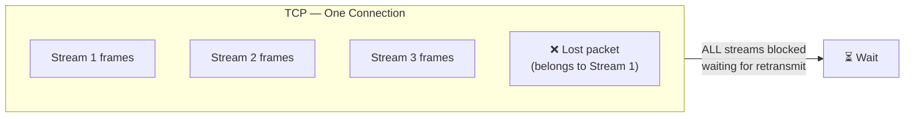

# 🚀 HTTP/3, QUIC & Head-of-Line Blocking

> [!note] Why This Matters
> HTTP/3 is not just a minor upgrade — it changes the **transport layer** entirely. Understanding it means understanding why TCP's reliability guarantees actually hurt performance at scale, and how QUIC solves that.

---

## 1. The Problem: TCP Head-of-Line Blocking

### What is Head-of-Line (HOL) Blocking?

When you have an ordered queue of items and the **first item gets stuck**, all items behind it are blocked — even if they could be processed independently.

In HTTP/1.1 over TCP:

```
Client sends:   Request A → Request B → Request C
Server must reply in order: Response A → Response B → Response C

If Response A takes 500ms, B and C wait — even if they're ready in 5ms.
```

### HTTP/1.1 Pipelining — Tried, Failed

HTTP/1.1 added **pipelining** to let clients send multiple requests without waiting for each response. The fundamental rule: **responses must arrive in the same order as requests**.

```
Client:  [GET /a] [GET /b] [GET /c]   ← sent without waiting
Server:  [/a 500ms] [/b 5ms] [/c 10ms]

Received in order:  /a (500ms) → /b (505ms) → /c (510ms)
                   ^^^^^^^^^^
                   B and C sat ready, but were blocked by A
```

**Why browsers didn't use pipelining:**
- Buggy proxy implementations in the wild
- Servers had to maintain complex state
- HOL blocking still happened
- Browsers defaulted to **6 parallel TCP connections** per origin as the workaround

---

## 2. HTTP/2 — Multiplexing (Partial Fix)

HTTP/2 introduced **binary framing** and **stream multiplexing** over a single TCP connection.

```
One TCP connection carries multiple logical streams:
  Stream 1: GET /api/users     ─────────────────────── [response]
  Stream 3: GET /api/posts     ─── [response]
  Stream 5: GET /static/app.js ───────── [response]
```

Each stream is independent. Stream 3's response doesn't wait for Stream 1.

**The key improvement:**

| Feature | HTTP/1.1 | HTTP/2 |
| :--- | :--- | :--- |
| Connections per origin | 6 (browsers open 6) | 1 |
| Requests per connection | 1 (or pipelined with order constraint) | Unlimited concurrent streams |
| Header compression | ❌ | ✅ HPACK |
| Server push | ❌ | ✅ |
| HOL blocking | Application-level | Transport-level (see below) |

### HTTP/2's Remaining Problem: TCP-Level HOL Blocking

HTTP/2 solved **application-layer** HOL blocking, but introduced a new one at the **transport layer**.

TCP guarantees **ordered, reliable delivery**. If a single TCP segment is lost:

```
TCP receives:  [seg 1] [seg 2] [LOSS: seg 3] [seg 4] [seg 5]

TCP must wait for seg 3 retransmission before delivering seg 4 or 5.
Even if seg 4 belongs to a completely different HTTP/2 stream.
```

This means: **one lost TCP packet stalls ALL HTTP/2 streams**, regardless of which stream the packet belonged to.



On a 1% packet loss network: HTTP/2 performs **worse** than HTTP/1.1 with 6 connections, because all streams block together vs. only one connection blocking.

---

## 3. QUIC — The New Transport

**QUIC** (Quick UDP Internet Connections) is a transport protocol built by Google, standardized by IETF (RFC 9000). It's the foundation of HTTP/3.

### Why UDP?

QUIC is built on UDP but **reimplements** everything good about TCP — reliability, ordering, flow control, congestion control — but **per stream**.

| Feature | TCP | QUIC |
| :--- | :--- | :--- |
| Transport | Layer 4 (OS kernel) | Layer 4, implemented in userspace |
| Reliability | Per-connection, ordered | Per-stream, independent |
| HOL blocking | Yes (connection-level) | No (stream-level loss recovery) |
| Connection setup | 1–3 RTT (TCP + TLS) | 0–1 RTT (built-in TLS 1.3) |
| Connection migration | ❌ (tied to IP:port) | ✅ (connection ID survives IP change) |
| Multiplexing | Via HTTP/2 framing | Native, independent streams |

### QUIC Connection Setup — 0-RTT vs 1-RTT

```
Traditional HTTPS (TCP + TLS 1.3):
  → SYN                               (1 RTT for TCP)
  ← SYN-ACK
  → Client Hello (TLS)                (1 RTT for TLS)
  ← Server Hello + Certificate
  → Finished
  = 2 RTT before first byte of data

QUIC (first connection):
  → Initial QUIC packet + TLS Client Hello   (1 RTT)
  ← Server Hello + Certificate + Data
  = 1 RTT before first byte

QUIC (resumed connection — 0-RTT):
  → Initial packet + application data immediately   (0 RTT)
  ← Response
  = 0 RTT — data sent with the first packet
```

> [!warning] 0-RTT Replay Attacks
> 0-RTT QUIC resumes sessions with pre-shared keys. This makes early data **replayable** — an attacker can re-send your 0-RTT request. Only use 0-RTT for idempotent operations (GET, HEAD). Never for POST/payment flows.

---

## 4. HTTP/3 — HTTP Over QUIC

HTTP/3 is simply **HTTP semantics over QUIC transport** instead of TCP.

```
HTTP/1.1  →  TCP  →  IP
HTTP/2    →  TCP  →  IP
HTTP/3    →  QUIC →  UDP  →  IP
```

The HTTP semantics (methods, headers, status codes, bodies) are identical. What changes is the transport.

### Stream Independence — The Core Win

```
QUIC connection carries:
  Stream 1: GET /api/users     → packet loss here...
  Stream 3: GET /api/posts     → ...does NOT affect this stream
  Stream 5: GET /static/app.js → ...or this one
```

Each QUIC stream has its own **loss recovery, ordering, and flow control**. A dropped packet for Stream 1 triggers retransmission for Stream 1 only — Streams 3 and 5 continue unaffected.

### HTTP/3 Prioritization

QUIC supports **stream prioritization**. Browsers use this to:
- Prioritize critical CSS/JS over images
- Prioritize API calls over analytics
- Reprioritize dynamically as the page loads

The APNIC research shows that **HTTP/3 prioritization is more effective** than HTTP/2's implementation because QUIC's stream independence means priority decisions actually take effect.

---

## 5. Connection Migration

A major quality-of-life improvement in QUIC.

**TCP problem:** A TCP connection is identified by `(src IP, src port, dst IP, dst port)`. If your mobile device switches from WiFi to cellular:
- IP address changes → TCP connection breaks
- All in-flight requests fail → reconnect, restart

**QUIC solution:** QUIC connections use **Connection IDs** — randomly generated identifiers independent of IP/port.

```
WiFi:     Client IP 192.168.1.5  →  Connection ID: 0x7f3a...  →  Server
Switch!
Cellular: Client IP 10.0.0.42   →  Connection ID: 0x7f3a...  →  Server
                                                   ^^^^^^^^^^^
                                     Same connection — no interruption
```

---

## 6. HTTP/3 Support & Limitations

As of 2024–2025:

| Component | HTTP/3 Support |
| :--- | :--- |
| Chrome, Firefox, Safari, Edge | ✅ Full support |
| Cloudflare CDN | ✅ |
| Google services | ✅ (invented QUIC) |
| AWS CloudFront | ✅ |
| nginx | ⚠️ Experimental (nginx-quic branch) |
| Node.js built-in `http` module | ❌ Not supported natively |
| Go `net/http` standard library | ❌ Not supported (use `quic-go`) |

> [!important] The Open Source Gap
> As HTTP Toolkit's research shows, most open-source HTTP libraries and tools **do not support HTTP/3** yet. Tools like curl, most load balancers, and backend frameworks require extra modules or third-party libraries. This matters if you're building infrastructure — don't assume HTTP/3 is available end-to-end.

**Where HTTP/3 does NOT help:**
- Intranet/datacenter traffic with near-zero packet loss (TCP performs equivalently)
- Low-latency connections where the RTT advantage is negligible
- Servers where UDP is firewalled (some corporate networks block UDP)

---

## 7. Version Comparison — Full Picture

| Dimension | HTTP/1.1 | HTTP/2 | HTTP/3 |
| :--- | :--- | :--- | :--- |
| **Transport** | TCP | TCP | QUIC (UDP) |
| **HOL blocking** | App-layer (pipelining order) | TCP-layer (packet loss) | Eliminated |
| **Multiplexing** | ❌ (one at a time) | ✅ (frames interleaved) | ✅ (native QUIC streams) |
| **Header compression** | ❌ | ✅ HPACK | ✅ QPACK |
| **Connection setup** | TCP + TLS: 2–3 RTT | TCP + TLS: 2 RTT | 1 RTT (0 RTT on resume) |
| **Connection migration** | ❌ | ❌ | ✅ |
| **Server push** | ❌ | ✅ (largely abandoned) | ✅ (not widely used) |
| **Encryption** | Optional (HTTPS) | Effectively required | Always (TLS 1.3 built-in) |
| **OS/kernel support** | Kernel TCP stack | Kernel TCP stack | Userspace (QUIC in app) |

---

## 8. Key Engineering Takeaways

1. **HTTP/1.1 HOL blocking** is at the application layer — pipelining order constraint.
2. **HTTP/2** solves app-layer HOL with multiplexing, but TCP-layer HOL remains on packet loss.
3. **HTTP/3 / QUIC** eliminates HOL completely via per-stream loss recovery at the transport.
4. **0-RTT resumption** dramatically reduces latency for repeat visitors — but watch replay attack risk.
5. **Connection migration** means mobile users on QUIC don't drop connections on network switches.
6. **UDP isn't unreliable** — QUIC adds its own reliability on top of UDP, implemented in userspace.
7. **Library support is still catching up** — verify HTTP/3 support in your stack before assuming.

---

## 📚 Sources

- [MDN — Head-of-Line Blocking](https://developer.mozilla.org/en-US/docs/Glossary/Head_of_line_blocking)
- [HTTP/3 & QUIC: Prioritization & HOL Blocking — APNIC Research](https://blog.apnic.net/2022/11/30/http-3-and-quic-prioritization-and-head-of-line-blocking/)
- [HTTP/3 Facts & What It Changes — Red Hat](https://www.redhat.com/zh-tw/blog/http3)
- [QUIC & HTTP/3: The Next Step in Web Performance](https://javascript-conference.com/blog/quic-and-http-3-the-next-step-in-web-performance/)
- [QUIC & HTTP/3 Deep Dive — System Design Space](https://system-design.space/en/chapter/quic-http3-protocol/)
- [HTTP/3 Open Source Support & Limitations — HTTP Toolkit](https://httptoolkit.com/blog/http3-quic-open-source-support-nowhere/)
