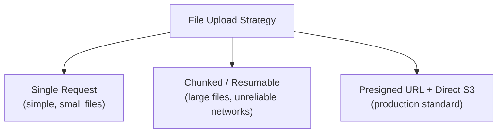
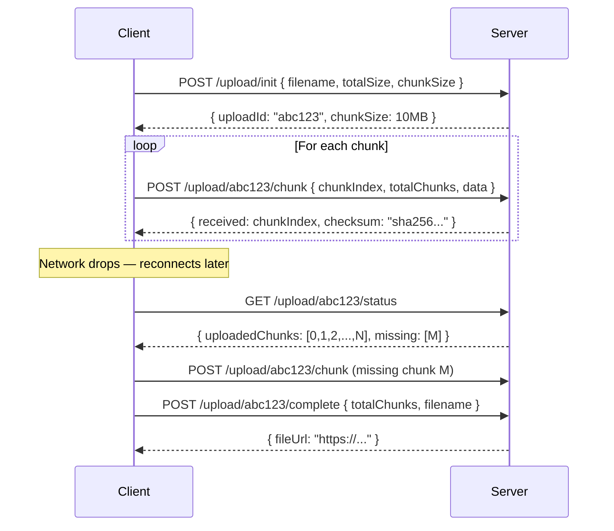
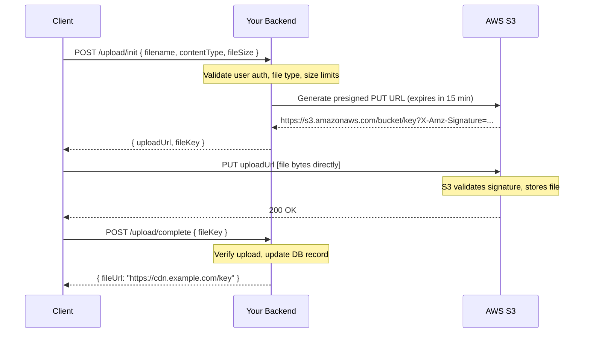

# 📁 File Upload Architecture

> [!note] Why This Is Non-Trivial
> File upload sounds simple — `<input type="file">` and POST. At scale, it's one of the more nuanced backend design problems: memory pressure, network failures, timeouts, storage architecture, security, and user experience all collide.

---

## 1. The Three Approaches



| Strategy | Best For | Key Trade-off |
| :--- | :--- | :--- |
| **Single POST** | Files < 10 MB, internal tools | Simple but fragile; memory pressure |
| **Chunked / Resumable** | Files 10 MB – multi-GB, mobile/slow networks | Complex but resilient |
| **Presigned URL → S3** | Production apps, files of any size | Best performance; server never touches bytes |

---

## 2. Single-Request Upload — What Actually Happens

```
POST /upload HTTP/1.1
Content-Type: multipart/form-data; boundary=----FormBoundary7MA4YWxk
Content-Length: 5242880

------FormBoundary7MA4YWxk
Content-Disposition: form-data; name="file"; filename="photo.jpg"
Content-Type: image/jpeg

[raw binary bytes of the image]
------FormBoundary7MA4YWxk--
```

### The Memory Problem

A naive implementation buffers the entire body before writing to disk:

```
                    ┌──────────┐
Client ──5MB──────► │  Server  │ ◄── 5 MB held in RAM
                    │  (RAM)   │     for every concurrent upload
                    └────┬─────┘
                         │ write to disk
                         ▼
                      uploads/
```

With 1,000 concurrent uploads of 5 MB each: **5 GB RAM** consumed by upload buffers alone.

### Streaming Fix — Process as Bytes Arrive

```javascript
// BAD: entire file in memory
app.post('/upload', (req, res) => {
  const data = [];
  req.on('data', chunk => data.push(chunk));  // accumulates ALL bytes
  req.on('end', () => {
    const file = Buffer.concat(data);         // 5 MB Buffer in RAM
    fs.writeFileSync('output.jpg', file);
  });
});

// GOOD: stream bytes directly to disk
const { pipeline } = require('stream/promises');
app.post('/upload', async (req, res) => {
  const dest = fs.createWriteStream('output.jpg');
  await pipeline(req, dest);  // bytes flow through, never fully buffered
  res.json({ ok: true });
});
```

> [!tip] Multer Streams to Disk
> Multer's `diskStorage` option writes to disk incrementally. `memoryStorage` (the default) loads everything into RAM — avoid it for large files.

---

## 3. `multipart/form-data` — How It Works

The `multipart/form-data` encoding lets a single HTTP request carry **multiple named parts** (fields + files), each with its own Content-Type.

```
POST /upload HTTP/1.1
Content-Type: multipart/form-data; boundary=abc123

--abc123
Content-Disposition: form-data; name="username"

Neel
--abc123
Content-Disposition: form-data; name="avatar"; filename="photo.jpg"
Content-Type: image/jpeg

[binary bytes]
--abc123--
```

The boundary string (`abc123`) must not appear in the file content — browsers generate a random boundary to avoid collisions.

**Parsing multipart on the server** means:
1. Read the `Content-Type` header to extract the boundary
2. Split the body stream on `--boundary` occurrences
3. Parse each part's headers (`Content-Disposition`, `Content-Type`)
4. Route each part to its handler (fields → memory, files → disk/stream)

Libraries like `multer` (Node.js), `multipart` (Go), `python-multipart` (FastAPI) handle this for you.

---

## 4. Chunked / Resumable Upload — Full Architecture

### Why Chunked?

```
Single 2 GB upload over a flaky connection:
  → 1.8 GB uploaded in 45 minutes
  → Connection drops
  → Start from zero ← WASTED
  
Chunked upload (20 MB chunks):
  → 90 chunks of 20 MB
  → Connection drops after chunk 82
  → Resume from chunk 83 ← only 8 chunks (160 MB) to redo
```

### The Protocol



### Chunk Size Considerations

| Chunk Size | Trade-offs |
| :--- | :--- |
| Too small (< 1 MB) | High request overhead, many round trips |
| Too large (> 100 MB) | Long retry payloads if chunk fails |
| **Optimal: 5–20 MB** | Balances overhead and retry cost |

AWS S3 Multipart requires chunks of **at least 5 MB** (except the last one).

### Integrity Checks — Checksums

Each chunk should include a checksum so the server can verify it arrived intact:

```javascript
const crypto = require('crypto');

// Client: compute SHA-256 of chunk before sending
const chunkBuffer = fs.readFileSync(chunkPath);
const checksum = crypto.createHash('sha256').update(chunkBuffer).digest('hex');

// Include in request
await axios.post(`/upload/${uploadId}/chunk`, formData, {
  headers: { 'X-Chunk-Checksum': checksum }
});

// Server: verify
const receivedChecksum = crypto.createHash('sha256')
  .update(receivedChunkBuffer)
  .digest('hex');

if (receivedChecksum !== req.headers['x-chunk-checksum']) {
  return res.status(400).json({ error: 'Checksum mismatch — retry chunk' });
}
```

---

## 5. AWS S3 Multipart Upload — Production Standard

For any file over 100 MB in production, use S3 Multipart Upload. It's the industry standard.

### How S3 Multipart Works

```
1. Initiate:   CreateMultipartUpload  →  UploadId
2. Upload:     UploadPart (part 1, 2, 3, ... N)  →  ETag per part
3. Complete:   CompleteMultipartUpload([{PartNumber, ETag}, ...])
4. (Abort):    AbortMultipartUpload  (cleanup if something fails)
```

Each part gets an **ETag** (checksum) from S3. The final `CompleteMultipartUpload` assembles the parts using their ETags.

### AWS SDK — Node.js Example

```javascript
const { S3Client, CreateMultipartUploadCommand,
        UploadPartCommand, CompleteMultipartUploadCommand,
        AbortMultipartUploadCommand } = require('@aws-sdk/client-s3');
const fs = require('fs');

const s3 = new S3Client({ region: 'us-east-1' });
const PART_SIZE = 10 * 1024 * 1024; // 10 MB minimum is 5 MB per S3 requirement

async function multipartUpload(filePath, bucket, key) {
  const fileSize = fs.statSync(filePath).size;
  const totalParts = Math.ceil(fileSize / PART_SIZE);

  // 1. Initiate multipart upload
  const { UploadId } = await s3.send(new CreateMultipartUploadCommand({
    Bucket: bucket,
    Key: key,
  }));

  const uploadedParts = [];

  try {
    // 2. Upload each part
    for (let i = 0; i < totalParts; i++) {
      const start = i * PART_SIZE;
      const end = Math.min(start + PART_SIZE, fileSize);
      const partNumber = i + 1;

      const partStream = fs.createReadStream(filePath, { start, end: end - 1 });

      const { ETag } = await s3.send(new UploadPartCommand({
        Bucket: bucket,
        Key: key,
        UploadId,
        PartNumber: partNumber,
        Body: partStream,
        ContentLength: end - start,
      }));

      uploadedParts.push({ PartNumber: partNumber, ETag });
      console.log(`✅ Part ${partNumber}/${totalParts}`);
    }

    // 3. Complete — S3 assembles all parts
    const { Location } = await s3.send(new CompleteMultipartUploadCommand({
      Bucket: bucket,
      Key: key,
      UploadId,
      MultipartUpload: { Parts: uploadedParts },
    }));

    console.log(`🎉 Uploaded to: ${Location}`);
    return Location;

  } catch (err) {
    // 4. Always abort incomplete uploads (avoid S3 storage charges)
    await s3.send(new AbortMultipartUploadCommand({
      Bucket: bucket,
      Key: key,
      UploadId,
    }));
    throw err;
  }
}
```

> [!caution] Incomplete Multipart Uploads Cost Money
> Incomplete S3 multipart uploads **still incur storage charges** for the uploaded parts. Always call `AbortMultipartUpload` on failure, and configure an S3 lifecycle rule to auto-abort incomplete uploads after N days.

---

## 6. Presigned URLs — The Architecture That Scales

### The Problem With Server-Side Uploads

```
Client → [file bytes] → Your Server → [file bytes] → S3

Problems:
- Your server is a bandwidth bottleneck
- Your server holds file in RAM or temp disk
- Your server pays for egress AND ingress bandwidth
- Scaling upload capacity = scaling servers (expensive)
```

### Presigned URLs — Direct Client → S3



**Benefits:**
- Your server **never touches file bytes** — zero memory/bandwidth pressure
- S3 handles bandwidth scaling automatically
- Files upload at S3's speed, not your server's speed
- Backend only handles metadata (auth, DB record, validation)

### Generating a Presigned URL (Node.js)

```javascript
const { S3Client, PutObjectCommand } = require('@aws-sdk/client-s3');
const { getSignedUrl } = require('@aws-sdk/s3-request-presigner');

const s3 = new S3Client({ region: 'us-east-1' });

app.post('/upload/init', authenticate, async (req, res) => {
  const { filename, contentType, fileSize } = req.body;

  // Server-side validation BEFORE generating URL
  const allowedTypes = ['image/jpeg', 'image/png', 'image/webp', 'video/mp4'];
  if (!allowedTypes.includes(contentType)) {
    return res.status(400).json({ error: 'File type not allowed' });
  }
  if (fileSize > 5 * 1024 * 1024 * 1024) { // 5 GB limit
    return res.status(400).json({ error: 'File too large' });
  }

  const fileKey = `uploads/${req.user.id}/${Date.now()}-${filename}`;

  const command = new PutObjectCommand({
    Bucket: process.env.S3_BUCKET,
    Key: fileKey,
    ContentType: contentType,
    ContentLength: fileSize,
    // Server-side encryption
    ServerSideEncryption: 'AES256',
  });

  // URL expires in 15 minutes — client must upload within this window
  const uploadUrl = await getSignedUrl(s3, command, { expiresIn: 900 });

  // Create a pending DB record
  await db.files.create({
    key: fileKey,
    userId: req.user.id,
    status: 'pending',
    originalName: filename,
  });

  res.json({ uploadUrl, fileKey });
});

// Client calls this after successful PUT to S3
app.post('/upload/complete', authenticate, async (req, res) => {
  const { fileKey } = req.body;

  // Verify the file actually exists in S3 before marking complete
  await s3.send(new HeadObjectCommand({
    Bucket: process.env.S3_BUCKET,
    Key: fileKey,
  }));

  await db.files.update({ key: fileKey }, {
    status: 'ready',
    url: `https://cdn.example.com/${fileKey}`,
  });

  res.json({ ok: true, url: `https://cdn.example.com/${fileKey}` });
});
```

### Client-Side Upload With Progress

```javascript
async function uploadFile(file) {
  // 1. Get presigned URL from your backend
  const { uploadUrl, fileKey } = await fetch('/upload/init', {
    method: 'POST',
    headers: { 'Content-Type': 'application/json' },
    body: JSON.stringify({
      filename: file.name,
      contentType: file.type,
      fileSize: file.size,
    }),
  }).then(r => r.json());

  // 2. PUT directly to S3 with progress tracking
  await new Promise((resolve, reject) => {
    const xhr = new XMLHttpRequest();
    xhr.open('PUT', uploadUrl);
    xhr.setRequestHeader('Content-Type', file.type);

    xhr.upload.onprogress = (e) => {
      const percent = Math.round((e.loaded / e.total) * 100);
      updateProgressBar(percent); // your UI update
    };

    xhr.onload = () => xhr.status === 200 ? resolve() : reject(xhr.status);
    xhr.onerror = reject;
    xhr.send(file);
  });

  // 3. Notify backend that upload is done
  await fetch('/upload/complete', {
    method: 'POST',
    headers: { 'Content-Type': 'application/json' },
    body: JSON.stringify({ fileKey }),
  });
}
```

---

## 7. S3 Multipart + Presigned URLs — Best of Both Worlds

For very large files (> 100 MB) with presigned URLs, combine both approaches:

```javascript
// Backend: generate presigned URLs per part
app.post('/upload/multipart/init', authenticate, async (req, res) => {
  const { filename, contentType, totalParts } = req.body;
  const fileKey = `uploads/${req.user.id}/${Date.now()}-${filename}`;

  // Initiate multipart upload on S3
  const { UploadId } = await s3.send(new CreateMultipartUploadCommand({
    Bucket: process.env.S3_BUCKET,
    Key: fileKey,
    ContentType: contentType,
  }));

  // Generate presigned URL for each part
  const partUrls = await Promise.all(
    Array.from({ length: totalParts }, (_, i) =>
      getSignedUrl(s3, new UploadPartCommand({
        Bucket: process.env.S3_BUCKET,
        Key: fileKey,
        UploadId,
        PartNumber: i + 1,
      }), { expiresIn: 3600 })
    )
  );

  res.json({ uploadId: UploadId, fileKey, partUrls });
});
```

Client splits the file into parts, PUTs each part directly to its presigned URL, collects the ETags, and calls your backend to complete the multipart upload. Your server never touches the file bytes.

---

## 8. AWS Amplify — Resumable Uploads

AWS Amplify's JavaScript library handles chunking, resumption, and S3 multipart transparently:

```javascript
import { uploadData } from 'aws-amplify/storage';

const upload = uploadData({
  key: `photos/${file.name}`,
  data: file,
  options: {
    contentType: file.type,
    onProgress: ({ totalBytes, transferredBytes }) => {
      const percent = Math.round((transferredBytes / totalBytes) * 100);
      setProgress(percent);
    },
  },
});

// Pause / resume / cancel support
upload.pause();
upload.resume();
upload.cancel();

try {
  const result = await upload.result;
  console.log('Uploaded:', result.key);
} catch (err) {
  if (err.name === 'CanceledError') {
    console.log('Upload cancelled');
  }
}
```

> [!tip] When to Use Amplify
> Amplify abstracts away the entire multipart + resumable complexity for client-side uploads. Use it in React Native / mobile apps where network reliability is poor and large file uploads are common.

---

## 9. Security Checklist

> [!caution] File Upload Is a Top OWASP Risk
> Unrestricted file upload is consistently in OWASP's top vulnerabilities. Never trust client-provided metadata.

| Risk | Mitigation |
| :--- | :--- |
| Malicious file types (PHP shell) | Validate MIME type server-side, **not** by extension |
| File size DoS | Set `Content-Length` limits and S3 lifecycle rules |
| Path traversal | Use UUIDs/hashes as keys, never user-provided filenames as paths |
| Stored XSS (SVG uploads) | Serve from a separate origin / subdomain, not your main domain |
| Presigned URL abuse | Include `ContentLength` in the signed command to prevent size manipulation |
| Incomplete upload charges | S3 lifecycle rule: `AbortIncompleteMultipartUpload` after 7 days |
| Scan for malware | Use ClamAV, AWS GuardDuty, or a 3rd-party service (e.g. Cloudmersive) on uploaded files |

---

## 📚 Sources

- [AWS S3 Multipart Upload Guide — Official Docs](https://docs.aws.amazon.com/AmazonS3/latest/userguide/mpu-upload-object.html)
- [AWS S3 Multipart Upload Overview](https://docs.aws.amazon.com/AmazonS3/latest/userguide/mpuoverview.html)
- [Amazon S3 Multipart Upload — AWS Blog](https://aws.amazon.com/blogs/aws/amazon-s3-multipart-upload/)
- [AWS Amplify Resumable File Uploads](https://aws.amazon.com/about-aws/whats-new/2021/10/aws-amplify-javascript-file-uploads-storage/)
- [Uploading Large Files Without Killing Server Memory — Filestack](https://blog.filestack.com/uploading-large-files-server-memory/)
- [API Multipart File Upload — Codelit](https://codelit.io/blog/api-multipart-file-upload)
- [File Upload Pipeline: Presigned URLs, Chunked Uploads & S3 at Scale](https://letsbuildsolutions.com/blog/system-design/designing-a-file-upload-pipeline-presigned-urls-chunked-uploads-and-processing-at-scale/)
