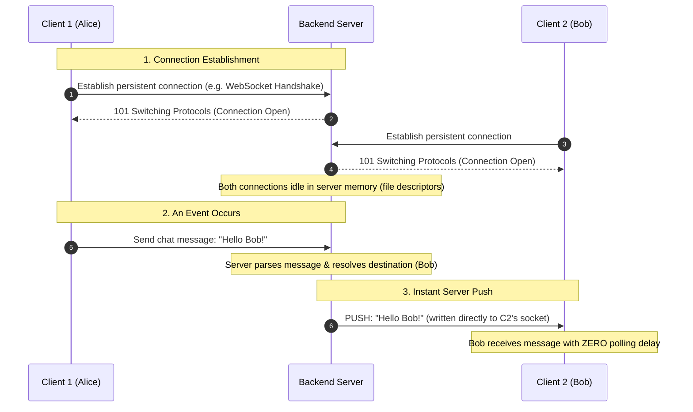
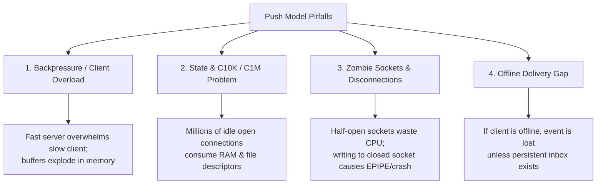
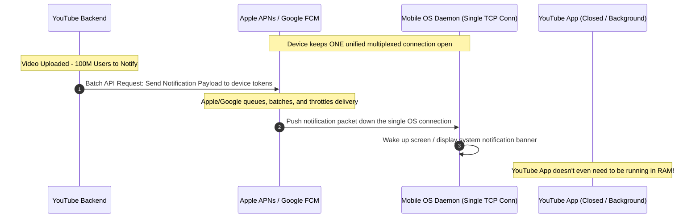
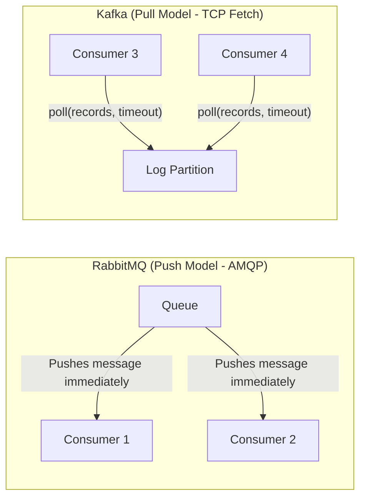
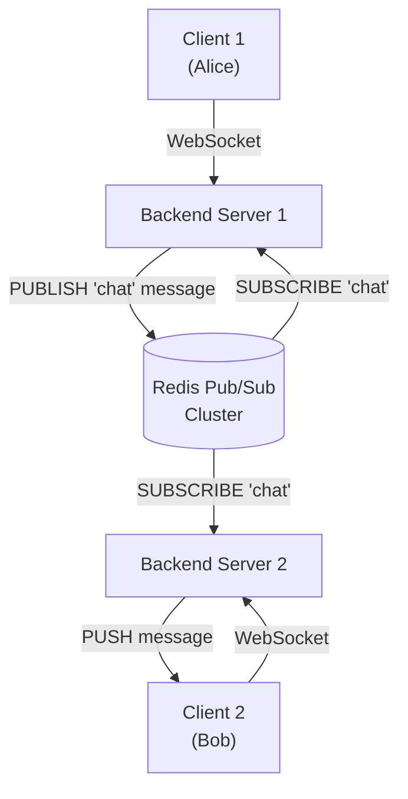
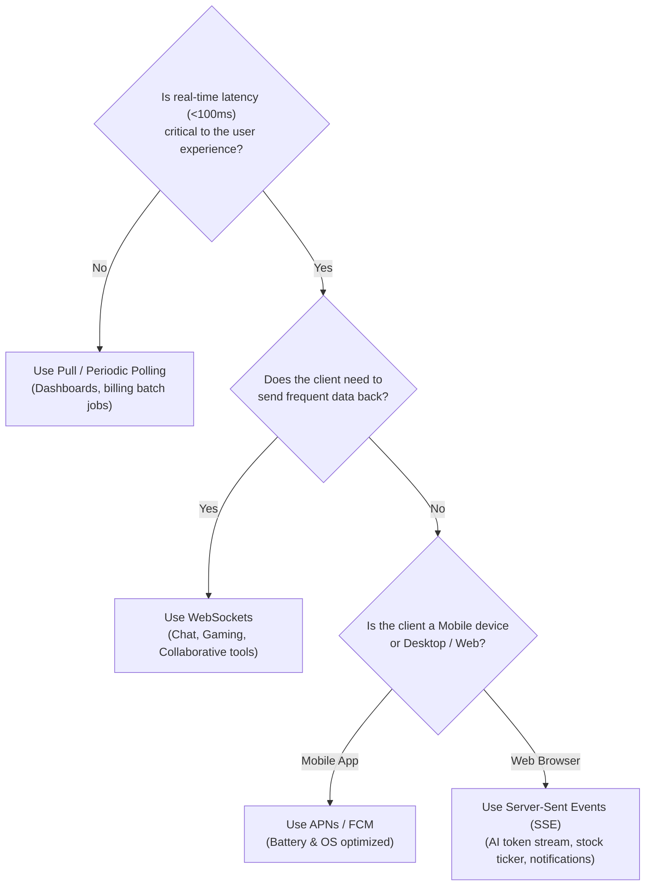

# 🚀 The Push Communication Pattern — Architecture & Internals

> [!important] Core Mental Model
> In **Request–Response**, the client asks for data when it needs it. But in modern systems, the **server often acquires knowledge first** (a chat message arrived, a stock price changed, a video was published, a background job finished).
>
> If the client doesn't know *when* an event will occur, repeatedly asking ("*Has anything changed?*") wastes massive network bandwidth and CPU. The **Push Model** flips the initiative: **the client establishes a persistent channel, and the server pushes data into that channel the moment the event occurs.**

---

## 1. Executive Summary & Comparison

| Communication Pattern | Who Initiates? | Connection Nature | Latency to Deliver Event | Best For | Major Bottleneck |
| :--- | :--- | :--- | :--- | :--- | :--- |
| **Request–Response** | Client | Short-lived or persistent keep-alive | $1 \text{ RTT} + \text{Server Time}$ | Fetching web pages, REST, GraphQL, CRUD | Client must know when to ask |
| **Short Polling** | Client (periodic) | Repeated new requests | Up to polling interval $T$ | Infrequent updates, simple dashboards | Overwhelming empty responses |
| **Long Polling** | Client (held open) | Held open until event or timeout | Near zero ($< 10\text{ms}$) | Fallbacks when WebSockets are blocked | Connection churn, header overhead |
| **Push Model** | **Server** (on pre-opened link) | **Persistent stream** (TCP / WS / SSE) | **Instantaneous** (zero network round-trip overhead) | Chat, live financial tickers, notifications, gaming | Backpressure, connection limits, state management |
| **Pull Model** | Client | Client drives the batch size and rate | Dependent on consumer batch cycle | Kafka event streaming, heavy data pipelines | Client latency vs resource trade-off |

---

## 2. Anatomy of the Push Pattern

The push pattern operates in two distinct phases:

1. **Connection Establishment Phase (Handshake):** The client connects to the server using a protocol that supports persistent bidirectional or server-to-client streaming (e.g., WebSocket upgrade, TCP connection, HTTP text/event-stream).
2. **Event Delivery Phase (Push):** The server receives an event from an external source (database write, message broker, another user) and immediately writes bytes onto the client's socket.



### The Low-Level Reality: Socket Writes

Under the hood, "pushing" is not magic:
1. The server's operating system maintains an open **TCP File Descriptor (FD)** for each connected client.
2. The server keeps a pointer or reference to that socket object in an in-memory collection (Array, Map, or Set).
3. When data is ready, the server issues a `write()` / `send()` syscall to the kernel's **TCP Send Buffer**.
4. The kernel segments the data into TCP packets and flushes them through the network interface controller (NIC) directly to the client.

```
Application Memory                Linux Kernel Space                  Client Socket
┌──────────────────┐             ┌─────────────────────┐             ┌─────────────┐
│ Event Received   │ ──write()─► │ TCP Send Buffer     │ ──packets─► │ Read Buffer │
│ socket.send(msg) │             │ (Kernel Socket Mem) │             └─────────────┘
└──────────────────┘             └─────────────────────┘
```

---

## 3. Protocols Enabling the Push Model

| Protocol | Directionality | Transport Layer | Overhead | Browser Support | Typical Use Cases |
| :--- | :--- | :--- | :--- | :--- | :--- |
| **WebSockets (RFC 6455)** | Full Duplex (Bi-directional) | TCP (Port 80/443 with HTTP upgrade) | Minimal (2–10 byte binary framing) | 100% modern browsers | Multi-user chat, collaborative editing, interactive games |
| **Server-Sent Events (SSE)** | Unidirectional (Server $\rightarrow$ Client) | HTTP/1.1 or HTTP/2 (`text/event-stream`) | Low (HTTP text format: `data: ...\n\n`) | Standard in all browsers (`EventSource`) | AI LLM token streaming (ChatGPT, Claude), stock tickers, live sports scores |
| **gRPC Server Streaming** | Unidirectional stream after RPC call | HTTP/2 multiplexed streams over TCP | Ultra-low (Protobuf binary framing) | Native backend-to-backend; requires gRPC-Web for browsers | Microservice-to-microservice events, telemetry pipelines |
| **AMQP / MQTT** | Bi-directional / Pub-Sub | Raw TCP / TLS | Extremely compact binary wire format | IoT devices, embedded systems, message broker clients | RabbitMQ consumer push, IoT sensor networks |
| **Mobile APNs / FCM** | Unidirectional to device | Multiplexed persistent TLS tunnel managed by OS | Zero app battery drain (handled by OS daemon) | iOS (`apns`) & Android (`fcm`) | Mobile push notifications, lock-screen alerts |

### 3.1 Anatomy of the WebSocket Handshake (HTTP Upgrade)
WebSockets do not begin on raw TCP; they initiate as a standard HTTP/1.1 request that negotiates an **in-place protocol upgrade**:

```http
Client Handshake Request:
GET /chat HTTP/1.1
Host: server.example.com
Upgrade: websocket
Connection: Upgrade
Sec-WebSocket-Key: dGhlIHNhbXBsZSBub25jZQ==
Sec-WebSocket-Version: 13
Origin: https://example.com

Server Handshake Response:
HTTP/1.1 101 Switching Protocols
Upgrade: websocket
Connection: Upgrade
Sec-WebSocket-Accept: s3pPLMBiTxaQ9kYGzzhZRbK+xOo=
```

Once the `101 Switching Protocols` response is written to the socket, the HTTP layer is discarded. The underlying TCP socket remains open and transforms into a **full-duplex binary frame channel**.

---

## 4. First Principles: Advantages & Critical Pitfalls

### Advantages (Why We Love Push)

1. **Instantaneous Real-Time Latency:** Latency is bounded only by the physical network transmission time ($0.5 \text{ RTT}$). There is no polling delay ($T/2$).
2. **Bandwidth & CPU Efficiency on Idle:** When no events occur, zero packets travel across the network (aside from small periodic TCP keep-alive or application heartbeats). In contrast, polling at 100,000 clients every 5 seconds generates 20,000 requests/sec of pure wasted overhead.
3. **Natural Fit for Event-Driven Architectures:** Aligns with message queues, CDC (Change Data Capture), and domain event pub/sub.

---

### Pitfalls & Challenges (The Hidden Costs)



#### 1. The Backpressure & Overload Problem
In a pull system (like Kafka), the consumer controls the consumption rate: it requests 50 messages, processes them at its own pace, and then requests 50 more.

In a push system, the server says: *"Here is data! Here is data! Take it!"*
- If the server produces 5,000 events/second and the client can only deserialize and process 500 events/second:
  - The client's operating system receive buffer fills up.
  - TCP flow control kicks in (Window Size $\rightarrow 0$), halting network transport.
  - The server's kernel send buffer fills up.
  - If the server application queues messages in memory for that socket, **the server crashes with Out-of-Memory (OOM)**.

#### 2. The Offline Client Problem
A server cannot push data to a client that is disconnected or offline.
- If a user closes their browser or goes through a subway tunnel, all pushed messages sent during that window vanish unless you design a persistent mailbox / acknowledgment queue.

#### 3. Connection State & Resource Exhaustion (C1M Problem)
Each open connection consumes:
- 1 Linux File Descriptor (`ulimit -n`).
- Kernel socket buffers (`rmem` and `wmem`, typically 4KB to 128KB per socket).
- Application memory (session context, authentication state, event listener closures).
- Maintaining 1,000,000 idle connections requires roughly 2–4 GB of pure kernel/socket memory alone, requiring specialized OS tuning (`epoll`, `sysctl`).

#### 4. Half-Open / Zombie Sockets
If a client abruptly loses internet connection (e.g. WiFi turned off, battery dies), **the TCP `FIN` packet is never sent**. The server believes the connection is still alive and will attempt to write to it until TCP timeouts trigger (which can take minutes to hours unless application-layer heartbeats are implemented).

---

## 5. Detailed Case Studies & Real-World Architectures

### Case Study 1: The YouTube / MrBeast 100M Notification Problem

> [!question] Can YouTube simply push notifications directly to 100,000,000 users over WebSockets?
> Imagine a channel with 100M subscribers uploads a new video. If YouTube had to maintain 100M open WebSocket connections directly to mobile phones:
> 1. **Device Battery Disaster:** A mobile phone maintaining 50 open TCP connections for 50 different apps would drain its battery in 2 hours due to cellular radio wake-locks.
> 2. **Server Thundering Herd:** Looping through 100,000,000 sockets to serialize and push JSON payloads would exhaust network egress and CPU within seconds.

#### The Solution: Push Notification Gateways (APNs & FCM)

Mobile operating systems solve this by maintaining **exactly ONE persistent connection** per device to Apple (APNs) or Google (FCM).



- YouTube's backend makes bulk requests to Apple Push Notification service (APNs) or Firebase Cloud Messaging (FCM).
- Apple and Google manage the astronomical scale of connection handling, sleep states, cellular network hopping, and battery optimization.

---

### Case Study 2: Message Brokers — RabbitMQ (Push) vs Kafka (Pull)

The choice of push vs pull defines the core architecture of message brokers:



#### How RabbitMQ Solves the Push Overload Problem: `basic.qos` (Prefetch Count)
Because RabbitMQ uses a push model, a fast producer could easily overwhelm a slow consumer.
To fix this, AMQP introduced **Prefetch / QoS (Quality of Service)**:
- The consumer tells RabbitMQ: `channel.basicQos(100)` ("*Do not push more than 100 unacknowledged messages to me*").
- RabbitMQ pushes up to 100 messages and then **stops pushing**.
- As the consumer acknowledges (`ack`) processed messages, RabbitMQ pushes the next ones.
- **This hybrid gives the latency benefits of push while preventing consumer buffer overflows!**

---

### Case Study 3: AI Token Streaming via Server-Sent Events (SSE)

When querying a Large Language Model (e.g., ChatGPT, Claude), generating a 500-word response takes 10 to 30 seconds.
- Using **Request–Response**, the user stares at a blank screen and a spinner for 30 seconds until the entire text is ready.
- Using **Server-Sent Events (Push)**, the backend pushes each generated token to the frontend the microsecond it emerges from the neural network.

```
HTTP/1.1 200 OK
Content-Type: text/event-stream
Cache-Control: no-cache
Connection: keep-alive

data: {"token": "The"}

data: {"token": " push"}

data: {"token": " pattern"}

data: [DONE]
```

---

## 6. Hands-On Engineering: Building a Production-Grade Push Server

Let's look at the implementation shown in the lecture, identify its critical failure points, and fix them with production hardening.

### The Naive Implementation (From the Lecture)

```javascript
// naive-server.js
const http = require('http');
const WebSocketServer = require('websocket').server;

const server = http.createServer();
server.listen(8080);

const wsServer = new WebSocketServer({ httpServer: server });
const connections = []; // Array of active sockets

wsServer.on('request', (request) => {
  const connection = request.accept(null, request.origin);
  connections.push(connection);

  connection.on('message', (message) => {
    // Broadcast incoming message to EVERY connected user
    for (const c of connections) {
      c.send(`User ${connection.socket.remotePort}: ${message.utf8Data}`);
    }
  });
});
```

### 🚨 Why the Naive Code Fails in Production

1. **Dead Sockets / Broken Pipe:** If a user closes their laptop, `connection` is still in `connections[]`. Calling `c.send()` on a closed or closing connection throws uncaught exceptions (`Error: Connection closed`) and breaks the loop for all subsequent clients.
2. **Memory Leak:** Every connected client stays in `connections[]` forever. When clients disconnect, their connection objects and socket buffers are never garbage collected.
3. **Array Search / Remove is $O(N)$:** Removing a disconnected user from a flat array requires scanning or splicing.
4. **Echoing Back to Sender:** Alice receives her own message echoed back from the server unless filtered out.

---

### The Production-Hardened Push Server

Here is the robust, production-grade implementation using native Node.js `ws` with:
- `Set` for $O(1)$ addition and removal of connections.
- Heartbeat **Ping/Pong** mechanism to detect and reap zombie sockets.
- Self-echo prevention.
- Clean disconnection handling and exception guards.

```javascript
// server.js — Production-Grade Push Broadcast Server
const http = require('node:http');
const WebSocket = require('ws');

const server = http.createServer((req, res) => {
  res.writeHead(200, { 'Content-Type': 'text/plain' });
  res.end('Push Server is Running\n');
});

const wss = new WebSocket.Server({ server });

// Set provides O(1) add and delete operations, avoiding array leaks
const clients = new Set();

wss.on('connection', (ws, req) => {
  const remotePort = req.socket.remotePort;
  const clientIp = req.socket.remoteAddress;

  // Track connection health
  ws.isAlive = true;
  ws.userId = `User-${remotePort}`;

  clients.add(ws);
  console.log(`[CONNECT] ${ws.userId} from ${clientIp}. Total active: ${clients.size}`);

  // Notify everyone else that someone joined
  broadcast({
    type: 'SYSTEM',
    message: `${ws.userId} joined the room.`,
    activeCount: clients.size
  }, /* excludeSender = */ ws);

  // Heartbeat response from client
  ws.on('pong', () => {
    ws.isAlive = true;
  });

  // Handle incoming message and push to all connected peers
  ws.on('message', (data, isBinary) => {
    try {
      const parsedText = isBinary ? data : data.toString();
      
      const payload = {
        type: 'CHAT',
        sender: ws.userId,
        text: parsedText,
        timestamp: Date.now()
      };

      // Push to all active, ready clients
      broadcast(payload, /* excludeSender = */ null);
    } catch (err) {
      console.error(`[ERROR] Failed to process message from ${ws.userId}:`, err);
    }
  });

  // Graceful cleanup on socket close
  ws.on('close', (code, reason) => {
    clients.delete(ws);
    console.log(`[DISCONNECT] ${ws.userId} left (code: ${code}). Remaining: ${clients.size}`);
    
    broadcast({
      type: 'SYSTEM',
      message: `${ws.userId} left the room.`,
      activeCount: clients.size
    }, ws);
  });

  // Guard against socket-level errors
  ws.on('error', (err) => {
    console.error(`[SOCKET ERROR] ${ws.userId}:`, err.message);
    clients.delete(ws);
    ws.terminate();
  });
});

/**
 * Pushes payload to all open connections
 * @param {Object} payload 
 * @param {WebSocket} [excludeSender] - Optional socket to skip echoing back
 */
function broadcast(payload, excludeSender = null) {
  const serialized = JSON.stringify(payload);

  for (const client of clients) {
    // Only push to clients whose TCP connection is fully OPEN
    if (client !== excludeSender && client.readyState === WebSocket.OPEN) {
      client.send(serialized, (err) => {
        if (err) {
          console.error(`[SEND FAILED] Could not push to ${client.userId}:`, err.message);
          clients.delete(client);
          client.terminate();
        }
      });
    }
  }
}

// Zombie Connection Reaper: Ping clients every 30 seconds
const heartbeatInterval = setInterval(() => {
  for (const ws of clients) {
    if (!ws.isAlive) {
      console.warn(`[REAPING] Terminating dead zombie connection: ${ws.userId}`);
      clients.delete(ws);
      ws.terminate();
      continue;
    }

    // Mark as unacknowledged until pong returns
    ws.isAlive = false;
    ws.ping();
  }
}, 30000);

wss.on('close', () => {
  clearInterval(heartbeatInterval);
});

const PORT = process.env.PORT || 8080;
server.listen(PORT, () => {
  console.log(`🚀 Push server running on http://localhost:${PORT}`);
});
```

---

### The Browser Client Implementation

```html
<!-- index.html -->
<!DOCTYPE html>
<html lang="en">
<head>
  <meta charset="UTF-8">
  <title>Real-Time Push Client</title>
  <style>
    body { font-family: system-ui, sans-serif; max-width: 600px; margin: 40px auto; }
    #chat-box { border: 1px solid #ccc; height: 350px; overflow-y: auto; padding: 12px; margin-bottom: 12px; border-radius: 6px; }
    .msg { margin-bottom: 8px; }
    .system { color: #888; font-style: italic; }
    .sender { font-weight: bold; color: #0284c7; }
    .input-row { display: flex; gap: 8px; }
    input { flex: 1; padding: 8px 12px; border: 1px solid #ccc; border-radius: 4px; }
    button { padding: 8px 16px; background: #0284c7; color: white; border: none; border-radius: 4px; cursor: pointer; }
  </style>
</head>
<body>
  <h2>Real-Time Push Demo</h2>
  <div id="status">Connecting...</div>
  <div id="chat-box"></div>
  <div class="input-row">
    <input type="text" id="message-input" placeholder="Type a message..." disabled />
    <button id="send-btn" disabled>Push Send</button>
  </div>

  <script>
    const chatBox = document.getElementById('chat-box');
    const input = document.getElementById('message-input');
    const sendBtn = document.getElementById('send-btn');
    const statusDiv = document.getElementById('status');

    // 1. Establish persistent bi-directional connection
    let socket;
    function connect() {
      socket = new WebSocket('ws://localhost:8080');

      socket.addEventListener('open', () => {
        statusDiv.textContent = '🟢 Connected (Push Ready)';
        input.disabled = false;
        sendBtn.disabled = false;
      });

      // 2. Receive instantaneous push events from the server
      socket.addEventListener('message', (event) => {
        const data = JSON.parse(event.data);
        const div = document.createElement('div');
        div.className = 'msg';

        if (data.type === 'SYSTEM') {
          div.className += ' system';
          div.textContent = `[SYSTEM] ${data.message} (${data.activeCount} online)`;
        } else {
          div.innerHTML = `<span class="sender">${data.sender}:</span> ${data.text}`;
        }

        chatBox.appendChild(div);
        chatBox.scrollTop = chatBox.scrollHeight;
      });

      // 3. Auto-reconnect with backoff on failure
      socket.addEventListener('close', () => {
        statusDiv.textContent = '🔴 Disconnected. Retrying in 3s...';
        input.disabled = true;
        sendBtn.disabled = true;
        setTimeout(connect, 3000);
      });
    }

    function sendMessage() {
      const text = input.value.trim();
      if (text && socket.readyState === WebSocket.OPEN) {
        socket.send(text);
        input.value = '';
      }
    }

    sendBtn.addEventListener('click', sendMessage);
    input.addEventListener('keydown', (e) => { if (e.key === 'Enter') sendMessage(); });

    connect();
  </script>
</body>
</html>
```

---

## 7. Scaling the Push Model Across Multiple Servers

When your application scales past a single machine (more than ~50,000 concurrent sockets), you must deploy multiple backend instances behind a Load Balancer.



### The Problem
If Alice is connected to **Server 1** and Bob is connected to **Server 2**, Server 1 has no knowledge of Bob's socket!

### The Solution: Redis Pub/Sub as the Backplane
1. Each server instance maintains its local active connections in an in-memory map (`localConnections.set(userId, socket)`).
2. All server instances subscribe to shared **Redis Pub/Sub channels** (e.g. `user:*` or `room:*`).
3. When Alice sends a message intended for Bob:
   - Server 1 checks if Bob is connected locally. If yes, it pushes immediately.
   - If Bob is on another server, Server 1 publishes the event to Redis: `publisher.publish('user:bob', payload)`.
   - Redis broadcasts the message to Server 2.
   - Server 2 delivers the message to Bob's active WebSocket!

```javascript
// multi-server-ws-redis.js — Scaling WebSockets across instances via Redis Pub/Sub
const { createClient } = require('redis');
const WebSocket = require('ws');

const localConnections = new Map(); // userId -> WebSocket instance

const subscriber = createClient({ url: 'redis://localhost:6379' });
const publisher = createClient({ url: 'redis://localhost:6379' });

async function initMultiServerPush() {
  await subscriber.connect();
  await publisher.connect();

  // Listen for messages targeted at any user connected to this instance
  await subscriber.pSubscribe('user:*', (message, channel) => {
    const targetUserId = channel.split(':')[1];
    const localWs = localConnections.get(targetUserId);

    if (localWs && localWs.readyState === WebSocket.OPEN) {
      localWs.send(message);
    }
  });

  console.log('🔗 Redis Pub/Sub connected. Server ready to route distributed push events.');
}

// Dispatches a message to a user regardless of which server instance holds the socket
async function sendToUser(userId, messageObj) {
  const payload = JSON.stringify(messageObj);

  // Optimization: Check local connections first to save Redis round-trip
  const localWs = localConnections.get(userId);
  if (localWs && localWs.readyState === WebSocket.OPEN) {
    localWs.send(payload);
    return;
  }

  // User is connected to another server replica — publish via Redis backplane
  await publisher.publish(`user:${userId}`, payload);
}

initMultiServerPush();
```

---

## 8. Summary: When Should You Use the Push Model?



### Checklist for Backend Engineers Implementing Push:
1. ✅ **Guard against slow consumers:** Implement queue boundaries and drop policies (or prefetch limits like AMQP `basicQos`).
2. ✅ **Reap zombie sockets:** Always configure a periodic **Ping/Pong heartbeat** (every 30–60s) to terminate ungracefully closed connections.
3. ✅ **Prevent memory leaks:** Never store connection objects in unbounded arrays; use a `Set` or `Map` keyed by user/socket ID and clean up on both `close` and `error` events.
4. ✅ **Decouple multi-server broadcasting:** Use a message bus (Redis Pub/Sub or NATS) when running more than one server instance.
5. ✅ **Tune OS kernel parameters:** For high concurrency (C100K+), raise `ulimit -n`, increase `net.core.somaxconn`, and optimize TCP read/write buffer defaults in `sysctl.conf`.
