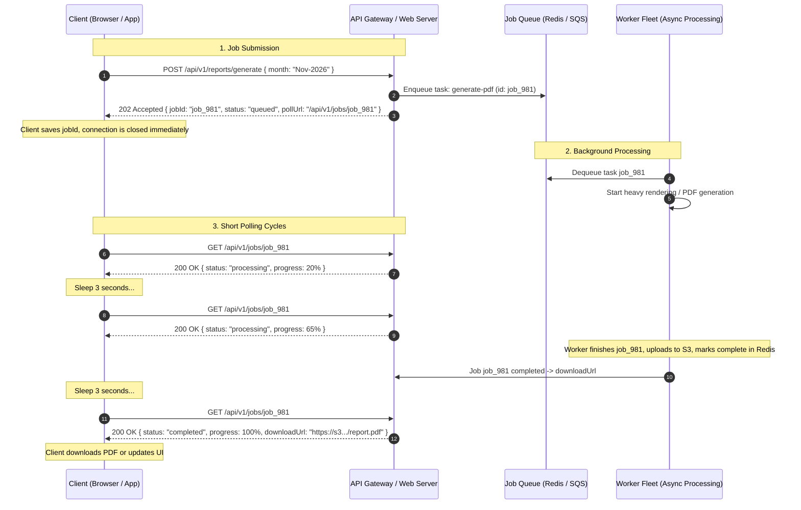
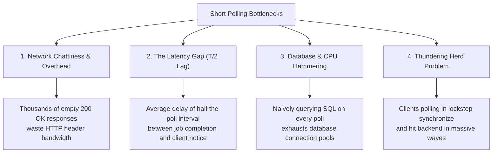
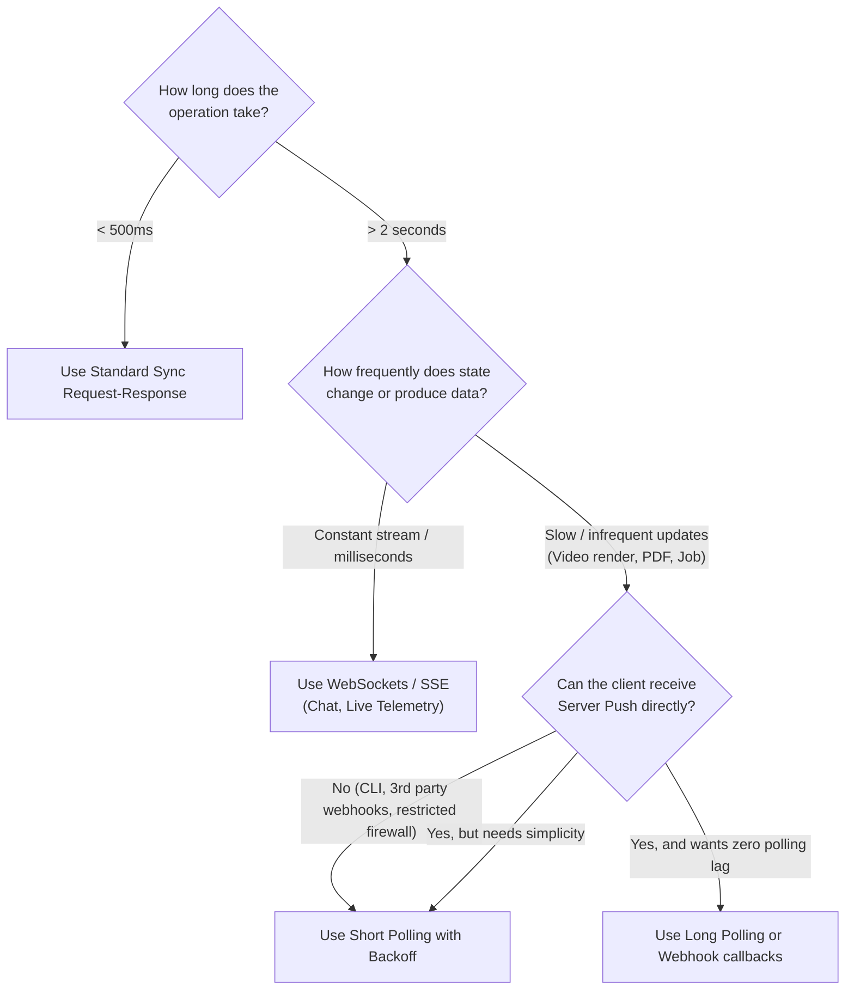

# ⏱️ The Short Polling Communication Pattern

> [!important] Core Mental Model
> What do you do when a client asks for something that takes **2 minutes to compute** (transcoding a video, generating a 500-page financial PDF, training an ML model, or running a massive database migration)?
>
> If you keep the HTTP connection open, you risk **504 Gateway Timeouts**, client drops, thread starvation, and wasted server resources.
>
> **Short Polling** decomposes one long-running, fragile request into an **Asynchronous Job**:
> 1. The client triggers the job and immediately receives an identifier (`jobId`) with HTTP `202 Accepted`.
> 2. The backend processes the job asynchronously in a worker pool or message queue.
> 3. The client periodically makes quick, lightweight requests ("*Is Job 123 done yet?*") until the server reports completion.

---

## 1. Executive Summary & Comparison

| Communication Pattern | Mechanism | Connection Duration | Server State | Best Used When | Critical Bottleneck |
| :--- | :--- | :--- | :--- | :--- | :--- |
| **Vanilla Request–Response** | Client requests $\rightarrow$ Server blocks until done | Entire duration of operation | Thread/Socket held in memory | Fast operations ($< 500\text{ms}$), CRUD | Timeouts on long operations |
| **Short Polling** | Client repeatedly polls on an interval ($T$) | Short-lived HTTP cycles ($< 20\text{ms}$ each) | Stateless across polls; state in DB/Redis | Long-running async jobs, simple clients, unreliable networks | High network chattiness, empty responses |
| **Long Polling** | Client requests $\rightarrow$ Server holds open until event or timeout | Held open up to 30–60 seconds | Per-connection server state | Moderate update frequency, push fallback | Connection churn on busy streams |
| **Push (WebSockets/SSE)** | Single persistent connection; server pushes data | Indefinite | Stateful open sockets | High-frequency bidirectional streams (Chat, Gaming) | Complex infrastructure, sticky load balancers |

---

## 2. The Asynchronous Job Pattern (How Short Polling Works)

The modern implementation of short polling revolves around the **Async Job / Task Pattern**:



### The Three Protocol Stages

1. **Submission (`POST /resource`):**
   - Server returns **`HTTP 202 Accepted`** (RFC 7231 standard for "*request received and queued, but processing not completed*").
   - Response contains metadata: `{ "jobId": "...", "status": "pending", "pollInterval": 3000 }` and a `Location` or `pollUrl` header.
2. **Status Check (`GET /jobs/:jobId`):**
   - Each poll is an ultra-fast query (usually against Redis or a memory cache, taking $< 5\text{ms}$).
   - Returns current state: `"queued"`, `"processing"` (with optional percentage progress), `"completed"`, or `"failed"`.
3. **Completion & Retrieval:**
   - Once completed, the response provides either the direct payload or a secure link (e.g., S3 presigned URL) to retrieve the artifact.

### 2.1 The Naive Client Polling Loop (Interval-Based)
In basic web applications (such as notification widgets or status tickers), short polling is often implemented with a naive timer:

```javascript
// Naive Client: Ask every 5 seconds regardless of state
setInterval(async () => {
  try {
    const res = await fetch('/api/notifications');
    const data = await res.json();
    if (data.notifications?.length > 0) {
      renderNotifications(data.notifications);
    }
  } catch (err) {
    console.error('Polling error:', err);
  }
}, 5000);
```

```javascript
// Server: Standard synchronous request handler
app.get('/api/notifications', async (req, res) => {
  const notifications = await db.getNewNotifications(req.user.id);
  res.json({ notifications });
});
```

While trivial to write, this naive implementation exposes your backend directly to the scaling wall detailed below.

---

## 3. Advantages of Short Polling

### 1. Resilient to Client Disconnections & Network Drops
In a synchronous request, if the user loses WiFi, closes their laptop, or navigates away, the connection resets (`ECONNRESET`). The server might crash, cancel the computation midway, or finish the job but fail to deliver the result.
- With short polling, the client can store `jobId` in `localStorage` or disk. If the client disconnects and reconnects 10 minutes later, it simply polls `GET /jobs/:jobId` and immediately retrieves the result!

### 2. Trivial Load Balancing & Statelessness
Because every poll is an independent, standard HTTP `GET` request:
- No sticky sessions or persistent socket pinning required.
- Any backend server in your cluster can answer any poll request, as long as job metadata resides in a shared datastore (e.g., Redis).
- Standard Layer 7 load balancers (Nginx, AWS ALB, HAProxy) route polls with zero special configuration.

### 3. Client Drives the Pace
If a client is on a constrained low-battery device or metered 3G connection, it can decide to poll every 15 seconds instead of every 2 seconds. The client has full autonomy over when to request updates.

### 4. Simplicity of Implementation
Unlike WebSockets or SSE, short polling works everywhere:
- Through all corporate firewalls, reverse proxies, and legacy browsers.
- No protocol upgrades, no complex reconnect state machines, no binary framing.

---

## 4. The Scaling Wall & Pitfalls



### 1. The Math Problem: Network Chattiness
Every HTTP request carries overhead: TCP 3-way handshake (if no keep-alive), TLS negotiation, and 500–1000 bytes of request/response headers (Cookies, User-Agent, Authorization).

$$\text{Total RPS} = \frac{\text{Active Polling Users}}{\text{Poll Interval in Seconds}}$$

Suppose you have **10,000 users** checking file conversions with a **3-second poll interval**:

$$\text{RPS} = \frac{10{,}000}{3} \approx 3{,}333 \text{ requests / second}$$

- That is **3,333 HTTP requests per second** hitting your infrastructure.
- **Over 95% of those requests return no new data** (`"status": "processing"`).
- At 1 KB per request/response round-trip, your servers burn **3.3 MB/s (~285 GB/day)** just transmitting empty status messages!

### 2. The Latency Gap ($T/2$)
Short polling is **not real-time**. If a job takes 5.1 seconds to finish and the client polls every 5 seconds:
- Poll 1 at $t = 0\text{s}$: Started
- Poll 2 at $t = 5\text{s}$: Still processing (98%)
- Job completes at $t = 5.1\text{s}$
- Poll 3 at $t = 10\text{s}$: Completed!
- **The user waited an extra 4.9 seconds** after the work was done before finding out!
- The average latency lag of short polling is:

$$\text{Average Latency Penalty} = \frac{T_{\text{interval}}}{2}$$

### 3. The Thundering Herd / Lockstep Wave
If 1,000 users submit a job during a flash sale or live event, all 1,000 clients start polling simultaneously on fixed intervals (e.g., exactly every 5.0 seconds).
Their polls will synchronize into **resonant waves**, hammering the backend with massive spikes of traffic every 5th second, followed by 4 seconds of silence.

---

## 5. Production Hardening: How to Do Short Polling Right

If you choose short polling, you must apply five engineering principles:

### Principle 1: Fast Cache for Status (Never Poll the Database)
Never run `SELECT * FROM jobs WHERE id = ?` against your primary PostgreSQL or MySQL database on every poll.
- Workers should write progress updates to **Redis** (`HSET job:123 progress 45 status processing`).
- The API polling handler reads exclusively from Redis via $O(1)$ memory lookup ($< 1\text{ms}$).

### Principle 2: Exponential Backoff & Jitter
Never poll on a rigid fixed interval (`setInterval(poll, 3000)`).
Use **exponential backoff with randomized jitter**:
- Poll 1: after 1s
- Poll 2: after 2s
- Poll 3: after 4s
- Poll 4+: after 8s (capped at max 15s)
- Add $\pm 20\%$ random jitter to prevent lockstep thundering herds.

### Principle 3: Use HTTP `202 Accepted` and `Retry-After`
Leverage standard HTTP semantics:
```http
HTTP/1.1 202 Accepted
Location: /api/v1/jobs/task_456
Retry-After: 5
Content-Type: application/json

{
  "jobId": "task_456",
  "status": "processing",
  "progress": 30
}
```
The `Retry-After: 5` header explicitly instructs the client not to contact the server again for at least 5 seconds.

### Principle 4: Enforce Job TTL & Cleanup
Completed or abandoned jobs must not accumulate in memory:
- Set an automatic **Time-To-Live (TTL)** in Redis (e.g., expire job status after 24 hours).
- If a client never comes back for its result, the cache self-cleans.

---

## 6. Hands-On Implementation

Let's look at the Express demo from the lecture, identify what needs fixing, and build a full production-ready implementation.

### The Lecture's Demo Code Analysis

```javascript
// naive-polling-server.js (from lecture)
const app = require("express")();
const jobs = {}; // In-memory dictionary

app.post("/submit", (req, res) => {
  const jobId = `job:${Date.now()}`; // ⚠️ Collisions if two requests arrive in same millisecond!
  jobs[jobId] = 0;
  updateJob(jobId); // Simulates async progress
  res.end(jobId);
});

app.get("/checkstatus", (req, res) => {
  res.end(`\nJobStatus: ${jobs[req.query.jobid]}%\n`); // ⚠️ No validation, memory leak, raw string response
});

function updateJob(jobId) {
  if (jobs[jobId] < 100) {
    setTimeout(() => {
      jobs[jobId] += 10;
      updateJob(jobId);
    }, 3000);
  }
}

app.listen(8080);
```

#### Flaws in Naive Code:
1. `Date.now()` creates collision hazards under concurrent load.
2. `jobs` dictionary grows indefinitely in process memory (memory leak / OOM).
3. Status queries are unvalidated and return plain unstructured text.
4. If the Node.js process restarts, all active jobs and states evaporate.

---

### Production-Grade Backend (Node.js + Express)

This version uses cryptographically secure UUIDs, structured JSON responses, simulated Redis state with TTLs, and HTTP `202 Accepted` headers.

```javascript
// server.js — Production-Grade Asynchronous Polling Server
const express = require('express');
const crypto = require('node:crypto');

const app = express();
app.use(express.json());

// In production, replace this Map with a Redis client (ioredis)
const jobStore = new Map();

/**
 * Helper to update job state with TTL expiration
 */
function setJob(id, data, ttlSeconds = 300) {
  const expiresAt = Date.now() + ttlSeconds * 1000;
  jobStore.set(id, { ...data, expiresAt });
}

// Background reaper for expired jobs
setInterval(() => {
  const now = Date.now();
  for (const [id, job] of jobStore.entries()) {
    if (job.expiresAt && now > job.expiresAt) {
      jobStore.delete(id);
    }
  }
}, 60000);

/**
 * 1. Submit Job Endpoint
 * Accepts the request, enqueues work, returns 202 Accepted immediately
 */
app.post('/api/v1/jobs', (req, res) => {
  const { taskType, payload } = req.body;

  if (!taskType) {
    return res.status(400).json({ error: 'taskType is required' });
  }

  // Generate unique collision-proof ID
  const jobId = crypto.randomUUID();

  // Initialize job state
  setJob(jobId, {
    id: jobId,
    taskType,
    status: 'queued',
    progress: 0,
    result: null,
    error: null,
    createdAt: new Date().toISOString()
  });

  // Trigger background asynchronous worker (simulated)
  processJobAsynchronously(jobId, payload);

  // Return 202 Accepted with polling location and suggested interval
  res.status(202)
    .set({
      'Location': `/api/v1/jobs/${jobId}`,
      'Retry-After': '2' // Recommends polling in 2 seconds
    })
    .json({
      jobId,
      status: 'queued',
      pollUrl: `/api/v1/jobs/${jobId}`,
      message: 'Job submitted successfully and is processing.'
    });
});

/**
 * 2. Check Job Status Endpoint (Polled by client)
 */
app.get('/api/v1/jobs/:jobId', (req, res) => {
  const { jobId } = req.params;
  const job = jobStore.get(jobId);

  if (!job) {
    return res.status(404).json({ error: 'Job not found or has expired' });
  }

  // If completed or failed, return final payload
  if (job.status === 'completed') {
    return res.status(200).json({
      jobId: job.id,
      status: 'completed',
      progress: 100,
      result: job.result,
      completedAt: job.completedAt
    });
  }

  if (job.status === 'failed') {
    return res.status(500).json({
      jobId: job.id,
      status: 'failed',
      error: job.error
    });
  }

  // Still processing -> 200 OK (or 202 Accepted) with progress update
  res.status(200)
    .set('Retry-After', '2')
    .json({
      jobId: job.id,
      status: job.status,
      progress: job.progress
    });
});

/**
 * Simulated Asynchronous Background Worker
 */
function processJobAsynchronously(jobId, payload) {
  let progress = 0;

  const interval = setInterval(() => {
    progress += 20;

    const currentJob = jobStore.get(jobId);
    if (!currentJob) {
      clearInterval(interval);
      return;
    }

    if (progress < 100) {
      setJob(jobId, {
        ...currentJob,
        status: 'processing',
        progress
      });
    } else {
      clearInterval(interval);
      // Mark complete and attach output result (e.g., S3 URL)
      setJob(jobId, {
        ...currentJob,
        status: 'completed',
        progress: 100,
        result: {
          downloadUrl: `https://storage.example.com/exports/${jobId}.pdf`,
          fileSize: '4.2 MB'
        },
        completedAt: new Date().toISOString()
      }, /* keep completed job for 1 hour */ 3600);
    }
  }, 2000); // Progress increases every 2 seconds
}

const PORT = process.env.PORT || 8080;
app.listen(PORT, () => {
  console.log(`🚀 Polling backend running on http://localhost:${PORT}`);
});
```

---

### Production-Grade Client (JavaScript / TypeScript with Exponential Backoff & Jitter)

This client script avoids thundering herds, honors `Retry-After`, and uses exponential backoff.

```javascript
// client-poller.js — Robust Polling Client
class JobPoller {
  constructor(options = {}) {
    this.initialInterval = options.initialInterval || 1000; // 1s
    this.maxInterval = options.maxInterval || 10000;         // 10s max
    this.backoffFactor = options.backoffFactor || 1.5;
    this.timeoutMs = options.timeoutMs || 120000;            // 2 min timeout
  }

  /**
   * Submits task and polls until completion or failure
   */
  async submitAndPoll(endpoint, payload, onProgress = () => {}) {
    // 1. Submit Job
    const submitRes = await fetch(endpoint, {
      method: 'POST',
      headers: { 'Content-Type': 'application/json' },
      body: JSON.stringify(payload)
    });

    if (!submitRes.ok && submitRes.status !== 202) {
      throw new Error(`Submission failed with status: ${submitRes.status}`);
    }

    const { jobId, pollUrl } = await submitRes.json();
    console.log(`[SUBMITTED] Job ID: ${jobId}`);

    // 2. Poll Loop
    const startTime = Date.now();
    let currentInterval = this.initialInterval;

    while (Date.now() - startTime < this.timeoutMs) {
      // Apply jitter (+/- 20%) to prevent synchronized polling waves
      const jitter = currentInterval * (Math.random() * 0.4 - 0.2);
      const sleepDuration = Math.max(500, currentInterval + jitter);

      await new Promise(res => setTimeout(res, sleepDuration));

      const pollRes = await fetch(pollUrl);
      
      // Check for server-recommended retry delay
      const retryAfter = pollRes.headers.get('Retry-After');
      if (retryAfter) {
        currentInterval = parseInt(retryAfter, 10) * 1000;
      }

      if (!pollRes.ok) {
        throw new Error(`Polling failed with HTTP ${pollRes.status}`);
      }

      const jobData = await pollRes.json();
      onProgress(jobData);

      if (jobData.status === 'completed') {
        return jobData.result;
      }

      if (jobData.status === 'failed') {
        throw new Error(`Job execution failed: ${jobData.error}`);
      }

      // Exponential backoff up to max ceiling
      currentInterval = Math.min(this.maxInterval, currentInterval * this.backoffFactor);
    }

    throw new Error(`Job timed out after ${this.timeoutMs / 1000} seconds`);
  }
}

// Example Usage:
(async () => {
  const poller = new JobPoller();

  try {
    const result = await poller.submitAndPoll(
      'http://localhost:8080/api/v1/jobs',
      { taskType: 'generate_pdf', payload: { reportId: 42 } },
      (status) => {
        console.log(`[PROGRESS] Status: ${status.status} (${status.progress || 0}%)`);
      }
    );

    console.log('🎉 Job Finished Successfully! Result:', result);
  } catch (err) {
    console.error('❌ Error executing job:', err.message);
  }
})();
```

---

## 7. Real-World Case Studies

### 1. Video Transcoding Pipeline (YouTube / Vimeo / Cloudflare Stream)
Uploading a 4K 10GB video takes 5 minutes to transfer, followed by 15 minutes of multi-resolution transcoding (1080p, 720p, HLS chunks).
- Direct HTTP upload is completed via multipart chunking.
- The transcoding phase is submitted to an asynchronous job queue (e.g. AWS MediaConvert).
- The client receives an `uploadId` and polls `GET /videos/:id/status`.
- Progress moves incrementally: `10% (audio extracted) -> 40% (1080p done) -> 90% (HLS manifests generated) -> 100% (ready)`.

### 2. Heavy Financial Report Generation (Stripe / QuickBooks / SAP)
Exporting 500,000 transaction rows as CSV/PDF cannot execute inside a standard 30-second web request.
- Client submits filter parameters: `POST /v1/reports`.
- Backend enqueues the database query in BullMQ / Celery.
- Client polls `GET /v1/reports/:id` every 3 seconds.
- Once finished, backend sends a temporary presigned S3 URL for download.

### 3. Payment Processing & 3D Secure Verification
When a customer confirms payment, the payment gateway must contact the card issuing bank, wait for 3DS SMS authentication, and verify fraud scores.
- Rather than freezing the checkout browser window, the payment API enqueues the payment intent.
- The checkout modal polls the payment status until the bank responds with `"succeeded"` or `"requires_action"`.

---

## 8. Decision Matrix: When to Use Short Polling



### When Short Polling is the Best Choice:
- ✅ **Batch & Export Jobs:** Operations that run for 5 seconds to 10 minutes where users can wait a few seconds for notification.
- ✅ **Unreliable Mobile Networks:** Mobile clients moving in and out of cell reception can cleanly resume polling without maintaining open TCP state.
- ✅ **Simplicity & Speed to Market:** Minimal infrastructure required — no Redis pub/sub backplanes or WebSocket server scaling.

### When to Avoid Short Polling:
- ❌ **Real-Time Instant Messaging:** Chat messages require sub-100ms delivery; polling every 2 seconds feels sluggish and burns server bandwidth.
- ❌ **High-Concurrency Feeds:** If 1,000,000 active users are waiting on live updates, short polling will crush your ingress proxies. Use WebSockets or SSE instead.
