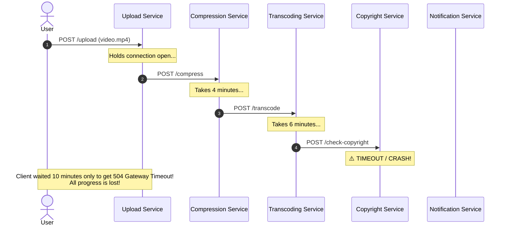
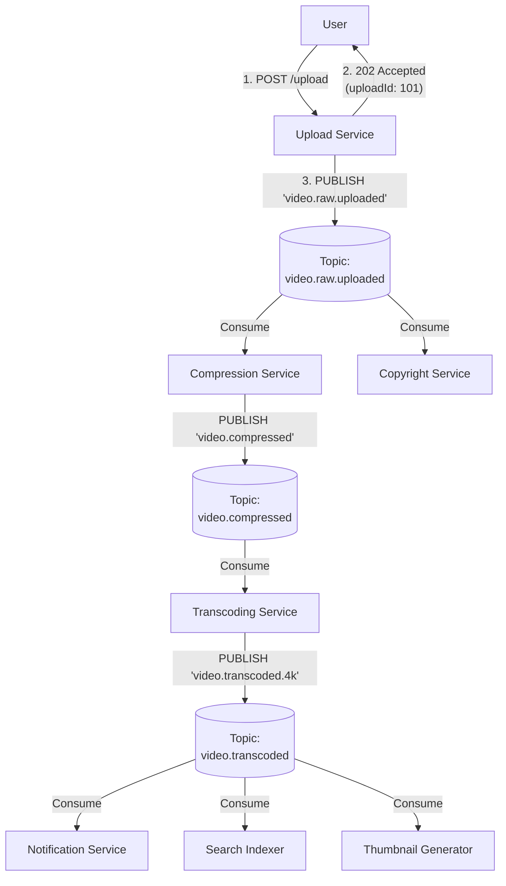
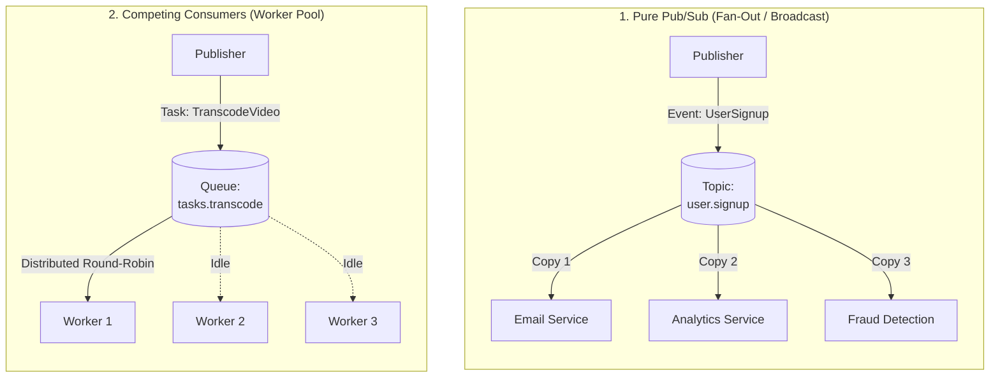
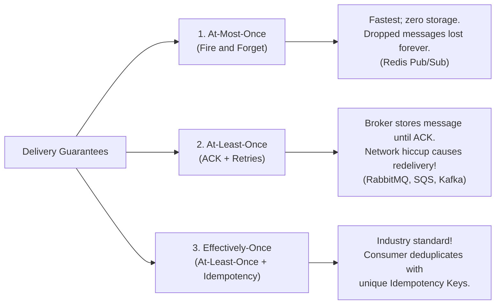
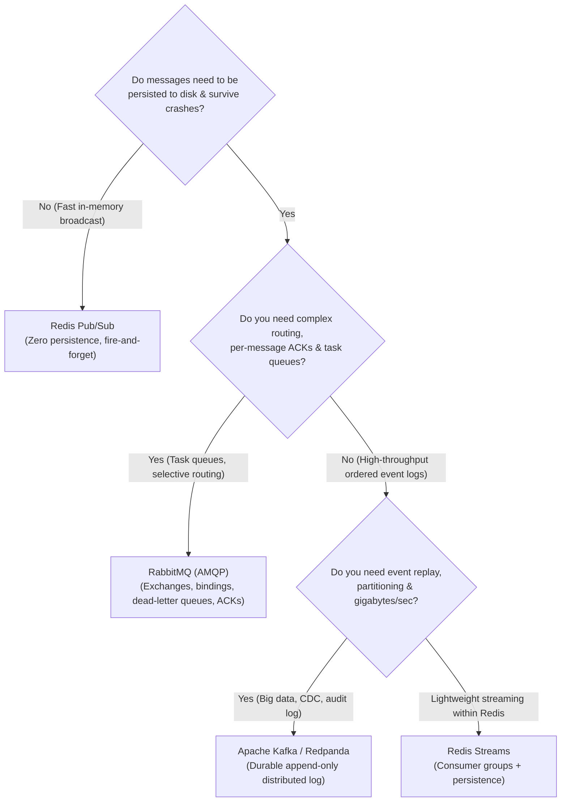
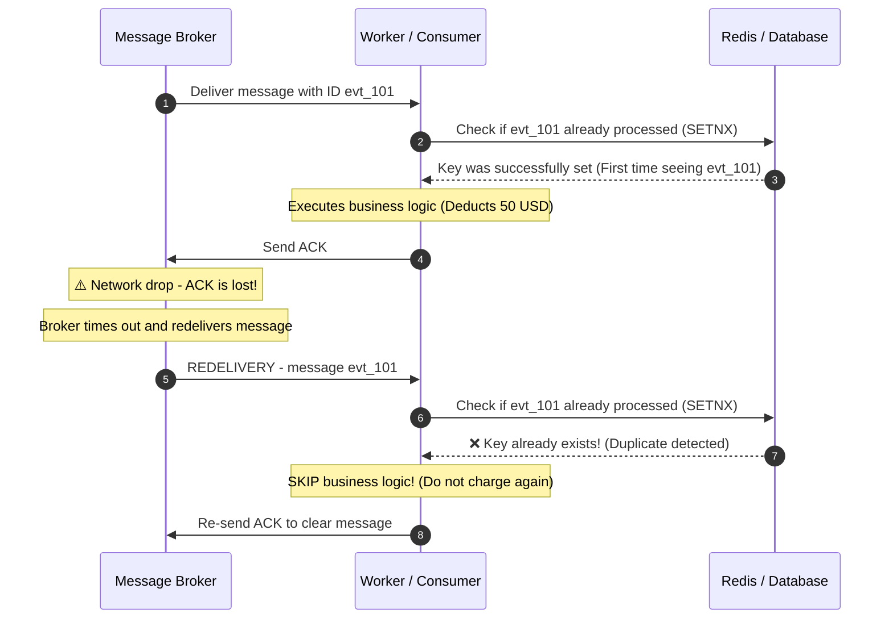
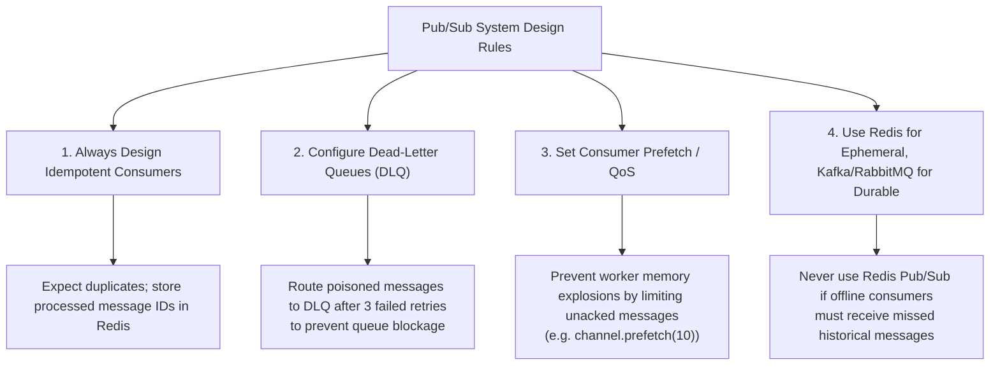

# 📢 The Publish–Subscribe (Pub/Sub) Pattern

> [!important] Core Mental Model
> In a traditional microservice system built with synchronous Request–Response, services call each other directly: Service A calls Service B, which calls Service C, which calls Services D and E. This creates a brittle, tightly coupled **"distributed monolith"** where a single latency spike or crash in Service E cascades backward and brings down the entire application.
>
> The **Publish–Subscribe (Pub/Sub)** pattern decouples producers from consumers through an intermediate **Message Broker**:
> - **Publishers** emit events to a topic or exchange and immediately continue their work (fire-and-forget). They have **zero knowledge** of who is listening, how many consumers exist, or where they live.
> - **Subscribers** register interest in specific topics. Whenever an event is published, the broker delivers it to all interested subscribers.
>
> **"Publishers announce facts that occurred; Subscribers react to facts at their own pace."**

---

## 1. The Core Problem: Why Chained Request–Response Fails

Consider the real-world workflow of uploading a video to YouTube:
1. Video uploaded by user.
2. Raw video must be compressed.
3. Transcoded into multiple resolutions (480p, 720p, 1080p, 4K).
4. Subtitles generated via AI speech-to-text.
5. Scanned by a Copyright / Content-ID infringement service.
6. Push notifications sent to millions of subscribers.
7. Search index and recommendation engines updated.

### ❌ The Synchronous Request–Response Failure
If implemented using direct HTTP calls:



#### Why Chained Request–Response Breaks at Scale:
1. **Compounding Latency:** Total request latency = $\sum(\text{latencies of all downstream services})$. The client is blocked waiting for minutes.
2. **Cascading Failures:** If Service 5 (Copyright) crashes, the whole chain fails. Services 1, 2, and 3 executed wasted compute.
3. **Rigid High Coupling ($O(N^2)$ Complexity):** If you want to add a new "Thumbnail Generator" service, you must modify the Transcoding service's source code, configure network credentials, and deploy changes.
4. **Temporal Coupling:** Both the sender and the receiver must be online and healthy at the exact same millisecond for communication to succeed.

---

### ✅ The Pub/Sub Decoupled Architecture

With Pub/Sub, the entire workflow becomes an event-driven pipeline mediated by message brokers:



#### The Three Dimensions of Decoupling:
1. **Space Decoupling (Reference):** Publishers and subscribers do not know each other's IP addresses, hostnames, or ports. They only know the broker's topic name.
2. **Time Decoupling (Temporal):** The publisher and subscriber do not need to run concurrently. A publisher can push 1,000 messages at midnight; the subscriber can boot up at 6:00 AM, process the queue, and shut down.
3. **Synchronization Decoupling:** Publishing is asynchronous and non-blocking. The publisher flushes the message to the broker in $< 2\text{ms}$ and frees its HTTP thread to serve the next user.

---

## 2. Pub/Sub Models & Delivery Semantics

Not all Pub/Sub architectures behave the same way. The two primary paradigms are **Fan-Out Pub/Sub** and **Competing Consumers (Message Queues)**:



| Model | Mechanics | Duplication Behavior | Typical Technology |
| :--- | :--- | :--- | :--- |
| **Pure Pub/Sub (Fan-Out)** | One-to-Many broadcast. Every subscriber gets a complete copy of the message. | Every interested subscriber receives its own copy. | Redis Pub/Sub, SNS, Kafka Consumer Groups, RabbitMQ Fanout Exchange. |
| **Competing Consumers (Queue)** | One-to-One worker distribution. Multiple workers consume from the same queue; each message is processed by **exactly one worker**. | Load balanced across worker pool; no duplicate processing. | SQS, RabbitMQ Queues, Celery, BullMQ, Redis Streams consumer groups. |

---

## 3. Delivery Guarantees & The Two Generals' Problem

In distributed systems, networks drop packets, servers crash, and disks fail. How does Pub/Sub handle message reliability?



### The Trade-off Table

| Guarantee | How It Works | Failure Scenario | When to Use |
| :--- | :--- | :--- | :--- |
| **At-Most-Once** | Publisher sends message; broker does not wait for consumer ACK. | If consumer crashes mid-processing, **message is lost forever**. | Live metrics, telemetry, non-critical chat presence, stock tickers. |
| **At-Least-Once** | Consumer must send an explicit **ACK (Acknowledgment)**. If consumer crashes or timeout expires, broker re-delivers message. | If consumer processes message but network drops before ACK reaches broker, **message is delivered twice**. | E-commerce orders, payments, video transcoding, emails. |
| **Exactly-Once** | Theoretical ideal. In distributed reality, networks cannot guarantee exactly-once across network boundaries (Two Generals' Paradox). | Solved via **At-Least-Once delivery + Idempotent Consumers**. | Financial transactions, ledger updates. |

---

## 4. Technology Deep Dive: RabbitMQ vs. Redis Pub/Sub vs. Kafka

A common interview question: *"When should I use Redis Pub/Sub vs RabbitMQ vs Kafka?"*



### Head-to-Head Comparison

| Feature | Redis Pub/Sub | RabbitMQ (AMQP) | Apache Kafka | Redis Streams |
| :--- | :--- | :--- | :--- | :--- |
| **Architecture** | Ephemeral in-memory routing | Traditional Smart Broker / Dumb Consumer | Dumb Broker / Smart Consumer (Distributed Log) | In-memory append-only log with consumer groups |
| **Persistence** | **None** (Fire-and-forget; offline clients miss messages) | **Yes** (Messages persist in queues on disk) | **Yes** (Immutable commit log on disk with retention policies) | **Yes** (Persists with RDB/AOF snapshots) |
| **Message Routing** | Topic pattern matching (`PSUBSCRIBE news.*`) | Complex Exchange Routing (Direct, Fanout, Topic, Headers) | Topic partitioning via message key hash | Key-based stream channels |
| **Message Replay** | ❌ Impossible | ❌ Disappears once acknowledged | ✅ Replay from any historical offset/timestamp | ✅ Replay using stream IDs (`0-0` or specific range) |
| **Consumer Model** | Push (Broker pushes to connection) | Push (Broker pushes with `basic.qos` prefetch) | **Pull** (Consumer calls `poll()` with long polling) | Pull / Blocking read (`XREADGROUP BLOCK`) |
| **Throughput** | ~1,000,000 msgs/sec | ~50,000 msgs/sec | ~1,000,000+ msgs/sec | ~500,000 msgs/sec |
| **Best Used For** | Real-time chat presence, cache invalidation, live alerts | Complex business workflows, asynchronous task queues | Event sourcing, analytics pipelines, log aggregation | Lightweight queuing when Redis is already in stack |

---

## 5. Hands-On Engineering Implementations

### Implementation 1: RabbitMQ with AMQP & Explicit ACKs (Hussein's Lecture Demo)

In the lecture, Hussein demonstrated how RabbitMQ ensures reliability:
1. Producer asserts a queue and sends a job (`107`).
2. Worker 1 receives the job, but **does not acknowledge it**.
3. When Worker 1 dies or is terminated, RabbitMQ detects the broken socket and **automatically redelivers job `107` to Worker 2**.

```javascript
// rabbitmq-producer.js
const amqp = require('amqplib');

async function publishJob(jobNumber) {
  // Connect to RabbitMQ broker (Local or CloudAMQP)
  const connection = await amqp.connect(process.env.RABBITMQ_URL || 'amqp://localhost');
  const channel = await connection.createChannel();

  const queueName = 'jobs';
  // assertQueue ensures the queue exists and survives broker restarts (durable: true)
  await channel.assertQueue(queueName, { durable: true });

  const payload = Buffer.from(JSON.stringify({ jobNumber, timestamp: Date.now() }));
  
  // persistent: true writes message to disk
  channel.sendToQueue(queueName, payload, { persistent: true });
  console.log(`[PRODUCER] Sent Job: ${jobNumber}`);

  await channel.close();
  await connection.close();
}

publishJob(107);
```

```javascript
// rabbitmq-consumer.js
const amqp = require('amqplib');

async function startWorker(workerName) {
  const connection = await amqp.connect(process.env.RABBITMQ_URL || 'amqp://localhost');
  const channel = await connection.createChannel();

  const queueName = 'jobs';
  await channel.assertQueue(queueName, { durable: true });

  // Fair dispatch: Do not push more than 1 unacked message to this worker at a time!
  channel.prefetch(1);

  console.log(`[${workerName}] Waiting for messages...`);

  // noAck: false requires EXPLICIT acknowledgment
  channel.consume(queueName, async (msg) => {
    if (msg !== null) {
      const content = JSON.parse(msg.content.toString());
      console.log(`[${workerName}] Processing Job: ${content.jobNumber}...`);

      try {
        // Simulate heavy asynchronous task (e.g. video rendering)
        await new Promise((res) => setTimeout(res, 3000));

        console.log(`[${workerName}] ✅ Completed Job: ${content.jobNumber}`);
        
        // Explicitly acknowledge to tell RabbitMQ: "Safe to delete this message"
        channel.ack(msg);
      } catch (err) {
        console.error(`[${workerName}] ❌ Failed processing. Rejecting message...`);
        // nack with requeue: true puts message back in queue for another worker!
        channel.nack(msg, false, /* requeue = */ true);
      }
    }
  }, { noAck: false });
}

startWorker(process.argv[2] || 'Worker-1');
```

---

### Implementation 2: Redis Pub/Sub (Fast In-Memory Broadcast)

Redis Pub/Sub is the industry standard for broadcasting events across scaled WebSocket servers or notifying web nodes of cache invalidations.

> [!warning] The Redis Pub/Sub Trap
> Redis Pub/Sub is **fire-and-forget**. If no subscribers are connected when a message is published, **the message is instantly destroyed**. If you need messages stored for offline workers, use **Redis Streams** (`XADD`) instead!

```javascript
// redis-pubsub.js — Microservice Event Broadcast with ioredis
const Redis = require('ioredis');

// Publishers and Subscribers require SEPARATE Redis client instances
// because once a client enters SUBSCRIBE mode, it cannot issue regular commands!
const publisher = new Redis(process.env.REDIS_URL || 'redis://localhost:6379');
const subscriber = new Redis(process.env.REDIS_URL || 'redis://localhost:6379');

// 1. Subscriber registers interest in channel
subscriber.subscribe('video.transcoded', (err, count) => {
  if (err) console.error('Subscription failed:', err);
  console.log(`[SUBSCRIBER] Subscribed to ${count} channels. Listening for events...`);
});

// 2. Reacting to broadcast events
subscriber.on('message', (channel, message) => {
  const event = JSON.parse(message);
  console.log(`[EVENT RECEIVED] Channel '${channel}': Video ${event.videoId} ready in ${event.resolution}`);
});

// 3. Pattern Matching Subscription (PSUBSCRIBE)
const patternSubscriber = new Redis(process.env.REDIS_URL || 'redis://localhost:6379');
patternSubscriber.psubscribe('video.*', () => {
  console.log('[AUDIT LOG] Subscribed to all video.* topics');
});

patternSubscriber.on('pmessage', (pattern, channel, message) => {
  console.log(`[AUDIT] Matched ${pattern} on channel ${channel}`);
});

// 4. Publisher publishes events
async function publishEvents() {
  await new Promise(r => setTimeout(r, 500)); // wait for subscription setup

  const eventPayload = {
    videoId: 'vid_98231',
    resolution: '4K',
    cdnUrl: 'https://cdn.youtube.com/vid_98231_4k.mp4',
    timestamp: Date.now()
  };

  const subscriberCount = await publisher.publish(
    'video.transcoded',
    JSON.stringify(eventPayload)
  );

  console.log(`[PUBLISHER] Broadcasted event to ${subscriberCount} active subscribers.`);
}

publishEvents();
```

---

## 6. Solving the Duplicate Message Problem: Idempotency

Because production message brokers (RabbitMQ, Kafka, SQS) provide **At-Least-Once** delivery, consumers will inevitably receive duplicate messages during network hiccups or worker retries.



### The Idempotent Consumer Implementation (Node.js + Redis)

```javascript
async function handleOrderEvent(event, redisClient) {
  const { idempotencyKey, orderId, amount } = event;

  // Use Redis SET with NX (Not eXists) and EX (Expiration)
  // Atomic check-and-set: returns 'OK' if key was set, null if key already exists!
  const isNew = await redisClient.set(
    `processed:event:${idempotencyKey}`,
    'COMPLETED',
    'EX', 86400, // 24-hour TTL
    'NX'
  );

  if (!isNew) {
    console.warn(`[IDEMPOTENCY] Duplicate event ${idempotencyKey} detected. Skipping processing.`);
    return; // Safely exit without charging user twice!
  }

  // Safe to execute non-idempotent business logic
  await processPayment(orderId, amount);
  console.log(`[ORDER] Successfully processed order ${orderId} for $${amount}`);
}
```

---

## 7. Summary & Architectural Checklist



### Key Engineering Takeaways:
1. **Pub/Sub turns $O(N^2)$ direct service dependencies into $O(1)$ event streams.**
2. **Space, time, and synchronization decoupling** allows individual services to crash, scale, and deploy independently without breaking the system.
3. **Delivery guarantees are bounded by physics:** You can achieve *at-most-once* or *at-least-once*. You achieve *effectively-once* by pairing *at-least-once* with **idempotency keys**.
4. **Choose the right tool:**
   - **Redis Pub/Sub:** Ultra-fast in-memory broadcast for live chat/presence where losing dropped messages is acceptable.
   - **RabbitMQ:** Complex routing, task queues, and per-message worker acknowledgments.
   - **Kafka:** Persistent, replayable, distributed event streaming at millions of messages/sec.
