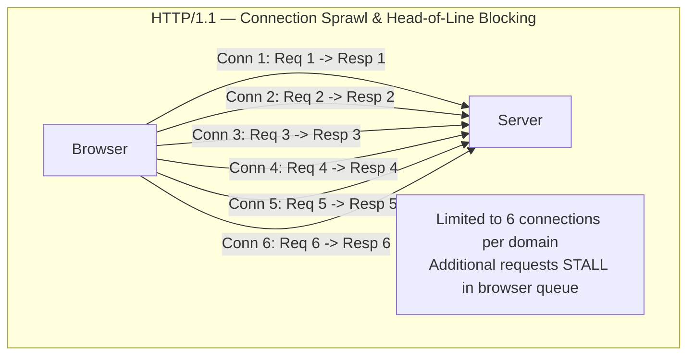
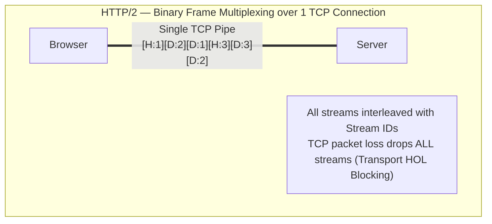
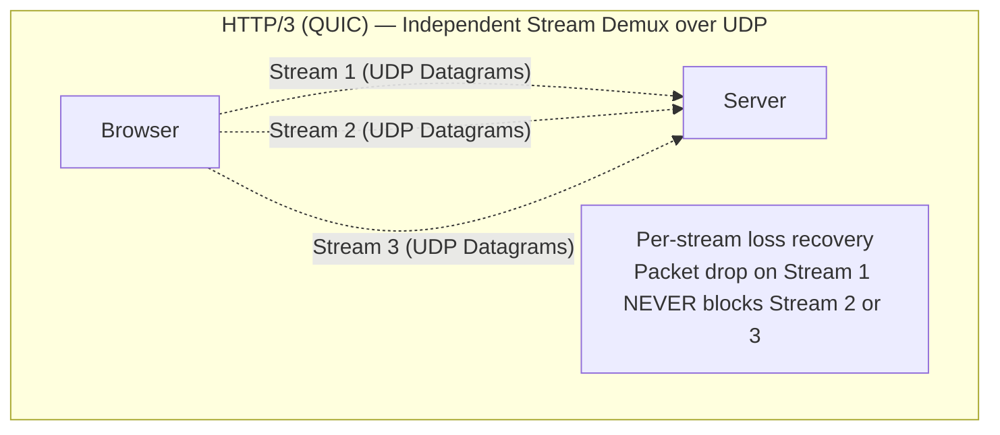
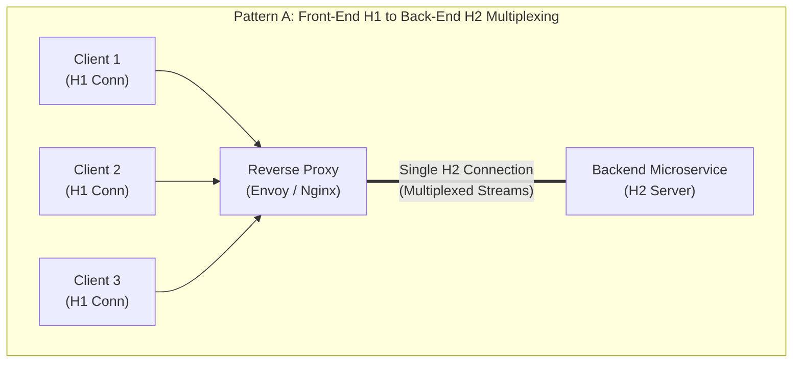
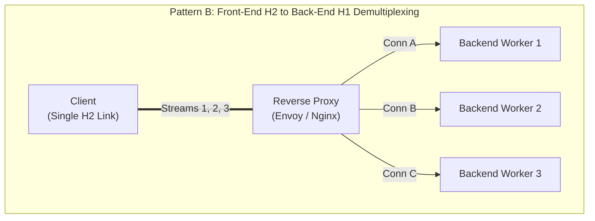
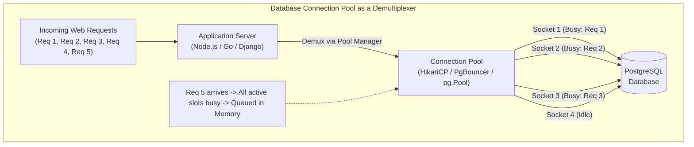
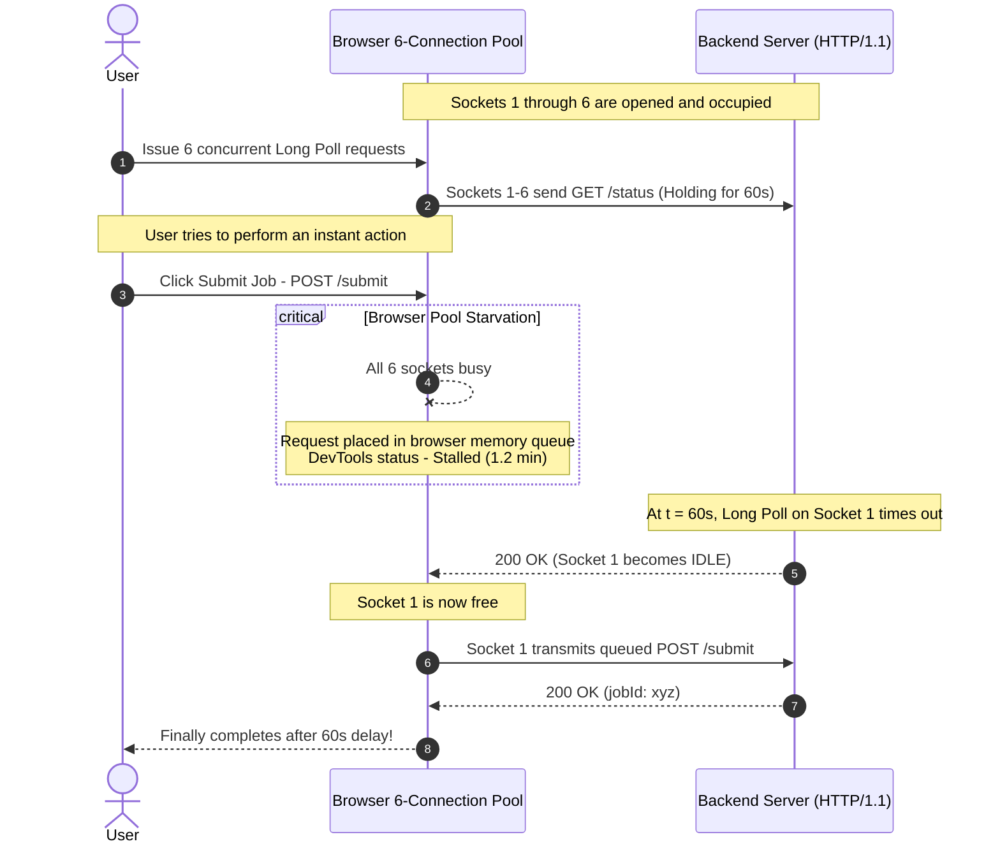
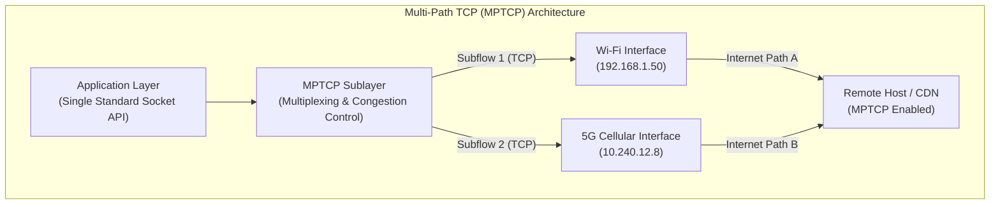

# 🔀 Multiplexing vs. Demultiplexing

> [!important] Core Mental Model
> Although **Multiplexing** and **Demultiplexing** originate in telecommunications and low-level networking, they represent one of the most critical structural paradigms in modern backend engineering.
>
> - **Multiplexing (Mux):** Combining multiple distinct logical streams, requests, or signals into a **single physical channel or connection** ($N \to 1$).
> - **Demultiplexing (Demux):** Taking messages, streams, or tasks from a single channel or source and **splitting, distributing, or routing them across multiple separate connections or destinations** ($1 \to N$).
>
> In software architecture, every layer makes deliberate design choices about where to multiplex and where to demultiplex:
> 1. **Browsers** multiplex hundreds of concurrent requests over **one TCP connection** using HTTP/2 frames.
> 2. **Reverse Proxies (Envoy, Nginx)** demultiplex client HTTP/2 streams across a **backend pool of HTTP/1.1 connections**, or vice versa.
> 3. **Database Drivers (PgBouncer, HikariCP)** demultiplex application queries across a **pool of persistent database connections** because relational databases historically cannot interleave concurrent queries on a single socket.
> 4. **Transport Protocols (MPTCP)** multiplex traffic across **multiple physical network interfaces** (Wi-Fi + Cellular) under a single logical TCP connection.

---

## 1. Executive Summary & Comparison

```
MULTIPLEXING (N -> 1)                     DEMULTIPLEXING (1 -> N)
Stream A ──┐                                         ┌──> Target A
Stream B ──┼──> [ Single Physical Link ] ──> [ Demux ] ──┼──> Target B
Stream C ──┘                                         └──> Target C
```

| Dimension | Multiplexing (Mux) | Demultiplexing (Demux) |
| :--- | :--- | :--- |
| **Fundamental Goal** | Funnel many logical channels into one physical channel | Split/route a shared channel into isolated, dedicated channels |
| **Cardinality** | **Many to One** ($N \to 1$) | **One to Many** ($1 \to N$) |
| **Resource Impact** | Minimizes connection overhead, socket file descriptors, and handshakes | Maximizes isolation, prevents noisy neighbors, simplifies protocol parsing |
| **Bottleneck / Cost** | Higher CPU overhead for framing/parsing; shared congestion & flow control | High connection footprint (memory per socket, OS file descriptors, thread pools) |
| **HTTP Example** | **HTTP/2**: Interleaving multiple browser streams over 1 TCP connection | **HTTP/1.1 Browser**: Spreading requests across 6 distinct TCP sockets |
| **Reverse Proxy Example** | Merging 1,000 incoming HTTP/1.1 client requests into 1 backend HTTP/2 link | Splitting 1 incoming HTTP/2 client stream into a pool of backend microservice sockets |
| **Database Example** | PostgreSQL 14+ Pipelining (sending multiple queries on one socket) | Connection Pooling (HikariCP/PgBouncer routing queries to idle connections) |
| **Network Example** | Multipath TCP (MPTCP) aggregating multiple network paths into 1 stream | Network router dispatching incoming IP packets to specific host ports |

---

## 2. HTTP Transport Evolution: HTTP/1.1 vs. HTTP/2 vs. HTTP/3

To understand multiplexing in web architecture, consider how HTTP transports evolved to eliminate connection sprawl and latency bottlenecks.







### 2.1 HTTP/1.1: The Connection Sprawl Workaround
Under HTTP/1.0 and HTTP/1.1, an HTTP request consumes the entire TCP connection until the response completes. While HTTP/1.1 introduced **Pipelining** (sending multiple requests without waiting for the prior response), it required the server to send responses back in the **exact sequential order** the requests were received. If Request 1 was a slow database report taking 5 seconds, Request 2 (a 10ms stylesheet) was stuck waiting behind it. Because of this **Application Head-of-Line (HOL) Blocking**, virtually all browsers disabled HTTP pipelining by default.

Instead, browsers implemented a brute-force workaround: **opening up to 6 parallel TCP connections per origin**.
- **Pros:** Up to 6 requests can execute simultaneously.
- **Cons:** 6 full TCP 3-way handshakes, 6 TLS handshakes, 6 independent slow-start congestion windows, and heavy kernel socket memory overhead on the server.

### 2.2 HTTP/2: Binary Framing & Stream Multiplexing
HTTP/2 introduced the **Binary Framing Layer**, which breaks plain-text HTTP messages into discrete binary frames stamped with a **Stream Identifier** (Stream ID):

```
+-----------------------------------------------+
|                 Length (24)                   |
+---------------+---------------+---------------+
|   Type (8)    |   Flags (8)   |
+-+-------------+---------------+---------------+
|R|                 Stream ID (31)              |
+-----------------------------------------------+
|                   Frame Payload               |
+-----------------------------------------------+
```

- **Stream:** A bi-directional, independent flow of frames within a single TCP connection.
- **Message:** A logical HTTP request or response (consisting of `HEADERS` and `DATA` frames).
- **Frame:** The smallest unit of communication (e.g., `HEADERS`, `DATA`, `SETTINGS`, `RST_STREAM`, `PING`).

Because every frame is tagged with its `Stream ID`, the client and server can **interleave frames** from dozens of concurrent requests and responses over a single physical TCP connection:

```
[HEADERS: Stream 1] -> [DATA: Stream 1] -> [HEADERS: Stream 3] -> [DATA: Stream 1] -> [DATA: Stream 3]
```

#### The Hidden Trade-Off of HTTP/2 Multiplexing
While HTTP/2 drastically improves network efficiency, it introduces two distinct engineering costs:
1. **Server CPU Overhead:** The server OS receives one continuous TCP byte stream. The HTTP/2 server layer must parse each binary frame, look up its Stream ID in an in-memory hash table, demultiplex the byte chunks, and reconstruct individual requests for the application router. At high throughput, this framing and demuxing logic consumes measurable CPU cycles compared to raw HTTP/1.1 streaming.
2. **TCP-Level Head-of-Line (HOL) Blocking:** In HTTP/2, all multiplexed logical streams share **one single TCP connection**. If a single TCP segment drops on a lossy Wi-Fi or cellular network, the operating system's TCP stack halts delivery of all subsequent segments until the missing segment is retransmitted and acknowledged. Consequently, **every single HTTP/2 stream on that connection stalls**, even if their data arrived completely intact.

### 2.3 HTTP/3 (QUIC): Solving the Multiplexing Dilemma
HTTP/3 replaces TCP with **QUIC** (built on top of UDP). QUIC moves stream multiplexing from the application layer down into the transport layer:
- Each QUIC stream has its own independent flow control and loss recovery.
- If a UDP packet containing data for Stream 1 is lost, the receiver acknowledges packets for Stream 2 and Stream 3 immediately.
- **Result:** True transport-layer multiplexing without cross-stream Head-of-Line blocking.

---

## 3. Reverse Proxy Architectures: Envoy & Nginx

In enterprise architectures, reverse proxies and API gateways (Envoy, Nginx, HAProxy, Traefik) sit between external clients and backend microservices. These proxies act as protocol translators, dynamically deciding whether to **multiplex** or **demultiplex** traffic.





### 3.1 Pattern A: Front-End HTTP/1.1 $\to$ Proxy Mux $\to$ Back-End HTTP/2
In this topology, multiple external clients connect to the reverse proxy using traditional HTTP/1.1 connections. The proxy aggregates these requests and **multiplexes them over a single, persistent HTTP/2 connection** to the backend service.

- **Why use it?**
  - **Connection Consolidation:** If 10,000 clients send requests, the backend service only needs a handful of long-lived HTTP/2 TCP sockets open rather than 10,000 separate TCP connections.
  - **Socket Resource Protection:** Drastically reduces file descriptor exhaustion and ephemeral port exhaustion on the backend cluster.
- **Architectural Trade-Off:**
  - **Single Point of Congestion:** All 10,000 client requests share the single TCP window of the backend HTTP/2 link. A slow backend response or high packet loss on that link impacts all proxied traffic.
  - **Backend CPU Load:** The backend service must spend CPU power parsing and demultiplexing the binary HTTP/2 frame stream.

### 3.2 Pattern B: Front-End HTTP/2 $\to$ Proxy Demux $\to$ Back-End Connection Pool
In this topology, a single modern browser or mobile app connects to the edge proxy over a single HTTP/2 connection (multiplexing images, scripts, and API calls). The proxy terminates the HTTP/2 connection, strips the binary framing, and **demultiplexes each request across a dedicated connection pool of HTTP/1.1 or gRPC sockets** to backend workers.

- **Why use it?**
  - **Isolated Flow Control:** Each backend worker receives a clean, unmultiplexed HTTP/1.1 byte stream over its own dedicated socket. If Worker 1 hangs or runs a heavy computation, it has zero impact on Worker 2 or Worker 3.
  - **Simplified Microservice Code:** Backend services do not need complex HTTP/2 server implementations or framing parsers; they remain lightweight, standard HTTP/1.1 microservices.
  - **Independent Congestion Management:** Each connection to the internal backend cluster manages its own TCP buffer, ensuring that noisy neighbor requests do not choke unrelated endpoints.

---

## 4. Connection Pooling as Demultiplexing

One of the most ubiquitous examples of demultiplexing in software engineering occurs between application servers and relational databases (PostgreSQL, MySQL, Oracle).



### 4.1 The "Untagged Wire Protocol / Correlation ID" Problem
Engineers often ask: **"Why do we need a connection pool of 20 TCP sockets? Why can't we just open one TCP connection to PostgreSQL and send all our queries over it concurrently?"**

The answer lies in the **database wire protocol**:
- Traditional relational database wire protocols (like the PostgreSQL Frontend/Backend Protocol 3.0 or MySQL Client/Server Protocol) **lack Stream IDs or Correlation IDs** in their query frames.
- When an application sends a query, the database responds with a stream of raw binary row tuples terminated by a `CommandComplete` packet.

```
SCENARIO: Interleaving Queries on a Single Sockets Without Correlation IDs

Client writes to Socket:
  [Query 1: SELECT * FROM heavy_analytics_report;]  (Takes 7000ms)
  [Query 2: SELECT id FROM users WHERE id = 42;]    (Takes 2ms)

Database processes Query 2 quickly, while Query 1 is still scanning disk.
Database writes to Socket:
  [Row tuple: 42, "Neel"]
  [CommandComplete]
  [Row tuple: 101, 99.4, "Report Data..."]
  ...

THE CLIENT PARSER CRASHES:
The client socket parser has NO protocol field to identify which rows belong
to Query 1 and which belong to Query 2! 
The response stream is hopelessly corrupted.
```

Because traditional database protocols cannot tag response rows with query IDs, **a single database connection can only execute one query at a time**. The application must wait until the query completes and all rows are consumed before the socket can be used for another query.

### 4.2 How the Connection Pool Solves This
A **Connection Pool** (e.g., HikariCP for Java, `pg.Pool` for Node.js, `database/sql` in Go, or an external proxy like **PgBouncer**) acts as an application-level **Demultiplexer**:
1. The pool opens and maintains $N$ persistent TCP connections to the database.
2. When an incoming HTTP request needs to run a query, the pool manager **borrows an idle connection** from the pool.
3. The query executes exclusively on that dedicated socket.
4. When the query completes, the connection is **returned to the pool** for reuse by another request.

#### Thread-per-Connection vs. Async Non-Blocking Pooling
- **Django / Flask (Traditional WSGI):** Historically allocated a database connection per worker process or thread. If 500 concurrent requests arrived, the system either attempted to open 500 database connections (crashing PostgreSQL via RAM/fork exhaustion) or rejected traffic.
- **Node.js / Go / Tokio:** Hundreds of concurrent async HTTP request handlers multiplex across a tight, fixed pool (e.g., 20 database connections). Incoming queries wait in an in-memory queue until a socket becomes idle.

### 4.3 Modern Evolution: PostgreSQL 14+ Pipelining Mode
Starting in PostgreSQL 14, `libpq` introduced native **Pipeline Mode**. 
- In pipeline mode, the client can send multiple queries back-to-back over a single connection without waiting for each query's result round-trip.
- **Constraint:** The database still returns results in strict FIFO (First-In, First-Out) order. It is not true out-of-order multiplexing like HTTP/2, but it eliminates network round-trip latency ($RTT$) between sequential queries.

### 4.4 Production Code: Safe Connection Pool Demultiplexing in Node.js

Below is a production implementation demonstrating how an async server demultiplexes concurrent client queries across a fixed database connection pool with timeout protection and queue metrics:

```typescript
import { Pool, PoolClient } from 'pg';
import http from 'http';

// Initialize a bounded connection pool (acting as our demultiplexer)
const dbPool = new Pool({
  host: 'localhost',
  port: 5432,
  database: 'production_db',
  user: 'app_user',
  password: 'secure_password',
  max: 5,                  // Maximum 5 concurrent physical TCP connections to DB
  idleTimeoutMillis: 30000,
  connectionTimeoutMillis: 2000, // Fail fast if no connection available in 2 seconds
});

dbPool.on('error', (err) => {
  console.error('[DB Pool Error] Unexpected idle client error:', err);
});

const server = http.createServer(async (req, res) => {
  if (req.url?.startsWith('/query')) {
    const startTime = Date.now();
    let client: PoolClient | null = null;

    try {
      // 1. Demux: Borrow an available physical connection from the pool
      // If all 5 connections are busy, this awaits in memory until one frees up
      client = await dbPool.connect();

      const waitTime = Date.now() - startTime;
      console.log(`[Pool Demux] Acquired socket. Queue wait time: ${waitTime}ms. Active: ${dbPool.totalCount - dbPool.idleCount}/${dbPool.max}`);

      // 2. Execute exclusive query on this dedicated socket
      const dbResult = await client.query('SELECT pg_sleep(1), NOW() as server_time');

      res.writeHead(200, { 'Content-Type': 'application/json' });
      res.end(JSON.stringify({
        status: 'success',
        data: dbResult.rows[0],
        poolStats: {
          total: dbPool.totalCount,
          idle: dbPool.idleCount,
          waiting: dbPool.waitingCount,
        },
      }));
    } catch (err: any) {
      console.error('[Query Error]', err.message);
      res.writeHead(503, { 'Content-Type': 'application/json' });
      res.end(JSON.stringify({ error: 'Database connection pool exhausted', details: err.message }));
    } finally {
      // 3. Crucial: ALWAYS release socket back to the pool so other queries can use it
      if (client) {
        client.release();
      }
    }
  } else {
    res.writeHead(404);
    res.end('Not Found');
  }
});

server.listen(3000, () => {
  console.log('HTTP Server listening on port 3000 with 5-socket DB Pool Demultiplexer');
});
```

---

## 5. The Browser 6-Connection Limit & Stalling Trap (Hussein's Lab)

In the lecture, Hussein demonstrated a classic production bug caused by browser-side connection pooling under HTTP/1.1.

### 5.1 The 6-Connection Rule per Origin
Under HTTP/1.1, browsers (Chrome, Firefox, Safari, Edge) enforce a strict hard limit: **a maximum of 6 concurrent TCP connections per domain name** (host + port).
- If your web application has 6 active requests open to `https://api.example.com`, any 7th request issued via `fetch()` or `axios` **will not be sent**.
- The browser queues the request in memory. In Chrome DevTools Network Waterfall, this request state is labeled as **"Stalled"** or **"Queueing"**.

```
Browser Connection Pool for "api.example.com" (HTTP/1.1):
[ Socket 1: BUSY (ID: 5353) ] ──> Holding Long Poll Request #1
[ Socket 2: BUSY (ID: 5353) ] ──> Holding Long Poll Request #2
[ Socket 3: BUSY (ID: 271)  ] ──> Holding Long Poll Request #3
[ Socket 4: BUSY (ID: 364)  ] ──> Holding Long Poll Request #4
[ Socket 5: BUSY (ID: 465)  ] ──> Holding Long Poll Request #5
[ Socket 6: BUSY (ID: 49)   ] ──> Holding Long Poll Request #6

Incoming Request: POST /submit-job (Instant 5ms operation)
Result: STALLED in browser for 1.2 minutes!
Why? No free TCP sockets in the browser pool.
```

### 5.2 Lab Recreation: Long Polling Stalling Immediate Requests
Consider a frontend application that implements asynchronous jobs:
1. User clicks "Check Status" on 6 different jobs.
2. The frontend issues 6 concurrent **Long Polling** requests: `GET /job/status?id=X`.
3. Because data is not ready, the backend server intentionally **holds the 6 TCP sockets open** (writing no bytes, waiting for background events).
4. Now, the user clicks **"Submit New Job"** (`POST /jobs`).
5. **The Disaster:**
   - The user expects `POST /jobs` to return in 5 milliseconds with `{ jobId: 123 }`.
   - Instead, the submit button spins indefinitely.
   - The browser does not even send a TCP `SYN` packet to the server. The request is completely stalled client-side because all 6 available sockets are blocked by the hanging long-polling requests.
   - The user cannot log in, navigate, or perform any API action until one of the 6 long-polling requests times out or completes (often 60–120 seconds later).

### 5.3 Chrome DevTools Connection ID Tracking
When inspecting this scenario in Chrome DevTools Network tab:
- Add the **"Connection ID"** column to the Network table.
- You will observe that all requests share a recurring set of numeric IDs (e.g., `5353`, `271`, `364`, `465`, `49`, `47`).
- Chrome aggressively reuses existing sockets rather than opening new ones.
- When all 6 sockets are held open by long-polling or Server-Sent Events, the waterfall graph shows a long gray/orange bar representing **"Stalled: 1.2 min"**.



### 5.4 Solutions to the 6-Connection Trap
1. **Upgrade to HTTP/2 or HTTP/3:** With HTTP/2, all requests (long polls, SSE streams, instant POSTs) are multiplexed as independent binary streams over **one single TCP connection**. The 6-connection pool limit disappears entirely (hundreds of streams can coexist).
2. **Domain Sharding (Legacy HTTP/1.1 Workaround):** Host static assets and long-polling endpoints on separate subdomains (e.g., `poll1.api.com`, `poll2.api.com`). Because the 6-connection limit is **per domain**, sharding grants 6 sockets per subdomain.
3. **Dedicated Polling Manager:** In frontend code, never fire unbound long polls. Limit background polling to 1 active socket and batch status checks into a single query (`GET /status?ids=1,2,3,4,5,6`).

---

## 6. Multi-Path TCP (MPTCP): Transport-Layer Multiplexing

Multiplexing also operates below the application layer directly inside the operating system's networking stack via **Multi-Path TCP (MPTCP — RFC 8684)**.



### 6.1 What Problem Does MPTCP Solve?
Traditional TCP binds a connection to a specific **4-tuple**:
$$\text{Connection} = (\text{Source IP}, \text{Source Port}, \text{Dest IP}, \text{Dest Port})$$

If you are downloading a large file or on a voice call on your smartphone and you walk out of your home Wi-Fi range:
1. Your smartphone switches from Wi-Fi to 5G Cellular.
2. Your phone's IP address changes from `192.168.1.50` to `10.240.12.8`.
3. The 4-tuple breaks. **The TCP connection instantly terminates with a `RST` packet.**
4. Your download fails, your SSH session freezes, and your real-time call drops.

### 6.2 How MPTCP Multiplexes Subflows
MPTCP presents a standard, single-socket interface to the application while transparently managing **multiple underlying TCP subflows**:
- **Simultaneous Bandwidth Aggregation:** MPTCP can transmit data across both Wi-Fi and 5G simultaneously, multiplexing packets across both interfaces to double throughput.
- **Seamless Zero-Downtime Failover:** When Wi-Fi signal degrades, MPTCP automatically shifts all traffic to the cellular subflow without breaking the application socket.
- **Real-World Deployment:** Apple adopted MPTCP for **Siri and Apple Music** as early as iOS 7, ensuring voice queries and music streaming do not drop when switching between cellular and home Wi-Fi.

---

## 7. Production Decision Matrix & Engineering Guidelines

| Use Case | Recommended Strategy | Why? |
| :--- | :--- | :--- |
| **Browser to API Gateway** | **Multiplexing via HTTP/2 or HTTP/3** | Eliminates 6-connection pool limit; minimizes handshake latency; enables concurrent SSE/API calls. |
| **API Gateway to Internal Microservices** | **Demultiplexing via HTTP/1.1 Connection Pool** | Isolates failure domains; gives each backend worker independent flow control; avoids backend frame-parsing CPU overhead. |
| **Relational Database Access (Postgres, MySQL)** | **Demultiplexing via Bounded Connection Pool** | Database wire protocols lack query stream IDs; prevents connection storms; queues excess queries safely in memory. |
| **Batch Analytical Queries** | **PostgreSQL 14+ Pipelining** | Eliminates network round-trip overhead when sending hundreds of inserts or updates over a single connection. |
| **Mobile Applications with High Mobility** | **Multi-Path TCP (MPTCP) or QUIC Connection Migration** | Prevents connection resets when switching between Wi-Fi and cellular networks. |
| **Microservice High-Throughput gRPC** | **HTTP/2 Multiplexing with Client-Side Load Balancing** | gRPC relies natively on HTTP/2 streams; requires subchannel pools or service meshes (Envoy) to distribute streams evenly across backend pods. |

---

## 8. Summary Checklist for System Designers

> [!tip] Practical Architecture Rules of Thumb
> 1. **Beware the HTTP/1.1 6-Connection Ceiling:** Never run multiple long-lived connections (Long Polling, SSE) over HTTP/1.1 from a browser without ensuring they don't starve standard REST/GraphQL requests. Always enable HTTP/2 on your reverse proxy or CDN.
> 2. **Multiplexing Saves Network Handshakes but Costs CPU:** Moving from HTTP/1.1 to HTTP/2 reduces TCP connections from $N$ to $1$, but increases CPU utilization on the receiving server due to binary framing disassembly and stream state tracking.
> 3. **Never Allow Unbounded Database Connection Pools:** A connection pool is a protective demultiplexer. Setting `max_connections` to 1,000 on PostgreSQL will degrade database performance due to OS process context switching and cache thrashing. Keep pool sizes lean (typically: $\text{Connections} = 2 \times \text{CPU Cores} + \text{Disk Spindle Count}$).
> 4. **Demultiplex for Isolation; Multiplex for Efficiency:** Use multiplexing when resource conservation (bandwidth, sockets, handshakes) is paramount. Use demultiplexing when task isolation, independent flow control, and simple debugging are paramount.
