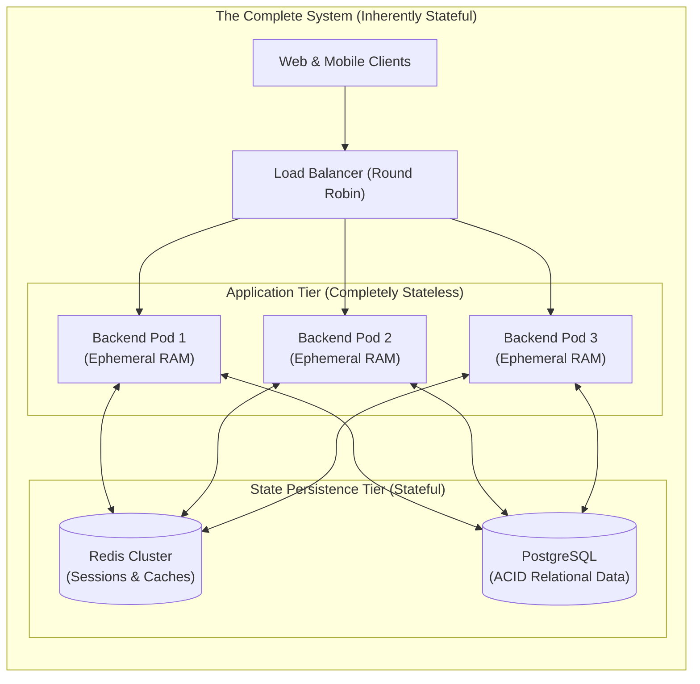
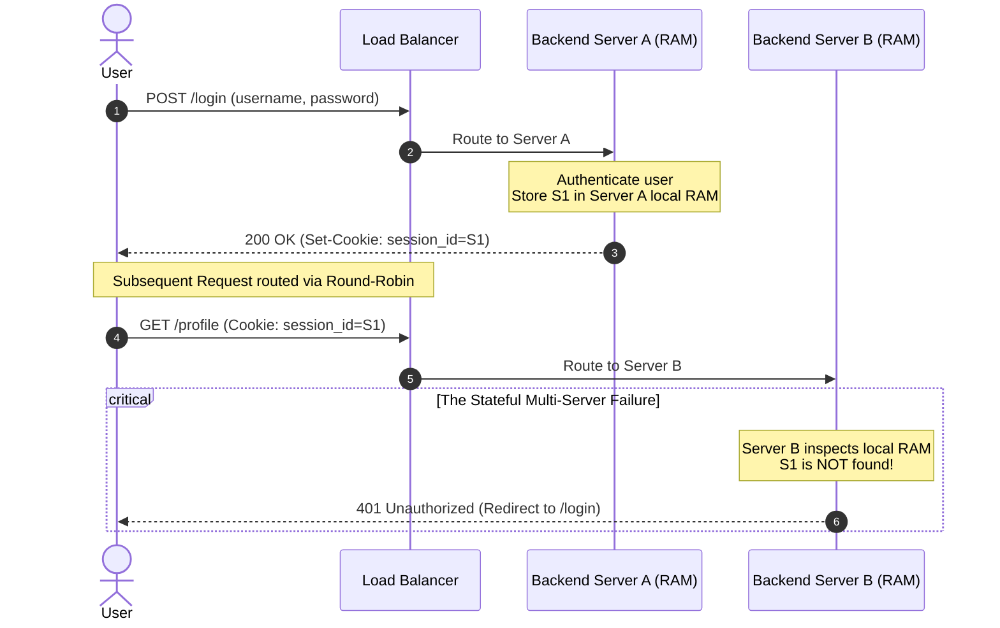
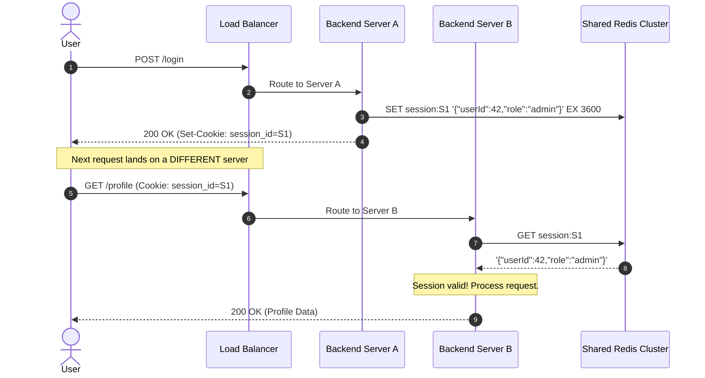
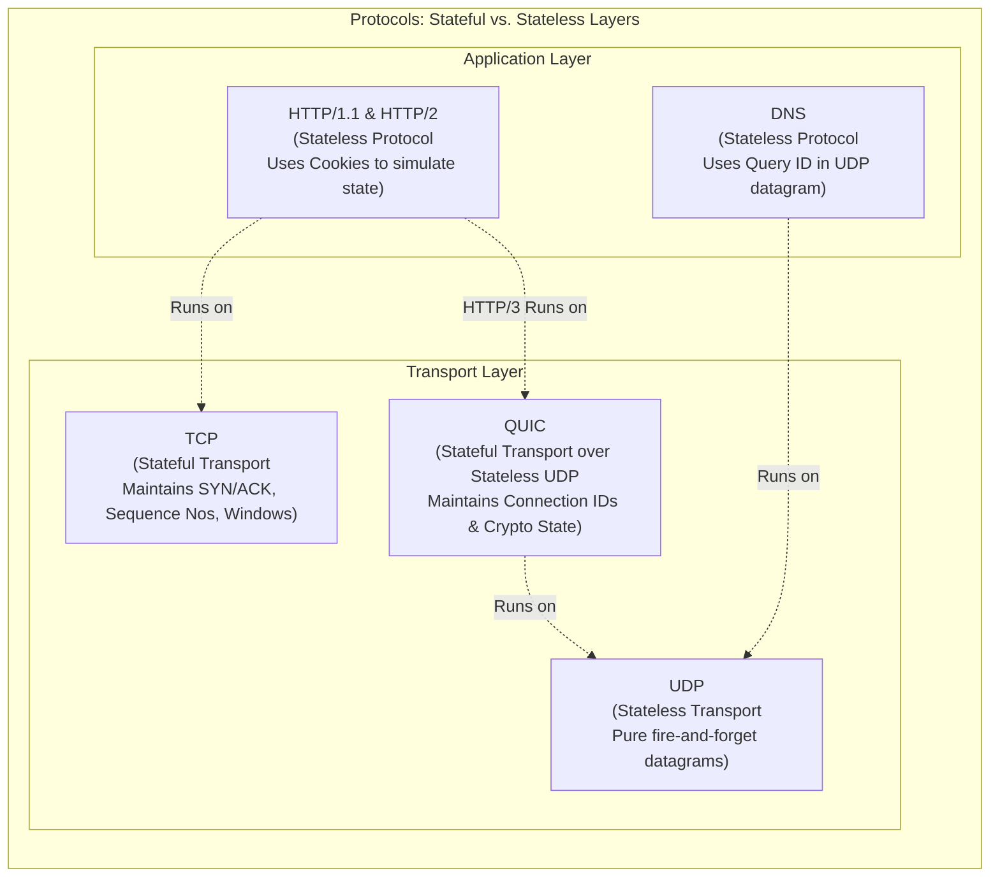
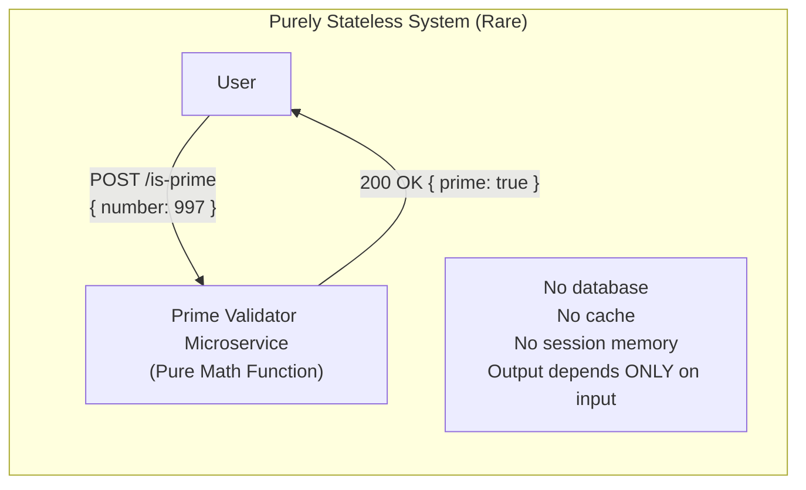

# ⚖️ Stateless vs. Stateful Architecture

> [!important] Core Mental Model
> In software engineering, debates over "stateful vs. stateless" often degenerate into pedantic semantic arguments. Every application stores variables in memory; therefore, strictly speaking, every running process possesses state.
>
> What matters to systems engineers is **dependency, failure modes, and side effects**:
> - **Stateful:** The server stores client-specific information in its local process/memory **and actively relies on that information being present to process subsequent requests**. If the server crashes, reboots, or if a load balancer routes the client to a different server instance, **the client's workflow breaks**.
> - **Stateless:** The server retains **zero client-specific state across requests** in its local process. Every incoming request must either carry all context required to be completely self-sufficient (e.g., tokens, query parameters), or state must be retrieved from a shared external persistent tier (e.g., Redis, PostgreSQL).
>
> ### 🧪 Hussein's Litmus Test (The "Idle Restart" Test)
> **"Can you terminate and restart your backend service while it is idle, bring it back up, and have connected clients continue their workflow seamlessly as if nothing happened?"**
> - If **YES** $\to$ Your backend application is **Stateless**.
> - If **NO** (users are kicked back to login, operations abort, data vanishes) $\to$ Your backend application is **Stateful**.

---

## 1. Executive Summary & Comparison

```
STATEFUL BACKEND (Local Memory Dependent)
Client ──[Req 1: Login]──────> [ Server A (Stores S1 in RAM) ]
Client ──[Req 2: View Profile]─┐
                               └─> [ Server B (No S1 in RAM) ] ──> 401 Unauthorized! (WORKFLOW BROKEN)

STATELESS BACKEND (External State Tier)
Client ──[Req 1: Login]──────> [ Server A ] ──> [ Write S1 to Redis/DB ]
Client ──[Req 2: View Profile]─┐
                               └─> [ Server B ] ──> [ Read S1 from Redis/DB ] ──> 200 OK (SEAMLESS)
```

| Dimension | Stateful Backend | Stateless Backend |
| :--- | :--- | :--- |
| **State Storage Location** | Local server memory (heap, RAM, process variables) | Client payload (JWT) or Shared External Store (Redis, DB) |
| **Horizontal Scalability** | **Difficult** — Requires sticky sessions or state synchronization | **Trivial** — Spin up $N$ identical instances behind a round-robin load balancer |
| **Instance Failure / Crash** | **Disruptive** — In-flight user sessions lost; users forced to re-authenticate | **Transparent** — Next request hits any healthy peer instance without disruption |
| **Load Balancing Strategy** | **Sticky Sessions / IP Hash** (couples client to one specific server) | **Round-Robin / Least Connections** (perfect load distribution) |
| **Request Latency** | **Fastest local reads** (nanoseconds to read process memory) | Extra network round-trip ($1\text{--}5\text{ ms}$) to Redis/DB or larger token payload |
| **Resource Efficiency** | High memory footprint per active user on the app server | Low, predictable RAM footprint on app servers; state offloaded to database |
| **Revocation / Invalidation** | **Instant & Simple** (delete session key from local RAM/Redis) | **Difficult with Pure Stateless Tokens** (JWTs remain valid until expiration) |
| **Real-World Examples** | Multi-player game game-loops, WebSockets without Redis adapter, local RAM sessions | REST APIs, microservices with Redis/Postgres session stores, Serverless/AWS Lambda |

---

## 2. Application Statelessness vs. System Statefulness

A frequent point of confusion is confusing an **application tier** with an entire **distributed system**:



> [!note] Critical Architectural Distinction
> - **The System is Stateful:** At the architectural level, almost every practical business system is stateful. If the database crashes and loses disk data, the business cannot operate.
> - **The Application Service is Stateless:** Individual backend compute instances (Docker containers, Kubernetes pods, AWS Lambda functions) retain **zero local state**. They can be killed, scaled from 1 to 100 during traffic spikes, or restarted mid-day during zero-downtime rolling deployments without breaking a single user's experience.

---

## 3. Deep Dive: Authentication & Session Management

To see the operational differences between stateful and stateless designs, consider how user authentication has evolved.

### 3.1 Pattern A: Stateful In-Memory Sessions (The 1990s Web Architecture)
In early web frameworks, user sessions were kept in server memory:
1. User logs in with `POST /login` (credentials verified against database).
2. Server generates Session ID `$S_1$`, stores `{ userId: 42, role: "admin" }` in a local in-memory hash map, and sets a cookie `Set-Cookie: session_id=S1`.
3. User navigates to `GET /profile`. The browser sends cookie `session_id=S1`.
4. Server looks up `$S_1$` in its local RAM. Found! Returns profile instantly without querying the database.



#### Why Stateful In-Memory Sessions Break in Production
1. **The Load Balancing Roulette:** Unless the load balancer uses **Sticky Sessions** (session affinity), requests bounce between different servers. On Server A, the user is authenticated; on Server B, the user is an unauthorized stranger.
2. **The Fragility of Sticky Sessions:** Sticky sessions bind a client's IP or cookie to Server A. However:
   - If Server A experiences a memory leak or crashes, **all users bound to Server A are abruptly logged out**, even if Servers B, C, and D are running at 5% CPU capacity.
   - Traffic becomes unevenly distributed (hotspotting), destroying the core purpose of horizontal load balancing.
3. **Inability to Deploy Code Seamlessly:** Deploying a new software version requires restarting instances. Restarting a stateful server wipes active sessions from RAM, causing massive spikes in user login requests (a self-inflicted **thundering herd** on the auth database).

---

### 3.2 Pattern B: Stateless Application with Centralized State Store
To solve the multi-server problem while maintaining fast session validation, the session state is moved out of process memory into a dedicated, high-speed **Distributed In-Memory Cache** (e.g., Redis or Memcached).



- **Why this works:** Both Server A and Server B are completely stateless. Either server can be killed or replaced at any second without invalidating active sessions.
- **The Trade-Off:** Every authenticated request incurs an extra network call from the backend to Redis (typically $0.5\text{--}2\text{ ms}$).

---

### 3.3 Pattern C: Purely Stateless Authentication via JSON Web Tokens (JWT)
In a pure stateless model, **neither the application server nor any database stores active session records**. The entire state is encoded, signed, and handed to the client:

$$\text{JWT} = \underbrace{\text{Base64Url}(\text{Header})}_{\text{Algorithm \& Token Type}} \;.\; \underbrace{\text{Base64Url}(\text{Payload})}_{\text{Claims: userId, roles, exp}} \;.\; \underbrace{\text{Digital Signature}}_{\text{HMAC-SHA256}(\text{Header} + \text{Payload}, \text{Secret})}$$

1. User logs in.
2. Server validates credentials and generates a signed cryptographic token containing user claims:
   ```json
   {
     "sub": "user_42",
     "name": "Neel",
     "role": "admin",
     "iat": 1732200000,
     "exp": 1732203600
   }
   ```
3. Server returns the JWT. The server **saves nothing in RAM and nothing in a database**.
4. Client attaches the token in the `Authorization: Bearer <token>` header for subsequent requests.
5. Any server instance verifies the digital signature using its shared secret or public key. If the signature matches and `exp > now()`, the request is authenticated immediately.

#### The Security Dilemma of Pure Statelessness: The Revocation Problem
While JWTs eliminate database session lookups entirely, their pure statelessness creates a major architectural flaw: **Revocation is extremely difficult**.

```
SCENARIO: User Account Compromise or Permission Revocation

1. An employee's laptop is stolen, or an admin revokes an employee's access.
2. Admin flips "isActive = false" in the corporate database.
3. Attacker uses the stolen JWT to send API requests:
   - Server receives JWT.
   - Server checks cryptographic signature -> VALID!
   - Server checks expiration timestamp -> NOT EXPIRED!
   - Server NEVER queries the database!
   - Result: Attacker executes admin actions until the token expires!
```

#### How Engineers Reconcile the JWT Dilemma
1. **Short Token Lifetimes + Refresh Tokens:**
   - Set **Access Token (JWT)** expiration to 5–15 minutes.
   - Issue a long-lived **Refresh Token** (e.g., 7 days) stored in a database or Redis.
   - When the access token expires, the client uses the refresh token to get a new access token. Revoking user access only requires invalidating the refresh token in the database.
2. **Denylists / Blocklists in Redis:**
   - When a user logs out or is revoked, add their token ID (`jti`) to a Redis blacklist with a TTL matching the token's remaining lifetime.
   - **The Irony:** Checking a Redis blocklist on every API request reintroduces the exact external state lookup that JWTs were designed to eliminate!

---

## 4. Protocols: Stateful vs. Stateless Transport

Statefulness is not restricted to application logic; network and transport protocols are also explicitly designed as either stateful or stateless.



### 4.1 TCP: The Quintessential Stateful Protocol
TCP (Transmission Control Protocol) is inherently **stateful**. Both endpoints maintain an elaborate in-memory state machine throughout the lifetime of the connection:

```
                  +---------+
                  | CLOSED  |
                  +---------+
                       |
               [Active Open / SYN]
                       v
                  +---------+
                  | SYN_SENT|
                  +---------+
                       |
                 [Receive SYN+ACK]
                       v
                +-------------+
                | ESTABLISHED | <--- Data Transfer Occurs Here
                +-------------+      (Tracks seq, ack, rwnd, cwnd)
                       |
                 [Send FIN]
                       v
                +-------------+
                |  FIN_WAIT   |
                +-------------+
```

- **Tracked State:** 
  - Socket File Descriptors (`fd`).
  - Next Sequence Number to send and expected Acknowledgment Number.
  - Receiver Window Size (`rwnd`) for flow control.
  - Congestion Window (`cwnd`) and Slow-Start Threshold (`ssthresh`).
  - Smoothed Round Trip Time ($SRTT$) estimators.
- **Consequence of State Loss:** If a server reboots mid-TCP connection, the kernel loses the state table in memory. When the client sends the next packet, the restarted server has no record of the connection and immediately responds with a `RST` (TCP Reset), abruptly killing the session.

### 4.2 UDP: The Pure Stateless Transport
UDP (User Datagram Protocol) is completely **stateless**:
- No handshake, no connection establishment, no sequence numbers, no ACK tracking, and no flow control.
- An operating system writes a datagram to the network interface and forgets it existed nanoseconds later.
- Datagrams can arrive out of order, duplicate, or vanish without the UDP layer knowing or caring.

### 4.3 DNS: Stateless Protocol over Stateless Transport
DNS traditionally runs over UDP on port 53.
- When an OS resolver issues a DNS query for `google.com`, it packages the query into a single UDP datagram and fires it to the DNS server IP.
- Because there is no persistent connection, **how does the client know which reply matches which query?**
- DNS uses a **16-bit Transaction ID (Query ID)** placed in the DNS message header:
  ```
  Client Query:    [UDP Datagram -> Dest Port 53] Header: { Transaction ID: 0x4A12, Query: google.com }
  DNS Server:      Resolves IP
  Server Response: [UDP Datagram -> Client Port]  Header: { Transaction ID: 0x4A12, Answer: 142.250.190.46 }
  ```
- The operating system routes the incoming packet to the client's listening ephemeral UDP port, and the application matches the `Transaction ID` to resolve the query.

### 4.4 QUIC: Stateful Protocol Built on Stateless UDP
HTTP/3 runs on top of **QUIC**, creating a fascinating architectural hybrid:
- **Transport Medium:** Stateless UDP datagrams.
- **QUIC Layer:** Strictly **stateful**. QUIC reconstructs connection management, TLS 1.3 cryptographic contexts, streams, and loss recovery on top of UDP.
- **Connection IDs (CID):** Because UDP has no concept of a connection, QUIC embeds a unique `Connection ID` directly inside the payload of each packet. This enables **Connection Migration**: if a mobile phone switches from Wi-Fi to cellular, its IP address and port change, but the QUIC `Connection ID` remains unchanged. The server continues the session seamlessly without renegotiating TLS!

### 4.5 HTTP: Stateless Protocol Built on Stateful TCP
HTTP is a **stateless application protocol** running on top of a **stateful transport protocol (TCP)**:
- HTTP requests are independent request-response transactions. The protocol does not require the server to remember previous requests.
- If the underlying TCP connection breaks or drops due to a network timeout, HTTP does not break conceptually: the browser simply initiates a new TCP connection and re-sends the HTTP request.
- **Cookies (RFC 6265)** were explicitly invented to bridge this gap, allowing a stateless protocol to transport state tokens back and forth between client and server.

---

## 5. Completely Stateless Systems: Myth vs. Reality

Are there systems that are 100% stateless end-to-end?



A system is **completely stateless** only if:
1. The server stores no data in local RAM across requests.
2. The server talks to **no external database, file system, or persistent cache**.
3. The response is a **pure function** of the request payload ($f(\text{input}) \to \text{output}$).

### Real-World Examples of Truly Stateless Systems
- **Mathematical Computation Services:** Prime number verification, currency conversion rate calculation (with client-supplied rates), UUID generators.
- **Stateless Media Transcoding / Image Resizing:** An endpoint that accepts a raw image buffer in the POST body, resizes it to a thumbnail, and streams back the PNG bytes without writing to disk.
- **Cryptographic Signature Verification:** Verifying whether a digital signature is valid given a public key and raw payload.

For almost everything else (e-commerce carts, user profiles, payments, social feeds), the system is stateful. **The engineering goal is never to eliminate state entirely, but to push state into dedicated, specialized storage systems (databases/caches) so your application compute tier can remain completely stateless.**

---

## 6. Implementation Comparison: Stateful vs. Stateless Backends

Below is a complete, runnable TypeScript implementation showing the architectural shift from a fragile in-memory stateful server to a resilient stateless server using Redis:

```typescript
import express, { Request, Response } from 'express';
import cookieParser from 'cookie-parser';
import crypto from 'crypto';

const app = express();
app.use(express.json());
app.use(cookieParser());

// ============================================================================
// ARCHITECTURE 1: STATEFUL BACKEND (In-Memory Session Store)
// ANTI-PATTERN: Fails the "Idle Restart" test and breaks behind load balancers!
// ============================================================================
const inMemorySessionStore = new Map<string, { userId: string; role: string }>();

app.post('/stateful/login', (req: Request, res: Response) => {
  const { username, password } = req.body;
  
  // Simulated credential verification
  if (username === 'neel' && password === 'secure123') {
    const sessionId = crypto.randomUUID();
    
    // Storing state in process memory (RAM)
    inMemorySessionStore.set(sessionId, { userId: 'usr_101', role: 'admin' });
    
    res.cookie('stateful_sid', sessionId, { httpOnly: true });
    return res.json({ message: 'Logged in successfully via stateful RAM session' });
  }
  return res.status(401).json({ error: 'Invalid credentials' });
});

app.get('/stateful/profile', (req: Request, res: Response) => {
  const sessionId = req.cookies['stateful_sid'];
  
  // If the server restarted, inMemorySessionStore was wiped clean!
  const session = inMemorySessionStore.get(sessionId);
  if (!session) {
    return res.status(401).json({ error: 'Session expired or server was restarted! Please log in again.' });
  }
  
  return res.json({ profile: { userId: session.userId, role: session.role, bio: 'Backend Engineer' } });
});

// ============================================================================
// ARCHITECTURE 2: STATELESS BACKEND (External State Tier - Simulated Redis)
// BEST PRACTICE: Passes the "Idle Restart" test and scales horizontally!
// ============================================================================
// Simulated external distributed key-value store (e.g., Redis cluster)
class DistributedCacheClient {
  private static externalStore = new Map<string, string>();

  static async set(key: string, val: object, ttlSeconds: number): Promise<void> {
    this.externalStore.set(key, JSON.stringify(val));
  }

  static async get(key: string): Promise<any | null> {
    const raw = this.externalStore.get(key);
    return raw ? JSON.parse(raw) : null;
  }

  static async delete(key: string): Promise<void> {
    this.externalStore.delete(key);
  }
}

app.post('/stateless/login', async (req: Request, res: Response) => {
  const { username, password } = req.body;

  if (username === 'neel' && password === 'secure123') {
    const sessionId = crypto.randomUUID();

    // Application server retains ZERO state; offloads state to external cache
    await DistributedCacheClient.set(`session:${sessionId}`, { userId: 'usr_101', role: 'admin' }, 3600);

    res.cookie('stateless_sid', sessionId, { httpOnly: true });
    return res.json({ message: 'Logged in successfully via stateless external session' });
  }
  return res.status(401).json({ error: 'Invalid credentials' });
});

app.get('/stateless/profile', async (req: Request, res: Response) => {
  const sessionId = req.cookies['stateless_sid'];
  if (!sessionId) {
    return res.status(401).json({ error: 'Missing session cookie' });
  }

  // Any backend replica can fetch this session from the shared cache
  const session = await DistributedCacheClient.get(`session:${sessionId}`);
  if (!session) {
    return res.status(401).json({ error: 'Invalid or expired session' });
  }

  return res.json({ profile: { userId: session.userId, role: session.role, bio: 'Backend Engineer' } });
});

app.listen(3000, () => {
  console.log('Server running on port 3000');
  console.log('Test Stateful vs Stateless endpoints at /stateful/* and /stateless/*');
});
```

---

## 7. Architectural Decision Matrix

```
                                 IS LOCAL PROCESS CRASH TOLERANT?
                                                |
                       ┌────────────────────────┴────────────────────────┐
                       ▼                                                 ▼
                      YES                                                NO
            (Stateless App Tier)                                 (Stateful App Tier)
                       |                                                 |
         ┌─────────────┴─────────────┐                     ┌─────────────┴─────────────┐
         ▼                           ▼                     ▼                           ▼
    Read Latency                Zero DB Call           Low Latency                Shared State
      Tolerant?                   Mandatory?            Required?                  Required?
         |                           |                     |                           |
         ▼                           ▼                     ▼                           ▼
  [Redis/DB Session]          [Self-Contained JWT]    [In-Memory RAM]         [Sticky Load Balancer
 (Best All-Rounder)          (Needs Short Expiry)     (Single Node Only)       or Actor Model/Akka]
```

| Scenario / Constraint | Recommended Pattern | Architecture Strategy |
| :--- | :--- | :--- |
| **Public-Facing Web App (E-Commerce, SaaS)** | **Stateless App + Redis Session Store** | Best balance: instant token revocation, zero session loss on deployment, horizontal autoscaling. |
| **High-Volume Microservice-to-Microservice APIs** | **Stateless JWT (Short-Lived 5-min Exp)** | Eliminates database network hops across internal services; uses asymmetric key verification (RS256). |
| **Real-Time Multiplayer Game (FPS / MMORPG)** | **Stateful Server Process (UDP / WebSockets)** | Game loop updates state at 60 Hz; network round-trips to Redis introduce unacceptable lag. Requires sticky routing. |
| **Collaborative Document Editing (Google Docs, Figma)** | **Stateful WebSocket Server with CRDTs** | Server maintains active operational transformation / CRDT document graph in memory per active room. |
| **Serverless Functions (AWS Lambda, Cloudflare Workers)** | **Strictly Stateless Application** | Execution environments are spun down automatically when idle; process memory is completely ephemeral. |

---

## 8. Summary Checklist for System Designers

> [!tip] Practical Engineering Takeaways
> 1. **Do Not Treat Statelessness as a Trophy:** Statelessness is not inherently "better" than statefulness; it is a design choice with specific trade-offs (trading network hops to external stores for horizontal scalability and crash safety).
> 2. **Always Run the Idle Restart Test:** If restarting an idle server drops user connections, invalidates logins, or corrupts workflows, acknowledge that you have built a stateful backend and plan for sticky routing or disaster recovery accordingly.
> 3. **Avoid In-Memory Caches for Authorization State:** Never store authentication session maps inside process variables (`Map`, `dict`, global variables) in production web apps. It will inevitably fail when load balancers scale across multiple replicas.
> 4. **Understand the JWT Trade-Off:** If your security compliance requires immediate session revocation (e.g., banking, HIPAA), pure stateless JWTs are problematic. Prefer short-lived tokens or centralized Redis sessions.
> 5. **Remember Layer Inversion:** A stateless protocol (HTTP) can sit on top of a stateful transport (TCP), and a stateful protocol (QUIC) can sit on top of a stateless transport (UDP). Always evaluate statefulness layer by layer.
