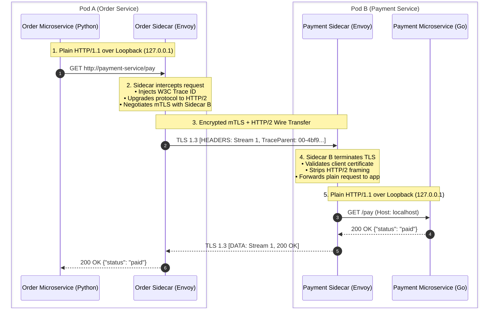
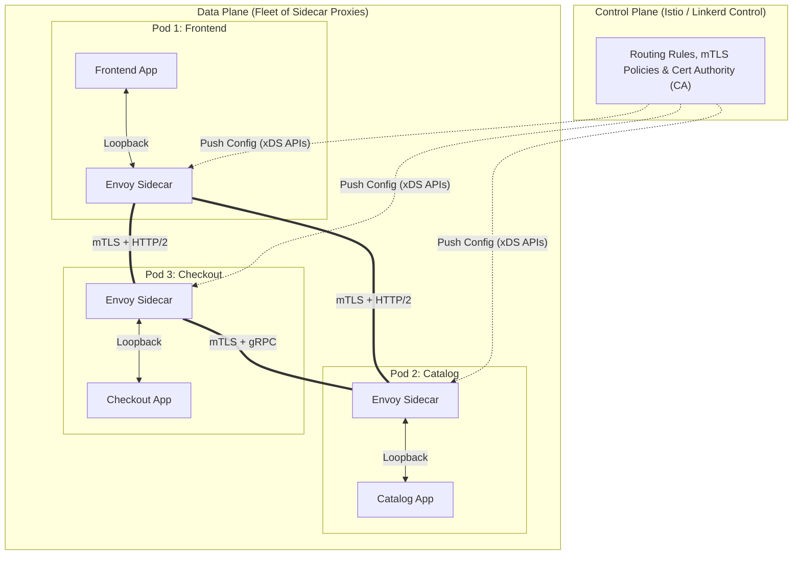

# 🏍️ The Sidecar Pattern & Service Mesh Architecture

> [!important] Core Mental Model
> Every network protocol—whether HTTP/1.1, HTTP/2, HTTP/3 (QUIC), gRPC, or TLS—requires a **client library** to serialize messages, manage socket writes, negotiate protocols (ALPN), and handle encryption.
>
> In a large-scale polyglot microservice architecture (Python, Node.js, Go, Java, Rust), embedding complex networking logic inside "fat client libraries" within application code creates an operational nightmare:
> - Every programming language needs its own implementation of circuit breaking, retries, mutual TLS (mTLS), and distributed tracing.
> - Upgrading a protocol (e.g., HTTP/1.1 $\to$ HTTP/2 or HTTP/3) or patching a critical cryptographic vulnerability (e.g., OpenSSL Heartbleed, Log4j) requires updating, retesting, and redeploying hundreds of distinct services.
>
> The **Sidecar Pattern** decouples application business logic from communication infrastructure:
> 1. The application communicates using a **thin, unchanging, standard protocol** (like plain HTTP/1.1) over the local loopback interface (`127.0.0.1` or Unix domain socket).
> 2. A separate helper process—the **Sidecar Proxy** (e.g., Envoy, Linkerd)—runs on the **same machine, container pod, or network namespace**.
> 3. The sidecar intercepts all inbound and outbound traffic, handling protocol upgrades (HTTP/2, HTTP/3, gRPC), transparent mTLS encryption, connection pooling, retries, circuit breaking, and distributed tracing.
>
> **"Let the application focus on business logic; let the sidecar handle the wire."**

---

## 1. Executive Summary: Fat Library vs. Sidecar Architecture

```
APPROACH A: "FAT CLIENT LIBRARY" (Tightly Coupled)
┌────────────────────────────────────────────────────────┐
│ Application Code (Python / Go / Java)                  │
│  ├─ Business Logic                                     │
│  ├─ Fat Client Library (Finagle / gRPC SDK)            │
│  │   ├─ HTTP/2 & HTTP/3 Framing                        │
│  │   ├─ TLS 1.3 Encryption & Cert Rotation             │
│  │   ├─ Circuit Breaking, Retries & Backoff            │
│  │   └─ Tracing (OpenTelemetry Headers)                │
└──────────────────────────┬─────────────────────────────┘
                           │ Network Wire
                           ▼

APPROACH B: "THE SIDECAR PATTERN" (Decoupled & Polyglot)
┌─────────────────────────────────── Host / Pod (Shared Loopback 127.0.0.1) ───────────────────────────────────┐
│                                                                                                              │
│  ┌─────────────────────────────┐                  ┌───────────────────────────────────────────────────────┐  │
│  │ Application Code            │                  │ Sidecar Proxy (Envoy / Linkerd in Rust or C++)        │  │
│  │  ├─ Pure Business Logic     │  Plain HTTP/1.1  │  ├─ Protocol Upgrade (HTTP/1.1 -> HTTP/2 / HTTP/3)    │  │
│  │  └─ Ultra-thin HTTP Client  │ ───────────────> │  ├─ Automatic Mutual TLS (mTLS) & Cert Management    │  │
│  │     (Standard fetch/requests) (Local Syscall)  │  ├─ Retries, Circuit Breaking & Health Checks         │  │
│  │                             │                  │  └─ W3C Distributed Trace ID Injection                │  │
│  └─────────────────────────────┘                  └──────────────────────────┬────────────────────────────┘  │
│                                                                              │                               │
└──────────────────────────────────────────────────────────────────────────────┼───────────────────────────────┘
                                                                               │ Over the Wire (mTLS + HTTP/2)
                                                                               ▼
```

| Dimension | Fat Client Library (In-App) | Sidecar Proxy (Out-of-Process) |
| :--- | :--- | :--- |
| **Language Support** | **Monoglot locked** (must rewrite/maintain SDK for every language) | **100% Polyglot** (works with Node.js, Python, Go, Java, Rust, Ruby) |
| **Protocol Upgrades** | Must update code dependencies and retest/redeploy entire app | **Zero app code changes** — Upgrade the sidecar binary independently |
| **Security & CVE Patching** | Slow and fragmented across teams and microservice repositories | **Immediate** — Centralized rollout of updated sidecar container image |
| **Latency Cost** | **Zero extra hops** (in-memory function call) | **Two extra hops** per RPC (Local loopback context switch $\approx 0.5\text{--}2\text{ ms}$) |
| **Memory / CPU Overhead** | Low (shares app process heap) | Higher (dedicated memory footprint per sidecar container; e.g. 50MB per Pod) |
| **Operational Complexity** | Low infrastructure complexity; high developer code maintenance | Higher infrastructure complexity (requires Kubernetes, iptables/eBPF routing) |
| **Real-World Examples** | Twitter Finagle (Scala), Netflix Ribbon / Hystrix (Java) | **Envoy**, **Istio**, **Linkerd**, **Consul Connect**, **Dapr** |

---

## 2. The Core Problem: Why Fat Libraries Break at Scale

### 2.1 The Twitter 2010 World Cup Case Study
During the 2010 FIFA World Cup, Twitter experienced massive outages ("The Fail Whale"). At the time:
- Twitter operated a monolithic Ruby on Rails application running on virtual machines.
- Traffic spikes caused virtual machines to thrash and crash. Spinning up new VMs took minutes, and newly launched VMs immediately crashed under the backlog.
- Twitter decomposed the monolith into microservices (Tweet API, Retweet API, Timeline API).
- To manage service-to-service communication, Twitter built **Finagle**, an RPC library providing connection pooling, timeouts, retries, and load balancing.

#### The Finagle Trap
Finagle was written in **Scala** on the JVM. While Finagle was powerful, it imposed a strict constraint:
**Every engineering team at Twitter was forced to write their services in Scala/Java on the JVM to use Finagle.** 
If a team wanted to build an ultra-fast machine learning service in Python or a low-latency systems tool in Go or C++, they either had to:
1. Re-implement the entire Finagle protocol and networking stack from scratch in Python or Go.
2. Forego connection pooling, retries, and circuit breaking.

### 2.2 The Cryptographic & Protocol Maintenance Burden
Consider modern networking requirements:
- **Protocol Shifts:** Moving from HTTP/1.1 to binary HTTP/2 multiplexing, or to UDP-based HTTP/3 (QUIC).
- **ALPN (Application-Layer Protocol Negotiation):** Dynamically negotiating protocols inside the TLS handshake.
- **CVEs & Security Flaws:** Vulnerabilities in OpenSSL (Heartbleed), Log4j, or deprecated TLS ciphers.
When networking logic is embedded in 200 microservices across 5 different programming languages, upgrading TLS or replacing a cipher suite requires coordinate-wide code modifications, QA cycles, and deployments across dozens of teams.

---

## 3. How the Sidecar Pattern Operates

The sidecar pattern solves this by pairing every application container with an independent, dedicated proxy container running in the same network context.



### 3.1 Loopback Interception (`127.0.0.1`)
In Linux and container environments (such as Kubernetes Pods):
- All containers inside the same Pod share the **same Network Namespace** (`netns`), network interfaces, and IP address.
- Traffic sent between the application container and the sidecar container travels over the **Loopback Interface (`lo`)**.
- Because loopback stays entirely inside kernel memory, packets never touch a physical network card (NIC) or switch.

### 3.2 Analogy: Local Debugging Proxies (Fiddler & Charles)
The sidecar architecture mirrors how developer tools like **Fiddler**, **Charles Proxy**, or **mitmproxy** work:
1. You run Fiddler on your local machine listening on `127.0.0.1:8888`.
2. You set your OS or browser proxy to `127.0.0.1:8888`.
3. Your browser sends unencrypted requests to Fiddler; Fiddler inspects headers, logs the traffic, and initiates encrypted HTTPS connections to external servers on your behalf.
A sidecar proxy performs this exact task programmatically at the infrastructure level.

---

## 4. Layer 7 (Application) vs. Layer 4 (Transport) Proxying

Hussein emphasized that sidecar proxies must operate primarily at **Layer 7 (L7 - Application Layer)** of the OSI model.

```
       OSI MODEL                  L4 PROXY (TCP/UDP)                 L7 PROXY (ENVOY/ISTIO)
┌──────────────────────────┐   ┌───────────────────────┐          ┌───────────────────────────┐
│ Layer 7: Application     │   │ Cannot inspect!       │          │ • Reads HTTP Path & Host  │
│ (HTTP, gRPC, Headers)    │   │ Sees only raw bytes.  │          │ • Injects Trace IDs       │
├──────────────────────────┤   ├───────────────────────┤          │ • Terminates/Re-encrypts  │
│ Layer 4: Transport       │   │ • Inspects IP:Port    │          │ • Circuit breaks on 5xx   │
│ (TCP, UDP, Sockets)      │   │ • Routes raw TCP      │          │ • Retries idempotent GETs │
└──────────────────────────┘   └───────────────────────┘          └───────────────────────────┘
```

### Why Layer 4 is Insufficient for Microservice Sidecars:
1. **Host & Path Routing:** At Layer 4, the proxy only sees IP addresses and TCP port numbers. It cannot determine whether a request is for `/users/profile` or `/orders/checkout`. A Layer 7 proxy parses the HTTP request line and route table to direct traffic to specific upstream service clusters.
2. **Payload & Header Rewriting:** Layer 7 proxies inject distributed tracing headers (`traceparent`), user identity tokens, and correlation IDs.
3. **Application Circuit Breaking:** An L4 proxy only detects broken TCP connections or timeouts. An L7 proxy inspects HTTP response status codes: if an upstream service returns `503 Service Unavailable` for 10% of requests over 5 seconds, the L7 sidecar trips the circuit breaker and prevents further requests from overloading the failing service.
4. **Protocol Translation:** An L7 proxy can receive plain HTTP/1.1 and translate it into HTTP/2, HTTP/3, or gRPC before transmitting it across the cluster.

---

## 5. Service Mesh: The Production Realization

When sidecar proxies are deployed next to every microservice in an entire cluster, the architecture is called a **Service Mesh**.



### 5.1 The Two Planes of a Service Mesh
1. **The Data Plane:** The high-performance sidecar proxies (Envoy written in C++, Linkerd-proxy written in Rust) deployed alongside every service instance. The data plane directly handles all network packets, executes encryption, balances loads, and collects metrics.
2. **The Control Plane (e.g., Istiod):** A centralized orchestrator that never touches application packets directly. Instead, it:
   - Issues and rotates short-lived cryptographic x.509 certificates for mutual TLS.
   - Pushes routing configurations, rate limits, and circuit breaker policies to all proxies using dynamic APIs (e.g., Envoy's **xDS APIs**).

---

## 6. Deep Dive: Architectural Superpowers of the Sidecar

### 6.1 Language-Agnostic Resilience (Circuit Breaking & Retries)
Instead of relying on custom retry loops in every programming language:
- The developer configures the sidecar: `"Retry up to 3 times on 503 errors with exponential backoff and 200ms jitter"`.
- If an upstream service becomes overloaded, the sidecar automatically pauses retries, breaks the circuit, and serves a fallback response without application code involvement.

### 6.2 Zero-Trust Security with Automatic Mutual TLS (mTLS)
In enterprise zero-trust architectures, traffic across the internal network must be encrypted.
- **Without Sidecars:** Developers must write TLS configuration code in Python, Go, and Java, store certificate files on disk, and handle certificate renewal.
- **With Sidecars:** Applications communicate in plain text over `127.0.0.1`. The sidecar automatically establishes an authenticated, encrypted mTLS session with the receiving sidecar, verifying identity via SPIFFE/SPIRE certificate IDs.

### 6.3 Universal Distributed Tracing
When an external request enters the system and triggers calls across 10 microservices ($A \to B \to C \to D$):
- Tracking down which service caused a 500ms latency spike is impossible without unified trace headers.
- Sidecars automatically attach a unique **Trace ID** (`x-request-id` or W3C `traceparent: 00-4bf92f3577b34da6a3ce929d0e0e4736-00f067aa0ba902b7-01`).
- The sidecar reports latency metrics to **Jaeger**, **Zipkin**, or **Prometheus**, rendering a complete waterfall trace across the entire distributed system.

---

## 7. The Hidden Costs & Trade-Offs: Latency, RAM & Complexity

While the sidecar pattern provides immense operational benefits, it is **not free**. Hussein emphasized that engineers must understand its severe drawbacks:

```
THE TWO-HOP LATENCY TAX
Normal Call:    App A ────────────────────── Network ──────────────────────> App B   (1 Network Hop)
Sidecar Call:   App A ──[Hop 1]──> Sidecar A ── Network ──> Sidecar B ──[Hop 2]──> App B   (3 Hops: 2 Local + 1 Remote)
```

### 7.1 Latency Overhead (The Context-Switch Tax)
Every remote call introduces **two additional local hops**:
1. App A writes bytes to local socket $\to$ Linux kernel switches context $\to$ Sidecar A reads bytes.
2. Sidecar A parses HTTP/1.1 $\to$ wraps in HTTP/2 $\to$ encrypts via TLS 1.3 $\to$ sends over physical network.
3. Receiving Sidecar B decrypts TLS 1.3 $\to$ strips HTTP/2 framing $\to$ writes to local socket.
4. Linux kernel switches context $\to$ App B reads bytes.
- **Cost:** Even with high-performance C++/Rust proxies, this adds between **$0.5\text{ ms}$ and $3\text{ ms}$ of latency per RPC**.
- In a microservice mesh where 1 user request triggers a call chain 8 levels deep, sidecar latency can add **$15\text{--}25\text{ ms}$** of pure proxy overhead.

### 7.2 Memory & CPU Footprint
In Kubernetes, every Pod runs its own sidecar container:
- An Envoy proxy typically consumes **$40\text{--}120\text{ MB}$ of RAM** plus baseline CPU cycles for health checks and telemetry.
- In a cluster running **1,000 Pods**, sidecars consume:
  $$1,000 \times 80\text{ MB} = 80\text{ GB of RAM}$$
  This is 80 GB of memory dedicated exclusively to running network proxies!

### 7.3 Operational Complexity & Troubleshooting Nightmares
When a request fails with `504 Gateway Timeout` or `502 Bad Gateway`:
- *Did the application process crash?*
- *Did the sidecar timeout before the app could respond?*
- *Did the mTLS certificate expire on the receiving sidecar?*
- *Did an `iptables` rule fail to intercept the traffic?*
Debugging requires inspecting both application container logs and sidecar proxy access logs (`/dev/stdout`), requiring specialized DevOps and platform engineering expertise.

---

## 8. Practical Example: Kubernetes Pod Configuration

Below is a production-grade Kubernetes Pod definition illustrating how an application container and an Envoy sidecar container live side-by-side, sharing the loopback network namespace:

```yaml
apiVersion: v1
kind: Pod
metadata:
  name: order-service-pod
  labels:
    app: order-service
spec:
  containers:
    # -------------------------------------------------------------------------
    # CONTAINER 1: THE BUSINESS APPLICATION (Python / Node.js)
    # Speaks ONLY plain HTTP/1.1 locally. Has ZERO knowledge of mTLS or HTTP/2.
    # -------------------------------------------------------------------------
    - name: order-app
      image: myregistry.azurecr.io/order-service:v2.1.0
      env:
        # App sends outbound calls to the local Sidecar proxy port
        - name: PAYMENT_SERVICE_URL
          value: "http://127.0.0.1:15001/pay"
      ports:
        - containerPort: 8080 # App listens on localhost:8080
      resources:
        limits:
          cpu: "500m"
          memory: "256Mi"

    # -------------------------------------------------------------------------
    # CONTAINER 2: THE SIDECAR PROXY (Envoy)
    # Intercepts, upgrades to HTTP/2, encrypts via mTLS, injects trace headers.
    # -------------------------------------------------------------------------
    - name: envoy-sidecar
      image: envoyproxy/envoy:v1.28.0
      ports:
        - containerPort: 15001 # Ingress & Egress interception port
      volumeMounts:
        - name: envoy-config-volume
          mountPath: /etc/envoy
      resources:
        limits:
          cpu: "200m"
          memory: "128Mi"

  volumes:
    - name: envoy-config-volume
      configMap:
        name: envoy-sidecar-config
```

---

## 9. Architectural Comparison: When to Use the Sidecar Pattern

| Scenario / Architecture | Recommendation | Justification |
| :--- | :--- | :--- |
| **Large-Scale Polyglot Microservices** | **Strongly Recommended (Envoy / Istio)** | Eliminates the need to maintain networking/security libraries across 5+ languages; enables zero-trust mTLS. |
| **Ultra-Low Latency High-Frequency Trading (HFT)** | **Avoid Sidecars (Use Native In-Process SDKs)** | The $1\text{--}2\text{ ms}$ context switch and socket copy overhead of loopback proxying is unacceptable in sub-millisecond systems. |
| **Monolithic Architecture** | **Avoid Sidecars** | Single process; internal function calls in memory are infinitely faster and simpler than proxy hops. |
| **Monoglot Go or Java Microservices** | **Consider In-Process Libraries (gRPC / Finagle)** | If all services share one runtime, language-specific SDKs avoid sidecar RAM overhead while providing native performance. |
| **Serverless / Ephemeral Lambdas** | **Avoid Sidecars (or use lightweight extensions)** | Cold start times are penalized by launching heavy proxy processes alongside ephemeral functions. |
| **Next-Gen Alternative: Ambient Mesh / eBPF** | **Modern Evolution (Cilium / Istio Ambient)** | Replaces per-pod sidecars with kernel-level eBPF routing and per-node proxies, drastically reducing cluster RAM costs. |

---

## 10. Summary Checklist for System Designers

> [!tip] Practical Engineering Rules of Thumb
> 1. **Do Not Introduce a Service Mesh Prematurely:** A service mesh is powerful, but adds massive operational overhead. If you have 5 microservices, a sidecar architecture is overkill. When you scale to 50+ microservices in multiple languages, sidecars become essential.
> 2. **Applications Should Remain Blind to the Mesh:** The application should talk standard HTTP/1.1 or gRPC. Never write application code that depends on proprietary sidecar internals.
> 3. **Account for the Two-Hop Latency Tax:** When establishing service SLAs, add $1\text{--}3\text{ ms}$ of buffer per microservice hop to account for sidecar serialization, context switching, and mTLS handshakes.
> 4. **Monitor Sidecar Resource Consumption:** Always set Kubernetes memory and CPU requests/limits on sidecar containers. An unconstrained sidecar can exhaust node RAM and trigger Out-Of-Memory (OOM) kills on the business application.
> 5. **Evaluate Ambient Mesh / eBPF for the Future:** Keep an eye on sidecarless service meshes (e.g., Istio Ambient Mesh, Cilium Service Mesh) that run proxying logic at the host/kernel level via eBPF, eliminating the per-pod sidecar resource tax.
