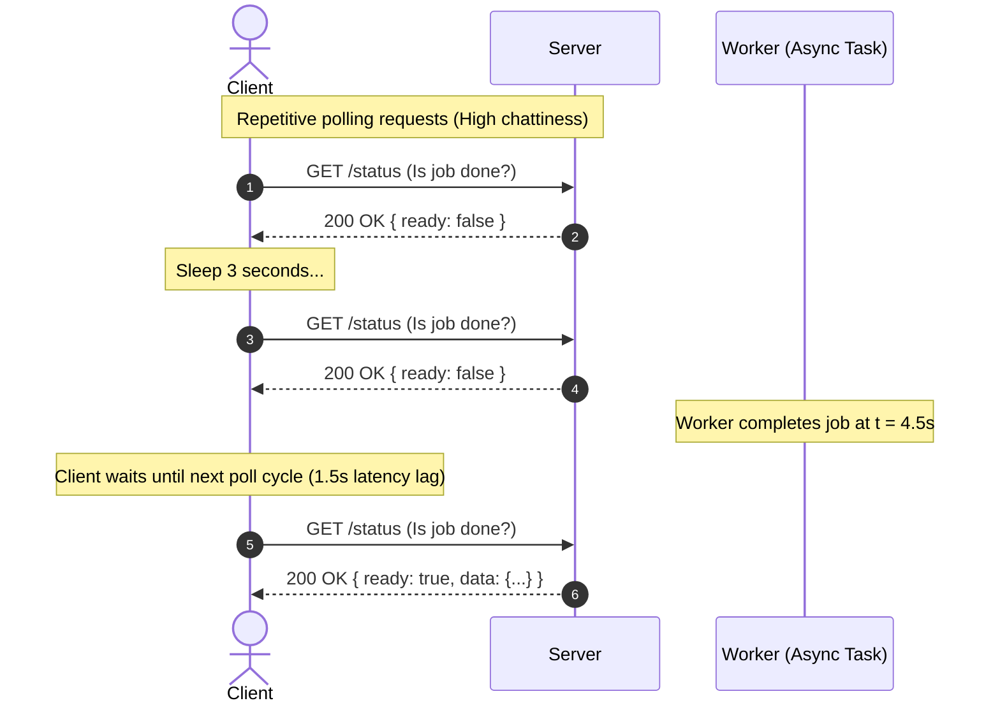
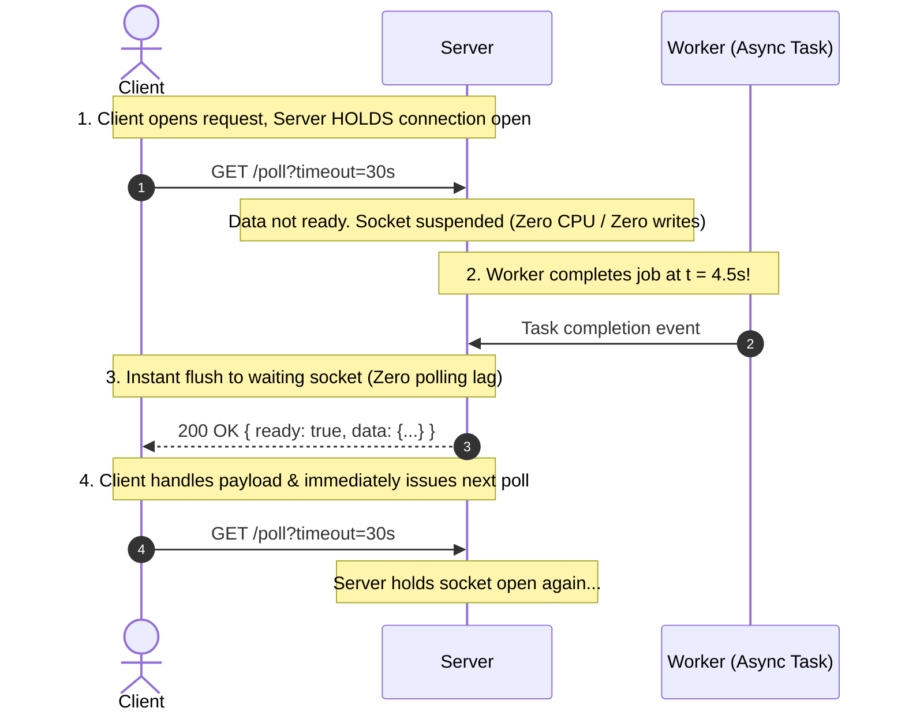
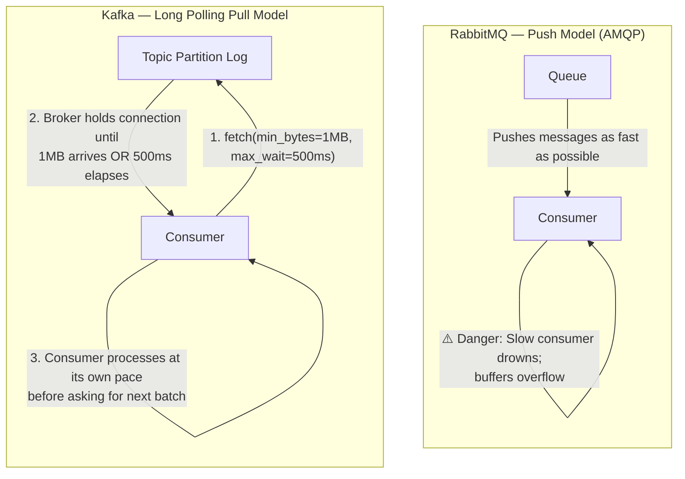
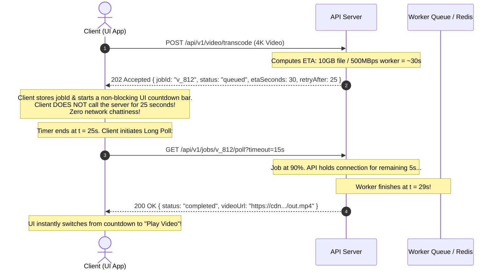
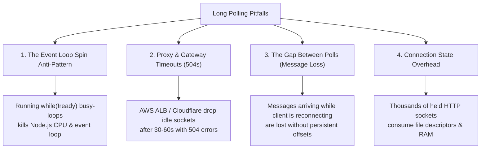
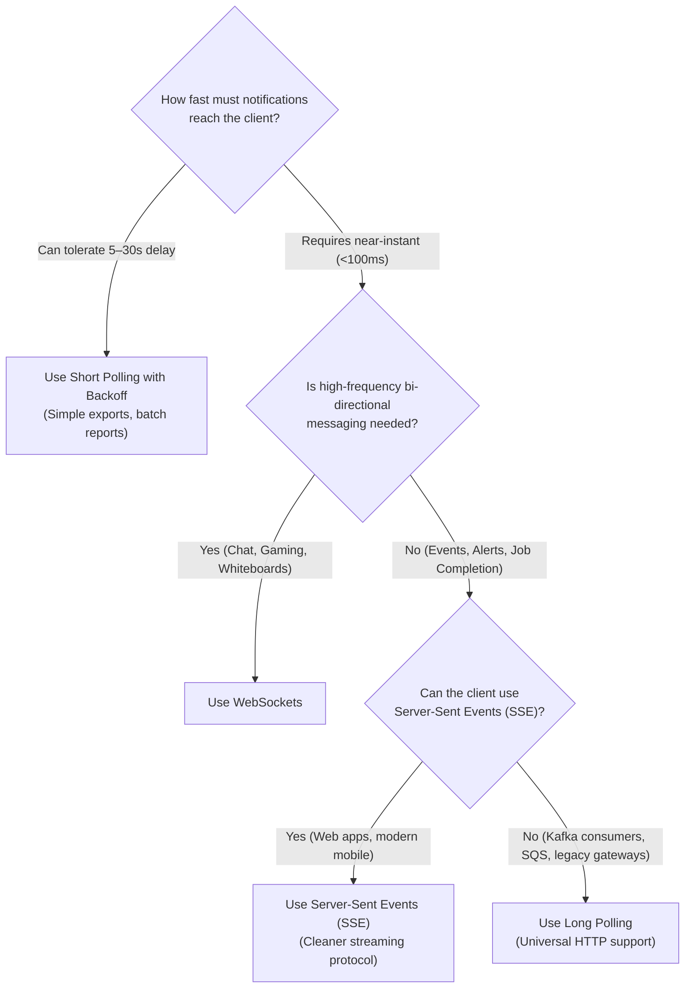

# ⏳ The Long Polling Communication Pattern — Architecture & Internals

> [!important] Core Mental Model
> In **Short Polling**, the client asks "*Is it ready?*" and the server immediately replies "*Nope*," forcing the client to ask again and again. This chatty loop floods the network with empty requests.
>
> **Long Polling (the "Hanging GET" pattern)** transforms this dynamic:
> 1. The client sends a request asking for data or task status.
> 2. If data is **not yet ready**, the server **does not reply**. It suspends the request and leaves the HTTP socket open.
> 3. The instant the event occurs or the background task finishes, the server writes the response to the open socket.
> 4. Upon receiving the response, the client immediately issues the next request to wait for future events.
>
> **"Don't call me every 2 seconds. Ask me once, and I will hold your call until I have the answer."**

---

## 1. Executive Summary & Comparison

| Dimension | Short Polling | Long Polling | Server Push (WebSockets / SSE) |
| :--- | :--- | :--- | :--- |
| **Request Mechanism** | Rapid, periodic independent requests | Client opens request; server holds open until event or timeout | Single persistent bi-directional connection |
| **Server Response on No Data** | Immediately returns `false` / `pending` | **Suspends response** (holds socket open) | None (silent on wire) |
| **Event Delivery Latency** | High lag ($T_{\text{interval}} / 2$) | **Near-zero** ($< 10\text{ms}$ upon event creation) | **Near-zero** (instant socket write) |
| **Network Chattiness** | **Extreme** (thousands of empty HTTP requests/sec) | **Minimal** (traffic only on events or timeouts) | **Lowest** (tiny frame overhead) |
| **Protocol Requirements** | Standard HTTP/1.1 or HTTP/2 | Standard HTTP/1.1 or HTTP/2 | WebSocket (RFC 6455) or SSE (`text/event-stream`) |
| **Firewall & Proxy Traversal** | 100% transparent | 100% transparent (standard HTTP `GET`/`POST`) | Can be blocked by strict enterprise firewalls |
| **Client Backpressure Control** | High (client pulls when ready) | **High** (client controls next poll timing) | Low (server pushes data down client's throat) |

---

## 2. Protocol Anatomy: Short vs. Long Polling

### 2.1 Short Polling (Chatty Request–Response Cycles)



### 2.2 Long Polling (Hanging GET & Instant Event Delivery)



---

## 3. Why Apache Kafka Built Its Entire Architecture on Long Polling

In the lecture, Hussein Nasser recalls learning how **Apache Kafka intentionally rejected the Push model** in favor of **Pull with Long Polling**. Understanding *why* Kafka made this design choice is a masterclass in distributed systems architecture.



### 1. The Push Flaw: Drowning the Consumer
In a pure push system (like early RabbitMQ or naive WebSockets), the broker determines delivery speed.
- If a producer publishes 100,000 events/second during a peak spike, the broker pushes all 100,000 events to the consumer.
- If the consumer is writing to a slow database or doing intensive ML inference, **its memory buffers explode**, leading to garbage collection pauses or Out-Of-Memory (OOM) crashes.

### 2. Kafka's Masterstroke: `fetch.min.bytes` & `fetch.max.wait.ms`
Kafka consumers pull data using the `poll()` API. To prevent short polling chattiness when a topic is idle, Kafka's fetch protocol implements **Long Polling with dual thresholds**:

```java
// Kafka Consumer Configuration
props.put(ConsumerConfig.FETCH_MIN_BYTES_CONFIG, 1024 * 1024); // 1 MB batch minimum
props.put(ConsumerConfig.FETCH_MAX_WAIT_MS_CONFIG, 500);         // 500 ms max wait
```

1. **The Consumer sends a fetch request:** *"Give me data for partition 0 starting at offset 4020."*
2. **If no data exists:** The Kafka broker **does not reply**. It parks the request in an internal purgatory queue.
3. **The request completes when EITHER condition is met:**
   - **Data Volume Reached:** Producers append enough data to reach `fetch.min.bytes` (1 MB) $\rightarrow$ Broker flushes batch immediately (maximizing I/O throughput).
   - **Timeout Reached:** `fetch.max.wait.ms` (500ms) expires $\rightarrow$ Broker flushes whatever data is available (preventing starvation).
4. **Result:**
   - Zero CPU waste when the topic is empty.
   - High batching throughput under heavy load.
   - Consumer dictates its own memory consumption and ingestion rate.

---

## 4. Smart Polling: Server-Calculated ETA & Scheduled Polling

A frequent dilemma in system design:
> "*What if the background job takes 60 seconds (like a video rendering job), but cloud proxies (Nginx, AWS ALB, Cloudflare) kill connections after 30 seconds?*"

If you hold a single long poll for 60 seconds, proxies will drop it with `504 Gateway Timeout`.
The solution is **Smart Polling with Estimated Time of Completion (ETA)**:



### Why Smart ETA Polling is Superior:
1. **Zero Chattiness:** During the known initial computation phase ($0 \rightarrow 25\text{s}$), the client makes **zero requests**.
2. **Non-Blocking Client Experience:** The UI displays an accurate countdown or progress animation without locking threads.
3. **Precision Finish:** When the estimated window approaches ($25\text{s}$), the client opens a **Long Poll** to catch the exact moment of completion with sub-second precision.

---

## 5. First Principles: Advantages & Critical Pitfalls

### Advantages

1. **Near-Zero Latency on Event Arrival:** Unlike short polling (where updates wait for the next polling cycle), the server flushes data the millisecond the event occurs.
2. **Drastic Reduction in Network Traffic:** Replaces thousands of empty request-response round-trips with a single suspended connection.
3. **Universal Firewall Compatibility:** Operates entirely over standard HTTP methods (`GET` / `POST`). No protocol upgrades, WebSocket handshake blocks, or custom proxy configs.
4. **Built-In Flow Control:** The client determines when it is ready to process the next event by deciding when to send the subsequent long-poll request.

---

### Critical Pitfalls & How to Avoid Them



#### 1. The Event Loop Spin Anti-Pattern (Hussein's Warning)
In the lecture, Hussein Nasser points out a dangerous beginner trap:
```javascript
// ❌ FATAL ANTI-PATTERN: DO NOT DO THIS
app.get("/checkstatus", async (req, res) => {
  while (!isJobComplete(req.query.jobId)) {
    // Even with setTimeout or sleep, polling inside an HTTP handler
    // keeps functions on the heap and risks spinning the event loop!
    await sleep(1000);
  }
  res.json({ status: "done" });
});
```
**Why this is dangerous:**
If 10,000 clients connect, your server has 10,000 asynchronous while-loops waking up every second to check a dictionary or database.
**The Fix:** Use an **Event-Driven Pub/Sub architecture** (`EventEmitter` in Node.js, Redis Pub/Sub, or Go channels). When the worker finishes, it emits `job:complete:123`, and the waiting HTTP response listener triggers once and terminates cleanly.

#### 2. Intermediate Proxy Timeouts (The 30-Second Rule)
Reverse proxies and load balancers enforce strict idle timeouts:
- **AWS Application Load Balancer (ALB):** 60 seconds (default).
- **Cloudflare:** 100 seconds.
- **Nginx:** `proxy_read_timeout 60s`.

If your long poll waits 120 seconds, the proxy terminates the TCP socket and returns `504 Gateway Timeout`.
**The Fix:** Always set a **server-side timeout shorter than your gateway** (e.g., 25–30 seconds). If no event occurs within 25 seconds, the server gracefully returns `HTTP 204 No Content` or `{ ready: false, timeout: true }`. The client catches this clean response and immediately issues a fresh request.

#### 3. The "Between Polls" Race Condition
Consider this timeline:
1. Long Poll 1 finishes $\rightarrow$ Client receives Message 1.
2. The HTTP connection closes.
3. Client takes 50ms to deserialize JSON and issue Long Poll 2.
4. **An event occurs during those 50ms!**
If the server doesn't retain messages, that event is lost forever!
**The Fix (Message Offsets / Cursors):** Every poll must include a cursor or sequence ID: `GET /poll?lastEventId=42`. The server checks its backlog for any events with `id > 42` before putting the socket to sleep.

---

## 6. Hands-On Engineering: Production-Grade Implementation

Let's build a production-grade Long Polling architecture with:
- **Event-Driven Backend:** Using Node.js `EventEmitter` (zero CPU busy-waiting).
- **Graceful Timeout Management:** 25-second server timeout to prevent 504 proxy drops.
- **Resilient Client:** Seamless reconnect loop with ETA calculation and cursor tracking.

### Production-Grade Backend (Node.js + Express)

```javascript
// server.js — Event-Driven Long Polling Server
const express = require('express');
const { EventEmitter } = require('node:events');
const crypto = require('node:crypto');

const app = express();
app.use(express.json());

// Event bus to notify waiting HTTP sockets without busy-looping
const jobBus = new EventEmitter();
// Increase listener limit to handle concurrent waiting sockets
jobBus.setMaxListeners(50000);

// In-memory job state (In production: Redis hashes)
const jobs = new Map();

/**
 * 1. Submit Asynchronous Job
 * Calculates ETA and returns 202 Accepted
 */
app.post('/api/v1/jobs', (req, res) => {
  const jobId = crypto.randomUUID();
  const { fileSizeBytes = 50 * 1024 * 1024 } = req.body;

  // Calculate estimated duration: e.g. 10MB per second
  const estimatedSeconds = Math.max(5, Math.ceil(fileSizeBytes / (10 * 1024 * 1024)));

  jobs.set(jobId, {
    id: jobId,
    status: 'processing',
    result: null,
    createdAt: Date.now()
  });

  // Simulate background worker finishing after estimated time
  setTimeout(() => {
    const job = jobs.get(jobId);
    if (job) {
      job.status = 'completed';
      job.result = { downloadUrl: `https://storage.cdn.com/exports/${jobId}.mp4` };
      
      // Emit event to notify the suspended long-poll handler instantly
      jobBus.emit(`done:${jobId}`, job);
    }
  }, estimatedSeconds * 1000);

  res.status(202).json({
    jobId,
    status: 'queued',
    etaSeconds: estimatedSeconds,
    pollUrl: `/api/v1/jobs/${jobId}/poll`
  });
});

/**
 * 2. Long Polling Endpoint
 * Suspends connection until job completes OR timeout expires
 */
app.get('/api/v1/jobs/:jobId/poll', (req, res) => {
  const { jobId } = req.params;
  const job = jobs.get(jobId);

  if (!job) {
    return res.status(404).json({ error: 'Job not found' });
  }

  // 1. If already completed, respond immediately
  if (job.status === 'completed') {
    return res.status(200).json({ status: 'completed', result: job.result });
  }

  // 2. Set safety timeout (25 seconds) to beat proxy/gateway timeouts
  const SERVER_TIMEOUT_MS = 25000;
  let isHandled = false;

  const onJobComplete = (completedJob) => {
    if (isHandled) return;
    isHandled = true;
    clearTimeout(timer);
    res.status(200).json({ status: 'completed', result: completedJob.result });
  };

  // Register listener for this specific job ID
  jobBus.once(`done:${jobId}`, onJobComplete);

  // Safety timer: flush response cleanly before reverse proxies drop the socket
  const timer = setTimeout(() => {
    if (isHandled) return;
    isHandled = true;
    jobBus.removeListener(`done:${jobId}`, onJobComplete);

    // Return 200 with timeout indicator (or 204 No Content)
    res.status(200).json({
      status: 'pending',
      timeout: true,
      message: 'Still processing. Please re-poll.'
    });
  }, SERVER_TIMEOUT_MS);

  // Clean up listener if client abruptly closes the connection / browser tab
  req.on('close', () => {
    if (!isHandled) {
      isHandled = true;
      clearTimeout(timer);
      jobBus.removeListener(`done:${jobId}`, onJobComplete);
    }
  });
});

const PORT = 8080;
app.listen(PORT, () => console.log(`🚀 Long polling server listening on http://localhost:${PORT}`));
```

---

### Production-Grade Client (JavaScript / Browser)

```javascript
// client-long-poller.js — Resilient Long Polling Client with Smart ETA
class LongPoller {
  constructor(options = {}) {
    this.maxRetries = options.maxRetries || 5;
    this.isAborted = false;
  }

  /**
   * Submits job, respects ETA countdown, and initiates long polling
   */
  async submitAndAwaitJob(submitUrl, payload, onStatusUpdate = () => {}) {
    // Step 1: Submit job
    const submitRes = await fetch(submitUrl, {
      method: 'POST',
      headers: { 'Content-Type': 'application/json' },
      body: JSON.stringify(payload)
    });

    const { jobId, pollUrl, etaSeconds } = await submitRes.json();
    onStatusUpdate({ status: 'queued', etaSeconds });

    // Step 2: Smart Wait — sleep for (ETA - buffer) without network requests
    if (etaSeconds && etaSeconds > 5) {
      const sleepSeconds = etaSeconds - 3; // Start polling 3s before expected finish
      console.log(`[ETA] Waiting ${sleepSeconds}s before starting long polling...`);
      
      for (let i = sleepSeconds; i > 0; i--) {
        onStatusUpdate({ status: 'waiting_eta', remainingSeconds: i });
        await new Promise(r => setTimeout(r, 1000));
      }
    }

    // Step 3: Enter Long Polling Loop
    return this.pollUntilComplete(pollUrl, onStatusUpdate);
  }

  async pollUntilComplete(pollUrl, onStatusUpdate) {
    let attempts = 0;

    while (!this.isAborted) {
      try {
        onStatusUpdate({ status: 'polling', attempt: attempts + 1 });

        // Request suspends on server until event occurs or 25s elapses
        const response = await fetch(pollUrl);

        if (!response.ok) {
          throw new Error(`Server returned HTTP ${response.status}`);
        }

        const data = await response.json();

        // Case A: Job finished!
        if (data.status === 'completed') {
          onStatusUpdate({ status: 'completed', result: data.result });
          return data.result;
        }

        // Case B: Server 25s timeout reached -> immediately issue next poll
        if (data.timeout) {
          attempts = 0; // reset retry counter on healthy timeout
          continue;
        }
      } catch (err) {
        attempts++;
        console.warn(`[LONG POLL ERROR] Attempt ${attempts}:`, err.message);

        if (attempts >= this.maxRetries) {
          throw new Error('Exceeded maximum long polling retry attempts.');
        }

        // Backoff slightly on true network errors (e.g. 2s, 4s)
        await new Promise(r => setTimeout(r, 1000 * Math.pow(2, attempts)));
      }
    }
  }

  abort() {
    this.isAborted = true;
  }
}

// Example usage:
(async () => {
  const poller = new LongPoller();
  
  const result = await poller.submitAndAwaitJob(
    'http://localhost:8080/api/v1/jobs',
    { fileSizeBytes: 80 * 1024 * 1024 },
    (state) => console.log('[STATUS UPDATE]:', state)
  );

  console.log('🎉 Successfully finished with result:', result);
})();
```

---

## 7. Real-World Case Studies

### 1. Amazon Simple Queue Service (AWS SQS) Long Polling
By default, SQS short polls: if an SQS queue is empty, `ReceiveMessage` immediately returns an empty list (charging you $0.40 per million calls).
- Enabling **SQS Long Polling** (`WaitTimeSeconds = 20`) causes the SQS server to hold the connection for up to 20 seconds waiting for messages to arrive.
- **Impact:** Reduces AWS billing costs by up to **90%** and eliminates millions of empty API requests across microservices.

### 2. Chat & Notification Fallbacks (Socket.io / BOSH)
Before WebSockets enjoyed 100% browser adoption, web engines used **Comet / BOSH (Bidirectional-streams Over Synchronous HTTP)**:
- The browser maintained an open `XMLHttpRequest` long-poll.
- The server flushed instant messages as they arrived.
- Socket.io still uses Long Polling as its initial connection handshake before upgrading to WebSockets!

---

## 8. Decision Matrix: When to Use Long Polling



### When Long Polling Shines:
- ✅ **Distributed Consumer Pulling (Kafka, SQS):** When consumers need complete control over ingestion batch sizes and backpressure.
- ✅ **Firewall-Restricted Environments:** Where corporate proxies or VPNs intercept and terminate WebSocket upgrade handshakes.
- ✅ **Infrequent Real-Time Events:** Systems where events happen every few minutes, but when they do happen, they must be delivered immediately.
