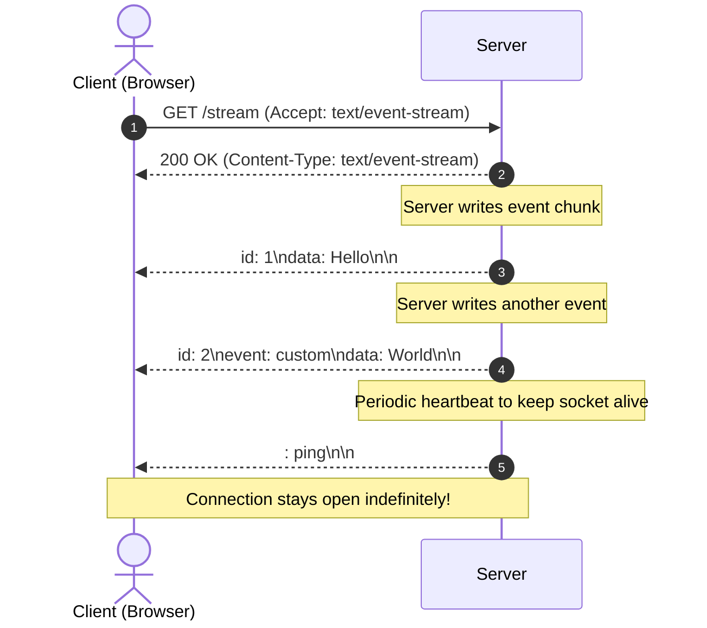
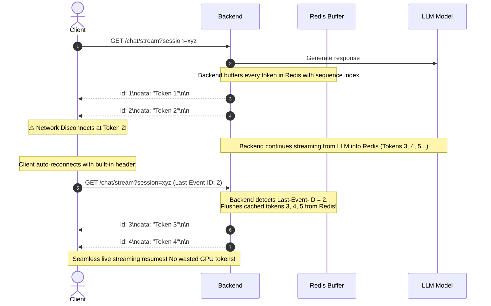
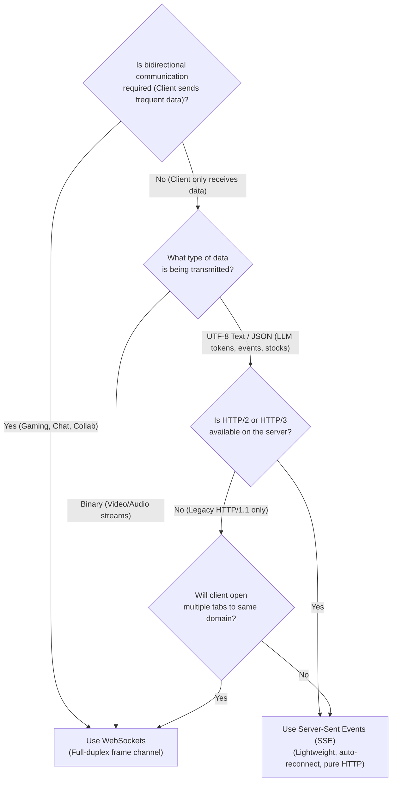

# 📡 Server-Sent Events (SSE) — Architecture & LLM Streaming

> [!important] Core Mental Model
> What makes Server-Sent Events (SSE) so elegant is that it **does not invent a new transport protocol**. Unlike WebSockets (which requires an HTTP upgrade handshake and custom binary framing), SSE is **100% pure HTTP**.
>
> It leverages a clever trick:
> 1. The client issues a standard HTTP `GET` request.
> 2. The server responds with `Content-Type: text/event-stream` and chunked transfer encoding.
> 3. **The server intentionally never closes the response.**
> 4. Over this single, open HTTP pipe, the server streams discrete, formatted text events whenever updates occur.
>
> To the browser, it looks like a single HTTP download that never ends. To the JavaScript application, the browser's built-in `EventSource` parses every chunk into a distinct, real-time event.

---

## 1. Executive Summary & Protocol Comparison

| Dimension | Server-Sent Events (SSE) | WebSockets (WS) | Long Polling |
| :--- | :--- | :--- | :--- |
| **Protocol** | **Standard HTTP** (`GET /stream`) | WebSocket Protocol (`ws://`, `wss://`) | Standard HTTP (`GET /poll`) |
| **Directionality** | **Unidirectional** (Server $\rightarrow$ Client) | **Full-Duplex** (Bi-directional) | Emulated Bi-directional (Client pulls) |
| **Transport Framing** | UTF-8 plain text (`data: ...\n\n`) | Binary frame headers (2–10 bytes) | Standard HTTP request/response payloads |
| **Auto-Reconnection** | **Built-in natively** by browser (`EventSource`) | Must implement manually in JS | Reconnect loop driven by client code |
| **Connection Recovery** | Uses **`Last-Event-ID`** to resume stream | None (must implement custom sync) | Uses query offset/cursor |
| **Firewall & Proxy Traversal** | **100% transparent** (standard port 80/443 HTTP) | Often blocked by strict corporate firewalls | 100% transparent |
| **HTTP/2 Multiplexing** | **Natively supported** (hundreds of streams per TCP link) | Not part of HTTP/2 multiplexing | Supported |
| **Best Used For** | **LLM token streaming**, live tickers, notifications | **Multiplayer games**, chat apps, collaborative tools | Asynchronous batch job completions |

---

## 2. Anatomy of the SSE Protocol

### 2.1 The HTTP Headers

To establish an SSE stream, the client initiates a request with the `text/event-stream` accept header, and the server commits to a chunked, unbuffered stream:

```http
GET /api/v1/stream HTTP/1.1
Host: api.example.com
Accept: text/event-stream
Cache-Control: no-cache
```

The server responds with specific headers:

```http
HTTP/1.1 200 OK
Content-Type: text/event-stream
Cache-Control: no-cache, no-transform
Connection: keep-alive
Transfer-Encoding: chunked
```

> [!tip] The `no-transform` Directive
> Reverse proxies (like Nginx, Cloudflare, or AWS ALB) often compress or buffer HTTP responses. Setting `Cache-Control: no-cache, no-transform` and `X-Accel-Buffering: no` ensures proxies **flush chunks immediately** rather than holding bytes until a buffer fills up.

---

### 2.2 Wire Format & Event Boundaries

In SSE, the stream consists of UTF-8 text. Every message is delimited by **two consecutive newline characters (`\n\n`)**.

A message can have four standard fields:

```
id: 101
event: price-update
retry: 5000
data: {"symbol": "BTC", "price": 95200.50}

```

| Field | Purpose |
| :--- | :--- |
| **`data:`** | The actual payload. Can span multiple lines; consecutive `data:` lines are joined with `\n`. |
| **`id:`** | Sets the event ID. The browser remembers this and sends it in the `Last-Event-ID` header upon reconnecting! |
| **`event:`** | Defines a custom event name. Instead of firing `onmessage`, the browser dispatches to `addEventListener('event_name', ...)`. |
| **`retry:`** | Tells the client how many milliseconds to wait before attempting to reconnect if the connection drops (default is ~3000ms). |
| **`: (colon)`** | Any line starting with a colon is a **comment**. Used as a **heartbeat** (e.g. `: keep-alive\n\n`) to prevent proxies from timing out idle connections. |



---

## 3. Case Study: AI Token Streaming (ChatGPT, Claude & Gemini)

The explosive adoption of Server-Sent Events in recent years is driven by **Large Language Models (LLMs)**.

### Why Request–Response Fails for AI Generation
Generating a 500-word response from an LLM takes between **10 to 30 seconds** because neural networks generate text **auto-regressively** (one token at a time).
- In **Request–Response**, the user stares at a blank screen and a loading spinner for 30 seconds until the entire text block completes.
- In **Server-Sent Events**, the server flushes each token to the client the microsecond it is sampled from the model's logits:

```mermaid
sequenceDiagram
    autonumber
    actor U as User
    participant Frontend as Web UI (EventSource)
    participant Backend as App Server
    participant LLM as OpenAI / Anthropic / Local LLM

    U->>Frontend: Clicks "Submit Prompt"
    Frontend->>Backend: POST /api/chat { prompt: "Explain quantum computing" }
    Backend->>LLM: Stream inference request
    
    Backend-->>Frontend: 200 OK (text/event-stream)

    loop Token Generation Loop (~20 tokens / sec)
        LLM-->>Backend: Token: "Quantum"
        Backend-->>Frontend: data: {"token": "Quantum "}\n\n
        Note over Frontend: User sees "Quantum " appear on screen!
        
        LLM-->>Backend: Token: "computing"
        Backend-->>Frontend: data: {"token": "computing "}\n\n
        Note over Frontend: User sees "computing " appear on screen!
    end

    Backend-->>Frontend: data: [DONE]\n\n
    Note over Frontend: Stream closes; generation complete
```

---

## 4. The Critical Problem: Disconnections During AI Generation

> [!question] The Real-World Failure Mode
> What happens if a user is generating a long response, and at token 250 out of 500, their **WiFi drops or their mobile phone switches cell towers**?
>
> 1. The SSE TCP socket drops (`ECONNRESET`).
> 2. The client loses all subsequent tokens.
> 3. Does the backend continue calling the LLM API, wasting costly tokens and money?
> 4. If the client reconnects, does the user have to regenerate the entire prompt from scratch?

### Solution 1: Resilient Stream Caching with `Last-Event-ID`
To make AI streaming resilient, the backend pairs the SSE `id` field with a fast cache (Redis / Memory Buffer):



### Solution 2: Aborting Abandoned Streams (`AbortController`)
If the user intentionally navigates away or clicks **"Stop Generating"**, you must cancel the upstream LLM call immediately to avoid burning GPU resources:

```javascript
app.post('/api/generate', (req, res) => {
  const abortController = new AbortController();

  // If client closes browser tab or clicks cancel, kill upstream LLM call
  req.on('close', () => {
    console.log('[ABORT] Client disconnected. Canceling upstream LLM request...');
    abortController.abort();
  });

  // Pass abortController.signal to OpenAI / Anthropic / fetch API
  callLLMStream({ prompt: req.body.prompt, signal: abortController.signal }, res);
});
```

---

## 5. The Critical HTTP/1.1 Bottleneck: The 6-Connection Limit

Hussein Nasser highlights a major architectural trap in the lecture:

### The Problem in HTTP/1.1
Browsers (Chrome, Firefox, Safari) enforce a strict limit of **6 concurrent TCP connections per origin (domain)** under HTTP/1.1.
- In HTTP/1.1, a single TCP connection can only handle **one active request at a time**.
- An SSE connection is an **unending request**. The socket is permanently marked as **busy**.
- If a user opens **6 browser tabs** of your application, and each tab opens an SSE connection to `api.myapp.com`:
  - **All 6 connections to your domain are permanently occupied.**
  - If the user tries to click a button, fetch data (`fetch('/api/users')`), or download an image, **the browser queues the request indefinitely**.
  - Your entire website freezes!

```
HTTP/1.1 Browser Limits (6 Sockets per Domain):
Socket 1: [SSE Stream Tab 1] ──BUSY──►
Socket 2: [SSE Stream Tab 2] ──BUSY──►
Socket 3: [SSE Stream Tab 3] ──BUSY──►
Socket 4: [SSE Stream Tab 4] ──BUSY──►
Socket 5: [SSE Stream Tab 5] ──BUSY──►
Socket 6: [SSE Stream Tab 6] ──BUSY──►
Socket 7: [GET /api/data]   ──BLOCKED / QUEUED FOREVER!──⏳
```

### The Solution: HTTP/2 Multiplexing
Under **HTTP/2 (or HTTP/3)**, this limitation disappears!
- HTTP/2 uses **multiplexed binary frames** over a **single TCP connection**.
- A browser opens **1 TCP connection** to the server, and inside that connection, it can open **hundreds of concurrent logical streams** (typically 100–250).
- Multiple SSE streams, API calls, and static assets interleave peacefully without blocking each other.

> [!important] Production Rule
> **Never run Server-Sent Events in production over plain HTTP/1.1.** Always ensure your reverse proxy (Nginx, Cloudflare, Caddy) has **HTTP/2 enabled** (`listen 443 ssl http2;`).

---

## 6. Hands-On Engineering: Production-Grade Implementation

### Production-Grade Server (Node.js + Express)

Features:
- Proper SSE headers with proxy buffering disabled (`X-Accel-Buffering: no`).
- Periodic comment-line **heartbeat** (`: ping\n\n`) to prevent proxy socket drops.
- Sequential message IDs for seamless reconnection recovery.
- Client disconnect listener to prevent memory leaks and dangling intervals.

```javascript
// sse-server.js
const express = require('express');
const cors = require('cors');

const app = express();
app.use(cors());
app.use(express.json());

// Simulated token cache for reconnection recovery (In production: Redis list)
const messageHistory = [];

app.get('/api/v1/stream', (req, res) => {
  // 1. Mandatory SSE Headers
  res.writeHead(200, {
    'Content-Type': 'text/event-stream',
    'Cache-Control': 'no-cache, no-transform',
    'Connection': 'keep-alive',
    'X-Accel-Buffering': 'no' // Instructs Nginx not to buffer chunks
  });

  // Flush headers immediately
  res.flushHeaders();

  console.log('[SSE] Client connected.');

  // 2. Handle Reconnection: Check if client provided Last-Event-ID
  const lastEventId = parseInt(req.headers['last-event-id'], 10);
  if (!isNaN(lastEventId)) {
    console.log(`[RESUME] Client reconnected with Last-Event-ID: ${lastEventId}`);
    // Replay missed messages from cache
    const missed = messageHistory.filter(msg => msg.id > lastEventId);
    for (const msg of missed) {
      res.write(`id: ${msg.id}\nevent: ${msg.event}\ndata: ${JSON.stringify(msg.data)}\n\n`);
    }
  }

  // 3. Heartbeat: Send comment line every 15s to keep NAT/proxies alive
  const heartbeat = setInterval(() => {
    res.write(': ping\n\n');
  }, 15000);

  // 4. Simulate token or event emission
  let counter = messageHistory.length;
  const eventInterval = setInterval(() => {
    counter++;
    const payload = { text: `Token chunk #${counter}`, time: new Date().toISOString() };

    // Save to history cache
    messageHistory.push({ id: counter, event: 'token', data: payload });

    // Format strictly: id, event, data, followed by double newline (\n\n)
    res.write(`id: ${counter}\n`);
    res.write(`event: token\n`);
    res.write(`data: ${JSON.stringify(payload)}\n\n`);
  }, 2000);

  // 5. Cleanup on socket close
  req.on('close', () => {
    console.log('[SSE] Client closed connection. Cleaning up timers.');
    clearInterval(heartbeat);
    clearInterval(eventInterval);
    res.end();
  });
});

const PORT = 8080;
app.listen(PORT, () => {
  console.log(`🚀 SSE Server running at http://localhost:${PORT}`);
});
```

---

### Production-Grade Browser Client (`EventSource`)

```html
<!-- index.html -->
<!DOCTYPE html>
<html lang="en">
<head>
  <meta charset="UTF-8">
  <title>SSE Live Stream Demo</title>
  <style>
    body { font-family: system-ui, sans-serif; max-width: 600px; margin: 40px auto; }
    #feed { border: 1px solid #ccc; height: 350px; overflow-y: auto; padding: 12px; border-radius: 6px; }
    .item { margin-bottom: 6px; font-family: monospace; }
    .status { font-weight: bold; margin-bottom: 12px; }
  </style>
</head>
<body>
  <h2>Server-Sent Events Live Stream</h2>
  <div id="status" class="status">Status: Connecting...</div>
  <div id="feed"></div>

  <script>
    const feed = document.getElementById('feed');
    const statusDiv = document.getElementById('status');

    // 1. Built-in EventSource handles handshake and auto-reconnect natively!
    const eventSource = new EventSource('http://localhost:8080/api/v1/stream');

    eventSource.onopen = () => {
      statusDiv.textContent = 'Status: 🟢 Connected to Event Stream';
    };

    // 2. Listen to custom named event: "token"
    eventSource.addEventListener('token', (e) => {
      const data = JSON.parse(e.data);
      const row = document.createElement('div');
      row.className = 'item';
      row.textContent = `[ID: ${e.lastEventId}] ${data.text} (${data.time})`;
      feed.appendChild(row);
      feed.scrollTop = feed.scrollHeight;
    });

    // 3. Built-in error and reconnection handling
    eventSource.onerror = (err) => {
      // Browser automatically retries connection in background!
      statusDiv.textContent = 'Status: 🔴 Connection lost. Browser reconnecting automatically...';
    };
  </script>
</body>
</html>
```

---

## 7. When to Use SSE vs. WebSockets: Decision Matrix



### Choose SSE When:
- ✅ **AI & LLM Output:** Streaming tokens from GPT-4, Claude, or local Ollama models.
- ✅ **Live Feeds & Dashboards:** Stock tickers, cryptocurrency prices, sports scores, social media notifications.
- ✅ **Build & Deployment Logs:** Streaming CI/CD logs (GitHub Actions, Jenkins, Vercel deployments).
- ✅ **Simplicity & Firewall Resilience:** You want real-time push without configuring WebSocket gateways or sticky sessions.

### Choose WebSockets When:
- ❌ **Low-Latency Bidirectional Interaction:** Multiplayer action gaming, real-time whiteboards (Figma), fast peer chat.
- ❌ **Binary Protocols:** Transferring raw binary camera feeds or audio buffers.
