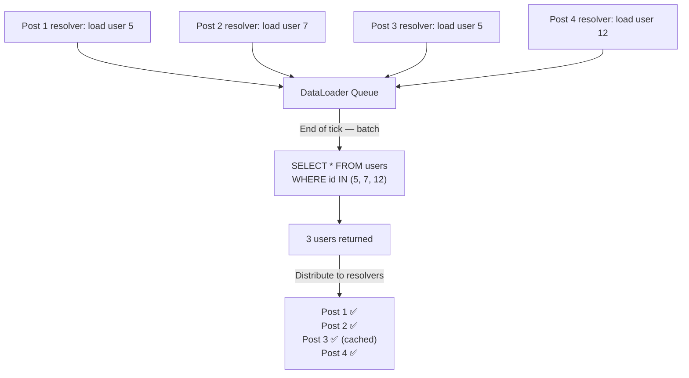

# 🔗 GraphQL DataLoader — Solving the N+1 Problem

> [!important] The Core Problem
> GraphQL moves the N+1 problem from client→server to resolver→database. One GraphQL query can trigger hundreds of SQL queries. DataLoader is the standard solution.

---

## 1. What Is the N+1 Problem?

### In REST (the original problem DataLoader solves)

```javascript
// Client fetches 1 post, then N comments' authors separately
const post = await fetch('/posts/1');              // 1 request
const comments = await fetch('/posts/1/comments'); // 1 request (returns N comments)

// For each comment, fetch the author — N more requests!
const authors = await Promise.all(
  comments.map(c => fetch(`/users/${c.authorId}`)) // N requests
);
// Total: 1 + 1 + N = N+2 requests ← N+1 problem
```

### In GraphQL (the problem moves to resolvers)

```graphql
# Client sends ONE query — looks efficient
query {
  posts {
    title
    author {
      name
    }
  }
}
```

**What the server actually does:**

```javascript
// GraphQL execution engine calls resolvers like this:

// 1. Resolve posts (1 DB query)
Query.posts = () => db.query('SELECT * FROM posts');  // returns 100 posts

// 2. For EACH post, resolve its author — 100 separate DB queries!
Post.author = (post) => db.query(
  'SELECT * FROM users WHERE id = ?', [post.authorId]
);

// Total DB queries: 1 + 100 = 101 ← the N+1 problem, now server-side
```

This can silently destroy performance. A single GraphQL query that looks fine can generate hundreds of DB calls.

---

## 2. What is DataLoader?

DataLoader is a utility that **batches and caches** data loading requests within a single execution tick.

**Core idea:**
- Instead of immediately fetching when a resolver requests data, **collect all requests** made in the same tick
- At the end of the tick, **send one batched request** for all collected IDs
- **Cache results** so the same ID is never fetched twice in one request



**Result:** 100 posts → **1 batched DB query** instead of 100 individual queries.

---

## 3. DataLoader in JavaScript (Official Library)

### Installation

```bash
npm install dataloader
```

### Basic Usage

```javascript
const DataLoader = require('dataloader');
const db = require('./db');

// Define the batch function — receives an array of keys, returns array of values IN THE SAME ORDER
const userLoader = new DataLoader(async (userIds) => {
  // One query for all requested IDs
  const users = await db.query(
    'SELECT * FROM users WHERE id = ANY($1)',
    [userIds]
  );

  // CRITICAL: return values in the same order as the input keys
  // DataLoader matches by index, not by ID
  return userIds.map(id => users.find(u => u.id === id) || null);
});

// Usage — each call schedules a load, doesn't fire immediately
const user1 = userLoader.load(1);  // queued
const user2 = userLoader.load(2);  // queued
const user3 = userLoader.load(1);  // cache hit — returns same promise as user1

// All three resolve with one DB query: WHERE id IN (1, 2)
```

> [!caution] Order Contract — The Most Common Bug
> The batch function **must return an array in the same order as the input keys array**. If your DB query returns results in a different order (e.g., sorted by name), you must reorder. Failing this causes wrong data to be returned to the wrong callers.

### Integration With GraphQL (Node.js / graphql-js)

```javascript
const { graphql, buildSchema } = require('graphql');
const DataLoader = require('dataloader');

const schema = buildSchema(`
  type User {
    id: ID!
    name: String!
  }
  type Post {
    id: ID!
    title: String!
    author: User
  }
  type Query {
    posts: [Post]
  }
`);

// Create a new DataLoader PER REQUEST — not globally!
function createContext() {
  return {
    userLoader: new DataLoader(async (ids) => {
      const users = await db.query('SELECT * FROM users WHERE id = ANY($1)', [ids]);
      return ids.map(id => users.find(u => u.id === Number(id)) ?? null);
    }),
  };
}

const resolvers = {
  Query: {
    posts: () => db.query('SELECT * FROM posts'),
  },
  Post: {
    // Uses loader instead of direct DB call
    author: (post, _, context) => context.userLoader.load(post.authorId),
  },
};

// Pass context per request
app.post('/graphql', (req, res) => {
  const context = createContext();  // fresh loader per request
  graphql({ schema, source: req.body.query, rootValue: resolvers, contextValue: context })
    .then(result => res.json(result));
});
```

> [!warning] DataLoader Must Be Per-Request
> **Never** share a DataLoader instance between requests. The cache would serve stale data to different users. Create a new instance per request (in the context factory).

---

## 4. DataLoader in Go

Using `graph-gophers/dataloader`:

```bash
go get github.com/graph-gophers/dataloader/v7
```

```go
package loaders

import (
    "context"
    "github.com/graph-gophers/dataloader/v7"
)

type User struct {
    ID   int
    Name string
}

func NewUserLoader(db *sql.DB) *dataloader.Loader[int, *User] {
    batchFn := func(ctx context.Context, keys []int) []*dataloader.Result[*User] {
        // Build query
        placeholders := make([]string, len(keys))
        args := make([]interface{}, len(keys))
        for i, k := range keys {
            placeholders[i] = fmt.Sprintf("$%d", i+1)
            args[i] = k
        }

        query := fmt.Sprintf(
            "SELECT id, name FROM users WHERE id IN (%s)",
            strings.Join(placeholders, ","),
        )

        rows, _ := db.QueryContext(ctx, query, args...)
        defer rows.Close()

        userMap := make(map[int]*User)
        for rows.Next() {
            var u User
            rows.Scan(&u.ID, &u.Name)
            userMap[u.ID] = &u
        }

        // Return in key order
        results := make([]*dataloader.Result[*User], len(keys))
        for i, k := range keys {
            if u, ok := userMap[k]; ok {
                results[i] = &dataloader.Result[*User]{Data: u}
            } else {
                results[i] = &dataloader.Result[*User]{
                    Error: fmt.Errorf("user %d not found", k),
                }
            }
        }
        return results
    }

    return dataloader.NewBatchedLoader(batchFn)
}
```

---

## 5. DataLoader in .NET / Hot Chocolate

Chillicream's Hot Chocolate (C# GraphQL server) has first-class DataLoader support:

```csharp
// Define the DataLoader
public class UserByIdDataLoader : BatchDataLoader<int, User>
{
    private readonly IUserRepository _repository;

    public UserByIdDataLoader(
        IBatchScheduler batchScheduler,
        IUserRepository repository,
        DataLoaderOptions? options = null)
        : base(batchScheduler, options)
    {
        _repository = repository;
    }

    // Called once per batch with all requested keys
    protected override async Task<IReadOnlyDictionary<int, User>> LoadBatchAsync(
        IReadOnlyList<int> keys,
        CancellationToken ct)
    {
        // One query for all keys
        var users = await _repository.GetUsersByIdsAsync(keys, ct);
        return users.ToDictionary(u => u.Id);
    }
}

// Use in resolver
public class PostType : ObjectType<Post>
{
    protected override void Configure(IObjectTypeDescriptor<Post> descriptor)
    {
        descriptor
            .Field(p => p.AuthorId)
            .Name("author")
            .ResolveWith<PostResolvers>(r => r.GetAuthorAsync(default!, default!, default));
    }
}

public class PostResolvers
{
    public async Task<User?> GetAuthorAsync(
        [Parent] Post post,
        UserByIdDataLoader userLoader,  // ← injected per request
        CancellationToken ct)
    {
        return await userLoader.LoadAsync(post.AuthorId, ct);
    }
}
```

Hot Chocolate handles DataLoader injection scope automatically — it creates a new instance per request.

---

## 6. Caching Behavior

DataLoader has **two levels of caching**:

### Request-Level Cache (Default)

Within a single GraphQL request, the same key is never loaded twice:

```javascript
// These two calls happen in the same request
const user = await loader.load(5);        // DB hit
const sameUser = await loader.load(5);    // Cache hit — returns same value
```

### Clearing the Cache

For mutations that change data, clear the relevant cache entries:

```javascript
// After updating a user
await db.update('users', { name: 'NewName' }, { id: 5 });
loader.clear(5);           // remove from cache
// or
loader.clearAll();         // clear entire cache
```

### Priming the Cache

If you've already loaded data, prime the cache to avoid redundant loads:

```javascript
// You just fetched all users for a list view
const users = await db.query('SELECT * FROM users');

// Prime the loader cache with what we already have
users.forEach(user => loader.prime(user.id, user));

// Later resolvers that load these users will get cache hits
```

---

## 7. When DataLoader Doesn't Help

| Situation | Why DataLoader Doesn't Help | Solution |
| :--- | :--- | :--- |
| **Non-keyed queries** | DataLoader batches by key; arbitrary queries can't batch | Query complexity limits |
| **Deep nesting** | 3 levels of N+1 (posts → comments → authors) need 3 loaders | One DataLoader per entity type |
| **Complex joins** | Sometimes a JOIN is better than batched loads | Use JOIN in the batch function |
| **Real-time subscriptions** | DataLoader's tick-based batching doesn't map well | Separate subscription resolvers |

---

## 8. GraphQL Query Complexity Limits

DataLoader reduces DB load, but clients can still write expensive queries:

```graphql
# This query could load millions of records
{
  users {              # 10,000 users
    posts {            # × 50 posts each = 500,000
      comments {       # × 20 comments each = 10,000,000
        author { name }
      }
    }
  }
}
```

Add **query complexity analysis** to reject expensive queries:

```javascript
const { createComplexityLimitRule } = require('graphql-validation-complexity');

const server = new ApolloServer({
  schema,
  validationRules: [
    createComplexityLimitRule(1000, {  // max complexity score of 1000
      onCost: (cost) => console.log('Query cost:', cost),
    }),
  ],
});
```

---

## 📚 Sources

- [GraphQL N+1 Problem & DataLoader — Official graphql-js Documentation](https://www.graphql-js.org/docs/n1-dataloader/)
- [DataLoader Batching — Chillicream Hot Chocolate (.NET)](https://chillicream.com/docs/hotchocolate/fetching-data/batching/dataloader)
- [GraphQL DataLoader Example Repository — GitHub](https://github.com/nickqweaver/graphql-dataloader-example)
