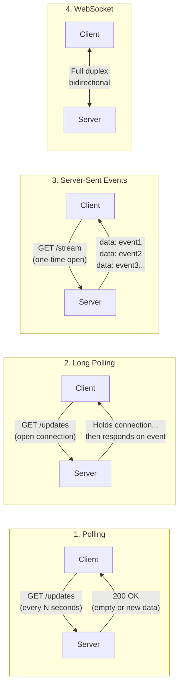
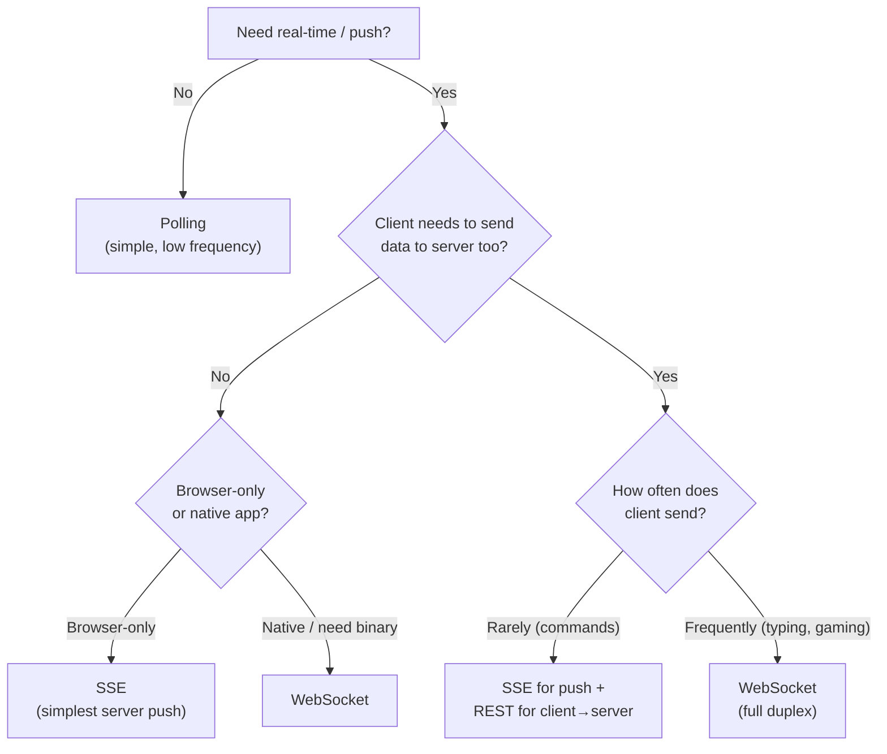

# ⚡ Polling, Long Polling, SSE & WebSockets

> [!note] The Core Problem
> HTTP Request–Response requires the **client to initiate** every exchange. But real-time applications (chat, notifications, live dashboards, collaborative editing) need the **server to push** data to clients as events happen. These four patterns solve that problem with different trade-offs.

---

## 1. The Four Patterns at a Glance



---

## 2. Polling

### How It Works

Client repeatedly makes HTTP requests on a timer, regardless of whether new data exists.

```javascript
// Client: ask every 5 seconds
setInterval(async () => {
  const response = await fetch('/api/notifications');
  const data = await response.json();
  if (data.notifications.length > 0) {
    renderNotifications(data.notifications);
  }
}, 5000);
```

```javascript
// Server: standard request handler
app.get('/api/notifications', async (req, res) => {
  const notifications = await db.getNewNotifications(req.user.id);
  res.json({ notifications });
});
```

### The Math Problem

$$\text{RPS} = \frac{\text{Concurrent Users}}{\text{Poll Interval (seconds)}} = \frac{100{,}000}{5} = 20{,}000 \text{ req/s}$$

20,000 requests per second — even when **nothing has changed**. Most responses are empty.

### Characteristics

| Dimension | Detail |
| :--- | :--- |
| **Latency** | Up to N seconds (the poll interval) |
| **Server load** | High — requests even when no new data |
| **Implementation** | Trivial — standard REST endpoint |
| **State on server** | None — stateless per request |
| **Firewall/proxy** | ✅ No issues — standard HTTP |

### When To Use Polling

- Prototyping or low-traffic internal tools
- When update frequency matches poll interval naturally
- When simplicity > efficiency
- Dashboard that refreshes every 60 seconds (cost is acceptable)

---

## 3. Long Polling

### How It Works

Client opens an HTTP request and **holds the connection open**. The server doesn't respond until it has new data (or a timeout occurs). When the client receives a response, it immediately opens a new request.

```javascript
// Client: recursive long poll
async function longPoll(lastEventId = null) {
  try {
    const url = lastEventId
      ? `/api/events?after=${lastEventId}`
      : '/api/events';

    const response = await fetch(url, {
      signal: AbortSignal.timeout(30000), // 30 second max wait
    });

    const data = await response.json();

    if (data.event) {
      handleEvent(data.event);
      longPoll(data.event.id); // immediately reconnect
    } else {
      longPoll(lastEventId);   // timeout, reconnect
    }
  } catch (err) {
    // Network error — wait before reconnecting
    setTimeout(() => longPoll(lastEventId), 2000);
  }
}

longPoll(); // start
```

```javascript
// Server: hold connection until event or timeout
app.get('/api/events', async (req, res) => {
  const { after } = req.query;
  const timeout = 29000; // slightly under client's 30s to control the race
  const start = Date.now();

  // Poll the event queue with exponential backoff
  while (Date.now() - start < timeout) {
    const event = await eventQueue.getNext(req.user.id, after);
    if (event) {
      return res.json({ event });
    }
    await sleep(500); // check every 500ms
  }

  // Timeout — tell client to reconnect
  res.json({ event: null });
});
```

### How Long Polling Differs From Polling

```
Regular Polling:
  Client: request → Server: immediate empty response → Client: waits 5s → repeat
  
Long Polling:
  Client: request → Server: HOLDS connection → (new data arrives) → Server: responds → Client: immediately repeats
```

The key difference: **the server holds the request open** instead of returning immediately. This reduces wasted empty responses but keeps connections occupied.

### Characteristics

| Dimension | Detail |
| :--- | :--- |
| **Latency** | Near-realtime (seconds at most) |
| **Server load** | Medium — fewer empty responses; but connections held open |
| **Connections** | One open connection per client (but it's held) |
| **Firewall/proxy** | ✅ Standard HTTP — works through most proxies |
| **State on server** | Per-connection while request is open |
| **Complexity** | Medium — requires timeout handling, reconnect logic |

### Connection Limits

Servers must handle many simultaneously held-open connections efficiently. Node.js's event loop handles this well (non-blocking I/O). Threaded servers (traditional Java/PHP) would need one thread per connection — much harder.

---

## 4. Server-Sent Events (SSE)

### How It Works

Client opens **one persistent HTTP connection**. Server sends a stream of **text events** in a standardized format over that connection. The connection stays open indefinitely.

```
GET /api/stream HTTP/1.1
Host: example.com
Accept: text/event-stream
```

```
HTTP/1.1 200 OK
Content-Type: text/event-stream
Cache-Control: no-cache
Connection: keep-alive

id: 1
event: notification
data: {"message": "New comment on your post"}

id: 2
event: notification
data: {"message": "John liked your photo"}

: heartbeat (comment line, keeps connection alive)

id: 3
event: price-update
data: {"symbol": "AAPL", "price": 182.50}
```

### SSE Message Format

Each event block:
```
id: <event-id>           ← optional; client uses for reconnect
event: <event-type>      ← optional; default is "message"
data: <payload>          ← required; can span multiple lines
                         ← blank line = end of event
```

Multi-line data:
```
data: {"part": 1,
data:  "continues": true}  ← each "data:" line is concatenated
```

### Server Implementation (Node.js)

```javascript
app.get('/api/stream', (req, res) => {
  // Set SSE headers
  res.setHeader('Content-Type', 'text/event-stream');
  res.setHeader('Cache-Control', 'no-cache');
  res.setHeader('Connection', 'keep-alive');
  res.setHeader('Access-Control-Allow-Origin', '*');
  res.flushHeaders(); // important: flush headers immediately

  let eventId = 0;

  // Send heartbeat every 30s to keep connection alive (proxies close idle connections)
  const heartbeat = setInterval(() => {
    res.write(': heartbeat\n\n');
  }, 30000);

  // Subscribe to events for this user
  const unsubscribe = eventBus.subscribe(req.user.id, (event) => {
    eventId++;
    res.write(`id: ${eventId}\n`);
    res.write(`event: ${event.type}\n`);
    res.write(`data: ${JSON.stringify(event.payload)}\n\n`);
  });

  // Cleanup when client disconnects
  req.on('close', () => {
    clearInterval(heartbeat);
    unsubscribe();
  });
});
```

### Client Implementation (Browser EventSource API)

```javascript
const source = new EventSource('/api/stream');

// Generic message listener
source.onmessage = (event) => {
  const data = JSON.parse(event.data);
  handleUpdate(data);
};

// Listen to specific event types
source.addEventListener('notification', (event) => {
  showNotification(JSON.parse(event.data));
});

source.addEventListener('price-update', (event) => {
  updatePriceDisplay(JSON.parse(event.data));
});

// Auto-reconnect is built-in to EventSource!
source.onerror = (err) => {
  console.log('SSE error — browser will auto-reconnect');
};

// Close explicitly when done
function cleanup() {
  source.close();
}
```

> [!tip] Built-In Reconnection
> `EventSource` **automatically reconnects** on disconnection. It sends the last received `id` in the `Last-Event-ID` header, so your server can resume from where it left off. You don't need to implement reconnect logic.

### Characteristics

| Dimension | Detail |
| :--- | :--- |
| **Direction** | Server → Client only (unidirectional) |
| **Latency** | Realtime — events pushed immediately |
| **Server load** | Low per event — one connection held, events pushed as needed |
| **Reconnection** | ✅ Built-in browser auto-reconnect with `Last-Event-ID` |
| **Firewall/proxy** | ✅ Standard HTTP — works through most proxies |
| **HTTP/2** | ✅ Works great — multiplexed with other requests |
| **Internet Explorer** | ❌ Not supported (use polyfill if needed) |
| **Binary data** | ❌ Text-only (base64 encode binary if needed) |

---

## 5. WebSockets

### The Upgrade Handshake

WebSocket starts as an HTTP request and upgrades to the WebSocket protocol:

```
Client → Server:
GET /chat HTTP/1.1
Host: example.com
Upgrade: websocket
Connection: Upgrade
Sec-WebSocket-Key: dGhlIHNhbXBsZSBub25jZQ==
Sec-WebSocket-Version: 13

Server → Client:
HTTP/1.1 101 Switching Protocols
Upgrade: websocket
Connection: Upgrade
Sec-WebSocket-Accept: s3pPLMBiTxaQ9kYGzzhZRbK+xOo=
```

After `101 Switching Protocols`, HTTP is gone. The connection is now a **WebSocket frame stream** — a custom binary protocol with its own message framing.

### Full-Duplex Communication

Both client and server can send messages at any time, independently:

```
Client → Server: { type: "message", text: "Hello" }
Server → Client: { type: "message", text: "Hi", from: "Alice" }
Client → Server: { type: "typing" }
Server → Client: { type: "typing", user: "Bob" }
Client → Server: { type: "message", text: "How are you?" }
```

### Server Implementation (Node.js with `ws`)

```javascript
const WebSocket = require('ws');
const http = require('http');

const server = http.createServer(app);
const wss = new WebSocket.Server({ server });

// Map to track connections by user
const connections = new Map();

wss.on('connection', (ws, req) => {
  const userId = getUserFromRequest(req); // extract from cookie/token
  connections.set(userId, ws);

  ws.on('message', (rawData) => {
    const message = JSON.parse(rawData.toString());

    switch (message.type) {
      case 'chat':
        // Broadcast to all in room
        broadcastToRoom(message.roomId, {
          type: 'chat',
          from: userId,
          text: message.text,
          timestamp: Date.now(),
        });
        break;

      case 'typing':
        broadcastToRoom(message.roomId, {
          type: 'typing',
          userId,
        }, exclude = userId); // don't send to sender
        break;
    }
  });

  ws.on('close', () => {
    connections.delete(userId);
  });

  // Heartbeat — detect zombie connections
  ws.isAlive = true;
  ws.on('pong', () => { ws.isAlive = true; });
});

// Ping all connections every 30s to detect dead ones
const interval = setInterval(() => {
  wss.clients.forEach((ws) => {
    if (!ws.isAlive) return ws.terminate();
    ws.isAlive = false;
    ws.ping();
  });
}, 30000);

function broadcastToRoom(roomId, message, exclude = null) {
  const roomMembers = getRoomMembers(roomId); // from DB/Redis
  for (const memberId of roomMembers) {
    if (memberId === exclude) continue;
    const ws = connections.get(memberId);
    if (ws?.readyState === WebSocket.OPEN) {
      ws.send(JSON.stringify(message));
    }
  }
}
```

### Client Implementation (Browser WebSocket API)

```javascript
const ws = new WebSocket('wss://api.example.com/chat');

ws.onopen = () => {
  console.log('Connected');
  ws.send(JSON.stringify({ type: 'join', roomId: 'general' }));
};

ws.onmessage = (event) => {
  const data = JSON.parse(event.data);
  switch (data.type) {
    case 'chat':
      appendMessage(data);
      break;
    case 'typing':
      showTypingIndicator(data.userId);
      break;
  }
};

ws.onclose = (event) => {
  console.log('Disconnected:', event.code, event.reason);
  // Reconnect with exponential backoff
  setTimeout(() => reconnect(), 1000 * Math.pow(2, retries++));
};

ws.onerror = (error) => {
  console.error('WebSocket error:', error);
};

// Send a message
function sendMessage(text) {
  if (ws.readyState === WebSocket.OPEN) {
    ws.send(JSON.stringify({ type: 'chat', text, roomId: 'general' }));
  }
}
```

### Characteristics

| Dimension | Detail |
| :--- | :--- |
| **Direction** | Bidirectional — both sides send/receive freely |
| **Latency** | Realtime — lowest latency of all patterns |
| **Protocol** | WebSocket (not HTTP after handshake) |
| **Firewall/proxy** | ⚠️ Corporate firewalls may block non-HTTP WebSocket traffic |
| **Reconnection** | ❌ No built-in auto-reconnect — must implement manually |
| **State** | Per-connection server-side state required |
| **Scaling** | Hard — connections are sticky to one server (needs Redis pub/sub) |
| **Binary data** | ✅ Natively supported (send ArrayBuffer) |

---

## 6. Full Comparison

| Dimension | Polling | Long Polling | SSE | WebSocket |
| :--- | :--- | :--- | :--- | :--- |
| **Direction** | C → S | C → S | S → C | S ↔ C |
| **Connection** | New per request | Held until event | Persistent stream | Persistent ws:// |
| **Latency** | Poll interval | Near-realtime | Realtime | Realtime |
| **Server load** | High (empty responses) | Medium | Low | Low |
| **Auto-reconnect** | N/A | Manual | ✅ Built-in | ❌ Manual |
| **HTTP/2 support** | ✅ | ✅ | ✅ Excellent | N/A (separate protocol) |
| **Firewalls** | ✅ | ✅ | ✅ | ⚠️ |
| **IE support** | ✅ | ✅ | ❌ | ✅ |
| **Binary data** | ✅ | ✅ | ❌ (text only) | ✅ |
| **Complexity** | Low | Medium | Low–Medium | High |

---

## 7. Scaling WebSockets

The hardest problem with WebSockets: connections are **sticky** to a single server instance. If you have 3 servers:

```
User A connected to Server 1
User B connected to Server 2

User A sends message to User B
Server 1 doesn't have User B's WebSocket connection!
```

**Solution: Redis Pub/Sub as a message bus**

```javascript
const { createClient } = require('redis');
const subscriber = createClient();
const publisher = createClient();

await subscriber.connect();
await publisher.connect();

// When a message is meant for User B, publish it
async function sendToUser(userId, message) {
  // Try local connection first
  const localWs = localConnections.get(userId);
  if (localWs?.readyState === WebSocket.OPEN) {
    localWs.send(JSON.stringify(message));
    return;
  }
  // User is on another server — publish to Redis channel
  await publisher.publish(`user:${userId}`, JSON.stringify(message));
}

// Each server subscribes and delivers messages to its local connections
await subscriber.subscribe('user:*', (message, channel) => {
  const userId = channel.split(':')[1];
  const localWs = localConnections.get(userId);
  if (localWs?.readyState === WebSocket.OPEN) {
    localWs.send(message);
  }
});
```

---

## 8. Choosing the Right Pattern



**Decision guide:**

| Use Case | Best Pattern |
| :--- | :--- |
| Notifications / alerts | SSE |
| Live feed / social timeline | SSE |
| Live sports scores | SSE |
| Stock price tickers | SSE |
| Chat applications | WebSocket |
| Multiplayer games | WebSocket |
| Collaborative editing | WebSocket |
| Progress bars for long jobs | SSE |
| Dashboard that refreshes every 60s | Polling |
| Legacy system / must support IE | Long Polling |

---

## 📚 Sources

- [Polling, Long Polling, SSE & WebSockets — Technical Analysis (ssup2)](https://ssup2.github.io/blog-software/en/docs/theory-analysis/web-polling-long-polling-server-sent-events-websocket/)
- [Long Polling vs WebSockets vs Server-Sent Events — Medium System Design Blog](https://medium.com/system-design-blog/long-polling-vs-websockets-vs-server-sent-events-5a2d1c9e8d1f)
