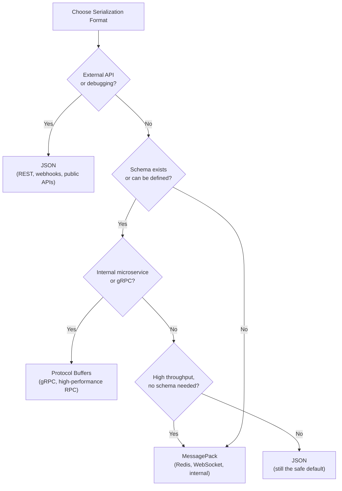

# 🗜️ Serialization Formats — JSON vs Protobuf vs MessagePack

> [!note] What Is Serialization?
> Serialization converts an in-memory data structure into a transmittable byte sequence. Deserialization is the reverse. Every API call, every database write, every message queue message involves serialization — it's not optional, only the format is.

---

## 1. Why Format Choice Matters

The choice of serialization format affects:
- **Wire size** — how many bytes are transmitted (bandwidth, cost)
- **Parse speed** — how long encoding/decoding takes (CPU, latency)
- **Schema requirements** — do both sides need a contract?
- **Human readability** — can you debug raw messages?
- **Language support** — does every service language have a library?

---

## 2. JSON — The Default

### How JSON Works

JSON (JavaScript Object Notation) is a text-based format. Every value is encoded as human-readable characters.

```json
{
  "id": 101,
  "name": "Neel",
  "active": true,
  "scores": [98, 87, 92]
}
```

**What's transmitted on the wire:**
```
7b 22 69 64 22 3a 20 31 30 31 2c 20 22 6e 61 6d 65 22 3a 20 22 4e 65 65 6c 22 ...
```
(raw UTF-8 bytes of the text representation — includes field names, quotes, colons, commas)

### JSON Wire Size Example

Struct: `{ id: 101, name: "Neel", active: true }`

```
JSON:  {"id":101,"name":"Neel","active":true}  = 39 bytes
         ↑                                      
         Field name "id" takes 4 bytes (key + colon + quotes)
         The integer 101 takes 3 bytes as ASCII text
```

Field names are **repeated in every record**. A 1 million row response with 20 fields wastes enormous bandwidth on key names.

### JSON Performance in Go

```go
package main

import (
    "encoding/json"
    "testing"
)

type User struct {
    ID     int    `json:"id"`
    Name   string `json:"name"`
    Active bool   `json:"active"`
}

func BenchmarkJSONMarshal(b *testing.B) {
    u := User{ID: 101, Name: "Neel", Active: true}
    for i := 0; i < b.N; i++ {
        _, _ = json.Marshal(u)
    }
}

func BenchmarkJSONUnmarshal(b *testing.B) {
    data := []byte(`{"id":101,"name":"Neel","active":true}`)
    var u User
    for i := 0; i < b.N; i++ {
        _ = json.Unmarshal(data, &u)
    }
}
```

Go's `encoding/json` uses **reflection** at runtime — it inspects struct tags and field types on every call. This is slow compared to code-generated marshalers.

**Faster JSON in Go:**
- [`encoding/json/v2`](https://github.com/golang/go/issues/63397) — proposed stdlib upgrade
- [`github.com/json-iterator/go`](https://github.com/json-iterator/go) — drop-in faster replacement
- [`github.com/bytedance/sonic`](https://github.com/bytedance/sonic) — JIT-based, fastest option (ByteDance/TikTok)

---

## 3. Protocol Buffers (Protobuf) — Google's Binary Format

### How Protobuf Works

Protobuf is a **binary, schema-first** format. You define the schema in a `.proto` file; a code generator produces serialization code for each language.

```protobuf
// user.proto
syntax = "proto3";

message User {
  int32  id     = 1;   // field number, NOT the value
  string name   = 2;
  bool   active = 3;
}
```

**Wire encoding — no field names, only field numbers:**

```
Field 1 (id=101):
  Tag: 0x08  (field 1, wire type 0 = varint)
  Value: 0x65 (varint encoding of 101)

Field 2 (name="Neel"):
  Tag: 0x12  (field 2, wire type 2 = length-delimited)
  Length: 0x04
  Value: 4e 65 65 6c ("Neel" in UTF-8)

Field 3 (active=true):
  Tag: 0x18  (field 3, wire type 0 = varint)
  Value: 0x01 (true)

Total: ~11 bytes  vs JSON's 39 bytes
```

### Key Properties

| Property | Protobuf |
| :--- | :--- |
| **Field names on wire** | ❌ — only field numbers |
| **Schema required** | ✅ — both sides need the .proto |
| **Human readable** | ❌ — binary (use `protoc --decode` to inspect) |
| **Size vs JSON** | ~3–10x smaller |
| **Parse speed** | ~5–10x faster than JSON (code-generated, no reflection) |
| **Backward compatibility** | ✅ — adding fields is safe; never renumber or reuse field numbers |

### Protobuf in Go

```bash
# Install tools
go install google.golang.org/protobuf/cmd/protoc-gen-go@latest
protoc --go_out=. user.proto  # generates user.pb.go
```

```go
import (
    "google.golang.org/protobuf/proto"
    pb "yourmodule/gen/user"
)

// Serialize
user := &pb.User{Id: 101, Name: "Neel", Active: true}
bytes, err := proto.Marshal(user)

// Deserialize
var decoded pb.User
err = proto.Unmarshal(bytes, &decoded)
fmt.Println(decoded.Name) // "Neel"
```

### Schema Evolution Rules

The killer feature of Protobuf is **backward and forward compatible schema evolution**.

```protobuf
// v1
message User {
  int32  id   = 1;
  string name = 2;
}

// v2 — add a field (old clients ignore unknown fields)
message User {
  int32  id    = 1;
  string name  = 2;
  string email = 3;  // ← safe to add
}

// v3 — NEVER do this (breaks compatibility)
message User {
  int32  id    = 1;
  string email = 2;  // ← CHANGED field number 2 — corruption!
  string name  = 3;
}
```

**Rules:**
- ✅ Add new fields with new numbers
- ✅ Remove fields (mark as `reserved`)
- ❌ Never reuse a field number
- ❌ Never change a field's data type

---

## 4. MessagePack — Binary JSON

### How MessagePack Works

MessagePack is a binary serialization format that's **semantically identical to JSON** (same types: null, bool, int, float, string, array, map) but encoded in binary.

```
JSON:         {"id":101,"name":"Neel","active":true}  = 39 bytes
MessagePack:  [binary]                                  = ~20 bytes
```

Unlike Protobuf, MessagePack:
- **Does NOT require a schema** — dynamic, like JSON
- **Preserves JSON's flexibility** — arbitrary keys, nested maps, arrays
- **Is not self-describing in a human-readable way** — but can be decoded without a schema

### MessagePack Wire Format

```
JSON value      MessagePack encoding
-----------     --------------------
null            0xc0
true            0xc3
false           0xc2
101 (int)       0x65  (1 byte for ints 0-127!)
"Neel" (str)    0xa4 4e 65 65 6c  (1 byte length prefix + 4 bytes)
{"id":101}      0x81 a2 69 64 65  (fixmap + fixstr "id" + fixint 101)
```

Small integers (0–127) take **1 byte** in MessagePack vs 1–3 ASCII bytes in JSON.
Strings under 32 chars use a **1-byte length prefix** vs JSON's 2-byte quote overhead per string.

### MessagePack in Go

```go
import "github.com/vmihailenco/msgpack/v5"

type User struct {
    ID     int    `msgpack:"id"`
    Name   string `msgpack:"name"`
    Active bool   `msgpack:"active"`
}

// Encode
user := User{ID: 101, Name: "Neel", Active: true}
bytes, err := msgpack.Marshal(user)
fmt.Printf("MessagePack: %d bytes\n", len(bytes)) // ~15 bytes

// Decode
var decoded User
err = msgpack.Unmarshal(bytes, &decoded)
```

### MessagePack in Node.js

```javascript
const msgpack = require('@msgpack/msgpack');

const user = { id: 101, name: "Neel", active: true };
const encoded = msgpack.encode(user);           // Uint8Array
const decoded = msgpack.decode(encoded);        // back to JS object

console.log(`JSON: ${JSON.stringify(user).length} bytes`);  // 39
console.log(`MsgPack: ${encoded.length} bytes`);             // ~20
```

---

## 5. Format Comparison — Full Picture

| Dimension | JSON | XML/SOAP | Protocol Buffers | MessagePack |
| :--- | :---: | :---: | :---: | :---: |
| **Human readable** | ✅ | ✅ | ❌ | ❌ |
| **Schema required** | ❌ | Optional | ✅ | ❌ |
| **Wire size** | Medium | Large | Small | Small |
| **Parse speed** | Medium | Slow | Very Fast | Fast |
| **Field names on wire** | ✅ | ✅ | ❌ (numbers) | ✅ |
| **Schema evolution** | Manual | XSD versioning | Built-in rules | Manual |
| **Streaming** | ❌ (needs complete doc) | ❌ | ✅ (with gRPC) | ❌ |
| **Language support** | Universal | Universal | Good (20+ langs) | Good (50+ langs) |
| **Best use case** | Web APIs, REST, debugging | Legacy enterprise | gRPC, internal microservices | High-throughput, no schema |

---

## 6. Serialization Performance Issues in Practice

From OneUptime's production analysis — where serialization became a real bottleneck:

### Common Causes of Serialization Overhead

```
1. Large payloads
   → Serializing 50 MB of nested JSON on every API call
   → Fix: pagination, field selection, projection

2. Frequent serialization in hot paths
   → Serializing + deserializing on every Redis cache read/write
   → Fix: store pre-serialized bytes in cache; skip redundant encode/decode

3. Reflection-based serializers in hot paths
   → Go's encoding/json uses reflection → ~3–5x slower than codegen
   → Fix: use protobuf, sonic, or json-iterator in hot paths

4. Unnecessary double-serialization
   → App deserializes JSON from DB, re-serializes for response
   → Fix: pass raw bytes through if no transformation needed

5. Logging serialization
   → Serializing entire request objects into log lines
   → Fix: log only key fields; use structured logging (zerolog, zap)
```

### Measuring in Go

```go
import (
    "encoding/json"
    "testing"
    jsoniter "github.com/json-iterator/go"
    "github.com/bytedance/sonic"
)

var ji = jsoniter.ConfigCompatibleWithStandardLibrary

func BenchmarkStdJSON(b *testing.B)  { /* json.Marshal */ }
func BenchmarkJsonIter(b *testing.B) { /* ji.Marshal */ }
func BenchmarkSonic(b *testing.B)    { /* sonic.Marshal */ }
// Typical results: Std < JsonIter < Sonic in speed
// Std > JsonIter > Sonic in allocations
```

---

## 7. When to Use Which



**Practical guidance:**

| Scenario | Recommendation |
| :--- | :--- |
| Public REST API | JSON — universally understood, easy to debug |
| Internal microservices (Go/Java/C++) | Protobuf — schema contract, type safety, speed |
| WebSocket messages at high volume | MessagePack — same flexibility as JSON, 50% smaller |
| Redis cache storage | MessagePack or Protobuf — minimize stored bytes |
| Event streaming (Kafka) | Protobuf + Schema Registry — schema evolution management |
| Debugging/logging | JSON — human readable |

---

## 📚 Sources

- [Choosing Serialization Formats in Go — Rotational](https://rotational.io/blog/go-serialization-formats/)
- [Serialization Performance Issues in Production — OneUptime](https://oneuptime.com/blog/post/2026-01-24-serialization-performance/view)
- [MessagePack Overview & Format Spec](https://github.com/techishthoughts-org/java_serialization_frameworks/blob/main/docs/frameworks/msgpack.md)
