# 🌐 Protocols & Protocol Properties — Computer Networking

### Core Mental Model — Before Everything Else

> [!important] The Big Picture
> A **protocol** is a contract between two communicating systems. It defines the rules, format, and behavior they both agree to follow.
> Without a shared protocol, two machines cannot understand each other — even if they can physically send bytes.
>
> **TCP ≠ HTTP.** TCP transports bytes; HTTP defines what those bytes mean.
> **TCP ≠ UDP.** TCP is reliable, ordered, connection-oriented; UDP is fast, connectionless, best-effort.

| Concept | Meaning |
| :--- | :--- |
| **Protocol** | An agreed set of rules governing how two systems communicate |
| **Text-based protocol** | Messages encoded as human-readable characters |
| **Binary protocol** | Messages encoded in machine-oriented binary format |
| **Stateful protocol** | Maintains session/connection state across exchanges |
| **Stateless protocol** | Each exchange is independent — no inherent session memory |
| **Stream (TCP)** | Continuous ordered byte flow — no inherent message boundaries |
| **Datagram (UDP)** | Individual, self-contained packets — message boundaries preserved |

---

## Topics Covered

| Video | Topic Area | Core Questions |
| :--- | :--- | :--- |
| **Video 1** | What is a Protocol? | Why do computers need an agreed format? |
| **Video 1** | Custom Protocol Design | How do you build your own protocol? |
| **Video 1** | Database Drivers | Why do databases have their own drivers? |
| **Video 2** | HTTP over TCP (Practical) | How does HTTP really work at the wire level? |
| **Video 2** | CRLF, Content-Length, Content-Type | How does HTTP delimit messages? |
| **Video 2** | Raw TCP + Netcat Demo | What actually travels over the wire? |
| **Video 3** | Protocol Properties | What must every protocol decide? |
| **Video 3** | Data Format, Transfer Mode, Addressing | Text vs Binary, Message vs Stream, DNS/IP/MAC |
| **Video 3** | Directionality, State, Routing | Half/Full duplex, Stateful vs Stateless, Proxies |
| **Video 3** | Flow Control, Congestion, Reliability | How does TCP handle these? What does UDP skip? |
| **Video 3** | Error Management | Error codes, timeouts, retries, idempotency |
| **Video 3** | Protocol Overview | TCP, UDP, HTTP/1-2-3, WebSocket, WebRTC, gRPC |

---

## 1. What is a Protocol?

A communication protocol is a **set of rules that allows two or more devices or systems to communicate with each other.**

Think of two people communicating:

- Person A speaks English. Person B speaks English. → They understand each other.
- Person A speaks English. Person B speaks only Japanese. → Communication fails.

Computers face the exact same problem. The agreed communication format is the **protocol**.

```
Computer A wants to send data
      |
      v
Computer A formats data according to Protocol Rules
      |
      | (bytes travel over network)
      v
Computer B receives bytes
      |
      v
Computer B interprets bytes using the same Protocol Rules
      |
      v
Communication successful ✅
```

> [!note] Key Insight
> A protocol does not need to be complicated. Even a simple message format with agreed-upon rules counts as a protocol.

### The Simplest Protocol — An Addition Example

Imagine we invent a minimal protocol supporting addition:

**Rules:**
1. The first word is the command.
2. The second word is the first argument.
3. The third word is the second argument.
4. Arguments are separated by spaces.
5. Every message ends with a newline `\n`.

**Request:**
```
add 2 3\n
```

**How the server parses it:**

| Part | Meaning |
| :--- | :--- |
| `add` | Command: perform addition |
| `2` | First argument |
| `3` | Second argument |
| `\n` | End of message |

**Server calculates:** `2 + 3 = 5`

**Response:**
```
5\n
```

Both sides understand the exchange because they follow the **same protocol**. This is the foundation of all networking.

---

## 2. Why Computers Need Protocols

Computers transmit raw binary data. Without a protocol, the receiver has no way to know:

- What does this data represent?
- Where does the message start?
- Where does the message end?
- Which operation is being requested?
- What arguments are provided?
- How should the response be formatted?
- What does an error look like?

```
Client sends:  add 10 20

Without protocol → server sees: 97 100 100 32 49 48 32 50 48
  ❓ Is "add" a command?
  ❓ Are "10" and "20" arguments?
  ❓ Is the message even complete?

With protocol → server parses correctly ✅
```

The protocol removes all ambiguity.

---

## 2.1 Protocols Are Designed to Solve Specific Problems

Every protocol exists to solve a particular communication problem. Before designing or choosing a protocol, ask:

- What are we building?
- What performance requirements exist?
- What type of communication is needed (request/response, streaming, real-time)?

| Protocol | Designed to Solve |
| :--- | :--- |
| **TCP** | Reliable, ordered byte-stream communication |
| **UDP** | Lightweight, low-overhead datagram communication |
| **HTTP** | Client-server web and API communication |
| **DHCP** | Automatic network configuration assignment |
| **SMTP** | Sending email between servers |
| **DNS** | Resolving domain names to IP addresses |
| **WebSocket** | Persistent, bidirectional, event-driven communication |
| **WebRTC** | Real-time peer-to-peer audio/video/data |
| **gRPC** | Efficient remote procedure calls between services |
| **Apache Thrift** | Cross-language RPC with generated code |

> [!tip] Protocol Design Philosophy
> Performance and suitability matter more than blindly following a list of theoretical properties. The right protocol depends on the problem you are solving.

---

## 3. Building Your Own Protocol

You can create your own protocol. There is no requirement for every protocol to be a global standard. However, you must implement **both sides**.

```
Client                              Server
  |                                    |
  | Knows protocol spec               | Knows protocol spec
  | Formats messages                  | Receives messages
  | Sends requests                    | Parses messages
  | Decodes responses                 | Executes logic
  |                                    | Formats responses
  |                                    | Sends responses
```

**Client responsibilities:**
- Understand the protocol specification
- Format messages according to the rules
- Encode requests and send them
- Decode and interpret responses

**Server responsibilities:**
- Receive incoming bytes
- Parse according to the protocol
- Decode the operation and arguments
- Execute the requested logic
- Format and send the response

**Example flow:**
```
Client sends:    add 10 20\n
                      |
                      v
Server parses:   command = "add", a = 10, b = 20
Server computes: 10 + 20 = 30
Server sends:    30\n
                      |
                      v
Client receives: 30 ✅
```

> [!important] Encoder / Decoder Pairs
> Both sides need compatible encoders and decoders. If your protocol is not widely supported, you must build your own client library or SDK. This is exactly why databases ship their own drivers.

---

## 3.1 Why Databases Have Their Own Drivers

Consider connecting a Node.js app to MySQL:

```javascript
const result = await connection.query("SELECT * FROM users");
```

This looks simple, but behind this call:

```
Your App
  |
  | Calls the MySQL driver
  v
MySQL Driver
  | Encodes SQL query into MySQL wire protocol format
  | Opens TCP connection to MySQL server
  | Sends encoded binary message
  v
MySQL Server (over TCP)
  | Receives and parses the message
  | Executes the SQL query
  | Formats the result rows
  | Sends response back
  v
MySQL Driver
  | Decodes the binary response
  | Returns JavaScript-friendly result rows
  v
Your App receives: [ { id: 1, name: 'Neel' }, ... ]
```

The **driver is the protocol implementation**. It knows how to speak MySQL's specific wire format over TCP. Same for PostgreSQL (`pg`), MongoDB, Redis — each uses its own protocol and ships its own driver.

---

## 4. Part 2 — How HTTP Works Over TCP (Practical)

> [!important] TCP ≠ HTTP
> These are completely different layers.
> - **TCP** = the transport channel (moves bytes reliably)
> - **HTTP** = the application format (defines what those bytes mean)
>
> TCP is the pipe. HTTP is the language spoken through the pipe.

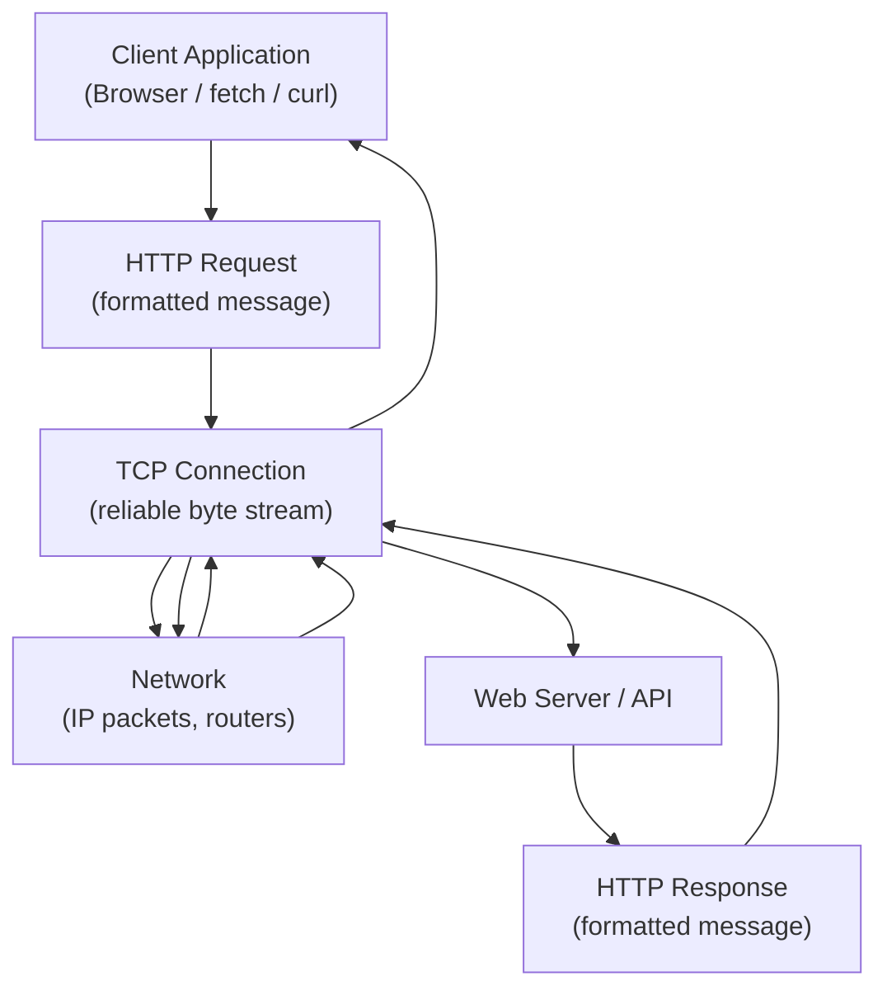

### HTTP Communication Steps

1. Client initiates TCP connection to server (IP + Port)
2. Client sends a formatted HTTP request
3. Server parses the request bytes
4. Server executes business logic
5. Server formats and sends an HTTP response
6. Client parses the response bytes

---

## 4.1 HTTP Request Structure

An HTTP request has five parts:

```
POST /login HTTP/1.1\r\n
Host: localhost\r\n
Content-Type: application/x-www-form-urlencoded\r\n
Content-Length: 28\r\n
\r\n
user=earth&password=pass
```

### A. HTTP Method

Defines what operation the client wants to perform:

| Method | Purpose |
| :--- | :--- |
| `GET` | Retrieve a resource |
| `POST` | Submit or create data |
| `PUT` | Replace a resource entirely |
| `PATCH` | Partially update a resource |
| `DELETE` | Delete a resource |

### B. URL / Path

Identifies the target resource:
```
/users
/login
/products/123
/orders?status=pending
```

### C. HTTP Version

```
HTTP/1.1   ← text-based, one request per connection (or keep-alive)
HTTP/2     ← binary framed, multiplexed streams
HTTP/3     ← QUIC over UDP
```

### D. Headers

Provide metadata about the request:

| Header | Purpose |
| :--- | :--- |
| `Host` | Target host the request is for (required in HTTP/1.1) |
| `Content-Type` | Format of the request body (`application/json`, `text/plain`) |
| `Content-Length` | Size of the body in bytes |
| `Authorization` | Authentication credentials (Bearer token, Basic auth) |
| `Accept` | Formats the client is willing to receive |

### E. Request Body

The payload data, used mainly with `POST`, `PUT`, `PATCH`:

```json
{
  "username": "neel",
  "password": "123456"
}
```

---

## 4.2 CRLF — The HTTP Message Delimiter

HTTP/1.1 uses **CRLF** (`\r\n`) as line endings to separate components:

| Characters | Name | Purpose |
| :--- | :--- | :--- |
| `\r` | Carriage Return | Part of HTTP line ending |
| `\n` | Line Feed | Part of HTTP line ending |
| `\r\n` | CRLF | End of each header line |
| `\r\n\r\n` | Double CRLF | Separates headers from body |

```
GET /users HTTP/1.1\r\n       ← Request line
Host: localhost\r\n            ← Header 1
Content-Type: application/json\r\n  ← Header 2
\r\n                           ← Empty line = headers finished
{...body here...}             ← Body starts
```

> [!note] Why the Empty Line Matters
> The server reads headers line by line until it hits an empty `\r\n` line. Everything after that is the body. Without this delimiter, the server cannot tell where headers end and body begins.

---

## 4.3 Content-Length — Why It's Required for Bodies

TCP is a **stream** — there are no inherent message boundaries. When a client sends a body, the server needs to know exactly how many bytes to read before the message is complete.

```
POST /login HTTP/1.1
Host: localhost
Content-Length: 28

user=earth&password=pass
```

- Server reads headers until `\r\n\r\n`
- Server sees `Content-Length: 28`
- Server reads exactly **28 bytes** from the stream as the body
- Server knows the request is now complete

> [!caution] Content-Length is in bytes, not characters
> With UTF-8 encoding, some characters are multi-byte. `Content-Length` must reflect the actual byte count of the encoded body, not the character count.

---

## 4.4 Content-Type — Telling the Server How to Interpret the Body

```
Content-Type: application/json
Content-Type: text/plain
Content-Type: application/x-www-form-urlencoded
Content-Type: multipart/form-data
```

The server uses this to decide how to parse the body. Frameworks like Express.js or Flask abstract this:

```javascript
app.use(express.json());  // Auto-parses JSON bodies

app.post("/users", (req, res) => {
  console.log(req.body); // Already a JavaScript object
  res.json({ status: "created" });
});
```

Without `Content-Type`, the server must guess the format — which is error-prone.

---

## 4.5 Raw TCP Connection Demo — HTTP Is Just Bytes

The key insight from the practical video: **you can send an HTTP request manually using nothing but a TCP connection**.

```bash
# Open a raw TCP connection to the server
nc localhost 1729
```

Then type the HTTP request by hand:

```
GET /fu HTTP/1.1
Host: localhost
[press Enter twice for empty line]
```

Server responds:

```
HTTP/1.1 200 OK
Content-Length: 3
Content-Type: text/plain

bar
```

**What this proves:** HTTP is a message format. `curl` and browsers don't do magic — they simply construct these byte sequences for you. Any program that can open a TCP connection can speak HTTP.

### What Happens on a Bad Request

If you send bytes that don't follow HTTP format:

```
fu bar abc
```

The server responds:
```
HTTP/1.1 400 Bad Request
```

The server validates incoming data against the protocol specification and rejects anything that doesn't conform.

---

## 4.6 HTTP Response Structure

```
HTTP/1.1 200 OK\r\n
Content-Type: application/json\r\n
Content-Length: 32\r\n
\r\n
{"message": "Login successful"}
```

A response always has:
1. HTTP version + Status code + Status message (the **status line**)
2. Response headers
3. Empty line (`\r\n`)
4. Response body (optional)

**Common HTTP Status Codes:**

| Code | Category | Meaning |
| :--- | :--- | :--- |
| `200` | Success | OK — request succeeded |
| `201` | Success | Created — resource was created |
| `204` | Success | No Content — success but no body |
| `301` | Redirect | Moved Permanently |
| `400` | Client Error | Bad Request — malformed message |
| `401` | Client Error | Unauthorized — authentication required |
| `403` | Client Error | Forbidden — authorization denied |
| `404` | Client Error | Not Found — resource doesn't exist |
| `429` | Client Error | Too Many Requests — rate limited |
| `500` | Server Error | Internal Server Error |
| `502` | Server Error | Bad Gateway |
| `503` | Server Error | Service Unavailable |

---

## 5. Part 3 — Protocol Properties & Design

> [!important] These Are Design Decisions, Not Rigid Rules
> When you design a protocol, you must decide on each of these properties. The right choice depends on your problem, performance requirements, and use case.
> Do **not** memorize these as a checklist — understand *why* each exists.

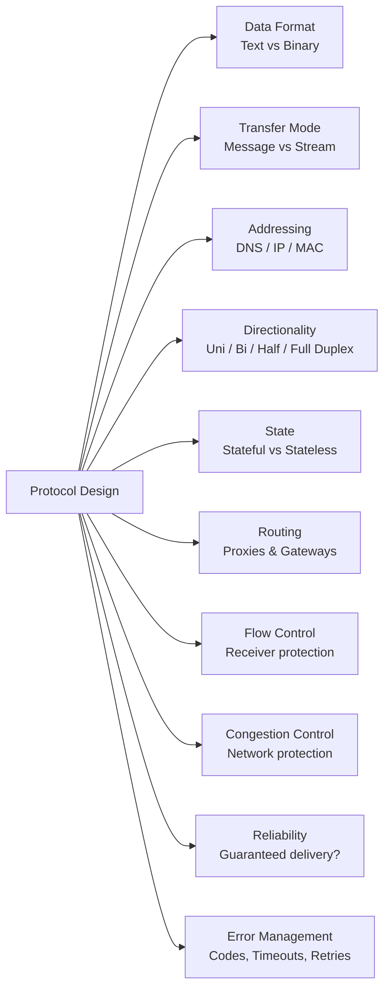

---

## 5.1 Property 1 — Data Format: Text vs Binary

The first design decision: **how is data encoded on the wire?**

### A. Text-Based Protocols

Data is represented as human-readable characters.

**Examples:** HTTP/1.1, JSON over HTTP, XML-RPC, SMTP commands, Redis RESP (partially)

```
GET /users HTTP/1.1
Host: example.com
Content-Type: application/json
```

You can read this in Wireshark, Netcat, or a text editor (when unencrypted).

| Advantage | Disadvantage |
| :--- | :--- |
| Human-readable | Larger byte size for same data |
| Easy to debug and inspect | Slower parsing (string processing) |
| Simple to construct manually | Field names repeated in every message |
| Works with text tools (curl, telnet) | Cannot efficiently represent binary data |

### B. Binary Protocols

Data is encoded in a compact machine-oriented binary format.

**Examples:** Protocol Buffers, HTTP/2 wire format, MySQL wire protocol, Redis RESP3 extensions

```
10101010 00010001 01010101 ...
```

You cannot read this without a decoder.

| Advantage | Disadvantage |
| :--- | :--- |
| Compact — fewer bytes for same data | Not human-readable |
| Faster to parse (no string conversion) | Harder to debug |
| Efficient for high-throughput systems | Requires encoders/decoders |
| Can represent all data types natively | Requires spec knowledge to inspect |

### Text vs Binary Comparison

| Property | Text-Based | Binary |
| :--- | :--- | :--- |
| **Human readability** | High | Low |
| **Debugging** | Easy (Wireshark readable) | Requires decoder tools |
| **Message size** | Often larger | Often smaller |
| **Parsing overhead** | String parsing | Binary decoding |
| **Examples** | HTTP/1.1, JSON | Protobuf, HTTP/2, RESP |

> [!note] HTTP/2 is a Hybrid
> HTTP/2 is still HTTP at the application level (same methods, headers, status codes), but uses a **binary framing layer** at the wire level. The API stays familiar; only the encoding changes.

---

## 5.2 Property 2 — Transfer Mode: Message vs Stream

**How is data transferred?** Are boundaries preserved, or is it a continuous flow of bytes?

### A. Message-Based Communication

Data is transmitted as individual, discrete messages. Each message has a defined start and end.

**Primary example:** UDP

```
Message 1: HELLO         (arrives as one complete unit)
Message 2: HOW ARE YOU   (arrives as one complete unit)
Message 3: GOODBYE       (arrives as one complete unit)
```

The receiver always sees complete, distinct messages.

**Use cases:** DNS queries, online gaming, real-time telemetry, video frames

| Advantage | Disadvantage |
| :--- | :--- |
| Message boundaries preserved | Per-message protocol overhead |
| Easier to process individually | Large messages may need IP fragmentation |
| Good for independent operations | UDP: no delivery guarantee |

### B. Stream-Based Communication

Data flows as a **continuous ordered byte sequence**. There are no inherent message boundaries.

**Primary example:** TCP

```
Sender writes in three calls:         Receiver might see:
  socket.write("HELLO")
  socket.write("WORLD")       →       "HELLOWORLDGOODBYE"  (all at once)
  socket.write("GOODBYE")     or →    "HEL" then "LOWORLDGOOD" then "BYE"
```

TCP preserves **byte order** but does **NOT preserve write boundaries**.

**This is one of the most critical concepts for backend networking.**

| Advantage | Disadvantage |
| :--- | :--- |
| Efficient for continuous data | App must implement its own framing |
| Good for large data volumes | Must handle partial messages |
| Suits persistent connections | Must handle multiple messages in one read |

### Message vs Stream Comparison

| Property | Message-Based (UDP) | Stream-Based (TCP) |
| :--- | :--- | :--- |
| **Boundary preservation** | Yes | No |
| **Data representation** | Discrete datagrams | Continuous byte flow |
| **Who does framing?** | Transport layer | Application layer |
| **Processing model** | Message-by-message | Incremental stream reading |
| **Challenge** | Message size / MTU | Frame detection / parsing |

---

## 5.3 TCP Requires Application-Level Message Framing

Because TCP is a stream, **your application must define how to detect complete messages**.

Consider an HTTP server built on TCP:

```
TCP STREAM bytes arriving:

GET /users HTTP/1.1\r\nHost: localhost\r\n\r\nGET /products HTTP/1.1\r\nHost: localhost\r\n\r\n
```

The TCP layer just sees bytes. Your HTTP implementation must:
1. Read bytes until `\r\n\r\n` → that's the end of headers
2. Check `Content-Length` to know how many body bytes to read
3. After reading the body → one complete HTTP request is done
4. Continue reading for the next request

### Common Framing Techniques

| Technique | How It Works | Example |
| :--- | :--- | :--- |
| **Fixed-length** | Every message is exactly N bytes | Binary sensor readings: 32 bytes each |
| **Length-prefixed** | First 4 bytes = message length, then read that many bytes | `0005HELLO`, `0005WORLD` |
| **Delimiter-based** | Message ends at a special character | HTTP headers end at `\r\n\r\n` |
| **Structured framing** | Explicit frame type, length, payload fields | HTTP/2 frames, WebSocket frames |

```
Length-prefixed example:
┌─────────┬─────────────────────┐
│ 4 bytes │   N bytes of data   │
│ (length)│      (payload)      │
└─────────┴─────────────────────┘

Receiver: read 4 bytes → get N → read exactly N bytes → one complete message
```

---

## 5.4 Property 3 — Addressing System

A protocol must have a way to identify **where communication is coming from** and **where it is going**.

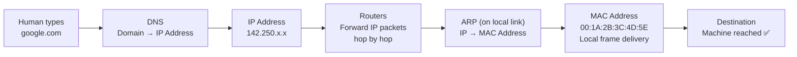

### A. DNS — Domain Name System

Translates human-readable names into IP addresses.

```
google.com   →   DNS Lookup   →   142.250.x.x
```

Why DNS exists: humans remember names, not 32-bit or 128-bit numbers.

- DNS is an **application-layer** protocol
- Uses UDP port 53 (small queries) or TCP port 53 (large responses, zone transfers)
- Hierarchical: Root → TLD (.com, .org) → Authoritative nameserver → IP

### B. IP Address — Network Layer Addressing

Identifies a network interface for routing packets across the internet.

```
IPv4: 192.168.1.10          (32-bit, ~4.3 billion addresses)
IPv6: 2001:0db8:85a3::8a2e  (128-bit, virtually unlimited)
```

IP addresses are used by **routers** to forward packets toward their destination across the global internet.

### C. MAC Address — Data-Link Layer Addressing

Identifies a network interface at the local network (Ethernet, Wi-Fi) level.

```
Example: 00:1A:2B:3C:4D:5E
```

> [!caution] MAC Addresses Are NOT End-to-End
> MAC addresses are only relevant within a local network segment (a single hop). At each router, the IP packet is unwrapped from its frame, routed based on IP, then re-wrapped in a new frame with new source/destination MAC addresses for the next hop. MAC addresses do not travel end-to-end across the internet.

### D. ARP — Address Resolution Protocol

ARP maps a known IPv4 address to a MAC address on the local network.

```
"I know the IP is 192.168.1.10, but what MAC address should I send this frame to?"
   |
   v
ARP Broadcast: "Who has 192.168.1.10?"
   |
   v
ARP Reply: "192.168.1.10 is at 00:1A:2B:3C:4D:5E"
```

### How DNS, IP, MAC Work Together

1. User types `google.com`
2. DNS resolves it to `142.250.x.x`
3. OS builds IP packet destined for `142.250.x.x`
4. If destination is not on local subnet → ARP finds the router's MAC address
5. Frame is sent to router's MAC on local link
6. Router strips frame, reads IP, routes packet to next hop
7. Repeat across internet until packet reaches Google's server

---

## 5.5 Property 4 — Directionality

**Can data flow in one direction, or both?**

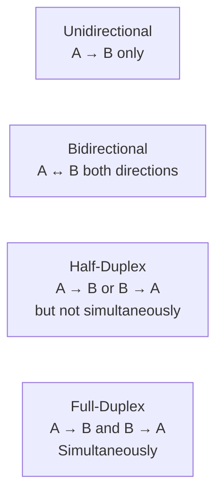

| Type | Description | Real-World Example |
| :--- | :--- | :--- |
| **Unidirectional** | Data flows in one direction only | TV broadcast, radio signal |
| **Bidirectional** | Both ends can send and receive | Most network protocols |
| **Half-Duplex** | Both ends can communicate, but not at the same time | Wi-Fi (shared medium), walkie-talkies |
| **Full-Duplex** | Both ends send and receive simultaneously | TCP, Ethernet, WebSocket |

> [!note] TCP is Full-Duplex
> A single TCP connection allows both sides to send data simultaneously. This is why bidirectional streaming (gRPC bidirectional streaming, WebSocket) is possible without establishing two separate connections.

---

## 5.6 Property 5 — Protocol State: Stateful vs Stateless

**Does the protocol maintain state between exchanges?**

### Stateful Protocol

Maintains information about the connection or session across multiple exchanges.

```
Client                    Server
   |                          |
   |---- Connect ------------>|  ← Connection state created
   |                          |     (sequence numbers, window size, state machine)
   |---- Send Data 1 -------->|
   |<--- ACK 1 ---------------|
   |---- Send Data 2 -------->|
   |<--- ACK 2 ---------------|
   |---- Disconnect --------->|  ← State cleaned up
```

**Examples:** TCP (tracks seq numbers, ACKs, window, state), gRPC (stateful streaming sessions)

TCP maintains per-connection state:
- Sequence numbers
- Acknowledgment numbers
- Receive window (flow control)
- Congestion window
- Connection state machine (SYN_SENT, ESTABLISHED, TIME_WAIT, etc.)

### Stateless Protocol

Each exchange is independent. No persistent session state at the protocol level.

```
Client                    Server
   |                          |
   |---- Datagram 1 -------->|  ← No state created
   |---- Datagram 2 -------->|  ← Completely independent
   |---- Datagram 3 -------->|  ← No relationship to previous
```

**Example:** UDP

UDP does not maintain connection state, sequence tracking, or acknowledgment state. Every datagram is independent.

### Stateful vs Stateless Comparison

| Property | Stateful | Stateless |
| :--- | :--- | :--- |
| **Session memory** | Maintained across exchanges | Not inherently maintained |
| **Connection setup** | Required (e.g., TCP handshake) | Not required |
| **Failure recovery** | Built-in (retransmit, reconnect) | Application must handle |
| **Resource cost** | Higher (state must be stored) | Lower per-exchange overhead |
| **Example** | TCP, TLS sessions | UDP, basic HTTP requests |

> [!important] HTTP Application Statefulness
> HTTP as a protocol is **stateless** — each request/response is independent. But **applications built on HTTP** can maintain state using cookies, JWT tokens, session IDs, and server-side session storage. The protocol statelessness and application statefulness are different concerns.

---

## 5.7 Property 6 — Routing: Proxies and Gateways

Protocols must work correctly even when communication passes through **intermediary devices**.

### Direct Communication

```
Client ──────────────────────────────> Server
  (Resolves IP, opens TCP, sends HTTP)
```

### Communication Through a Proxy

```
Client ──────> Proxy ──────> Server
  (connects to proxy)   (proxy forwards)
```

The proxy sees two distinct connections:
- Client → Proxy connection
- Proxy → Server connection

The client's intent (reach `google.com`) vs the immediate connection target (the proxy server) are different.

**Why proxies matter for protocol design:**

| Use Case | Why a Proxy Exists |
| :--- | :--- |
| **Corporate firewall** | Traffic inspection, access control |
| **Load balancer** | Distribute requests across server instances |
| **CDN edge node** | Cache responses geographically near users |
| **Reverse proxy (Nginx/HAProxy)** | SSL termination, routing, rate limiting |
| **Forward proxy** | Anonymize client, bypass restrictions |

> [!note] HTTP Proxy Awareness
> HTTP has built-in proxy support via the `Host` header and CONNECT method. When an HTTP client connects through a proxy to reach HTTPS, the proxy uses `CONNECT` to establish a tunnel, then the client performs TLS directly to the origin server.

---

## 5.8 Property 7 — Flow Control

**How do we prevent the sender from overwhelming the receiver?**

```
Sender: 1 GB/s capacity
Receiver: 100 MB/s capacity

Without flow control:
  Sender → floods → Receiver's buffer overflows → data dropped ❌

With flow control:
  Receiver tells Sender: "I can only accept 100 MB/s right now"
  Sender respects that limit ✅
```

### TCP Flow Control — Receive Window

TCP uses a **receiver-advertised window** mechanism:

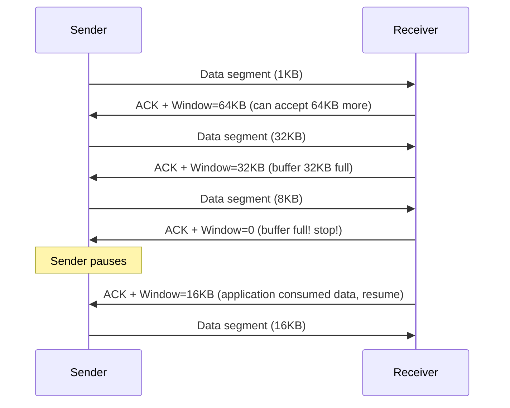

The receiver continuously advertises how much buffer space it has. The sender cannot send more than the advertised window.

### UDP Flow Control

**UDP has no built-in flow control.** If you use UDP and need flow control, your application must implement it. For example, WebRTC implements congestion and flow control at the application layer above UDP.

---

## 5.9 Property 8 — Congestion Control

**Flow control protects the receiver. Congestion control protects the network.**

```
Problem: Multiple senders flooding the same network link
  → Routers' queues fill up
  → Packets are dropped
  → All senders slow down due to drops
  → Network throughput collapses (congestion collapse)
```

TCP has built-in congestion control algorithms that detect and respond to network congestion:

| Algorithm Phase | Behavior |
| :--- | :--- |
| **Slow Start** | Begin with small window, double it each RTT |
| **Congestion Avoidance** | Additive increase once threshold is reached |
| **Fast Retransmit** | Retransmit on 3 duplicate ACKs without waiting for timeout |
| **Fast Recovery** | Don't drop back to slow start after triple-dup-ACK |

Modern TCP variants: `CUBIC` (Linux default), `BBR` (Bottleneck Bandwidth & RTT — Google), `QUIC` (integrates congestion control at transport level).

### Flow Control vs Congestion Control

| Property | Flow Control | Congestion Control |
| :--- | :--- | :--- |
| **Protects** | The receiver's buffer | The network itself |
| **Mechanism** | Receiver-advertised window | Sender-estimated network capacity |
| **TCP built-in** | Yes | Yes |
| **UDP built-in** | No | No |
| **Triggered by** | Receiver buffer fullness | Packet loss / ECN signals |

---

## 5.10 Property 9 — Reliability

**Is data delivery guaranteed?**

### TCP — Reliable Delivery

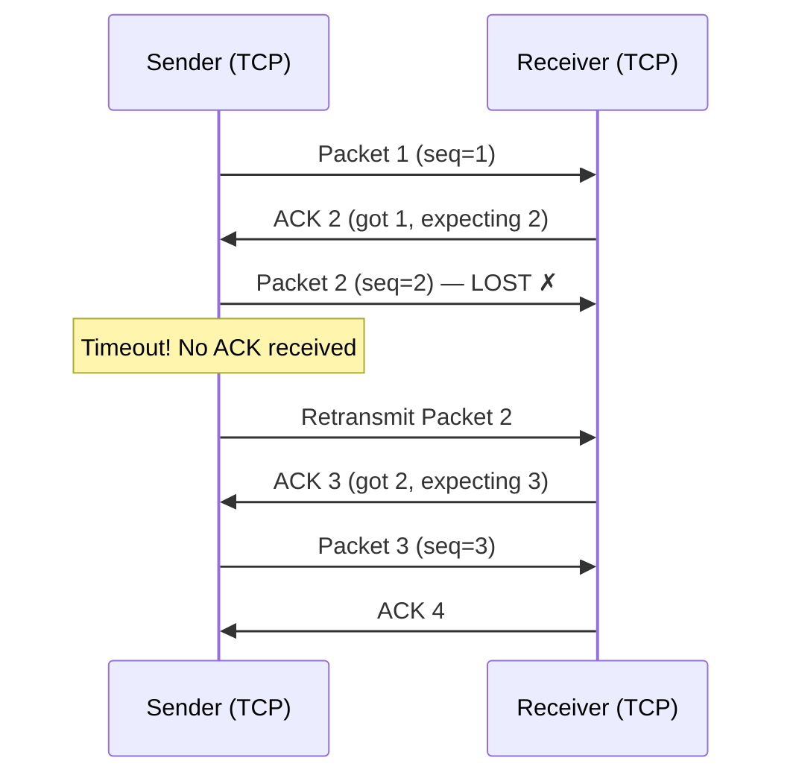

TCP provides:
- **Guaranteed delivery** — lost packets are retransmitted
- **Ordered delivery** — application receives bytes in send order
- **Error detection** — checksum in every segment
- **Duplicate detection** — sequence numbers identify retransmits

### UDP — Best-Effort Delivery

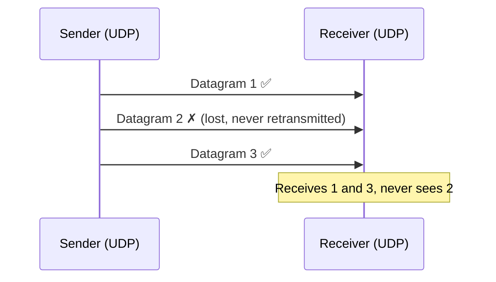

UDP provides:
- **No guaranteed delivery** — packets can be silently dropped
- **No ordering** — packets can arrive out of order
- **No retransmission** — sender never knows if packet was lost
- **No duplicate suppression** — same packet could arrive twice

### Why Use UDP Then?

Because sometimes **latency and simplicity matter more than guaranteed delivery**.

| Use Case | Why UDP is Preferred |
| :--- | :--- |
| Live audio/video | Stale retransmitted data is useless |
| Online gaming | Need newest state, not old retransmitted state |
| DNS queries | Small, fast, can retry at application level |
| WebRTC | Real-time — latency > reliability |
| QUIC (HTTP/3) | Reliability is reimplemented more efficiently than TCP |

> [!tip] UDP + Custom Reliability
> Applications that need UDP's low latency but also need some reliability implement it themselves. WebRTC, QUIC, and many game networking libraries do this.

---

## 5.11 Property 10 — Error Management

**What happens when things go wrong?**

A complete error management strategy covers:

### A. Error Codes

Protocols should define structured error codes that clients can interpret programmatically.

```
HTTP:   400 Bad Request, 401 Unauthorized, 404 Not Found, 500 Internal Server Error
gRPC:   INVALID_ARGUMENT, NOT_FOUND, UNAUTHENTICATED, INTERNAL
Custom: { "error": "INVALID_COMMAND", "code": 1001, "message": "Unknown command" }
```

### B. Timeout Handling

If the server doesn't respond, the client must not wait forever.

```javascript
const controller = new AbortController();

const timeout = setTimeout(
  () => controller.abort(),
  5000  // 5-second timeout
);

try {
  const response = await fetch("/api/users", {
    signal: controller.signal
  });
  console.log(await response.json());
} catch (err) {
  if (err.name === "AbortError") {
    console.error("Request timed out after 5 seconds");
  }
} finally {
  clearTimeout(timeout);
}
```

**What to define in a protocol:**
- How long should clients wait?
- Should the client retry after timeout?
- Should the connection be torn down?

### C. Retry Mechanisms

When a request fails, should the client retry?

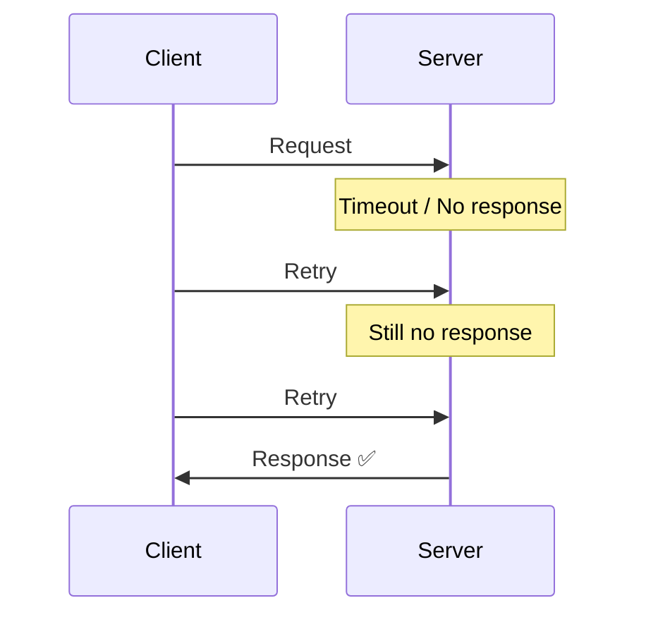

> [!caution] Retries Can Cause Duplicate Operations!
> Example: A `POST /payments` request succeeds on the server but the response is lost. If the client retries, the payment processes **twice**.
>
> **Solution: Idempotency Keys**
> ```http
> POST /payments
> Idempotency-Key: payment-uuid-12345
>
> {"amount": 100, "currency": "USD"}
> ```
> The server stores that key. If the same key arrives again, it returns the original response without re-processing.

### D. Error Handling Design Checklist

A well-designed protocol defines:

| Scenario | What Should Happen |
| :--- | :--- |
| **Invalid request format** | Reject with specific error code |
| **Missing required fields** | Return structured validation errors |
| **Server processing error** | Return 5xx / INTERNAL with safe error message |
| **Request timeout** | Client aborts, optionally retries |
| **Connection lost mid-request** | Client retries with idempotency key |
| **Rate limiting** | 429 response with `Retry-After` header |
| **Unknown command** | Error code + description |

---

## 6. Protocol Design Checklist

When building your own protocol, evaluate each of these properties:

| # | Property | Key Question |
| :---: | :--- | :--- |
| 1 | **Data Format** | Text-based or binary? |
| 2 | **Transfer Mode** | Message-based (UDP-style) or stream-based (TCP-style)? |
| 3 | **Addressing** | How do we identify source and destination? (DNS / IP / Port) |
| 4 | **Directionality** | Unidirectional, bidirectional, half-duplex, or full-duplex? |
| 5 | **State** | Stateful connection or stateless exchanges? |
| 6 | **Routing** | Does it work through proxies, load balancers, gateways? |
| 7 | **Flow Control** | How do we prevent overwhelming the receiver? |
| 8 | **Congestion Control** | How do we prevent overwhelming the network? |
| 9 | **Reliability** | Is delivery guaranteed? Or best-effort? |
| 10 | **Error Codes** | How are errors represented and communicated? |
| 11 | **Timeout Handling** | How long should the sender wait for a response? |
| 12 | **Retry Mechanism** | Should failed operations be retried? How to avoid duplicates? |
| 13 | **Message Boundaries** | How does the receiver know when one message ends? |

### Example — Designing "MyRPC" Protocol

| Decision | Choice Made | Reason |
| :--- | :--- | :--- |
| **Data format** | Binary (Protobuf) | High throughput, compact |
| **Transfer mode** | Message-based | Independent RPC calls |
| **Addressing** | IP + Port + Service name | Service mesh compatible |
| **Directionality** | Full-duplex | Bidirectional streaming needed |
| **State** | Stateful connection | Stream lifecycle management |
| **Routing** | Proxy-aware headers | Works with Envoy/Nginx |
| **Flow control** | Receiver window | Prevent slow consumer overload |
| **Congestion control** | Required (inherits from TCP) | Network fairness |
| **Reliability** | ACK + retransmit | Critical data must arrive |
| **Error codes** | Structured error types | Machine-parseable |
| **Timeout** | Configurable per-call | Different SLAs per operation |
| **Retry** | Exponential backoff + idempotency | Safe retries |
| **Message boundaries** | 4-byte length prefix | Simple, efficient framing |

---

## 7. Popular Protocols Overview

### 7.1 TCP — Transmission Control Protocol

> OSI Layer 4 (Transport) | Connection-Oriented | Reliable | Stream-Based

TCP is the foundation of most reliable internet communication.

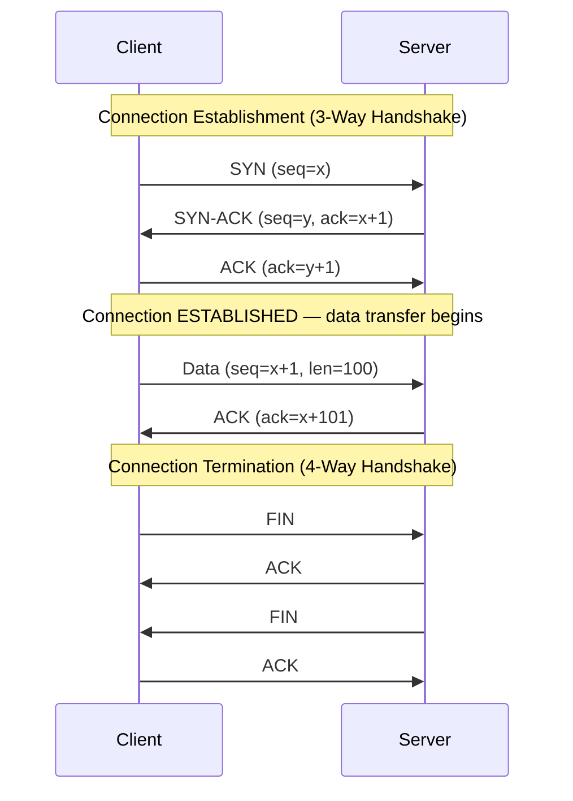

**Key TCP features:**
- Reliable, ordered, error-detected byte stream
- Three-way handshake (SYN, SYN-ACK, ACK)
- Sequence numbers + ACKs for delivery confirmation
- Retransmission of lost segments
- Flow control (receive window advertisement)
- Congestion control (Slow Start, CUBIC, BBR)

**Used by:** HTTP/1.1, HTTP/2, database connections, SSH, SMTP, FTP

---

### 7.2 UDP — User Datagram Protocol

> OSI Layer 4 (Transport) | Connectionless | Best-Effort | Datagram-Based

UDP is the lightweight, fast alternative to TCP.

```
Sender          Receiver
  |                 |
  |── Datagram 1 ──>|  ← May or may not arrive
  |── Datagram 2 ──>X  ← Lost, no retransmit
  |── Datagram 3 ──>|  ← Arrives out of order? No problem for UDP
```

**Key UDP features:**
- No connection setup (no handshake overhead)
- No guaranteed delivery
- No ordering guarantee
- No retransmission
- Minimal header overhead (8 bytes vs TCP's 20+ bytes)
- Application defines message boundaries (since it's datagram-based)

**Used by:** DNS, NTP, DHCP, real-time audio/video, online gaming, WebRTC, QUIC

---

### 7.3 HTTP/1.1

> OSI Layer 7 (Application) | Text-Based | Request-Response | Built on TCP

```
GET /users HTTP/1.1\r\n
Host: api.example.com\r\n
Authorization: Bearer token123\r\n
\r\n
```

**Key HTTP/1.1 features:**
- Request methods: GET, POST, PUT, PATCH, DELETE
- Text-based message format
- CRLF (`\r\n`) line endings
- Headers + body structure
- `Content-Length` for body framing
- Persistent connections (`Connection: keep-alive` by default)
- Chunked transfer encoding for streaming bodies
- Stateless request semantics

**Limitation:** Only one request at a time per connection (pipelining was poorly supported). To parallelize, browsers open multiple TCP connections.

---

### 7.4 HTTP/2

> OSI Layer 7 (Application) | Binary Framing | Multiplexed | Built on TCP

HTTP/2 addresses HTTP/1.1's performance limitations while keeping the same HTTP semantics.

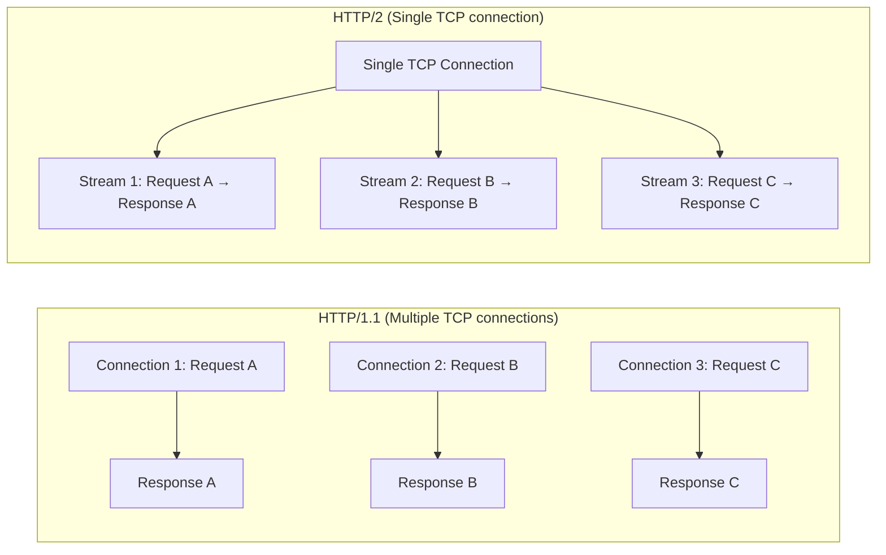

**Key HTTP/2 features:**
- **Binary framing** — not text-based at the wire level
- **Multiplexing** — multiple streams over one TCP connection
- **HPACK** header compression — reduces redundant header bytes
- **Stream prioritization** — weight-based resource ordering
- **Server push** — server can proactively send resources
- Eliminates HTTP/1.1 head-of-line blocking at the HTTP level

> [!note] HTTP/2 Still Has TCP Head-of-Line Blocking
> HTTP/2 multiplexes multiple HTTP streams over one TCP connection. But if a TCP segment is lost, **all streams stall** until TCP retransmits it. This is why HTTP/3 moved to QUIC over UDP.

---

### 7.5 HTTP/3

> OSI Layer 7 (Application) | QUIC over UDP | Integrated TLS 1.3

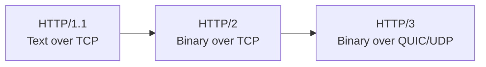

**QUIC = Quick UDP Internet Connections** (developed by Google, now IETF standardized)

**Key HTTP/3 / QUIC features:**
- Runs over **UDP** (not TCP)
- **Integrated TLS 1.3** — 0-RTT or 1-RTT connection establishment
- **Independent streams** — a lost UDP packet only blocks its own stream, not all streams
- **Connection migration** — connection ID instead of IP+Port, survives IP changes (e.g., phone switching Wi-Fi to cellular)
- Reduced latency compared to TCP + TLS setup

| Feature | HTTP/1.1 (TCP) | HTTP/2 (TCP) | HTTP/3 (QUIC/UDP) |
| :--- | :--- | :--- | :--- |
| **Transport** | TCP | TCP | UDP (QUIC) |
| **Framing** | Text | Binary | Binary |
| **Multiplexing** | No (1 req/conn) | Yes (all share 1 TCP) | Yes (independent streams) |
| **HOL Blocking** | Full | At HTTP level | Eliminated per stream |
| **TLS integration** | Separate | Separate | Built-in |
| **Connection setup** | 1 RTT TCP + TLS | 1 RTT TCP + TLS | 0–1 RTT |

---

### 7.6 WebSocket

> Application-Level | Full-Duplex | Persistent Connection | Starts as HTTP

WebSocket provides **persistent, bidirectional communication** between client and server.

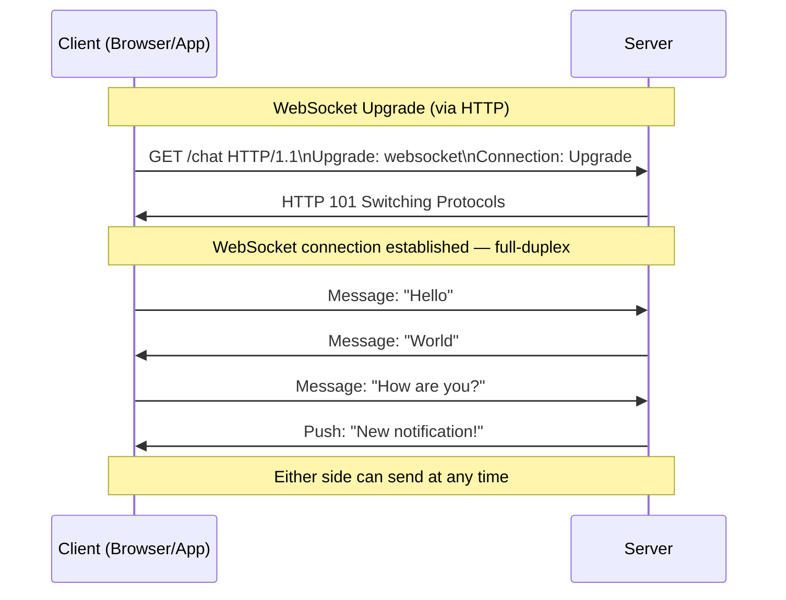

**Key features:**
- Begins with HTTP upgrade handshake (works through firewalls)
- Full-duplex — server can push data to client without client requesting
- Low overhead per message after connection is established (small frame headers)
- Persistent connection — no reconnect overhead per exchange

**Use cases:** Live chat, collaborative editing, real-time dashboards, multiplayer games, live notifications, trading platforms

---

### 7.7 WebRTC — Web Real-Time Communication

> Peer-to-Peer | Real-Time Audio/Video/Data | UDP-Based | Browser Native

WebRTC is a **collection of protocols and APIs** enabling real-time peer-to-peer communication.

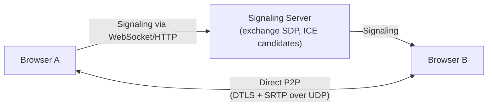

**Key components:**
- **ICE** (Interactive Connectivity Establishment) — finds the best path between peers
- **STUN** — helps peers discover their public IP/port
- **TURN** — relay server for when direct P2P fails (firewall/NAT)
- **SDP** (Session Description Protocol) — describes media capabilities
- **DTLS** — TLS for UDP (encryption)
- **SRTP** — Secure Real-Time Transport Protocol (encrypted media)

**Use cases:** Video conferencing, voice calls, browser-based meetings, file sharing, real-time gaming

---

### 7.8 gRPC

> Framework + Protocol | RPC-Style | Binary (Protobuf) | HTTP/2 Based

gRPC is a **Remote Procedure Call framework** that makes calling functions on a remote service feel like calling local functions.

```protobuf
// Define service in .proto file
service UserService {
  rpc GetUser (UserRequest) returns (UserResponse);
  rpc ListUsers (ListRequest) returns (stream UserResponse);  // server streaming
  rpc UpdateUsers (stream UserRequest) returns (UpdateResponse); // client streaming
  rpc Chat (stream ChatMessage) returns (stream ChatMessage); // bidirectional
}

message UserRequest {
  string user_id = 1;
}

message UserResponse {
  string id = 1;
  string name = 2;
  string email = 3;
}
```

**On the client side:**
```javascript
// Generated client code — just call it like a local function
const user = await userClient.getUser({ userId: "123" });
console.log(user.name); // "Neel"
```

**gRPC features:**
- Uses **Protocol Buffers** (binary serialization) by default
- Runs over **HTTP/2** (inherits multiplexing, header compression)
- Strongly typed service contracts via `.proto` files
- Code generation in 10+ languages
- Four RPC modes: Unary, Server Streaming, Client Streaming, Bidirectional Streaming
- Interceptors, load balancing, health checking, deadlines built-in

**Use cases:** Microservice-to-microservice communication, mobile-to-backend, service meshes (Istio, Envoy)

---

### 7.9 Apache Thrift

> Cross-Language RPC Framework | IDL-based | Multiple Transport Options

Apache Thrift (originally from Facebook) is similar to gRPC but predates it.

```thrift
// Thrift IDL definition
service UserService {
  User getUser(1: string userId),
  list<User> listUsers()
}

struct User {
  1: string id,
  2: string name,
  3: string email
}
```

**Key features:**
- **IDL** (Interface Definition Language) for defining services
- **Code generation** for 20+ languages
- Multiple serialization options: Binary, Compact, JSON
- Multiple transport options: Buffered, Framed, HTTP
- Used by: Facebook, Twitter, Pinterest historically

---

### 7.10 DHCP — Dynamic Host Configuration Protocol

> Application Layer | UDP-Based | Automatic Network Configuration

When a device joins a network, DHCP automatically assigns it a network configuration.

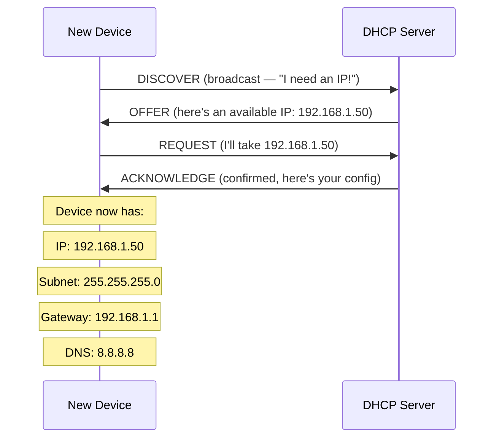

The process is called **DORA**: Discover → Offer → Request → Acknowledge.

---

### 7.11 SMTP — Simple Mail Transfer Protocol

> Application Layer | TCP-Based | Email Delivery

SMTP handles sending emails between mail clients and servers.

```
Application (Gmail/Outlook)
     |
     | SMTP (port 587 / 465)
     v
Your Mail Server (smtp.gmail.com)
     |
     | SMTP (port 25)
     v
Recipient's Mail Server (smtp.outlook.com)
     |
     | IMAP / POP3
     v
Recipient reads email
```

**SMTP commands:**
```
EHLO sender.com
MAIL FROM:<neel@example.com>
RCPT TO:<friend@example.com>
DATA
Subject: Hello

Body content here.
.
QUIT
```

---

### 7.12 Protocol Buffers (Protobuf)

> Binary Serialization Format | Language-Agnostic | Used by gRPC

Protobuf is a binary serialization format developed by Google. It is **not** a transport protocol by itself — it's a data encoding format.

```protobuf
message User {
  string id = 1;
  string name = 2;
  int32 age = 3;
}
```

**Protobuf vs JSON:**

| Property | JSON | Protobuf |
| :--- | :--- | :--- |
| Format | Text (UTF-8) | Binary |
| Human readable | Yes | No |
| Parsing speed | Slower | Faster |
| Message size | Larger | Smaller (3-10x) |
| Schema required | No | Yes (.proto file) |
| Cross-language | Yes | Yes (code generation) |

---

### 7.13 RESP — Redis Serialization Protocol

> Text/Binary Hybrid | Simple | Used by Redis

RESP is Redis's own communication protocol. It's remarkably simple:

```
Simple String: +OK\r\n
Error:         -ERR unknown command\r\n
Integer:       :1000\r\n
Bulk String:   $6\r\nfoobar\r\n
Array:         *2\r\n$3\r\nfoo\r\n$3\r\nbar\r\n
```

First byte indicates type: `+` string, `-` error, `:` integer, `$` bulk string, `*` array.

---

### 7.14 HOMA — Why New Protocols Are Created

HOMA is a research protocol designed specifically for **data-center RPC communication**.

**The problem:** TCP was designed decades ago for wide-area networks. Modern data centers have:
- 10–100 Gbps links
- Sub-millisecond latency between servers
- Thousands of concurrent short RPCs
- Very different traffic patterns than the public internet

TCP's overhead (connection setup, congestion control designed for packet loss, head-of-line blocking) can be suboptimal for data-center workloads.

**HOMA's approach:**
- Receiver-driven flow control instead of sender-driven
- Prioritizes short messages (reduces tail latency)
- Designed for RDMA-compatible hardware
- Eliminates HOL blocking within a connection

> [!note] The Lesson from HOMA
> **Protocols evolve because requirements evolve.** A protocol optimal for one environment may be suboptimal for another. This is why new protocols like QUIC, HOMA, and custom binary protocols continue to emerge.

---

## 8. Important Distinctions — Never Confuse These

| Comparison | Key Difference |
| :--- | :--- |
| **TCP vs HTTP** | TCP = transport channel (moves bytes). HTTP = application message format (what those bytes mean). |
| **TCP vs UDP** | TCP = reliable, ordered, connection-oriented stream. UDP = best-effort, connectionless, datagram. |
| **Text vs Binary** | Text = human-readable, easier debugging. Binary = compact, faster machine processing. |
| **Message vs Stream** | Message = discrete units (UDP preserves boundaries). Stream = continuous bytes (TCP doesn't preserve write boundaries). |
| **DNS vs IP** | DNS = domain-name resolution service. IP = network-layer addressing for routing. |
| **IP vs MAC** | IP = end-to-end internet routing address. MAC = local link addressing (changes at each router hop). |
| **Flow vs Congestion** | Flow control = protect the receiver's buffer. Congestion control = protect the shared network. |
| **Stateful vs Stateless** | Stateful = maintains session state across exchanges. Stateless = each exchange is independent. |
| **HTTP/1.1 vs HTTP/2** | Same application semantics. Different wire format: text vs binary frames. |
| **HTTP/2 vs HTTP/3** | Both binary. HTTP/2 uses TCP. HTTP/3 uses QUIC over UDP. |

---

## 9. Technical Corrections & Precision

> [!caution] Common Misconceptions to Avoid

1. **"TCP preserves messages"** — FALSE. TCP preserves **byte order**. Applications must implement their own message framing.
2. **"UDP fragments large packets"** — Partially misleading. IP handles fragmentation at the network layer. UDP itself doesn't fragment or reassemble — it just sends datagrams. Avoid oversized UDP datagrams to prevent IP fragmentation.
3. **"MAC addresses identify machines on the internet"** — FALSE. MAC addresses are local-link only. At each router, the frame is rebuilt with new MACs for the next hop.
4. **"HTTP is stateful"** — FALSE for HTTP the protocol. HTTP requests are stateless. Applications maintain state via cookies/tokens/sessions at the application layer above HTTP.
5. **"gRPC is just a transport protocol"** — FALSE. gRPC is a **framework** for RPC. It sits on top of HTTP/2 and Protocol Buffers.
6. **"HTTP/3 is just faster HTTP/2"** — Oversimplification. HTTP/3 fundamentally changes the transport from TCP to QUIC/UDP, eliminating TCP-level HOL blocking and enabling connection migration.

---

## 10. Complete Network Communication Flow

What happens when your browser opens `https://example.com/users`:

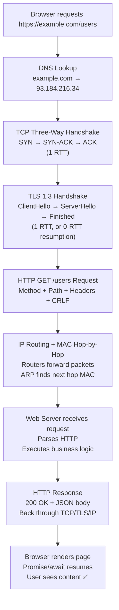

**Layer-by-layer breakdown:**

| Layer | Protocol | What It Does |
| :--- | :--- | :--- |
| **Application** | HTTP (3), DNS | Formats requests/responses, resolves names |
| **Transport** | TCP or QUIC/UDP | Reliable/fast byte delivery, flow control |
| **Network** | IP | Routing packets across internet |
| **Data Link** | Ethernet/Wi-Fi (MAC + ARP) | Local link frame delivery |
| **Physical** | Copper/Fiber/Radio | Actual bit transmission |

---

## 11. Study Roadmap

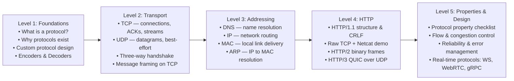

**Recommended study order:**

| Priority | Topic | Why |
| :---: | :--- | :--- |
| 1 | What is a protocol? | Foundational concept |
| 2 | TCP and UDP | All application protocols build on these |
| 3 | IP, DNS, MAC, ARP | Addressing and routing |
| 4 | HTTP/1.1 structure | Understand request/response at the wire level |
| 5 | Raw TCP + Netcat | Make the abstract concrete |
| 6 | Message vs Stream | Critical for TCP-based application development |
| 7 | Flow & Congestion Control | Understand why TCP is designed as it is |
| 8 | Reliability & Error Handling | Failure-aware design |
| 9 | HTTP/2 and HTTP/3 | Modern web communication |
| 10 | WebSocket & WebRTC | Real-time communication |
| 11 | gRPC & Apache Thrift | Service-to-service RPC |
| 12 | Custom Protocol Design | Apply everything together |

> [!tip] The Single Most Important Concept
> Spend the most time on **TCP as a byte stream** and **message framing**. Understanding that TCP preserves byte order but NOT write boundaries — and that applications must implement their own framing — is the foundation for understanding HTTP servers, database drivers, WebSockets, and all network application development.

---

## 12. Glossary

| Term | Definition |
| :--- | :--- |
| **Protocol** | An agreed set of rules governing communication format and behavior between systems |
| **Encoder** | Converts structured data into a wire-format byte sequence |
| **Decoder** | Converts received bytes back into structured application data |
| **CRLF** | `\r\n` — Carriage Return + Line Feed; HTTP line terminator |
| **MTU** | Maximum Transmission Unit — maximum byte size of a network packet on a link |
| **Datagram** | A self-contained, independent unit of data with defined boundaries (UDP) |
| **Stream** | A continuous ordered sequence of bytes without inherent message boundaries (TCP) |
| **Framing** | Application-level technique to delimit message boundaries in a byte stream |
| **Stateful** | Protocol that maintains session/connection state across multiple exchanges |
| **Stateless** | Protocol where each exchange is independent; no inherent session memory |
| **Flow Control** | Mechanism where receiver limits sender's rate to prevent buffer overflow |
| **Congestion Control** | Mechanism where sender reduces rate to prevent network overload |
| **Idempotency** | Property where repeating an operation produces the same result as doing it once |
| **Idempotency Key** | Unique token clients send so servers can safely ignore duplicate requests |
| **ACK** | Acknowledgment — confirmation that a segment or datagram was received |
| **RTT** | Round-Trip Time — time for a packet to reach destination and acknowledgment to return |
| **TLS** | Transport Layer Security — cryptographic protocol for encryption and authentication |
| **Multiplexing** | Sharing a single connection for multiple independent streams (HTTP/2, QUIC) |
| **HOL Blocking** | Head-of-Line blocking — later items stall behind a delayed earlier item |
| **QUIC** | Quick UDP Internet Connections — Google's protocol underlying HTTP/3 |
| **SDP** | Session Description Protocol — negotiates WebRTC media capabilities |
| **ICE** | Interactive Connectivity Establishment — finds best P2P path in WebRTC |
| **STUN** | Session Traversal Utilities for NAT — WebRTC public IP discovery |
| **TURN** | Traversal Using Relays around NAT — WebRTC fallback relay server |
| **Protobuf** | Protocol Buffers — Google's compact binary serialization format |
| **IDL** | Interface Definition Language — language-neutral service contract definition |
| **DORA** | Discover → Offer → Request → Acknowledge — DHCP process |
| **WAF** | Write Amplification Factor (SSD term, not a protocol property) |
| **HOL** | Head-of-Line (blocking) — a blocked message delays all behind it |

---

## 13. References & Further Reading

### Authoritative Documentation

- [RFC 9293 — Transmission Control Protocol (TCP)](https://www.rfc-editor.org/rfc/rfc9293)
- [RFC 768 — User Datagram Protocol (UDP)](https://www.rfc-editor.org/rfc/rfc768)
- [RFC 9110 — HTTP Semantics](https://www.rfc-editor.org/rfc/rfc9110)
- [RFC 9113 — HTTP/2](https://www.rfc-editor.org/rfc/rfc9113)
- [RFC 9114 — HTTP/3](https://www.rfc-editor.org/rfc/rfc9114)
- [RFC 9000 — QUIC: A UDP-Based Multiplexed and Secure Transport](https://www.rfc-editor.org/rfc/rfc9000)
- [RFC 6455 — The WebSocket Protocol](https://www.rfc-editor.org/rfc/rfc6455)
- [gRPC Official Documentation](https://grpc.io/docs/)
- [Protocol Buffers Developer Guide](https://protobuf.dev/overview/)

### Books to Study

| Priority | Book | Why |
| :---: | :--- | :--- |
| **1** | **Computer Networks: A Top-Down Approach** — Kurose & Ross | Best textbook covering TCP, UDP, HTTP, DNS from application down to physical |
| **2** | **TCP/IP Illustrated Vol. 1** — W. Richard Stevens | Exhaustive, technically precise reference for TCP internals |
| **3** | **High Performance Browser Networking** — Ilya Grigorik | HTTP/1.1, HTTP/2, HTTP/3, WebSocket, WebRTC — free online |
| **4** | **The Linux Programming Interface** — Michael Kerrisk | TCP socket programming at the syscall level |

### Engineering Articles

- [High Performance Browser Networking — Ilya Grigorik (free)](https://hpbn.co)
- [HTTP/3 Explained — Daniel Stenberg](https://http3-explained.haxx.se)
- [The Road to QUIC — Cloudflare Blog](https://blog.cloudflare.com/the-road-to-quic/)

---

## 14. Topics for Further Investigation

- TCP Nagle's Algorithm (`TCP_NODELAY`) and its interaction with small writes
- TCP TIME_WAIT state and why it exists (and when it causes port exhaustion)
- QUIC connection migration across network changes (IP address change mid-session)
- gRPC deadlines vs timeouts — propagation across service call chains
- HTTP/2 HPACK static/dynamic table compression internals
- WebRTC STUN/TURN fallback mechanics and ICE candidate gathering
- Protocol Buffer field encoding — varint, zigzag encoding, wire types
- RESP3 — Redis's new binary-safe serialization protocol
- HOMA protocol — receiver-driven flow control in data centers
- Custom binary protocol framing patterns used in production (Kafka, MySQL, PostgreSQL wire protocol)

