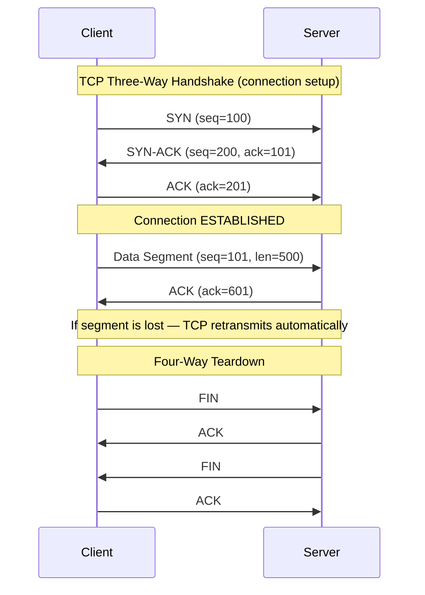
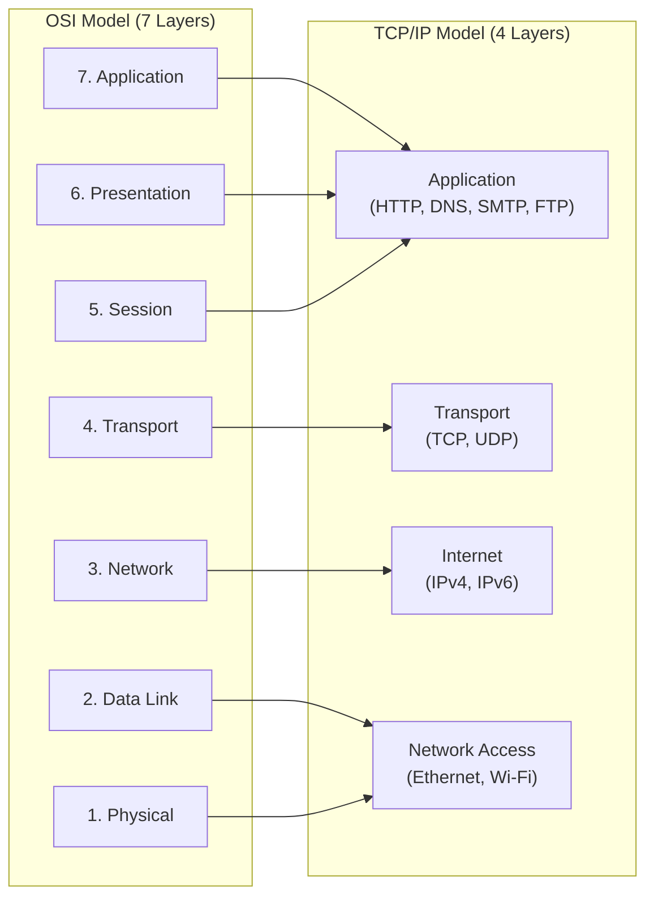
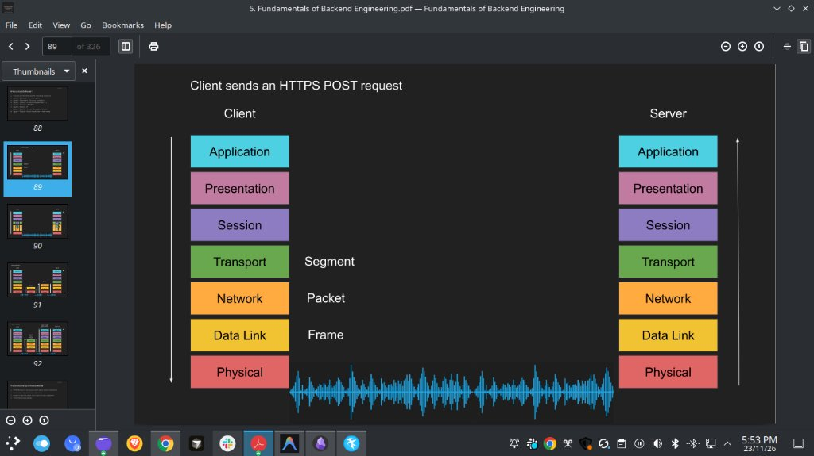

# 🌐 OSI Model — Open Systems Interconnection

### Core Mental Model — Before Everything Else

> [!important] Why Learn the OSI Model?
> Before learning TCP, UDP, HTTP, DNS, MAC addresses and other protocols, you must understand **which layer each protocol belongs to** and **what responsibility that layer has.**
>
> The OSI model gives you a mental framework to place every networking concept in the right box.
> - **Layers 1–3:** Moving bits and packets across hardware and networks
> - **Layer 4:** End-to-end application communication (TCP, UDP)
> - **Layers 5–7:** Where your backend application code actually lives (HTTP, DNS, gRPC)

| Layer | Name | Key Protocols / Technologies |
| :---: | :--- | :--- |
| **7** | Application | HTTP, HTTPS, DNS, SMTP, FTP, WebSocket, gRPC |
| **6** | Presentation | TLS/SSL, JSON, XML, gzip, UTF-8 |
| **5** | Session | NetBIOS, RPC session concepts |
| **4** | Transport | TCP, UDP |
| **3** | Network | IPv4, IPv6, ICMP, OSPF, BGP |
| **2** | Data Link | Ethernet, Wi-Fi (802.11), ARP, MAC |
| **1** | Physical | Cables, fiber, radio signals, hubs |

---

## Topics Covered

| Section | Topic | Core Question |
| :--- | :--- | :--- |
| §1 | What is the OSI Model? | Why do we layer networking? |
| §2 | Layer 1 — Physical | How do raw bits actually travel? |
| §3 | Layer 2 — Data Link | How does local delivery + framing work? |
| §4 | Layer 3 — Network | How does routing work across the internet? |
| §5 | Layer 4 — Transport | What do TCP and UDP give us? |
| §6 | Layer 5 — Session | What manages communication sessions? |
| §7 | Layer 6 — Presentation | How is data encoded and encrypted? |
| §8 | Layer 7 — Application | Where does HTTP, DNS, and gRPC live? |
| §9 | Encapsulation & Decapsulation | How does data travel end-to-end? |
| §10 | PDU at Each Layer | What is the data unit at each layer? |
| §11 | OSI vs TCP/IP Model | How do the two models compare? |
| §12 | Real-World Communication | How does HTTPS POST work across layers? |
| §13 | Protocol → Layer Mapping | Which protocol belongs where? |
| §14 | Networking Devices by Layer | Switch vs Router vs Firewall vs CDN? |

---

## 1. What Is the OSI Model?

The **OSI (Open Systems Interconnection) Model** is a conceptual framework that explains how data travels between two devices over a network.

It divides network communication into **seven distinct layers**, each with a specific responsibility. Layers only communicate with the layer directly above and below them.

**Simple analogy — sending a letter:**
```
You write the letter               → Application Layer (the message itself)
You put it in an envelope          → Presentation Layer (formatting/encoding)
You address the envelope           → Network Layer (routing address)
Post office sorts it               → Data Link Layer (local delivery)
Truck physically transports it     → Physical Layer (actual transmission)
```

**Simple technical example — opening a website:**
```
Browser creates HTTP request       → Layer 7 (Application)
Data serialized + TLS encrypted    → Layer 6 (Presentation)
Session managed                    → Layer 5 (Session)
TCP segments the data              → Layer 4 (Transport)
IP routes packets to server        → Layer 3 (Network)
Ethernet frames travel on LAN      → Layer 2 (Data Link)
Electrical/optical signals travel  → Layer 1 (Physical)
```

> [!note] OSI is Conceptual
> The OSI model is a reference framework, not a strict implementation recipe. Real protocols (like TLS) don't fit neatly into one layer. The TCP/IP model (4 layers) is the actual architecture of the internet. OSI gives you the vocabulary and mental model.

**The Seven Layers (top to bottom):**

| Layer | Number | PDU | Key Word |
| :--- | :---: | :--- | :--- |
| Application | 7 | Data | **Services** |
| Presentation | 6 | Data | **Format** |
| Session | 5 | Data | **Sessions** |
| Transport | 4 | Segment / Datagram | **End-to-End** |
| Network | 3 | Packet | **Routing** |
| Data Link | 2 | Frame | **Local Delivery** |
| Physical | 1 | Bits | **Signals** |

**Memory aid (top → bottom):** **A**ll **P**eople **S**eem **T**o **N**eed **D**ata **P**rocessing  
**Memory aid (bottom → top):** **P**lease **D**o **N**ot **T**hrow **S**ausage **P**izza **A**way

---

## 2. Layer 1 — Physical Layer

> OSI Layer 1 | PDU: **Bits**

The Physical Layer is responsible for **transmitting raw bits (0s and 1s)** through a physical communication medium.

It deals with the actual physical signals used to transfer data between devices — electrical, optical, or radio.

**Main responsibilities:**
- Transmitting raw bits over a medium
- Defining electrical signal specifications
- Defining optical signal specifications (fiber)
- Defining radio signal specifications (Wi-Fi)
- Setting transmission speed (baud rate)
- Defining cables, connectors, and physical interfaces

```
Sender                         Receiver
  |                                |
  | 0101010111000101...            |
  |=============================>  |
  (Copper wire / Fiber / Radio)
```

**Examples of physical media:**

| Medium | Signal Type | Example Use |
| :--- | :--- | :--- |
| Ethernet cable (Cat5e/6) | Electrical | Office LAN |
| Fiber-optic cable | Light pulses | Datacenter interconnects, ISP backbone |
| Wi-Fi radio | Radio waves | Wireless LAN |
| Coaxial cable | Electrical | Cable internet |

**Technologies and components at Layer 1:**

| Technology | Purpose |
| :--- | :--- |
| Ethernet physical standards (10BASE-T, 1000BASE-T) | Define signaling |
| Fiber optics (single-mode, multi-mode) | Transmit data using light |
| Repeaters | Regenerate/amplify signals over distance |
| Hubs | Broadcast electrical signals to all ports |

> [!note] Hub vs Switch
> A **hub** operates at Layer 1 — it repeats all electrical signals to all ports. A **switch** operates at Layer 2 — it uses MAC addresses to forward frames only to the correct port.

**Data Unit: Bits**

---

## 3. Layer 2 — Data Link Layer

> OSI Layer 2 | PDU: **Frame**

The Data Link Layer is responsible for **communication between devices on the same local network link**. It takes Network Layer packets and wraps them into frames for local delivery.

**Main responsibilities:**
- **Framing** — wrapping data in frames with start/end delimiters
- **MAC addressing** — identifying source/destination on the local link
- **Local delivery** — delivering frames to the correct device on the local segment
- **Error detection** — Frame Check Sequence (FCS) / CRC
- **Media access control** — managing who gets to transmit (CSMA/CD, CSMA/CA)

### A. What Is a MAC Address?

A MAC (Media Access Control) address is a **hardware-level identifier** burned into a network interface card.

```
Example: 00:1A:2B:3C:4D:5E
         │   │   │   │   │
         └───┴───┘   └───┴───── Device identifier (vendor-assigned)
             │
             └─────────────────── OUI (manufacturer identifier)
```

> [!caution] MAC Addresses Are LOCAL Only
> MAC addresses identify devices **on the same local network segment only**. At every router hop, the IP packet is unwrapped from its frame and re-wrapped with new source/destination MAC addresses for the next hop. MAC addresses do NOT travel end-to-end across the internet.

### B. What Is an Ethernet Frame?

A frame is the Layer 2 data unit. An Ethernet frame structure:

```
┌──────────────────┬─────────────────┬──────────┬─────────────────┬─────┐
│ Destination MAC  │   Source MAC    │  EtherType│    Payload      │ FCS │
│    (6 bytes)     │   (6 bytes)     │  (2 bytes)│  (46–1500 bytes)│(4B) │
└──────────────────┴─────────────────┴──────────┴─────────────────┴─────┘
```

- **Destination MAC** — who should receive this frame on the local link
- **Source MAC** — who sent this frame
- **EtherType** — indicates what's inside (IPv4 = `0x0800`, IPv6 = `0x86DD`, ARP = `0x0806`)
- **Payload** — the IP packet (or other Layer 3 data)
- **FCS** — Frame Check Sequence, used for error detection (CRC-32)

### C. What Is ARP?

ARP (Address Resolution Protocol) answers the question: **"I know the IP address, but what MAC address should I use to deliver this frame locally?"**

```
Your PC wants to send to 192.168.1.1 (router)
  |
  v
ARP Broadcast → "Who has 192.168.1.1? Tell 192.168.1.5"
  |
  v
Router replies → "192.168.1.1 is at AA:BB:CC:DD:EE:FF"
  |
  v
Your PC builds Ethernet frame with Dst MAC = AA:BB:CC:DD:EE:FF
```

**Protocols and technologies at Layer 2:**
- Ethernet (IEEE 802.3)
- Wi-Fi (IEEE 802.11) — MAC sublayer
- PPP (Point-to-Point Protocol)
- VLAN (IEEE 802.1Q) — virtual LAN tagging
- ARP (conventionally associated with Layer 2 boundary)

**Networking devices:** Switches, Bridges

**Data Unit: Frame**

---

## 4. Layer 3 — Network Layer

> OSI Layer 3 | PDU: **Packet**

The Network Layer is responsible for **routing data between different networks**. Its most important function is determining how packets travel from source to destination across potentially many routers.

**Main responsibilities:**
- **IP addressing** — assigning logical addresses to identify hosts
- **Routing** — determining the best path to the destination
- **Packet forwarding** — moving packets toward their destination hop by hop
- **Fragmentation** — splitting large packets in IPv4 when needed
- **Inter-network delivery** — connecting different LANs across the internet

### A. IP Addresses

| Version | Bit Width | Example | Address Space |
| :--- | :--- | :--- | :--- |
| **IPv4** | 32 bits | `192.168.1.10` | ~4.3 billion addresses |
| **IPv6** | 128 bits | `2001:0db8:85a3::8a2e` | ~3.4 × 10³⁸ addresses |

### B. How Routing Works

```
Your PC (192.168.1.5)
         |
         | Frame: SrcMAC=your_mac, DstMAC=router_mac
         v
Home Router (192.168.1.1)
         |
         | "Packet is for 93.184.216.34, not on my subnet"
         | Strips old Ethernet frame, builds new one for next hop
         v
ISP Router 1
         |
         | Routing table lookup: forward toward 93.184.0.0/16
         v
ISP Router 2
         |
         | ...hop by hop across the internet...
         v
Example.com Server (93.184.216.34)
```

Each router reads the **destination IP address** in the packet, consults its routing table, and forwards the packet to the next hop.

### C. What Is a Router?

A router operates at Layer 3. It:
1. Receives a frame, strips the Layer 2 header
2. Reads the IP destination address in the Layer 3 packet
3. Looks up the best next-hop in its routing table
4. Wraps the packet in a new frame (with new MAC addresses) for the next link
5. Forwards it toward the destination

**Protocols at Layer 3:**
- IPv4, IPv6
- ICMP (Internet Control Message Protocol — ping, traceroute)
- IPsec (security extensions for IP)
- OSPF, BGP (routing protocols)

**Networking devices:** Routers, Layer 3 Switches

**Data Unit: Packet**

---

## 5. Layer 4 — Transport Layer

> OSI Layer 4 | PDU: **Segment (TCP) / Datagram (UDP)** | ⚠️ Most important for backend developers

The Transport Layer provides **end-to-end communication between applications** on different hosts. This is where TCP and UDP live.

**Main responsibilities:**
- **Segmentation and reassembly** — splitting application data into segments
- **Port addressing** — identifying which application on a host
- **End-to-end delivery** — getting data from source app to destination app
- **Reliability** (TCP only) — acknowledgments, retransmission, ordering
- **Flow control** (TCP only) — prevent overwhelming the receiver
- **Congestion control** (TCP only) — prevent overwhelming the network

### A. TCP — Transmission Control Protocol

TCP provides a **reliable, ordered, full-duplex byte stream** between two applications.



**TCP provides:**
- Reliable delivery (retransmit lost segments)
- Ordered delivery (sequence numbers)
- Full-duplex (both sides send simultaneously)
- Flow control (receiver-advertised window)
- Congestion control (Slow Start, CUBIC, BBR)
- Connection management (3-way handshake, 4-way teardown)

### B. UDP — User Datagram Protocol

UDP provides a **lightweight, connectionless, best-effort datagram service**.

```
Sender → Datagram 1 → Receiver ✅
Sender → Datagram 2 → ✗ (lost, never retransmitted)
Sender → Datagram 3 → Receiver ✅ (possibly arrives before Datagram 1)
```

**UDP characteristics:**
- No connection setup (no handshake)
- No guaranteed delivery
- No ordering guarantee
- No retransmission
- Minimal overhead (8-byte header vs TCP's 20+ bytes)

**When to use UDP:**
- DNS queries (small, fast, can retry at application level)
- Real-time audio/video (stale data is useless — better to drop)
- Online gaming (need newest state, not retransmitted old state)
- WebRTC (implements its own reliability above UDP)
- QUIC / HTTP/3 (reimplements reliability more efficiently than TCP)

### C. Port Numbers

A port identifies which **application** on a device should receive the data.

```
Socket = IP Address + Port
Example: 192.168.1.5:3000  ←→  93.184.216.34:443
           (your app)              (HTTPS server)
```

**Well-known port numbers:**

| Port | Protocol | Service |
| :---: | :--- | :--- |
| 20/21 | TCP | FTP (data/control) |
| 22 | TCP | SSH |
| 25 | TCP | SMTP |
| 53 | UDP/TCP | DNS |
| 80 | TCP | HTTP |
| 443 | TCP | HTTPS |
| 3306 | TCP | MySQL |
| 5432 | TCP | PostgreSQL |
| 6379 | TCP | Redis |
| 27017 | TCP | MongoDB |
| 8080 | TCP | HTTP alt / dev servers |

**Data Units:**
- TCP → **Segment**
- UDP → **Datagram**

---

## 6. Layer 5 — Session Layer

> OSI Layer 5 | PDU: **Data**

The Session Layer is responsible for **establishing, managing, and terminating communication sessions** between applications.

Think of it as managing the logical "conversation" — when does it start, how long does it last, how is it re-established after interruption.

**Main responsibilities:**
- Establishing sessions
- Maintaining sessions (keeping them alive)
- Terminating sessions
- Synchronization (checkpoints for recovery)
- Managing dialog control (who speaks when)

```
Application A              Application B
     |                           |
     |── Open Session ──────────>|
     |<─ Session Accepted ───────|
     |                           |
     |══ Data Exchange ══════════|
     |                           |
     |── Checkpoint (sync) ──────|   ← Can resume from here if interrupted
     |                           |
     |── Close Session ──────────|
```

**Examples:**
- NetBIOS session services
- RPC session management
- TLS session resumption (conceptually at this boundary)

> [!note] Session Layer in Modern Practice
> In the real internet, explicit "Session Layer" protocols are rare. Session management is usually handled at the application layer by cookies, JWT tokens, WebSocket connections, and gRPC streams. The OSI Layer 5 is more of a conceptual category than a distinct layer in real TCP/IP stacks.

**Data Unit: Data**

---

## 7. Layer 6 — Presentation Layer

> OSI Layer 6 | PDU: **Data**

The Presentation Layer is responsible for **ensuring data is in a format the receiving application can understand**. It is the translation layer between the network and the application.

**Main responsibilities:**
- **Data encoding** — character sets (UTF-8, ASCII)
- **Data formatting** — JSON, XML, Protobuf, HTML
- **Data serialization** — converting objects to bytes and back
- **Data compression** — gzip, Brotli, zstd
- **Data encryption/decryption** — TLS conceptually lives here

### A. Data Encoding

```
Sender (Node.js):  { name: "Neel", age: 25 }
         |
         v
Serialized JSON:  {"name":"Neel","age":25}
         |
         v (transmitted as bytes)
         v
Receiver (Python): json.loads(data) → {"name": "Neel", "age": 25}
```

Both sides must agree on:
- Character encoding (UTF-8 vs UTF-16 vs ASCII)
- Data format (JSON vs XML vs Protobuf vs MessagePack)
- Compression algorithm (gzip vs Brotli)

### B. Data Compression

| Algorithm | Use Case | Compression Ratio |
| :--- | :--- | :--- |
| **gzip** | HTTP responses, files | Good (moderate speed) |
| **Brotli** | HTTP responses (browsers) | Better (slower encoding) |
| **zstd** | High-performance streaming | Very fast + good ratio |
| **LZ4** | Real-time, low-latency | Extremely fast |

### C. Encryption (TLS)

TLS (Transport Layer Security) is conceptually mapped to the Presentation Layer in OSI but is implemented between Layer 4 (TCP) and Layer 7 (HTTP) in practice.

```
Application (HTTP) → TLS (Encryption) → TCP (Transport) → IP → Ethernet
```

> [!note] TLS Does Not Fit Perfectly Into OSI
> TLS is often described as "between Layer 4 and Layer 7." It operates after TCP (Layer 4) is established and before the application (Layer 7) sends data. The OSI model predates modern TLS, so this is a known conceptual mismatch.

**Data Unit: Data**

---

## 8. Layer 7 — Application Layer

> OSI Layer 7 | PDU: **Data** | ⚠️ Most visible layer for backend developers

The Application Layer provides **network communication services directly to applications**. This is the layer where your backend code operates.

> [!important] Layer 7 ≠ Your App's UI
> The Application Layer means the **network protocol** your application uses, not the UI itself. HTTP, DNS, SMTP — these are Layer 7 protocols. Your Express.js or Django app speaks these protocols.

**Main responsibilities:**
- Defining request and response formats
- Supporting resource access (HTTP)
- Supporting file transfer (FTP)
- Supporting email (SMTP, IMAP, POP3)
- Supporting name resolution (DNS)
- Supporting real-time communication (WebSocket, WebRTC)

**Application Layer Protocols:**

| Protocol | Purpose | Transport |
| :--- | :--- | :--- |
| **HTTP / HTTPS** | Web and API communication | TCP |
| **DNS** | Domain name resolution | UDP (small) / TCP (large) |
| **SMTP** | Sending email | TCP |
| **IMAP / POP3** | Reading email | TCP |
| **FTP** | File transfer | TCP |
| **SSH** | Secure remote access | TCP |
| **DHCP** | Automatic IP configuration | UDP |
| **WebSocket** | Bidirectional persistent comms | TCP (upgraded from HTTP) |
| **gRPC** | Service-to-service RPC | TCP (HTTP/2) |
| **MQTT** | IoT lightweight messaging | TCP |

### HTTP at Layer 7

```
GET /users HTTP/1.1
Host: api.example.com
Authorization: Bearer eyJhbGc...
Content-Type: application/json
```

HTTP defines everything at Layer 7: the method, path, headers, body format, status codes, and response format. TCP (Layer 4) just moves those bytes reliably. HTTP doesn't care *how* the bytes got there.

**Data Unit: Data**

---

## 9. Encapsulation & Decapsulation — How All Layers Work Together

This is the most important mechanical concept of the OSI model.

**Encapsulation (Sender):** Data travels **down** from Layer 7 → Layer 1, with each layer adding its own header (and sometimes trailer).

**Decapsulation (Receiver):** Data travels **up** from Layer 1 → Layer 7, with each layer reading and removing its header.

```mermaid
flowchart TD
    subgraph Sender["📤 SENDER — Encapsulation (L7 → L1)"]
        A7["Layer 7 Application\n[HTTP Data]"] --> A6
        A6["Layer 6 Presentation\n[TLS encrypted | HTTP Data]"] --> A5
        A5["Layer 5 Session\n[Session Info | TLS | HTTP Data]"] --> A4
        A4["Layer 4 Transport\n[TCP Header | Session | TLS | HTTP Data]"] --> A3
        A3["Layer 3 Network\n[IP Header | TCP | Session | TLS | HTTP Data]"] --> A2
        A2["Layer 2 Data Link\n[Eth Header | IP | TCP | ... | HTTP Data | FCS]"] --> A1
        A1["Layer 1 Physical\n010110100101...  (electrical/optical/radio signals)"]
    end

    subgraph Receiver["📥 RECEIVER — Decapsulation (L1 → L7)"]
        B1["Layer 1 Physical\nReceives raw bits/signals"] --> B2
        B2["Layer 2 Data Link\nReads Eth header, checks FCS, strips frame"] --> B3
        B3["Layer 3 Network\nReads IP header, checks dest IP, strips IP header"] --> B4
        B4["Layer 4 Transport\nReads TCP header, reassembles segments, strips TCP"] --> B5
        B5["Layer 5 Session\nManages session state"] --> B6
        B6["Layer 6 Presentation\nDecrypts TLS, deserializes data"] --> B7
        B7["Layer 7 Application\nReceives: GET /users HTTP/1.1 ✅"]
    end
```



**Visual encapsulation example:**

```
Application creates:
  "GET /users HTTP/1.1\r\nHost: example.com\r\n\r\n"

After Layer 4 (TCP) adds header:
  [TCP: Src=4321, Dst=443, Seq=100, Flags=PSH|ACK] [HTTP data]

After Layer 3 (IP) adds header:
  [IP: Src=192.168.1.5, Dst=93.184.216.34, Proto=TCP] [TCP header] [HTTP data]

After Layer 2 (Ethernet) adds header+trailer:
  [Eth: SrcMAC=AA:BB:CC Dst=Router_MAC] [IP header] [TCP header] [HTTP data] [FCS]

Layer 1: 0101011001010011...  (transmitted as electrical/light/radio)
```

---

## 10. PDU — Protocol Data Unit at Each Layer

Each layer wraps data in its own container. The name of that container is the **PDU**.

| Layer | Layer Name | PDU Name | Contains |
| :---: | :--- | :--- | :--- |
| 7 | Application | **Data** | Application payload (HTTP body, DNS query) |
| 6 | Presentation | **Data** | Encoded/encrypted application data |
| 5 | Session | **Data** | Session-managed data |
| 4 | Transport | **Segment** (TCP) or **Datagram** (UDP) | TCP/UDP header + data |
| 3 | Network | **Packet** | IP header + segment/datagram |
| 2 | Data Link | **Frame** | Ethernet/Wi-Fi header + packet + FCS |
| 1 | Physical | **Bits** | Raw 1s and 0s (signals) |

```
Bits → Frame → Packet → Segment → Data
 L1      L2      L3        L4      L5-7
  ↑ decapsulation goes this way (receiver) ↑
  ↓ encapsulation goes this way (sender)   ↓
Data → Segment → Packet → Frame → Bits
 L7      L4        L3      L2      L1
```

---

## 11. OSI Model vs TCP/IP Model

The OSI model has 7 layers. The **TCP/IP model** (the actual architecture of the internet) uses **4 layers** by collapsing some OSI layers.



**TCP/IP Layer Descriptions:**

| TCP/IP Layer | OSI Equivalent | Protocols |
| :--- | :--- | :--- |
| **Application** | Layers 5, 6, 7 | HTTP, HTTPS, DNS, SMTP, FTP, SSH, WebSocket |
| **Transport** | Layer 4 | TCP, UDP |
| **Internet** | Layer 3 | IPv4, IPv6, ICMP |
| **Network Access** | Layers 1, 2 | Ethernet, Wi-Fi, ARP |

> [!tip] Which Model to Use?
> - Use **OSI** to explain networking concepts, troubleshoot at specific layers, and have vocabulary conversations
> - Use **TCP/IP** when describing actual internet protocol implementation
> - In interviews, mention both — OSI for theory, TCP/IP for practice

---

## 12. Real-World Communication — HTTPS POST Across Layers

This is where the theory becomes practical. The images below are from Hussein Nasser's Backend Engineering course — they show exactly what happens at each layer when your app sends an HTTPS POST request.

### 12.1 OSI Layers on a Single Machine (HTTPS POST)

> *Page 89 from the course PDF — "Client sends an HTTPS POST request"*



**What this diagram shows:**
- The **client** (left) starts at Layer 7 (Application — the HTTPS request) and passes data **down** to Layer 1 (Physical — the raw signal)
- The **server** (right) receives the signal at Layer 1 and processes it **up** to Layer 7
- In the middle: the data unit names — **Segment** at Layer 4, **Packet** at Layer 3, **Frame** at Layer 2, **signal** at Layer 1

```
Client side                              Server side
L7 Application                           L7 Application
L6 Presentation                          L6 Presentation
L5 Session                               L5 Session
L4 Transport  ← Segment →               L4 Transport
L3 Network    ← Packet  →               L3 Network
L2 Data Link  ← Frame   →               L2 Data Link
L1 Physical   ~~~~signal~~~~~~~~~~~~~~~~ L1 Physical
```

---

### 12.2 What Headers Are Added at Each Layer

> *Page 90 from the course PDF — Header fields at Layers 2, 3, and 4*


**What this diagram shows:**

This is the **encapsulated packet** structure — specifically what fields are added at Layers 2, 3, and 4.

| Layer | Fields Added | Full Name |
| :--- | :--- | :--- |
| **Layer 4 (Transport)** | SPORT, DPORT | Source Port, Destination Port |
| **Layer 3 (Network)** | SIP, DIP | Source IP Address, Destination IP Address |
| **Layer 2 (Data Link)** | SMAC, DMAC | Source MAC Address, Destination MAC Address |

**Why this matters for backend engineering:**

```
Your HTTPS POST to api.example.com:443

Layer 7: HTTP POST body → "{ user: 'neel', pass: '...' }"
Layer 6: TLS encrypts it
Layer 4: TCP adds: SPORT=52341, DPORT=443
Layer 3: IP adds:  SIP=192.168.1.5, DIP=93.184.216.34
Layer 2: ETH adds: SMAC=your_mac, DMAC=router_mac  ← changes at every hop!
Layer 1: Electrical signal transmitted
```

> [!important] SMAC/DMAC Change at Every Router Hop
> The **IP addresses (SIP/DIP) stay the same** end-to-end. But the **MAC addresses (SMAC/DMAC) change at every single router hop** because they only identify the next immediate link, not the final destination.

---

### 12.3 OSI Across Networks — Switch and Router

> *Page 91 from the course PDF — "Across networks" with Switch and Router*


**What this diagram shows:**

When traffic travels across different networks (which is always the case on the internet), it passes through intermediate devices. Each device operates at different OSI layers:

```
Client          Switch          Router         Server
  |                |               |               |
  | L1-L7          |               |               |
  v                v               v               v
  ↕ Physical    ↕ Physical      ↕ Physical      ↕ Physical
  ↕ Data Link   ↕ Data Link     ↕ Data Link     ↕ Data Link
                                 ↕ Network       ↕ Network
                                 ↕ Transport     ↕ Transport
                                 ...             ↕ Application
```

**Switch (Layer 2):**
- Reads the **Ethernet frame** (Layer 2)
- Uses the **destination MAC address** to decide which port to forward to
- Does NOT look at IP addresses
- Only operates within the same local network segment

**Router (Layer 3):**
- Reads the **IP packet** (Layer 3)
- Uses the **destination IP address** to route toward the correct network
- Strips the old Ethernet frame, creates a new one for the next hop
- Connects different IP networks

| Device | Reads Up To | Uses | Scope |
| :--- | :--- | :--- | :--- |
| **Hub** | Layer 1 | Nothing — just broadcasts | Same physical segment |
| **Switch** | Layer 2 | Destination MAC | Same LAN |
| **Router** | Layer 3 | Destination IP | Between different networks |

---

### 12.4 OSI With Layer 4 Proxy + Layer 7 Load Balancer / CDN

> *Page 92 from the course PDF — "Across networks" with Layer 4 Proxy/Firewall and Layer 7 Load Balancer/CDN*


**What this diagram shows:**

This is the most practically important diagram for backend developers. Real internet traffic passes through multiple intermediary devices, each processing traffic at different OSI layers.

```
Client → Layer 4 Proxy/Firewall → Layer 7 LB/CDN → Backend Server
```

**Layer 4 Proxy / Firewall:**

```
Can read:   IP address (Layer 3), TCP/UDP ports (Layer 4)
Cannot see: HTTP headers, cookies, URLs (Layer 7 — encrypted)
Can do:     IP-based filtering, port blocking, NAT, TCP load balancing
```

| Feature | What It Does |
| :--- | :--- |
| TCP load balancing | Forward TCP connections to backend servers based on IP/port |
| Firewall rules | Allow/block traffic by IP range, port, protocol |
| NAT | Translate source/destination IP addresses |
| DDoS mitigation | Drop packets before they reach Layer 7 |

**Layer 7 Load Balancer / CDN:**

```
Can read:   Full HTTP request — URL, headers, cookies, body
Can do:     Content-based routing, SSL termination, caching, auth
Examples:   Nginx, HAProxy (L7 mode), AWS ALB, Cloudflare, Fastly
```

| Feature | What It Does |
| :--- | :--- |
| Path-based routing | `/api` → backend A, `/images` → CDN cache |
| Header inspection | Route by `Host`, `User-Agent`, `Authorization` |
| SSL/TLS termination | Decrypt HTTPS at the LB, forward plain HTTP internally |
| Response caching | Cache static assets at the CDN edge |
| A/B testing | Route % of traffic to different backend versions |
| WAF | Web Application Firewall — block SQLi, XSS at Layer 7 |

**Key comparison:**

| Feature | Layer 4 Proxy | Layer 7 Load Balancer |
| :--- | :--- | :--- |
| **OSI visibility** | IP + TCP/UDP only | Full HTTP content |
| **Performance** | Very fast (less processing) | Slower (full HTTP parsing) |
| **Routing basis** | IP address + port | URL, headers, cookies |
| **TLS termination** | No (can't read encrypted) | Yes (must decrypt to inspect) |
| **Use case** | Simple TCP load balancing, firewall | Smart HTTP routing, caching, auth |

> [!tip] Why This Matters for Backend Engineering
> When debugging why a request isn't reaching your backend:
> - **Connection refused at Layer 3/4?** → Check IP routing, firewall rules, security groups
> - **Request drops at Layer 4?** → Check TCP port, load balancer config
> - **403/404 from Layer 7?** → Check Nginx rules, CDN cache rules, WAF policies
> - **Reaching your app?** → Debug at Layer 7 (HTTP headers, auth, body parsing)

---

## 13. Protocol → OSI Layer Mapping

| Protocol / Technology | OSI Layer | Notes |
| :--- | :---: | :--- |
| **HTTP / HTTPS** | 7 | Application-level web communication |
| **DNS** | 7 | Uses UDP port 53 (small queries) or TCP |
| **SMTP / IMAP / POP3** | 7 | Email protocols |
| **FTP** | 7 | File transfer |
| **WebSocket** | 7 | Upgraded from HTTP at Layer 7 |
| **gRPC** | 7 | RPC framework on HTTP/2 |
| **MQTT** | 7 | IoT messaging |
| **TLS / SSL** | 6 *(conceptual)* | Encryption — sits between L4 and L7 |
| **JSON / XML / Protobuf** | 6 | Data serialization formats |
| **gzip / Brotli** | 6 | Compression |
| **TCP** | 4 | Reliable stream transport |
| **UDP** | 4 | Best-effort datagram transport |
| **QUIC** | 4 | UDP-based reliable transport (HTTP/3) |
| **IPv4 / IPv6** | 3 | Network addressing + routing |
| **ICMP** | 3 | ping, traceroute, error messages |
| **OSPF / BGP** | 3 | Routing protocols |
| **Ethernet** | 2 | Local wired network frames |
| **Wi-Fi (802.11)** | 2 | Wireless MAC layer |
| **ARP** | 2/3 boundary | Maps IP → MAC on local network |
| **VLAN (802.1Q)** | 2 | Virtual LAN tagging |
| **Ethernet physical (1000BASE-T)** | 1 | Electrical signaling spec |
| **Fiber optic transmission** | 1 | Optical signaling |

> [!caution] OSI Mappings Are Approximate
> Some technologies span multiple layers. TLS doesn't fit perfectly in OSI. QUIC spans L3/L4 boundary. ARP bridges L2 and L3. These conceptual mappings are useful vocabulary, not strict rules.

---

## 14. Networking Devices by OSI Layer

| Device | OSI Layer(s) | What It Reads | What It Does |
| :--- | :---: | :--- | :--- |
| **Hub** | 1 | Nothing | Broadcasts all bits to all ports |
| **Repeater** | 1 | Nothing | Regenerates signal strength |
| **Switch** | 2 | Destination MAC | Forwards frames to correct port on LAN |
| **Bridge** | 2 | MAC address | Segments LAN into two collision domains |
| **Router** | 3 | Destination IP | Routes packets between networks |
| **Layer 3 Switch** | 2–3 | MAC + IP | Switch with routing capabilities |
| **Firewall (stateless)** | 3–4 | IP + Port | Allows/blocks by IP/port rules |
| **Firewall (stateful)** | 3–4 | TCP state | Tracks connection state, allows return traffic |
| **Layer 4 Load Balancer** | 4 | TCP port + IP | Distributes TCP connections |
| **Layer 7 Load Balancer** | 7 | Full HTTP | Routes by URL, headers, content |
| **Reverse Proxy (Nginx)** | 7 | Full HTTP | Terminates TLS, routes, caches |
| **CDN** | 7 | Full HTTP | Caches static content at edge nodes |
| **WAF** | 7 | HTTP content | Blocks application-layer attacks |

---

## 15. Memory Aids

### Top → Bottom (Layer 7 to 1)
> **A**ll **P**eople **S**eem **T**o **N**eed **D**ata **P**rocessing

| Letter | Layer |
| :--- | :--- |
| **A** | 7 — Application |
| **P** | 6 — Presentation |
| **S** | 5 — Session |
| **T** | 4 — Transport |
| **N** | 3 — Network |
| **D** | 2 — Data Link |
| **P** | 1 — Physical |

### Bottom → Top (Layer 1 to 7)
> **P**lease **D**o **N**ot **T**hrow **S**ausage **P**izza **A**way

| Letter | Layer |
| :--- | :--- |
| **P** | 1 — Physical |
| **D** | 2 — Data Link |
| **N** | 3 — Network |
| **T** | 4 — Transport |
| **S** | 5 — Session |
| **P** | 6 — Presentation |
| **A** | 7 — Application |

### PDU Memory (Bottom → Top)
> **B**ig **F**at **P**eople **S**it **D**own **D**aily

Bits → Frames → Packets → Segments → Data → Data → Data

---

## 16. Interview Questions & Answers

| Question | Answer |
| :--- | :--- |
| Which layer handles IP addressing and routing? | **Layer 3 — Network** |
| Which layer handles MAC addressing? | **Layer 2 — Data Link** |
| At which layer do TCP and UDP operate? | **Layer 4 — Transport** |
| What is the PDU of the Data Link Layer? | **Frame** |
| What is the PDU of the Network Layer? | **Packet** |
| What is the PDU of the Transport Layer? | **Segment** (TCP) or **Datagram** (UDP) |
| Which layer handles encryption conceptually? | **Layer 6 — Presentation** (TLS in practice sits between L4 and L7) |
| Which layer transmits raw bits? | **Layer 1 — Physical** |
| Which layer is responsible for HTTP? | **Layer 7 — Application** |
| What is encapsulation? | Adding layer-specific headers as data moves **down** the stack (sender) |
| What is decapsulation? | Removing headers as data moves **up** the stack (receiver) |
| How many layers in TCP/IP model? | **4** (Application, Transport, Internet, Network Access) |
| Which device operates at Layer 3? | **Router** |
| Which device operates at Layer 2? | **Switch** |
| Does a switch look at IP addresses? | **No** — switches use MAC addresses (Layer 2) |
| Does a router look at MAC addresses? | **No** — routers use IP addresses (Layer 3); MACs change at each hop |
| What does a Layer 7 load balancer see that a Layer 4 LB cannot? | Full HTTP content: URLs, headers, cookies, TLS-decrypted body |
| Why do MAC addresses change at each router hop? | They identify the **next immediate link** only, not the final destination |
| Why do IP addresses NOT change end-to-end (normally)? | They identify the **final source and destination** across the entire path |

---

## 17. Glossary

| Term | Definition |
| :--- | :--- |
| **OSI** | Open Systems Interconnection — 7-layer conceptual networking model |
| **TCP/IP** | 4-layer model that describes actual internet architecture |
| **PDU** | Protocol Data Unit — the data container at each OSI layer |
| **Encapsulation** | Adding headers as data moves down the OSI stack (sender side) |
| **Decapsulation** | Removing headers as data moves up the OSI stack (receiver side) |
| **Frame** | Layer 2 PDU — Ethernet/Wi-Fi frame containing MAC addresses |
| **Packet** | Layer 3 PDU — IP packet containing source/destination IP addresses |
| **Segment** | Layer 4 PDU (TCP) — contains sequence numbers, ports, ACK info |
| **Datagram** | Layer 4 PDU (UDP) — lightweight, no connection state |
| **MAC Address** | Hardware identifier for a network interface on the local link |
| **IP Address** | Logical address for identifying a host across networks |
| **ARP** | Address Resolution Protocol — maps IPv4 → MAC on local network |
| **Router** | Layer 3 device — forwards packets between IP networks |
| **Switch** | Layer 2 device — forwards frames within a LAN using MAC addresses |
| **Hub** | Layer 1 device — broadcasts all signals to all ports (deprecated) |
| **TLS** | Transport Layer Security — encryption protocol between TCP and HTTP |
| **SIP** | Source IP Address (in IP packet header) |
| **DIP** | Destination IP Address (in IP packet header) |
| **SPORT** | Source Port (TCP/UDP header — identifies sending application) |
| **DPORT** | Destination Port (TCP/UDP header — identifies receiving application) |
| **SMAC** | Source MAC Address (Ethernet frame — identifies sending NIC on local link) |
| **DMAC** | Destination MAC Address (Ethernet frame — identifies receiving NIC on local link) |
| **MTU** | Maximum Transmission Unit — max frame/packet size for a network link |
| **FCS** | Frame Check Sequence — CRC error detection trailer in Ethernet frames |
| **NAT** | Network Address Translation — maps private IPs to public IPs at router |
| **WAF** | Web Application Firewall — Layer 7 security filtering |
| **CDN** | Content Delivery Network — distributed Layer 7 caching and routing |

---

## 18. References & Further Reading

### Official Documentation
- [Cloudflare — What is the OSI Model?](https://www.cloudflare.com/en-ca/learning/ddos/glossary/open-systems-interconnection-model-osi/)
- [Oracle — OSI Reference Model](https://docs.oracle.com/cd/E19683-01/806-4075/6jd69oa77/index.html)
- [Cisco — TCP/IP and OSI Model](https://www.cisco.com/c/en/us/support/docs/ip/routing-information-protocol-rip/13769-5.pdf)

### Books
| Book | Why Read It |
| :--- | :--- |
| **Computer Networks: A Top-Down Approach** — Kurose & Ross | Best textbook, covers all 7 layers with practical TCP/IP perspective |
| **TCP/IP Illustrated Vol. 1** — W. Richard Stevens | Deep technical reference on TCP, IP, ICMP with actual packet traces |
| **High Performance Browser Networking** — Ilya Grigorik (free) | HTTP/1.1, HTTP/2, HTTP/3, WebSocket with OSI context |

### Engineering Articles
- [ByteByteGo — Network Protocols Run the Internet](https://blog.bytebytego.com/p/network-protocols-run-the-internet)

---

## 19. Topics for Further Investigation

- TCP sequence number and acknowledgment mechanics in detail
- IPv4 fragmentation — when does it happen and why is it bad?
- IPv6 extension headers and how they replace IPv4 options
- VLAN tagging (802.1Q) and how managed switches use it
- Spanning Tree Protocol (STP) — prevents Layer 2 loops in switched networks
- BGP — how the internet's routers exchange routes
- MPLS — Multi-Protocol Label Switching for high-speed backbone routing
- SDN (Software-Defined Networking) — separating control plane from data plane
- eBPF — running custom code in the kernel to inspect/modify packets at any layer
- QUIC internals — how it reimplements reliability at Layer 4 above UDP
- SSL/TLS handshake in detail — certificates, cipher suite negotiation, session resumption
- Layer 7 WAF rules — OWASP top 10, SQL injection detection, rate limiting
