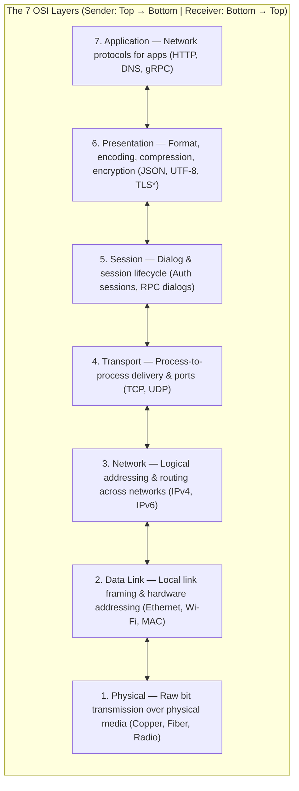
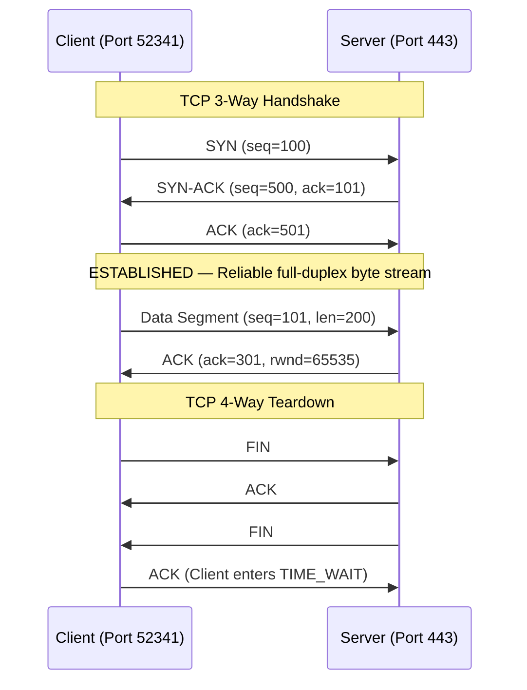
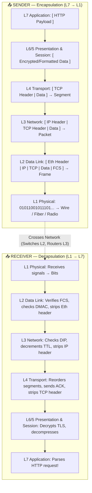
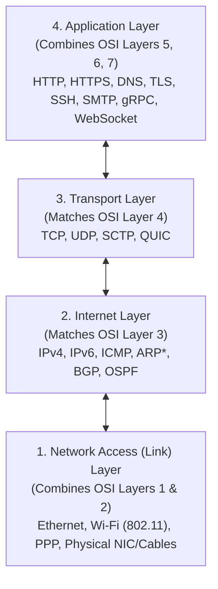
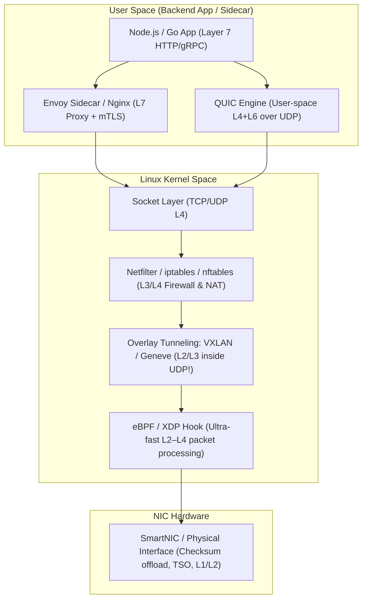
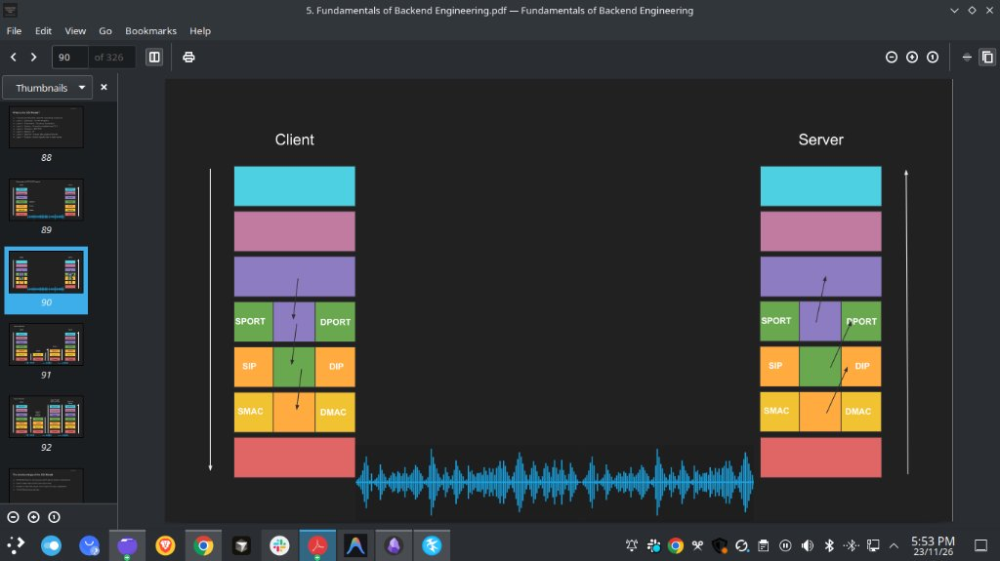
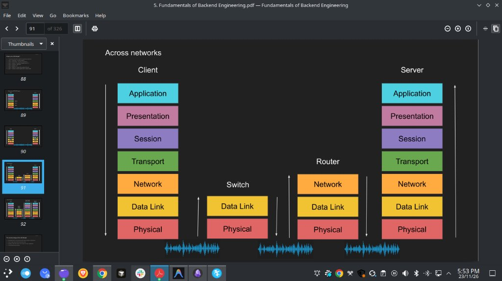

# 🌐 Networking Models — OSI, TCP/IP & Modern Architectures

### Core Mental Model — Before Everything Else

> [!important] Why Do Networking Models Exist?
> Sending data from a browser to a database involves electricity/light on cables, local hardware addresses, global internet routing, reliable byte delivery, encryption, and application semantics.
>
> Instead of building one giant monolithic system, networking is divided into **layers**. Each layer has a clear job, talks only to the layers directly above and below it, and can evolve independently (e.g., switching from Ethernet to Wi-Fi does not break HTTP).
>
> Three core models matter in backend engineering:
> 1. **OSI Model (7 Layers):** The universal **conceptual vocabulary** (L2 switch, L3 router, L4 firewall, L7 load balancer).
> 2. **TCP/IP Model (4 Layers):** The original **internet architecture** (RFC 1122 / DoD model).
> 3. **Modern 5-Layer Hybrid + Hourglass / Cloud Models:** How **modern textbooks, Linux kernels, QUIC, and cloud-native infrastructure** actually work today.

| OSI (7 Layers) | Hybrid (5 Layers) | TCP/IP (4 Layers) | Key Technologies |
| :---: | :---: | :---: | :--- |
| **7. Application** | **5. Application** | **4. Application** | HTTP/1.1, HTTP/2, HTTP/3, DNS, gRPC, WebSocket |
| **6. Presentation** | *(merged into App)* | *(merged into App)* | TLS, JSON, Protobuf, UTF-8, gzip, Brotli |
| **5. Session** | *(merged into App)* | *(merged into App)* | Session tokens, TLS tickets, RPC dialogs |
| **4. Transport** | **4. Transport** | **3. Transport** | TCP, UDP, QUIC (over UDP) |
| **3. Network** | **3. Network** | **2. Internet** | IPv4, IPv6, ICMP, BGP, OSPF |
| **2. Data Link** | **2. Data Link** | **1. Network Access** | Ethernet, Wi-Fi (802.11), ARP, MAC, VLAN |
| **1. Physical** | **1. Physical** | *(merged into Link)* | Cat6 copper, Fiber optics, Radio waves |

---

## Topics Covered

| Section | Topic | Core Question |
| :--- | :--- | :--- |
| §1 | What Is the OSI Model? | Why do we layer networking, and how do layers interact? |
| §2 | OSI Layer 1 — Physical | How do raw bits become electrical, optical, or radio signals? |
| §3 | OSI Layer 2 — Data Link | How do MAC addresses, frames, switches, and ARP work? |
| §4 | OSI Layer 3 — Network | How do IP addresses, routers, and CIDR enable global routing? |
| §5 | OSI Layer 4 — Transport | How do ports, TCP, and UDP provide end-to-end delivery? |
| §6 | OSI Layer 5 — Session | What was Session meant to do, and why is it merged today? |
| §7 | OSI Layer 6 — Presentation | How do encoding, compression, and TLS fit in? |
| §8 | OSI Layer 7 — Application | Why is HTTP/DNS Layer 7, and not your UI? |
| §9 | Encapsulation, Decapsulation & PDUs | How are headers added and stripped end-to-end? |
| §10 | The 4-Layer TCP/IP Model | How does the real Internet model work, and why did it beat OSI? |
| §11 | Modern Networking Models | 5-Layer Hybrid, Internet Hourglass, Kernel/User-space, Overlays |
| §12 | Real-World HTTPS POST Walkthrough | Course slides: `SPORT/DPORT`, `SIP/DIP`, `SMAC/DMAC`, L4 vs L7 |
| §13 | Protocol & Device Mapping | Quick lookup by layer |
| §14 | Memory Aids & Interview Q&A | Mnemonics and high-frequency engineering questions |
| §15 | Glossary, References & Next Topics | Definitions, RFCs, books, and deep-dive topics |

---

## 1. What Is the OSI Model?

The **OSI (Open Systems Interconnection) Model** (standardized by ISO in 1984) is a **7-layer conceptual reference model** that explains how data travels from an application on one machine to an application on another machine.

### Why Layering Matters (The Power of Abstraction)
Think of each layer as an **API contract**:
- **Application developers** write HTTP requests without caring whether packets travel over fiber-optic cable or 5G radio.
- **Router engineers** forward IP packets without caring whether the payload is a JSON API response or a video stream.
- **Hardware engineers** improve Wi-Fi speeds without rewriting TCP or HTTP.

**Everyday Analogy — Sending a Physical Letter:**
```text
Layer 7 (Application)  : You write the letter in English ("Send $50")
Layer 6 (Presentation) : You translate/format or seal it in a tamper-evident envelope
Layer 5 (Session)      : You track the ongoing conversation ("Reply to Letter #3")
Layer 4 (Transport)    : Registered mail tracking number & delivery confirmation
Layer 3 (Network)      : Street address + Postal/ZIP code (global routing)
Layer 2 (Data Link)    : Local mail carrier delivering to your specific mailbox
Layer 1 (Physical)     : Roads, trucks, airplanes physically moving the paper
```



> [!note] Key Mental Rule: Lower Layers Serve Higher Layers
> On a single machine, **Layer $N$ provides a service to Layer $N+1$** and **relies on Layer $N-1$**.
> Logically, Layer 4 on the Client talks to Layer 4 on the Server (peer-to-peer), even though physically the bytes must drop all the way down to Layer 1, cross the wire, and climb back up to Layer 4 on the other side.

---

## 2. OSI Layer 1 — Physical Layer

> **OSI Layer 1** | **PDU:** Bits (`0` and `1`) | **Devices:** Cables, Repeaters, Hubs, NIC Transceivers

The Physical Layer moves **raw bits** across a physical medium. It has zero understanding of headers, IP addresses, MAC addresses, or packets — it only knows voltages, light pulses, and radio frequencies.

**Core Responsibilities:**
- Converting digital bits (`0`/`1`) into physical signals (**modulation / line coding** such as NRZ, Manchester, PAM4, QAM)
- Defining physical topology, connectors (RJ45, SFP+), pinouts, and voltage levels
- Defining bit rate (bits per second, e.g., 1 Gbps, 10 Gbps) and synchronization clocks
- Defining transmission mode: simplex, half-duplex, or full-duplex at the signal level

| Physical Medium | Signal Type | Typical Use Case |
| :--- | :--- | :--- |
| **Twisted-Pair Copper (Cat5e/6/6a)** | Electrical voltage pulses | Office LANs, desktop to switch (up to 100m) |
| **Fiber-Optic (Single/Multi-mode)** | Laser / LED light pulses | Data centers, undersea cables, ISP backbones (km+) |
| **Wireless RF (Wi-Fi, 5G, Bluetooth)** | Electromagnetic radio waves | Mobile devices, laptops, IoT |
| **Coaxial Cable** | Shielded electrical signals | Cable broadband internet |

> [!note] Hub (Layer 1) vs Switch (Layer 2)
> A **Hub** is a dumb Layer 1 repeater: when a bit arrives on Port 1, it blindly blasts that electrical signal out of Ports 2, 3, and 4. Every device hears everything (causing collisions). Modern networks replaced hubs with **Layer 2 Switches**.

---

## 3. OSI Layer 2 — Data Link Layer

> **OSI Layer 2** | **PDU:** Frame | **Devices:** Switches, Bridges, Wireless Access Points | **Protocols:** Ethernet (802.3), Wi-Fi (802.11), ARP, VLAN (802.1Q)

The Data Link Layer provides **node-to-node delivery on the same local network segment (LAN)**. It turns raw Layer 1 bits into structured **Frames** and uses **MAC addresses** to deliver them to the right machine on the local link.

**Core Responsibilities:**
- **Framing:** Wrapping Network Layer packets with a header and trailer so the NIC knows where a frame starts and ends
- **Physical (MAC) Addressing:** Identifying sender and receiver NICs on the local broadcast domain
- **Error Detection:** Verifying frame integrity with **FCS (Frame Check Sequence / CRC-32)** and dropping corrupted frames
- **Media Access Control (MAC sublayer):** Coordinating shared media access (e.g., CSMA/CA in Wi-Fi so devices don't talk over each other)

### A. MAC Address (48-bit Hardware Identifier)
Every Network Interface Card (NIC) has a 48-bit (6-byte) MAC address written in hex:
```text
00:1A:2B : 3C:4D:5E
└──────┘   └──────┘
  OUI        NIC Specific
(Vendor ID) (Device ID)
```
- `FF:FF:FF:FF:FF:FF` is the **Layer 2 broadcast address** (delivered to every device on the LAN).

> [!caution] Crucial Rule: MAC Addresses Are Local-Only (Hop-by-Hop)
> MAC addresses **never cross a router**. When your packet leaves your home network for Google, your Ethernet frame's Destination MAC is **your home router's MAC**, not Google's. At every router hop along the internet, the old Layer 2 frame is stripped off and a brand-new Layer 2 frame is built for the next hop.

### B. Ethernet II Frame Structure
```text
┌────────────────┬────────────────┬───────────┬─────────────────────┬───────────┐
│ Destination MAC│   Source MAC   │ EtherType │  Payload (IP Packet)│    FCS    │
│   (6 bytes)    │   (6 bytes)    │ (2 bytes) │   (46–1500 bytes)   │ (4 bytes) │
└────────────────┴────────────────┴───────────┴─────────────────────┴───────────┘
```
- **EtherType** tells the OS which Layer 3 protocol is inside: `0x0800` = IPv4, `0x86DD` = IPv6, `0x0806` = ARP.
- **1500 bytes** is the standard Ethernet **MTU (Maximum Transmission Unit)** for payload.

### C. How a Layer 2 Switch Works
A switch maintains a **MAC Address Table (CAM table)** mapping `MAC → Switch Port`:
1. Frame arrives on Port 1 from `SMAC = AA:AA...` → Switch learns "`AA:AA` is on Port 1".
2. Switch checks `DMAC = BB:BB...` in its table.
3. If known (e.g., Port 3) → forwards frame **only** out Port 3.
4. If unknown → floods frame out all ports except Port 1.

### D. ARP (Address Resolution Protocol)
Bridges Layer 3 (IP) and Layer 2 (MAC) on IPv4 networks (IPv6 uses **NDP — Neighbor Discovery Protocol** over ICMPv6):
```text
1. App wants to send packet to 192.168.1.1 (Default Gateway), but only knows its IP.
2. OS checks local ARP cache (`arp -a` or `ip neigh`). If missing:
3. OS sends Layer 2 Broadcast: "Who has 192.168.1.1? Tell 192.168.1.5 (my MAC)"
4. Router replies (unicast):    "192.168.1.1 is at 11:22:33:44:55:66"
5. OS caches the mapping and sends the Ethernet frame!
```

---

## 4. OSI Layer 3 — Network Layer

> **OSI Layer 3** | **PDU:** Packet | **Devices:** Routers, Layer 3 Switches | **Protocols:** IPv4, IPv6, ICMP, OSPF, BGP, IPsec

The Network Layer provides **end-to-end logical addressing and routing across interconnected networks** (the "inter-net"). While Layer 2 gets a frame across *one wire*, Layer 3 gets a packet across *the globe*.

**Core Responsibilities:**
- **Logical Addressing (IP):** Assigning globally or privately routable addresses independent of hardware
- **Routing:** Building routing tables (via BGP, OSPF) to choose the best path across networks
- **Forwarding:** Examining the destination IP and moving the packet to the next-hop router
- **TTL / Hop Limit:** Decremented by 1 at each router; if it hits `0`, the packet is dropped (prevents infinite routing loops — `traceroute` relies on this!)
- **Fragmentation (IPv4):** Splitting packets larger than a link's MTU (avoided in IPv6 and modern TCP via Path MTU Discovery)

### IPv4 vs IPv6 Comparison
| Feature | IPv4 | IPv6 |
| :--- | :--- | :--- |
| **Address Size** | 32 bits (~4.3 billion) | 128 bits (~$3.4 \times 10^{38}$) |
| **Format** | Dotted decimal (`192.168.1.10`) | Hexadecimal (`2001:db8::1`) |
| **Header Size** | 20 bytes (variable with options) | 40 bytes (fixed, simpler for routers) |
| **NAT Needed?** | Heavily (due to address exhaustion) | No (every device can have a public IP) |
| **Router Fragmentation** | Allowed (unless `DF` bit is set) | Not allowed by routers (sender only) |

### Routing vs Forwarding
- **Routing (Control Plane):** Routers exchanging topology maps via protocols like **OSPF** (inside an organization) and **BGP** (between ISPs/ASNs on the internet) to build routing tables.
- **Forwarding (Data Plane):** A router taking an incoming packet, performing a **longest-prefix match** on `Destination IP` against its routing table, rewriting the Layer 2 MAC header, and sending it out the chosen interface.

---

## 5. OSI Layer 4 — Transport Layer

> **OSI Layer 4** | **PDU:** Segment (TCP) / Datagram (UDP) | ⚠️ **Critical for Backend Engineers**

Layer 3 gets a packet to the right **machine** (`IP`). Layer 4 gets data to the right **process/application** running on that machine (`Port`) and optionally adds reliability, ordering, and flow control.

### A. Ports & The 5-Tuple
A network socket/connection in the OS kernel is uniquely identified by a **5-tuple**:
```text
(Protocol, Source IP, Source Port, Destination IP, Destination Port)
Example: (TCP, 192.168.1.5, 52341, 93.184.216.34, 443)
```
- **Well-known ports (0–1023):** `22` (SSH), `53` (DNS), `80` (HTTP), `443` (HTTPS)
- **Registered ports (1024–49151):** `3306` (MySQL), `5432` (PostgreSQL), `6379` (Redis), `8080` (HTTP alt)
- **Ephemeral ports (49152–65535):** Dynamically assigned by the OS to outbound client connections

### B. TCP vs UDP at a Glance
| Property | TCP (Transmission Control Protocol) | UDP (User Datagram Protocol) |
| :--- | :--- | :--- |
| **Model** | Connection-oriented, full-duplex **byte stream** | Connectionless, **message/datagram** based |
| **Header Size** | 20–60 bytes | 8 bytes |
| **Reliability** | Guaranteed (ACKs + Retransmissions) | Best-effort (no ACKs, can drop/reorder) |
| **Ordering** | Strictly ordered (Sequence numbers) | No ordering guarantee |
| **Flow Control** | Yes (Receiver Window / `rwnd`) | No |
| **Congestion Control** | Yes (Slow Start, CUBIC, BBR) | No |
| **Message Boundaries** | **Not preserved** (app must frame messages) | **Preserved** (1 `sendto` = 1 `recvfrom`) |
| **Use Cases** | HTTP/1.1, HTTP/2, Databases, SSH, Kafka | DNS, Video/Audio (WebRTC), Gaming, **QUIC (HTTP/3)** |



---

## 6. OSI Layer 5 — Session Layer

> **OSI Layer 5** | **PDU:** Data | **Status in Modern Stacks:** Absorbed into Layer 7 / Application Libraries

The Session Layer was designed to **open, manage, synchronize, and terminate logical conversations ("sessions")** between two applications.

**Original Design Responsibilities:**
- **Dialog Control:** Deciding whose turn it is to talk (half-duplex/full-duplex conversation tokens)
- **Synchronization / Checkpoints:** Inserting checkpoints in a massive file transfer so if the network drops at 80%, you resume from 80% instead of 0%
- **Session Lifecycle:** Creating and tearing down multi-request sessions

**Reality Today:**
In modern TCP/IP applications, there is no standalone OS "Session Layer". Instead:
- **HTTP** handles sessions via **Cookies, JWTs, or Server-side Session IDs** (Redis)
- **TLS** handles session resumption via **TLS Session Tickets**
- **gRPC / HTTP/2** manages multiplexed streams within a connection
- **RPC / NetBIOS / SMB** are historical examples often cited for Layer 5

---

## 7. OSI Layer 6 — Presentation Layer

> **OSI Layer 6** | **PDU:** Data | **Status in Modern Stacks:** Absorbed into Application / Libraries

The Presentation Layer acts as the **translator** — ensuring that data sent by one machine's internal memory representation can be understood by another machine.

**Core Responsibilities:**
1. **Character Encoding:** UTF-8, UTF-16, ASCII (preventing garbled text across OSes)
2. **Serialization / Deserialization:** Converting in-memory objects into wire formats (`JSON`, `XML`, `Protobuf`, `MessagePack`, `Avro`)
3. **Compression:** Shrinking payloads (`gzip`, `Brotli`, `zstd`) to save bandwidth
4. **Encryption / Decryption:** Protecting confidentiality and integrity (**TLS/SSL**)

> [!note] Where Does TLS Actually Live?
> Conceptually, encryption belongs to **Layer 6 (Presentation)**. Practically, **TLS sits right between Layer 4 (TCP) and Layer 7 (HTTP)** — encrypting the HTTP bytes before handing them to the TCP socket (or in QUIC, TLS 1.3 is baked directly into the Layer 4 transport handshake).

---

## 8. OSI Layer 7 — Application Layer

> **OSI Layer 7** | **PDU:** Data | ⚠️ **Where Backend Code & APIs Live**

> [!important] Layer 7 ≠ Your Frontend UI or Business Logic
> Chrome, VS Code, or React are *applications*, not Layer 7 protocols. Layer 7 consists of the **network communication protocols** that applications speak: **HTTP, DNS, SMTP, FTP, SSH, WebSocket, gRPC, MQTT**.

**Core Responsibilities:**
- Defining request/response syntax, methods, headers, and status codes
- Naming and directory services (**DNS**)
- Resource transfer (**HTTP/HTTPS**, **FTP**), Email (**SMTP/IMAP**), and RPC (**gRPC**)

**Example — HTTP/1.1 at Layer 7:**
```http
POST /api/orders HTTP/1.1
Host: api.example.com
Content-Type: application/json
Content-Length: 29

{"itemId": 42, "quantity": 1}
```
Notice HTTP has no idea if it's running over Ethernet, Wi-Fi, IPv4, or IPv6 — it simply writes structured text/bytes to a transport connection.

---

## 9. Encapsulation, Decapsulation & PDUs

When data is sent, it moves **down** the stack (L7 → L1), getting wrapped at each layer (**Encapsulation**). When received, it moves **up** the stack (L1 → L7), getting unwrapped (**Decapsulation**).



### Protocol Data Units (PDUs) Summary
| Layer | Layer Name | PDU Name | Key Header Info Added |
| :---: | :--- | :--- | :--- |
| **7–5** | Application / Pres / Session | **Data** | HTTP method/headers, JSON, TLS record |
| **4** | Transport | **Segment** (TCP) / **Datagram** (UDP) | `SPORT`, `DPORT`, Seq/Ack, Checksum |
| **3** | Network | **Packet** | `SIP`, `DIP`, TTL, Protocol |
| **2** | Data Link | **Frame** | `SMAC`, `DMAC`, EtherType, `FCS` |
| **1** | Physical | **Bits** | Physical signaling (no header) |

---

## 10. The 4-Layer TCP/IP Model (DoD / RFC 1122)

While the OSI model is the **textbook teaching model**, the **TCP/IP Model** (officially defined in **RFC 1122** and **RFC 1123**, originating from the US DoD ARPANET) is the **actual model that built the Internet**.

### Why TCP/IP Won Over OSI ("The Protocol Wars")
In the 1980s, ISO designed the 7-layer OSI suite by committee *before* writing implementations — resulting in complex, bloated specifications. Meanwhile, the IETF/DARPA built TCP/IP *bottom-up* with working Unix implementations (BSD sockets), free distribution, and the motto: *"We reject kings, presidents, and voting. We believe in rough consensus and running code."*

### The 4 Layers of the TCP/IP Model



| Layer | Name in RFC 1122 | Responsibility | Equivalent OSI Layers | Examples |
| :---: | :--- | :--- | :---: | :--- |
| **4** | **Application** | All user-facing protocols, data formatting, encoding, encryption, and session state | **5, 6, 7** | HTTP, DNS, SMTP, FTP, SSH, TLS, gRPC |
| **3** | **Transport** | Host-to-host / process-to-process communication, ports, reliability, congestion control | **4** | TCP, UDP, QUIC |
| **2** | **Internet** | Packet formatting, logical IP addressing, and routing packets across multiple networks | **3** | IPv4, IPv6, ICMP, IPsec |
| **1** | **Network Access (Link)** | Everything needed to push bits/frames across a single physical link to a neighbor | **1, 2** | Ethernet, Wi-Fi, PPP, Device Drivers, Cables |

> [!tip] Why Did TCP/IP Merge OSI Layers 5–7 and 1–2?
> 1. **Layers 5, 6, 7 → Application:** In practice, applications decide their own session state (cookies/JWT), serialization (JSON/Protobuf), and encryption (TLS). Splitting them into 3 rigid OS layers made no practical sense.
> 2. **Layers 1 & 2 → Network Access:** TCP/IP deliberately treats the underlying physical link as a black box — IP doesn't care *how* a frame reaches the next hop, as long as the link layer can deliver an IP packet.

---

## 11. Core Networking Models Used in Modern Times

Beyond classical 7-layer OSI and 4-layer TCP/IP, modern backend, systems, and cloud engineers rely on **three core architectural models**:

### 11.1 The 5-Layer Hybrid Model (Modern Industry & Textbook Standard)
This is the model taught in *Computer Networks: A Top-Down Approach* (Kurose & Ross) and *Computer Networks* (Tanenbaum), and used daily by cloud/network engineers.

**Why it exists:**
- **4-layer TCP/IP** is too coarse at the bottom (merging Physical & Data Link hides crucial differences between cables/RF and MAC switching/VLANs).
- **7-layer OSI** is too granular at the top (Session & Presentation don't exist as separate layers in modern apps).

```text
┌───────────────────────────────────────────────────────────┐
│ 5. Application  │ HTTP/3, gRPC, DNS, TLS, JSON, Sessions  │ ← User-space Apps
├─────────────────┼─────────────────────────────────────────┤
│ 4. Transport    │ TCP, UDP, Ports, Congestion Control     │ ← OS Kernel (or QUIC in User-space)
├─────────────────┼─────────────────────────────────────────┤
│ 3. Network      │ IPv4, IPv6, Routing (BGP/OSPF), NAT     │ ← OS Kernel & Routers
├─────────────────┼─────────────────────────────────────────┤
│ 2. Data Link    │ Ethernet, Wi-Fi MAC, Switches, ARP      │ ← NIC Driver & L2 Switches
├─────────────────┼─────────────────────────────────────────┤
│ 1. Physical     │ Copper, Fiber, Radio Frequencies, Bits  │ ← Hardware / Cables / Antennas
└─────────────────┴─────────────────────────────────────────┘
```

### 11.2 The "Hourglass" Model of the Internet (The Narrow Waist)
This is the **most important architectural model** explaining why the Internet scaled globally without breaking.

```text
   \  HTTP   gRPC   DNS   SSH   WebRTC   SMTP  /    ← Many Application Protocols
    \    TCP          UDP         QUIC        /     ← Few Transport Protocols
     \_______________________________________/
                  IP (IPv4 / IPv6)                  ← THE NARROW WAIST (One Universal Layer)
      _______________________________________
     /                                       \
    /  Ethernet   Wi-Fi   5G   Fiber   Starlink \   ← Many Link / Physical Technologies
```

**What this teaches us:**
1. **Everything over IP, IP over everything:** Any new link technology (like 6G or satellite) only needs to carry IP packets to join the entire internet. Any new app protocol only needs to run over IP.
2. **Protocol Ossification & Why QUIC Uses UDP:** Because routers, NATs, and firewalls inspect Layer 3 (IP) and Layer 4 (TCP/UDP), deploying a brand-new Layer 4 protocol directly over IP gets **blocked by legacy middleboxes** on the internet. That is why **HTTP/3 (QUIC)** runs **on top of UDP** — tunneling a modern transport protocol through the narrow waist's existing UDP hole!

### 11.3 Modern Cloud-Native & Linux Execution Model (Kernel vs User-Space & Overlays)
In modern Kubernetes, microservices, and high-performance backends, traffic doesn't just follow a simple textbook stack — **where** code executes (Hardware vs Kernel vs User-space) and **overlay encapsulation** define performance and architecture:



**Three Modern Shifts Every Backend Engineer Should Know:**
1. **Overlay Networking (Cloud VPCs & Kubernetes):** A Kubernetes Pod sends an Ethernet frame + IP packet, which the kernel wraps inside **another UDP packet (VXLAN/Geneve)** and sends over the physical datacenter's IP/Ethernet network (`L2-over-L3-over-L2`).
2. **Shift from Kernel to User-Space (QUIC & DPDK):** HTTP/3 moves reliability, congestion control, and TLS 1.3 *out of the OS kernel* into user-space libraries over UDP, allowing rapid updates without waiting years for OS kernel upgrades.
3. **Service Mesh & eBPF:** Traditional L3/L4 IP-based firewalls are insufficient in ephemeral container environments. Modern cloud systems use **L7 identity-based mTLS** (Envoy/Istio) combined with **eBPF/XDP** in the Linux kernel for wire-speed observability and load balancing.

---

## 12. Real-World Communication — HTTPS POST Across Layers (Course Slides)

This is where theory becomes concrete. These four slides from Hussein Nasser's Backend Engineering course trace exactly what happens when a client sends an **HTTPS POST request**.

### 12.1 OSI Layers on a Single Machine (HTTPS POST)
> *Page 89 from the course PDF — "Client sends an HTTPS POST request"*


*Figure 1: Client sends an HTTPS POST request — Encapsulation down the client stack, physical signal across the wire, and decapsulation up the server stack.*

- **Client (left):** Starts at Layer 7 (HTTPS POST) and encapsulates down to Layer 1.
- **Data Units:** **Segment** (L4) → **Packet** (L3) → **Frame** (L2) → **Signal** (L1).
- **Server (right):** Receives the raw signal at Layer 1 and decapsulates up to Layer 7.

---

### 12.2 Headers Added at Layers 2, 3, and 4
> *Page 90 from the course PDF — Header fields at Layers 2, 3, and 4*


*Figure 2: Encapsulated headers — `SPORT/DPORT` (Layer 4), `SIP/DIP` (Layer 3), and `SMAC/DMAC` (Layer 2).*

| Layer | Headers Added | Meaning | Changes Across Hops? |
| :--- | :--- | :--- | :--- |
| **Layer 4 (Transport)** | `SPORT`, `DPORT` | Source Port, Destination Port (`52341` → `443`) | **No** *(unless NAT translates ports)* |
| **Layer 3 (Network)** | `SIP`, `DIP` | Source IP, Destination IP (`192.168.1.5` → `93.184.216.34`) | **No** *(unless NAT translates private IP)* |
| **Layer 2 (Data Link)** | `SMAC`, `DMAC` | Source MAC, Destination MAC (`Client MAC` → `Next-Hop MAC`) | **YES — changes at every router hop!** |

---

### 12.3 OSI Across Networks — Switch vs. Router
> *Page 91 from the course PDF — "Across networks" with Switch and Router*


*Figure 3: Intermediate devices only inspect up to the layer they need — Switches stop at Layer 2; Routers stop at Layer 3.*

- **Switch (Layer 2):** Reads up to **Data Link (L2)** (`DMAC`), forwards the frame within the local LAN, and never inspects IP or TCP headers.
- **Router (Layer 3):** Reads up to **Network (L3)** (`DIP`), looks up its routing table, strips the old Layer 2 frame, wraps the IP packet in a new Layer 2 frame (`SMAC/DMAC` for the next link), and forwards it.

---

### 12.4 OSI With Layer 4 Proxy/Firewall + Layer 7 Load Balancer/CDN
> *Page 92 from the course PDF — "Across networks" with Layer 4 Proxy/Firewall and Layer 7 Load Balancer/CDN*


*Figure 4: Real production path — Layer 4 Proxies/Firewalls inspect IP+Port; Layer 7 Load Balancers/CDNs terminate TLS and inspect HTTP.*

| Feature | Layer 4 Proxy / Firewall | Layer 7 Load Balancer / CDN (Nginx, Envoy, ALB, Cloudflare) |
| :--- | :--- | :--- |
| **OSI Visibility** | IP (`SIP/DIP`) + Port (`SPORT/DPORT`) | Full HTTP: URL path, Headers, Cookies, Body |
| **TLS Termination** | **No** (passes encrypted TLS stream straight through) | **Yes** (decrypts TLS to inspect HTTP, re-encrypts or sends HTTP internally) |
| **Routing Decisions** | Connection-level (`IP:Port` hashing, round-robin) | Content-level (`/api` → Service A, `/static` → CDN cache) |
| **Performance** | Extremely fast (minimal parsing) | Higher CPU cost (TLS + HTTP parsing) |
| **Security** | IP allow/block lists, port filtering, SYN flood protection | **WAF** (blocks SQLi, XSS), JWT auth, rate-limiting by user |

> [!tip] Practical Debugging Using Layers
> - **Timeout / `ECONNREFUSED` at Layer 3/4?** Check routing tables, security groups, firewall rules, or listening port.
> - **TLS Handshake Error (Layer 4/6 boundary)?** Check expired certificates, SNI hostname, or cipher mismatch.
> - **`403 Forbidden` / `404` / `502 Bad Gateway` at Layer 7?** Check Nginx/ALB routing rules, WAF blocks, or upstream app health.

---

## 13. Protocol & Device Mapping Quick Reference

| Protocol / Device | OSI Layer | Hybrid 5-Layer | TCP/IP 4-Layer | Role |
| :--- | :---: | :---: | :---: | :--- |
| **HTTP / HTTPS / gRPC / DNS** | 7 | 5 (App) | 4 (App) | Application protocols |
| **TLS / JSON / Protobuf / gzip** | 6 | 5 (App) | 4 (App) | Encryption, serialization, compression |
| **TCP / UDP / QUIC** | 4 | 4 (Transport) | 3 (Transport) | End-to-end transport & ports |
| **IPv4 / IPv6 / ICMP / BGP / Router** | 3 | 3 (Network) | 2 (Internet) | Global addressing & routing |
| **Ethernet / Wi-Fi / MAC / Switch / ARP** | 2 | 2 (Data Link) | 1 (Link) | Local framing & MAC forwarding |
| **Cat6 / Fiber / RF / Hub / Repeater** | 1 | 1 (Physical) | 1 (Link) | Raw bit signaling |

---

## 14. Memory Aids & Interview Q&A

### Mnemonics
- **Top → Bottom (7 to 1):** **A**ll **P**eople **S**eem **T**o **N**eed **D**ata **P**rocessing *(Application, Presentation, Session, Transport, Network, Data Link, Physical)*
- **Bottom → Top (1 to 7):** **P**lease **D**o **N**ot **T**hrow **S**ausage **P**izza **A**way
- **PDUs (Bottom → Top):** **B**its → **F**rames → **P**ackets → **S**egments → **D**ata

### High-Frequency Interview Questions
| Question | Concise, Accurate Answer |
| :--- | :--- |
| **OSI vs TCP/IP vs 5-Layer Hybrid?** | OSI has 7 conceptual layers; TCP/IP (RFC 1122) has 4 practical layers (merging L1–2 and L5–7); the 5-Layer Hybrid keeps Physical & Data Link separate while merging L5–7 into Application. |
| **Why did TCP/IP beat OSI?** | TCP/IP had working code first (Unix/BSD), simpler design, and open standardization; OSI was overly complex and designed by committee before implementation. |
| **Do switches read IP addresses?** | No. Standard L2 switches forward using **MAC addresses**. (Only specialized L3 switches route by IP). |
| **Why do MAC addresses change at every hop while IP stays the same?** | MAC addresses are local-link identifiers (`SMAC/DMAC`) for the next physical hop; IP addresses (`SIP/DIP`) identify the end-to-end endpoints (unless modified by NAT). |
| **Where does HTTP/3 (QUIC) sit in the models?** | QUIC runs over **UDP (Layer 4)** in user space and bundles transport reliability + **TLS 1.3 (Layer 6)** + multiplexed streams together to avoid TCP head-of-line blocking and middlebox ossification. |
| **What can a Layer 7 LB do that a Layer 4 LB cannot?** | Terminate TLS and route based on URL path, HTTP headers, cookies, or body content — whereas L4 only sees IP and TCP/UDP ports. |

---

## 15. Glossary, References & Next Topics

### Key Terms
| Term | Definition |
| :--- | :--- |
| **PDU** | Protocol Data Unit — name of the data container at each layer (Bits, Frame, Packet, Segment/Datagram, Data) |
| **Encapsulation / Decapsulation** | Adding headers down the sender stack (L7→L1) and stripping them up the receiver stack (L1→L7) |
| **Narrow Waist (Hourglass)** | The architectural principle where IP sits as the single universal Layer 3 protocol connecting diverse link layers and applications |
| **ARP / NDP** | Address Resolution Protocol (IPv4→MAC) / Neighbor Discovery Protocol (IPv6→MAC) |
| **MTU / PMTUD** | Maximum Transmission Unit (typically 1500B on Ethernet) and Path MTU Discovery |
| **VXLAN / Geneve** | Cloud overlay protocols encapsulating Layer 2/3 container packets inside Layer 4 UDP packets |
| **eBPF / XDP** | Linux kernel technologies enabling high-speed programmable packet processing at L2–L4 |

### References & Books
- **RFC 1122** — *Requirements for Internet Hosts — Communication Layers* (Defines the 4-layer TCP/IP architecture)
- **Computer Networks: A Top-Down Approach** — *Kurose & Ross* (Uses the 5-layer hybrid model; gold standard for learning)
- **TCP/IP Illustrated, Vol. 1** — *W. Richard Stevens* (Deep packet-level reference)
- **High Performance Browser Networking** — *Ilya Grigorik* ([hpbn.co](https://hpbn.co))
- [ByteByteGo — Network Protocols Run the Internet](https://blog.bytebytego.com/p/network-protocols-run-the-internet)
- [Cloudflare — What is the OSI Model?](https://www.cloudflare.com/en-ca/learning/ddos/glossary/open-systems-interconnection-model-osi/)

### Topics for Further Investigation
- TCP `TIME_WAIT`, Nagle's algorithm (`TCP_NODELAY`), and BBR congestion control
- Path MTU Discovery (PMTUD) and why "ICMP black holes" break connections
- How Linux `iptables` / `nftables` / `eBPF` hook into the kernel network stack
- Cloud VPC & Kubernetes CNI overlay networking (VXLAN, Cilium eBPF)
- QUIC connection migration and zero-RTT handshakes
