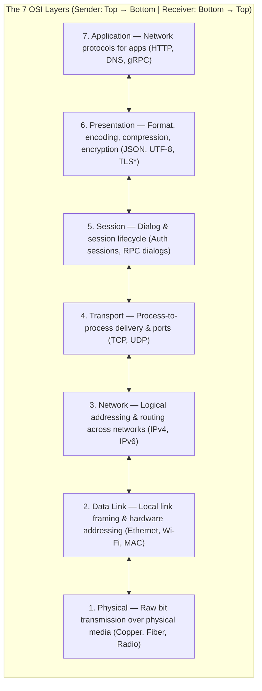
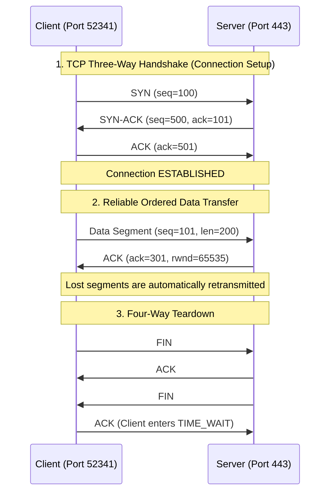
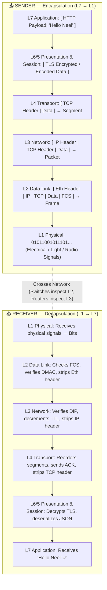
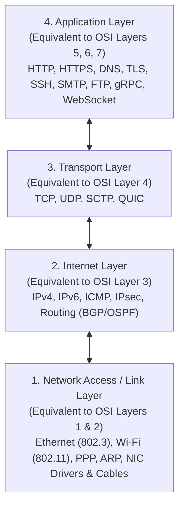
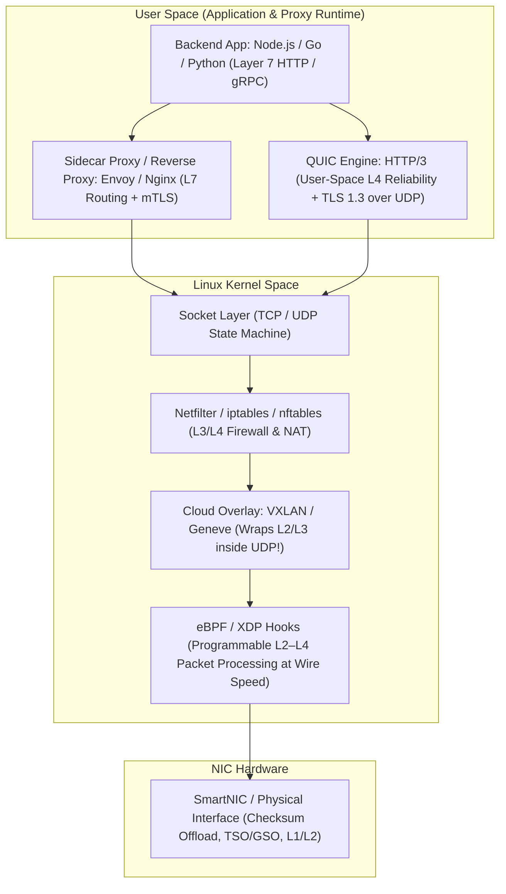
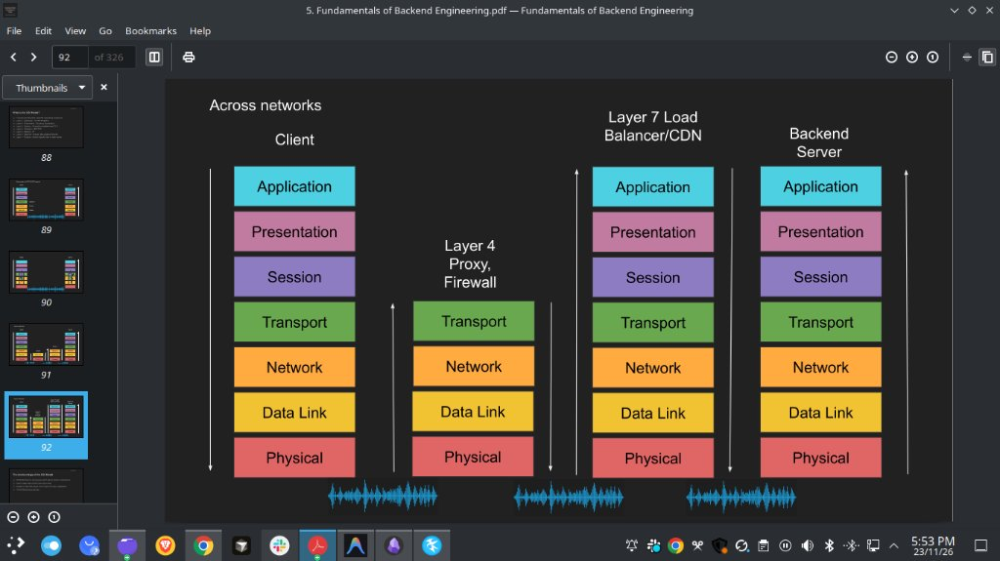

# 🌐 Networking Models — OSI, TCP/IP & Modern Architectures

### Core Mental Model — Before Everything Else

> [!important] Why Do Networking Models Exist?
> Sending data from a browser to a database involves electrical signals or light pulses on cables, local hardware addresses, global internet routing, reliable byte delivery, encryption, and application semantics.
>
> Instead of building one giant monolithic system, networking is divided into **layers**. Each layer has a clearly defined job, communicates only with the layers directly above and below it, and can evolve independently (for example, switching from Ethernet to Wi-Fi does not break HTTP).
>
> Three core models matter in backend engineering:
> 1. **OSI Model (7 Layers):** The universal **conceptual vocabulary** used across industry (`L2 switch`, `L3 router`, `L4 firewall`, `L7 load balancer`).
> 2. **TCP/IP Model (4 Layers):** The original **internet architecture** (RFC 1122 / DoD model) that actually built the internet.
> 3. **Modern Models (5-Layer Hybrid, Internet Hourglass, & Cloud/Linux Stack):** How **modern textbooks, Linux kernels, QUIC/HTTP3, Kubernetes overlays, and cloud-native infrastructure** work today.

| OSI Model (7 Layers) | Hybrid Model (5 Layers) | TCP/IP Model (4 Layers) | Key Technologies |
| :---: | :---: | :---: | :--- |
| **7. Application** | **5. Application** | **4. Application** | HTTP/1.1, HTTP/2, HTTP/3, DNS, gRPC, WebSocket, SMTP |
| **6. Presentation** | *(merged into App)* | *(merged into App)* | TLS/SSL, JSON, XML, Protobuf, UTF-8, gzip, Brotli |
| **5. Session** | *(merged into App)* | *(merged into App)* | Session tokens, JWT, TLS session tickets, RPC dialogs |
| **4. Transport** | **4. Transport** | **3. Transport** | TCP, UDP, SCTP, QUIC (over UDP) |
| **3. Network** | **3. Network** | **2. Internet** | IPv4, IPv6, ICMP, BGP, OSPF, IPsec |
| **2. Data Link** | **2. Data Link** | **1. Network Access** | Ethernet (802.3), Wi-Fi (802.11), ARP, MAC, VLAN (802.1Q) |
| **1. Physical** | **1. Physical** | *(merged into Link)* | Cat6 copper, Fiber optics, Radio waves, Hubs, Repeaters |

---

## Topics Covered

| Section | Topic | Core Question |
| :--- | :--- | :--- |
| §1 | What Is the OSI Model? | Why do we layer networking, and how do layers communicate? |
| §2 | OSI Layer 1 — Physical | How do raw bits become electrical, optical, or radio signals? |
| §3 | OSI Layer 2 — Data Link | How do MAC addresses, Ethernet frames, switches, and ARP work? |
| §4 | OSI Layer 3 — Network | How do IP addresses, routers, TTL, and BGP/OSPF enable global routing? |
| §5 | OSI Layer 4 — Transport | How do ports, 5-tuples, TCP, and UDP provide end-to-end delivery? |
| §6 | OSI Layer 5 — Session | What was Session meant to do, and why is it merged into apps today? |
| §7 | OSI Layer 6 — Presentation | How do encoding, serialization, compression, and TLS fit in? |
| §8 | OSI Layer 7 — Application | Why is HTTP/DNS Layer 7, and not your frontend UI? |
| §9 | Encapsulation, Decapsulation & PDUs | How are headers added and stripped end-to-end? |
| §10 | The 4-Layer TCP/IP Model | How does the real Internet model work, and why did it beat OSI? |
| §11 | Core Modern Networking Models | 5-Layer Hybrid, Internet Hourglass, Kernel vs User-Space & Overlays |
| §12 | Real-World HTTPS POST Walkthrough | Course slides: `SPORT/DPORT`, `SIP/DIP`, `SMAC/DMAC`, L4 vs L7 |
| §13 | Protocol & Device Mapping | Quick lookup across all 3 models and 13 hardware/software devices |
| §14 | Memory Aids | Top-down, bottom-up, and PDU mnemonics |
| §15 | Interview Questions & Answers | 20 high-frequency backend and networking interview questions |
| §16 | Glossary | 30+ essential networking definitions |
| §17 | References & Further Investigation | RFCs, textbooks, articles, and advanced deep-dive topics |

---

## 1. What Is the OSI Model?

The **OSI (Open Systems Interconnection) Model** (standardized by ISO in 1984) is a **conceptual networking framework** that explains how data travels between two devices over a network.

It divides network communication into **seven distinct layers**, where each layer has a specific responsibility and interacts only with the layer directly above and below it.

### Why Layering Matters (Abstraction & Modularity)
Without layers, every web browser would have to know how Ethernet voltage levels, Wi-Fi radio interference, router BGP tables, and fiber-optic cables work just to fetch a webpage. Layering acts like an **API contract**:
- **Application developers** write HTTP requests without caring whether packets travel over copper Ethernet or 5G cellular radio.
- **Router engineers** forward IP packets without caring whether the payload inside is a JSON API response, a SQL query, or a video stream.
- **Hardware engineers** invent faster fiber-optic transceivers without anyone having to rewrite TCP or HTTP.

### Everyday Analogy — Sending a Physical Letter
```text
Layer 7 (Application)  : You write the letter in English ("Please send $50")
Layer 6 (Presentation) : You translate/format it or put it in a tamper-evident envelope
Layer 5 (Session)      : You track the ongoing conversation ("Reply to Letter #3")
Layer 4 (Transport)    : Registered mail tracking number & delivery confirmation
Layer 3 (Network)      : Street address + City + Postal/ZIP code (global routing)
Layer 2 (Data Link)    : Local mail carrier delivering to your specific mailbox
Layer 1 (Physical)     : Roads, trucks, airplanes physically moving the paper
```

### Technical Example — Opening a Website in Your Browser
```text
Layer 7 (Application)  : Browser creates an HTTP GET request
Layer 6 (Presentation) : Data is UTF-8 encoded, compressed (gzip), and TLS encrypted
Layer 5 (Session)      : Session state / TLS session ticket / cookies are managed
Layer 4 (Transport)    : TCP breaks data into segments and adds Source/Dest Ports
Layer 3 (Network)      : IP adds Source/Dest IP addresses for global routing
Layer 2 (Data Link)    : Ethernet/Wi-Fi wraps packet into a Frame with MAC addresses
Layer 1 (Physical)     : NIC converts bits into electrical, optical, or radio signals
```



> [!note] OSI Is Conceptual (Vocabulary, Not Strict Law)
> The OSI model is a reference framework, not a rigid implementation recipe. Some real-world protocols (like TLS or ARP) span layers or sit between them. The **TCP/IP model** (Section 10) describes the actual architecture of the internet, while **OSI** gives engineers a shared vocabulary.

**Summary of the Seven Layers (Top to Bottom):**

| Layer | Name | PDU | Key Responsibility |
| :---: | :--- | :--- | :--- |
| **7** | Application | Data | Provides network protocols directly to applications |
| **6** | Presentation | Data | Data formatting, character encoding, compression, encryption |
| **5** | Session | Data | Establishes, manages, and terminates logical sessions |
| **4** | Transport | Segment / Datagram | End-to-end process delivery via ports, reliability, flow control |
| **3** | Network | Packet | Logical IP addressing and routing across multiple networks |
| **2** | Data Link | Frame | Local network delivery, framing, MAC addressing, error detection |
| **1** | Physical | Bits | Transmits raw 0s and 1s as physical signals over media |

---

## 2. OSI Layer 1 — Physical Layer

> **OSI Layer 1** | **PDU:** Bits (`0` and `1`) | **Devices:** Cables, Repeaters, Hubs, NIC Transceivers

The Physical Layer is responsible for **transmitting raw bits (`0`s and `1`s)** through a physical communication medium. It has zero understanding of headers, IP addresses, MAC addresses, or packets — it only understands electrical voltages, light pulses, and radio frequencies.

**Main Responsibilities:**
- Converting digital bits into physical signals (**line coding / modulation**, e.g., NRZ, Manchester, PAM4, QAM)
- Defining electrical, optical, and wireless radio specifications
- Defining cables, connectors (RJ45, SFP+, LC/SC fiber), and pinouts
- Setting transmission speed (bit rate / baud rate) and clock synchronization
- Defining physical topology (bus, star, mesh) and signal-level duplex mode

```text
Sender NIC                                                 Receiver NIC
  |                                                             |
  |  0101010111000101... (converted to voltage / light / RF)    |
  | ==========================================================> |
  |               Copper Wire / Fiber / Radio Airwaves          |
```

**Examples of Physical Media:**

| Medium | Signal Type | Typical Speed / Range | Common Use Case |
| :--- | :--- | :--- | :--- |
| **Twisted-Pair Copper (Cat5e/6/6a)** | Electrical voltage pulses | 1–10 Gbps (up to 100m) | Office LANs, desktop to switch |
| **Fiber-Optic (Single/Multi-mode)** | Laser / LED light pulses | 10–400+ Gbps (meters to 100+ km) | Data centers, undersea cables, ISP backbones |
| **Wireless RF (Wi-Fi, 5G, Bluetooth)** | Electromagnetic radio waves | Mbps to multi-Gbps (local/cell) | Laptops, phones, IoT devices |
| **Coaxial Cable** | Shielded electrical signals | Hundreds of Mbps to Gbps | Cable broadband internet |

**Technologies & Devices at Layer 1:**

| Component | Purpose |
| :--- | :--- |
| **Ethernet PHY standards (1000BASE-T)** | Defines how bits map to electrical signals on copper |
| **Fiber Optics / SFP+ Transceivers** | Converts electrical bits into light pulses |
| **USB / Serial Physical Signaling** | Short-range physical bit transmission |
| **Repeaters** | Regenerates and amplifies weak signals over long distances |
| **Hubs** | Multi-port repeater that broadcasts every incoming bit to *all* ports |

> [!note] Hub (Layer 1) vs. Switch (Layer 2)
> A **Hub** operates at Layer 1 — when a signal arrives on Port 1, it blindly repeats that electrical signal out of Ports 2, 3, and 4, causing collisions and wasted bandwidth. Modern networks replaced hubs with **Layer 2 Switches**, which read MAC addresses and forward frames only to the intended port.

**Data Unit (PDU):** Bits

---

## 3. OSI Layer 2 — Data Link Layer

> **OSI Layer 2** | **PDU:** Frame | **Devices:** Switches, Bridges, Wireless Access Points | **Protocols:** Ethernet (802.3), Wi-Fi (802.11), PPP, VLAN (802.1Q), ARP

The Data Link Layer is responsible for **node-to-node communication between devices on the same local network link (LAN)**. It takes packets from the Network Layer and wraps them into structured **Frames** for local delivery.

**Main Responsibilities:**
- **Framing:** Organizing raw bits into structured frames with start/end boundaries
- **MAC Addressing:** Identifying sender and receiver network interfaces on the local segment
- **Local Network Delivery:** Delivering frames to the right device on the same LAN
- **Error Detection:** Verifying frame integrity via the **Frame Check Sequence (FCS / CRC-32)** and dropping corrupted frames
- **Media Access Control (MAC sublayer):** Coordinating who can transmit on a shared medium (e.g., CSMA/CA in Wi-Fi)

### A. What Is a MAC Address?
A **MAC (Media Access Control) address** is a 48-bit (6-byte) hardware identifier burned into a Network Interface Card (NIC), written in hexadecimal:
```text
00:1A:2B : 3C:4D:5E
└──────┘   └──────┘
  OUI        NIC Specific
(Vendor ID) (Device ID)
```
- `FF:FF:FF:FF:FF:FF` is the **Layer 2 broadcast address** (every device on the local LAN receives it).

> [!caution] Crucial Rule: MAC Addresses Are LOCAL Only (Hop-by-Hop)
> MAC addresses identify devices **on the same local network segment only**. When your laptop sends a packet to Google, your Ethernet frame's Destination MAC is **your home router's MAC address**, not Google's. At every router hop along the internet, the old Layer 2 frame is stripped off and a brand-new Layer 2 frame is built for the next hop.

### B. What Is an Ethernet II Frame?
An Ethernet frame is the Layer 2 data unit:
```text
┌──────────────────┬─────────────────┬───────────┬─────────────────────┬─────┐
│ Destination MAC  │   Source MAC    │ EtherType │       Payload       │ FCS │
│    (6 bytes)     │   (6 bytes)     │ (2 bytes) │   (46–1500 bytes)   │(4B) │
└──────────────────┴─────────────────┴───────────┴─────────────────────┴─────┘
```
- **Destination MAC:** Hardware address of the next-hop receiver on this link
- **Source MAC:** Hardware address of the sender on this link
- **EtherType:** Identifies the Layer 3 protocol inside (`0x0800` = IPv4, `0x86DD` = IPv6, `0x0806` = ARP)
- **Payload:** The Layer 3 IP packet (standard Ethernet **MTU = 1500 bytes**)
- **FCS (Frame Check Sequence):** 32-bit CRC checksum used to detect bit corruption on the wire

### C. How a Layer 2 Switch Works
A switch maintains an in-memory **MAC Address Table (CAM Table)** mapping `MAC Address → Switch Port`:
1. A frame arrives on **Port 1** with `Source MAC = AA:AA...` → Switch learns "`AA:AA` lives on Port 1".
2. Switch inspects `Destination MAC = BB:BB...`.
3. If `BB:BB` is in the table (e.g., Port 3) → forwards the frame **only** out Port 3.
4. If `BB:BB` is unknown (or broadcast `FF:FF...`) → floods the frame out all ports except Port 1.

### D. What Is ARP?
**ARP (Address Resolution Protocol)** bridges Layer 3 and Layer 2 on IPv4 networks by answering: *"I know the IPv4 address, but what MAC address should I put in the Ethernet frame?"* (IPv6 uses **NDP — Neighbor Discovery Protocol** over ICMPv6 instead of ARP).

```text
1. Your PC wants to send a packet to 192.168.1.1 (Default Gateway)
2. OS checks its ARP table (`ip neigh` or `arp -a`). If missing:
3. PC broadcasts Layer 2 ARP Request : "Who has 192.168.1.1? Tell 192.168.1.5"
4. Router replies with ARP Reply     : "192.168.1.1 is at AA:BB:CC:DD:EE:FF"
5. PC caches the MAC and sends the Ethernet frame!
```

**Data Unit (PDU):** Frame

---

## 4. OSI Layer 3 — Network Layer

> **OSI Layer 3** | **PDU:** Packet | **Devices:** Routers, Layer 3 Switches | **Protocols:** IPv4, IPv6, ICMP, IPsec, OSPF, BGP

The Network Layer is responsible for **delivering packets between different networks** (inter-networking). While Layer 2 moves a frame across *one local link*, Layer 3 routes a packet across *many networks around the globe*.

**Main Responsibilities:**
- **Logical Addressing (IP):** Assigning globally or privately routable addresses independent of physical hardware
- **Routing:** Building routing tables to select optimal paths across interconnected networks
- **Packet Forwarding:** Examining the Destination IP and sending the packet to the next-hop router
- **TTL / Hop Limit:** Decremented by 1 at every router; if it reaches `0`, the packet is dropped and an ICMP Time Exceeded message is returned (preventing infinite routing loops — `traceroute` works using this!)
- **Fragmentation (IPv4):** Splitting packets larger than a link's MTU (modern TCP/IPv6 avoids this via Path MTU Discovery — PMTUD)

### A. IPv4 vs. IPv6
An **IP address** identifies a network interface at Layer 3.

| Feature | IPv4 | IPv6 |
| :--- | :--- | :--- |
| **Address Size** | 32 bits (~4.3 billion addresses) | 128 bits (~$3.4 \times 10^{38}$ addresses) |
| **Example** | `192.168.1.10` | `2001:0db8:85a3::8a2e:0370:7334` |
| **Header Size** | 20 bytes (variable with options) | 40 bytes (fixed — faster for routers to parse) |
| **NAT Required?** | Widely used due to address exhaustion | Not needed (abundant public addresses) |
| **Router Fragmentation** | Allowed (unless `DF` / Don't Fragment is set) | Forbidden at routers (sender must size packets) |

### B. How Routing Works Across Networks
Imagine Computer A (`192.168.1.10`) communicating with Computer B (`93.184.216.34`):

```text
Computer A (192.168.1.10)
    |
    |  Packet: [SIP=192.168.1.10, DIP=93.184.216.34]
    v
Home Router (192.168.1.1)
    |  "93.184.216.34 is not on 192.168.1.0/24 — forward to ISP"
    |  Strips old L2 frame, decrements TTL, builds new L2 frame for ISP
    v
ISP Router 1 ──▶ ISP Router 2 ──▶ Backbone Router 3
    |
    v
Destination Server (93.184.216.34)
```

### C. Routing (Control Plane) vs. Forwarding (Data Plane)
- **Routing (Control Plane):** Routers exchange network reachability maps using protocols like **OSPF** (inside an organization) and **BGP** (between ISPs/Autonomous Systems on the internet) to populate their routing tables.
- **Forwarding (Data Plane):** When a packet arrives, the router looks up `Destination IP` in its routing table using **Longest-Prefix Match**, rewrites the Layer 2 MAC addresses (`SMAC/DMAC`), decrements TTL, and transmits the packet out the chosen interface.

**Data Unit (PDU):** Packet

---

## 5. OSI Layer 4 — Transport Layer

> **OSI Layer 4** | **PDU:** Segment (TCP) / Datagram (UDP) | ⚠️ **Critical for Backend Engineers**

Layer 3 delivers a packet to the right **host machine** (`IP Address`). The Transport Layer delivers data to the right **process/application** running on that machine (`Port Number`), and optionally provides reliability, ordering, flow control, and congestion control.

**Main Responsibilities:**
- **Port Addressing & Multiplexing:** Allowing thousands of apps/connections to share one IP address
- **Segmentation & Reassembly:** Breaking large application streams into segments sized for the network (MSS)
- **End-to-End Reliability** *(TCP)*: Acknowledgments, sequence numbers, and retransmissions
- **Flow Control** *(TCP)*: Protecting the receiver's buffer from overflow (`rwnd`)
- **Congestion Control** *(TCP)*: Protecting the shared network from overload (`cwnd`)

### A. Port Numbers & The 5-Tuple
Every active socket/connection in the OS kernel is uniquely identified by a **5-tuple**:
```text
(Protocol, Source IP, Source Port, Destination IP, Destination Port)
Example: (TCP, 192.168.1.5, 52341, 93.184.216.34, 443)
```
- **Well-known ports (`0–1023`):** Standardized services (`22` SSH, `53` DNS, `80` HTTP, `443` HTTPS)
- **Registered ports (`1024–49151`):** Databases & app servers (`3306` MySQL, `5432` PostgreSQL, `6379` Redis, `27017` MongoDB)
- **Ephemeral ports (`49152–65535`):** Temporarily assigned by the client OS for outbound connections

### B. TCP — Transmission Control Protocol
TCP provides a **reliable, ordered, full-duplex byte stream** between two endpoints.



- **Flow Control:** The receiver advertises its remaining buffer space (`rwnd` — Receive Window) so the sender does not overwhelm it.
- **Congestion Control:** Algorithms like **CUBIC** (Linux default) and **BBR** adjust the sending rate based on packet loss or RTT signals so the network doesn't collapse.
- **`TIME_WAIT`:** After closing, the side that initiated the close waits briefly (~60–120s) to ensure delayed packets from the old connection don't corrupt a new connection on the same port.

### C. UDP — User Datagram Protocol
UDP provides a **lightweight, connectionless, best-effort datagram service** with an 8-byte header (vs. TCP's 20–60 bytes).

```text
Sender ──▶ Datagram 1 ──▶ Receiver ✅
Sender ──▶ Datagram 2 ──✗ (Lost in transit — never retransmitted)
Sender ──▶ Datagram 3 ──▶ Receiver ✅ (May arrive out of order)
```

### D. TCP vs. UDP Comparison
| Property | TCP | UDP |
| :--- | :--- | :--- |
| **Connection Model** | Connection-oriented (3-way handshake) | Connectionless (send immediately) |
| **Header Overhead** | 20–60 bytes | 8 bytes |
| **Delivery Guarantee** | Reliable (ACKs + Retransmissions) | Best-effort (packets can drop) |
| **Ordering** | Strictly ordered (Sequence numbers) | No ordering guarantee |
| **Message Boundaries** | **Not preserved** (continuous byte stream) | **Preserved** (1 `sendto` = 1 `recvfrom`) |
| **Flow / Congestion Control** | Built-in | None built-in (app must implement if needed) |
| **Typical Use Cases** | HTTP/1.1, HTTP/2, Databases, SSH, Kafka | DNS, Video/Audio (WebRTC), Gaming, **QUIC (HTTP/3)** |

**Data Unit (PDU):** **Segment** (TCP) / **Datagram** (UDP)

---

## 6. OSI Layer 5 — Session Layer

> **OSI Layer 5** | **PDU:** Data | **Status in Modern Stacks:** Mostly absorbed into Layer 7 / Application Libraries

The Session Layer is conceptually responsible for **establishing, managing, synchronizing, and terminating logical conversations ("sessions")** between applications.

**Main Responsibilities (Conceptual Design):**
- **Establishing & Terminating Sessions:** Opening and cleanly closing multi-step application dialogs
- **Dialog Control:** Coordinating who speaks and when (half-duplex turn-taking vs. full-duplex)
- **Synchronization / Checkpoints:** Inserting recovery checkpoints into long transfers so a dropped connection can resume from the last checkpoint instead of restarting from zero

```text
Application A                            Application B
     |                                         |
     |──── Open Session ──────────────────────>|
     |<─── Session Ready ──────────────────────|
     |                                         |
     |<═══ Ongoing Data Exchange ═════════════>|
     |──── Checkpoint #1 (sync) ───────────────|  ← Resume point if interrupted
     |                                         |
     |──── Close Session ─────────────────────>|
```

**Examples & Modern Reality:**
- **Historical examples:** NetBIOS session services, RPC session management, SMB.
- **Modern reality:** Modern internet stacks do **not** implement a separate OS-level Layer 5. Instead, session management lives inside application protocols and frameworks: **HTTP Cookies, JWTs, Redis session stores, TLS Session Tickets, WebSocket connections, and gRPC streams**.

**Data Unit (PDU):** Data

---

## 7. OSI Layer 6 — Presentation Layer

> **OSI Layer 6** | **PDU:** Data | **Status in Modern Stacks:** Handled by Application Libraries & TLS

The Presentation Layer is the **translation and formatting layer**, ensuring that data produced by one system's internal memory representation is readable and secure when received by another system.

**Main Responsibilities:**
1. **Character Encoding:** Translating text consistently across systems (`UTF-8`, `UTF-16`, `ASCII`)
2. **Data Serialization:** Converting in-memory language objects into wire formats (`JSON`, `XML`, `Protocol Buffers`, `MessagePack`, `Avro`)
3. **Data Compression:** Reducing payload size over the wire (`gzip`, `Brotli`, `zstd`, `LZ4`)
4. **Encryption & Decryption:** Protecting data confidentiality and integrity (**TLS/SSL**)

### A. Serialization Example (Cross-Language Translation)
```javascript
// Sender (Node.js in-memory object)
const user = { name: "Neel", age: 25 };

// Serialized to UTF-8 JSON wire format:
// {"name":"Neel","age":25}
```
```python
# Receiver (Python deserializes JSON bytes into a Python dict)
user = json.loads(raw_bytes.decode("utf-8"))
```

### B. Compression Algorithms
| Algorithm | Common Use Case | Trade-off |
| :--- | :--- | :--- |
| **gzip** | HTTP responses, log files | Widely supported, balanced speed/ratio |
| **Brotli (`br`)** | Modern browser HTTP assets | Higher compression ratio than gzip, slower to compress |
| **zstd** | Microservices, streaming, databases | Very fast decompression + high ratio |
| **LZ4** | Real-time caches, Kafka, DB pages | Extreme speed, lighter compression |

### C. Encryption — Where Does TLS Fit?
```text
Application (HTTP) ──▶ TLS (Encryption) ──▶ TCP (Transport) ──▶ IP ──▶ Ethernet
```
> [!note] TLS Conceptual vs. Practical Placement
> Conceptually, encryption belongs to **Layer 6 (Presentation)**. In practice, **TLS sits right between Layer 4 (TCP) and Layer 7 (HTTP)** — encrypting the application byte stream before passing it to the TCP socket (or in HTTP/3, TLS 1.3 is integrated directly into the QUIC transport handshake).

**Data Unit (PDU):** Data

---

## 8. OSI Layer 7 — Application Layer

> **OSI Layer 7** | **PDU:** Data | ⚠️ **Where Backend APIs & Application Protocols Live**

The Application Layer is the layer closest to user applications. It provides **network communication services and message formats** directly to software applications.

> [!important] Layer 7 ≠ Your App's UI or Business Logic
> Your React frontend, Chrome browser, or Express.js business logic are **not** Layer 7 protocols — they *use* Layer 7 protocols like **HTTP, DNS, SMTP, WebSocket, and gRPC** to communicate over the network.

**Main Responsibilities:**
- Defining request/response syntax, methods, headers, and status codes
- Providing naming services (**DNS**), web APIs (**HTTP/HTTPS**), file transfers (**FTP**), email (**SMTP/IMAP**), and RPC (**gRPC**)

**Common Application-Layer Protocols:**

| Protocol | Purpose | Underlying Transport |
| :--- | :--- | :--- |
| **HTTP / HTTPS** | Web pages, REST/GraphQL APIs | TCP (HTTP/1.1, HTTP/2) or QUIC/UDP (HTTP/3) |
| **DNS** | Domain-name to IP resolution | UDP port 53 (queries) / TCP port 53 (large/zone) |
| **SMTP / IMAP / POP3** | Sending and retrieving email | TCP |
| **FTP / SFTP** | File transfer | TCP |
| **SSH** | Encrypted remote shell access | TCP |
| **DHCP** | Automatic IP/Gateway/DNS assignment | UDP (ports 67/68) |
| **WebSocket** | Persistent full-duplex messaging | TCP (upgraded from HTTP) |
| **gRPC** | High-performance service-to-service RPC | TCP (HTTP/2 + Protobuf) |
| **MQTT** | Lightweight IoT pub/sub messaging | TCP |

**Example — HTTP/1.1 Request at Layer 7:**
```http
POST /api/orders HTTP/1.1
Host: api.example.com
Authorization: Bearer eyJhbGciOi...
Content-Type: application/json
Content-Length: 29

{"itemId": 42, "quantity": 1}
```

**Data Unit (PDU):** Data

---

## 9. Encapsulation, Decapsulation & PDUs

When sending a message (`"Hello Neel"`), data moves **down** the sender's stack (Layer 7 → Layer 1), with each layer wrapping it with its own header (and sometimes trailer). This is **Encapsulation**.

When receiving, data moves **up** the receiver's stack (Layer 1 → Layer 7), with each layer inspecting and stripping off its own header. This is **Decapsulation**.



### Byte-Level Encapsulation Visualization
```text
Application (L7) :  "Hello Neel"
Transport   (L4) :  [TCP Header: SPORT=52341, DPORT=443, Seq=1] [Hello Neel]
Network     (L3) :  [IP Header: SIP=192.168.1.5, DIP=93.184.216.34] [TCP] [Hello Neel]
Data Link   (L2) :  [Eth Header: SMAC=AA:BB, DMAC=Router_MAC] [IP] [TCP] [Hello Neel] [FCS]
Physical    (L1) :  0101011001010011010010101110...
```

### Protocol Data Units (PDUs) at Each Layer
A **PDU (Protocol Data Unit)** is the specific name for the unit of data at each layer:

| OSI Layer | Layer Name | PDU Name | What It Contains |
| :---: | :--- | :--- | :--- |
| **7** | Application | **Data** | Raw application payload (HTTP request, DNS query) |
| **6** | Presentation | **Data** | Encoded, compressed, or encrypted payload |
| **5** | Session | **Data** | Session-managed payload |
| **4** | Transport | **Segment** (TCP) / **Datagram** (UDP) | Transport header (`SPORT/DPORT`) + Data |
| **3** | Network | **Packet** | IP header (`SIP/DIP`) + Segment/Datagram |
| **2** | Data Link | **Frame** | Frame header (`SMAC/DMAC`) + Packet + FCS trailer |
| **1** | Physical | **Bits** | Raw `0`s and `1`s transmitted as physical signals |

```text
Encapsulation (Down):  Data  ──▶  Segment/Datagram  ──▶  Packet  ──▶  Frame  ──▶  Bits
Decapsulation (Up)  :  Bits  ──▶  Frame             ──▶  Packet  ──▶  Segment/Datagram  ──▶  Data
```

---

## 10. The 4-Layer TCP/IP Model (DoD / RFC 1122)

While the 7-layer OSI model is the standard **teaching and conceptual reference**, the **4-Layer TCP/IP Model** (originally built for ARPANET by the US DoD and formally standardized in **RFC 1122** and **RFC 1123**) is the **actual architectural model that built the Internet**.

### Why Did TCP/IP Win Over OSI? ("The Protocol Wars")
In the 1980s, OSI and TCP/IP competed to become the global networking standard:
- **OSI (Top-Down by Committee):** ISO wrote massive, rigid specifications for all 7 layers *before* building working software. Implementations were slow, complex, and expensive.
- **TCP/IP (Bottom-Up with Working Code):** DARPA and the IETF built working code first (integrated directly into **BSD Unix** with the Sockets API), gave it away for free, and followed the philosophy: *"Rough consensus and running code."*

### The 4 Layers of the TCP/IP Model Explained



| Layer | Official Name (RFC 1122) | Core Responsibilities | OSI Mapping | Key Protocols |
| :---: | :--- | :--- | :---: | :--- |
| **4** | **Application Layer** | All user-facing network protocols, data encoding/serialization, encryption, and session management | **5, 6, 7** | HTTP/1.1/2/3, DNS, TLS, SSH, SMTP, FTP, gRPC |
| **3** | **Transport Layer** | Host-to-host & process-to-process delivery via ports, reliability, flow control, congestion control | **4** | TCP, UDP, SCTP, QUIC |
| **2** | **Internet Layer** | Logical host addressing, packet formatting, and best-effort routing across multiple networks | **3** | IPv4, IPv6, ICMP, IPsec |
| **1** | **Network Access (Link) Layer** | Hardware framing, MAC addressing, and pushing raw bits across a single physical link | **1, 2** | Ethernet, Wi-Fi, PPP, ARP, NIC Hardware |

### Why TCP/IP Collapsed OSI Layers 5–7 and 1–2
1. **Why merge Layers 5, 6, 7 into Application:** In real-world software, applications themselves decide how to serialize data (`JSON`/`Protobuf`), handle sessions (`Cookies`/`JWT`), and encrypt (`TLS`). Having the operating system enforce three separate layers above TCP added complexity with zero practical benefit.
2. **Why merge Layers 1 & 2 into Network Access (Link):** TCP/IP deliberately treats the underlying physical link as a black box. As long as a link layer can carry an IP packet from one neighbor to the next, the Internet Layer doesn't care if it's Ethernet, Wi-Fi, or carrier pigeons (RFC 1149!).

---

## 11. Core Networking Models Used in Modern Times

Beyond classical 7-layer OSI and 4-layer TCP/IP, modern backend, systems, and cloud engineers rely on **three core architectural models**:

### 11.1 The 5-Layer Hybrid Model (Modern Academic & Industry Standard)
This is the model taught in the world's most widely used textbooks — *Computer Networks: A Top-Down Approach* (Kurose & Ross) and *Computer Networks* (Tanenbaum) — and used daily by backend and infrastructure engineers.

**Why it exists:**
- **4-layer TCP/IP** is *too coarse* at the bottom (merging Physical & Data Link hides the crucial boundary between physical cabling/RF and L2 MAC switching/VLANs).
- **7-layer OSI** is *too fragmented* at the top (Session & Presentation do not exist as independent network layers).

```text
┌──────────────────────────────────────────────────────────────┐
│ 5. Application  │ HTTP/1-3, gRPC, DNS, TLS, JSON, Sessions   │ ← User-Space Apps & Libraries
├─────────────────┼────────────────────────────────────────────┤
│ 4. Transport    │ TCP, UDP, Ports, Flow & Congestion Control │ ← OS Kernel (or User-Space QUIC)
├─────────────────┼────────────────────────────────────────────┤
│ 3. Network      │ IPv4, IPv6, Routing (BGP/OSPF), NAT        │ ← OS Kernel & Routers
├─────────────────┼────────────────────────────────────────────┤
│ 2. Data Link    │ Ethernet, Wi-Fi MAC, Switches, ARP, VLANs  │ ← NIC Driver & L2 Switches
├─────────────────┼────────────────────────────────────────────┤
│ 1. Physical     │ Copper, Fiber, Radio Waves, Bits           │ ← NIC Transceiver & Cables
└─────────────────┴────────────────────────────────────────────┘
```

---

### 11.2 The Internet "Hourglass" Model (The Narrow Waist)
This is the **single most important architectural model** explaining why the Internet scaled to billions of devices without collapsing.

```text
   \   HTTP    gRPC    DNS    SSH    WebRTC    SMTP   /   ← Endless Application Protocols
    \     TCP            UDP             QUIC        /    ← Few Transport Protocols
     \______________________________________________/
                     IP (IPv4 / IPv6)                     ← THE NARROW WAIST (One Universal Layer)
      ______________________________________________
     /                                              \
    /  Ethernet   Wi-Fi   5G/LTE   Fiber   Starlink  \    ← Endless Physical/Link Technologies
```

**Two Crucial Lessons from the Hourglass Model:**
1. **"Everything over IP, IP over everything":** Because IP is the single narrow waist, any new physical technology (like Starlink or 6G) only needs to transport IP packets to connect to the entire internet. Likewise, any new application only needs to speak IP.
2. **Protocol Ossification & Why HTTP/3 (QUIC) Uses UDP:** Because the middle of the hourglass has been frozen for decades, routers, NATs, and corporate firewalls only understand IP + TCP + UDP. If you invent a brand-new Layer 4 protocol directly on top of IP, **middleboxes on the internet will drop it**. That is why **QUIC (HTTP/3)** runs **on top of UDP** — effectively building a modern encrypted, multiplexed transport layer *inside* UDP so it passes cleanly through the narrow waist!

---

### 11.3 Modern Cloud-Native & Linux Execution Model (Kernel vs. User-Space & Overlays)
On a modern Linux server, Kubernetes cluster, or cloud VPC, packets do not just travel down a single textbook stack. Engineers must understand **where code executes** (Hardware vs. Kernel vs. User-Space) and **overlay encapsulation**:



**Three Modern Shifts Every Backend Engineer Should Understand:**
1. **Cloud & Kubernetes Overlays (`L2-over-L3-over-L2`):** In AWS VPCs or Kubernetes (Flannel/Cilium/Calico), a container creates an Ethernet frame + Pod IP packet. The host kernel then wraps that entire packet inside **another UDP packet (VXLAN or Geneve)** and sends it across the physical datacenter network. Virtual networks sit *on top of* physical networks.
2. **Transport Moving to User-Space (QUIC & DPDK):** Traditional TCP lives in the OS kernel, making upgrades take years. **HTTP/3 (QUIC)** moves congestion control, loss recovery, and TLS 1.3 into **user-space libraries** running over kernel UDP sockets — allowing browsers and servers to ship transport upgrades in weeks.
3. **eBPF & Zero-Trust Service Mesh:** Static IP-based L3/L4 firewalls don't work well when Kubernetes Pods spin up and die every minute with changing IPs. Modern platforms combine **eBPF/XDP** (programmable packet filtering/load-balancing inside the Linux kernel) with **Layer 7 Service Meshes** (Envoy sidecars enforcing cryptographic identity via **mTLS** at Layer 7).

---

## 12. Real-World Communication — HTTPS POST Across Layers (Course Slides)

This is where theory becomes concrete. These four slides from Hussein Nasser's Backend Engineering course trace exactly what happens across the layers when a client sends an **HTTPS POST request**.

### 12.1 OSI Layers on a Single Machine (HTTPS POST)
> *Page 89 from the course PDF — "Client sends an HTTPS POST request"*


*Figure 1: Client sends an HTTPS POST request — encapsulation down the client stack, signal across the wire, and decapsulation up the server stack.*

**What this diagram shows:**
- **Client (left):** Starts at Layer 7 (Application — HTTPS POST) and encapsulates data down to Layer 1 (Physical).
- **PDUs in the middle:** **Segment** (Layer 4) → **Packet** (Layer 3) → **Frame** (Layer 2) → **Physical Signal** (Layer 1).
- **Server (right):** Receives the raw physical signal at Layer 1 and decapsulates upward to Layer 7.

---

### 12.2 Headers Added at Layers 2, 3, and 4
> *Page 90 from the course PDF — Header fields at Layers 2, 3, and 4*


*Figure 2: Encapsulated packet headers — `SPORT/DPORT` (Layer 4), `SIP/DIP` (Layer 3), and `SMAC/DMAC` (Layer 2).*

| Layer | Fields Added | Full Name | Changes Across Router Hops? |
| :--- | :--- | :--- | :--- |
| **Layer 4 (Transport)** | `SPORT`, `DPORT` | Source Port, Destination Port (`52341` → `443`) | **No** *(unless NAT translates ports)* |
| **Layer 3 (Network)** | `SIP`, `DIP` | Source IP Address, Destination IP Address (`192.168.1.5` → `93.184.216.34`) | **No** *(unless NAT translates private IP)* |
| **Layer 2 (Data Link)** | `SMAC`, `DMAC` | Source MAC Address, Destination MAC Address (`Client MAC` → `Next-Hop MAC`) | **YES — rewritten at every router hop!** |

> [!important] End-to-End IPs vs. Hop-by-Hop MACs
> Your **IP addresses (`SIP`/`DIP`)** identify the end-to-end machines and remain constant across the internet (unless NAT rewrites a private IP at a gateway). Your **MAC addresses (`SMAC`/`DMAC`)** only identify the immediate local link and are stripped and replaced at every single router hop.

---

### 12.3 OSI Across Networks — Switch vs. Router
> *Page 91 from the course PDF — "Across networks" with Switch and Router*


*Figure 3: Intermediate devices only inspect up to the layer they need — Switches stop at Layer 2; Routers stop at Layer 3.*

**What this diagram shows:**
- **Switch (Layer 2):** Inspects only up to **Data Link (L2)**. Reads `DMAC` to forward the Ethernet frame to the right port on the local LAN. It never reads IP addresses or ports.
- **Router (Layer 3):** Inspects up to **Network (L3)**. Strips the incoming L2 frame, reads `DIP`, checks its routing table, builds a new L2 frame with new `SMAC/DMAC` for the next link, and forwards the packet.

---

### 12.4 OSI With Layer 4 Proxy/Firewall + Layer 7 Load Balancer/CDN
> *Page 92 from the course PDF — "Across networks" with Layer 4 Proxy/Firewall and Layer 7 Load Balancer/CDN*


*Figure 4: Real production path — Layer 4 Proxies/Firewalls inspect IP+Port; Layer 7 Load Balancers/CDNs terminate TLS and inspect HTTP.*

| Feature | Layer 4 Proxy / Firewall | Layer 7 Load Balancer / CDN (Nginx, Envoy, ALB, Cloudflare) |
| :--- | :--- | :--- |
| **OSI Visibility** | IP (`SIP/DIP`) + TCP/UDP Port (`SPORT/DPORT`) | Full HTTP request: URL path, Headers, Cookies, Body |
| **TLS Termination** | **No** (cannot read encrypted payload; passes TLS stream through) | **Yes** (decrypts TLS to inspect HTTP, then forwards or re-encrypts) |
| **Routing Basis** | `IP:Port` hashing, round-robin TCP connections | Content-based (`/api` → Backend A, `/images` → CDN cache) |
| **Performance** | Very fast (minimal packet parsing) | Higher CPU cost (TLS decryption + HTTP parsing) |
| **Security** | IP allow/block lists, port blocking, NAT, DDoS filtering | **WAF** (blocks SQLi, XSS), JWT auth, per-user rate limiting |

> [!tip] Practical Production Debugging by OSI Layer
> - **No link / cable unplugged?** → Layer 1 (Physical)
> - **ARP failing / wrong VLAN on local subnet?** → Layer 2 (Data Link)
> - **`No route to host` / packet dropped by subnet ACL?** → Layer 3 (Network)
> - **`ECONNREFUSED` / TCP timeout / blocked port?** → Layer 4 (Transport)
> - **TLS certificate expired / cipher mismatch?** → Layer 4/6 Boundary (TLS)
> - **`403 Forbidden` / `404` / `502 Bad Gateway` from Nginx or CDN?** → Layer 7 (Application)

---

## 13. Complete Protocol & Device Mapping

### Protocol Mapping Across All 3 Models
| Protocol / Technology | OSI (7-Layer) | Hybrid (5-Layer) | TCP/IP (4-Layer) | Role |
| :--- | :---: | :---: | :---: | :--- |
| **HTTP / HTTPS / gRPC / DNS / SMTP** | Layer 7 | Layer 5 (App) | Layer 4 (App) | Application-level communication |
| **TLS / SSL / JSON / Protobuf / gzip** | Layer 6 | Layer 5 (App) | Layer 4 (App) | Encryption, serialization, compression |
| **Cookies / JWT / RPC Dialogs** | Layer 5 | Layer 5 (App) | Layer 4 (App) | Session state & dialog management |
| **TCP / UDP / QUIC** | Layer 4 | Layer 4 (Transport) | Layer 3 (Transport) | End-to-end transport & ports |
| **IPv4 / IPv6 / ICMP / BGP / OSPF** | Layer 3 | Layer 3 (Network) | Layer 2 (Internet) | Global addressing & routing |
| **Ethernet / Wi-Fi / MAC / ARP / VLAN** | Layer 2 | Layer 2 (Data Link) | Layer 1 (Link) | Local framing & MAC forwarding |
| **Cat6 Copper / Fiber / Radio Waves** | Layer 1 | Layer 1 (Physical) | Layer 1 (Link) | Raw bit signaling |

### Networking Devices by Layer
| Device | OSI Layer(s) | What It Reads | What It Does |
| :--- | :---: | :--- | :--- |
| **Hub** | 1 | Nothing | Broadcasts electrical bits to all ports |
| **Repeater** | 1 | Nothing | Regenerates and amplifies signals |
| **Switch** | 2 | Destination MAC | Forwards frames to the correct port on a LAN |
| **Bridge** | 2 | MAC address | Connects and segments two LAN collision domains |
| **Router** | 3 | Destination IP | Routes packets between different IP networks |
| **Layer 3 Switch** | 2–3 | MAC + IP | High-speed switch with hardware IP routing |
| **Stateless Firewall** | 3–4 | IP + Port | Filters packets using static IP/port rules |
| **Stateful Firewall** | 3–4 | IP + Port + TCP State | Tracks active connections and allows return traffic |
| **Layer 4 Load Balancer** | 4 | IP + TCP/UDP Port | Distributes connections without reading HTTP |
| **Layer 7 Load Balancer** | 7 | Full HTTP | Routes by URL path, headers, cookies; terminates TLS |
| **Reverse Proxy (Nginx/Envoy)** | 7 | Full HTTP | Terminates TLS, routes, caches, enforces auth |
| **CDN (Cloudflare/Fastly)** | 7 | Full HTTP | Caches content at global edge servers |
| **WAF** | 7 | HTTP content | Inspects payloads to block SQLi, XSS, and bots |

---

## 14. Memory Aids

### Top → Bottom (Layer 7 to Layer 1)
> **A**ll **P**eople **S**eem **T**o **N**eed **D**ata **P**rocessing

| Letter | Layer |
| :---: | :--- |
| **A** | 7 — Application |
| **P** | 6 — Presentation |
| **S** | 5 — Session |
| **T** | 4 — Transport |
| **N** | 3 — Network |
| **D** | 2 — Data Link |
| **P** | 1 — Physical |

### Bottom → Top (Layer 1 to Layer 7)
> **P**lease **D**o **N**ot **T**hrow **S**ausage **P**izza **A**way

| Letter | Layer |
| :---: | :--- |
| **P** | 1 — Physical |
| **D** | 2 — Data Link |
| **N** | 3 — Network |
| **T** | 4 — Transport |
| **S** | 5 — Session |
| **P** | 6 — Presentation |
| **A** | 7 — Application |

### PDU Memory (Bottom → Top)
> **B**ig **F**at **P**eople **S**it **D**own **D**aily → **B**its, **F**rames, **P**ackets, **S**egments, **D**ata

---

## 15. Interview Questions & Answers

| # | Question | Concise, Accurate Answer |
| :---: | :--- | :--- |
| 1 | **Which OSI layer handles IP addressing and routing?** | **Layer 3 — Network** |
| 2 | **Which OSI layer handles MAC addressing?** | **Layer 2 — Data Link** |
| 3 | **At which layer do TCP and UDP operate?** | **Layer 4 — Transport** |
| 4 | **What is the PDU of Layer 2, Layer 3, and Layer 4?** | L2 = **Frame**, L3 = **Packet**, L4 = **Segment** (TCP) or **Datagram** (UDP) |
| 5 | **Which layer handles encryption conceptually?** | **Layer 6 — Presentation** (in practice, TLS sits between Layer 4 and Layer 7) |
| 6 | **Which layer transmits raw bits?** | **Layer 1 — Physical** |
| 7 | **Which layer is responsible for HTTP and DNS?** | **Layer 7 — Application** |
| 8 | **What is encapsulation vs. decapsulation?** | **Encapsulation** adds headers moving down the sender stack (L7→L1); **decapsulation** strips headers moving up the receiver stack (L1→L7). |
| 9 | **How many layers are in the TCP/IP model?** | **4 layers** (Application, Transport, Internet, Network Access/Link) per RFC 1122. |
| 10 | **How does the 5-Layer Hybrid Model differ from TCP/IP and OSI?** | It keeps **Physical (1)** and **Data Link (2)** separate (unlike 4-layer TCP/IP) while merging **Session & Presentation** into **Application (5)** (unlike 7-layer OSI). |
| 11 | **Why did TCP/IP beat OSI?** | TCP/IP shipped working BSD Unix code first with simpler specs; OSI was overly complex and designed by committee before implementation. |
| 12 | **What is the Internet "Hourglass" Model?** | IP is the single **narrow waist** connecting diverse link technologies below (Ethernet, Wi-Fi, 5G) with diverse transport/app protocols above. |
| 13 | **Why does HTTP/3 (QUIC) run over UDP instead of directly over IP?** | Because internet middleboxes (firewalls, NATs) drop unknown Layer 4 protocols (**protocol ossification**); running QUIC over UDP lets it pass cleanly through the narrow waist. |
| 14 | **Does a standard L2 switch look at IP addresses?** | **No** — switches forward frames using **MAC addresses** (Layer 2). Only specialized L3 switches route by IP. |
| 15 | **Why do MAC addresses change at every router hop while IP stays the same?** | MAC addresses (`SMAC/DMAC`) identify the **next immediate physical link** only; IP addresses (`SIP/DIP`) identify the **end-to-end endpoints** (unless rewritten by NAT). |
| 16 | **What does a Layer 7 Load Balancer see that a Layer 4 LB cannot?** | Full HTTP content (URL path, headers, cookies, body) after terminating TLS; L4 only sees IP addresses and TCP/UDP ports. |
| 17 | **What is a 5-tuple in networking?** | `(Protocol, Source IP, Source Port, Destination IP, Destination Port)` — uniquely identifies a socket/connection. |
| 18 | **How does `traceroute` use Layer 3?** | It sends packets with incrementally increasing **TTL** values (`1, 2, 3...`) and logs each router that drops the packet and replies with ICMP Time Exceeded. |
| 19 | **How do Kubernetes/cloud VPCs build virtual networks over physical hardware?** | Using **overlay encapsulation** (like **VXLAN** or **Geneve**), wrapping L2/L3 container packets inside Layer 4 UDP packets. |
| 20 | **Where does eBPF execute?** | Inside the **Linux kernel** (before or alongside the kernel network stack) to inspect, filter, or load-balance packets at wire speed. |

---

## 16. Glossary

| Term | Definition |
| :--- | :--- |
| **OSI** | Open Systems Interconnection — 7-layer conceptual networking reference model |
| **TCP/IP Model** | 4-layer model (RFC 1122) describing the actual architecture of the Internet |
| **5-Layer Hybrid Model** | Modern engineering model: Physical, Data Link, Network, Transport, Application |
| **Hourglass Model** | Architectural view with IP as the single universal "narrow waist" |
| **Protocol Ossification** | Inability to deploy new L4 protocols over IP because legacy middleboxes drop unrecognized headers |
| **PDU** | Protocol Data Unit — the data unit name at each layer (Bits, Frame, Packet, Segment/Datagram, Data) |
| **Encapsulation** | Wrapping data with layer headers as it travels down the sender stack (L7 → L1) |
| **Decapsulation** | Stripping layer headers as data travels up the receiver stack (L1 → L7) |
| **Frame** | Layer 2 PDU — Ethernet/Wi-Fi unit containing `SMAC`, `DMAC`, EtherType, Payload, and `FCS` |
| **Packet** | Layer 3 PDU — IP unit containing `SIP`, `DIP`, TTL, and Payload |
| **Segment** | Layer 4 PDU (TCP) — contains `SPORT`, `DPORT`, sequence numbers, ACKs, and window size |
| **Datagram** | Layer 4 PDU (UDP) — lightweight, self-contained, connectionless packet |
| **5-Tuple** | `(Protocol, Src IP, Src Port, Dst IP, Dst Port)` — uniquely identifies a connection |
| **MAC Address** | 48-bit hardware address identifying a NIC on the local link |
| **IP Address** | Logical address (32-bit IPv4 / 128-bit IPv6) for routing across networks |
| **ARP / NDP** | Address Resolution Protocol (IPv4 → MAC) / Neighbor Discovery Protocol (IPv6 → MAC) |
| **TTL / Hop Limit** | Counter decremented at each router hop; drops packet at `0` to prevent routing loops |
| **Router** | Layer 3 device — routes IP packets between networks using routing tables |
| **Switch** | Layer 2 device — forwards frames within a LAN using its MAC address table |
| **Hub** | Layer 1 device — broadcasts all electrical bits to every port (obsolete) |
| **TLS** | Transport Layer Security — encrypts traffic between TCP and HTTP (or inside QUIC) |
| **SIP / DIP** | Source IP Address / Destination IP Address |
| **SPORT / DPORT** | Source Port / Destination Port |
| **SMAC / DMAC** | Source MAC Address / Destination MAC Address |
| **MTU / PMTUD** | Maximum Transmission Unit (1500B default on Ethernet) / Path MTU Discovery |
| **FCS** | Frame Check Sequence — CRC-32 error-detection trailer in Ethernet frames |
| **NAT** | Network Address Translation — rewrites private IPs/ports to public IPs at a gateway |
| **VXLAN / Geneve** | Overlay encapsulation protocols wrapping L2/L3 frames inside UDP for cloud/K8s |
| **eBPF / XDP** | Linux kernel technologies for programmable, wire-speed packet processing |
| **WAF / CDN** | Web Application Firewall (L7 security) / Content Delivery Network (L7 edge caching) |

---

## 17. References & Topics for Further Investigation

### Authoritative Documentation & RFCs
- [RFC 1122 — Requirements for Internet Hosts (4-Layer TCP/IP Model)](https://www.rfc-editor.org/rfc/rfc1122)
- [Cloudflare — What is the OSI Model?](https://www.cloudflare.com/en-ca/learning/ddos/glossary/open-systems-interconnection-model-osi/)
- [Oracle — OSI Reference Model](https://docs.oracle.com/cd/E19683-01/806-4075/6jd69oa77/index.html)
- [Cisco — TCP/IP and OSI Model](https://www.cisco.com/c/en/us/support/docs/ip/routing-information-protocol-rip/13769-5.pdf)

### Books & Articles
| Resource | Why Read It |
| :--- | :--- |
| **Computer Networks: A Top-Down Approach** — *Kurose & Ross* | Best textbook; uses the 5-layer hybrid model with top-down clarity |
| **TCP/IP Illustrated, Vol. 1** — *W. Richard Stevens* | Definitive packet-level reference on TCP, IP, and ICMP |
| **High Performance Browser Networking** — *Ilya Grigorik* ([hpbn.co](https://hpbn.co)) | HTTP/1.1, HTTP/2, HTTP/3, TLS, WebSocket, and WebRTC |
| [ByteByteGo — Network Protocols Run the Internet](https://blog.bytebytego.com/p/network-protocols-run-the-internet) | Visual overview of OSI, TCP/IP, and encapsulation |

### Topics for Further Investigation
- TCP `TIME_WAIT`, Nagle's algorithm (`TCP_NODELAY`), and BBR congestion control
- Path MTU Discovery (PMTUD) and why "ICMP black holes" break connections
- IPv4 vs. IPv6 header layout and extension headers
- VLAN tagging (`802.1Q`) and Spanning Tree Protocol (STP) at Layer 2
- BGP autonomous systems and how global internet routing works
- Linux `iptables` / `nftables` / `eBPF` hooks inside the kernel network stack
- Cloud VPC & Kubernetes CNI overlay networking (VXLAN, Cilium eBPF)
- QUIC internals — connection migration, 0-RTT handshakes, and stream multiplexing
