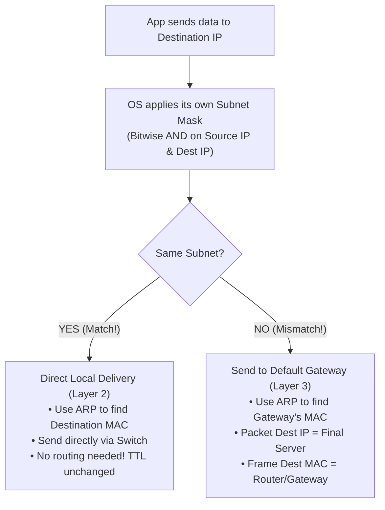
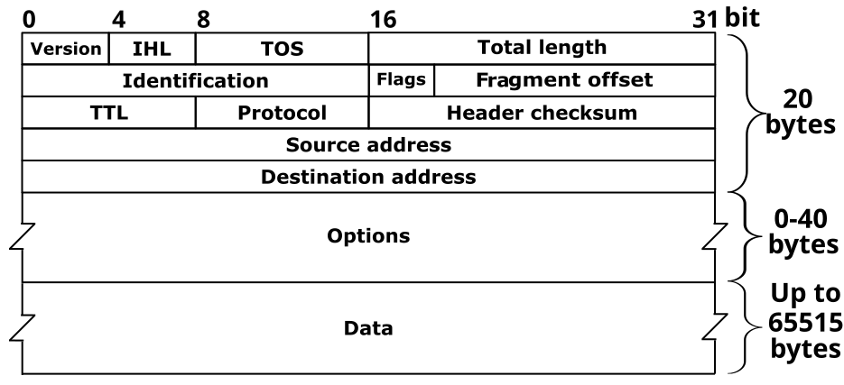
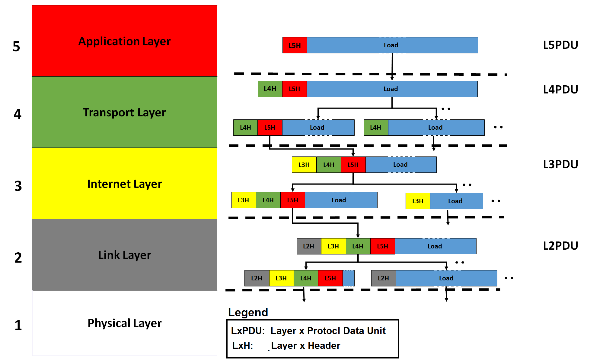
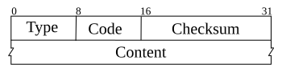
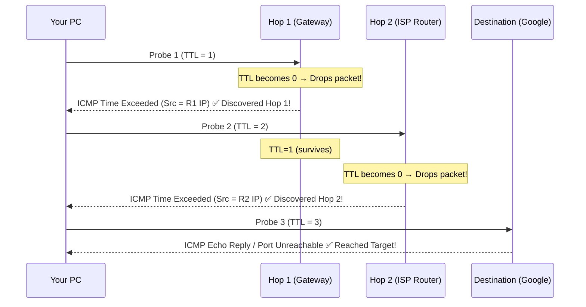
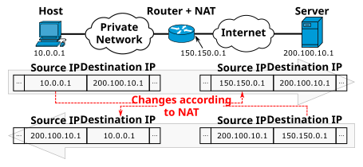
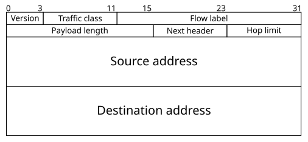

# 🚚 Internet Protocol (IP) — The Vehicle of the Internet

### Core Mental Model — Before Everything Else

> [!important] The Most Important Mental Model
> **IP is the vehicle of the Internet.**
> Everything you do in backend engineering — an HTTP/REST request, a gRPC call, a TLS-encrypted payload, a PostgreSQL SQL query/response, or a DNS lookup — **eventually sits inside an IP packet.**
>
> At **Layer 3 (Network Layer)**, routers **do not know or care** about ports, HTTP headers, JSON, or encryption. To a router, it is just a bunch of bytes wrapped in a **Source IP** and a **Destination IP**.

| Concept | Plain-English Meaning |
| :--- | :--- |
| **IP Packet (Layer 3)** | A container holding data + Source IP + Destination IP (+ routing metadata) |
| **Subnet & Subnet Mask** | How a machine decides: *"Is the target in my local network, or do I send this to a router?"* |
| **Default Gateway** | Your local router's IP address — where packets go when the destination is outside your subnet |
| **IPv4 Header** | 20 bytes (default) to 60 bytes (with options) of routing & control metadata |
| **MTU (1500 bytes)** | Maximum Transmission Unit — max payload size that fits in one standard Ethernet frame |
| **TTL (Time To Live)** | A hop counter decremented by every router so lost packets don't loop forever |
| **ICMP** | Layer 3 diagnostic/error protocol (`ping`, `traceroute`, "Fragmentation Needed") — **no ports!** |

---

## Topics Covered

| Timestamp | Section | Core Question |
| :--- | :--- | :--- |
| `00:00–06:10` | §1. IP Building Blocks & CIDR | What is an IPv4 address, Network vs. Host bits (`/24`), and static vs. DHCP? |
| `06:10–15:30` | §2. Subnets, Subnet Masks & Bitwise `AND` | How does a host decide between direct MAC delivery vs. Default Gateway? |
| `15:30–19:15` | §3. Default Gateways & Backend DB Tip | How do routers "live two lives", and why shouldn't your DB sit in another subnet? |
| `19:15–28:10` | §4. Anatomy of an IPv4 Packet | What is inside the 20-byte IPv4 header (Version, IHL, Protocol, ECN, Src/Dst IP)? |
| `28:10–32:40` | §5. MTU, Jumbo Frames & Fragmentation | What happens when a packet exceeds 1500 bytes (`DF` flag vs. splitting frames)? |
| `32:40–37:35` | §6. Time To Live (TTL) & Statelessness | Why is IP stateless, and how does TTL stop infinite routing loops? |
| `37:35–46:55` | §7. Spoofing & ECN Congestion Signals | Why is IP spoofing blocked by ISPs, and how does ECN warn TCP without drops? |
| `49:33–1:07:12` | §8. ICMP, `ping`, `traceroute` & Black Holes | How do `ping` and `traceroute` work at Layer 3, and what is a TCP Black Hole? |
| *Reference* | §9–§12 | NAT, IPv4 vs. IPv6, Practical Linux Commands, Interview Q&A & Glossary |

---

## 1. IP Building Blocks — IPv4 Addresses & CIDR

An **IP address** is a **Layer 3** logical address assigned to a network interface.

- **Dynamic Assignment (DHCP):** Your router/DHCP server automatically leases an IP address, subnet mask, and gateway when you join a network.
- **Static Assignment:** You manually hardcode a fixed IP address on a server (common for databases, routers, and DNS servers).

### Network Portion vs. Host Portion (`A.B.C.D / X`)
An **IPv4 address** is **4 bytes (32 bits)** long, written as four decimal numbers (`0–255`) separated by dots:

```text
Example:  192.168.254.0 / 24
          └──┬──┘ └─┬─┘   └─ CIDR prefix: first 24 bits = Network Portion
             │      │
       3 bytes      1 byte (remaining 8 bits = Host Portion)
```

- **`/24` (CIDR notation):** The first **24 bits** (`192.168.254`) identify the **Network**. The remaining **8 bits** (`.0` to `.255`) identify individual **Hosts** inside that network.
- **How many hosts?** $2^8 = 256$ total addresses (typically **254 usable hosts**, because `.0` is reserved for the network ID and `.255` for the broadcast address).
- **Network vs. Host Trade-off:**
  - Need *more hosts* in one network? Shrink the network prefix (e.g., `/16` gives $2^{16} - 2 = 65,534$ hosts).
  - Need *more separate networks* with fewer hosts each? Grow the network prefix (e.g., `/26` gives 62 usable hosts per subnet).

> [!note] Why Software Engineers Need This
> You don't need to pass a CCNA exam to build backends—network engineers handle day-to-day switch/router provisioning. However, understanding how packets decide **where to go** lets you diagnose latency, firewall blocks, and database placement issues immediately.

---

## 2. Subnets, Subnet Masks & Bitwise `AND`

Every machine on an IPv4 network needs **three pieces of configuration** to communicate. Without all three, you are "dead in the water" for general internet access:

1. **Your IP Address** (e.g., `192.168.1.3`)
2. **Your Subnet Mask** (e.g., `255.255.255.0` — equivalent to `/24`)
3. **Your Default Gateway** (e.g., `192.168.1.100` — your local router)

### The Single Question Every Outbound Packet Asks
Before sending any IP packet, your OS asks:

> **"Is the Destination IP in MY subnet, or in a DIFFERENT subnet?"**

This single question splits packet delivery into **two completely different paths**:



### Step-by-Step Bitwise `AND` Math
How does the OS check if two IPs are in the same subnet? Using the bitwise **`AND`** operator:
- `anything AND 1 = same value` (`255` in binary is `11111111`, so it **keeps** the number)
- `anything AND 0 = 0` (`0` in binary is `00000000`, so it **zeros out** the number)

#### Scenario A — Same Subnet (`192.168.1.3` → `192.168.1.22`)
```text
Source IP       :  192 . 168 .   1 .   3
Subnet Mask     :  255 . 255 . 255 .   0
─────────────────────────────────────────  (Bitwise AND)
Source Network  :  192 . 168 .   1 .   0

Destination IP  :  192 . 168 .   1 .  22
Subnet Mask     :  255 . 255 . 255 .   0
─────────────────────────────────────────  (Bitwise AND)
Dest Network    :  192 . 168 .   1 .   0
```
✅ **Result:** `192.168.1.0 == 192.168.1.0` → **Same subnet!**
Your machine does **not** need a router to route this. Even if the packets pass physically through your home router's built-in LAN ports, the router only acts as a **Layer 2 Switch** (reads MAC addresses only, never touches Layer 3 IP routing or TTL).

#### Scenario B — Different Subnet (`192.168.1.3` → `192.168.2.22`)
```text
Source Network  :  192 . 168 .   1 .   0
Dest Network    :  192 . 168 .   2 .   0
```
❌ **Result:** `192.168.1.0 != 192.168.2.0` → **Different subnet!**
Your machine doesn't know how to reach `192.168.2.22` directly. So it hands the packet to someone who might know: the **Default Gateway** (`192.168.1.100`).
- **IP Header:** `Src IP = 192.168.1.3`, `Dst IP = 192.168.2.22`
- **Ethernet Frame:** `Src MAC = Your_MAC`, `Dst MAC = Gateway_MAC`

> [!caution] Security Note: ARP Poisoning
> Because your machine sends all out-of-subnet traffic to the **MAC address** of the Default Gateway, if an attacker on your local Wi-Fi sends fake ARP replies claiming *"I am the Gateway's IP, here is my MAC address"*, all your traffic flows through the attacker's machine first (**ARP Poisoning / Man-in-the-Middle**).

---

## 3. Default Gateways & Backend Database Placement

### How a Router "Lives Two Lives"
A **Default Gateway (Router)** is simply a device with **two or more network interfaces**, belonging to multiple networks at the same time:
- Interface 1: `192.168.1.100` (lives inside Subnet 1)
- Interface 2: `192.168.2.200` (lives inside Subnet 2)

Border routers on the internet can have interfaces connected to hundreds of networks! When `192.168.1.3` sends a packet to `192.168.2.22`, the router receives it on `192.168.1.100`, checks its routing table, and forwards it out of `192.168.2.200` to reach `192.168.2.22`.

### Crucial Backend Engineering Lesson: App & Database Subnets
> [!tip] Don't Put Your Database in a Different Subnet Unnecessarily
> Suppose your backend API server and your PostgreSQL database are placed in **different subnets**:
> 1. Every SQL query (`SELECT`, `INSERT`) must leave the app, go through a **Layer 3 Router**, get queued in the router's memory buffer, and get forwarded to the DB subnet.
> 2. If that router is busy routing traffic for thousands of other hosts, its **buffer fills up**.
> 3. Your SQL TCP segments get **delayed in router queues** (random millisecond latency spikes) or even dropped!
>
> **Best Practice:** Place your backend application servers and database on the **same subnet** connected via a high-performance **Layer 2 Switch** (unless strict network segmentation/compliance requires a firewall/router hop). Your app has no business talking through a congested router just to reach its own database.

---

## 4. Anatomy of an IPv4 Packet (The 20-Byte Header)

As backend engineers, it's tempting to imagine an IP packet like a simple Matryoshka ("Petrushka") doll: `[Src IP] [Data] [Dst IP]`. On the wire, the actual **IPv4 packet** consists of a **Header** (20 bytes default, up to 60 bytes with Options) followed by **Data** (up to ~64 KB total).


*Figure 1: Official IPv4 Header layout (RFC 791) — 32 bits (4 bytes) wide per row × 5 rows = 20 bytes.*

### Why Header Overhead Matters (Nagle's Algorithm)
- Every single IPv4 packet adds **at least 20 bytes** of IP header (plus **20 bytes** of TCP header = **40 bytes of overhead**).
- Sending **1 byte** of user data (like a single keystroke in SSH) with 40 bytes of headers is a massive waste of bandwidth and router CPU!
- That is why TCP uses optimizations like **Nagle's Algorithm** and **Delayed Acknowledgments** to batch small writes together before wrapping them in IP packets.

### Every IPv4 Header Field Explained

| Field | Size | What It Does & Why It Exists |
| :--- | :--- | :--- |
| **Version** | 4 bits | IP version (`4` for IPv4, `6` for IPv6). 4 bits can represent 0–15, though only 4 and 6 are used. |
| **IHL** *(Internet Header Length)* | 4 bits | Number of 32-bit (4-byte) rows in the header. Default is **`5`** ($5 \times 4 = 20\text{ bytes}$). Max is `15` ($15 \times 4 = 60\text{ bytes}$) when Options are added. |
| **DSCP** *(Differentiated Services)* | 6 bits | Priority/QoS marking (e.g., prioritizing real-time voice/video over background downloads). |
| **ECN** *(Explicit Congestion Notification)* | 2 bits | Lets routers warn TCP of buffer congestion **without dropping packets** (explained below!). |
| **Total Length** | 16 bits | Entire packet size (Header + Data). Max = $2^{16} - 1 = \mathbf{65,535\text{ bytes}}$. |
| **Identification** | 16 bits | Unique ID shared by all fragments belonging to the same original packet. |
| **Flags** | 3 bits | Bit 0: Reserved (`0`). Bit 1: **`DF` (Don't Fragment)**. Bit 2: **`MF` (More Fragments)**. |
| **Fragment Offset** | 13 bits | Tells the receiver where this fragment fits when reassembling the original packet. |
| **TTL** *(Time To Live)* | 8 bits | Hop counter (e.g., `64` or `128`). Decremented by 1 at each router; dropped at `0`. |
| **Protocol** | 8 bits | Identifies the payload protocol inside Data (`1` = ICMP, `6` = TCP, `17` = UDP; up to 255). |
| **Header Checksum** | 16 bits | Verifies the IPv4 header wasn't corrupted in transit (recalculated at each hop since TTL changes!). |
| **Source IP** | 32 bits | IPv4 address of the original sender (unless rewritten by NAT). |
| **Destination IP** | 32 bits | IPv4 address of the final receiver. |
| **Options** | 0–40 bytes | Optional extensible fields (rarely used — many internet routers drop packets with IP Options for security). |

### Why `Protocol` (8 bits) Is Genius Metadata
Why waste 8 bits telling the router whether the Data is TCP (`6`), UDP (`17`), or ICMP (`1`)?
- Because routers and OS kernels can inspect just the first 20 bytes of header and **immediately know what protocol is inside** (to filter, prioritize, or route to the right kernel handler) without scanning the entire payload!

### How ECN (Explicit Congestion Notification) Saves Performance
When too many packets arrive at a router, its memory buffer fills up:
- **Old behavior (Tail Drop):** The router silently drops incoming packets. The sender waits for a long TCP timeout, realizes the packet was lost, and slows down.
- **With ECN (2 bits in IP header):** When the router sees its buffer is *about* to fill up, instead of dropping the packet, it sets the **ECN bit to `1`** and forwards it! The receiver sees the congestion flag, notifies the sender in the TCP ACK, and the sender slows down **with zero packet loss and zero timeout stalls**.

---

## 5. MTU, Jumbo Frames & IP Fragmentation

Even though the IPv4 `Total Length` field supports **65,535 bytes (~64 KB)**, you will almost never see a 65 KB IP packet on the public internet.

Why? Because **Layer 2 (Ethernet)** has a **Maximum Transmission Unit (MTU)** of **1,500 bytes**!


*Figure 2: Splitting an oversized IP packet into smaller fragments to fit a link's MTU, then reassembling at the destination.*

### What Happens When a 2,000-Byte Packet Hits a 1,500-Byte MTU?
There are **two options**:

1. **Option 1 — Fragment the Packet (`DF = 0`):**
   - The router splits the 2,000-byte IP packet into two smaller frames (e.g., 1,500 bytes + 500 bytes), tagging both with the same **Identification** and **Fragment Offset**.
   - **Why Fragmentation Is Frowned Upon:**
     - Fragments can arrive **out of order**; the destination host wastes CPU/RAM buffering and reassembling them.
     - If **just 1 fragment is lost**, the **entire** original packet must be retransmitted.
     - Fragmentation has historically been a major **security attack vector** (overlapping fragment attacks).
2. **Option 2 — Set `DF` (Don't Fragment) (`DF = 1`):**
   - The sender sets the **`DF` flag**. If the packet is too big for a link's MTU, the router **drops the packet** and sends back an **ICMP "Fragmentation Needed"** message telling the sender the smaller MTU size so the sender can shrink its packets.
   - Modern protocols like **QUIC (HTTP/3)** explicitly set `DF` and disable IP fragmentation!

> [!note] What About Jumbo Frames (9,000 Bytes) or 64 KB MTUs?
> Inside private cloud datacenters (AWS/Azure/GCP) or high-speed storage/DB networks (100 Gbps Ethernet) that never touch the public internet, engineers sometimes enable **Jumbo Frames (`MTU = 9000`)**—or even 64 KB on loopback/custom interfaces—to pack more data per header and reduce latency.

---

## 6. Time To Live (TTL) & Statelessness

**IP is completely stateless.** Routers do not store memory of which packets they have already forwarded.

### The Problem: Infinite Routing Loops
If Router A forwards a packet to Router B, and Router B's routing table mistakenly points back to Router A, the packet would bounce back and forth **forever**, consuming internet bandwidth until the end of time.

### The Solution: Carrying State Inside the Packet (`TTL`)
Every IP packet carries an 8-bit **TTL (Time To Live)** counter (typically starting at `64` or `128`):
1. Sender sets `TTL = 64`.
2. Router 1 receives it, decrements `TTL` by `1` (`TTL = 63`), recalculates header checksum, and forwards it.
3. Router 2 decrements `TTL` to `62`, and so on.
4. If a router decrements `TTL` to **`0`**, it **must drop the packet** and send an **ICMP Time Exceeded** message back to the `Source IP`!

```text
Sender (TTL=3) ──▶ Router 1 (TTL=2) ──▶ Router 2 (TTL=1) ──▶ Router 3 (TTL=0 → DROP! ❌)
   ▲                                                                 │
   └────────────────── ICMP "Time Exceeded" ─────────────────────────┘
```

---

## 7. IP Spoofing Explained

Can someone fake the `Source IP` field in an IP packet to pretend to be someone else?
- **Technically:** Yes, raw sockets let you write any 32-bit IP into the `Source IP` field.
- **In Practice (Why It Usually Fails):**
  1. Your **ISP's first router** knows the IP range assigned to your connection. Most ISPs enforce **egress filtering (uRPF)** and drop any packet leaving your network whose `Source IP` doesn't belong to you.
  2. Even if it gets through, the server sends its reply back to the **fake `Source IP`**, so the spoofer **never receives the response** (though it can still be used in one-way DDoS amplification attacks if an ISP doesn't filter).

---

## 8. ICMP — Internet Control Message Protocol, `ping`, `traceroute` & Black Holes

> **OSI Layer 3** | **IP Protocol Number:** `1` | **Ports:** **NONE!**

**ICMP (RFC 792)** is the control and diagnostic companion to IP. Because it lives inside Layer 3 IP packets directly:
- **There are NO ports in ICMP.**
- You do **not** need an open listening port on a server to receive or reply to ICMP messages (only OS kernel support).


*Figure 3: General ICMP Header (RFC 792) — 1-byte Type, 1-byte Code, 2-byte Checksum, and 4-byte Rest of Header.*

### Important ICMP Message Types
| ICMP Message | Meaning |
| :--- | :--- |
| **Echo Request (`Type 8`) / Echo Reply (`Type 0`)** | Used by **`ping`** to test reachability and round-trip latency |
| **Destination Unreachable (`Type 3`)** | Host unreachable, **Port unreachable** (even though ports are L4, L3 ICMP reports it!), or **Fragmentation Needed** (`Code 4`) |
| **Time Exceeded (`Type 11`)** | Packet `TTL` reached `0` — used by **`traceroute`** |

### A. How `ping` Works
When you run `ping google.com`:
1. `ping` first uses **DNS** to resolve `google.com` → an IP address (e.g., `142.250.x.x`), because `ping` only speaks IP.
2. Your OS sends an **ICMP Echo Request** inside an IP packet (`TTL = 64`, `64 bytes` payload).
3. If the destination host allows ICMP, it flips Source/Destination IPs, resets TTL, and sends back an **ICMP Echo Reply**.
4. `ping` prints the **RTT (Round-Trip Time)** in milliseconds (e.g., `6 ms` over Wi-Fi to your local router vs. `12 ms` to Google).

### B. How `traceroute` (`tracert` on Windows) Works
`traceroute` answers: *"What is every single router hop my packet passes through to reach Google?"*

It cleverly exploits **TTL expiration + ICMP Time Exceeded**:



**Three Real-World `traceroute` Caveats:**
1. **Same-Subnet `traceroute`:** If you `traceroute` another laptop on your own Wi-Fi/LAN, it completes in **1 hop** directly to the laptop! Even if traffic crosses your router hardware, the router acts as a **Layer 2 Switch** and **never decrements TTL**.
2. **`* * *` (Timeouts):** Many routers and firewalls **block or rate-limit ICMP** for security (preventing ICMP floods or probing), which shows up as `* * *` in `traceroute` output.
3. **Asymmetric / Dynamic Routes:** The packet with `TTL=1` and the packet with `TTL=2` might take *different* internet routes, so `traceroute` is not always a guaranteed 100% static path snapshot.

### C. The "TCP Black Hole" Problem (Why Blocking All ICMP Is Dangerous!)
> [!caution] Never Blindly Drop All ICMP Traffic
> Firewalls often block ICMP to "look invisible" or stop ping floods. However, blocking **`ICMP Type 3 Code 4` (Fragmentation Needed)** breaks **Path MTU Discovery (PMTUD)** and creates a **TCP Black Hole**:
> 1. Your client opens a TCP connection (`SYN` / `SYN-ACK` / `ACK`) — **succeeds!** (Because handshake packets are tiny, ~40–60 bytes).
> 2. Your app sends a **1,500-byte** HTTP/TLS packet with `DF = 1` (Don't Fragment).
> 3. A router/tunnel along the path has a smaller MTU (e.g., `1400` bytes). It drops the packet and tries to send back **ICMP Fragmentation Needed**.
> 4. The firewall **blocks that ICMP message**!
> 5. Your client never finds out the packet was too big, keeps retransmitting the exact same 1,500-byte packet, and the connection **hangs indefinitely**!

---

## 9. NAT & IPv4 vs. IPv6

### NAT (Network Address Translation)
Because IPv4 only has ~4.3 billion addresses, your home devices use **Private IPv4 addresses** (`192.168.x.x`, `10.x.x.x`, `172.16.x.x–172.31.x.x`) that cannot be routed on the public internet. Your router uses **NAT** to translate your private `Source IP:Port` to your ISP's **Public IP:Port** on outbound traffic and maps replies back to your device.


*Figure 4: NAT translates private LAN IP addresses into a shared public IPv4 address at the gateway router.*

### IPv4 vs. IPv6 Header Comparison
IPv6 expands addresses from 32 bits to **128 bits** and cleans up the header into a **fixed 40-byte** structure (dropping header checksums, IHL, and router fragmentation flags for faster hardware forwarding):


*Figure 5: Fixed 40-byte IPv6 Header — `TTL` is renamed `Hop Limit`, and `Protocol` is renamed `Next Header`.*

| IPv4 Field | IPv6 Equivalent | Improvement in IPv6 |
| :--- | :--- | :--- |
| **Header Size (20–60B)** | **Fixed 40B** | Routers don't need to calculate variable header lengths (`IHL`) |
| **Header Checksum** | *Removed* | Layer 2 (FCS) and Layer 4 (TCP/UDP) already verify integrity |
| **TTL** | **Hop Limit** | Same behavior (decremented at each hop, drops at 0) |
| **Protocol** | **Next Header** | Points to TCP/UDP/ICMPv6 or chained extension headers |
| **Router Fragmentation** | *Removed* | Routers never fragment IPv6; senders must use PMTUD |

---

## 10. Practical Networking Commands to Try

```bash
# 1. Inspect your IP address and CIDR subnet mask (Linux)
ip addr show

# 2. Inspect your Default Gateway and routing table
ip route show

# 3. Inspect your local ARP cache (IP → MAC mappings)
ip neigh show      # or: arp -a

# 4. Test Layer 3 reachability & RTT latency
ping -c 4 8.8.8.8
ping -c 4 google.com

# 5. Trace every Layer 3 router hop to a destination
traceroute google.com        # Linux / macOS
tracert google.com           # Windows

# 6. Discover Path MTU to a destination (Linux)
tracepath google.com
```

---

## 11. Interview Q&A & Glossary

### High-Frequency Interview Questions
| Question | Concise Answer |
| :--- | :--- |
| **How does a host decide whether to send a packet directly or to the Default Gateway?** | It applies a bitwise **`AND`** of its **Subnet Mask** with both its own IP and the Destination IP. If the network IDs match, it sends directly via Layer 2 MAC; otherwise it sends to the Default Gateway's MAC. |
| **Does a packet's `Destination IP` change when sent to the Default Gateway?** | **No.** The packet's `Destination IP` stays the final target server, while the **Layer 2 `Destination MAC`** is set to the Default Gateway's MAC. |
| **Why shouldn't an app server and its database sit in different subnets without reason?** | Cross-subnet traffic must traverse a Layer 3 router. If router buffers congest, SQL segments queue or drop, adding tail latency. Same-subnet traffic uses fast Layer 2 switching. |
| **How does `traceroute` work?** | It sends probes with `TTL=1, 2, 3...`. Each router that decrements TTL to `0` drops the packet and returns **ICMP Time Exceeded** containing its own IP address. |
| **Why is IP stateless, and how does TTL solve loops?** | Routers don't track past packets. TTL stores a hop budget *inside* each packet so looping packets expire at `TTL=0` instead of circulating forever. |
| **What causes a "TCP Black Hole"?** | Blocking **`ICMP Fragmentation Needed`** breaks Path MTU Discovery when packets have `DF=1` — the 3-way handshake works, but larger data packets silently drop. |
| **Does ICMP use port numbers?** | **No.** Ports are Layer 4 (TCP/UDP). ICMP sits directly inside Layer 3 IP (`Protocol = 1`). |

### Glossary
| Term | Definition |
| :--- | :--- |
| **CIDR (`/X`)** | Classless Inter-Domain Routing — specifies how many leading bits form the Network portion (e.g., `/24`) |
| **Subnet Mask** | Bitmask (e.g., `255.255.255.0`) used with bitwise `AND` to separate Network bits from Host bits |
| **Default Gateway** | Router interface on your local subnet that forwards packets destined for other networks |
| **MTU** | Maximum Transmission Unit — largest payload that fits in one link-layer frame (`1500B` on standard Ethernet) |
| **Jumbo Frame** | Ethernet frame with an MTU larger than 1500 bytes (commonly `9000` bytes in datacenters) |
| **`DF` (Don't Fragment)** | IPv4 header flag instructing routers to drop oversized packets and send ICMP instead of fragmenting |
| **ECN** | Explicit Congestion Notification — 2 IP header bits routers set to warn TCP of congestion before dropping packets |
| **TTL** | Time To Live — 8-bit hop counter decremented by every router to stop routing loops |
| **ICMP** | Internet Control Message Protocol — Layer 3 diagnostic/error protocol powering `ping` and `traceroute` |
| **TCP Black Hole** | Connection hangs after handshake because oversized packets with `DF=1` drop and ICMP feedback is blocked |
| **NAT** | Network Address Translation — maps private LAN IPv4 addresses to a public IPv4 address at a router |

---

## 12. References
- [RFC 791 — Internet Protocol (IPv4 Specification)](https://www.rfc-editor.org/rfc/rfc791)
- [RFC 792 — Internet Control Message Protocol (ICMP)](https://www.rfc-editor.org/rfc/rfc792)
- [RFC 8200 — Internet Protocol, Version 6 (IPv6)](https://www.rfc-editor.org/rfc/rfc8200)
- [Cloudflare — What is IP? / Subnetting / ICMP](https://www.cloudflare.com/learning/network-layer/internet-protocol/)
