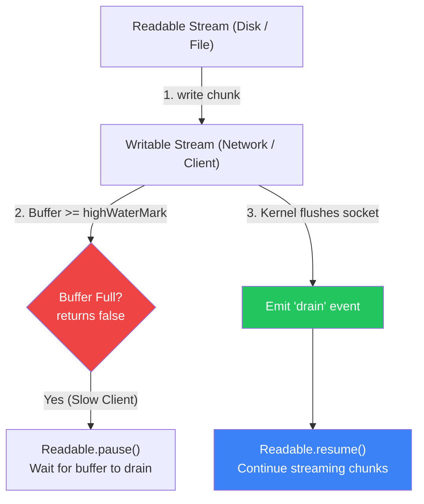

# 🌊 Node.js Streams & Buffers Internals

### Node.js Streams & Buffers

- A **Buffer** is a fixed-size chunk of memory allocated directly in the C++ layer outside the V8 JavaScript heap to store raw binary data.
- **Streams** are asynchronous collections of data that process chunk-by-chunk rather than loading the entire payload into RAM at once.
- Streams implement the **EventEmitter** interface and manage flow control via internal queues and a configurable threshold called `highWaterMark`.
- Understanding streams and buffers is the difference between a backend that smoothly streams a **10 GB** video using only **30 MB** of RAM and a service that crashes with `JavaScript heap out of memory` under a **500 MB** load.

---

### The Analogy — Garden Hose vs. Giant Water Tank

```
┌────────────────────────────────────────────────────────────────────────┐
│                   MEMORY BUFFERING COMPARISON                          │
│                                                                        │
│  ❌ BAD PATH (Loading whole file into Buffer):                         │
│     [10 GB File on Disk] ──▶ 💥 CRASH: Heap out of memory (>2 GB)      │
│     All 10 GB must sit simultaneously in RAM before sending 1 byte.    │
│                                                                        │
│  ✅ GOOD PATH (Streaming in Chunks):                                    │
│     [10 GB File] ──▶ [64 KB Chunk] ──▶ [Network Socket] ──▶ Free RAM   │
│     Peak RAM consumed: ~30 MB constant, regardless of file size!       │
└────────────────────────────────────────────────────────────────────────┘
```

---

### How Buffers Work Under the Hood

A `Buffer` instance in Node.js is an array of raw octets (bytes). The numbers seen inside a buffer are hexadecimal representations of ASCII/Unicode character codes.

```javascript
// 1. Fixed allocation: allocates 5 bytes initialized to zero
const buffer = Buffer.alloc(5);
buffer.fill("hi", 0, 2); // fill manual bytes

// 2. Unsafe allocation (fast, does not wipe old memory):
const fastBuffer = Buffer.allocUnsafe(1024);

// 3. Creating from strings or existing arrays (common in production):
const msg = "hello";
const withBuffer = Buffer.from(msg); // <Buffer 68 65 6c 6c 6f>
console.log(withBuffer.toString("utf-8")); // "hello"

// 4. Copying and slicing:
const copyTarget = Buffer.alloc(6);
copyTarget.set(buffer, 0);
```

> [!NOTE] **Memory Pool Slicing**
> Allocations smaller than 4 KB (`Buffer.poolSize / 2`) are sliced from a single shared internal pre-allocated slab (`Buffer.poolSize = 8192`). Large allocations bypass the pool and call C++ `node::Buffer::New` directly via `ArrayBuffer`.

---

### Stream Types & Taxonomy

| Stream Type | Description | Key Methods | Common Examples |
| :--- | :--- | :--- | :--- |
| **Readable** | Abstraction for a source of data you consume from. | `read()`, `pipe()`, `pause()`, `resume()` | `fs.createReadStream()`, `http.IncomingMessage`, `process.stdin` |
| **Writable** | Abstraction for a destination to which data is written. | `write(chunk)`, `end()`, `cork()`, `uncork()` | `fs.createWriteStream()`, `http.ServerResponse`, `process.stdout` |
| **Duplex** | Both Readable and Writable with two independent internal buffers. | All Readable and Writable methods | `net.Socket`, TLS stream |
| **Transform** | A Duplex stream where the output is computed from the input. | `_transform()`, `_flush()` | `zlib.createGzip()`, `crypto.createCipheriv()` |

---

### Stream Events & Lifecycle

| Event | Applicable Streams | Trigger Condition | Highlight / Severity |
| :--- | :--- | :--- | :--- |
| `data` | Readable | Emitted whenever a chunk of data is made available by the stream. | ⚡ **Pushes stream into flowing mode** |
| `readable` | Readable | Emitted when there is a chunk ready to be read from the buffer via `.read()`. | 🔍 **Non-flowing (paused) manual mode** |
| `drain` | Writable | Emitted when the internal buffer has dropped below `highWaterMark` and it is safe to write again. | ✅ **Backpressure relief signal** |
| `finish` | Writable | Emitted after `stream.end()` is called and all buffered data has flushed to the underlying system. | 🏁 **Clean completion of writes** |
| `end` | Readable | Emitted when no more data is available to be consumed from the source. | 🏁 **EOF (End of File/Stream)** |
| `error` | All Streams | Emitted when an internal error occurs during reading, writing, or transforming. | 🚨 **Must be handled or Node process crashes** |
| `close` | All Streams | Emitted when the underlying resource (e.g. file descriptor or socket) is closed. | 🔒 **Resource cleanup confirmation** |

---

### The Mechanics of Backpressure

Backpressure occurs when the **producer (Readable)** generates data faster than the **consumer (Writable)** can flush it to the disk or network card.



#### Manual Backpressure Implementation
```javascript
const fs = require('fs');

function copyWithBackpressure(src, dest) {
  const readStream = fs.createReadStream(src, { highWaterMark: 64 * 1024 });
  const writeStream = fs.createWriteStream(dest, { highWaterMark: 64 * 1024 });

  readStream.on('data', (chunk) => {
    // If write returns false, the buffer is saturated: PAUSE reading
    const canContinue = writeStream.write(chunk);
    if (!canContinue) {
      readStream.pause();
    }
  });

  // When the writable finishes flushing its queue: RESUME reading
  writeStream.on('drain', () => {
    readStream.resume();
  });

  readStream.on('end', () => {
    writeStream.end();
  });

  readStream.on('error', (err) => console.error('Read error:', err));
  writeStream.on('error', (err) => console.error('Write error:', err));
}
```

---

### `pipe()` vs. `pipeline()` — The Modern Standard

> [!WARNING] **The Dangerous Pitfall with `.pipe()`**
> `readable.pipe(writable)` **does not automatically forward errors**! If an error occurs midway through a `.pipe()` chain, the destination streams are left unclosed, creating severe file descriptor and memory leaks.

```javascript
const { pipeline } = require('stream/promises');
const fs = require('fs');
const zlib = require('zlib');

// ✅ MODERN PRODUCTION STANDARD: Automatically closes all streams & cleans FDs on error
async function compressFile(source, destination) {
  try {
    await pipeline(
      fs.createReadStream(source),
      zlib.createGzip(),
      fs.createWriteStream(destination)
    );
    console.log('Compression completed successfully.');
  } catch (err) {
    console.error('Pipeline failed with error:', err);
  }
}
```

---

### Performance Comparison

| Approach | 2 GB File Transfer | Peak RAM Used | CPU Impact | Risk Level |
| :--- | :--- | :--- | :--- | :--- |
| `fs.readFileSync()` | Reads full file to memory | **2,150 MB** | High allocation spike | 💀 Crashes if concurrent |
| `fs.readFile()` (Async) | Allocates huge buffer on heap | **2,050 MB** | High GC churn | 💀 V8 heap out of memory |
| `pipeline(readStream, writeStream)` | Streams in 64 KB chunks | **~28 MB** | Flat, steady CPU | ⚡ Production safe & resilient |

---

### Summary Checklist

- ⚡ **Buffers reside outside the V8 heap**; manage them conscientiously to prevent native C++ memory leaks.
- ⚡ **Never use raw `.pipe()` in modern production**; always prefer `stream.pipeline` or `stream/promises` for bulletproof error handling and resource cleanup.
- ⚡ **Always monitor the return value of `.write()`**; if `false`, pause reading and wait for the `'drain'` event.
- ⚡ **Tune `highWaterMark`** based on use case: 16 KB default for normal streams, 64 KB for file streams, 16 objects for `objectMode`.
