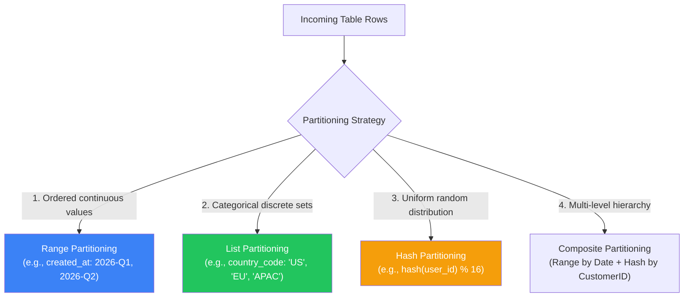

# 🗄️ Database Partitioning & Sharding Architecture

### Partitioning Fundamentals

- **Partitioning** is the division of a logical table or database into independent, manageable physical subsets to improve query performance, vacuum maintenance, and storage scalability.
- **Horizontal Partitioning (Partitioning / Sharding)** splits rows across tables or physical database nodes while keeping schemas identical.
- **Vertical Partitioning** splits columns into separate tables to isolate high-frequency narrow columns from large, rarely accessed binary blobs or text fields.
- Effective partitioning transforms slow table scans across **500,000,000** rows into rapid partition-pruned index scans across only **5,000,000** rows (a **100x** query speedup).

---

### Partitioning Strategies & Taxonomy



| Strategy | Partition Key Type | Best For | Risk / Gotcha |
| :--- | :--- | :--- | :--- |
| **Range** | Timestamps, numerical IDs | Time-series data, logs, audit trails. Old partitions can be dropped instantly with `DROP TABLE`. | **Write Hotspotting**: 100% of current writes hit the latest partition. |
| **List** | Discrete enumerations (`region`, `status`) | Multi-tenant geographic isolation, regulatory data compliance (GDPR). | Data skew if one region (e.g. `US`) has 80% of all rows. |
| **Hash** | High-cardinality keys (`user_id`, `uuid`) | Even distribution across nodes, eliminating write hotspots. | Range queries (`WHERE id BETWEEN A AND B`) must scatter-gather to all partitions. |
| **Composite** | Multi-column combinations | Massive-scale systems (e.g., Range by month $\rightarrow$ Hash by customer ID). | Increased schema management complexity. |

---

### In-Depth: Partitioning vs. Sharding

| Dimension | In-Database Partitioning (Single Instance) | Distributed Sharding (Multi-Node) |
| :--- | :--- | :--- |
| **Physical Location** | Multiple tables within a single database engine | Multiple physical server instances across nodes |
| **Transactions** | Full ACID transactions supported natively | Distributed transactions require 2PC or Saga |
| **Network Latency** | Local IPC / disk access ($<0.1\text{ ms}$) | Network hop required ($1\text{--}10\text{ ms}$) |
| **Use Case** | Optimize query execution, maintenance, indexing | Scale beyond the CPU/RAM/Disk limits of a single machine |

---

### Declarative Partitioning in PostgreSQL

PostgreSQL provides native declarative partitioning with automatic **partition pruning**:

```sql
-- 1. Create the root partitioned table
CREATE TABLE orders (
    order_id BIGSERIAL,
    customer_id BIGINT NOT NULL,
    order_date DATE NOT NULL,
    total_amount NUMERIC(12, 2) NOT NULL,
    status VARCHAR(32) NOT NULL,
    PRIMARY KEY (order_id, order_date) -- ⚠️ Partition key must be part of primary key!
) PARTITION BY RANGE (order_date);

-- 2. Create concrete child partitions
CREATE TABLE orders_2026_q1 PARTITION OF orders
    FOR VALUES FROM ('2026-01-01') TO ('2026-04-01');

CREATE TABLE orders_2026_q2 PARTITION OF orders
    FOR VALUES FROM ('2026-04-01') TO ('2026-07-01');

CREATE TABLE orders_2026_q3 PARTITION OF orders
    FOR VALUES FROM ('2026-07-01') TO ('2026-10-01');

-- 3. Create Default Partition for catching unmapped ranges
CREATE TABLE orders_default PARTITION OF orders DEFAULT;

-- 4. Verify Partition Pruning with EXPLAIN
EXPLAIN ANALYZE
SELECT * FROM orders 
WHERE order_date >= '2026-02-01' AND order_date < '2026-03-01';
-- Result: Executor scans ONLY 'orders_2026_q1' and ignores all other partitions!
```

---

### 🚨 Critical Gotchas & Anti-Patterns

| Gotcha | Why It Breaks | Mitigation |
| :--- | :--- | :--- |
| **Scatter-Gather Overhead** | Query omitting the partition key forces the planner to search *every partition* in parallel, multiplying I/O. | Enforce partition keys in high-frequency WHERE clauses. |
| **Global Uniqueness** | Single-partition indexes cannot enforce uniqueness across other partitions without including partition key. | Composite primary key `(id, partition_key)`. |
| **Over-Partitioning** | Creating thousands of tiny partitions bloats PostgreSQL catalog metadata and exhausts memory. | Aim for partitions between **10 GB and 100 GB** each; avoid partitions with $<1\text{ GB}$. |
| **Dropping Old History** | Deleting 50M rows with `DELETE FROM orders WHERE date < ...` generates massive WAL and bloat. | Instant drop: `ALTER TABLE orders DETACH PARTITION orders_2024; DROP TABLE orders_2024;` |
