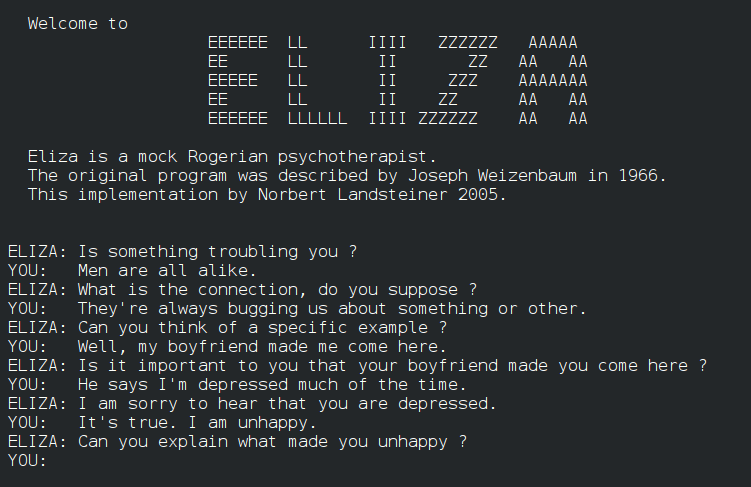
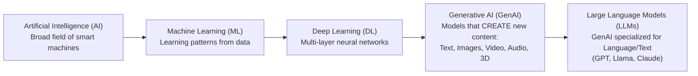
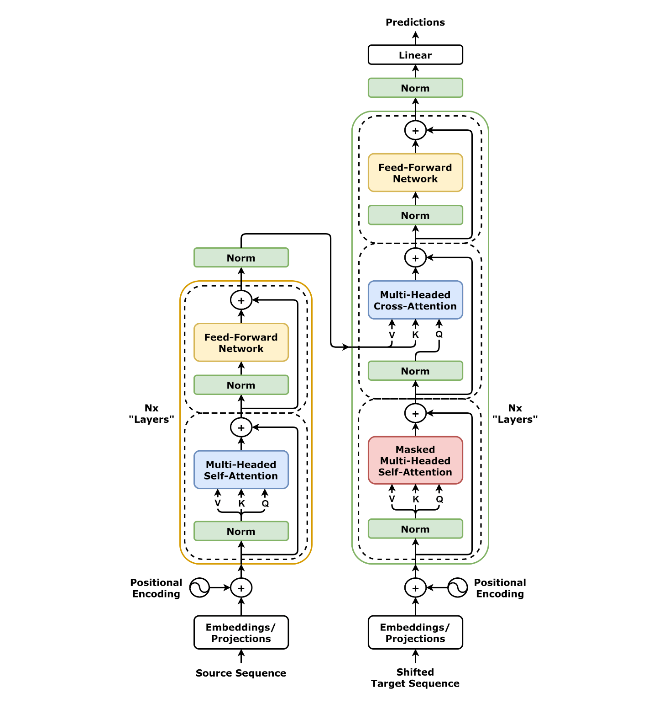
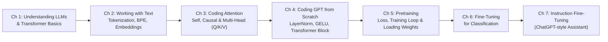

# 🧠 Lecture 1: Building LLMs from Scratch — Series Introduction

### Core Mental Model — Before Everything Else

> [!important] Don't Just Build Wrappers — Master the Nuts and Bolts
> Most developers learning Generative AI make one critical mistake: they jump straight to **application wrappers** (LangChain, API calls, cloning GitHub repos, or running Google Colab notebooks) without understanding how a Large Language Model actually works internally.
>
> **Goal of this series:** Build a complete GPT-style Large Language Model **completely from scratch** from first principles — assuming **zero prior LLM knowledge** — so that both building AI applications and answering deep technical interview questions (Query/Key/Value attention, positional embeddings, tokenization, pretraining) become effortless.

| Dimension | Surface-Level ("Wrapper") Approach | First-Principles ("From Scratch") Approach |
| :--- | :--- | :--- |
| **How you learn** | Call APIs, copy LangChain templates | Understand tokenization, embeddings, attention, transformer blocks, and training loops |
| **Debugging ability** | Guessing when outputs hallucinate or fail | Deep intuition of context windows, temperature, logits, and fine-tuning |
| **Interview readiness** | Struggles on Q/K/V, positional encoding, or architecture questions | Confidently explains and implements every building block from scratch |
| **Long-term edge** | Easily replaced as frameworks change | Frameworks (LangChain, LlamaIndex) become trivial once fundamentals are solid |

---

## Topics Covered (Lecture 1 Timeline)

| Timestamp | Topic | Core Takeaway |
| :--- | :--- | :--- |
| `00:00–03:35` | **§1–2. Intro & Teaching Philosophy** | Dr. Raj Dandekar (IIT Madras → MIT PhD → Vizuara); teaching from scratch with free notes & code |
| `03:35–06:35` | **§3. Demonstration: 1960s ELIZA vs. ChatGPT** | How NLP evolved from 1966 pattern-matching (`ELIZA`) to modern contextual LLMs (`GPT`) |
| `06:35–08:05` | **§4. Open-Source vs. Closed-Source LLMs** | GPT-4 (closed) vs. Meta Llama 3.1 / 405B (open-weights) and the closing capability gap |
| `08:05–10:10` | **§5. What Is Generative AI & Job Market** | AI → ML → DL → GenAI → LLMs; multimodal GenAI, Vizuara's MCQ app, 5–6× job market growth |
| `10:10–15:55` | **§6–7. Why Other Courses Fail & Course Roadmap** | Reference book (*Build a Large Language Model (From Scratch)* by Sebastian Raschka) & 7-chapter plan |

---

## 1. Instructor Background & Series Philosophy

- **Instructor:** **Dr. Raj Dandekar** (Co-founder of **Vizuara**)
  - B.Tech in Mechanical Engineering — **IIT Madras** (2017)
  - Ph.D. in Machine Learning — **Massachusetts Institute of Technology (MIT)** (2022)
  - Mission: Make AI and Deep Learning accessible to everyone through first-principles education (YouTube playlists on Machine Learning, Deep Learning, and now Building LLMs from Scratch).
- **Teaching Philosophy:**
  - **Assume nothing:** Every concept is built from the ground up — no hand-waving or skipping math/code prerequisites.
  - **Comprehensive & Free:** Planned as **50–60 in-depth video lectures** accompanied by **200–300 pages of detailed lecture notes**, all completely free.
  - **Outcome:** By the end of the series, you will have coded and trained your own working GPT-style LLM from scratch.

---

## 2. The Most Common Mistake When Learning LLMs

As Generative AI startups and job opportunities explode, learners commonly fall into a trap:

```text
Typical Mistake:
  Skip fundamentals ──▶ Clone GitHub / LangChain repo ──▶ Call OpenAI API ──▶ Stuck in interviews!

Correct Path (This Series):
  Text & Tokenization ──▶ Embeddings ──▶ Self-Attention (Q, K, V) ──▶ GPT Architecture
         ──▶ Pretraining ──▶ Fine-Tuning ──▶ Now LangChain & AI Apps feel effortless! ✅
```

> [!tip] Why Foundations Win Interviews
> Anyone can clone a repository and call an API. In real ML/AI engineering interviews, interviewers ask deep questions such as:
> - *"How do Query, Key, and Value matrices work in Self-Attention?"*
> - *"Why do Transformers need Positional Embeddings?"*
> - *"What is the difference between pretraining and instruction fine-tuning?"*
>
> Having built an LLM from scratch puts you in a completely different league.

---

## 3. Historical Demonstration: 1960s ELIZA vs. Modern ChatGPT

To appreciate how far Natural Language Processing (NLP) has come, the lecture compares a **1960s chatbot (ELIZA)** with **modern ChatGPT**.

### A. ELIZA (1964–1966) — The World's First Chatbot
Created by **Joseph Weizenbaum** at **MIT**, **ELIZA** was one of the earliest NLP programs. Its most famous script, **`DOCTOR`**, simulated a **Rogerian psychotherapist** (a style of therapy that reflects the patient's own statements back as questions).


*Figure 1: Example conversation with Joseph Weizenbaum's ELIZA (1966), demonstrating rule-based pattern matching and pronoun reflection.*

#### How ELIZA Actually Worked Under the Hood
Despite seeming conversational, ELIZA had **zero true understanding, zero neural networks, and zero memory of meaning**. It used pure string-manipulation rules:
1. **Keyword Search:** Scans input for ranked keywords (e.g., `"mother"`, `"depressed"`, `"always"`, `"like"`).
2. **Decomposition Rules:** Matches the sentence structure around the keyword.
3. **Reassembly & Pronoun Flipping:** Reflects the user's words back by swapping pronouns (`"I"` → `"you"`, `"my"` → `"your"`, `"am"` → `"are"`).
4. **Generic Fallback:** If no keyword matches, prints canned prompts like *"Please go on"* or *"You seem to be quite positive."*

**Lecture Demo Transcript:**
```text
ELIZA : How do you do. Please tell me your problem.
User  : I am trying to learn about large language models, but I am finding it difficult.
        Could you provide some resources for me to start with?
ELIZA : Is it because you are trying to learn about large language models that you came to me?
User  : Yes.
ELIZA : You seem to be quite positive.
User  : ...
ELIZA : You are sure.
```
Notice how the conversation goes nowhere — ELIZA simply mirrors phrases mechanically without understanding what an LLM or a "resource" is.

> [!note] The "ELIZA Effect" (Research Context)
> Weizenbaum was shocked when humans—even people who knew ELIZA was just a simple string-matching script—began confiding deeply personal secrets to it. This psychological tendency for humans to attribute intelligence and understanding to machines simply because they output human language became known as the **ELIZA Effect**.

### B. Fast-Forward 60 Years: Modern ChatGPT (GPT)
Asking the **exact same question** to ChatGPT yields structured, actionable, context-aware guidance:
- Specific **books**, **online courses**, and **foundational research papers**
- Clear step-by-step explanations tailored to the user's goal

| Era / System | Core Mechanism | Context & Understanding | Output Quality |
| :--- | :--- | :--- | :--- |
| **ELIZA (1966)** | Hand-written keyword matching & pronoun-flipping templates | None (repeats patterns mechanically) | Loops and stalls quickly |
| **Modern GPT / LLMs (2020s)** | Deep Transformer neural networks with Self-Attention trained on trillions of tokens | Rich contextual representations across long sequences | Coherent, reasoned, multi-step answers |

---

## 4. Open-Source vs. Closed-Source LLMs

Around the time of this lecture (2024), Meta released **Llama 3.1** (including the **405B parameter** model), highlighting a major shift in the AI landscape:

| Dimension | Closed-Source (Proprietary) | Open-Source / Open-Weights |
| :--- | :--- | :--- |
| **Examples** | **OpenAI** (GPT-4, GPT-4o), **Anthropic** (Claude) | **Meta** (Llama 3.1 — 8B, 70B, 405B), Mistral, Qwen, Gemma |
| **Weights & Architecture** | Hidden behind paid APIs; internal weights and training details are private | Weights and architecture are publicly downloadable, inspectable, and customizable |
| **2022–2023 Landscape** | Dominant performance gap (GPT-4 far ahead of open models in 2023) | Lagged behind proprietary frontier models |
| **2024+ Landscape** | Still strong, but gap narrowed dramatically | **Llama 3.1** matched GPT-4-class benchmarks, putting frontier LLM knowledge in everyone's hands |

> [!important] Why Open-Source Matters for Learners
> Because open-weights models like **Llama 3.1** publish their exact architecture and match closed-source frontier performance, **all the knowledge needed to build state-of-the-art LLMs is now public**. You just need the willingness to learn the foundations.

---

## 5. What Is Generative AI vs. LLMs?

Many beginners confuse **AI**, **Machine Learning**, **Deep Learning**, **Generative AI**, and **LLMs**. They form nested subsets:



- **Generative AI** is broader than text — it includes **AI-generated video, images, audio, and 3D models** (e.g., photorealistic AI ocean/wave videos generated entirely without cameras).
- **Large Language Models (LLMs)** are the text/language branch of Generative AI.
- **Real-World Application Example (Vizuara):** Built an LLM-powered **MCQ Generator for school teachers** — enter a topic (e.g., *"Gravity"*), and within seconds the LLM generates structured multiple-choice questions for classroom use.
- **Career & Job Market Impact:** The global Generative AI job market is projected to grow **5–6× over the next 5 years**, making deep LLM engineering one of the highest-leverage skills in tech.

---

## 6. Why Existing Courses Fall Short & Our Course Roadmap

When searching Google or YouTube for *"learn to build LLMs from scratch"*, existing resources generally fall into three traps:
1. **App-Building Courses ("Build LLM Apps" / LangChain):** Teach how to wire APIs together, **not** how LLMs actually work.
2. **Short Crash-Course Playlists:** 10–15 minute overview videos that skim concepts without depth.
3. **Andrej Karpathy's *"Let's build GPT"* (~90 min):** Brilliant, but fast-paced and starts mid-stream assuming strong PyTorch & deep learning background — tough for beginners.

### Our Core Reference Book & 7-Chapter Roadmap
This series is structured as a comprehensive, beginner-friendly walkthrough of the gold-standard book:

> **Reference Textbook:** *Build a Large Language Model (From Scratch)* by **Sebastian Raschka** (~360–400+ pages, Manning Publications)

Every chapter of the book is expanded into detailed whiteboard intuition, lecture notes, and scratch Python/PyTorch code:


*Figure 2: The Transformer architecture ("Attention Is All You Need", Vaswani et al. 2017) — GPT models use the Decoder-style stack with Masked (Causal) Multi-Head Self-Attention.*



| Stage / Chapter | What You Will Build & Understand |
| :--- | :--- |
| **Ch. 1 — Understanding LLMs** | What LLMs are, stages of building/using LLMs (pretraining vs. fine-tuning), Transformer overview |
| **Ch. 2 — Working with Text Data** | Tokenization, Token IDs, **Byte Pair Encoding (BPE)**, sliding-window sampling, Token & Positional Embeddings |
| **Ch. 3 — Coding Attention Mechanisms** | Why sequential RNNs struggle, simple self-attention, trainable **Query/Key/Value (`Q, K, V`)** weights, **Causal Attention** masks, **Multi-Head Attention** |
| **Ch. 4 — Implementing a GPT Model** | Layer Normalization, **GELU** activations, Feed-Forward Networks, Residual/Shortcut connections, full GPT architecture & text generation |
| **Ch. 5 — Pretraining on Unlabeled Data** | Cross-entropy loss, perplexity, training & validation loops, decoding (`temperature`, `top-k`), loading official pretrained OpenAI weights |
| **Ch. 6 — Fine-Tuning for Classification** | Adapting a pretrained GPT backbone for supervised classification (e.g., spam detection) |
| **Ch. 7 — Instruction Fine-Tuning** | Formatting instruction-response datasets, training a helpful assistant, and evaluating outputs |
| **Appendices (A–E)** | PyTorch from scratch, training loop optimizations, and **LoRA** (Parameter-Efficient Fine-Tuning) |

---

## 7. Key Concepts Previewed for Interviews

Even in Lecture 1, keep these core terms on your radar — each will get its own deep-dive lecture:
- **Tokenization & Embeddings:** Converting raw human text into numbers/vectors that neural networks can process.
- **Positional Encoding / Embeddings:** Teaching Transformers word order (since attention processes tokens in parallel, unlike RNNs).
- **Query, Key, and Value (`Q`, `K`, `V`):** The three learned projections inside Self-Attention that allow every token to dynamically decide which other tokens in the context matter most.
- **Pretraining vs. Fine-Tuning:** Pretraining teaches language structure & world knowledge via next-token prediction on massive unlabeled text; fine-tuning adapts the model to specific tasks or instruction-following.

---

## 8. Glossary, References & Next Steps

### Glossary
| Term | Definition |
| :--- | :--- |
| **LLM (Large Language Model)** | A deep neural network (typically Transformer-based) trained on massive text corpora to understand and generate human language |
| **Generative AI** | Broad AI subfield focused on generating new data (text, images, audio, video, 3D) rather than only classifying existing data |
| **ELIZA (1966)** | Earliest rule-based chatbot by Joseph Weizenbaum (MIT); used keyword matching and pronoun reflection (`DOCTOR` script) |
| **ELIZA Effect** | Human tendency to attribute real intelligence and emotion to machines simply because they use natural language |
| **Open-Weights / Open-Source LLM** | Models (like Meta Llama 3.1) whose architecture and trained weights are publicly released |
| **Closed-Source LLM** | Proprietary models (like GPT-4 or Claude) accessible only via API without public weights |
| **Self-Attention (`Q, K, V`)** | Mechanism allowing each token to weigh the relevance of every other token in the sequence |

### References
- **Course Playlist:** Vizuara — *Build a Large Language Model from Scratch* (Dr. Raj Dandekar)
- **Primary Textbook:** *Build a Large Language Model (From Scratch)* — Sebastian Raschka (Manning Publications)
- **Foundational Paper:** *Attention Is All You Need* — Vaswani et al. (2017)
- **Historical Paper:** *ELIZA — A Computer Program For the Study of Natural Language Communication Between Man and Machine* — Joseph Weizenbaum (1966)

### Up Next — Lecture 2
- **Introduction to Large Language Models** & **Stages of Building an LLM** (diving into the whiteboard notes previewed at the end of Lecture 1!).

