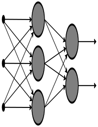
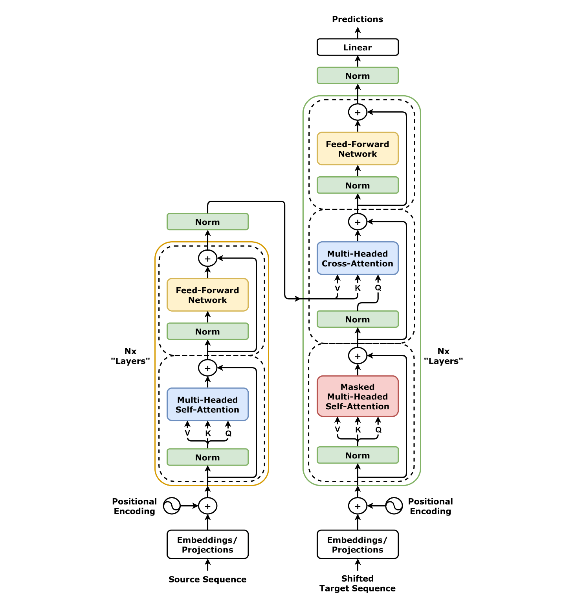
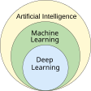
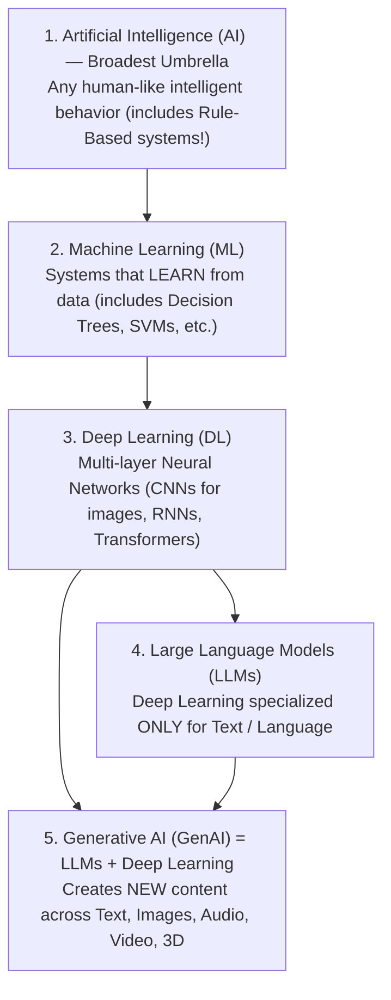

# 🤖 Lecture 2: Large Language Models (LLM) Basics

### Core Mental Model — Before Everything Else

> [!important] What Is an LLM in One Sentence?
> At its simplest form, a **Large Language Model (LLM)** is a **deep neural network** (built on the **Transformer architecture**) trained on massive amounts of text data to **understand, generate, and respond to human-like text** — often responding *like* a human.
>
> - **"Large"** = **Billions to Trillions of parameters** (weights learned during training).
> - **"Language Model"** = Specialized in the **text/language modality** (unlike image/video models).
> - **Secret Sauce** = The **Transformer architecture** (*"Attention Is All You Need"*, 2017).

| Concept | Key Distinction |
| :--- | :--- |
| **LLM** | Deep neural network (Transformer) trained on text with **billions/trillions of parameters** |
| **Earlier NLP Models** | Narrow, single-task models (one for translation, another for sentiment) |
| **AI vs. ML** | **AI** includes rule-based chatbots (e.g., Lufthansa assistant); **ML** learns patterns from data |
| **ML vs. DL** | **ML** includes non-neural algorithms (e.g., Decision Trees); **DL** uses stacked neural networks |
| **GenAI vs. LLM** | **LLMs** handle text only; **GenAI** = LLMs + DL creating new content across text, image, audio, video |

---

## Topics Covered (Lecture 2 Timeline)

| Timestamp | Section | Core Question |
| :--- | :--- | :--- |
| `00:00–02:08` | **Objectives** | Course vision & 6 core goals of Lecture 2 |
| `02:08–06:45` | **§1. What Are LLMs?** | Neural network fundamentals + ChatGPT demonstration |
| `06:45–11:50` | **§2. Why "Large" Language Models?** | Parameter explosion (`GPT-1 → GPT-3 → GPT-4`), 1950–2022+ scaling, & language modality |
| `11:50–14:15` | **§3. LLMs vs. Earlier NLP Models** | General-purpose multitask capability & custom instruction following |
| `14:15–17:55` | **§4. The Secret Sauce Behind LLMs** | The **Transformer architecture** & *"Attention Is All You Need"* (2017) |
| `17:55–25:45` | **§5. AI vs. ML vs. DL vs. GenAI vs. LLM** | Concrete examples distinguishing every buzzword |
| `25:45–33:35` | **§6. Applications of LLMs** | 5 core LLM application pillars + Vizuara's Teacher Portal demo |

---

## 1. What Are Large Language Models (LLMs)?

An LLM has **two fundamental parts** in its definition:

### Part 1: It Is a Deep Neural Network
A **neural network** is a mathematical model symbolically inspired by the circuitry of the human brain:
- **Input Layer:** Receives raw numerical input data.
- **Hidden Layers:** Multiple stacked layers of interconnected artificial **neurons** (that's why it's called a **Deep Neural Network**).
- **Output Layer:** Produces predictions (e.g., classifying a brain tumor, steering a self-driving car, or predicting the next word).


*Figure 1: A deep neural network — Input layer feeding into stacked Hidden layers of neurons and an Output layer.*

### Part 2: Designed to Understand, Generate & Respond to Human-Like Text
LLMs are neural networks specialized for generic text tasks.

**Lecture ChatGPT Demonstration (`GPT-4` / `GPT-4o`):**
- **Prompt:** *"Can you help me plan a relaxing day that focuses on activities for rejuvenation? To start, ask me what my favorite forms of relaxation are."*
- **ChatGPT Response:** Naturally asks follow-up options (*outdoors, reading, yoga, painting, cooking*).
- **User Reply:** *"Reading a book."*
- **ChatGPT Output:** Generates a full structured itinerary (30 min morning meditation, 45 min healthy breakfast, 2 hours reading time, 1 hour nature walk) — conversing seamlessly **like a human**.

> [!note] Takeaway
> Behind ChatGPT's human-like conversation is not magic — it is a **deep neural network** trained on massive amounts of text. As models improve, sounding increasingly human also introduces major societal and safety challenges.

---

## 2. Why Is It Called a "Large" Language Model?

Why not just call it a *Language Model*? Because of the **unprecedented number of parameters** (tunable numerical weights inside the neural network):
- Traditional NLP models had thousands or a few million parameters.
- Modern LLMs have **billions ($10^9$)** to **trillions ($10^{12}$)** of parameters!

### GPT-3 Model Family Sizes
Notice how the suffix (`13B`, `175B`) directly denotes the parameter count:

| Model Variant | Parameter Count |
| :--- | :--- |
| **GPT-3 Small** | 125 Million (`125M`) |
| **GPT-3 Medium** | 350 Million (`350M`) |
| **GPT-3 Large** | 760 Million (`760M`) |
| **GPT-3 13B** | 13 Billion (`13B`) |
| **GPT-3 175B** | 175 Billion (`175B`) |

### Scaling Across Generations: GPT-1 → GPT-2 → GPT-3
As parameter count, depth, and context length scaled up dramatically, model capabilities leaped forward:

| Metric | GPT-1 | GPT-2 | GPT-3 |
| :--- | :--- | :--- | :--- |
| **Parameters** | ~117 Million | 1.5 Billion (~10× jump) | 175 Billion (~100× jump) |
| **Decoder Layers** | 12 | 48 | 96 |
| **Context / Token Size** | 512 tokens | 1,024 tokens | 2,048 tokens |

### Historical Scaling of AI Models (1950–2022+, *Nature* Log-Scale Trend)
```text
1950s        : ~10 to 100 parameters
1950–1960s   : ~1,000 to 10,000 parameters
1980–2000s   : ~100,000 parameters
2020–Present : 100M → 1B → 175B → ~1 Trillion+ parameters (dominated by LLMs!)
```

### Why "Language" Model?
Because classical LLMs operate strictly on the **language/text modality** (not images or video) — handling question answering, translation, summarization, and sentiment analysis.

---

## 3. LLMs vs. Earlier NLP Models

Natural Language Processing (NLP) existed for decades before LLMs. Two fundamental breakthroughs separate modern LLMs from earlier NLP models:

| Comparison | Earlier NLP Models | Modern LLMs (GPT, Llama, Claude) |
| :--- | :--- | :--- |
| **1. Task Scope** | **Single-task / Narrow:** One model trained only for translation; a separate model trained only for sentiment analysis | **General-purpose / Multi-task:** A single model trained for next-token completion automatically handles QA, translation, summarization, coding, and more |
| **2. Custom Instructions** | **Rigid:** Could not follow open-ended custom instructions reliably | **Instruction-following:** Trivially follows arbitrary prompts (e.g., *"Draft an email to a friend to book movie tickets"* complete with tone and emojis) |

---

## 4. The Secret Sauce Behind LLMs: The Transformer Architecture

What single breakthrough made LLMs jump so far ahead of earlier NLP models?

> **The Transformer Architecture** — introduced in the landmark 2017 Google Brain paper:
> **"Attention Is All You Need"** (Vaswani et al., 8 authors, 15 dense pages, **100,000+ citations** in ~5 years).


*Figure 2: The Transformer architecture from "Attention Is All You Need" (2017). Every single block — Input Embeddings, Positional Encoding, Multi-Head Attention (Q, K, V), Add & Norm, and Feed-Forward — will be built from scratch in this series.*

### Key Components Previewed for Upcoming Lectures
Don't worry if these terms look unfamiliar now — each will get dedicated deep-dive lectures:
- **Input & Output Embeddings:** Turning text tokens into vectors.
- **Positional Encoding:** Encoding word order in parallel.
- **Scaled Dot-Product & Multi-Head Attention (`Query, Key, Value`):** Letting every word attend to relevant context words.
- **Add & Norm (Residual Connections + LayerNorm)** & **Feed-Forward Networks**.

---

## 5. AI vs. ML vs. DL vs. LLMs vs. Generative AI

These five terms form **nested concentric umbrellas** — with **Generative AI** bridging LLMs and broader Deep Learning:


*Figure 3: Concentric relationship from Artificial Intelligence (broadest) down through Machine Learning, Deep Learning, and LLMs.*



### Concrete Lecture Examples Distinguishing Every Layer

| Category | Lecture Example | Why It Belongs Here (and Not Deeper) |
| :--- | :--- | :--- |
| **AI (Not ML)** | **Lufthansa Flight Chat Assistant ("Elisa")** | Rule-based clickable menu (*"Flight cancelled → Check alternatives"*). It behaves intelligently, **but it does NOT learn** from user behavior — every user gets the exact same hardcoded flow. |
| **ML (Not DL)** | **Heart Disease Prediction with a Decision Tree** (303 patients: age, gender, chest pain, cholesterol, ECG) | Learns patterns from data, **but uses a Decision Tree — zero neural networks** are involved. |
| **Deep Learning (Not LLM)** | **1. CNN Image Classifier** (detecting an *"Espresso"* coffee cup over *"Lifeboat"* or *"Pizza"*)<br>**2. MNIST Handwritten Digit Classifier** (`Input → 2 Hidden Layers → Output`, predicting `8`, `7`) | Uses stacked **neural network layers**, **but processes images**, not text. |
| **LLM** | **GPT-3 / GPT-4 / Llama 3.1** (text prompts & responses) | Deep neural networks specialized specifically for **human language/text**. |
| **Generative AI** | **ChatGPT + DALL-E / AI Video / Audio Generators** | Combines **LLMs + Deep Learning** to *generate brand-new content* across text, images, audio, and video. |

---

## 6. Top 5 Applications of LLMs (+ Vizuara Portal Demo)

While applications are expanding daily, Dr. Dandekar groups LLM capabilities into **5 core pillars**:

| # | Application Pillar | Lecture Example |
| :---: | :--- | :--- |
| **1** | **Creating New Content** | Writing original creative text that never existed before (e.g., *"Write a poem about the solar system in the style of a detective story"* → Detective Orion in the Milky Way) |
| **2** | **Chatbots & Virtual Assistants** | Conversational customer support for airlines, hotel reservations, banks, movie booking, and personal assistants |
| **3** | **Machine Translation** | Translating the solar-system detective poem into **French** instantly, plus expanding research into regional languages |
| **4** | **Long-Form Text Generation** | Writing books, news articles, scripts, and media reports |
| **5** | **Sentiment Analysis** | Analyzing paragraphs to detect customer sentiment or **hate speech** on social media (Twitter/X, Instagram) |

### Vizuara Teacher Portal Demo (Built Using LLMs)
To show what you can build once you master LLMs, the lecture demos Vizuara's school-teacher portal featuring:
- **Lesson Plan Generator:** Topic *"Gravity"* aligned with India's **CBSE curriculum** → generates objectives, opening, guided/independent practice, and assessments.
- **MCQ Generator:** Topic *"World War II"* (1 hard, 1 medium, 1 easy question) → generates all 3 MCQs with answers and explanations in ~5 seconds.
- **Other Tools:** YouTube generator, Text Summarizer, Text Rewriter, and Worksheet Generator.

> [!tip] Final Takeaway from Lecture 2
> *"The sky is the limit when it comes to LLM applications — what we showed is just the tip of the iceberg. However, students who truly make an impact are the ones who understand Transformer code, Query/Key/Value attention, and positional encoding from scratch."*

---

## 7. Glossary & Next Lecture

| Term | Definition |
| :--- | :--- |
| **Parameter** | A learnable numerical weight inside a neural network adjusted during training (LLMs have billions–trillions) |
| **Context / Token Size** | Maximum number of tokens an LLM can process at once (`512` in GPT-1 → `2048` in GPT-3 → `128K+` today) |
| **Transformer** | Neural network architecture introduced in 2017 (*"Attention Is All You Need"*) powering all modern LLMs |
| **Decision Tree** | Classic non-neural Machine Learning algorithm that splits data on feature thresholds |
| **CNN (Convolutional Neural Network)** | Deep learning architecture using spatial filters, widely used for image recognition |

- **Up Next (Lecture 3):** **Stages of Building LLMs** (Pretraining, Fine-Tuning, and moving toward hands-on coding!).

