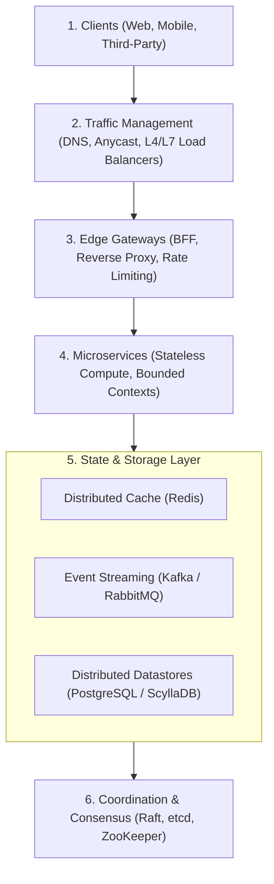

# 🏗️ Microservices Architecture & Distributed System Primitives

> [!ABSTRACT] **Executive Summary**
> Distributed systems engineering operates on a fundamental formula:
> **$$\text{System Design} = \text{Placement} + \text{Replication} + \text{Coordination} + \text{Failure Handling} + \text{Time} + \text{Scale}$$**
> This note synthesizes the core system design primitives that underpin modern cloud architectures and catalogs the essential microservices patterns used in production.

---

## 🗺️ Architectural Layer Stack

---

## 🧩 Part 1: Distributed Systems Primitives (The 11 Pillars)

### 1. Data Distribution & Placement
*Problem Solved: Where does data live and how is work balanced across nodes?*

| Primitive | Mechanism | Real-World Systems |
| :--- | :--- | :--- |
| **Consistent Hashing** | Maps keys and nodes to a circular hash ring; minimizes data movement when adding/removing nodes. | Cassandra, DynamoDB, Discord |
| **Range Partitioning** | Partitions data based on ordered ranges of key values; enables efficient range queries. | CockroachDB, Google Spanner, HBase |
| **Virtual Nodes (V-Nodes)** | Assigns multiple tokens per physical node on the hash ring to eliminate hot spots and balance heterogeneous hardware. | Cassandra, DynamoDB, Couchbase |
| **Directory-Based Sharding** | Centralized lookup routing table directs incoming keys to specific physical shards. | Citus, MongoDB (Config Servers) |
| **Rebalancing & Resharding** | Automated background migration of partition splits without service downtime. | CockroachDB, Elasticsearch |

---

### 2. Replication & Consistency
*Problem Solved: How many copies exist, and how consistent are they across network partitions?*

| Primitive | Mechanism | Real-World Systems |
| :--- | :--- | :--- |
| **Leader-Follower (Single Leader)** | All writes route to a designated leader node; followers replicate the WAL to serve reads. | PostgreSQL, MySQL, Redis, MongoDB |
| **Multi-Leader (Master-Master)** | Multiple nodes accept writes; requires conflict resolution (LWW or CRDTs). | CouchDB, Aurora Multi-Master |
| **Leaderless (Dynamo-Style)** | Client writes to $W$ replicas and reads from $R$ replicas where $W + R > N$ (Quorum). | Cassandra, Amazon DynamoDB |
| **Linearizability** | Strongest consistency: operations appear to take effect instantaneously on a single copy. | Google Spanner, etcd, ZooKeeper |
| **Eventual Consistency** | Given no new updates, all replicas converge to identical state over time. | DNS, DynamoDB, Kafka mirrors |
| **Read-Your-Writes** | Guarantees an individual client immediately observes their own recently executed writes. | Social media feeds, e-commerce carts |

---

### 3. Consensus & Coordination
*Problem Solved: How do independent nodes agree on a single shared truth in the presence of failures?*

| Primitive | Mechanism | Real-World Systems |
| :--- | :--- | :--- |
| **Raft** | Understandable leader-based consensus algorithm using terms, log replication, and heartbeat election. | etcd, CockroachDB, TiKV, HashiCorp Consul |
| **Multi-Paxos** | Classical consensus protocol with prepare/promise and accept/accepted phases. | Google Chubby, Spanner, Megastore |
| **ZAB (ZooKeeper Atomic Broadcast)** | High-throughput atomic broadcast protocol maintaining strict causal order. | Apache ZooKeeper, Apache Kafka (KRaft) |
| **Distributed Locks** | Coordination tokens ensuring single-worker exclusivity (e.g., Redlock, etcd leases). | Distributed schedulers, billing engines |
| **Fencing Tokens (STONITH)** | Monotonically increasing numbers sent with every write to prevent split-brain zombies. | Pacemaker, Patroni HA |

---

### 4. Failure Handling & Resilience
*Problem Solved: What happens when hardware fails, networks partition, or dependencies degrade?*

| Primitive | Mechanism | Real-World Systems |
| :--- | :--- | :--- |
| **Circuit Breakers** | Fast-fails remote calls when error thresholds are crossed, preventing cascading outages. | Envoy, Netflix Hystrix, Resilience4j |
| **Bulkheads** | Isolates critical resources into distinct pools so a failing subsystem cannot exhaust the process. | Thread pools, isolated connection pools |
| **Gossip Protocols** | Decentralized peer-to-peer epidemic message dissemination for node cluster membership. | HashiCorp Serf, Cassandra cluster state |
| **Phi-Accrual Failure Detectors** | Probabilistic suspicion algorithm that adapts to variable network latency rather than static timeouts. | Cassandra, Akka Cluster |
| **Heartbeats & Leases** | Periodic keep-alives with time-bound ownership guarantees. | Kubernetes Node leases, etcd |

---

### 5. Time, Ordering & Logical Clocks
*Problem Solved: In a distributed system without synchronized physical clocks, what happened first?*

| Primitive | Mechanism | Real-World Systems |
| :--- | :--- | :--- |
| **Lamport Timestamps** | Monotonic integer counters incremented on each event; captures partial causal order. | Distributed debugging, causality tracking |
| **Vector Clocks** | Array of clocks (one per node) capturing exact causal relationships and concurrent conflicts. | Amazon Dynamo, Riak |
| **Hybrid Logical Clocks (HLC)** | Combines physical NTP clock readings with logical counters to bound drift. | CockroachDB, MongoDB |
| **TrueTime API** | Hardware-synchronized GPS and atomic clocks exposing time as an uncertainty interval $[t_{earliest}, t_{latest}]$. | Google Spanner |

---

### 6. Transactions & Distributed Correctness
*Problem Solved: How do we update state across multiple physical nodes safely?*

| Pattern | Mechanism | Trade-off / Cost |
| :--- | :--- | :--- |
| **Two-Phase Commit (2PC)** | Coordinator sends Prepare phase, waits for unanimous vote, then sends Commit. | 💀 Blocking: if coordinator crashes during commit, locks are held indefinitely. |
| **Saga (Orchestration)** | Central state machine invokes individual service transactions and triggers compensating rollbacks on failure. | ✅ Asynchronous & non-blocking; eventual consistency requires handling dirty reads. |
| **Saga (Choreography)** | Services listen to domain events and execute local transactions reactively. | Low coupling, but distributed tracing and workflow debugging become difficult. |
| **Transactional Outbox** | Atomically writes state changes and outgoing domain events to the same DB transaction; poller/CDC emits to broker. | Guarantees at-least-once event delivery without distributed 2PC overhead. |

---

## 🏛️ Part 2: Comprehensive Microservices Patterns Catalog

### 1. Integration & Edge Routing Patterns

| Pattern | Description | Best For |
| :--- | :--- | :--- |
| **API Gateway** | Single entry point that handles cross-cutting concerns (auth, rate limiting, SSL, telemetry). | External client abstraction |
| **Backend for Frontend (BFF)** | Dedicated lightweight gateway per frontend client type (Web, iOS, Android, Desktop). | Multi-platform UX optimization |
| **Gateway Aggregation** | Merges multiple internal backend REST/gRPC calls into a single consolidated client response. | Reducing mobile network chattiness |
| **Gateway Offloading** | Offloads TLS termination, JWT validation, and static asset caching to the edge proxy. | Reducing compute load on business services |
| **Service Mesh** | Dedicated infrastructure layer (sidecar proxies like Envoy) managing mTLS, metrics, and traffic routing. | Polyglot inter-service communication |

---

### 2. Deployment & Operational Patterns

| Pattern | Description | Zero Downtime? |
| :--- | :--- | :-: |
| **Blue-Green Deployment** | Two identical production environments; switch router traffic instantaneously from Blue to Green. | ✅ Yes |
| **Canary Release** | Route a tiny fraction of user traffic (e.g., 2%) to the new version; monitor metrics before full rollout. | ✅ Yes |
| **Rolling Update** | Gradually replace instances of the previous version with the new version one pod at a time. | ✅ Yes |
| **Strangler Fig** | Incrementally replace legacy monolith functionality by routing specific URI paths to new microservices. | ✅ Yes |
| **Sidecar Pattern** | Deploys a supporting container alongside the main application container within the same lifecycle and network namespace. | N/A (Architecture) |

---

## 📚 Recommended Repositories & Real-World Implementations

- [Go Food Delivery Microservices](https://github.com/mehdihadeli/go-food-delivery-microservices) — Production-grade Go microservices utilizing Clean Architecture, Event Sourcing, CQRS, and Kafka.
- [Shop Golang Microservices](https://github.com/meysamhadeli/shop-golang-microservices) — Comprehensive e-commerce architecture demonstrating RabbitMQ, gRPC, and PostgreSQL.
- [Go CoffeeShop](https://github.com/thangchung/go-coffeeshop) — Pragmatic microservices demonstrating Saga orchestration, Outbox pattern, and Event Collaboration.
- [Istio Observability with Go & gRPC](https://itnext.io/istio-observability-with-go-grpc-and-protocol-buffers-based-microservices-d09e34c1255a) — End-to-end tutorial on distributed tracing, mTLS, and service mesh deployment.
- [Transactions in Microservices Series](https://dev.to/federico_bevione/series/30165) — In-depth architectural breakdown of distributed transactions and Sagas.
