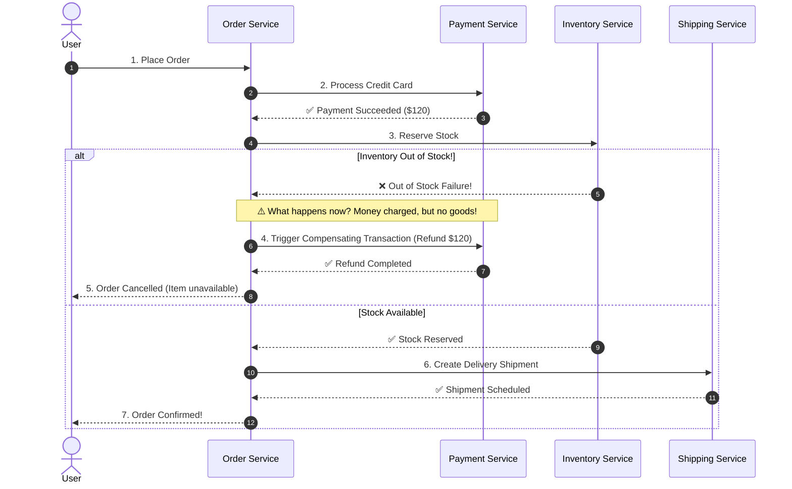
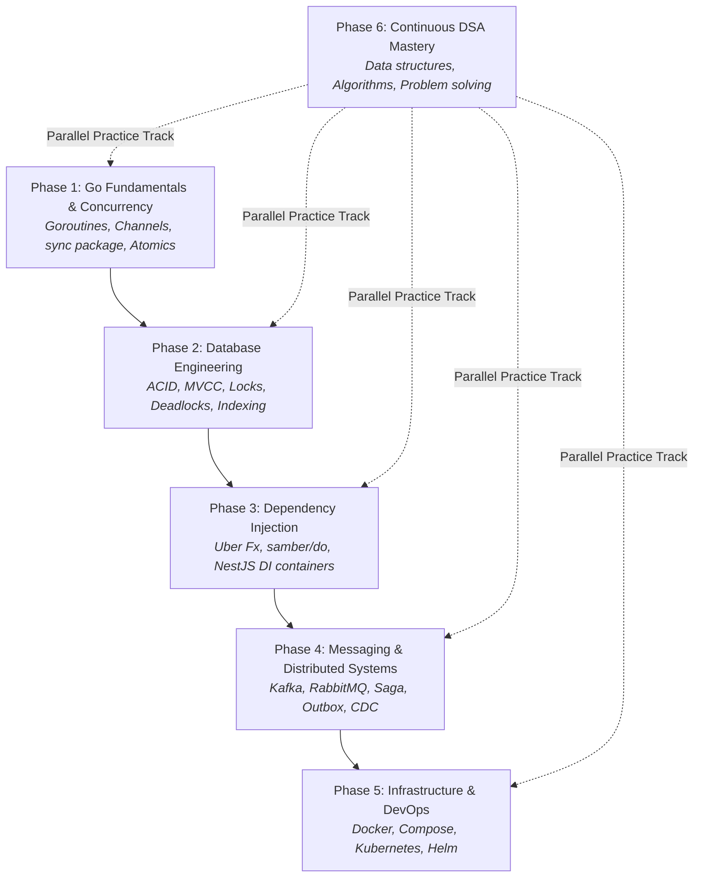

# 🚀 Backend Engineering Learning Checklist & Practice Guide

> [!ABSTRACT] **Curriculum Overview**
> This guide is a structured, long-term backend engineering curriculum focused on **distributed systems**, **Go concurrency**, **database internals**, **software architecture**, and **system resilience**. Use the interactive checkboxes (`- [ ]`) to track your hands-on drills and project milestones.
>
> 🔗 **Companion Master Plan:** [[Roadmaps & Trackers/Things that i need to do in 3 month|3-Month Master Roadmap]]

---

## 1. 🌐 Distributed Systems and Microservices

> [!TIP] **Related Vault Notes**
> See [[Sys Design/Microservices|Microservices]] and [[MessageBrokers/Message Brokers and design patterns|Message Broker Patterns]].

### Core Topics & Concepts

| Topic | What It Means | Vault Reference |
| :--- | :--- | :--- |
| **Saga Pattern** | Managing distributed transactions across multiple microservices without a single blocking database lock or 2PC. | [[Sys Design/Microservices|Microservices]] |
| **Outbox Pattern** | Reliably publishing events to a message broker by atomically committing state and event data to the database in a single transaction. | [[Sys Design/Microservices|Microservices]] |
| **CDC (Change Data Capture)** | Capturing row-level database changes directly from the Write-Ahead Log (WAL) and streaming them as events (e.g. Debezium). | [[Database/ACID/Transaction|Transactions]] |
| **Event Sourcing** | Storing every state change as an immutable chronological append-only log of events rather than updating in-place state. | [[Sys Design/Microservices|Microservices]] |
| **Message Brokers** | Distributed middleware platforms that decouple services, buffer spikes, and route messages (Kafka, RabbitMQ, NATS). | [[MessageBrokers/Kafka\|Kafka]], [[MessageBrokers/Rabbit MQ\|RabbitMQ]] |

---

### The Real-World Challenge: Distributed E-Commerce Flow

Imagine an e-commerce platform processing a customer checkout:

> [!IMPORTANT] **Why This Matters**
> In distributed architectures, individual service operations can succeed while downstream ones fail. Without patterns like **Saga** (compensating rollbacks), **Transactional Outbox** (guaranteed event delivery), and **Message Brokers** (asynchronous decoupling), money is charged with no items shipped, data drifts out of sync, and systems fail unpredictably.

---

## 2. 💉 Dependency Injection (DI)

Dependency Injection establishes loose coupling by supplying dependencies from the outside rather than instantiating them hardcoded within business logic.

| Topic | What to Learn | Ecosystem |
| :--- | :--- | :--- |
| **DI using Fx** | Dependency injection using Uber's `fx` reflection-based application framework in Go. | Go (Uber) |
| **DI using Do** | Dependency injection using `samber/do` (lightweight, package-free, generic-based DI) or Google's `Wire` (compile-time code generation). | Go |
| **DI in NestJS** | Hierarchical IoC container using TypeScript decorators, custom tokens, and dynamic modules. | Node.js / NestJS |

### Deep-Dive Focus Areas

#### For Go:
- [ ] **Constructor Injection**: Creating `NewService(repo Repository, cfg Config) *Service` functions.
- [ ] **Dependency Graphs**: Building clean initialization trees without circular dependencies.
- [ ] **Interface Decoupling**: Depending on abstractions defined at the consumer side rather than concrete struct pointers.
- [ ] **Lifecycle Management**: Hooking into startup and graceful shutdown sequences (`OnStart`, `OnStop`).
- [ ] **Uber Fx Framework**: Providing constructors via `fx.Provide`, running modules via `fx.Invoke`, and managing options via `fx.Options`.
- [ ] **Compile-Time vs. Runtime DI**: Comparing `Wire` (compile-time safety) vs `Uber Fx` / `samber/do` (runtime convenience).

#### For NestJS:
- [ ] **Providers & Services**: Declaring `@Injectable()` classes.
- [ ] **Modules**: Organizing boundaries with `@Module({ imports, controllers, providers, exports })`.
- [ ] **Injectable Decorators**: Custom parameter decorators and `@Inject('CUSTOM_TOKEN')`.
- [ ] **Custom Providers**: Value providers (`useValue`), Factory providers (`useFactory`), Class providers (`useClass`).
- [ ] **Dependency Scopes**: `DEFAULT` (singleton), `REQUEST` (per-incoming HTTP request), `TRANSIENT` (new instance per consumer).
- [ ] **Resolving Circular Dependencies**: Using `forwardRef()` or refactoring module boundaries.

---

## 3. ⚡ Concurrency and Database Internals

> [!TIP] **Related Vault Notes**
> Check out [[networking/concurrency and networking|Concurrency & Networking]], [[Database/ACID/Transaction|ACID Transactions]], and [[Database/Database Indexing/Index|Indexing]].

| Domain | What to Master | Impact on Production |
| :--- | :--- | :--- |
| **Concurrency** | Structuring programs to execute independent tasks concurrently and safely without race conditions. | Maximizes multi-core CPU utilization; minimizes request latency. |
| **Database Locking** | Regulating simultaneous reads and writes to maintain transaction isolation and data integrity. | Prevents lost updates, phantom reads, and catastrophic deadlock freezes. |
| **Go `sync` Package** | Core low-level synchronization primitives built into the Go standard library. | Fast, memory-efficient in-process synchronization without external dependencies. |
| **Beyond Effective Go** | Advanced concurrency design patterns, memory model guarantees, and cache-conscious systems. | Production-grade software that survives extreme concurrency bursts. |

---

### Go Concurrency Checklist
- [ ] **Goroutines**: Lightweight runtime threads (~2 KB stack allocation, cooperative M:N scheduling).
- [ ] **Channels**: Unbuffered (synchronous rendezvous) vs. buffered channels; channel directionality (`<-chan`, `chan<-`).
- [ ] **Mutex & RWMutex**: Protecting critical sections; reader-writer locks for read-heavy workloads.
- [ ] **WaitGroup**: Coordinating fan-out task completion (`Add`, `Done`, `Wait`).
- [ ] **Atomic Operations (`sync/atomic`)**: Lock-free counters and pointer updates (`AddInt64`, `CompareAndSwap`, `StorePointer`).
- [ ] **Context Cancellation (`context`)**: Propagating deadlines, timeouts, and cancellation signals across API boundaries.
- [ ] **Race Detector**: Running tests with `go test -race` and diagnosing data races.
- [ ] **Deadlock Prevention**: Consistent lock ordering, timeout-based acquisition, avoiding lock contention inside loops.
- [ ] **Worker Pool Pattern**: Fixed pool of worker goroutines consuming jobs from a shared channel.
- [ ] **Fan-In & Fan-Out**: Fanning out CPU-intensive work across multiple workers and multiplexing results into a single channel.
- [ ] **Semaphores (`golang.org/x/sync/semaphore`)**: Limiting concurrent access to scarce resources (e.g. max 10 concurrent database connections).

---

### Database Locking & Internals Checklist
- [ ] **Shared Locks (S-Locks)**: Read locks allowing multiple concurrent readers while blocking writers.
- [ ] **Exclusive Locks (X-Locks)**: Write locks blocking both readers and other writers.
- [ ] **Row-Level vs. Table-Level Locking**: Granular concurrency vs. coarse-grained table locks during DDL alterations.
- [ ] **Pessimistic Locking**: `SELECT ... FOR UPDATE` (explicitly acquiring row locks to guarantee single-writer safety).
- [ ] **Optimistic Locking**: Version numbers or timestamps (`UPDATE table SET balance = 50, version = 2 WHERE id = 1 AND version = 1`).
- [ ] **Deadlock Detection & Resolution**: Wait-for graphs, deadlock detection intervals, transaction rollbacks.
- [ ] **Isolation Levels**: Read Uncommitted, Read Committed, Repeatable Read, Serializable.
- [ ] **MVCC (Multi-Version Concurrency Control)**: Snapshot isolation, non-blocking reads, VACUUM / garbage collection of dead tuples.

---

## 4. 🐳 Infrastructure and Deployment

> [!TIP] **Related Vault Notes**
> Reference [[kubernetes/kubernetes|Kubernetes Architecture]] and [[docker/Kubernetes|Docker Notes]].

| Technology | What to Learn | Key Production Milestones |
| :--- | :--- | :--- |
| **Docker** | Containerization, multi-stage builds, minimal images, layer caching, bridge networks, volumes, Docker Compose. | Reduce image size from 1.2 GB down to 15 MB using Distroless / Alpine. |
| **Kubernetes** | Pod lifecycle, ReplicaSets, Deployments, Services (ClusterIP, NodePort, LoadBalancer), ConfigMaps, Secrets, Ingress, HPA. | Deploy zero-downtime rolling microservice updates with liveness and readiness probes. |

### Practical Deployment Checklist
- [ ] Build a multi-stage `Dockerfile` separating build tools from the final production runtime container.
- [ ] Configure `docker-compose.yml` orchestrating API, PostgreSQL, Redis, and Kafka in a local developer environment.
- [ ] Write Kubernetes manifests:
  - [ ] `Deployment` with CPU/Memory resource requests and limits.
  - [ ] `Service` for internal load balancing.
  - [ ] `ConfigMap` and `Secret` for environment configurations.
  - [ ] `Ingress` routing external HTTP traffic.
  - [ ] `HorizontalPodAutoscaler` (HPA) scaling pods based on CPU/Memory utilization.

---

## 5. 🧮 Data Structures and Algorithms (DSA)

DSA provides the computational tools and spatial reasoning required to write efficient, scalable algorithms and ace senior engineering technical interviews.

> [!NOTE] **Related Vault Folders**
> Practice files in [[DSA(Mohit)/Graphs|DSA Mohit]] and [[DSA(NeelPatel)/Time&Space_Complexity|Complexity Analysis]].

### DSA Topic Master Checklist

| Category | Core Concepts to Practice | Vault Link |
| :--- | :--- | :--- |
| **Arrays & Slices** | - [ ] Two pointers, sliding window, prefix sums, Kadane's algorithm | [[DSA(Mohit)/Array/2D arrays\|Arrays]] |
| **Strings** | - [ ] String hashing, palindrome checks, pattern matching, anagrams | [[DSA(Mohit)/Strings/Questions\|Strings]] |
| **Hashing** | - [ ] Hash maps, hash sets, frequency counting, collisions | [[DSA(Mohit)/Array/TimeSheet\|Hashing]] |
| **Linked Lists** | - [ ] Fast & slow pointer (cycle detection), reversal, merge two sorted lists | [[DSA(Mohit)/Linked List/TimeSheet\|Linked Lists]] |
| **Stack & Queue** | - [ ] Monotonic stack (Next Greater Element), min-stack, BFS queues | [[DSA(Mohit)/Stack/TimeSheet\|Stack]] |
| **Trees & BST** | - [ ] DFS (pre/in/post-order), BFS level order, height, LCA, validate BST | [[DSA(Mohit)/Tree\|Trees]] |
| **Graphs** | - [ ] Adjacency list, BFS, DFS, Dijkstra, topological sort (Kahn's), Union-Find | [[DSA(Mohit)/Graphs\|Graphs]] |
| **Searching** | - [ ] Binary search on sorted arrays, search on rotated array, search answer space | [[DSA(Mohit)/BinarySearch/TimeSheet\|Binary Search]] |
| **Sorting** | - [ ] Quick sort (partitioning), Merge sort (divide & conquer) | [[DSA(Mohit)/Sorting\|Sorting]] |
| **Recursion & Backtracking** | - [ ] Subsets, permutations, N-Queens, maze traversal | [[DSA(Mohit)/Recursion/TimeSheet\|Recursion]] |
| **Dynamic Programming** | - [ ] Memoization (top-down), Tabulation (bottom-up), 0/1 Knapsack, LCS | [[DSA(Mohit)/TLE/Level 1/solutions\|DP]] |
| **Advanced Topics** | - [ ] Min/Max Heaps, Tries (prefix trees), Disjoint Set Union (DSU), Bitwise tricks | [[DSA(Mohit)/Bit Manipulation/Questions\|Bit Manipulation]] |

---

## 6. 🗺️ Six-Phase Ordered Learning Roadmap

### 1. Phase 1 — Go Fundamentals and Concurrency
- [ ] Goroutines and channels lifecycle
- [ ] Master the complete Go `sync` package (`Mutex`, `RWMutex`, `WaitGroup`, `Once`, `Cond`, `Pool`)
- [ ] Lock-free programming with `sync/atomic`
- [ ] Diagnosing race conditions (`go test -race`) and resolving deadlocks

### 2. Phase 2 — Database Engineering
- [ ] Relational transaction mechanics and ACID guarantees
- [ ] Isolation levels (Dirty Read, Non-Repeatable Read, Phantom Read, Serialization Anomalies)
- [ ] MVCC internal row versioning and vacuuming
- [ ] Database locking strategies: Optimistic (`version`) vs. Pessimistic (`FOR UPDATE`)

### 3. Phase 3 — Dependency Injection
- [ ] Inversion of Control (IoC) and constructor injection principles
- [ ] Building production Go backends using Uber `fx` or `samber/do`
- [ ] NestJS modular architecture, providers, dynamic modules, and lifecycle hooks

### 4. Phase 4 — Messaging and Distributed Systems
- [ ] Event brokers: Apache Kafka, RabbitMQ, and NATS
- [ ] Saga pattern (Orchestration vs. Choreography) with compensating actions
- [ ] Transactional Outbox pattern with Change Data Capture (CDC)
- [ ] Distributed idempotency, retries with exponential backoff and jitter

### 5. Phase 5 — Infrastructure and Deployment
- [ ] Containerization best practices with Docker multi-stage builds
- [ ] Multi-container local environments with Docker Compose
- [ ] Kubernetes cluster primitives: Pods, Deployments, Services, ConfigMaps, Ingress, HPA
- [ ] Zero-downtime rolling deployments and health check probes

### 6. Phase 6 — Continuous DSA Practice
- [ ] Core data structures: Arrays, Hash Maps, Linked Lists, Stacks, Queues, Heaps
- [ ] Core algorithms: Binary Search, Graph Traversals (BFS/DFS), Sorting, DP
- [ ] Daily problem solving and time/space complexity analysis

---

## 7. 🛠️ Practical Projects: Connecting Everything Together

> [!IMPORTANT] **The Hands-On Imperative**
> Theoretical study without production implementation produces shallow knowledge. Build these 6 end-to-end projects to cement your engineering mastery:

- [ ] **1. Distributed E-Commerce Backend**
  - *Stack*: Go / Node.js, PostgreSQL, Apache Kafka, Redis.
  - *Features*: Order placement with Saga orchestration, Transactional Outbox for event publishing, and automated refunds on inventory exhaustion.
- [ ] **2. High-Throughput Job Processing Engine**
  - *Stack*: Go, RabbitMQ / Redis.
  - *Features*: Dynamic worker pool, rate-limited job execution, graceful shutdown on `SIGTERM`, dead-letter retry queues with backoff.
- [ ] **3. Event-Driven Audit & CDC Streaming Pipeline**
  - *Stack*: PostgreSQL, Debezium, Kafka, Elasticsearch.
  - *Features*: Capturing database WAL changes via CDC, publishing to Kafka topics, and sinking into Elasticsearch for real-time audit queries.
- [ ] **4. Production NestJS Enterprise API**
  - *Stack*: TypeScript, NestJS, TypeORM / Prisma, PostgreSQL.
  - *Features*: Clean Architecture with custom providers, JWT auth guards, global interceptors, and transactional repositories.
- [ ] **5. Distributed High-Contention Flash Sale Service**
  - *Stack*: Go, Redis, PostgreSQL.
  - *Features*: Benchmark optimistic vs. pessimistic locking under 10,000 concurrent requests; enforce distributed locks via Redis/Redlock without stock overselling.
- [ ] **6. Microservices Kubernetes Deployment Suite**
  - *Stack*: Docker, Kind / Minikube, Kubernetes, Helm.
  - *Features*: Containerize backend services into distroless images, write Helm charts, configure Ingress routing, and trigger auto-scaling under load testing.

---

### 💡 Final Recommendation & Strategy

> [!SUMMARY] **Where to Focus First**
> Prioritize **Go concurrency**, **database locking/transactions**, and **distributed messaging (Kafka & Outbox)**. These three domains form the high-impact core of modern senior backend engineering:
> - Concurrency allows you to handle thousands of requests per second per node.
> - Database mastery ensures you maintain strict correctness and never corrupt financial state.
> - Distributed messaging enables you to scale horizontally across independent microservices without distributed monolith lock-in.
