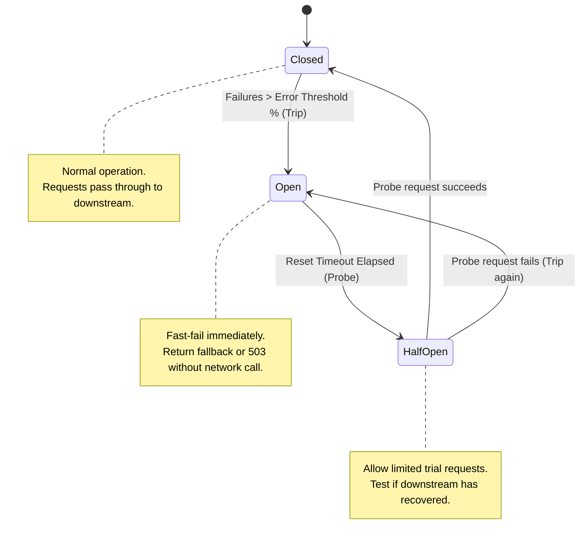

# ⚡ Circuit Breaker Pattern & Implementation in Node.js

### Circuit Breaker Fundamentals

- The **Circuit Breaker** pattern prevents an application from repeatedly executing an operation that is almost guaranteed to fail, stopping cascading outages across distributed microservices.
- When downstream services experience latency spikes or crashes, continuing to bombard them with requests exhausts upstream thread pools and connection queues.
- A circuit breaker wraps remote calls and monitors failures; when failures exceed a threshold, the breaker **trips open**, failing subsequent requests immediately (within **0.1ms**) without touching the network.
- Setting appropriate recovery probes (**Half-Open**) allows automatic self-healing without requiring manual operator intervention or restarts.

---

### The Three State Transitions



| State | Behavior | Request Status |
| :--- | :--- | :--- |
| **Closed** | Breaker is healthy; all calls pass through to the downstream service. | ✅ Executed normally |
| **Open** | Breaker tripped due to repeated failures/timeouts; all calls fail immediately. | ⚡ Fast-fail / Fallback triggered |
| **Half-Open** | Trial period after `resetTimeout`; allows a small batch of canary requests through. | 🔍 Testing downstream health |

---

### Production Implementation in Node.js (`opossum`)

Install the battle-tested Opossum circuit breaker package:
```bash
npm install opossum axios
```

```javascript
const CircuitBreaker = require('opossum');
const axios = require('axios');

// 1. The downstream network operation that might fail
async function fetchUserOrders(userId) {
  const response = await axios.get(`https://orders.service.internal/api/v1/users/${userId}/orders`, {
    timeout: 2000 // 2 second HTTP timeout
  });
  return response.data;
}

// 2. Circuit Breaker Configuration Options
const options = {
  timeout: 3000,                  // If action takes longer than 3s, trigger a failure
  errorThresholdPercentage: 50,    // When 50% of requests fail over the rolling window, OPEN breaker
  resetTimeout: 10000,            // Wait 10 seconds in OPEN state before trying HALF-OPEN probe
  rollingCountTimeout: 10000,     // Window size in ms for stats collection (10s)
  rollingCountBuckets: 10,        // Number of buckets in the rolling statistical window
  volumeThreshold: 10             // Minimum requests required in window before tripping logic engages
};

// 3. Wrap function inside CircuitBreaker
const breaker = new CircuitBreaker(fetchUserOrders, options);

// 4. Fallback function executed when breaker is OPEN or request fails
breaker.fallback((userId, err) => {
  console.warn(`[CircuitBreaker] Fallback invoked for user ${userId}. Reason: ${err?.message}`);
  return {
    cached: true,
    orders: [],
    warning: "Orders service is temporarily unavailable. Displaying cached placeholder."
  };
});

// 5. Lifecycle event listeners for observability & metrics
breaker.on('open', () => console.error('🚨 [CircuitBreaker] Circuit is OPEN! Downstream service down.'));
breaker.on('halfOpen', () => console.log('🔍 [CircuitBreaker] Circuit is HALF-OPEN. Probing downstream service...'));
breaker.on('close', () => console.log('✅ [CircuitBreaker] Circuit is CLOSED. Downstream service recovered.'));
breaker.on('timeout', () => console.warn('⏱️ [CircuitBreaker] Downstream request timed out.'));

// 6. Usage in route handler
async function handleGetOrders(req, res) {
  try {
    const result = await breaker.fire(req.params.userId);
    res.json(result);
  } catch (error) {
    res.status(503).json({ error: "Service Unavailable" });
  }
}

module.exports = { breaker, handleGetOrders };
```

---

### Common Traps & Best Practices

| Gotcha | Problem | Best Practice Solution |
| :--- | :--- | :--- |
| **Low Volume Tripping** | If 1 out of 1 request fails at startup, failure rate is 100% and trips circuit prematurely. | Always specify `volumeThreshold` (e.g. 10 or 20 calls) before allowing the breaker to trip. |
| **Failing Fallback** | Fallback function itself throws an unhandled promise rejection or error. | Keep fallbacks purely local (memory cache, stale replica, static defaults) with no external network calls. |
| **Circuit Flapping** | Breaker opens and closes repeatedly because `resetTimeout` is shorter than backend cold start. | Set conservative `resetTimeout` (10s–30s) to give the downstream service time to recover. |
| **Missing HTTP Timeout** | Remote socket hangs for 60s; breaker cannot count failure until socket closes. | Always enforce client-side HTTP timeouts inside the wrapped function shorter than breaker timeout. |
