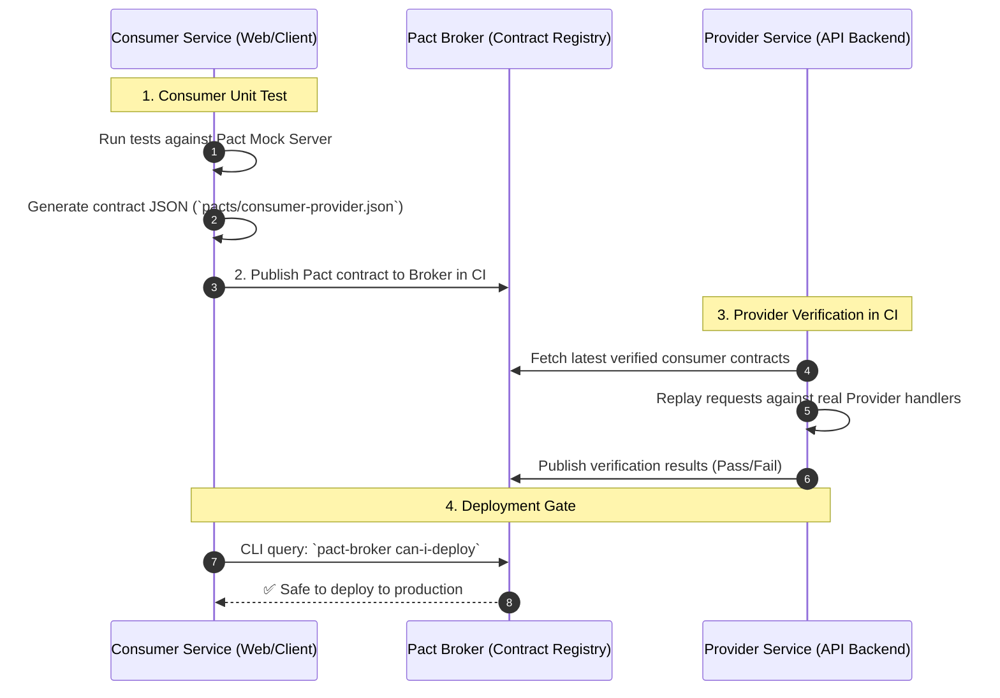

# 📜 Consumer-Driven Contract Testing with Pact

### Contract Testing Fundamentals

- In microservice architectures, testing inter-service communication traditionally relies on **End-to-End (E2E) integration tests**, which are notoriously slow, flaky, expensive to spin up in CI, and difficult to isolate.
- **Consumer-Driven Contract Testing** verifies that services (an API Consumer and an API Provider) can communicate with each other by asserting that each side adheres to a shared, versioned contract file without spinning up both services simultaneously.
- **Pact** is the industry standard framework (used by eBay, Netflix, Atlassian) for defining, publishing, and verifying consumer contracts.
- Contract tests run in **milliseconds** during unit-test execution, enabling teams to safely deploy microservices independently with 100% confidence they won't break upstream or downstream dependents.

---

### E2E Testing vs. Contract Testing

| Dimension | ❌ End-to-End (E2E) Testing | ✅ Contract Testing (Pact) |
| :--- | :--- | :--- |
| **Execution Time** | Minutes to hours (spins up full cluster/DBs) | **Milliseconds** (mocked local unit tests) |
| **Flakiness** | High (network drops, timing races, seed data drift) | **Zero flakiness** (isolated deterministic tests) |
| **Root-Cause Isolation**| Difficult (which service failed?) | **Instantaneous** (exact field and schema difference highlighted) |
| **Team Independence** | Blocks deployments until staging environments sync | Teams deploy independently via Pact Broker checks |

---

### The Pact Verification Workflow



---

### Code Implementation (Node.js with Pact)

#### 1. Consumer Test (`orderClient.spec.js`)
The consumer defines expectations for the API response:

```javascript
const { PactV3, MatchersV3 } = require('@pact-foundation/pact');
const { fetchOrder } = require('./orderClient');

const provider = new PactV3({
  consumer: 'OrderWebClient',
  provider: 'OrderBackendService',
  dir: './pacts'
});

describe('Order Service API Contract', () => {
  test('successfully fetches order by ID', async () => {
    // Define expected contract
    provider
      .uponReceiving('a request for an existing order')
      .withRequest({
        method: 'GET',
        path: '/api/v1/orders/101',
        headers: { Accept: 'application/json' }
      })
      .willRespondWith({
        status: 200,
        headers: { 'Content-Type': 'application/json' },
        body: {
          id: MatchersV3.integer(101),
          total: MatchersV3.decimal(89.99),
          status: MatchersV3.string('PENDING')
        }
      });

    // Execute test against local Pact mock server
    await provider.executeTest(async (mockServer) => {
      const order = await fetchOrder(mockServer.url, 101);
      expect(order.id).toBe(101);
      expect(order.status).toBe('PENDING');
    });
  });
});
```

#### 2. Provider Verification (`provider.spec.js`)
The backend provider verifies that its actual endpoints satisfy the published contract:

```javascript
const { Verifier } = require('@pact-foundation/pact');
const app = require('../src/server'); // Real Express server

describe('Pact Provider Verification', () => {
  let server;
  beforeAll((done) => {
    server = app.listen(8081, done);
  });

  afterAll((done) => {
    server.close(done);
  });

  test('validates against published consumer pacts', async () => {
    const verifier = new Verifier({
      provider: 'OrderBackendService',
      providerBaseUrl: 'http://localhost:8081',
      pactBrokerUrl: 'https://your-company.pactflow.io',
      pactBrokerToken: process.env.PACT_BROKER_TOKEN,
      publishVerificationResult: true,
      providerVersion: process.env.GIT_COMMIT
    });

    await verifier.verifyProvider();
  });
});
```

---

### 🛡️ Deployment Safety with `can-i-deploy`

In your CI/CD pipeline, gate deployments before deploying any microservice:

```bash
# Check if current commit is compatible with environments target
pact-broker can-i-deploy \
  --pacticipant OrderWebClient \
  --version ${GIT_COMMIT} \
  --to-environment production \
  --broker-base-url https://your-company.pactflow.io
```

If a backend developer renames a field (e.g. `total` to `amount`), `can-i-deploy` will exit with code 1, preventing a broken API from ever reaching production.
