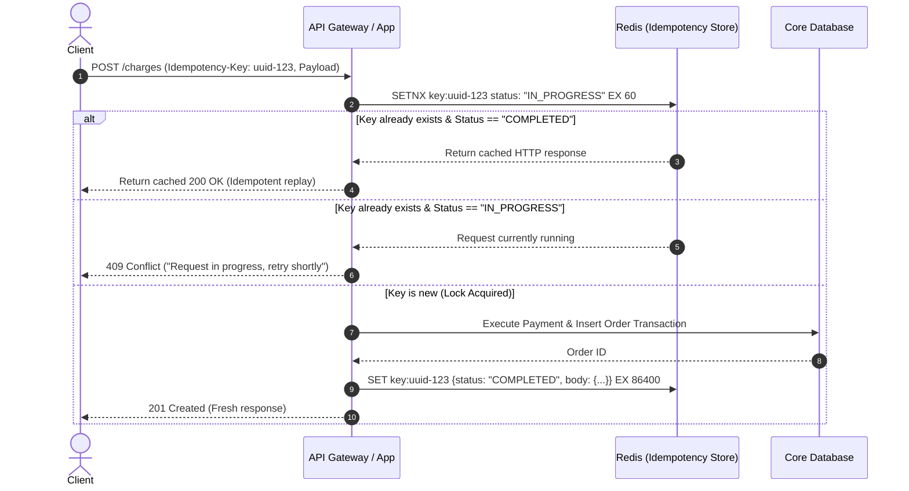

# 🔑 Idempotency Keys in Distributed APIs

### Idempotency Fundamentals

- An **Idempotent Operation** is one that produces the exact same side-effects and system state whether executed once or ten times.
- While `GET`, `PUT`, and `DELETE` are naturally idempotent by HTTP specification, `POST` and `PATCH` are non-idempotent.
- In distributed environments, network timeouts commonly create **ambiguous failures**: the server successfully charges a card or creates an order, but the network connection drops before the HTTP response reaches the client.
- Without an **Idempotency Key**, the client's automated retry creates a catastrophic **duplicate order or double charge**.

---

### The Ambiguous Failure Problem

```
┌────────────────────────────────────────────────────────────────────────┐
│                   THE NETWORK TIMEOUT ANOMALY                          │
│                                                                        │
│  Client                                 Server                  DB     │
│    │                                      │                      │     │
│    ├── 1. POST /orders ($100) ───────────▶│                      │     │
│    │                                      ├── 2. Insert Order ──▶│     │
│    │                                      │   (Order Created!)   │     │
│    │                                      │                      │     │
│    │   ❌ 3. Connection Drops!            │                      │     │
│    │◀- - - - - - - - - - - - - - - - - - -┤                      │     │
│    │   (Client thinks request failed)     │                      │     │
│    │                                      │                      │     │
│    ├── 4. Client Retries POST /orders ───▶│                      │     │
│    │                                      ├── 5. Insert Order ──▶│     │
│    │                                      │   💀 DUPLICATE ORDER!│     │
└────────────────────────────────────────────────────────────────────────┘
```

---

### The Idempotency Key Pattern & Lifecycle

The client generates a unique UUID v4 and sends it in the `Idempotency-Key` HTTP header.



---

### Production Implementation (Node.js + Redis)

```javascript
const crypto = require('crypto');
const redis = require('./redisClient');

/**
 * Express middleware for enforcing request idempotency
 */
function idempotencyMiddleware(ttlSeconds = 86400) {
  return async (req, res, next) => {
    const idempotencyKey = req.header('Idempotency-Key');
    if (!idempotencyKey) {
      return next(); // Skip if no key provided (or return 400 if strictly required)
    }

    const redisKey = `idempotency:${idempotencyKey}`;
    
    // Hash payload to detect if client reused key with different request body
    const requestHash = crypto
      .createHash('sha256')
      .update(JSON.stringify(req.body || {}))
      .digest('hex');

    // 1. Attempt atomic lock using SET NX
    const lockAcquired = await redis.set(
      redisKey,
      JSON.stringify({ status: 'IN_PROGRESS', hash: requestHash }),
      'NX',
      'EX',
      120 // 2-minute lock timeout
    );

    if (!lockAcquired) {
      // Key already exists; read existing state
      const recordRaw = await redis.get(redisKey);
      const record = JSON.parse(recordRaw);

      // Gotcha Check: Did client change the payload?
      if (record.hash !== requestHash) {
        return res.status(422).json({
          error: "Idempotency key reuse with mismatched request payload."
        });
      }

      if (record.status === 'IN_PROGRESS') {
        return res.status(409).json({
          error: "A request with this idempotency key is currently being processed."
        });
      }

      // Replay stored response
      return res.status(record.statusCode).json(record.body);
    }

    // 2. Intercept response to store result in Redis upon completion
    const originalJson = res.json.bind(res);
    res.json = (body) => {
      // Save completed response in background
      redis.set(
        redisKey,
        JSON.stringify({
          status: 'COMPLETED',
          hash: requestHash,
          statusCode: res.statusCode,
          body: body
        }),
        'EX',
        ttlSeconds
      );
      return originalJson(body);
    };

    next();
  };
}

module.exports = idempotencyMiddleware;
```

---

### Critical Traps & Best Practices

| Rule | Gotcha | Architectural Solution |
| :--- | :--- | :--- |
| **Payload Hash Verification** | Attacker or buggy client reuses an idempotency key with different payment amounts. | Always store a SHA-256 hash of the request parameters. Return `422 Unprocessable Entity` if hashes mismatch. |
| **Atomic Lock Acquisition** | Two concurrent identical requests arrive at the same millisecond. | Use Redis `SET key val NX EX` or SQL `INSERT ... ON CONFLICT DO NOTHING` to guarantee single-winner execution. |
| **Lock Expiration (TTL)** | If backend server crashes while processing, lock remains stuck forever. | Always set short lock expiration (60–120s) during `IN_PROGRESS` state. |
| **Database Transaction Integration** | Redis cache might be flushed or evicted under memory pressure. | For financial ledgers, store the `idempotency_key` as a `UNIQUE` column on the core SQL table within the same transaction. |
