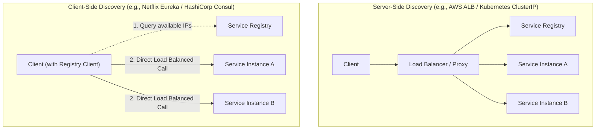
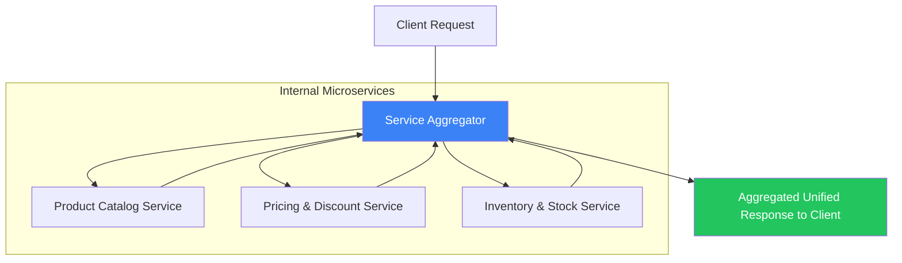

# 🌐 Microservice Patterns & Principles

### Overview

- Building microservice architectures requires proven patterns to handle cross-cutting concerns: routing client requests, discovering dynamic service endpoints, aggregating distributed data, and offloading security.
- Implementing these concerns individually inside every microservice creates maintenance nightmares and code duplication.
- Edge gateways and service registries centralize shared capabilities while preserving backend autonomy.

---

## 1. 🚪 Gateway & Edge Routing Patterns

### 1.1 API Gateway Pattern
- **Problem**: Direct client-to-microservice communication forces clients to know dozens of service endpoints, creates chattiness, and exposes internal network topologies to the public internet.
- **Solution**: A centralized reverse proxy acting as the single front-door entry point for all client requests.
- **Responsibilities**: Request routing, rate limiting, authentication/authorization, TLS termination, CORS handling, monitoring, and telemetry.

### 1.2 Backends for Frontends (BFF) Pattern
- **Problem**: A single general-purpose API Gateway becomes a bottleneck and single point of failure when mobile, web, and IoT frontends require radically different payloads, bandwidth constraints, and protocols.
- **Solution**: Deploy dedicated, lightweight API Gateways tailored for specific user interfaces (e.g. Web BFF, Mobile BFF, Partner API BFF).
- **Benefits**: Prevents frontend teams from stepping on each other's toes; mobile BFF can optimize for low-bandwidth cellular connections by stripping unnecessary fields.

### 1.3 Gateway Aggregation Pattern
- **Problem**: A client interface needs data from several microservices (e.g., User Profile, Recent Orders, Shopping Cart). Making multiple independent HTTP calls increases mobile latency and battery drain.
- **Solution**: The API Gateway dispatches requests to the required internal services concurrently, combines the individual responses into a single JSON response, and returns it to the client in one round trip.

### 1.4 Gateway Offloading Pattern
- **Problem**: Every microservice team having to implement TLS certificate rotation, IP whitelisting, OAuth token introspection, and rate limiting increases development overhead.
- **Solution**: Offload cross-cutting infrastructural concerns to the API Gateway layer, freeing service teams to focus strictly on business domain logic.

---

## 2. 🔍 Service Discovery & Service Registry

In containerized and cloud environments (Kubernetes, AWS ECS), service instances are ephemeral: IP addresses and ports change dynamically as pods scale, restart, or migrate.

| Discovery Model | Mechanism | Pros | Cons |
| :--- | :--- | :--- | :--- |
| **Client-Side Discovery** (Eureka, Consul) | The client queries the service registry directly, caches endpoints, and runs load-balancing algorithms internally. | Fewer network hops; no centralized load balancer bottleneck. | Client libraries required for every programming language. |
| **Server-Side Discovery** (K8s ClusterIP, AWS ALB) | The client calls a static load balancer/DNS; the load balancer queries the registry and routes traffic. | Language-agnostic; clean separation for developers. | Extra network hop through intermediate load balancer. |

---

## 3. 🧩 Service Aggregator Pattern

When complex business workflows require orchestrating multiple domain services, the Service Aggregator receives an intent, fans out calls to backend microservices, and compiles the composite result:

- **Example**: `AddItemToCart` aggregates data from `Product Catalog`, `Pricing Service`, and `Inventory Service` before responding.
- **Resilience Best Practice**: Set individual strict timeouts on every downstream call; if `Pricing Service` fails, return the base price with a warning rather than failing the entire aggregated response.

