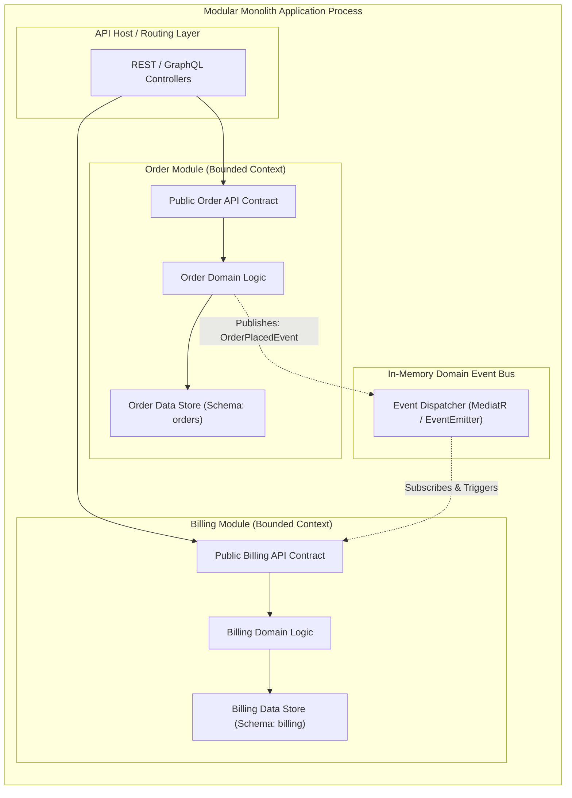

# 📦 Modular Monolith Architecture

### Modular Monolith Fundamentals

- A **Modular Monolith** is an architectural approach where a software system is deployed as a single physical unit (one process/artifact) but structured internally into strictly isolated, loosely coupled modules aligned with business domains.
- It provides the developer ergonomics and deployment simplicity of a monolith (single repository, zero network latency between calls, atomic transactions) while enforcing the strict boundary hygiene of microservices.
- Modules communicate exclusively through explicit **public API interfaces** or an **in-memory event bus**; direct access to another module's internal database tables or private classes is strictly forbidden.
- For 95% of software applications, a well-architected Modular Monolith is superior to microservices: it eliminates distributed systems overhead (network latency, distributed tracing, Kubernetes complexity) while making future microservice extraction trivial.

---

### Architectural Comparison

| Dimension | Spaghetti Monolith | 📦 Modular Monolith | 🌐 Microservices |
| :--- | :--- | :--- | :--- |
| **Physical Deployments** | 1 process | **1 process** | $N$ independent services |
| **Module Boundaries** | None (tangled imports) | **Strict (enforced via compiler/linter)** | Network endpoints |
| **Inter-module Calls** | Direct object calls | **Public Interfaces / In-memory Events** | HTTP / gRPC / Kafka |
| **Database Structure** | Single shared database | **Logical Schemas / Isolated Tables per Module** | Database-per-service |
| **Network Latency** | 0 ms | **0 ms** | 2–50 ms per inter-service hop |
| **Refactoring Cost** | High (accidental dependencies) | **Low (modular boundaries isolate changes)** | High (API versioning / breaking changes) |

---

### Internal Structure & Module Boundaries

---

### Inter-Module Communication Patterns

#### 1. In-Process Public API (Synchronous)
- A module exposes an explicit interface (contract) in a shared or public package.
- Other modules import *only* the public interface and receive an implementation via Dependency Injection.
- Access to module-internal entities or repositories from outside the module is prevented via package-private scopes (Java/Go) or linting rules (e.g. ESLint boundaries / Nx tags).

#### 2. In-Memory Event Bus (Asynchronous / Decoupled)
- When state changes occur within a module, it publishes a domain event to an in-memory event bus (e.g., Node.js `EventEmitter` or Go channel dispatcher).
- Subscribing modules react asynchronously without direct compile-time coupling to the publishing module.

---

### 🗄️ Database Boundary Rules

> [!IMPORTANT] **The Golden Database Rule of Modular Monoliths**
> A module **must never perform joins or directly query another module's database tables**! 
> - Isolate data either using distinct PostgreSQL **schemas** (`orders.*`, `billing.*`, `users.*`) or table prefixing with strict repository boundaries.
> - If the Order module needs customer information, it requests it through the `CustomerModule.getSummary(id)` API, not `JOIN customers ON ...`.

---

### Why Modular Monoliths Enable Painless Microservices Migration

If a specific business module eventually outgrows the monolith (e.g., massive traffic scale or independent release requirements):
1. Because the module has an isolated database schema, its tables can be split into a separate database with zero schema refactoring.
2. Because all module communication was already restricted to a public API contract and event handlers, the in-process interface is replaced with an HTTP/gRPC client or Kafka producer.
3. The rest of the monolith continues functioning without code breakage.
