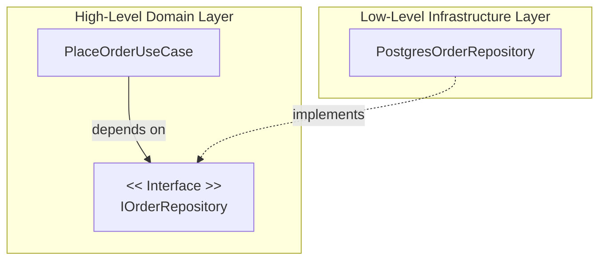

# 🏛️ The SOLID Principles in Backend & Systems Architecture

### SOLID Principles

- The **SOLID** design principles (introduced by Robert C. Martin / Uncle Bob) form the architectural foundation for building decoupled, testable, and maintainable software systems.
- In backend engineering, applying SOLID prevents tightly coupled spaghetti code where a minor change in the database layer ripples into broken API controllers.
- SOLID is intimately connected with **Clean Architecture**, **Domain-Driven Design (DDD)**, and **Dependency Injection**.

---

## 1. Single Responsibility Principle (SRP)

> *"A class or module should have one, and only one, reason to change."*

- **Core Meaning**: A module should be responsible to one, and only one, actor or business capability.
- **Architectural Link**: In Clean Architecture, domain entities represent enterprise business rules (e.g., `Order`, `Invoice`), repositories handle data persistence, and controllers handle HTTP serialization. Never combine business calculation, SQL queries, and email sending inside a single class.

#### ❌ Violation
```typescript
class OrderService {
  calculateTotal(order: Order) { /* ... */ }
  saveToDatabase(order: Order) { /* raw SQL query */ }
  sendConfirmationEmail(user: User) { /* SMTP logic */ }
}
```

#### ✅ Compliant
```typescript
class OrderPricingCalculator {
  calculateTotal(order: Order): number { /* pure business logic */ }
}

class OrderRepository {
  async save(order: Order): Promise<void> { /* persistence */ }
}

class EmailNotificationService {
  async sendOrderConfirmation(user: User, order: Order): Promise<void> { /* notification */ }
}
```

---

## 2. Open/Closed Principle (OCP)

> *"Software entities (classes, modules, functions) should be open for extension, but closed for modification."*

- **Core Meaning**: You should be able to extend a system's behavior without altering its existing, tested source code.
- **Architectural Link**: Implemented via polymorphism, interfaces, and the Strategy pattern. When adding a new payment method (e.g., Apple Pay), you implement a new adapter class rather than adding `else if (type === 'apple_pay')` inside existing payment logic.

#### ❌ Violation
```typescript
function processPayment(type: string, amount: number) {
  if (type === 'stripe') { /* Stripe charge */ }
  else if (type === 'paypal') { /* PayPal charge */ }
  else if (type === 'crypto') { /* Crypto transaction */ } // Modifying existing tested function!
}
```

#### ✅ Compliant
```typescript
interface PaymentGateway {
  charge(amount: number): Promise<PaymentResult>;
}

class StripeGateway implements PaymentGateway {
  async charge(amount: number) { /* Stripe logic */ }
}

class PayPalGateway implements PaymentGateway {
  async charge(amount: number) { /* PayPal logic */ }
}

// Open for extension: Simply add ApplePayGateway without touching PaymentProcessor!
class PaymentProcessor {
  constructor(private gateway: PaymentGateway) {}
  async execute(amount: number) {
    return this.gateway.charge(amount);
  }
}
```

---

## 3. Liskov Substitution Principle (LSP)

> *"Subtypes must be substitutable for their base types without altering the correctness of the program."*

- **Core Meaning**: Any derived child class must be able to replace its parent class without breaking client expectations or throwing unexpected exceptions.
- **The Classical Gotcha**: The *Square-Rectangle* problem. A square inherits from rectangle, but setting width independently violates the invariant of a square.
- **Backend Rule**: If an interface method promises not to throw on `save()`, an implementation must not throw an `UnsupportedOperationException`.

---

## 4. Interface Segregation Principle (ISP)

> *"Clients should not be forced to depend upon interfaces that they do not use."*

- **Core Meaning**: Prefer many small, client-specific, focused interfaces over one large, monolithic "fat" interface.
- **Go Philosophy**: Go embodies this best: standard library interfaces are often just a single method (e.g., `io.Reader`, `io.Writer`, `io.Closer`).

#### ❌ Violation
```typescript
interface MultiFunctionDevice {
  print(doc: Document): void;
  scan(): Document;
  fax(doc: Document): void; // Economic printer forced to implement fax!
}
```

#### ✅ Compliant
```typescript
interface Printer {
  print(doc: Document): void;
}

interface Scanner {
  scan(): Document;
}

// Services implement only what they genuinely support:
class SimpleOfficePrinter implements Printer {
  print(doc: Document) { /* ... */ }
}
```

---

## 5. Dependency Inversion Principle (DIP)

> *"High-level modules should not depend on low-level modules. Both should depend on abstractions. Abstractions should not depend on details; details should depend on abstractions."*

- **Core Meaning**: Business logic (Domain/Use Cases) must never import or depend directly on database drivers, external API SDKs, or filesystem drivers. Instead, define an interface in the domain layer, and implement it in the infrastructure layer.
- **Tooling**: Dependency Injection containers (e.g., `InversifyJS`, NestJS DI, or Uber's `fx` in Go).



---

### Summary Reference

| Principle | Core Question | Primary Tool |
| :--- | :--- | :--- |
| **S**RP | Does this module have only one reason to change? | Separation of concerns, domain entities |
| **O**CP | Can I add new features without modifying existing code? | Strategy pattern, interfaces |
| **L**SP | Can I swap implementations without runtime surprises? | Behavioral contracts, proper inheritance |
| **I**SP | Am I forcing classes to implement dummy methods? | Granular, single-purpose interfaces |
| **D**IP | Does domain logic depend on DB drivers or abstractions? | Dependency Injection, Hexagonal Architecture |
