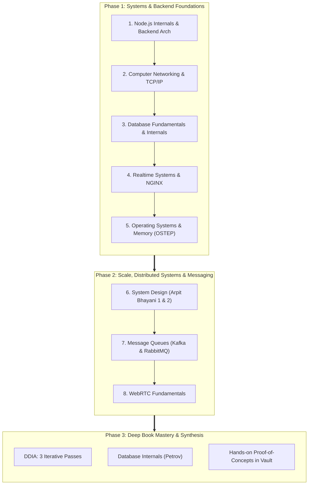
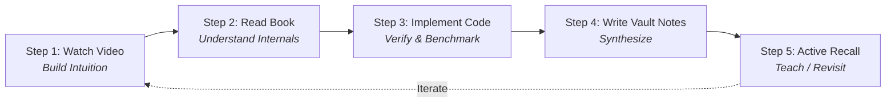
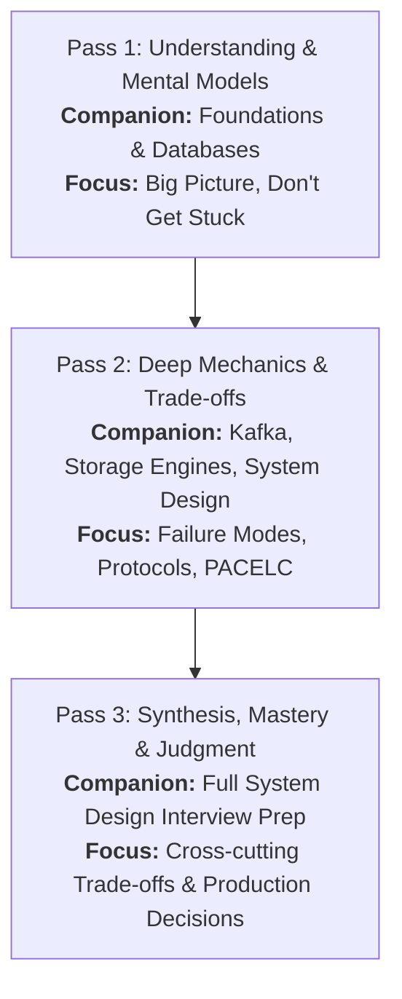

# 🚀 3-Month Backend Engineering & Distributed Systems Roadmap

> [!ABSTRACT] **Executive Summary & North Star**
> **Core Objective:** Become a high-caliber engineer capable of understanding how backend systems and runtimes work internally, designing production-grade distributed architectures, troubleshooting hard real-world failures, and making sound, data-driven engineering trade-offs.

---

## 🗺️ Visual Learning Journey

---

## 🧭 Vault Quick Links

| Area | Key Vault Notes & Folders |
| :--- | :--- |
| **System Design** | [[Sys Design/arpit bhayani/Introduction-01/what is sys desgin_01\|Arpit Bhayani System Design]], [[Microservices]], [[Sys Design/Clean Architecture\|Clean Architecture]] |
| **Databases** | [[Database/Database Indexing/Index\|Database Indexing]], [[Database/B-tree And B+tree/B-tree\|B-Trees]], [[Database/ACID/Transaction\|ACID & Transactions]], [[Postgres/postgres\|PostgreSQL]] |
| **Messaging** | [[MessageBrokers/Kafka\|Kafka]], [[MessageBrokers/Rabbit MQ\|RabbitMQ]], [[Message Brokers and design patterns\|Broker Design Patterns]] |
| **Networking & Realtime** | [[networking/OSI Model\|OSI Model]], [[concurrency and  networking\|Concurrency & Networking]], [[WebRTC]], [[nginx/nginx\|NGINX]] |
| **OS & Memory** | [[03-stack-memory\|Stack Memory]], [[OS/Process\|Processes & Threads]] |
| **Task Management** | [[TODO & Info]], [[pending things]] |

---

# 🧱 Phase 1: Backend Engineering Foundations

> [!NOTE] **Phase Goal**
> Understand how Node.js and the operating system work internally, master network protocols from socket to application layer, delve into database storage engines, and build production-grade, fault-tolerant backend services.

---

### 1. Backend Engineering and Node.js

#### 📺 Video Courses
- [ ] Akshay Saini – *Namaste JavaScript*
- [ ] Hussein Nasser – *Backend Engineering Fundamentals*
- [ ] Hussein Nasser – *Advanced Backend Engineering*
- [ ] Advanced Node.js concepts and backend design patterns

#### 📚 Books
- [ ] *Node.js Design Patterns* – Mario Casciaro and Luciano Mammino *(Recommended companion)*
- [ ] *Designing Data-Intensive Applications (DDIA)* – Martin Kleppmann *(Pass 1)*

#### 🧠 Topics to Master
- [ ] **Node.js Internals & Event Loop**: Libuv thread pool, microtask vs. macrotask queue, phases (timers, I/O callbacks, idle/prepare, poll, check, close callbacks)
- [ ] **V8 Engine Fundamentals**: JIT compilation (Ignition & TurboFan), hidden classes, inline caching
- [ ] **Asynchronous Programming**: Promises, async/await, event emitters, handling unhandled rejections
- [ ] **Streams and Buffers**: Readable, Writable, Duplex, Transform streams, backpressure management (see [[Streams Node.js]])
- [ ] **Concurrency & Scalability**: Worker threads, child processes, clustering, IPC
- [ ] **Memory Management & GC**: Heap vs. stack, V8 garbage collection (Scavenge/Semi-space, Mark-Sweep-Compact), memory leak debugging (heap snapshots, clinics)
- [ ] **Backend Architecture & Design Patterns**: Clean Architecture, Dependency Injection, Repository and Service layers (see [[Sys Design/Clean Architecture|Clean Architecture]])
- [ ] **API Design & Robustness**: REST conventions, GraphQL/gRPC trade-offs, structured error propagation
- [ ] **Authentication & Security**: Sessions, JWT, OAuth2, RBAC, password hashing (Argon2/bcrypt), CORS, CSP
- [ ] **Scalability & Performance**: Profiling CPU bottlenecks, event loop lag, non-blocking I/O
- [ ] **Observability**: Structured JSON logging, metrics, distributed tracing, health checks

#### 🛠️ Practical Projects
- [ ] **Production-style Node.js Backend**: Build an end-to-end production-ready API with modular architecture.
- [ ] **Resilience Middleware Suite**: Implement token-bucket / sliding-window rate limiting, Redis caching layers, centralized error handling, and structured logging.
- [ ] **Profiling & Leaks**: Deliberately create a closure/event-listener memory leak, take heap snapshots in Chrome DevTools/Clinic.js, and identify and fix the root cause.

---

### 2. Computer Networking Fundamentals

> [!TIP] **Related Vault Notes**
> Check out [[networking/OSI Model|OSI Model]] and [[concurrency and  networking|Concurrency and Networking]].

#### 📺 Video Course
- [ ] Hussein Nasser – *Networking Fundamentals*

#### 📚 Books
- [ ] *Computer Networking: A Top-Down Approach* – Kurose & Ross
- [ ] *Network Warrior* – Gary A. Donahue

#### 🧠 Topics to Master
- [ ] **Layered Models**: OSI 7-Layer model vs. TCP/IP 4-Layer model (encapsulation & de-encapsulation)
- [ ] **Transport Protocols**: TCP (reliable, byte-stream, ordered) vs. UDP (datagram, connectionless)
- [ ] **Web Protocols**: HTTP/1.1 (pipelining, keep-alive), HTTP/2 (binary framing, multiplexing, header compression), HTTP/3 (QUIC, UDP-based, 0-RTT)
- [ ] **Domain Name System (DNS)**: Iterative vs. recursive lookups, DNS records (A, AAAA, CNAME, MX, TXT), TTL, DNS cache poisoning
- [ ] **Transport Layer Security (TLS)**: TLS 1.2 vs. 1.3 handshake, asymmetric vs. symmetric encryption, cipher suites, certificate validation (CA)
- [ ] **TCP Lifecycle**: 3-way handshake (`SYN`, `SYN-ACK`, `ACK`), 4-way teardown (`FIN`, `ACK`, `FIN`, `ACK`), `TIME_WAIT` state
- [ ] **Flow & Congestion Control**: Sliding window, slow start, congestion avoidance, fast retransmit, fast recovery
- [ ] **Network Sockets**: Berkeley sockets, socket descriptors, socket buffers, non-blocking I/O (`epoll`, `kqueue`)
- [ ] **Proxies & Routing**: Forward proxies vs. Reverse proxies, Layer 4 (TCP/UDP) vs. Layer 7 (HTTP) routing
- [ ] **Load Balancing**: Round-robin, least connections, IP hash, consistent hashing
- [ ] **Performance Metrics**: RTT, propagation delay, transmission delay, queuing delay, bandwidth-delay product (BDP)
- [ ] **Connection Pooling**: Keep-alive overhead, connection churn, pool starvation, connection reuse
- [ ] **Packet Inspection**: PCAP analysis, TCP flags, retransmissions, zero-window alerts

#### 🛠️ Practical Projects
- [ ] **Wireshark Deep Dive**: Capture and inspect a full TLS 1.3 handshake, HTTP/2 multiplexed streams, and TCP 3-way handshake.
- [ ] **Raw TCP Server & Client**: Build a custom TCP server and client in Node.js or Go using raw sockets; inspect frames in Wireshark.
- [ ] **Browser Request Trace**: Trace step-by-step from URL keystroke → DNS resolution → TCP handshake → TLS negotiation → HTTP Request → Backend processing → HTTP Response.

---

### 3. Database Fundamentals and Internals

> [!TIP] **Related Vault Notes**
> Explore [[Database/Database Indexing/Index|Database Indexing]], [[Database/B-tree And B+tree/B-tree|B-Trees & B+ Trees]], [[Database/ACID/Transaction|ACID Transactions]], [[Database/Database Internals/Row vs Column Oriented|Row vs Column Stores]], and [[Postgres/postgres|PostgreSQL]].

#### 📺 Video Courses
- [ ] Hussein Nasser – *Database Fundamentals*
- [ ] CMU Database Group – *Database Systems (15-445/645)*
- [ ] Hussein Nasser – *Advanced Database Topics*

#### 📚 Books
- [ ] *Database Internals* – Alex Petrov *(Priority 2)*
- [ ] *Database Design and Implementation* – Edward Sciore
- [ ] *Designing Data-Intensive Applications (DDIA)* – Martin Kleppmann

#### 🧠 Topics to Master
- [ ] **Relational Core**: Relational algebra, tuple storage, schema design, normalization vs. denormalization
- [ ] **Query Execution Pipeline**: Parser, planner/optimizer, cost estimation, executor (Seq Scan, Index Scan, Bitmap Index Scan)
- [ ] **Indexing Structures**: B-Trees, B+ Trees, Hash Indexes, LSM-Trees (MemTable, WAL, SSTables, Compaction)
- [ ] **Storage Engines**: Page-oriented storage, slotted-page architecture, append-only logs, columnar formats
- [ ] **Memory Management**: Buffer pools, page replacement algorithms (LRU, CLOCK), dirty pages, flush policies
- [ ] **Transactions & ACID**:
  - `Atomicity`: All-or-nothing execution, rollback logs
  - `Consistency`: Invariants, constraints, schema rules
  - `Isolation`: Dirty reads, non-repeatable reads, phantom reads, serialization anomalies
  - `Durability`: Non-volatile persistence guarantees
- [ ] **Isolation Levels**: Read Uncommitted, Read Committed, Repeatable Read, Serializable
- [ ] **Concurrency Control & MVCC**: Multi-Version Concurrency Control, row versioning, snapshot isolation, vacuuming/GC
- [ ] **Locking Mechanisms**: Shared (S) vs. Exclusive (X) locks, two-phase locking (2PL), intention locks, deadlock detection and resolution
- [ ] **Query Optimization**: Statistics, histograms, join algorithms (Nested Loop, Hash Join, Merge Join)
- [ ] **Write-Ahead Logging (WAL)**: ARIES recovery algorithm, check-pointing, redo/undo logging
- [ ] **Replication**: Synchronous vs. asynchronous, leader-follower, multi-leader, quorum reads and writes
- [ ] **Sharding & Partitioning**: Horizontal vs. vertical partitioning, range-based, hash-based, rebalancing
- [ ] **Distributed Consistency**: Linearizability, event-driven consistency, PACELC theorem

#### 🛠️ Practical Projects
- [ ] **PostgreSQL Execution Plans**: Run complex `EXPLAIN (ANALYZE, BUFFERS)` queries; compare sequential scans vs. single-column and composite index scans.
- [ ] **B-Tree vs. LSM Benchmarking**: Benchmark write amplification and read latency between PostgreSQL (B-Tree) and RocksDB / Cassandra (LSM-Tree).
- [ ] **Transaction Isolation Testing**: Open two concurrent `psql` sessions; execute interleaved transactions to reproduce Dirty Read, Non-Repeatable Read, and Serialization Failures.
- [ ] **Storage Engine Study**: Inspect SQLite or Postgres source files/page formats to see how slotted pages store tuples on disk.

---

### 4. Realtime Backend Systems and NGINX

> [!TIP] **Related Vault Notes**
> Check out [[nginx/nginx|NGINX Notes]] and [[WebRTC]].

#### 📺 Video Courses
- [ ] Hussein Nasser – *Realtime Backend Systems*
- [ ] Hussein Nasser – *NGINX*
- [ ] Hussein Nasser – *Backend Troubleshooting*

#### 🧠 Topics to Master
- [ ] **Transport Protocols**: WebSockets (`ws://`, `wss://`), Server-Sent Events (SSE), HTTP Long Polling, Short Polling
- [ ] **Connection Lifecycle**: TCP persistent connections, HTTP Upgrade header, heartbeat / ping-pong frames
- [ ] **Connection Scaling**: File descriptor limits (`ulimit -n`), socket buffers, OS tuning (`epoll` tuning)
- [ ] **NGINX Architecture**: Master-worker process model, asynchronous event loop, non-blocking worker threads
- [ ] **Reverse Proxying & Routing**: Upstream blocks, proxy buffering, header forwarding (`X-Forwarded-For`, `X-Real-IP`)
- [ ] **Load Balancing Strategies**: Round-robin, weighted round-robin, least connections, IP hash, sticky sessions
- [ ] **Distributed Real-time Messaging**: Scaling WebSockets horizontally with Redis Pub/Sub backplanes or message brokers
- [ ] **Backpressure & Reliability**: Slow clients, queue overflowing, client reconnect storms, exponential backoff with jitter
- [ ] **Failure Handling**: Network partitions, detecting stale connections, TCP keep-alives vs. application heartbeats

#### 🛠️ Practical Projects
- [ ] **Distributed Realtime Chat App**: Build a Node.js WebSocket chat application scaled horizontally across multiple instances using Redis Pub/Sub.
- [ ] **NGINX Load Balancing**: Place NGINX in front of 3 backend replicas; configure health checks, SSL termination, and WebSocket proxying.
- [ ] **Load Testing**: Use `k6` or `autocannon` to simulate 10,000+ concurrent persistent WebSocket connections; monitor file descriptors and memory usage.

---

### 5. Operating Systems Fundamentals

> [!TIP] **Related Vault Notes**
> Reference [[03-stack-memory|Stack Memory]] and [[OS/Process|OS Processes]].

#### 📚 Books
- [ ] *Operating Systems: Three Easy Pieces (OSTEP)* – Remzi H. Arpaci-Dusseau & Andrea C. Arpaci-Dusseau *(Required)*
- [ ] *The Linux Programming Interface (TLPI)* – Michael Kerrisk *(Optional reference)*

#### 🧠 Topics to Master
- [ ] **Processes vs. Threads**: Address space layout (text, data, heap, stack), PCB, TCB, goroutines / lightweight threads
- [ ] **CPU Scheduling**: Preemptive vs. cooperative, round-robin, multi-level feedback queue (MLFQ), CFS (Completely Fair Scheduler)
- [ ] **Context Switching**: Register saving/restoring, TLB invalidation, user space ↔ kernel space transitions
- [ ] **Virtual Memory & Paging**: MMU, page tables, multi-level paging, page faults, swapping, thrashing
- [ ] **Memory Allocation**: Dynamic allocation (`malloc`, `brk`, `sbrk`), memory fragmentation (internal vs. external), buddy allocation
- [ ] **File Systems**: Inodes, file descriptors, directory structures, VFS, page cache, disk buffering
- [ ] **System Calls**: Software interrupts, I/O syscalls (`read`, `write`, `select`, `poll`, `epoll`)
- [ ] **Concurrency & Synchronization**: Critical sections, race conditions, atomic operations, mutexes, condition variables, semaphores
- [ ] **Deadlocks**: Coffman conditions, deadlock prevention, detection, and recovery algorithms
- [ ] **Storage & I/O**: Direct I/O vs. buffered I/O, synchronous vs. asynchronous I/O (`io_uring`)

#### 🛠️ Practical Projects
- [ ] **Process & Thread Profiling**: Use `top`, `htop`, `ps -efL`, and `strace` to trace system calls made by a running Node.js process.
- [ ] **Linux Debugging Commands**: Analyze memory mappings with `pmap` and `/proc/$PID/maps`; monitor file descriptor allocations via `lsof`.
- [ ] **Deadlock Simulation**: Write a short concurrent program that triggers a circular dependency deadlock, and diagnose it with thread stack dumps.

---

# 🌐 Phase 2: System Design and Distributed Systems

> [!NOTE] **Phase Goal**
> Transition from single-node backend architectures to resilient, distributed systems operating at scale. Master caching, partitioning, event-driven architectures, distributed transactions, and message brokers.

---

### 6. System Design – Part 1 and Part 2

> [!TIP] **Related Vault Notes**
> Check out [[Sys Design/arpit bhayani/Introduction-01/what is sys desgin_01|Introduction]], [[Sys Design/arpit bhayani/Database-02/Database_scaling_03|DB Scaling]], [[Sys Design/arpit bhayani/Cache-03/what_is_cache-01|Caching]], and [[Sys Design/arpit bhayani/Resilincy-05/what_is_resiliency|Resiliency]].

#### 📺 Video Courses
- [ ] Arpit Bhayani – *System Design Part 1*
- [ ] Arpit Bhayani – *System Design Part 2*
- [ ] Arpit Bhayani – *Redis Internals*

#### 📚 Book
- [ ] *Designing Data-Intensive Applications (DDIA)* – Martin Kleppmann *(Pass 2 & 3)*

#### 🧠 Topics to Master
- [ ] **Requirements Engineering**: Functional vs. non-functional requirements (Availability, Latency, Throughput, Durability, Consistency)
- [ ] **Back-of-the-Envelope Calculations**: QPS, storage estimation, bandwidth, memory caching requirements
- [ ] **Scaling Paradigms**: Horizontal vs. vertical scaling, stateless services, sticky vs. shared state
- [ ] **Caching Architectures**:
  - Cache patterns: Cache-aside, Read-through, Write-through, Write-back (Write-behind)
  - Eviction policies: LRU, LFU, FIFO, TTL
  - Cache anomalies: Cache stampede (thundering herd), cache penetration, cache breakdown
- [ ] **Database Partitioning & Sharding**: Consistent hashing, virtual nodes, shard rebalancing, cross-shard queries
- [ ] **Distributed Consensus & Coordination**: CAP theorem, PACELC theorem, Raft / Paxos basics, distributed locking (Redlock, ZooKeeper)
- [ ] **High Availability & Fault Tolerance**: Single points of failure (SPOF), active-passive vs. active-active failover, circuit breakers, bulkheads
- [ ] **Data Consistency Models**: Strong consistency, causal consistency, read-your-writes, eventual consistency
- [ ] **Distributed Transactions**: Two-Phase Commit (2PC), Saga pattern (Orchestration vs. Choreography), Outbox Pattern
- [ ] **Rate Limiting & Traffic Shaping**: Token bucket, leaky bucket, fixed window, sliding window log/counter
- [ ] **Idempotency**: Idempotency keys, deduplication caches, unique database constraints

#### 🛠️ Practical System Designs
- [ ] **URL Shortener** (TinyURL/Bitly): Consistent hashing, Base62 encoding, read-heavy caching, KGS (Key Generation Service)
- [ ] **WhatsApp / Discord Messaging Platform**: WebSocket connection managers, Redis presence servers, message store with Cassandra/ScyllaDB
- [ ] **YouTube / Netflix Video Streaming**: Chunked video uploads, transcoding queues, CDN caching, adaptive bitrate streaming (HLS/DASH)
- [ ] **Distributed Notification Service**: Priority queues, rate limiters, multi-channel gateways (email, SMS, push), deduplication
- [ ] **Distributed Rate Limiter**: Redis sliding window log / Lua scripts across distributed API gateway instances
- [ ] **Cloud File Storage** (Google Drive / Dropbox): Block-level deduplication, chunked S3 uploads, metadata synchronization service
- [ ] **Payment Processing System**: Idempotent APIs, distributed transactions via Saga orchestration, double-entry bookkeeping ledgers

---

### 7. Message Queues and Distributed Messaging

> [!TIP] **Related Vault Notes**
> Check out [[MessageBrokers/Kafka|Kafka Notes]], [[MessageBrokers/Rabbit MQ|RabbitMQ Notes]], and [[Message Brokers and design patterns|Patterns & Exercises]].

#### 📺 Video Courses & Resources
- [ ] Kafka fundamentals and advanced concepts
- [ ] RabbitMQ fundamentals and advanced concepts
- [ ] Hussein Nasser – Distributed systems & backend content

#### 📚 Books
- [ ] *Kafka: The Definitive Guide* – Neha Narkhede, Gwen Shapira & Todd Palino
- [ ] *RabbitMQ in Depth* – Gavin M. Roy

#### 🧠 Topics to Master
- [ ] **Architecture Models**: Smart Broker / Dumb Consumer (RabbitMQ) vs. Dumb Broker / Smart Consumer (Kafka commit-log)
- [ ] **Kafka Core Mechanics**: Topics, partitions, segment files, indexes (`.index`, `.timeindex`), consumer groups, rebalancing protocols
- [ ] **Replication & Consensus**: Partition leaders, ISR (In-Sync Replicas), `acks=0`, `acks=1`, `acks=all`, high-watermark
- [ ] **Offset Management**: Committed offsets (`__consumer_offsets`), auto-commit vs. manual commit, reprocessing, rebalance listeners
- [ ] **Delivery Guarantees**: At-most-once, at-least-once, exactly-once semantics (EOS, idempotent producers, transactional producer/consumer)
- [ ] **RabbitMQ Core Mechanics**: Exchanges (Direct, Fanout, Topic, Headers), queues, bindings, ACK/NACK, prefetch count (`basic.qos`)
- [ ] **Resilience Patterns**: Dead-letter exchanges (DLX), exponential backoff retry queues, poison message isolation
- [ ] **Architecture Patterns**: Event-Driven Architecture (EDA), Event Sourcing, CQRS, Transactional Outbox pattern, Saga pattern

#### 🛠️ Practical Projects
- [ ] **Kafka Event Pipeline**: Set up a multi-broker Kafka cluster; produce keyed events; create consumer groups; demonstrate partition rebalancing on consumer crash.
- [ ] **RabbitMQ Task Queue**: Implement worker queues with publisher confirms, manual acknowledgments, and dead-letter exchanges for failed jobs.
- [ ] **Transactional Outbox Implementation**: Build a service using Debezium / CDC or poller to read database outbox records and reliably emit them to Kafka.
- [ ] **Kafka vs. RabbitMQ Comparison Matrix**: Write a benchmark comparing latency and throughput under burst workloads.

---

### 8. WebRTC Fundamentals

> [!NOTE] **Secondary Focus**
> Study WebRTC after completing foundational networking, sockets, and real-time backend systems. See [[WebRTC]] for your current notes.

#### 🧠 Topics to Study
- [ ] **WebRTC Architecture**: Peer-to-peer mesh vs. SFU (Selective Forwarding Unit) vs. MCU (Multipoint Control Unit)
- [ ] **Signaling Mechanism**: Exchanging session metadata, offer/answer flow over WebSockets
- [ ] **NAT Traversal & ICE**:
  - STUN (Session Traversal Utilities for NAT): Discovering public reflective IP/port
  - TURN (Traversal Using Relays around NAT): Relay server fallback for symmetric NATs
  - ICE (Interactive Connectivity Establishment): Gathering and ranking candidate pairs
- [ ] **Session Description Protocol (SDP)**: Media capabilities, codecs, network candidates
- [ ] **Protocols**: RTP (Real-time Transport Protocol), RTCP (feedback & QoS), SRTP (encryption), SCTP (data channels)
- [ ] **Media Streams vs. Data Channels**: Low-latency binary data transfer, ordered vs. unordered modes

#### 🛠️ Practical Projects
- [ ] **P2P Video Call App**: Build a 1-on-1 video call app with Node.js/WebSocket signaling and native WebRTC browser APIs.
- [ ] **Custom STUN/TURN Setup**: Deploy a local `coturn` server; test connectivity under simulated restricted NAT environments.

---

# 📚 Phase 3: Books Reading Roadmap

| Priority | Book | Author(s) | Reading Target | Vault Reference | Status |
| :---: | :--- | :--- | :--- | :--- | :---: |
| **#1** | **Designing Data-Intensive Applications (DDIA)** | Martin Kleppmann | 3 complete passes *(Mastery)* | [[Sys Design/arpit bhayani/Introduction-01/what is sys desgin_01\|Sys Design]] | ⏳ Planning |
| **#2** | **Database Internals** | Alex Petrov | Complete remaining 2nd half | [[Database/Database Internal Book version/1-Storage Engine/Storage Engine\|Book Notes]] | ⏳ In-Progress |
| **#3** | **Computer Networking: A Top-Down Approach** | Kurose & Ross | Complete cover-to-cover | [[networking/OSI Model\|OSI Model]] | ⏳ Queue |
| **#4** | **Network Warrior** | Gary A. Donahue | Complete selected chapters | [[networking/OSI Model\|Networking]] | ⏳ Queue |
| **#5** | **Database Design and Implementation** | Edward Sciore | Complete | [[Database/Database Indexing/Index\|Database]] | ⏳ Queue |
| **#6** | **Operating Systems: Three Easy Pieces (OSTEP)** | Remzi & Andrea Arpaci-Dusseau | Complete cover-to-cover | [[03-stack-memory\|Stack Memory]] | ⏳ Queue |
| **#7** | **Kafka: The Definitive Guide** | Neha Narkhede, Gwen Shapira, Todd Palino | Complete relevant chapters | [[MessageBrokers/Kafka\|Kafka Notes]] | ⏳ Queue |
| **#8** | **RabbitMQ in Depth** | Gavin M. Roy | Complete relevant chapters | [[MessageBrokers/Rabbit MQ\|RabbitMQ Notes]] | ⏳ Queue |
| **#9** | **Domain-Driven Design** | Eric Evans | Complete | [[Sys Design/Clean Architecture\|Architecture]] | ⏳ Queue |
| **#10** | **Node.js Design Patterns** | Mario Casciaro & Luciano Mammino | Read alongside Node.js courses | [[Streams Node.js\|Streams]] | ⏳ Queue |

> [!TIP] **Supplementary Book**
> - *Implementing Domain-Driven Design* – Vaughn Vernon *(Optional, study after completing Eric Evans).*

---

# 🔄 Phase 4: How to Read Books Alongside Video Courses

> [!IMPORTANT] **The Unified Learning Principle**
> Never treat video learning and book reading as independent, disjointed tracks! Video courses build the high-level intuition; books supply the rigorous mathematical and architectural depth.

### The 5-Step Execution Cycle

1. **Step 1 – Watch the Video Lesson**
   - *Example:* Watch Hussein Nasser's database indexing lesson.
   - *Objective:* Grasp the terminology, visual mechanics, and problem space.
2. **Step 2 – Read the Related Book Section**
   - *Example:* Read indexing chapters in *Database Internals* (Petrov) and Chapter 3 in *DDIA*.
   - *Objective:* Unpack edge cases, disk I/O, tree balancing math, and hardware trade-offs.
3. **Step 3 – Implement the Concept in Code**
   - *Example:* Create tables in PostgreSQL, insert 1M rows, compare execution plans with and without B-Tree indexes, test composite index column ordering.
   - *Objective:* Confirm theoretical knowledge with real benchmarks.
4. **Step 4 – Write Structured Vault Notes**
   - For every major concept, answer these 5 core questions:
     1. **What** is the concept?
     2. **Why** does it exist?
     3. **What problem** does it solve?
     4. **How** does it work internally? (Include algorithms, data structures, and edge cases)
     5. **Where & when** would I use it in production? (Trade-offs & alternatives)
5. **Step 5 – Active Recall & Revisit**
   - 7 days later: Explain the concept out loud or sketch the architecture on a whiteboard/Excalidraw without looking at your notes.

---

# 📖 Phase 5: Special DDIA Reading Strategy

> [!IMPORTANT] **The Holy Grail of Distributed Systems**
> *Designing Data-Intensive Applications (DDIA)* by Martin Kleppmann is the centerpiece of this entire 3-month journey. A single pass is not enough; you must complete **3 iterative passes**, each with a dedicated mission.

### 🎯 Pass 1 – Core Understanding & Mental Models
- **Timeline:** Alongside Backend, Networking, and Database Fundamentals.
- **Focus:**
  - Build the big-picture mental models.
  - Understand why data systems need transactions, indexes, and replication.
  - **Rule:** Do *not* get bogged down in the weeds or stop when encountering difficult distributed consensus proofs. Keep moving forward.

### 🔬 Pass 2 – Deep Dive into Internal Mechanisms
- **Timeline:** Alongside Database Internals, Kafka, RabbitMQ, and System Design courses.
- **Focus:**
  - Deep-dive into distributed algorithms, storage formats (SSTables, LSM-Trees vs. B-Trees), replication lag, and concurrency anomalies.
  - Connect DDIA theory directly to real tools (Postgres MVCC, Kafka log retention, Redis replication).
  - Analyze trade-offs (e.g., synchronous vs. asynchronous replication; single-leader vs. multi-leader vs. leaderless).

### 👑 Pass 3 – Revision, Cross-System Synthesis & Mastery
- **Timeline:** After completing all video courses, practical projects, and system design mock architectures.
- **Focus:**
  - Connect every single chapter into a cohesive worldview.
  - Understand the holistic design space: when to combine event sourcing with batch processing, how to build reliable systems out of unreliable components.
  - Sharpen senior engineering intuition: defending design decisions and identifying failure modes before writing code.

---

# 🗓️ Phase 6: Recommended 12-Step Learning Schedule

| Week / Step | Subject Track | Core Video Focus | Main Book Reading | Practical Milestone | Vault Target |
| :---: | :--- | :--- | :--- | :--- | :--- |
| **01** | **Node.js Internals** | Namaste JS + Advanced Node.js | *Node.js Design Patterns* | Event loop & GC profiling | [[Streams Node.js]] |
| **02** | **Networking Basics** | Hussein Nasser Networking | *Computer Networking: Top-Down* | Wireshark TLS/TCP capture | [[networking/OSI Model\|OSI Model]] |
| **03** | **DB Fundamentals** | HN Database Fundamentals | *DDIA* (Ch 1–3) + *Petrov* | Index scan benchmarks in Postgres | [[Database/Database Indexing/Index\|DB Indexing]] |
| **04** | **Realtime & NGINX** | HN Realtime + NGINX | *DDIA* (Ch 4) | Clustered WebSockets + NGINX | [[nginx/nginx\|NGINX]] |
| **05** | **Operating Systems** | Linux system calls & memory | *OSTEP* (Three Easy Pieces) | CPU scheduling & memory leaks | [[03-stack-memory\|Stack Memory]] |
| **06** | **System Design I** | Arpit Bhayani SD Part 1 | *DDIA* (Ch 5–6: Replication & Sharding) | URL Shortener + Rate Limiter | [[Sys Design/arpit bhayani/Introduction-01/what is sys desgin_01\|Sys Design Intro]] |
| **07** | **Redis Internals** | Arpit Bhayani Redis Internals | *DDIA* (Caching sections) | Sliding window rate limiter in Lua | [[Sys Design/arpit bhayani/Cache-03/what_is_cache-01\|Cache Notes]] |
| **08** | **Kafka & Streaming** | Kafka Deep Dive | *Kafka: The Definitive Guide* + *DDIA* (Ch 10–11) | Multi-broker cluster with EOS | [[MessageBrokers/Kafka\|Kafka Notes]] |
| **09** | **RabbitMQ & Tasks** | RabbitMQ Architecture | *RabbitMQ in Depth* | Dead-letter retry task pipeline | [[MessageBrokers/Rabbit MQ\|RabbitMQ Notes]] |
| **10** | **DB Internals & CMU** | CMU 15-445 / HN Advanced DB | *Database Internals* (Alex Petrov) | Buffer pool & B+ Tree simulation | [[Database/B-tree And B+tree/B-tree\|B-Trees]] |
| **11** | **WebRTC & Media** | WebRTC signaling & STUN/TURN | WebRTC specs & MDN | P2P Video calling app | [[WebRTC]] |
| **12** | **System Design II & Synthesis** | Arpit Bhayani SD Part 2 | *DDIA* (Pass 3: Final Synthesis) | Full-scale distributed payment engine | [[Message Brokers and design patterns\|Broker Patterns]] |

---

# ⚖️ The 8 Golden Rules

> [!WARNING] **Non-Negotiable Principles for the Next 90 Days**
> 1. **Co-Study Rule**: Video courses and books must always be studied in tandem. Never do one exclusively for weeks.
> 2. **DDIA is King**: *Designing Data-Intensive Applications* receives the highest priority of all resources.
> 3. **The 2-Book Limit**: Never juggle 4 or 5 books at once. Maintain exactly **one primary book** (heavy study) and **one secondary book** (supplementary reading).
> 4. **Code Everything**: Watching a video or reading a chapter without writing code is zero retention. Build benchmarks, verify claims, inspect packets, and run execution plans.
> 5. **No Shortcut on Fundamentals**: Do not rush to distributed systems (Kafka, sharding, consensus) without deeply understanding OS processes, sockets, TCP, and relational transactions.
> 6. **Relink & Revisit**: Constantly reconnect new system design concepts back to the fundamentals (e.g., how Kafka relies on the OS page cache and sequential disk writes).
> 7. **Troubleshoot Real Failures**: Deliberately inject faults (kill a node, saturate the event loop, leak memory, fill disk) and practice diagnosing them using real tooling.
> 8. **Obsidian as the Second Brain**: Keep high-density notes detailing internal mechanics, performance numbers, architectural diagrams, and trade-off matrices.

---

# 🎯 Ultimate Objective

> [!SUMMARY] **Where You Will Stand in 90 Days**
> You will possess the theoretical depth, empirical intuition, and battle-tested practical capabilities to:
> - Diagnose and fix elusive production bottlenecks and memory leaks in backend services.
> - Explain exactly what happens from the OS kernel and network card up to the application runtime.
> - Design resilient, scalable distributed systems that gracefully survive network partitions, broker crashes, and database failovers.
> - Make rock-solid, pragmatic engineering trade-offs backed by data, benchmarks, and first principles.
