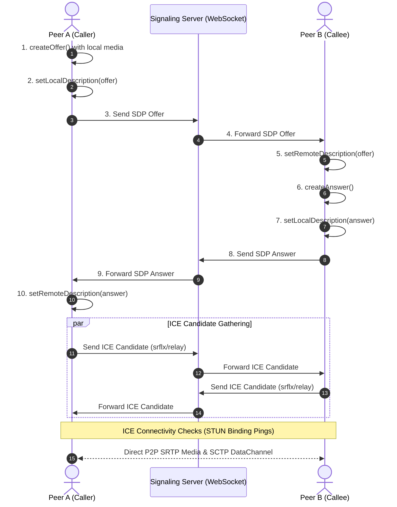

# 📹 WebRTC Architecture & NAT Traversal Deep Dive

### WebRTC Core

- **WebRTC (Web Real-Time Communication)** is an open standard and protocol suite enabling real-time audio, video, and arbitrary binary data streaming directly peer-to-peer (P2P) between browsers without intermediate media servers.
- Because consumer devices sit behind routers with private IP addresses, direct communication requires traversing **NAT (Network Address Translation)** and firewalls.
- **Signaling** (via WebSockets, HTTP, or SSE) is out-of-band and used exclusively to exchange connection metadata (**SDP**) and network routing candidates (**ICE**).
- When direct peer-to-peer connection is impossible due to restrictive NATs, media is relayed through a fallback server (**TURN**), increasing bandwidth costs from **$0** (pure P2P) to hundreds of dollars per gigabyte.

---

### The Analogy — Mail Delivery Through Office Gatekeepers

```
┌────────────────────────────────────────────────────────────────────────┐
│                   NAT TRAVERSAL ARCHITECTURE                           │
│                                                                        │
│   Peer A (Behind Home NAT)                   Peer B (Behind Office NAT)│
│   Private IP: 192.168.1.5                    Private IP: 10.0.0.12     │
│             │                                           │              │
│             ├── Ask STUN: "What is my public IP:Port?" ─┤              │
│             │   STUN Server (Public IP: 203.0.113.1)    │              │
│             ▼                                           ▼              │
│   Reflective: 203.0.113.50:5420               Reflective: 198.51.100.22│
│             │                                           │              │
│             └─────── Exchange SDP via Signaling ────────┘              │
│                                 │                                      │
│                  ✅ DIRECT PEER-TO-PEER UDP (RTP/SRTP)                 │
│              (Fallback to TURN relay if Symmetric NAT ❌)              │
└────────────────────────────────────────────────────────────────────────┘
```

---

### 1. 🛡️ NAT (Network Address Translation) Types

NAT translates private local IP addresses (`192.168.x.x`, `10.x.x.x`) to a single public IP. How the NAT router maps internal sockets to external sockets determines whether P2P is achievable.

| # | NAT Type | Mapping Behavior | Filtering Rule | P2P Traversal Ease |
| :-: | :--- | :--- | :--- | :-: |
| **1** | **Full Cone NAT** *(One-to-One)* | All requests from internal `IP:Port` map to the same external `PublicIP:Port`. | Any external host can send packets to the mapped port. | ✅ **Easiest** (STUN works 100%) |
| **2** | **Address-Restricted Cone NAT** | Internal `IP:Port` maps to the same external `PublicIP:Port`. | External host can only send packets back if the internal host previously contacted that host's **IP**. | ✅ **Easy** (STUN works) |
| **3** | **Port-Restricted Cone NAT** | Internal `IP:Port` maps to the same external `PublicIP:Port`. | External host can only send packets back if the internal host previously sent a packet to that host's exact **IP and Port**. | ⚡ **Moderate** (STUN hole-punching works) |
| **4** | **Symmetric NAT** | Every request from the same internal `IP:Port` to a different destination `IP:Port` creates a **completely new external port**! | Only the specific remote endpoint that received a packet can send one back. | ❌ **STUN Fails** — **TURN relay mandatory!** |

---

### 2. 🔍 STUN, TURN, and ICE Mechanics

#### STUN (Session Traversal Utilities for NAT)
- **Role**: Discovers the client's public reflexive IP and port.
- **Limitation**: If either peer is behind a **Symmetric NAT**, the port assigned to the STUN request will *differ* from the port assigned when connecting to the peer! In this scenario, STUN reflexive candidates are completely unusable.

#### TURN (Traversal Using Relays around NAT)
- **Role**: Media relay fallback server with a static public IP.
- **Trade-off**: High server bandwidth consumption, added latency, and cloud egress costs. Used only when hole-punching fails (roughly 10–15% of real-world connections).

#### ICE (Interactive Connectivity Establishment)
- A framework that coordinates candidate discovery, connectivity checks, and optimal path selection.
- **Candidate Types**:
  1. `host`: Direct local IP address (used if both peers are on the same Wi-Fi/subnet).
  2. `srflx` (Server Reflexive): Public IP and port discovered via STUN.
  3. `prflx` (Peer Reflexive): Public IP and port discovered directly during peer connectivity checks.
  4. `relay`: IP and port allocated on a public TURN server.

---

### 3. 🔄 The WebRTC Connection & Signaling Lifecycle



---

### 4. 📦 Session Description Protocol (SDP) Anatomy

SDP is a plain-text declaration of media capabilities, session timings, and network parameters.

```text
v=0                          # Protocol version
o=- 20518 2 IN IP4 0.0.0.0   # Session origin and ID
s=-                          # Session name
t=0 0                        # Session start/stop times
m=audio 9 UDP/TLS/RTP/SAVPF 111 103  # Media type (audio), transport, codecs
a=rtpmap:111 opus/48000/2    # Opus codec at 48kHz stereo
m=video 9 UDP/TLS/RTP/SAVPF 96 97    # Video track (VP8 / H.264)
a=candidate:1 1 UDP 2130706431 192.168.1.5 50000 typ host
a=candidate:2 1 UDP 1694498815 203.0.113.50 54200 typ srflx raddr 192.168.1.5 rport 50000
```

---

### 5. 🛠️ Protocol Stack: Media vs. Data

| Layer | Audio / Video Media | Data Channels (Chat, Gaming, File Transfer) |
| :--- | :--- | :--- |
| **Application Layer** | WebRTC MediaStream | WebRTC `RTCDataChannel` |
| **Framing & Feedback**| **RTP** (Delivery) & **RTCP** (Quality/Loss Reports) | **SCTP** (Stream Control Transmission Protocol) |
| **Encryption** | **SRTP** (Secure Real-Time Transport Protocol) | **DTLS** (Datagram Transport Layer Security) |
| **Transport Layer** | **UDP** (Low latency, avoids head-of-line blocking) | **UDP** |

---

### 6. 🚨 Common Gotchas & Troubleshooting

| Gotcha | Root Cause | Fix / Solution |
| :--- | :--- | :--- |
| **Black screen / No Audio** | ICE candidates sent before remote description is set. | Queue trickle ICE candidates until `setRemoteDescription()` resolves. |
| **Connection fails on 4G/Enterprise** | Symmetric NAT or firewall blocks all outbound UDP. | Configure TURN on port **443 with TCP / TLS** fallback (`turns:`). |
| **Audio echo & howling** | Acoustic feedback between microphone and speaker. | Enable browser native AEC (`echoCancellation: true` in `getUserMedia`). |
| **Sudden disconnect after 30s** | NAT binding timeout dropped silent UDP port. | Send keep-alive STUN pings or enable TURN channel refreshes. |

> [!TIP] **Diagnostic Tool**
> In Google Chrome, navigate to `chrome://webrtc-internals` to inspect live packet loss, bitrates, audio jitter, and ICE candidate pair states.
