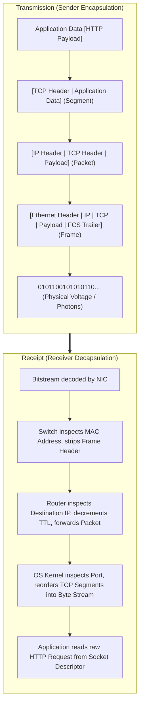

# 🌐 The OSI 7-Layer Reference Model & Encapsulation

### OSI Model Fundamentals

- The **OSI (Open Systems Interconnection)** model is a conceptual 7-layer framework developed by ISO to standardize telecommunication and computer network protocols.
- Each layer communicates only with the layer directly above and below it, appending its own header during transmission (**Encapsulation**) and stripping it during receipt (**Decapsulation**).
- In the real world, the **TCP/IP 4-Layer Model** is what the internet runs on; layers 5, 6, and 7 of the OSI model are collapsed into a single Application layer in TCP/IP.
- Knowing layer boundaries is the difference between diagnosing a **Layer 3 routing failure** (`ping` unreachable / 100% packet loss) versus a **Layer 7 authentication error** (HTTP 401 Unauthorized).

---

### The 7 Layers Master Reference Table

| # | Layer | Data Unit (PDU) | Core Addressing | Primary Protocols | Hardware / Devices | Core Function |
| :-: | :--- | :--- | :--- | :--- | :--- | :--- |
| **7** | **Application** | Data / Messages | URLs, Hostnames | HTTP/1.1, HTTP/2, HTTP/3, gRPC, DNS, SMTP, FTP, SSH | Proxies, Gateways | Human-computer interaction and application-level network services. |
| **6** | **Presentation** | Formatted Data | Syntax / Schemes | JSON, Protobuf, Avro, TLS/SSL, ASCII, gzip | Operating System libraries | Data translation, serialization, compression, and encryption. |
| **5** | **Session** | Dialog Data | Sockets, Session IDs | RPC, NetBIOS, PPTP, SOCKS5 | OS Socket API | Establishes, manages, and terminates persistent dialogs between processes. |
| **4** | **Transport** | **Segment** (TCP) / **Datagram** (UDP) | **Port Numbers** (0–65535) | TCP, UDP, QUIC, SCTP | L4 Load Balancers, Firewalls | End-to-end process-to-process data delivery, flow control, and reliability. |
| **3** | **Network** | **Packet** | **IP Addresses** (IPv4, IPv6) | IPv4, IPv6, ICMP, BGP, OSPF, IPSec | Routers, Layer 3 Switches | Routing packets across multiple independent logical networks. |
| **2** | **Data Link** | **Frame** | **MAC Addresses** (EUI-48) | Ethernet (802.3), Wi-Fi (802.11), ARP, VLAN (802.1Q) | Network Switches, Bridges, NICs | Node-to-node hop delivery across the local physical link. |
| **1** | **Physical** | **Bits** (1s and 0s) | Physical Signals | 1000BASE-T, DSL, Fiber (SONET), Radio frequencies | Hubs, Repeaters, Cables, Transceivers | Transmitting raw unstructured bitstreams over physical mediums. |

---

### Visual Data Encapsulation & Decapsulation

---

### Layer 4 vs. Layer 7 Load Balancing

| Dimension | Layer 4 Load Balancing (Transport) | Layer 7 Load Balancing (Application) |
| :--- | :--- | :--- |
| **Inspection Point** | IP and Port only | Full HTTP request (Headers, Cookies, URL path, Body) |
| **TLS Handling** | Passes through encrypted TLS stream | Terminates TLS; decrypts payload to inspect headers |
| **Routing Decisions** | Simple round-robin, IP hash, least connections | Path-based routing (`/api` vs `/static`), header routing |
| **Performance** | ⚡ Extremely fast; minimal CPU and memory overhead | 🔍 Higher CPU overhead due to parsing and TLS decryption |
| **Example Tools** | HAProxy (TCP mode), AWS NLB, Linux IPVS | NGINX, HAProxy (HTTP mode), Traefik, AWS ALB |

---

### Diagnostic Tooling by Layer

| Layer | Diagnostic Tool | Common Command | What to Look For |
| :-: | :--- | :--- | :--- |
| **7** | `curl`, `Postman` | `curl -Iv https://example.com` | HTTP status codes, TLS handshake, response timing |
| **5–7** | `dig`, `nslookup` | `dig +trace example.com` | DNS resolution latency, authoritative answers |
| **4** | `ss`, `netstat`, `nc` | `ss -tulwn` / `nc -zv host 443` | Listening ports, TCP connection states, socket buffer drops |
| **3** | `ping`, `traceroute` | `ping -c 4 1.1.1.1` / `traceroute host` | RTT latency, gateway routing hops, packet loss |
| **2–4** | `tcpdump`, `Wireshark` | `tcpdump -i eth0 -nn -s0 tcp port 80` | TCP retransmissions, zero-window probes, RST flags |
| **1–2** | `ethtool`, `ip link` | `ethtool eth0` / `ip -s link show` | Interface link speed, duplex state, CRC errors, frame drops |
