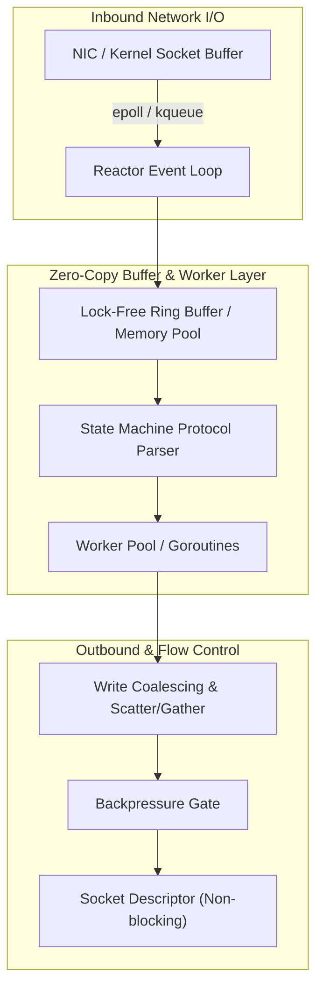

# ⚡ Concurrency, Network I/O & Memory Management Patterns

> [!ABSTRACT] **Overview**
> Digging into **network I/O buffering**, **memory management**, and **concurrency patterns** is the foundation for writing ultra-high-performance servers (such as `gnet`, `netty`, `libuv`, Redis, and NGINX). This space lies at the intersection of **systems programming**, **operating system kernel bypass/multiplexing**, and **high-throughput asynchronous I/O architectures**.

---

## 🧠 Core Principles and Architectural Patterns

---

### 1. 🔁 Zero-Copy & Memory Reuse

- **Avoid Unnecessary Copies**: Eliminate redundant copies between kernel space and user space (e.g., using `sendfile`, `splice`, or memory-mapped I/O `mmap`).
- **Memory Pooling & Buffer Reuse**: Allocate slabs or pools of fixed-size buffers up front (e.g., `sync.Pool` in Go or Netty's `ByteBufPool`) to avoid garbage collection pauses and allocator lock contention under heavy traffic.
- **Where It Appears**: `gnet`, Netty, Redis, JVM internals, Linux kernel I/O pipelines.

---

### 2. 🧵 Event Loop / Reactor Pattern

- **Single-Threaded / Worker-Per-Core Multiplexing**: A single loop monitors thousands of non-blocking file descriptors using OS-native polling mechanisms (`epoll` on Linux, `kqueue` on macOS/BSD, `IOCP` on Windows), dispatching readiness events to handlers.
- **Proactor Pattern vs. Reactor Pattern**:
  - **Reactor (Ready-based)**: OS notifies when an FD is *ready to read/write*; the application executes the actual `read`/`write` syscall.
  - **Proactor (Completion-based)**: Application initiates async operations; the OS kernel performs the read/write into application buffers and notifies upon *completion* (Windows IOCP, Linux `io_uring`).

---

### 3. 📥 Buffer Management Patterns

| Pattern | Mechanism | Advantage |
| :--- | :--- | :--- |
| **Elastic Buffers** | Grow on demand dynamically, shrink or reset pointers when idle. | Low idle footprint, accommodates bursty payloads. |
| **Scatter/Gather I/O (`readv` / `writev`)** | Read or write across multiple discrete buffers in a single system call. | Avoids concatenating memory blocks in user space before transmitting. |
| **Write Coalescing** | Batch multiple small writes into a larger consolidated buffer before flushing to the socket. | Drastically reduces costly kernel-space context switches and syscall overhead. |

---

### 4. 🔒 Lock-Free & Low-Lock Data Structures

- **Ring Buffers (Circular Buffers)**: Fixed-size circular array with head and tail sequence pointers updated via CPU atomic operations (`CAS` — Compare-And-Swap).
- **MPSC / SPSC Queues**: Multi-Producer Single-Consumer and Single-Producer Single-Consumer queues avoid heavy mutex contention.
- **Where It Appears**: LMAX Disruptor pattern, Aeron, `gnet`, Linux kernel `sk_buff` queues.

---

### 5. 🌊 Backpressure & Flow Control

- **Outbound Saturation**: A fast producer must never overwhelm a slow client; otherwise, intermediate buffers grow without bound, triggering out-of-memory (OOM) crashes.
- **Push vs. Pull Flow**: Transition from uncontrolled push to reactive pull or windowed acknowledgments where consumers pull batches only when ready.
- **High/Low Watermarks**: Pause reading from upstream when buffer exceeds High Watermark; resume only after buffer drains below Low Watermark.

---

### 6. 🚦 Async I/O and I/O Multiplexing

- Scaling concurrency from thread-per-connection ($O(N)$ thread stack overhead, context-switch thrashing) to event-driven non-blocking multiplexing ($O(1)$ thread overhead per CPU core).
- Multiplexing APIs:
  - `select` / `poll`: $O(N)$ scan time — scales poorly with high descriptor counts.
  - `epoll` / `kqueue`: $O(1)$ event readiness notifications via kernel event lists.
  - `io_uring`: Asynchronous ring-buffer submission/completion without repeated syscall overhead.

---

### 7. 🧪 False Sharing, Cache Lines & NUMA Awareness

- **False Sharing**: When two threads on different CPU cores update distinct variables that reside on the same 64-byte L1/L2 cache line, triggering constant cache coherency invalidations (bus bouncing).
- **Cache-Line Padding**: Pad internal struct fields with 64-byte alignment (`[8]uint64` or Go `cpu.CacheLinePad`) to isolate high-frequency counters.
- **NUMA (Non-Uniform Memory Access)**: Bind worker threads and memory allocations to the specific CPU socket where the NIC interrupt is pinned.

---

### 8. 🏗️ State Machines for Protocol Parsing

- Network streams arrive in unpredictable packet fragments (TCP does not preserve message boundaries).
- Incremental parsing requires a deterministic Finite State Machine (FSM): parse headers, determine content-length, accumulate payload chunks, and emit completed frames without blocking the event loop.

---

## 📚 Essential Books & Deep Dives

| Book | Author | Core Focus |
| :--- | :--- | :--- |
| [UNIX Network Programming (Vol 1 & 2)](https://www.oreilly.com/library/view/unix-network-programming/0131411551/) | W. Richard Stevens | The definitive standard on sockets, TCP lifecycle, and I/O multiplexing. |
| [Linux System Programming](https://www.oreilly.com/library/view/linux-system-programming/9781449341527/) | Robert Love | Memory mapping, file descriptors, page cache, and kernel-user space interactions. |
| [Designing Data-Intensive Applications](https://www.oreilly.com/library/view/designing-data-intensive-applications/9781098119058/preface01.html) | Martin Kleppmann | Storage trade-offs, log-structured merges, replication lag, and distributed messaging. |
| [High Performance Browser Networking](https://hpbn.co/) | Ilya Grigorik | Deep analysis of TCP windowing, congestion control, TLS 1.3, HTTP/2 multiplexing, and UDP/QUIC (Free online). |
| [Network Programming with Go](https://nostarch.com/networkprogrammingwithgo) | Adam Woodbeck | Practical implementation of TCP/UDP listeners, framing, raw sockets, and TLS in Go. |
| [Go Systems Programming](https://www.packtpub.com/en-us/product/go-systems-programming-9781787125643) | Mihalis Tsoukalos | System calls, file I/O, signals, and memory management in Go. |
| [The Art of Multiprocessor Programming](https://www.oreilly.com/library/view/the-art-of/9780123705914/ch01.html) | Maurice Herlihy & Nir Shavit | Theoretical and practical principles of lock-free data structures, atomics, and memory barriers. |

---

## 🛠️ Open Source Engines to Study

| Project | Language | Key Architectural Takeaways |
| :--- | :---: | :--- |
| [`gnet`](https://github.com/panjf2000/gnet) | Go | Multi-reactor event loop, ring-buffer memory reuse, zero-copy socket reads. |
| [`netty`](https://github.com/netty/netty) | Java | Pipeline architecture, reference-counted `ByteBuf`, pooled direct memory allocators. |
| [`libuv`](https://github.com/libuv/libuv) | C | Cross-platform event loop powering Node.js, threadpool worker offloading. |
| [`aeron`](https://github.com/real-logic/aeron) | Java/C++ | Ultra-low latency IPC and UDP messaging, lock-free ring buffers, zero GC allocations. |
| [`Redis`](https://github.com/redis/redis) | C | Single-threaded multiplexed event loop (`ae.c`), custom dynamic string buffer (`sds.c`). |
| [`NGINX`](https://github.com/nginx/nginx) | C | Master-worker architecture, non-blocking buffer chains, zero-copy static file streaming. |

---

## 🔗 Deep-Dive Articles & Community Discussions

- [Spinlocks in Go: Are they a thing?](https://www.reddit.com/r/golang/comments/16qvzts/spinlocks_in_go_are_they_a_thing/) — Discussion on CPU pause instructions, scheduler interactions, and mutex trade-offs.
- [High-Performance Ring Buffer: Disruptor-Style](https://zhen.org/blog/ring-buffer-variable-length-low-latency-disruptor-style/) — Detailed breakdown of variable-length, low-latency circular memory buffers.
- [Lock-Free Concurrency in Go](https://www.reddit.com/r/golang/comments/g56pe8/its_a_map_its_a_heap_no_its_a_nonblocking/) — Non-blocking data structures and atomic pointer operations in Go runtimes.

